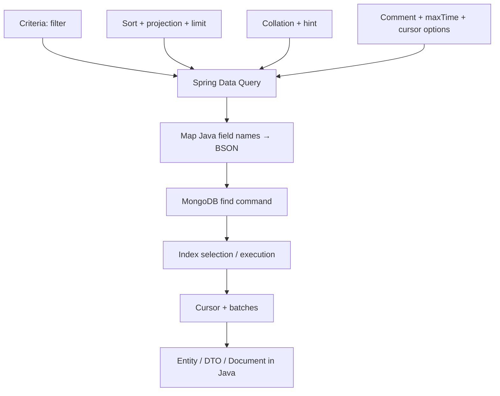

# Collation, hint, comment, maxTime, and Cursor Options

## 1. Why Is a Correct `Criteria` Still Not Enough?

In **Spring Data MongoDB**, `Criteria` and `Query` express *which documents to retrieve*. Yet the exact same filter condition can yield different results or performance depending on how MongoDB **compares strings**, **chooses indexes**, **caps execution time**, **attaches tracing metadata**, and **streams data via cursors**.

Suppose an application needs to find active customers named "Ánh", case-insensitively:

- With default binary comparison, `"Ánh"` and `"ánh"` will not match.
- If the query's collation differs from the index's collation, MongoDB may fail to use the index for string comparison or sorting as expected.
- If you force `hint` onto an unsuitable index, the query can run slower, or error out if the index does not exist.
- If a query takes too long, you need a server-side execution limit via `maxTime`, not just an HTTP client timeout.
- If the result set is very large, `batchSize` and cursor lifecycle affect round-trips and application memory usage.
- If you want to identify which query causes load, `comment` provides safe tracing labels in commands/profilers.

This lesson belongs to the **Query and Criteria** chapter of the **SPRING_DATA_MONGODB** module, where we connect and access MongoDB via `MongoTemplate` or repositories; it also covers inspecting indexes, aggregation, transactions, reactive access, testing, and data performance diagnostics.

**Goal:** build a `Query` that is both business-accurate *and* properly configured with **execution options**, rather than treating every `find` command with the same filter as identical.

## 2. Distinguishing Filter, Sort, Projection, and Query Options

A MongoDB query can be broken down into independent concerns:

| Group | Spring Data Example | Question Answered |
| --- | --- | --- |
| **Filter** | `Criteria.where("active").is(true)` | Which documents match? |
| **Sort** | `query.with(Sort.by("displayName"))` | In what order? |
| **Projection** | `query.fields().include("displayName")` | Which fields are returned? |
| **Limit/skip** | `query.limit(20)`, `query.skip(100)` | How many records, from which offset? |
| **Collation** | `query.collation(Collation.of("vi").strength(2))` | Which language rules govern string comparison/sorting? |
| **Hint** | `query.withHint("idx_customers_active_name_vi")` | Which index should be forced/preferred? |
| **Comment** | `query.comment("customer-search-v1")` | How is the query labeled for observability? |
| **Max time** | `query.maxTime(Duration.ofSeconds(2))` | What is the server-side MongoDB time budget? |
| **Cursor batch** | `query.cursorBatchSize(100)` | Roughly how many documents to request per cursor batch? |
| **Cursor flags** | `query.noCursorTimeout()` | Modify specific cursor behaviors per server/driver rules? |

`Query.getQueryObject()` reflects the *filter*, not a complete dump of all options. `Query` also holds `sort`, `collation`, `hint`, and metadata such as `comment`, `maxTime`, and `cursorBatchSize`. When debugging, do not print only the filter and conclude the server received all options.



Some options take effect on the server, while others are applied by Spring Data/the driver when opening or consuming the cursor. They **do not replace business conditions**, user authentication, or index design.

## 3. Preparing Practice Data and Java Model

### 3.1. Test Collection

Try these commands in an isolated database dedicated to learning:

```javascript
db.customers.insertMany([
  {
    _id: "cus-01",
    display_name: "Ánh",
    active: true,
    registered_at: ISODate("2026-11-20T02:00:00Z"),
    city: "Hà Nội",
    internal_note: "Loyal customer"
  },
  {
    _id: "cus-02",
    display_name: "ánh",
    active: true,
    registered_at: ISODate("2026-11-19T03:00:00Z"),
    city: "Đà Nẵng"
  },
  {
    _id: "cus-03",
    display_name: "Anh",
    active: true,
    registered_at: ISODate("2026-11-18T04:00:00Z"),
    city: "Huế"
  },
  {
    _id: "cus-04",
    display_name: "Ánh",
    active: false,
    registered_at: ISODate("2026-11-17T05:00:00Z"),
    city: "Cần Thơ"
  }
]);
```

`"Ánh"` and `"ánh"` differ only in letter case; `"Anh"` also differs in diacritics. This dataset helps observe collation behavior, though a handful of names cannot serve as exhaustive proof of all Unicode/Vietnamese comparison rules.

### 3.2. Spring Data MongoDB Entity

```java
import java.time.Instant;

import org.springframework.data.mongodb.core.mapping.Document;
import org.springframework.data.mongodb.core.mapping.Field;
import org.springframework.data.mongodb.core.mapping.FieldType;
import org.springframework.data.mongodb.core.mapping.MongoId;

@Document(collection = "customers")
public record CustomerDocument(
    @MongoId(FieldType.STRING) String id,
    @Field("display_name") String displayName,
    boolean active,
    @Field("registered_at") Instant registeredAt,
    String city,
    @Field("internal_note") String internalNote
) {}
```

Here:

- `id` maps to BSON `_id` as a string via `@MongoId(FieldType.STRING)`.
- Java property `displayName` is stored in BSON field `display_name`.
- Property `registeredAt` is stored as `registered_at`; the typical MongoDB type is BSON Date.
- `internalNote` is an internal field that should not be loaded when returning a customer list.

Lesson examples use Java 17+, `MongoTemplate`, and a MongoDB server supporting collation. They do not assume automatic index creation is enabled or that the collection is pre-provisioned.

### 3.3. Basic Query Without Options

```java
import java.util.List;

import org.springframework.data.mongodb.core.MongoTemplate;
import org.springframework.data.mongodb.core.query.Criteria;
import org.springframework.data.mongodb.core.query.Query;

public List<CustomerDocument> findActiveByName(
    MongoTemplate template,
    String name
) {
    Query query = Query.query(
        Criteria.where("active").is(true)
            .and("displayName").is(name)
    );
    return template.find(query, CustomerDocument.class);
}
```

When executed against `CustomerDocument.class`, Spring Data uses `@Field` metadata to map `displayName` to `display_name`. However, if `name = "ánh"`, default binary comparison will miss `"Ánh"`. We need an explicit **collation** option.

## 4. Collation: Comparing Strings by Locale and Strength

**Collation** specifies how MongoDB compares and sorts strings according to language (ICU) rules. It does not alter stored strings, is not an API-layer Unicode normalizer, and does not provide full-text search.

A collation document typically contains:

```javascript
{
  locale: "vi",
  strength: 2
}
```

With basic settings:

| `strength` | Typical Meaning | Caution |
| --- | --- | --- |
| `1` (primary) | Compares base characters only, typically ignoring diacritics and case at primary level | Can collapse names/words the business needs to keep distinct |
| `2` (secondary) | Considers diacritic differences, typically case-insensitive | Not a fuzzy search or universal character normalizer |
| `3` (tertiary) | Also considers case differences per locale rules | Sorts differently from simple binary |
| `4` or `5` | Additional distinction levels for specialized cases | Do not use without understanding requirements and server rules |

Level descriptions are general summaries; exact behavior depends on locale, `caseLevel`, `caseFirst`, `numericOrdering`, `alternate`, and other collation options. For Vietnamese, test accented names, `đ`, whitespace, and combining Unicode characters against real data.

### 4.1. Testing in `mongosh`

```javascript
// Default: simple comparison, typically matches only "ánh".
db.customers.find({
  active: true,
  display_name: "ánh"
});

// Collation vi, strength 2: aims to match both "Ánh" and "ánh".
db.customers.find({
  active: true,
  display_name: "ánh"
}).collation({
  locale: "vi",
  strength: 2
});
```

Because `cus-04` has `active: false`, it is not returned despite matching the name. This is an important lesson: **collation affects string comparison, never disabling business filters**.

Try adding a sort:

```javascript
db.customers.find({ active: true })
  .collation({ locale: "vi", strength: 2 })
  .sort({ display_name: 1, _id: 1 });
```

Appending `_id` establishes a deterministic tie-breaker among documents whose names compare equal under collation. For pagination/scrolling, stable ordering is essential.

### 4.2. Applying via `Query.collation(...)`

```java
import java.util.List;

import org.springframework.data.mongodb.core.MongoTemplate;
import org.springframework.data.mongodb.core.query.Collation;
import org.springframework.data.mongodb.core.query.Criteria;
import org.springframework.data.mongodb.core.query.Query;

public List<CustomerDocument> findIgnoringCase(
    MongoTemplate template,
    String name
) {
    Query query = Query.query(
        Criteria.where("active").is(true)
            .and("displayName").is(name)
    );

    query.collation(
        Collation.of("vi").strength(2)
    );

    return template.find(query, CustomerDocument.class);
}
```

`Collation.of("vi").strength(2)` builds the comparison rules; `query.collation(...)` attaches them to the query. You do not need to lowercase every name in the collection just to perform case-insensitive queries, though you should still decide separately on text normalization at write boundaries.

### 4.3. Collation, `regex`, and Search

A `$regex` query with option `i` is not equivalent to an equality query with collation. MongoDB `$regex` does not use case-insensitive collation indexes the same way equality/sort does; applying collation does not turn regex into a full ICU-aware comparison.

If you want to find names starting with typed characters, accent-insensitively, approximately, or regardless of typing variants, you may need a canonical search key, a prefix index, or a dedicated search engine. **Do not treat `strength: 1` as an automatic solution for all Vietnamese search needs.**

## 5. Collation and Indexes Must Be Designed Together

MongoDB lets you create an index with a specific collation:

```javascript
db.customers.createIndex(
  {
    active: 1,
    display_name: 1,
    _id: 1
  },
  {
    name: "idx_customers_active_name_vi",
    collation: { locale: "vi", strength: 2 }
  }
);
```

An equality/sort query on string fields wanting to fully leverage a collation index must have a **compatible collation**. If the query uses `simple` while the index uses `vi`, or the query uses `strength: 1` while the index uses `strength: 2`, index usability for the string comparison/sort portion may be restricted.

Verify in `mongosh`:

```javascript
db.customers.find({
  active: true,
  display_name: "ánh"
})
.collation({ locale: "vi", strength: 2 })
.sort({ display_name: 1, _id: 1 })
.explain("executionStats");
```

Inspect `winningPlan`, `IXSCAN`/`COLLSCAN`, `totalKeysExamined`, `totalDocsExamined`, and sort stages. Do not judge from a four-document collection: the query planner may choose a collection scan on tiny data; performance checks require a representative dataset.

### 5.1. A Unique Index with Collation Is a Business Decision

If you create a `unique` index with case-insensitive collation, `"Ánh"` and `"ánh"` are treated as duplicates under the index rules. That may suit normalized usernames, yet **is inappropriate** for assuming two customers' real names must be unique.

Before creating a unique index on strings, define what "two values count as identical" means in business terms and inspect legacy data. Never alter a unique index's collation merely to make a UI screen sort nicer.

### 5.2. Default Collation and Precedence

Collation can be declared at the collection/domain level or per query depending on collection creation and Spring Data configuration. In repositories, `@Query(collation=...)` or a `Collation` method parameter can specify rules for a method.

When a query needs comparison rules different from the default, specify them explicitly and write integration tests. In multilingual systems, no single locale fits every field: personal names, SKUs, emails, transaction IDs, and free text follow different rules.

## 6. Hint: Directing the Query Planner to a Specific Index

**`hint`** instructs MongoDB to use a specific index rather than letting the query planner choose on its own. In Spring Data MongoDB, the common method is:

```java
query.withHint("idx_customers_active_name_vi");
```

You can pass an existing index name or a key pattern form depending on the API. With a name, ensure exact spelling and verify the index exists on the collection. An index used to read strings under collation must be designed to match the query.

### 6.1. Complete Example

```java
import java.util.List;

import org.springframework.data.mongodb.core.MongoTemplate;
import org.springframework.data.mongodb.core.query.Collation;
import org.springframework.data.mongodb.core.query.Criteria;
import org.springframework.data.mongodb.core.query.Query;

public List<CustomerDocument> findWithIndexHint(
    MongoTemplate template,
    String name
) {
    Query query = Query.query(
        Criteria.where("active").is(true)
            .and("displayName").is(name)
    );

    query.collation(Collation.of("vi").strength(2));
    query.withHint("idx_customers_active_name_vi");

    return template.find(query, CustomerDocument.class);
}
```

Adding `withHint` **does not automatically create the index**. If the index name does not exist, MongoDB normally returns an error rather than silently creating it or falling back to the desired index. If the index has an incompatible collation, forcing it does not guarantee the query can use it efficiently for all comparison/sort steps.

### 6.2. Using a Key Pattern When Needed

`Query.withHint(String)` accepts an index name or a JSON string representing a key pattern; supported Spring Data versions also provide an overload accepting `org.bson.Document`:

```java
import org.bson.Document;

query.withHint(
    new Document("active", 1)
        .append("display_name", 1)
        .append("_id", 1)
);
```

Here the key pattern uses **BSON field names**, not Java's `displayName`. However, if multiple indexes share the same key pattern with different collations or options, hinting by **index name** is usually easier to control and review in application code.

### 6.3. When Should and Shouldn't You Hint?

| Situation | Decision |
| --- | --- |
| Query planner picks a poor index on a representative workload, verified by measurement | Can try `hint`, document the rationale, and monitor |
| Need to compare plans between two indexes in a test environment | `hint` is very useful for diagnostics |
| Small queries where planner already picks the right index | Usually no `hint` needed |
| Index may be renamed or dropped during migrations | Hardcoded hint carries deployment risk |
| Adding hint just because you want "faster queries" | Insufficient justification; must run `explain` and measure |
| Query depends on parameters with widely varying selectivity | A fixed hint may be suboptimal for some values |

**Principle:** treat `hint` as a deliberate plan-control override. Always benchmark with and without the hint. When schemas or indexes change, re-measure. A poorly chosen hint can perform worse than letting the query planner decide.

### 6.4. Hint and MongoDB Limitations

MongoDB has specific rules when using `hint` with wildcard, hidden, or partial indexes, or specialized commands. Never assume any index can be forced in every case. When a hint fails, check:

- `db.customers.getIndexes()`: does the index exist with the exact name and collation?
- Which BSON field names does the actual query send?
- Is the index hidden, partial, or subject to special conditions?
- Is the query's collation compatible with the index and sort?
- Which server/driver version is running and which command is issued?

## 7. Comment: Labeling Queries for Observability

`Query.comment(String)` attaches metadata so MongoDB or monitoring tools can identify the query source. It is helpful when many endpoints read the same collection.

```java
Query query = Query.query(
    Criteria.where("active").is(true)
);

query.comment("customer-list-v1");
```

In MongoDB, comments can appear in the database profiler, diagnostic logs, or command monitoring depending on configuration and log verbosity. It is **not** used to alter filtering, sorting, or index choice.

### 7.1. Designing Comments Intentionally

A simple convention:

```text
customer-list-v1
customer-search-by-name-v1
customer-export-batch-v2
order-reconciliation-v1
```

Comments should be stable so metrics can aggregate by query type. Avoid embedding directly in comments:

- Customer names, emails, or phone numbers.
- JWTs, API keys, session tokens, payment details.
- Unvalidated raw request bodies or long inputs.
- Sensitive IDs that could surface in logs/observability tools.

Do not use `comment` as a security mechanism or sole trace ID. Tracing systems still require correlation IDs, log policies, metrics, and log access controls. Storing comments in profilers/diagnostics also carries volume and retention considerations.

### 7.2. Comments in Repositories

Spring Data MongoDB provides the `@Meta` annotation for repository query methods to set metadata such as max execution time, comment, or cursor batch size:

```java
import java.util.List;

import org.springframework.data.mongodb.repository.Meta;
import org.springframework.data.mongodb.repository.MongoRepository;
import org.springframework.data.mongodb.repository.Query;

public interface CustomerRepository
        extends MongoRepository<CustomerDocument, String> {

    @Meta(
        comment = "customer-search-by-name-v1",
        maxExecutionTimeMs = 1500,
        cursorBatchSize = 100
    )
    @Query(
        value = "{ 'active': true, 'display_name': ?0 }",
        collation = "{ 'locale': 'vi', 'strength': 2 }"
    )
    List<CustomerDocument> findActiveByName(String name);
}
```

`@Meta` only sets metadata supported by Spring Data for repository query methods; it does not create indexes, rewrite `@Query` into another filter, or turn a large `List` into a memory-efficient stream. For dynamic options like `withHint(...)`, `MongoTemplate` usually expresses intent more directly.

Annotations and overloads may vary across Spring Data MongoDB versions; check the Javadoc of your actual dependency version before compiling.

## 8. `maxTime`: Capping Server-Side Processing Time

A query that accidentally skips an index or sorts many documents can consume excessive resources. `Query.maxTime(Duration)` asks MongoDB to enforce a **server-side execution time** limit corresponding to `maxTimeMS`:

```java
import java.time.Duration;

Query query = Query.query(
    Criteria.where("active").is(true)
);
query.maxTime(Duration.ofSeconds(2));
```

In `mongosh`:

```javascript
db.customers.find({ active: true })
  .maxTimeMS(2000);
```

If the command exceeds the limit under MongoDB's interrupt checks, the server can abort the operation and return a timeout error. This is a **resource guardrail**, not a guarantee that every query finishes within two seconds.

### 8.1. Server maxTime Differs from Client Timeout

| Mechanism | What It Controls | What Not to Assume |
| --- | --- | --- |
| `Query.maxTime(Duration)` / `maxTimeMS` | Server-side processing time bounded per MongoDB command rules | Does not cover full HTTP request/serialization/network time |
| Driver socket/read timeout | Waiting for network I/O on client/driver side | Does not replace server-side execution limits |
| API/gateway timeout | HTTP response time and service processing | Does not guarantee MongoDB immediately stops a query if the client disconnects |
| Transaction timeout | Transaction scope and lifetime | Not equivalent to a single query's `maxTimeMS` |
| Reactive cancellation | Cancels subscriber/downstream stream | Does not guarantee all server work halts instantaneously |

For multi-batch cursors, MongoDB applies time-limit rules across subsequent batch fetches; do not oversimplify `maxTimeMS` as "a wall-clock timer including network and Java processing". An expired session can also close a cursor even when `maxTimeMS` is set higher.

### 8.2. Choosing Thresholds Based on SLA and Workload

A threshold suitable for an **interactive query** may be far too short for a **report export query**. Do not apply 500 ms across every query indiscriminately just to chase low latency.

A better process:

1. Measure p95/p99 query latency on representative data.
2. Define endpoint SLAs and time budgets for other service steps.
3. Set `maxTime` tight enough to protect against abnormal queries without aborting valid ones.
4. Monitor abort counts, query types, and execution plans.
5. Fix indexes, filters, projections, or data models rather than merely raising `maxTime`.

When timeouts occur, do not blindly retry the same expensive query in an endless loop. Consider retry limits, backoff, moving work to background jobs, or redesigning the query.

## 9. Cursor Batch Size: How Many Documents per Round-Trip?

MongoDB uses a **cursor** to stream results of multi-document queries. The server returns a first batch, after which the driver requests more via `getMore`.

`Query.cursorBatchSize(int)` specifies the **target number of documents per batch**, not the total number of results:

```java
Query query = Query.query(
    Criteria.where("active").is(true)
);

query.cursorBatchSize(100);
```

If the query matches 5,000 documents:

- `cursorBatchSize(100)` **does not mean** you receive at most 100 documents total.
- It guides batch size; actual batch counts also depend on byte limits, data size, and driver/server behavior.
- If you call `mongoTemplate.find(query, CustomerDocument.class)`, Spring Data still **collects all results** into a `List`, so `batchSize` does not turn it into a low-RAM streaming API.
- To receive only 100 documents total, use `query.limit(100)`.
- To process sequentially and release resources, use `mongoTemplate.stream(...)` or reactive `Flux` under appropriate conditions.

### 9.1. Distinguishing `limit`, `batchSize`, and `Pageable`

| Option | Meaning |
| --- | --- |
| `query.limit(100)` | Caps **total number of documents** returned for a regular query |
| `query.cursorBatchSize(100)` | Hints how many documents to fetch in **each cursor batch** |
| `query.skip(100)` | Skips the initial portion of results in the defined order |
| `Pageable` | Offset pagination using page/size/sort in supported APIs |
| `Window<T>`/`ScrollPosition` | Windowed reading and continuation position in supported versions; not a permanently open server cursor |
| `stream()` / `Flux` | Streaming consumption model; requires lifecycle/cancellation management |

As a rough estimate: 1,000 documents with `batchSize` 100 may take multiple batch fetches, yet **you must not assume exactly 10 round-trips** because byte caps, first batch rules, limits, and driver behavior affect the count.

### 9.2. Tuning Batch Size by Document Size

Too small a `batchSize` increases `getMore` calls and network round-trips. Too large a `batchSize` increases temporary memory footprint, slows initial client processing, and wastes bandwidth if consumption cancels early.

Guidelines:

- Small documents of a few hundred bytes: larger batches may make sense.
- Documents with large arrays/fields: smaller batches avoid memory pressure.
- High-latency network links: per-round-trip cost matters more.
- CPU-heavy work per document: regulate processing rate and resources.
- Web API lists: apply `limit` and projection first before thinking about `batchSize`.

Never use `batchSize` as a substitute for indexes or filter optimization.

## 10. `noCursorTimeout` and Cursor Lifecycle

MongoDB closes idle cursors that remain unused beyond a timeout period. Spring Data provides:

```java
Query query = Query.query(
    Criteria.where("active").is(true)
);
query.noCursorTimeout();
```

This flag aims to suppress standard **idle cursor timeout** checks, yet **does not guarantee a cursor lives forever**. The MongoDB driver typically uses sessions; the session idle timeout (defaulting to around 30 minutes in common setups) can still cause the server to close the cursor even when `noCursorTimeout` is set.

### 10.1. When Should It Be Considered?

For example, an export job processing each document slowly might occasionally pause longer between `getMore` calls. You can consider `noCursorTimeout` only if you understand the risks.

Enable this flag only when:

- Workload requirements are clear and cursor timeouts have actually been observed.
- Processing paths explicitly manage `close()`/cancellation.
- Job timeouts/health checks and resource limits are in place.
- Session timeouts, read concerns, and the server cost of open cursors are understood.
- It is not used as an excuse to avoid fixing slow processing or resource leaks.

Never enable `noCursorTimeout()` on general API queries. Abandoned cursors hold server resources, and this flag never fixes missing indexes.

### 10.2. Using `MongoTemplate.stream` and Closing Resources

```java
import java.time.Duration;
import java.util.stream.Stream;

import org.springframework.data.mongodb.core.MongoTemplate;
import org.springframework.data.mongodb.core.query.Criteria;
import org.springframework.data.mongodb.core.query.Query;

public void exportCustomers(
    MongoTemplate template
) {
    Query query = Query.query(
        Criteria.where("active").is(true)
    );

    query.cursorBatchSize(100)
         .comment("customer-export-batch-v1")
         .maxTime(Duration.ofSeconds(10));

    // Consider only when explicit timeout control is required:
    // query.noCursorTimeout();

    try (Stream<CustomerDocument> stream =
             template.stream(query, CustomerDocument.class)) {

        stream.forEach(customer -> {
            // Example: process one item without keeping all in a List.
            System.out.println(customer.id());
        });
    }
}
```

`try-with-resources` ensures the stream/cursor closes on completion or exception. The example simply prints IDs rather than implementing full file export; production jobs also need backpressure, side-effect control, mid-stream error handling, retries, and checkpoints.

**Warning:** a long-lived cursor does not provide a transaction or immutable snapshot across the entire run. Under concurrent writes, results depend on read concern and query characteristics.

### 10.3. Session Timeout Still Applies

With implicit sessions in the MongoDB Driver, a cursor with `noCursorTimeout` can still be closed when its session sits idle past the timeout. If a system genuinely needs a cursor across long processing gaps, study explicit session management or redesign the flow into checkpointed batches.

For batch jobs running for hours, **keyset scrolling by ID or stable timestamp** is usually far easier to recover after failure than keeping a single cursor open indefinitely. Choose mechanisms based on consistency and ordering guarantees; never promise "exactly-once" processing solely from a cursor.

## 11. Advanced Cursor Options Requiring Caution

`Query` also exposes cursor or query flags that should never be enabled lightly:

| API / Flag | General Meaning | Warning |
| --- | --- | --- |
| `noCursorTimeout()` | Requests bypassing standard idle cursor timeout | Session timeouts and resource leaks still apply |
| `exhaust()` | Exhaust flag for specialized cursor streaming | Not a default API choice; verify driver/server support and semantics |
| `partialResults()` | Allows certain sharded queries to return results when a shard is unavailable | Can silently omit data; **never use** for reconciliation, accurate reports, or financial flows |
| `allowSecondaryReads()` | Flag related to permitting reads from secondaries | Requires understanding read preference, replication lag, and consistency |
| `allowDiskUse(true)` | Allows disk spilling for certain memory-heavy server operations per version | Does not fix bad indexes; increases I/O and latency |
| `withReadPreference(...)` | Selects read preference in Spring Data versions offering this API | Secondaries may lag behind primary; unsuitable for all use cases |
| `withReadConcern(...)` | Selects read consistency guarantees per MongoDB policy | Does not start a multi-document transaction |

Some flags are legacy or interpreted differently across MongoDB Server and Java Driver releases. Therefore, **do not put flags like `exhaust()` or `partialResults()` into a shared query template**. Whenever using them, ensure a verified use case, library version check, driver docs review, and integration tests.

### 11.1. Choosing Read Preference Deliberately

In reporting apps that do not require the latest writes, secondary reads may fit depending on SLAs. Yet customer info updated moments ago may not yet be replicated; querying secondaries risks **replication lag**.

For APIs that must read just-written data or make business update decisions, explicitly configure read/write concerns, read preference, and transactions. `Query` options do not automatically guarantee "read-your-writes" across every deployment topology.

### 11.2. Do Not Confuse `allowDiskUse` with Cursor Batches

`allowDiskUse` governs whether the server can spill memory-intensive operations like sorting or aggregation to disk per server version rules. It is **not** a client-side multi-batch buffer and does not replace `limit`.

If a query only runs after enabling `allowDiskUse(true)`, revisit index design, filters, and sorts before treating it as a long-term operational fix. MongoDB 6.0+ changed defaults for disk usage behavior; check your actual server configuration.

## 12. Combining Options in a `MongoTemplate` Query

A customer search method can explicitly express a **query contract**:

```java
import java.time.Duration;
import java.util.List;

import org.springframework.data.domain.Sort;
import org.springframework.data.mongodb.core.MongoTemplate;
import org.springframework.data.mongodb.core.query.Collation;
import org.springframework.data.mongodb.core.query.Criteria;
import org.springframework.data.mongodb.core.query.Query;

public List<CustomerDocument> searchActiveCustomers(
    MongoTemplate template,
    String name
) {
    Query query = Query.query(
        Criteria.where("active").is(true)
            .and("displayName").is(name)
    );

    query.with(Sort.by(
        Sort.Order.asc("displayName"),
        Sort.Order.asc("id")
    ));

    query.fields()
         .include("id")
         .include("displayName")
         .include("active")
         .include("registeredAt");

    query.limit(50);
    query.collation(Collation.of("vi").strength(2));
    query.withHint("idx_customers_active_name_vi");
    query.comment("customer-search-by-name-v1");
    query.maxTime(Duration.ofSeconds(2));
    query.cursorBatchSize(25);

    return template.find(query, CustomerDocument.class);
}
```

Notes:

1. Filter binds `active=true` and name via `Criteria`.
2. Sort orders by name, appending `id` to tie-break documents whose names compare equal under collation.
3. Projection retrieves only needed fields; `internal_note` is omitted.
4. `limit(50)` caps the **total number of documents** returned, unlike `cursorBatchSize(25)`.
5. `collation` defines string comparison and sorting rules.
6. `hint` must match an existing index; if not yet provisioned, this call can fail.
7. `comment` uses a static label containing no personal data.
8. `maxTime` is the MongoDB execution budget, not the full HTTP SLA.
9. When returning `List`, the application materializes all results; to handle millions of documents, use streams, reactive, or scrolling.

This example **packs enough options to demonstrate how they interact**, not as a recommendation to attach hint, collation, and cursorBatchSize to every query. In production, set only the options genuinely needed.

### 12.1. Watch Out for Partially Projected Entities

`CustomerDocument` in the example has `internalNote`, yet the query omits it. The returned object is an **incomplete entity**. Never do this:

```java
CustomerDocument partial = searchActiveCustomers(
    template, "ánh"
).get(0);

// DO NOT save a partial entity as if full data were loaded:
template.save(partial);
```

This can erase or overwrite unloaded fields depending on mapping and save semantics. For read-only APIs, switch to a DTO record/closed projection, or strictly enforce never saving partial objects.

To update a single field, use `MongoTemplate.updateFirst(...)` with a filter and `$set` on the target field; there is no need to read the entire entity first. Single-document atomicity does not automatically extend across multiple documents.

## 13. Repository `@Query` and `@Meta` vs. `MongoTemplate`

For a static query, a repository can be more concise:

```java
import java.util.List;

import org.springframework.data.mongodb.repository.Meta;
import org.springframework.data.mongodb.repository.MongoRepository;
import org.springframework.data.mongodb.repository.Query;

public interface CustomerRepository
        extends MongoRepository<CustomerDocument, String> {

    @Meta(
        maxExecutionTimeMs = 1500,
        comment = "customer-search-by-name-v1",
        cursorBatchSize = 25
    )
    @Query(
        value = "{ 'active': true, 'display_name': ?0 }",
        collation = "{ 'locale': 'vi', 'strength': 2 }"
    )
    List<CustomerDocument> searchByDisplayName(String name);
}
```

Parts:

- `@Query(value=...)`: BSON filter on the repository.
- `@Query(collation=...)`: per-query collation.
- `@Meta(...)`: max execution time, comment, and cursor batch metadata.
- `List<CustomerDocument>`: return type; without static projection, mapping constructs full entities.

When you need conditional dynamic hints, complex query logic, or streams with custom lifetimes, `MongoTemplate` keeps configuration visible in one place. There is no need to move every simple query out of repositories merely to use collation.

### 13.1. Dynamic Collation in Repositories

Spring Data allows repository methods to accept a dedicated `Collation` parameter per version rules:

```java
import java.util.List;
import org.springframework.data.mongodb.core.query.Collation;

public interface CustomerRepository
        extends MongoRepository<CustomerDocument, String> {

    List<CustomerDocument> findByDisplayName(
        String displayName,
        Collation collation
    );
}
```

When calling it, choose a locale fitting the data field and use case. However, **never let clients pass an arbitrary locale/collation JSON** unchecked. A different locale can change results or break index usage.

If collation is configured on the document/entity, query annotation, and method argument, check precedence rules in the Spring Data documentation; an explicit method parameter can override static `@Query` settings in supported cases.

## 14. ReactiveMongoTemplate and Backpressure

Reactive access uses `ReactiveMongoTemplate`, yet still requires careful filter, index, and query option design just like imperative code.

```java
import java.time.Duration;

import org.springframework.data.mongodb.core.ReactiveMongoTemplate;
import org.springframework.data.mongodb.core.query.Collation;
import org.springframework.data.mongodb.core.query.Criteria;
import org.springframework.data.mongodb.core.query.Query;

import reactor.core.publisher.Flux;

public Flux<CustomerDocument> reactiveSearch(
    ReactiveMongoTemplate template,
    String name
) {
    Query query = Query.query(
        Criteria.where("active").is(true)
            .and("displayName").is(name)
    );

    query.collation(Collation.of("vi").strength(2));
    query.comment("customer-search-reactive-v1");
    query.maxTime(Duration.ofSeconds(2));
    query.cursorBatchSize(50);
    query.limit(100);

    return template.find(query, CustomerDocument.class);
}
```

`Flux<CustomerDocument>` supports publisher-driven consumption; it does not eliminate result volume or query cost. `query.limit(100)` caps documents on the server. Reactor's `take(100)` cancels the subscription after 100 items, yet **should not completely replace a server-side limit** if you want to bound the work MongoDB performs and transmits.

Handle cancellation, timeouts, retries, and logging consistently in reactive flows; never call `block()` on the WebFlux event loop just to collect results.

### 14.1. Reactive `timeout` Differs from MongoDB `maxTime`

`Flux.timeout(Duration.ofSeconds(3))` is a reactive publisher-layer timeout; `query.maxTime(Duration.ofSeconds(2))` configures the MongoDB operation. Using both can trigger limits under different semantics. Do not assume the resulting exceptions or server-side cancellation behavior are identical.

Reactive transactions require `ReactiveMongoTransactionManager` and dedicated transactional context when multi-document atomicity is genuinely needed. `Query` options do not start transactions.

### 14.2. Impact of Cursor Batches in Reactive Streams

The driver/reactive stream implements demand and batch fetching. Yet `cursorBatchSize` does not guarantee bounded memory: downstream operators might call `collectList()` and buffer everything, or mapping/serialization may hold many objects.

Limit result counts, pick lean projections, and inspect consumption rates. If you must export an entire dataset, design a chunked/checkpointed pipeline rather than simply raising `batchSize`.

## 15. Observing Commands, Profiler, and Execution Plans

To verify which options are actually sent to MongoDB, there are three sets of tools.

### 15.1. Checking Indexes and `explain` in `mongosh`

```javascript
db.customers.getIndexes();

db.customers.find({
  active: true,
  display_name: "ánh"
})
.collation({ locale: "vi", strength: 2 })
.hint("idx_customers_active_name_vi")
.maxTimeMS(2000)
.comment("customer-search-test-v1")
.sort({ display_name: 1, _id: 1 })
.limit(50)
.explain("executionStats");
```

Use `explain("executionStats")` to examine the execution plan and statistics. Using `hint` here **forces the query planner toward the specified index**; also run the exact same query **without hint** to compare. Never compare one run with collation against another without collation and conclude one index is superior.

If the index does not exist yet, create the test configuration first, or drop the hint to let the planner choose. On small collections, measurement results are easily noisy.

### 15.2. Measuring the Right Metrics

| Metric to Inspect | Guidance |
| --- | --- |
| `IXSCAN`, `COLLSCAN` | Did the query use an index or scan the collection? |
| `totalKeysExamined` | How many index entries were traversed? |
| `totalDocsExamined` | How many root documents were read? |
| Sort stage | Is there an in-memory sort outside the index consuming memory? |
| Collation source | Does the query specify the exact locale/strength? |
| Hint | Does the forced index actually exist and remain compatible? |
| `maxTimeMS` | Was it transmitted and does it trigger server timeouts? |
| Comment | Is the command labeled for tracing? |
| Batch/getMore | For streams, how many batch fetches occurred? |
| Latency p95/p99 | What is the real endpoint impact under load? |

### 15.3. Command Monitoring and Safe Logging

`MongoTemplate` builds commands through Spring Data mapping and the driver. To verify the real wire path, use **command monitoring** in the MongoDB Java Driver or the database profiler on a test database to inspect fields like `collation`, `hint`, `comment`, `maxTimeMS`, and `batchSize`.

Do not inspect only `query.getQueryObject()`. It is not the final wire command, and options may be applied in other layers.

When logging, redact personal data, sensitive filters, and tokens. A comment is an operational label, **not** a place to dump entire requests.

### 15.4. Reasons a Query Is Still Slow

If all options are configured yet an API remains slow, check:

- Index does not match filter + sort + collation.
- Query matches too many documents or projection includes huge fields.
- Sort or aggregation spills memory outside indexes.
- `skip` is too deep in offset pagination.
- N+1 queries in the service layer loading referenced documents.
- Network/cluster latency, replication lag, connection pool contention.
- DTO mapping/serialization and CPU logic after receiving results.
- Timeouts/retries repeatedly re-running an already heavy query.

**Options provide control and observability**, not a way to paper over an unoptimized query design.

## 16. Integration Testing: Proving Behavior with Real MongoDB

A unit test checking only the constructed `Query` object does not prove MongoDB applies collation, hint, batching, or maxTime properly. Write integration tests with a real MongoDB (e.g., Testcontainers), provisioning data and indexes in a test database.

### 16.1. Testing Collation with Vietnamese Data

Example using JUnit 5 and Spring Boot test. The snippet assumes `MongoTemplate` points to an isolated test database:

```java
import static org.assertj.core.api.Assertions.assertThat;

import java.time.Instant;
import java.util.List;

import org.junit.jupiter.api.Test;
import org.springframework.beans.factory.annotation.Autowired;
import org.springframework.boot.test.autoconfigure.data.mongo.DataMongoTest;
import org.springframework.data.mongodb.core.MongoTemplate;
import org.springframework.data.mongodb.core.query.Collation;
import org.springframework.data.mongodb.core.query.Criteria;
import org.springframework.data.mongodb.core.query.Query;

@DataMongoTest
class CustomerCollationIntegrationTest {

    @Autowired MongoTemplate template;

    @Test
    void matchesNamesWithSameAccentDifferentCase() {
        Instant instant = Instant.parse("2026-11-20T02:00:00Z");

        template.insert(new CustomerDocument(
            "collation-01", "Ánh", true, instant, "Hà Nội", null
        ));
        template.insert(new CustomerDocument(
            "collation-02", "ánh", true, instant, "Đà Nẵng", null
        ));
        template.insert(new CustomerDocument(
            "collation-03", "Anh", true, instant, "Huế", null
        ));
        template.insert(new CustomerDocument(
            "collation-04", "Ánh", false, instant, "Cần Thơ", null
        ));

        Query query = Query.query(
            Criteria.where("active").is(true)
                .and("displayName").is("ánh")
        );
        query.collation(Collation.of("vi").strength(2));

        List<CustomerDocument> result =
            template.find(query, CustomerDocument.class);

        assertThat(result)
            .extracting(CustomerDocument::id)
            .containsExactlyInAnyOrder(
                "collation-01", "collation-02"
            );
    }
}
```

This test deliberately **omits hint**: the goal is verifying collation semantics before evaluating indexes. When re-running, clean the collection or use unique IDs/isolated test databases. If Unicode/locale differences occur on a specific server, inspect ICU versions and actual BSON strings rather than relaxing assertions to pass.

### 16.2. Testing Hints and Provisioned Indexes

Verification steps:

1. Create index `idx_customers_active_name_vi` in the test database with `locale="vi"`, `strength=2`.
2. Insert a sufficiently representative dataset for the query.
3. Run the query with `query.withHint("idx_customers_active_name_vi")`.
4. Confirm accurate results and record the winning plan via `explain` or command monitoring.
5. Test on a database where the index was dropped, observing the hint error when missing.
6. Measure again without the hint to verify forcing the index actually helps.

Avoid writing tests that assume the query planner will **always** select one fixed index across every environment without a hint; the planner may switch based on collection statistics.

### 16.3. Testing `comment`, `maxTime`, and `cursorBatchSize`

You can verify metadata stored on the `Query` object in a unit test:

```java
import static org.junit.jupiter.api.Assertions.*;

import java.time.Duration;

import org.junit.jupiter.api.Test;
import org.springframework.data.mongodb.core.query.Query;

class QueryOptionsTest {

    @Test
    void storesOperationalQueryOptions() {
        Query query = new Query()
            .comment("customer-search-v1")
            .maxTime(Duration.ofMillis(1200))
            .cursorBatchSize(50);

        assertEquals(
            "customer-search-v1",
            query.getMeta().getComment()
        );
        assertEquals(
            50,
            query.getMeta().getCursorBatchSize()
        );
    }
}
```

This unit test only verifies that **`Query` metadata is stored properly**, not that MongoDB enforced the time limit or batch size. Use integration tests and command monitoring to verify sent options.

Do not test `maxTime` using a hardcoded `sleep` expecting identical wall-clock timings across CI runs: timings depend on load, server version, and commands. Especially avoid running deliberately heavy queries on production just to prove they time out.

### 16.4. Testing Cursor Lifecycle

With `MongoTemplate.stream(...)`:

- Seed a dataset large enough to span multiple batches.
- Verify the stream reads all elements and closes upon exiting `try-with-resources`.
- In a test environment with command monitoring, verify `getMore` is issued when needed.
- Test early cancellation or consumer exceptions and confirm resources are closed.
- Do not assume `noCursorTimeout` beats session timeout; there is no need to wait 30 minutes in CI to prove it.

Integration tests cannot replace production observability, yet they guard against mapper/driver upgrades silently dropping options.

## 17. Distinguishing Commonly Confused Issues

| Symptom | Possible Mistake | How to Handle |
| --- | --- | --- |
| Searching `"ánh"` misses `"Ánh"` | Query uses simple collation or wrong filter | Set appropriate collation, check filter and BSON types |
| Vietnamese name sort differs from expectations | Mismatched locale/strength between query and index | Test Vietnamese edge cases; verify server collation |
| `hint` makes query error out | Index missing, misspelled, or unsupported | `getIndexes`, index migration, test without hint |
| Index exists yet `COLLSCAN` occurs | Index mismatches filter/sort/collation or planner chose otherwise | Run `explain` on representative data |
| Query still slow despite `maxTime` | Threshold excludes full API/network or wasn't applied | Inspect actual wire command, separate server/client timeouts |
| Queries aborted frequently | `maxTime` too low or query has a bottleneck | Measure p95/p99, fix index, adjust SLA |
| `cursorBatchSize(50)` still returns 5,000 items | Confused `batchSize` with `limit` | Use `limit` to cap total count |
| `find(...)` still consumes high RAM | `find` materializes a `List` | Use `stream`/`Flux` and process sequentially |
| Cursor disappears even with `noCursorTimeout` | Session idle timeout or closed connection/cursor | Review lifecycle, sessions, checkpointing |
| Comment leaks personal data in profiler | Built log label from raw user input | Replace with static non-sensitive labels |
| Reactive query times out differently from imperative | Publisher, driver, and MongoDB timeouts differ | Configure and monitor each layer |
| Missing data from sharded cluster | Misused `partialResults()` | Never use when complete data is required |
| Vietnamese names match yet uniqueness fails | Unique collation index collapsed distinct values | Define canonical/uniqueness policy upfront |

## 18. Comprehensive Practice Exercise

1. Create the `customers` collection per the example, inserting two names differing only by case and one differing by diacritics.
2. Run a simple query without collation and record the results.
3. Add `Collation.of("vi").strength(2)` and compare against `mongosh .collation(...)`.
4. Create index `{active:1,display_name:1,_id:1}` with the matching collation.
5. Run `explain("executionStats")` with and without collation, comparing index usage.
6. Test `withHint("idx_customers_active_name_vi")`, then try an invalid index name on the test database to observe the error.
7. Add `comment("customer-search-v1")`; inspect the command/profiler under a safe logging policy.
8. Add `maxTime(Duration.ofSeconds(2))`; verify the command receives `maxTimeMS` without creating a harmful heavy query.
9. Compare `cursorBatchSize(2)`, `limit(2)`, and `stream` to see differences in batches, total count, and memory.
10. Process a stream inside `try-with-resources`, avoiding `noCursorTimeout` without a clear reason.
11. Write a repository method using `@Query(collation=...)` and `@Meta`, comparing with `MongoTemplate`.
12. Test a reactive variant with `ReactiveMongoTemplate` if your application uses the reactive stack.
13. Add integration tests covering names, BSON types, indexes, and key query options.
14. Document which indexes/options are **genuinely needed** for the workload and remove unnecessary ones.

## 19. Checklist Before Shipping Query Options to Production

- **Collation:** What are the comparison rules for names, codes, and SKUs? Is locale/strength set correctly per field?
- **Index:** Does an index exist with a compatible collation? Was it verified with `explain`?
- **Hint:** Is there evidence it outperforms planner choice? Are index migration rename/drop risks covered?
- **Comment:** Are labels stable, concise, and free of sensitive data?
- **MaxTime:** Is the threshold grounded in SLAs and measurements, and distinguished from client/API timeouts?
- **Cursor batch:** Have you separated `batchSize` from `limit` and considered document size?
- **Cursor lifecycle:** When streaming, are resources closed and cancellations/exceptions handled?
- **NoCursorTimeout:** Is it genuinely needed, and do you account for session idle timeouts closing cursors?
- **Advanced flags:** Do `exhaust`, `partialResults`, or `allowSecondaryReads` have clear use cases and verified version support?
- **Reactive:** Are publishers non-blocking, results bounded, and backpressure managed properly?
- **BSON data:** Are queries using physical `@Field` names and matching BSON types?
- **Security:** Are queries scoped by tenant/permissions, preventing users from supplying dangerous indexes/options?
- **Testing:** Were collation, hint, query metadata, and cursors tested against real MongoDB in an isolated environment?
- **Operations:** Can you observe `explain`, profiler output, command monitoring, timeout errors, and p95/p99 latency?

## 20. Official Documentation and Version Checks

`Query` and `Meta` APIs evolve across Spring Data MongoDB releases. APIs used in this lesson include `collation(...)`, `withHint(String)`, `withHint(Document)`, `comment(String)`, `maxTime(Duration)`, `cursorBatchSize(int)`, `noCursorTimeout()`, and `getMeta()`. When building your application, **verify against your actual dependency version** instead of assuming every method from the latest Javadoc exists in older libraries.

References:

- [Spring Data MongoDB – Query API](https://docs.spring.io/spring-data/mongodb/reference/api/java/org/springframework/data/mongodb/core/query/Query.html)
- [Spring Data MongoDB – Collation API](https://docs.spring.io/spring-data/mongodb/reference/api/java/org/springframework/data/mongodb/core/query/Collation.html)
- [Spring Data MongoDB – Meta API](https://docs.spring.io/spring-data/mongodb/reference/api/java/org/springframework/data/mongodb/core/query/Meta.html)
- [Spring Data MongoDB – Repository Query Methods and Collation](https://docs.spring.io/spring-data/mongodb/reference/mongodb/repositories/query-methods.html)
- [MongoDB Manual – Cursors](https://www.mongodb.com/docs/manual/core/cursors/)
- [MongoDB Manual – `noCursorTimeout` and Session Idle Timeout](https://www.mongodb.com/docs/manual/reference/method/cursor.nocursortimeout/)
- [MongoDB Manual – `maxTimeMS`](https://www.mongodb.com/docs/manual/reference/method/cursor.maxtimems/)

**Conclusion:** In Spring Data MongoDB, `Criteria` defines filter conditions, while **collation, hint, comment, maxTime, and cursor options** govern how queries are compared, executed, observed, and consumed. **Collation must align with index design**, **hint requires evidence from `explain`**, **comments must be log-safe**, **maxTime is a server-side guardrail**, and **`batchSize` differs from `limit` while streams must manage cursors**. Combining `MongoTemplate`/repositories with real BSON testing, command monitoring, and performance measurements lets you pick exact query options without introducing new risks.
