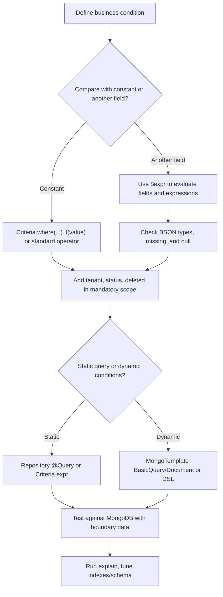

# $expr and Expressions When Conditions Compare Multiple Fields

With **Spring Data MongoDB**, most queries can be written using `Criteria.where("status").is("OPEN")` or `Criteria.where("totalAmount").gt(...)`. Those conditions typically compare **one field against an application-supplied value**. Yet many business rules require comparing **two fields of the same document being evaluated**: paid amount must be less than total amount, stock on hand must exceed reserved quantity, or expiration time must precede creation time.

MongoDB provides the **`$expr`** operator to evaluate aggregation expressions inside query conditions. For example, `{ $expr: { $lt: ["$paidAmount", "$totalAmount"] } }` selects documents whose `paidAmount` is less than `totalAmount`. The `$` prefix before a field name indicates **the value of that field**, not a literal string to compare against.

This lesson belongs to the **Query and Criteria** chapter, focusing on writing `$expr` accurately, combining it with tenant and soft-delete filters, building queries via `MongoTemplate`, inspecting `mongosh`, evaluating indexes, and testing data. This technique is also useful across custom repository queries, aggregation pipelines, and conditional updates in Spring Data MongoDB.

After this lesson, you will be able to:

- Distinguish comparing a field against a **constant value** from comparing a field against **another field**.
- Write `$expr` using `$eq`, `$ne`, `$lt`, `$lte`, `$gt`, `$gte` alongside `$add`, `$subtract`, and `$ifNull`.
- Combine `$expr` with `tenantId`, `status`, `deleted`, and `$and`/`$or` groups.
- Build queries via `BasicQuery`/`Document`, or `Criteria.expr(...)` when supported by your Spring Data version.
- Understand limitations around BSON types, missing fields, precision, and `@Field` mapping.
- Inspect query plans with `explain("executionStats")` and choose optimization strategies for real workloads.
- Write integration tests proving the query returns matching documents and **excludes non-matching** documents.

## 1. When Do You Need `$expr`?

Suppose the `billing_records` collection has fields:

```javascript
{
  tenantId: "T1",
  status: "OPEN",
  totalAmount: NumberDecimal("150.00"),
  paidAmount: NumberDecimal("90.00")
}
```

Requirement: **find invoices that are not yet paid in full**, meaning `paidAmount < totalAmount`.

An easily made mistake:

```javascript
// WRONG: "$totalAmount" is a literal string value in standard comparison operators.
db.billing_records.find({
  paidAmount: { $lt: "$totalAmount" }
});
```

In standard query syntax, the argument `"$totalAmount"` is not automatically interpreted as a path to the `totalAmount` field. It is a **BSON String** value. Therefore, the query does not express "paidAmount is less than totalAmount". Furthermore, MongoDB applies BSON type-bracketing comparison rules; Decimal128 values will not be numerically compared against a String as intended.

Correct version:

```javascript
db.billing_records.find({
  $expr: {
    $lt: ["$paidAmount", "$totalAmount"]
  }
});
```

Both arguments `"$paidAmount"` and `"$totalAmount"` **are evaluated as field references** within an aggregation expression context. MongoDB reads both values from **the same document** and then evaluates `$lt`.

| Need | MongoDB Syntax | Interpretation |
| --- | --- | --- |
| Field vs. constant | `{ paidAmount: { $lt: NumberDecimal("100") } }` | `paidAmount < 100` |
| Two fields against each other | `{ $expr: { $lt: ["$paidAmount", "$totalAmount"] } }` | `paidAmount < totalAmount` |
| Two fields equal | `{ $expr: { $eq: ["$paidAmount", "$totalAmount"] } }` | `paidAmount = totalAmount` |
| Comparison after calculation | `{ $expr: { $gte: ["$paidAmount", { $subtract: ["$totalAmount", "$discount"] }] } }` | Paid enough after discount |
| Combined with standard filters | `{ tenantId: "T1", $expr: { ... } }` | Tenant T1 **and** expression evaluates true |

**Remember:** `$expr` is not SQL syntax and does not perform automatic joins across collections. It evaluates expressions over fields of the candidate document, unless used in a context introducing other variables (such as `$lookup` with `let`).

## 2. Structure of `$expr` and Comparison Operators

General shape:

```javascript
{
  $expr: {
    <operator>: [<expression1>, <expression2>]
  }
}
```

Each expression can be:

- A field reference, e.g., `"$stock"` or `"$reservedStock"`.
- A constant value, e.g., `0` or `NumberDecimal("10.50")`.
- A nested calculation such as `{ $subtract: ["$stock", "$reservedStock"] }`.
- A conditional expression such as `{ $ifNull: ["$discountAmount", NumberDecimal("0")] }`.
- Another expression returning a comparable value.

| Operator | Meaning | Correct Example |
| --- | --- | --- |
| `$eq` | Equal | `{ $expr: { $eq: ["$paidAmount", "$totalAmount"] } }` |
| `$ne` | Not equal | `{ $expr: { $ne: ["$paidAmount", "$totalAmount"] } }` |
| `$lt` | Less than | `{ $expr: { $lt: ["$paidAmount", "$totalAmount"] } }` |
| `$lte` | Less than or equal to | `{ $expr: { $lte: ["$paidAmount", "$totalAmount"] } }` |
| `$gt` | Greater than | `{ $expr: { $gt: ["$stock", "$reservedStock"] } }` |
| `$gte` | Greater than or equal to | `{ $expr: { $gte: ["$stock", "$reservedStock"] } }` |

Inside aggregation expressions, `$eq` is not the standard query operator `{ field: value }`. It lives inside an expression tree and takes expression arguments. For example:

```javascript
// Paid the exact invoice amount:
db.billing_records.find({
  $expr: { $eq: ["$paidAmount", "$totalAmount"] }
});
```

### 2.1. Field Paths, String Literals, and the `$` Character

Inside `$expr`:

```javascript
{ $eq: ["$status", "OPEN"] }
```

`"$status"` is a **field reference**, while `"OPEN"` is a **string literal**. If you genuinely need to compare against a string starting with `$`, use `$literal` to prevent it from being parsed as a field path:

```javascript
{
  $expr: {
    $eq: ["$externalCode", { $literal: "$PROMO" }]
  }
}
```

Never turn user-supplied input into a field path by prepending `$`. When users supply **values** to filter by, bind them as typed values; field names and operators must be controlled exclusively by the application.

### 2.2. Expressions Should Evaluate to Meaningful Conditions

`$expr` expects an expression evaluated inside `$match` or `find`. For business rules, construct explicit boolean expressions like `$lt`, `$eq`, `$and`, or `$or` rather than relying on truthy/falsy coercion of arbitrary values.

Example combining two expression conditions:

```javascript
{
  $expr: {
    $and: [
      { $gt: ["$totalAmount", NumberDecimal("0")] },
      { $lt: ["$paidAmount", "$totalAmount"] }
    ]
  }
}
```

This checks that total amount is positive and paid amount is below total amount. You can use `$and` **outside** `$expr` to combine it with normal query predicates, or use `$and` **inside** `$expr` to combine expression terms.

## 3. Practical Case: Invoices Not Paid in Full

Suppose an application supports multiple tenants. Each document stores amounts in BSON Decimal128, an invoice status, and a soft-delete flag.

| Code | Tenant | Status | Total | Paid | Deleted | Unpaid Under Conditions? |
| --- | --- | --- | ---: | ---: | --- | --- |
| A | T1 | OPEN | 150.00 | 90.00 | false | Yes |
| B | T1 | OPEN | 100.00 | 100.00 | false | No |
| C | T1 | OPEN | 100.00 | 120.00 | false | No |
| D | T1 | OPEN | 50.00 | 0.00 | false | Yes |
| E | T2 | OPEN | 200.00 | 10.00 | false | Must not be returned for T1 |
| F | T1 | CLOSED | 100.00 | 20.00 | false | Excluded when filtering OPEN only |
| G | T1 | OPEN | 150.00 | 10.00 | true | Excluded when soft-deleted |
| H | T1 | OPEN | 100.00 | missing field | false | Requires explicit data policy |

Requirement: retrieve invoices that are **OPEN, not soft-deleted, belong to tenant T1, and have `paidAmount` less than `totalAmount`**.

```javascript
db.billing_records.find({
  tenantId: "T1",
  status: "OPEN",
  deleted: false,
  $expr: {
    $lt: ["$paidAmount", "$totalAmount"]
  }
});
```

Among records with both numeric fields present, expected results are **A and D**. B equals total, C overpaid, E belongs to another tenant, F is not OPEN, and G is soft-deleted.

**Point requiring explicit policy:** record H is missing `paidAmount`. Do not silently treat missing as 0 just because the business has a concept of "unpaid". Depending on how old data was written and comparison rules, BSON Null/missing can yield unexpected behavior. If policy dictates missing fields must be **excluded from the query**, check existence and BSON type; if missing fields are treated as 0, use `$ifNull` explicitly.

### 3.1. Why Must Tenant Conditions Stay Outside `$or`?

Mis-scoped query:

```javascript
{
  $or: [
    {
      tenantId: "T1",
      status: "OPEN"
    },
    {
      $expr: { $lt: ["$paidAmount", "$totalAmount"] }
    }
  ]
}
```

The second branch can return documents from **any tenant** if underpaid. To enforce tenant and soft-delete across all branches, place them outside the alternatives group:

```javascript
{
  tenantId: "T1",
  deleted: false,
  $or: [
    { status: "OPEN" },
    { $expr: { $lt: ["$paidAmount", "$totalAmount"] } }
  ]
}
```

This example only illustrates **proper tenant scoping**; the OR logic here still differs from "OPEN **and** underpaid". When business rules require both, use **AND** as in the primary filter at the top of section 3.

## 4. Arithmetic Expressions: Comparing Fields After Calculations

`$expr` does not merely compare two raw fields. Either side can be an expression evaluated by MongoDB on the current document.

### 4.1. Checking Amount Paid After Applying a Discount

Suppose an invoice has `totalAmount`, `discountAmount`, and `paidAmount`. Amount due:

```text
amountDue = totalAmount - discountAmount
```

To find fully paid invoices:

```javascript
db.billing_records.find({
  tenantId: "T1",
  deleted: false,
  $expr: {
    $gte: [
      "$paidAmount",
      {
        $subtract: [
          "$totalAmount",
          "$discountAmount"
        ]
      }
    ]
  }
});
```

This checks `paidAmount >= (totalAmount - discountAmount)`. Argument order in `$subtract` is critical; swapping them flips the sign of the difference. If business rules forbid discounts exceeding total, enforce that invariant in domain/validation logic rather than relying solely on a query.

### 4.2. Fields That May Be `null` or Missing: Use `$ifNull` When Policy Permits

Suppose `discountAmount` may be omitted and business rules define "no discount" as 0:

```javascript
{
  $expr: {
    $gte: [
      "$paidAmount",
      {
        $subtract: [
          "$totalAmount",
          {
            $ifNull: [
              "$discountAmount",
              NumberDecimal("0")
            ]
          }
        ]
      }
    ]
  }
}
```

`$ifNull` substitutes the fallback value when the first expression evaluates to `null` or is missing per operator semantics. Because total and discount are Decimal128, the fallback constant is declared as `NumberDecimal("0")` to keep numeric types consistent.

**Do not apply `$ifNull` blindly to every field.** For example, if `paidAmount` is missing due to a write bug and business rules disallow concluding "unpaid", coercing missing to 0 hides data corruption. Choose explicitly:

- **Exclude from results** when a required field is missing.
- **Substitute a default value** when the business contract permits it.
- **Route to a separate data-error bucket** for schema repair or migration.

### 4.3. Computing Available Stock

An inventory collection stores `onHand` and `reserved`. To find products with at least 10 available units:

```javascript
db.inventory.find({
  tenantId: "T1",
  $expr: {
    $gte: [
      { $subtract: ["$onHand", "$reserved"] },
      10
    ]
  }
});
```

The condition is `onHand - reserved >= 10`. If you only need `onHand >= reserved`, use `$gte` directly:

```javascript
{
  $expr: {
    $gte: ["$onHand", "$reserved"]
  }
}
```

In inventory systems, **reading** an in-stock document does not reserve stock against concurrent requests. If the goal is **decrementing or reserving stock**, execute an atomic conditional update on the document, combining `$inc` and checking modified document count; `$expr` in a read query does not lock data.

### 4.4. Comparing Timestamps Between Two Fields

To find documents where `expiresAt` precedes `createdAt`—an anomalous time invariant:

```javascript
db.sessions.find({
  tenantId: "T1",
  $expr: {
    $lt: ["$expiresAt", "$createdAt"]
  }
});
```

When fields store BSON Date, MongoDB compares the two instants. If fields store date strings, results may not align with chronological comparison, especially when formats vary. Normalize to BSON Date before relying on this check.

MongoDB supports the system variable `$$NOW` in aggregation expressions, allowing comparison against query execution time:

```javascript
db.sessions.find({
  tenantId: "T1",
  $expr: {
    $lt: ["$expiresAt", "$$NOW"]
  }
});
```

This compares against the server's evaluation timestamp, differing from the application passing `Instant.now()` as a constant. When using it, verify your MongoDB version and time semantics; do not confuse `$$NOW` with the string `"NOW"`.

## 5. BSON Types, Missing Fields, and Precision with `$expr`

Multi-field comparisons are trustworthy only when data shares **consistent types and meaning**. A JSON display showing `100` can hide the fact that MongoDB stores different records as BSON Int32, Int64, Double, Decimal128, or String.

### 5.1. Choosing Appropriate BSON Types

| Business Field | Recommended Type | Why |
| --- | --- | --- |
| Monetary amounts needing exact decimals | Decimal128, or integers in smallest currency unit | Avoids Double rounding error |
| Counts and integer counters | Int32 or Int64 | Clean numeric `$gt`/`$lt` comparisons |
| Created/expired timestamps | BSON Date | Chronological comparison |
| Order codes and statuses | BSON String / enum mapping | Avoids mixing with BSON condition objects |
| Soft-delete flag | Boolean | Avoid omitting field if API relies on `deleted = false` |

For money, Spring Data MongoDB supports specifying Decimal128 on fields:

```java
import java.math.BigDecimal;
import org.springframework.data.mongodb.core.mapping.Field;
import org.springframework.data.mongodb.core.mapping.FieldType;

@Field(targetType = FieldType.DECIMAL128)
private BigDecimal totalAmount;

@Field(targetType = FieldType.DECIMAL128)
private BigDecimal paidAmount;
```

If you declare `BigDecimal` without specifying the BSON target type, the default representation may be String depending on mapping settings. **Never assume Java `BigDecimal` automatically means BSON Decimal128.** Before writing monetary `$expr` logic, inspect raw BSON and normalize legacy data.

### 5.2. Filtering Only Documents with Present Fields and Defined Types

To exclude documents missing `paidAmount`/`totalAmount` and strictly require BSON Decimal128:

```javascript
db.billing_records.find({
  tenantId: "T1",
  status: "OPEN",
  deleted: false,
  paidAmount: { $type: "decimal" },
  totalAmount: { $type: "decimal" },
  $expr: {
    $lt: ["$paidAmount", "$totalAmount"]
  }
});
```

`$type` in query position checks the actual BSON type. If the application intentionally permits Int32/Int64 or other numeric types, explicitly specify the accepted types rather than mechanically copying this Decimal128 check.

### 5.3. Using `$type` in Aggregation to Audit Type Mismatches

```javascript
db.billing_records.aggregate([
  {
    $group: {
      _id: {
        paidType: { $type: "$paidAmount" },
        totalType: { $type: "$totalAmount" }
      },
      documents: { $sum: 1 }
    }
  },
  { $sort: { documents: -1 } }
]);
```

You may see groups like `decimal/decimal`, `string/decimal`, or `missing/decimal`. If a system has mixed types, investigate write paths, conversion logic, and migration risks before deploying comparisons to production.

### 5.4. Should You Use `$convert` in Queries for Legacy Data?

MongoDB provides `$convert` and type-conversion operators to coerce data before comparison. Example structure:

```javascript
{
  $convert: {
    input: "$paidAmount",
    to: "decimal",
    onError: null,
    onNull: null
  }
}
```

This is useful during migrations or diagnostic reports, yet should not become a permanent crutch hiding an inconsistent schema. An unparseable string falls into `onError`; substituting 0 afterward can produce incorrect business results. Moreover, per-document conversion adds query overhead and limits index usage.

### 5.5. Missing Fields and `null` Are Not the Same

```javascript
{ paidAmount: null, totalAmount: NumberDecimal("100") }
{ totalAmount: NumberDecimal("100") }
{ paidAmount: NumberDecimal("0"), totalAmount: NumberDecimal("100") }
```

The three documents have `paidAmount` as BSON Null, missing field, and Decimal128 zero respectively. To distinguish them:

```javascript
// BSON Null values only:
db.billing_records.find({
  paidAmount: { $type: "null" }
});

// Missing field only:
db.billing_records.find({
  paidAmount: { $exists: false }
});

// Decimal128 only:
db.billing_records.find({
  paidAmount: { $type: "decimal" }
});
```

Use type/existence checks when missing data must be excluded. Never rely on MongoDB's cross-type comparison order to infer payment status.

## 6. Spring Data MongoDB: Entity and Queries with `$expr`

### 6.1. Java Entity for Billing Example

To query Decimal128 amounts, use an entity with explicit metadata:

```java
import java.math.BigDecimal;
import org.bson.types.ObjectId;
import org.springframework.data.annotation.Id;
import org.springframework.data.mongodb.core.mapping.Document;
import org.springframework.data.mongodb.core.mapping.Field;
import org.springframework.data.mongodb.core.mapping.FieldType;

@Document(collection = "billing_records")
public class BillingRecord {
    @Id
    private ObjectId id;

    private String labRun;
    private String tenantId;
    private String status;
    private boolean deleted;

    @Field(targetType = FieldType.DECIMAL128)
    private BigDecimal totalAmount;

    @Field(targetType = FieldType.DECIMAL128)
    private BigDecimal paidAmount;

    @Field(targetType = FieldType.DECIMAL128)
    private BigDecimal discountAmount;

    protected BillingRecord() {}

    public BillingRecord(
            String labRun, String tenantId, String status,
            boolean deleted, BigDecimal totalAmount,
            BigDecimal paidAmount) {
        this.labRun = labRun;
        this.tenantId = tenantId;
        this.status = status;
        this.deleted = deleted;
        this.totalAmount = totalAmount;
        this.paidAmount = paidAmount;
    }

    public ObjectId getId() { return id; }
    public String getLabRun() { return labRun; }
    public String getTenantId() { return tenantId; }
    public String getStatus() { return status; }
    public boolean isDeleted() { return deleted; }
    public BigDecimal getTotalAmount() { return totalAmount; }
    public BigDecimal getPaidAmount() { return paidAmount; }
}
```

`labRun` is merely a marker to isolate data in practice labs. In production, you do not need that field. The example focuses on mapping and querying; non-negative amount validation, tenant authorization, and state transitions belong in the business layer.

### 6.2. Using `BasicQuery` with a BSON `Document` — Explicit Approach

When a specialized BSON expression is needed, you can assemble a `Document` filter **using fixed code**, then pass it to `BasicQuery`:

```java
import java.util.List;
import org.bson.Document;
import org.springframework.data.mongodb.core.MongoTemplate;
import org.springframework.data.mongodb.core.query.BasicQuery;

public List<BillingRecord> findUnderpaid(
        MongoTemplate template, String trustedTenantId) {

    Document expr = new Document(
        "$lt",
        List.of("$paidAmount", "$totalAmount")
    );

    Document filter = new Document("tenantId", trustedTenantId)
        .append("status", "OPEN")
        .append("deleted", false)
        .append("paidAmount", new Document("$type", "decimal"))
        .append("totalAmount", new Document("$type", "decimal"))
        .append("$expr", expr);

    return template.find(
        new BasicQuery(filter),
        BillingRecord.class
    );
}
```

This BSON query matches `tenantId = trustedTenantId AND status = OPEN AND deleted = false AND paidAmount/totalAmount are Decimal128 AND paidAmount < totalAmount`.

`BasicQuery` accepts a raw query representation; unlike `Criteria.where("paidAmount").lt(...)`, here you express field references inside `$expr` as `"$paidAmount"` and `"$totalAmount"`. Passing `BillingRecord.class` tells Spring Data which type to deserialize results into. Because expression paths live in raw BSON, **write the exact physical stored field names** and test thoroughly whenever `@Field` renames them.

**Security distinction:** building `Document` this way is controlled because the application hardcodes field names, operators, and structure; `trustedTenantId` is just a Java value. Never replace it with `Document.parse(clientSuppliedFilter)` allowing clients to supply `$expr` or arbitrary operators.

### 6.3. Using `Criteria.expr(MongoExpression)` When Supported by Version

In Spring Data MongoDB versions supporting `Criteria.expr(MongoExpression)`, expressions can be written more concisely:

```java
import java.util.List;
import org.springframework.data.mongodb.MongoExpression;
import org.springframework.data.mongodb.core.MongoTemplate;
import org.springframework.data.mongodb.core.query.Criteria;
import org.springframework.data.mongodb.core.query.Query;

public List<BillingRecord> findUnderpaidWithCriteria(
        MongoTemplate template, String trustedTenantId) {

    Criteria sameTenant = Criteria.where("tenantId")
        .is(trustedTenantId);
    Criteria open = Criteria.where("status").is("OPEN");
    Criteria visible = Criteria.where("deleted").is(false);

    Criteria amountComparison = Criteria.expr(
        MongoExpression.create(
            "{ $lt: [ '$paidAmount', '$totalAmount' ] }"
        )
    );

    Criteria filter = new Criteria().andOperator(
        sameTenant,
        open,
        visible,
        amountComparison
    );

    return template.find(
        new Query(filter),
        BillingRecord.class
    );
}
```

Here `Criteria.expr(...)` builds the `$expr` predicate, while `andOperator(...)` combines it with tenant, status, and the deleted flag. If your project's Spring Data version lacks `Criteria.expr`/`MongoExpression.create` with this signature, use the `BasicQuery` approach in section 6.2 or the expression API available in your version; **do not guess method names**.

With raw `MongoExpression`, strings `"$paidAmount"` and `"$totalAmount"` denote BSON field references. For an entity using an alias:

```java
@Field("total_amount")
private BigDecimal totalAmount;
```

verify that the expression sent to MongoDB targets `"$total_amount"` rather than `"$totalAmount"`. Whether field references inside expressions get mapped depends on the expression type and mapping context; a hand-written raw string should not be assumed to behave identically to a Java property path in `Criteria.where(...)`.

### 6.4. Querying with `@Query` in a Repository

When query structure is fixed, it can be declared in a repository:

```java
import java.util.List;
import org.bson.types.ObjectId;
import org.springframework.data.mongodb.repository.MongoRepository;
import org.springframework.data.mongodb.repository.Query;

public interface BillingRecordRepository
        extends MongoRepository<BillingRecord, ObjectId> {

    @Query("{ 'tenantId': ?0, 'status': 'OPEN', 'deleted': false, " +
           "  '$expr': { '$lt': [ '$paidAmount', '$totalAmount' ] } }")
    List<BillingRecord> findOpenUnderpaid(String tenantId);
}
```

`?0` is a placeholder for the tenant value; Spring Data binds the parameter rather than splicing raw client input into JSON. `@Query` here uses a request-invariant BSON expression and stays readable when conditions are few.

For expressions with many optional conditions or complex calculations, `MongoTemplate` keeps query construction easier to maintain. Derived query methods such as `findByPaidAmountLessThanTotalAmount(...)` **do not automatically compare against another field's value**: standard `LessThan` expects a **value parameter**. Do not try to replace `$expr` with long method names.

### 6.5. Why Is `Criteria.where("paidAmount").lt("totalAmount")` Wrong?

```java
// WRONG if the goal is comparing two fields of the same document.
Query query = Query.query(
    Criteria.where("paidAmount").lt("totalAmount")
);
```

`"totalAmount"` is a Java String literal, not a field reference. Likewise, `Criteria.where("paidAmount").lt("$totalAmount")` is not a reliable way to turn a string into a field reference. Use `$expr` or an explicit aggregation expression DSL intentionally.

## 7. Combining `$expr` in Conditional Updates

`$expr` can form part of the query filter in a MongoDB update operation, allowing **condition checking and updating on the same document** in a single atomic operation.

For example, updating status to `NEEDS_PAYMENT` when an invoice is OPEN yet `paidAmount < totalAmount`:

```java
import java.util.List;
import org.bson.Document;
import org.springframework.data.mongodb.core.MongoTemplate;
import org.springframework.data.mongodb.core.query.BasicQuery;
import org.springframework.data.mongodb.core.query.Update;

public long markUnderpaidInvoices(
        MongoTemplate template, String trustedTenantId) {

    Document filter = new Document("tenantId", trustedTenantId)
        .append("status", "OPEN")
        .append("deleted", false)
        .append("paidAmount", new Document("$type", "decimal"))
        .append("totalAmount", new Document("$type", "decimal"))
        .append("$expr", new Document(
            "$lt", List.of("$paidAmount", "$totalAmount")
        ));

    return template.updateMulti(
        new BasicQuery(filter),
        new Update().set("status", "NEEDS_PAYMENT"),
        BillingRecord.class
    ).getModifiedCount();
}
```

Each document is updated only if the filter holds when MongoDB applies the update. If another request pays the invoice in full and modifies `paidAmount` right before the update touches it, the conditional command sees the latest state at execution time. However:

- `updateMulti` **does not form a multi-document atomic transaction across all matched documents**.
- If money and status are updated through multiple write paths, align invariants and check for conflicts.
- `getModifiedCount()` must be evaluated under an acknowledged write concern.
- This query does not automatically check `@Version` from a previously loaded object; if you need an expected version, include it in the filter.

If the task only updates **a single invoice**, prefer a filter including `_id` and tenant with `updateFirst`. If you need to "evaluate state, update, and return the exact before/after record", consider `findAndModify` per your business contract.

### 7.1. Avoid Using `find` Results to Decide a Subsequent Update

A pattern prone to race conditions:

```text
1. find invoices where paidAmount < totalAmount.
2. Application computes the new status and runs another update by _id.
3. Between the two commands, another process modifies paidAmount.
```

Whenever correctness depends on a comparison at write time, put `$expr` and business conditions **directly inside the update's filter** rather than relying solely on a prior `find`.

## 8. `$expr` in Aggregation and Cases Requiring Variables

`$expr` is used inside an aggregation `$match` stage when expressions must be evaluated per document. With `find`, it sits in a regular filter; with aggregation, it is a stage predicate:

```javascript
db.billing_records.aggregate([
  {
    $match: {
      tenantId: "T1",
      status: "OPEN",
      deleted: false,
      $expr: {
        $lt: ["$paidAmount", "$totalAmount"]
      }
    }
  },
  {
    $project: {
      tenantId: 1,
      totalAmount: 1,
      paidAmount: 1,
      remainingAmount: {
        $subtract: ["$totalAmount", "$paidAmount"]
      }
    }
  }
]);
```

The `$match` stage filters underpaid invoices. `$project` computes `remainingAmount` in the returned output **without writing that field into stored documents**. Because pipelines execute on the MongoDB server, field names in raw stages must be **physical BSON names**.

### 8.1. Choosing Between `find` with `$expr` and Aggregation

| Requirement | Suitable Choice |
| --- | --- |
| Simply filter invoices where `paid < total` and read entities | `find` with `$expr` |
| Filter and compute remaining balance for response | Aggregation `$match` + `$project` |
| Aggregate total balance owed per tenant | Aggregation `$match` + `$group` |
| Filter after creating computed fields in a pipeline | Aggregation with appropriate stages |
| Filter a simple condition against a known constant | `Criteria.where(...).lt(value)`, no `$expr` needed |

If a query only needs `status = OPEN`, `$expr` is unnecessary. Regular query operators are simpler and easier for indexes to optimize.

### 8.2. `$expr` Inside `$lookup` with `let`

Another case is comparing a field in a looked-up document against a **variable from the source document** in a `$lookup` aggregation. Skeleton example:

```javascript
db.orders.aggregate([
  {
    $lookup: {
      from: "payments",
      let: {
        currentOrderId: "$_id"
      },
      pipeline: [
        {
          $match: {
            $expr: {
              $eq: [
                "$orderId",
                "$$currentOrderId"
              ]
            }
          }
        }
      ],
      as: "payments"
    }
  }
]);
```

Here `"$orderId"` is a field in the `payments` collection document; `"$$currentOrderId"` is the `let` variable captured from `orders`. Notice the two prefixes:

- `$fieldName`: field path.
- `$$variableName`: named expression/aggregation variable.

`$expr` is required because the comparison accesses a `$lookup` pipeline variable. Do not take this example to mean that `$expr` between two fields in **the same document** requires `$lookup`.

`$lookup` performance depends on indexes in the target collection, selectivity, and whether the planner can use an index for that expression. Check your MongoDB version and `explain` before claiming a condition uses an index.

## 9. Indexes, Query Plans, and Performance Impact

### 9.1. Why Comparing Two Fields Can Be Hard to Optimize

A regular condition:

```javascript
{ totalAmount: { $gt: NumberDecimal("100") } }
```

compares one field against a **constant value**. An index on `totalAmount` can bound a matching key range.

However:

```javascript
{ $expr: { $gt: ["$totalAmount", "$paidAmount"] } }
```

compares two values **that vary per document**. A standard B-tree index on `totalAmount` does not provide a constant range selecting all documents with `totalAmount > paidAmount`. Consequently, the field-vs-field comparison part typically still needs to inspect/evaluate candidate documents.

Do not state "`$expr` can never use an index". Index eligibility depends on expression shape, query context (especially certain comparisons in `$lookup`), MongoDB version, and the query planner. What matters is **measuring the concrete plan**.

### 9.2. Narrowing the Candidate Set with Standard Conditions

If an API always scopes by tenant, OPEN status, and non-deleted records, you can create an index for those predicates:

```javascript
db.billing_records.createIndex(
  { tenantId: 1, status: 1, deleted: 1 },
  { name: "idx_tenant_status_deleted" }
);
```

Then the query:

```javascript
db.billing_records.find({
  tenantId: "T1",
  status: "OPEN",
  deleted: false,
  $expr: {
    $lt: ["$paidAmount", "$totalAmount"]
  }
});
```

can leverage the index to narrow down the documents that `$expr` must evaluate. This is an index option to **evaluate**; actual payoff depends on selectivity per tenant/status, collection size, and other queries.

### 9.3. Reading `explain("executionStats")`

```javascript
db.billing_records.find({
  tenantId: "ACTUAL_TENANT",
  status: "OPEN",
  deleted: false,
  $expr: {
    $lt: ["$paidAmount", "$totalAmount"]
  }
}).explain("executionStats");
```

Replace the tenant placeholder with an actual value. Inspect:

| Metric | Question |
| --- | --- |
| `winningPlan` | Is an `IXSCAN` or scan/sort stage chosen? |
| `totalKeysExamined` | How many index entries did the query scan? |
| `totalDocsExamined` | How many documents had to be evaluated? |
| `nReturned` | Does it match the expected business result set? |
| `executionTimeMillis` | Timing for this single run; not representative of all loads |

If `docsExamined` is large while `nReturned` is tiny, it may signal the need to rethink query design, schema, or indexes. A dataset of a few documents is never sufficient to judge production performance.

### 9.4. Should You Materialize Computed Fields?

If a dashboard constantly queries "all underpaid invoices" across millions of documents, consider maintaining an `outstandingAmount` or `underpaid` field updated per business rules and indexing it.

Example:

```javascript
{
  totalAmount: NumberDecimal("150.00"),
  paidAmount: NumberDecimal("90.00"),
  outstandingAmount: NumberDecimal("60.00"),
  underpaid: true
}
```

Then the frequent query becomes much simpler:

```javascript
db.billing_records.find({
  tenantId: "T1",
  status: "OPEN",
  deleted: false,
  underpaid: true
});
```

**Trade-off:** you have introduced a **derived** field into stored data; every write path touching `totalAmount`/`paidAmount`/`discountAmount` must recompute it consistently, ideally within the same single-document atomic operation or a well-designed consistency mechanism. Missing even one write path leaves `underpaid` stale. Materialize only when workload measurements justify it and the team can uphold the invariant.

## 10. Expression Security and Correctness

`$expr` is powerful because it evaluates computed expressions rather than simple comparisons. That does not mean an API should let clients pass arbitrary payloads like:

```json
{
  "$expr": {
    "$gt": ["$totalAmount", "$paidAmount"]
  }
}
```

and feed `Document.parse(requestBody)` unchecked as a query. For an API whose purpose is "filter unpaid invoices", **the server must define the expression**, letting clients supply only validated input values.

Safe example:

```java
Document filter = new Document("tenantId", trustedTenantId)
    .append("status", "OPEN")
    .append("deleted", false)
    .append("$expr", new Document(
        "$lt", List.of("$paidAmount", "$totalAmount")
    ));
```

If an API genuinely needs to let users choose a comparison, define an explicit allowlist such as `LESS_THAN`, `EQUAL`, or `GREATER_THAN` and map them to fixed BSON structures. Never accept operator strings like `"$function"`, `"$where"`, field paths, or arbitrary JSON fragments directly from requests.

### 10.1. Avoid `$where` and Server-Side JavaScript

To compare two fields, `$expr` uses aggregation expressions and **does not** execute JavaScript on MongoDB. `$where` carries distinct limitations, overhead, and operational risks; never use it as a shortcut for numeric, date, or boolean comparisons already supported by `$expr`.

### 10.2. Field Aliases and Schema Changes

If the Java class changes:

```java
@Field("paid_amount")
private BigDecimal paidAmount;
```

then raw expressions must be updated too, for example:

```javascript
{
  $expr: {
    $lt: ["$paid_amount", "$total_amount"]
  }
}
```

assuming **both** fields are stored as `paid_amount`/`total_amount`. A refactor that changes only Java properties, annotations, or converters without reviewing raw BSON queries can silently yield wrong results or zero matches.

### 10.3. Query Calculations Do Not Replace Validation

`$expr` can detect records violating invariants, such as `paidAmount > totalAmount`, yet cannot **prevent the application from writing** invalid data. To enforce invariants, validate on write paths and optionally combine MongoDB JSON Schema validation, conditional updates, transactions, or appropriate mechanisms.

## 11. `mongosh` Practice: Proving Expressions Yourself

This section creates a dataset **isolated by a marker** in the `spring_data_training` test database. Do not run against production data or delete documents outside your run.

### 11.1. Creating Eight Documents Covering Edge Cases

Open `mongosh` against your test MongoDB, select the database, and run:

```javascript
use spring_data_training

const lab = db.getCollection("billing_records");
const runId = "queries-criteria-010-" + new ObjectId().toHexString();
const t1 = runId + "-T1";
const t2 = runId + "-T2";

const batch = lab.insertMany([
  {
    labRun: runId, tenantId: t1, label: "A",
    status: "OPEN", deleted: false,
    totalAmount: NumberDecimal("150.00"),
    paidAmount: NumberDecimal("90.00"),
    discountAmount: NumberDecimal("70.00")
  },
  {
    labRun: runId, tenantId: t1, label: "B",
    status: "OPEN", deleted: false,
    totalAmount: NumberDecimal("100.00"),
    paidAmount: NumberDecimal("100.00"),
    discountAmount: NumberDecimal("0")
  },
  {
    labRun: runId, tenantId: t1, label: "C",
    status: "OPEN", deleted: false,
    totalAmount: NumberDecimal("100.00"),
    paidAmount: NumberDecimal("120.00"),
    discountAmount: NumberDecimal("0")
  },
  {
    labRun: runId, tenantId: t1, label: "D",
    status: "OPEN", deleted: false,
    totalAmount: NumberDecimal("50.00"),
    paidAmount: NumberDecimal("0.00"),
    discountAmount: NumberDecimal("10.00")
  },
  {
    labRun: runId, tenantId: t2, label: "E",
    status: "OPEN", deleted: false,
    totalAmount: NumberDecimal("200.00"),
    paidAmount: NumberDecimal("10.00")
  },
  {
    labRun: runId, tenantId: t1, label: "F",
    status: "CLOSED", deleted: false,
    totalAmount: NumberDecimal("100.00"),
    paidAmount: NumberDecimal("20.00")
  },
  {
    labRun: runId, tenantId: t1, label: "G",
    status: "OPEN", deleted: true,
    totalAmount: NumberDecimal("150.00"),
    paidAmount: NumberDecimal("10.00")
  },
  {
    labRun: runId, tenantId: t1, label: "H",
    status: "OPEN", deleted: false,
    totalAmount: NumberDecimal("100.00")
    // paidAmount intentionally missing.
  }
]);

print("runId = " + runId);
print("tenant1 = " + t1);
print("tenant2 = " + t2);
print("documents = " +
  lab.countDocuments({ labRun: runId })); // 8
```

`runId` embeds a fresh ObjectId per run. Subsequent commands must run **within the same `mongosh` session** to preserve variables `lab`, `runId`, `t1`, and `t2`.

Helper for readable output:

```javascript
function findLabels(filter) {
  return lab.find(filter, { label: 1, _id: 0 })
    .toArray()
    .map(d => d.label)
    .sort();
}
```

### 11.2. Direct Comparison Between Two Fields

```javascript
const underpaidFilter = {
  labRun: runId,
  tenantId: t1,
  status: "OPEN",
  deleted: false,
  paidAmount: { $type: "decimal" },
  totalAmount: { $type: "decimal" },
  $expr: {
    $lt: ["$paidAmount", "$totalAmount"]
  }
};

printjson(findLabels(underpaidFilter));
// Expected: ["A", "D"]
```

This is the lesson's primary scenario: comparing **two field values in the same document**. H is excluded because the filter requires `paidAmount` to be Decimal128.

### 11.3. Equality and Greater-Than Comparisons

```javascript
const scope = {
  labRun: runId,
  tenantId: t1,
  status: "OPEN",
  deleted: false,
  paidAmount: { $type: "decimal" },
  totalAmount: { $type: "decimal" }
};

printjson(findLabels({
  ...scope,
  $expr: {
    $eq: ["$paidAmount", "$totalAmount"]
  }
}));
// Expected: ["B"]

printjson(findLabels({
  ...scope,
  $expr: {
    $gt: ["$paidAmount", "$totalAmount"]
  }
}));
// Expected: ["C"]
```

`$eq`, `$gt`, and `$lt` check distinct states; method names and API descriptions should reflect the exact invoice category being queried.

### 11.4. Expression with Discount Calculation

To select invoices with `paidAmount >= totalAmount - discountAmount`:

```javascript
printjson(findLabels({
  ...scope,
  $expr: {
    $gte: [
      "$paidAmount",
      {
        $subtract: [
          "$totalAmount",
          {
            $ifNull: [
              "$discountAmount",
              NumberDecimal("0")
            ]
          }
        ]
      }
    ]
  }
}));
// Expected: ["A", "B", "C"]
```

On record A, amount due after discount is `150 - 70 = 80`, while paid is `90`. B paid the full 100, and C overpaid past 100. D paid only 0 against 40 owed, so it does not match.

This is a mathematical check on existing data, not proof that discount rules were validated. If discounts exceed totals or are stored as wrong-type Strings, handle that in write paths/validators.

### 11.5. Distinguishing Missing from Decimal128 Zero

```javascript
printjson(findLabels({
  labRun: runId,
  paidAmount: { $exists: false }
}));
// Expected: ["H"]

printjson(findLabels({
  labRun: runId,
  paidAmount: NumberDecimal("0")
}));
// Expected: ["D"]
```

If an application reads document H and maps it into Java `BigDecimal paidAmount`, the property becomes `null`. You cannot automatically treat that as a 0 payment. Decide explicitly whether the schema requires `paidAmount`.

### 11.6. Inspecting the Query Plan

```javascript
lab.find(underpaidFilter)
  .explain("executionStats");
```

With eight documents, the query planner may pick a simple scan. Read the output as an exercise in **understanding explain**, not as a benchmark of a multi-million-document system.

### 11.7. Cleaning Up Run Data

```javascript
const toDelete = lab.countDocuments({ labRun: runId });
print("Documents to clean up: " + toDelete);

const removed = lab.deleteMany({ labRun: runId });
printjson({ deletedCount: removed.deletedCount });

print(lab.countDocuments({ labRun: runId })); // 0
```

Never change the filter `{ labRun: runId }` to `{}` if the collection may hold anyone else's data. Do not call `drop()` on a shared collection just to finish an exercise.

## 12. Integration Testing `$expr` in Spring Data MongoDB

A unit test asserting the contents of a `Document` only proves your code built the intended query object. To confirm the converter stores Decimal128, field names match, and MongoDB evaluates `$expr` as expected, write integration tests against a test MongoDB instance.

### 12.1. Required Test Case Checklist

| Case | Data | Expected Behavior |
| --- | --- | --- |
| Underpaid | `total = 150`, `paid = 90` | Returned when filtering `paid < total` |
| Paid in full | `total = 100`, `paid = 100` | Not returned |
| Overpaid | `total = 100`, `paid = 120` | Not returned |
| Underpaid in another tenant | T2 with `paid < total` | Never returned for T1 |
| Underpaid but not OPEN | `status = CLOSED` | Not returned |
| Underpaid but soft-deleted | `deleted = true` | Not returned |
| `paidAmount` missing | Field absent | Excluded when query requires BSON Decimal128 |
| `paidAmount` zero | Decimal128 zero | Handled properly when total is positive |
| Field alias | `@Field("paid_amount")` | Raw expression uses exact BSON name |
| Conditional update | Concurrent client alters `paid` | Filter is evaluated atomically during update |

Most important are **negative cases**: documents from another tenant or soft-deleted documents that satisfy `$expr`, yet must not appear in results.

### 12.2. JUnit 5 Example with `@DataMongoTest`

The example below assumes Spring Boot connects to an isolated test database. Across some Spring Boot/Spring Data MongoDB versions, test-slice imports or configurations may vary; adjust to match your dependencies.

```java
import static org.junit.jupiter.api.Assertions.*;
import static com.mongodb.client.model.Filters.eq;

import java.math.BigDecimal;
import java.util.List;
import java.util.Set;
import java.util.UUID;
import java.util.stream.Collectors;
import org.bson.Document;
import org.bson.types.Decimal128;
import org.junit.jupiter.api.Test;
import org.springframework.beans.factory.annotation.Autowired;
import org.springframework.boot.test.autoconfigure.data.mongo.DataMongoTest;
import org.springframework.data.mongodb.core.MongoTemplate;
import org.springframework.data.mongodb.core.query.BasicQuery;
import org.springframework.data.mongodb.core.query.Criteria;
import org.springframework.data.mongodb.core.query.Query;

@DataMongoTest
class ExprComparisonIntegrationTest {
    @Autowired
    MongoTemplate template;

    private BillingRecord insert(
            String run, String tenant, String status,
            boolean deleted, String total, String paid) {
        return template.insert(new BillingRecord(
            run, tenant, status, deleted,
            new BigDecimal(total), new BigDecimal(paid)
        ));
    }

    @Test
    void comparesTwoStoredDecimalFieldsAndKeepsTenantScope() {
        String run = UUID.randomUUID().toString();
        String t1 = run + "-T1";
        String t2 = run + "-T2";

        BillingRecord a =
            insert(run, t1, "OPEN", false, "150.00", "90.00");
        BillingRecord b =
            insert(run, t1, "OPEN", false, "100.00", "100.00");
        BillingRecord c =
            insert(run, t1, "OPEN", false, "100.00", "120.00");
        BillingRecord d =
            insert(run, t1, "OPEN", false, "50.00", "0.00");
        insert(run, t2, "OPEN", false, "200.00", "10.00");
        insert(run, t1, "CLOSED", false, "100.00", "20.00");
        insert(run, t1, "OPEN", true, "100.00", "20.00");

        try {
            Document expr = new Document(
                "$lt", List.of("$paidAmount", "$totalAmount")
            );
            Document filter = new Document("labRun", run)
                .append("tenantId", t1)
                .append("status", "OPEN")
                .append("deleted", false)
                .append("paidAmount",
                        new Document("$type", "decimal"))
                .append("totalAmount",
                        new Document("$type", "decimal"))
                .append("$expr", expr);

            List<BillingRecord> result = template.find(
                new BasicQuery(filter),
                BillingRecord.class
            );

            Set<Object> ids = result.stream()
                .map(BillingRecord::getId)
                .collect(Collectors.toSet());

            assertEquals(Set.of(a.getId(), d.getId()), ids);
            assertFalse(ids.contains(b.getId()));
            assertFalse(ids.contains(c.getId()));

            Document raw = template.getCollection("billing_records")
                .find(eq("_id", a.getId()))
                .first();

            assertNotNull(raw);
            assertTrue(
                raw.get("totalAmount") instanceof Decimal128
            );
            assertTrue(
                raw.get("paidAmount") instanceof Decimal128
            );
        } finally {
            template.remove(
                Query.query(Criteria.where("labRun").is(run)),
                BillingRecord.class
            );
        }
    }
}
```

In the test, documents are tagged with a random marker, and only documents matching that marker are deleted afterward. `@Field(targetType = FieldType.DECIMAL128)` must actually produce BSON Decimal128 values; the test inspects raw driver `Document` instances to confirm. Comparing ID sets verifies both positive **and** exclusion conditions.

This is **illustrative practice code**, not a test executed during authoring of this guide. Per the STEP 4 workflow, test execution and expert review are performed at the appropriate subsequent stage.

### 12.3. Counter-Example Test: "Comparing Against a Field Name as a String"

You can write a separate test using the wrong condition:

```java
Query incorrect = Query.query(
    Criteria.where("paidAmount").lt("totalAmount")
);
```

and prove this query does **not** return the same ID set as `$expr` on the Decimal128 dataset. You do not need to hardcode a fixed wrong ID set that could vary with BSON types or application converters; simply contrast it against the correct business contract.

### 12.4. Compatibility Test When Fields Are Renamed

If you use `@Field("paid_amount")`, add an assertion on raw documents to verify the exact BSON key. Then execute both the `MongoTemplate` query and `mongosh` using the raw field name. This catches regressions when refactoring entities without updating expressions.

## 13. Common Errors and How to Verify

| Symptom | Common Cause | Fix |
| --- | --- | --- |
| Wrote `Criteria.where("paid").lt("total")` with wrong results | String `"total"` is a constant, not a field reference | Use `$expr` with `"$paid"` and `"$total"` |
| `$expr` filter returns documents missing fields | No explicit policy for missing/null | Check `$exists`/`$type` or use `$ifNull` when business rules allow |
| Monetary comparisons return weird results | Mixed BSON String/Double/Decimal128 | Audit with `$type`, normalize, and enforce types |
| Java uses `BigDecimal` yet BSON stores String | Mapping did not request Decimal128 | Use `@Field(targetType = FieldType.DECIMAL128)` per contract and verify raw BSON |
| Raw `$expr` misses documents after refactor | `@Field` renamed the BSON field | Update field path in expression, run integration tests |
| Query returns another tenant's data | Tenant appeared in only one `$or` branch | Put tenant outside `$or` and test access boundaries |
| `Criteria.expr` fails to compile | Spring Data version lacks that API/signature | Check version or use `BasicQuery(Document)` |
| `$subtract` produces unexpected negative values | Wrong argument order or bad data | Confirm business formula, test boundary cases |
| `$convert` fails on invalid Strings | Legacy data unparseable as numbers | Audit types, handle `onError` deliberately, migrate |
| Expression runs slowly despite an index | Field-vs-field lacks constant range bounds | Run `explain`, narrow by tenant/status, review data design |
| Read query is right yet subsequent update is wrong | Read and write are two operations, race condition | Put `$expr` inside the conditional update filter |
| Multi-document update alters only part | `updateMulti` is not a cross-doc transaction | Design consistency, transactions if needed, handle partial progress |
| Client input alters expression structure | Parsing or splicing raw JSON queries from users | Keep operators/fields server-side, bind validated values only |
| Used `$where` for simple math | Wrong tool with operational risks | Use aggregation expressions via `$expr` |
| Newly written data is not returned properly | Mapping, BSON type, or filter mismatch | Inspect raw documents and assert ID sets in integration tests |

## 14. Query Selection and Design Workflow



Before deploying to production, answer eight questions:

1. **What are the real operands?** A Java value or a reference to a document field?
2. **What output is desired?** Direct comparison, comparison after calculation, or finding invariant violations?
3. **Are BSON types consistent?** Are String/Double/Decimal128/Date mixed or fields missing?
4. **What is the null/missing rule?** Exclude, substitute 0, or treat as corrupted data?
5. **Is the security scope airtight?** Do tenant, soft delete, and status apply to every `$or` branch?
6. **Is an atomic update needed?** If writing depends on the comparison, is the condition inside the update filter?
7. **Are BSON field names accurate?** Have `@Field`, converters, or migrations altered the schema?
8. **Is performance measured?** Which index narrows candidates, and how many documents does `explain` examine?

## 15. Practice Exercises

**Exercise 1 — Comparing Two Fields Properly.** Collection `inventory` has `stock` and `reserved`. Write a `mongosh` query finding documents with `reserved > stock`. Then rewrite it using `BasicQuery(Document)` via `MongoTemplate`. Explain why `Criteria.where("reserved").gt("stock")` does not achieve the goal.

**Exercise 2 — Underpaid Invoices.** Using dataset A–H from this lesson, write a query returning strictly A and D, enforcing tenant T1, status OPEN, deleted false, and Decimal128 monetary fields. Use `$expr` and verify the label set.

**Exercise 3 — Discounts.** Write the condition `paidAmount >= totalAmount - discountAmount`. If discount may be missing and the contract treats it as 0, add `$ifNull`. Predict the output on A–D in the practice dataset.

**Exercise 4 — Null/Missing.** Add a document with `paidAmount: null`, a document missing `paidAmount`, and a document with `paidAmount: NumberDecimal("0")`. Write three queries distinguishing them; explain when `$ifNull` is permitted.

**Exercise 5 — Dates and Times.** Collection `sessions` has `createdAt` and `expiresAt`, both BSON Dates. Write `$expr` to find documents with `expiresAt < createdAt`. Describe how to detect wrong BSON String fields and why timezones must be normalized.

**Exercise 6 — `@Field` and Raw Expressions.** A Java entity has `@Field("paid_amount")` and `@Field("total_amount")`. Write the right `$expr` comparison, then explain the difference between Java property paths in `Criteria.where(...)` and BSON field references in raw `MongoExpression`.

**Exercise 7 — Tenant-Scoped Queries with `$or`.** A developer wrote `(tenant=T1 AND status=OPEN) OR (paid<total)`. Prove with T2 data why the query scope is broken. Rewrite the expression so every branch constrains tenant, then enforce the business requirement of status OPEN **and** paid less than total.

**Exercise 8 — Conditional Updates.** When `stock >= requestedQuantity + reserved`, write a filter containing `$expr` and an atomic update to decrement stock or increment reserved per your chosen model. Describe the outcome under two concurrent requests and why `find` followed by `update` is insufficient.

**Exercise 9 — Indexes.** Design an index for queries filtering `tenantId`, `status`, `deleted` combined with monetary `$expr` comparisons. Measure `totalKeysExamined` and `totalDocsExamined`, and identify which part of the query is index-assisted.

**Exercise 10 — Aggregation.** Build a pipeline filtering underpaid invoices with `$match`/`$expr` and computing `remainingAmount` with `$project`. Explain why this is a computed output field rather than automatically persisted back to the database.

**Exercise 11 — Comparisons with `$lookup`.** In a `$lookup` pipeline using `let: { currentOrderId: "$_id" }`, write `$expr` matching `"$orderId"` in the target collection against `"$$currentOrderId"`. Distinguish `$field` from `$$variable`.

**Exercise 12 — Regression Testing.** Write a `@DataMongoTest` covering at least four cases: underpaid, paid in full, overpaid, and another tenant. Verify raw BSON Decimal128, exact returned IDs, and cleanup of test data by marker inside `finally`.

### Key Takeaways

**`$expr` is used when conditions must evaluate expressions over document fields**, rather than comparing one field against a fixed constant. Write `"$fieldName"` to reference fields inside expressions; combine `$lt`, `$gte`, `$subtract`, and `$ifNull` as business rules dictate. In Spring Data MongoDB, you can use `@Query`, `Criteria.expr(MongoExpression)` when supported by your version, or `MongoTemplate` with `BasicQuery(Document)`.

For reliable results, always verify **BSON types**, missing/null rules, post-mapping field names, tenant/soft-delete filters, and test both documents that should match **and documents that must be excluded**. When writes depend on expressions, put the condition inside the **update filter** itself; for optimization, inspect `explain` and evaluate schema/index trade-offs on real workloads.
