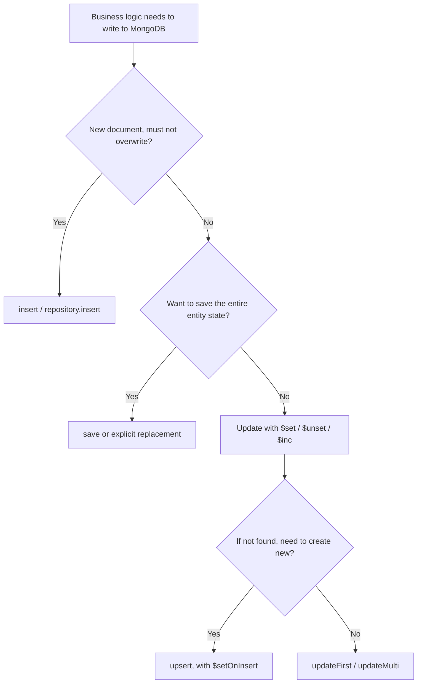

# Distinguishing Insert, Save (Document Replacement), and Field-Level Updates

In **Spring Data MongoDB**, three operations that look similar on the surface—creating a new entity with `insert`, saving an entity with `save`, and updating specific properties with `Update`—actually send **different** write intents to MongoDB. Confusing them can cause duplicate key errors, drop fields that already exist in the document, overwrite changes made by another request, or accidentally modify/delete data outside a tenant's scope.

This lesson belongs to the **Writes and Updates** chapter of the **SPRING_DATA_MONGODB** module. We will distinguish these write patterns across `MongoTemplate`, `MongoRepository`, and the MongoDB Java Driver, and examine when to use **insert**, **saving/replacing the whole document**, **field-level operator updates**, **upsert**, **conditional updates**, and **optimistic locking**. The examples can be practiced on a development MongoDB instance; do not run replacement or delete commands on production data without verifying the scope.

## 1. Four Key Operations: Insert, Save, Replace, and Update

| Intent | Spring Data MongoDB API | Semantic MongoDB Operation | When a Matching Document Already Exists |
| --- | --- | --- | --- |
| **Create new only** | `mongoTemplate.insert(entity)`, `repository.insert(entity)` | Insert a new document | Duplicate `_id`/unique index throws an error; does not replace the existing record |
| **Save entity state** | `mongoTemplate.save(entity)`, `repository.save(entity)` | Insert for a new entity; for an existing entity, typically writes the **mapped document** along the save/replacement path | May replace the document state rather than changing only the modified fields |
| **Explicit document replacement** | MongoDB Driver `replaceOne(...)`, or the appropriate replace API | Document replacement, with optional upsert toggle | Old fields absent from the replacement will not be preserved |
| **Selective update** | `mongoTemplate.updateFirst(...)`, `updateMulti(...)`, `Update` | Operators such as `$set`, `$unset`, `$inc`,… | Only the specified field paths are modified; the rest are preserved |

**The deciding keyword is _write intent_:** "Create a new object," "synchronize the entire state," or "change only certain fields"? There is no single API that fits every case.



This diagram serves as a business-level decision guide and does not describe every detail of new-entity detection, version mapping, or wire protocol commands. Those details depend on the entity state and Spring Data version.

## 2. Data Model Used Throughout the Lesson

An order is stored in the `orders` collection:

```javascript
{
  _id: ObjectId("674000000000000000000501"),
  tenant_id: "T1",
  status: "NEW",
  customer_note: "Deliver during business hours",
  total_vnd: NumberLong("350000"),
  delivery_address: {
    city: "Da Nang",
    street: "12 Tran Phu"
  },
  createdAt: ISODate("2026-11-20T02:00:00Z"),
  legacy_label: "MIGRATED-V1"
}
```

The `legacy_label` property was written into the document by a legacy system, but **does not exist in the new entity**. This is an ideal scenario to observe the difference between replacement and partial update.

Java entity:

```java
import java.time.Instant;
import org.bson.types.ObjectId;
import org.springframework.data.annotation.Id;
import org.springframework.data.mongodb.core.mapping.Document;
import org.springframework.data.mongodb.core.mapping.Field;

record DeliveryAddress(String city, String street) {}

@Document(collection = "orders")
public class Order {
    @Id
    private ObjectId id;

    @Field("tenant_id")
    private String tenantId;

    private String status;

    @Field("customer_note")
    private String customerNote;

    @Field("total_vnd")
    private long totalVnd;

    @Field("delivery_address")
    private DeliveryAddress deliveryAddress;

    private Instant createdAt;

    public Order() {}

    public Order(
            String tenantId, String status,
            String customerNote, long totalVnd,
            DeliveryAddress deliveryAddress, Instant createdAt) {
        this.tenantId = tenantId;
        this.status = status;
        this.customerNote = customerNote;
        this.totalVnd = totalVnd;
        this.deliveryAddress = deliveryAddress;
        this.createdAt = createdAt;
    }

    public ObjectId getId() { return id; }
    public String getTenantId() { return tenantId; }
    public String getStatus() { return status; }
    public String getCustomerNote() { return customerNote; }
    public long getTotalVnd() { return totalVnd; }
    public DeliveryAddress getDeliveryAddress() { return deliveryAddress; }
    public Instant getCreatedAt() { return createdAt; }

    public void markPaid() { this.status = "PAID"; }
    public void changeNote(String note) { this.customerNote = note; }
}
```

The entity uses `@Id ObjectId` to map `_id` and `@Field` to bind Java property names to BSON fields. `DeliveryAddress` is an embedded object mapped into `delivery_address`. In the main example, `@Version` is omitted so that replacement semantics stand out clearly; optimistic locking will be added in a later section.

**Example conventions:** `mongoTemplate` is a `MongoTemplate` bean injected into the service; `orderRepository` is a `MongoRepository<Order, ObjectId>`; the snippets illustrate independent alternatives rather than operations meant to run sequentially against a single production document.

## 3. Insert — Add New, Without Replacing an Existing Document

The insert operation states explicitly: **this document must be a new record**.

```java
import java.time.Instant;
import org.springframework.data.mongodb.core.MongoTemplate;

Order draft = new Order(
    "T1",
    "NEW",
    "Deliver during business hours",
    350_000L,
    new DeliveryAddress("Da Nang", "12 Tran Phu"),
    Instant.now()
);

Order inserted = mongoTemplate.insert(draft);
ObjectId id = inserted.getId();
```

If `id` was initially unset, Spring Data/the driver can generate a BSON ObjectId and populate the corresponding ID on the entity. The equivalent document creation command in `mongosh` looks like:

```javascript
db.orders.insertOne({
  tenant_id: "T1",
  status: "NEW",
  customer_note: "Deliver during business hours",
  total_vnd: NumberLong("350000"),
  delivery_address: {
    city: "Da Nang",
    street: "12 Tran Phu"
  },
  createdAt: new Date()
});
```

MongoDB generates `_id` if not provided. If the application already assigned `_id` and another document in the same collection has that `_id`, the insert fails due to the unique `_id` index. Another unique index (for example `tenant_id + order_number`) can also cause an insert to fail.

Corresponding repository:

```java
import org.bson.types.ObjectId;
import org.springframework.data.mongodb.repository.MongoRepository;

interface OrderRepository extends MongoRepository<Order, ObjectId> {}

// In the service:
Order insertedByRepo = orderRepository.insert(draft);
```

`MongoRepository.insert` and `MongoTemplate.insert` are used when the intent is **inserting a new record**. Do not use insert to "update if it already exists": a duplicate key error is not automatically converted into an update. You should distinguish duplicate key errors (`DuplicateKeyException`, typically translated by Spring from the MongoDB error) from connection errors, timeouts, or data validation failures.

**Note on inserting multiple documents:** `insertAll`, `insert` for collections, or `saveAll` have different strategies, and multiple records do not automatically form a single atomic transaction. Check write concern, ordered/unordered execution, and result/error handling for batch operations.

## 4. Save — Saving an Entity Is Not Equivalent to a Partial Update

This is a common source of data loss when using Spring Data MongoDB:

```java
ObjectId id = new ObjectId("674000000000000000000501");

Order order = mongoTemplate.findById(id, Order.class);
if (order == null) {
    throw new IllegalStateException("Order not found");
}

order.markPaid();
mongoTemplate.save(order);
```

It looks as though the code only modifies `status`, yet `save(order)` **does not mean `$set` only the changed fields**. In the normal save path of an entity that already has an ID and does not rely on special versioning behavior, Spring Data builds a BSON document from **the entire entity state** and writes it with save/replacement semantics.

The original document had `legacy_label: "MIGRATED-V1"`, but `Order` has no `legacyLabel` property. After saving with replacement semantics, the `legacy_label` field may **disappear** from the document.

```text
BEFORE save
  _id, tenant_id, status, customer_note,
  total_vnd, delivery_address, createdAt, legacy_label

Order entity loaded into Java
  id, tenantId, status, customerNote,
  totalVnd, deliveryAddress, createdAt
  (no legacyLabel)

AFTER modifying status and calling save
  _id, tenant_id, status="PAID", customer_note,
  total_vnd, delivery_address, createdAt
  (legacy_label is gone)
```

This situation is even more dangerous if the entity was loaded using a **projection** or if MongoDB holds new fields that the current service version does not yet know about. Saving the entire entity can drop fields that were never materialized into the Java object.

### Is Save the Same as Insert When ID Is Null?

If the document/entity is considered new, `save` may take the insert path. For an entity with an existing ID, `save` can perform a save/replacement operation and may exhibit upsert behavior depending on the mapping/versioning path. `MongoRepository.save` also uses Spring Data's `isNew` rule, which can rely on `@Version`, the ID, or `Persistable`; it should not be interpreted as merely an `id != null` check.

| Scenario | `insert` | `save` |
| --- | --- | --- |
| New entity with no ID | Inserts new document, typically generating an ID | Typically inserts new document |
| Entity with an ID not yet in the collection | Inserts new document with the supplied ID | May upsert/insert along the save path; `@Version` can change behavior |
| Entity with an ID matching an existing document | Duplicate key error | Can write the entity state over the existing document |
| BSON field absent from the entity | Unrelated to old documents | Risks dropping the field if the save path replaces the document |
| Only need to update one field | Not suitable | Not the minimal choice; prone to side effects |

**Choose `save` when** the application owns the full schema/state of the document and intentionally persists the entire aggregate with write concurrency controls. **Choose `Update` when** you only want to change specific fields or must preserve fields outside the current business scope.

## 5. Replacing a Document Explicitly

The MongoDB Java Driver lets you call `replaceOne`, which clearly expresses that a document will be **replaced** rather than updated field-by-field with operators.

```java
import static com.mongodb.client.model.Filters.and;
import static com.mongodb.client.model.Filters.eq;

import com.mongodb.client.result.UpdateResult;
import com.mongodb.client.model.ReplaceOptions;
import org.bson.Document;
import org.bson.types.ObjectId;

ObjectId id = new ObjectId("674000000000000000000501");

Document replacement = new Document("_id", id)
    .append("tenant_id", "T1")
    .append("status", "PAID")
    .append("customer_note", "Confirmed")
    .append("total_vnd", 350_000L);

UpdateResult result = mongoTemplate.getCollection("orders").replaceOne(
    and(eq("_id", id), eq("tenant_id", "T1")),
    replacement,
    new ReplaceOptions().upsert(false)
);
```

Here `upsert(false)` means: **if no matching document exists, do not create a new one**. If a document exists, the replacement swaps its field contents with the new document. In the example, `delivery_address`, `createdAt`, and `legacy_label` do not appear in the replacement, so they are gone after replacement.

Constraints to understand:

- `_id` is an immutable identifier of an existing document. A replacement cannot change `_id` to a different value.
- `replaceOne` is a **native driver operation**; when called via `getCollection(...)` with `Document`, it does not automatically apply all Spring Data entity callbacks, auditing, or optimistic locking.
- For authorization and to avoid modifying the wrong tenant, the filter still needs `tenant_id` alongside `_id`. If the ID exists under a different tenant, the operation does not match and does not replace.
- `matchedCount` and `modifiedCount` on `UpdateResult` have different meanings. `matchedCount = 1`, `modifiedCount = 0` can occur if the replacement equals the prior state.

When you want replacement through a Spring Data API, look at `findAndReplace` and the corresponding options for your version. Regardless of the API chosen, understand the difference between a **replacement document** and an **update operator document**.

## 6. Partial Update — Modifying Only Specified Fields

When the requirement is only to change the order status, a more appropriate method is `updateFirst` combined with `Update.set`.

```java
import com.mongodb.client.result.UpdateResult;
import org.bson.types.ObjectId;
import org.springframework.data.mongodb.core.query.Criteria;
import org.springframework.data.mongodb.core.query.Query;
import org.springframework.data.mongodb.core.query.Update;

ObjectId id = new ObjectId("674000000000000000000501");
String tenantId = "T1";

Query target = Query.query(
    Criteria.where("id").is(id)
        .and("tenantId").is(tenantId)
);

Update changes = new Update().set("status", "PAID");

UpdateResult result = mongoTemplate.updateFirst(
    target,
    changes,
    Order.class
);

long matched = result.getMatchedCount();
long modified = result.getModifiedCount();
```

Semantically, MongoDB receives an update operation like:

```javascript
db.orders.updateOne(
  {
    _id: ObjectId("674000000000000000000501"),
    tenant_id: "T1"
  },
  {
    $set: { status: "PAID" }
  }
);
```

**Other fields remain intact:** `customer_note`, `total_vnd`, `delivery_address`, `createdAt`, and even `legacy_label` still exist. This is the core difference between partial update and saving/replacing the whole document.

When `Query` and `Update` are paired with `Order.class`, Spring Data applies Java property mapping: `tenantId` becomes `tenant_id`, `id` becomes `_id`, and other renamed properties follow `@Field`. If operating directly via `mongosh`/native driver, you must use the actual **BSON field names**.

### updateFirst and updateMulti

```java
Query oldOrders = Query.query(
    Criteria.where("tenantId").is("T1")
        .and("status").is("NEW")
);

// Updates only one matching document.
mongoTemplate.updateFirst(
    oldOrders, new Update().set("status", "REVIEW"), Order.class
);

// Updates every matching document.
mongoTemplate.updateMulti(
    oldOrders, new Update().set("status", "REVIEW"), Order.class
);
```

`updateFirst` does not guarantee updating the "newest order" if the filter can match multiple documents without identifying a specific target record. To control a single document clearly, filter by `_id` and tenant; when you need to select a record by sort order or return the record alongside the update, consider `findAndModify` with an appropriate query/sort.

`updateMulti` can modify multiple documents. Each individual document is updated atomically, but the entire set is **not by default** a single shared transaction.

## 7. Common Update Operators

`Update` lets you express changes **per field** without reading and saving the entire entity.

| MongoDB Operator | Spring Data API | Effect |
| --- | --- | --- |
| `$set` | `new Update().set("status", "PAID")` | Sets a field value; creates the field if missing |
| `$unset` | `new Update().unset("customerNote")` | Removes the key completely from the document |
| `$inc` | `new Update().inc("retryCount", 1)` | Increments a number on the server, avoiding naive read-modify-write |
| `$setOnInsert` | `new Update().setOnInsert("createdAt", now)` | Sets the value only when an upsert performs an insert |
| `$push` | `new Update().push("tags", "priority")` | Appends an element to an array |
| `$addToSet` | `new Update().addToSet("tags", "priority")` | Adds to an array if no equal element exists |
| `$pull` | `new Update().pull("tags", "stale")` | Removes matching elements from an array |

Fields like `retryCount` and `tags` in the table are extended examples and must be declared in the schema/entity or managed as raw BSON in real code. For monetary fields, choose the right numeric type (`long`/`Decimal128`) and handle overflow and rounding according to business rules.

### Setting Null Is Not the Same as Unset

```javascript
// Field still exists, with value BSON Null.
db.orders.updateOne(
  { _id: someId },
  { $set: { customer_note: null } }
);

// Field is removed from the document.
db.orders.updateOne(
  { _id: someId },
  { $unset: { customer_note: "" } }
);
```

Spring Data:

```java
mongoTemplate.updateFirst(
    target,
    new Update().set("customerNote", null),
    Order.class
);

mongoTemplate.updateFirst(
    target,
    new Update().unset("customerNote"),
    Order.class
);
```

The two snippets above are **two independent choices**. After `$set: null`, a query `{customer_note: {$exists: true}}` can still match; after `$unset`, the field no longer exists. With `save(entity)`, `null` Java properties are often skipped by the converter on write unless configured otherwise; do not treat `save` as a complete substitute for `$set: null`.

### Updating Embedded Objects by Path

Suppose you only want to change the delivery city:

```java
mongoTemplate.updateFirst(
    target,
    new Update().set("deliveryAddress.city", "Hoi An"),
    Order.class
);
```

Spring Data translates the `deliveryAddress` property to BSON `delivery_address` and updates the path `delivery_address.city`. It **does not need to replace the entire** `delivery_address`; the `street` field is preserved.

Conversely, calling `set("deliveryAddress", new DeliveryAddress(...))` replaces the entire **value of the embedded field** with a new object. Choose the path granularity that matches your intended scope of change.

## 8. Upsert — Insert If Not Found

`Upsert` combines **update** and **insert-if-missing**. It fits data with a clear business identifier/key where the requirement is "adjust if it already exists, create if it does not."

```java
import java.time.Instant;
import org.bson.types.ObjectId;

ObjectId id = new ObjectId("674000000000000000000777");
Instant now = Instant.now();

Query byIdAndTenant = Query.query(
    Criteria.where("id").is(id)
        .and("tenantId").is("T1")
);

Update upsertFields = new Update()
    .set("status", "NEW")
    .setOnInsert("tenantId", "T1")
    .setOnInsert("createdAt", now)
    .setOnInsert("totalVnd", 0L);

UpdateResult result = mongoTemplate.upsert(
    byIdAndTenant,
    upsertFields,
    Order.class
);

boolean inserted = result.getUpsertedId() != null;
```

With a specified `_id`, MongoDB searches for a matching document and applies the operators. If none is found, the server can create a new document; values declared in `$setOnInsert` are applied only on the insert branch and do not overwrite `createdAt` on an existing order.

**Distinguishing `upsert` from `save`:**

- Upsert relies on **filter + update operators**, so unrelated fields are generally preserved on the update branch.
- Save relies on **entity state** and can carry full-document save/replacement semantics.
- With upsert, create a unique index on the key that determines uniqueness if multiple concurrent requests can compete.
- If `_id` already exists under a different tenant, a query including the tenant will not match; the insert branch with the same `_id` may fail with a duplicate key error. This is a signal to check scope/permissions—do not remove the tenant from the filter just to "make it work."

Some upsert paths construct a new document from equality predicates in the query combined with update operators; do not rely on implicit field derivation to guarantee schema completeness. Declare `$setOnInsert` for required fields, add validation, and run integration tests against real MongoDB.

## 9. Find-and-Modify — Atomic Update and Return Result

The operation "find an order matching conditions, update its status, and return the new document" is prone to race conditions if implemented as **two separate calls**: `findById` followed by `save`. For a single document, you can use `findAndModify` so the server performs the find-and-update as an atomic unit at the document level.

```java
import org.springframework.data.mongodb.core.FindAndModifyOptions;
import org.springframework.data.mongodb.core.query.Update;

Query pending = Query.query(
    Criteria.where("id").is(id)
        .and("tenantId").is("T1")
        .and("status").is("NEW")
);

Order updated = mongoTemplate.findAndModify(
    pending,
    new Update().set("status", "PAID"),
    FindAndModifyOptions.options()
        .returnNew(true)
        .upsert(false),
    Order.class
);

if (updated == null) {
    // No NEW order in this scope to transition.
}
```

`returnNew(true)` requests the document **after the update**. With `returnNew(false)`, the result is typically the document before the update. `upsert(false)` prevents creating a new order simply because the expected status was not found.

The condition `status = NEW` acts as a status-based **compare-and-set**: if another request already moved the order to a different status, the command no longer matches, preventing a silent overwrite. This is a business constraint at the single-document level and does not imply that multi-collection business flows are wrapped in a transaction.

## 10. Optimistic Locking and Concurrent Updates

If two requests read the same `Order`:

```text
Request A reads status=NEW
Request B reads status=NEW
Request A sets status=PAID and saves
Request B updates customerNote, saves stale entity
```

Along a **full-document save path without version checks**, B's save risks overwriting `status` back to the stale value `NEW`. This is a form of **lost update**.

Spring Data MongoDB supports optimistic locking via `@Version`:

```java
import org.springframework.data.annotation.Version;

// Added to the Order entity:
@Version
private Long version;
```

For an entity with `@Version`, entity save operations through versioning-aware paths verify the expected version. If the document on the server has been modified and the version no longer matches, Spring Data can raise `OptimisticLockingFailureException` instead of silently overwriting. An **acknowledged write concern** is required to detect write outcomes and conflicts accurately.

Do not assume every `updateFirst` automatically checks the stale in-memory version of an entity. For partial updates requiring compare-and-set, include the expected version or state in the **filter**:

```java
long expectedVersion = 3L;

Query guarded = Query.query(
    Criteria.where("id").is(id)
        .and("tenantId").is("T1")
        .and("version").is(expectedVersion)
);

Update changes = new Update()
    .set("status", "PAID");
// Check how your Spring Data version auto-updates @Version;
// if managing version manually, stick to a single consistent mechanism.

UpdateResult guardedResult =
    mongoTemplate.updateFirst(guarded, changes, Order.class);

if (guardedResult.getMatchedCount() == 0) {
    // Document version changed, does not exist, or wrong tenant.
}
```

When combining `@Version` with `MongoTemplate`, Spring Data can automatically increment the version on update paths if the update does not explicitly specify that field. **What you must ensure is that the filter includes the expected version** if business rules require version-based overwrite protection. Do not call `inc("version", 1)` a second time when the infrastructure already handles it, to avoid double-incrementing.

When not using a version field, filtering by `status` and `_id` is also a sensible choice for conditional state transitions. Depending on requirements, you can add conditions on total amount, tenant, or a dedicated idempotency key.

## 11. Write Results: Matched, Modified, Upserted

When using `MongoTemplate.updateFirst` / `updateMulti` / `upsert`, the result is typically `com.mongodb.client.result.UpdateResult`. Read the numbers accurately:

| Result Field | Meaning | Example |
| --- | --- | --- |
| `getMatchedCount()` | Number of documents matching the update filter | 1 if the order exists and matches the tenant |
| `getModifiedCount()` | Number of documents actually modified | Can be 0 even when matched = 1 |
| `getUpsertedId()` | ID of the new document inserted by upsert, if any | Distinguishes the insert branch |
| `DeleteResult.getDeletedCount()` | Number of documents deleted by a remove operation | Not used to evaluate updates |

Example:

```java
UpdateResult r = mongoTemplate.updateFirst(
    target,
    new Update().set("status", "PAID"),
    Order.class
);

if (r.getMatchedCount() == 0) {
    // No document found matching ID + tenant (or other conditions).
} else if (r.getModifiedCount() == 0) {
    // Status might already be PAID, or the update changed no value.
}
```

**Do not equate `matchedCount == 0` with HTTP 404 in all cases.** If the filter also includes expected status/version, a result of 0 may mean the document was modified, a state conflict occurred, or the tenant is wrong. Define a policy to distinguish 404/409 and enforce business-level authorization without leaking resource existence across tenants.

These counts are only meaningful when the write operation has an appropriate acknowledgement mechanism; when a network error occurs, the client may not know for sure whether the server applied the write. Retries should be designed around idempotency.

## 12. Atomicity, Transactions, and Consistency

MongoDB guarantees atomicity at the **single-document** level for a single write operation. That helps `$inc`, `$set`, and conditional updates avoid many race conditions compared to unguarded "read–modify in Java–write back."

However, a business flow like "create order, deduct inventory, record payment history" may touch **multiple documents/collections**. Calling three repository methods in sequence does not implicitly create a transaction.

```java
import org.springframework.transaction.annotation.Transactional;

@Transactional
public void confirmOrder(ObjectId orderId) {
    // Illustrates the business boundary:
    // 1. Conditionally update order.
    // 2. Update inventory.
    // 3. Create payment audit.
    // Implement fully in a real service.
}
```

For a MongoDB transaction to actually take effect, the application must have an appropriate `MongoTransactionManager` and a MongoDB topology that supports transactions (typically a replica set or appropriate sharded cluster). On the reactive driver, you need `ReactiveMongoTransactionManager` along with the Reactor Context.

When you only need to update a single document, prefer **a single command with the right predicate and operators** rather than opening an unnecessary transaction. Widening transaction scope has overhead and can affect throughput.

## 13. Write Performance and Index Design

A write operation still has to **find documents** matching the filter before modifying them. Therefore indexes matter, especially for bulk updates:

```javascript
// Find orders of a tenant in a status needing processing.
db.orders.createIndex(
  { tenant_id: 1, status: 1 },
  { name: "orders_tenant_status" }
);
```

A single-document update query by `_id` typically leverages the unique `_id` index; however, additional tenant/status filters still warrant evaluation depending on access patterns. Queries scanning many orders by `tenant_id + status` can benefit from this compound index. Conversely, every index adds update overhead whenever an indexed field is modified.

**Do not judge performance by lines of Java code.** A `save(entity)` call can rewrite a large document even if only one field changed; `$set` sends a more selective update intent, though the server still has to process the write, indexes, journal, and replica synchronization according to the write concern.

To analyze the filter, you can inspect the equivalent query:

```javascript
db.orders.find({
  tenant_id: "T1",
  status: "NEW"
}).explain("executionStats");
```

Examine `winningPlan`, `totalKeysExamined`, `totalDocsExamined`, and `nReturned`. This measures **document lookup capability** and does not replace benchmarking the actual update command or measuring index/write-concern cost.

For large update volumes, consider `BulkOperations` with an appropriate batch size. Do not assume bulk is a transaction; verify ordered/unordered semantics, per-operation results, and error-handling strategy. Bulk paths may not run callbacks or version handling the same way individual `save` calls do.

## 14. ReactiveMongoTemplate Still Follows the Same Write Semantics

In WebFlux, reactive Spring Data MongoDB returns publishers instead of synchronous results:

```java
import com.mongodb.client.result.UpdateResult;
import org.springframework.data.mongodb.core.ReactiveMongoTemplate;
import reactor.core.publisher.Mono;

Mono<UpdateResult> markPaid(
        ReactiveMongoTemplate template,
        ObjectId orderId,
        String tenantId) {

    Query query = Query.query(
        Criteria.where("id").is(orderId)
            .and("tenantId").is(tenantId)
    );

    return template.updateFirst(
        query,
        new Update().set("status", "PAID"),
        Order.class
    );
}
```

The server semantics of `$set` do not change simply because the return type is `Mono<UpdateResult>`. Reactive queries typically execute when the publisher is **subscribed to**; do not call `block()` on the WebFlux event loop and do not fire-and-forget `subscribe()` in a way that swallows errors on an important write.

If multiple updates require a transaction, compose the publishers within the same reactive chain using the appropriate transaction manager. Wrapping the result of a blocking `MongoTemplate` call in a `Mono` does not make that driver non-blocking.

## 15. Integration Test Proving Replacement Differs from Partial Update

Unit tests mocking `MongoTemplate` do not verify whether MongoDB actually preserves or drops fields outside the entity. An **integration test with raw BSON** makes the difference clear.

The test below demonstrates inserting a document with `legacy_label` via the native driver and then comparing the two write paths on separate documents. Connect to an isolated test MongoDB instance (such as Testcontainers); do not run against production.

```java
import static org.assertj.core.api.Assertions.assertThat;
import static com.mongodb.client.model.Filters.eq;

import java.util.UUID;
import org.bson.Document;
import org.bson.types.ObjectId;
import org.junit.jupiter.api.Test;
import org.springframework.beans.factory.annotation.Autowired;
import org.springframework.boot.test.autoconfigure.data.mongo.DataMongoTest;
import org.springframework.data.mongodb.core.MongoTemplate;
import org.springframework.data.mongodb.core.query.Criteria;
import org.springframework.data.mongodb.core.query.Query;
import org.springframework.data.mongodb.core.query.Update;

@DataMongoTest
class OrderWriteSemanticsTest {
    @Autowired MongoTemplate template;

    @Test
    void updatePreservesFieldWhileSaveCanReplaceDocument() {
        String tenant = "test-" + UUID.randomUUID();
        ObjectId partialId = new ObjectId();
        ObjectId saveId = new ObjectId();

        template.getCollection("orders").insertMany(
            java.util.List.of(
                rawOrder(partialId, tenant),
                rawOrder(saveId, tenant)
            )
        );

        Query partialTarget = Query.query(
            Criteria.where("id").is(partialId)
                .and("tenantId").is(tenant)
        );
        template.updateFirst(
            partialTarget,
            new Update().set("status", "PAID"),
            Order.class
        );

        Document partialRaw = template.getCollection("orders")
            .find(eq("_id", partialId)).first();
        assertThat(partialRaw).isNotNull();
        assertThat(partialRaw.getString("status")).isEqualTo("PAID");
        assertThat(partialRaw.getString("legacy_label"))
            .isEqualTo("MIGRATED-V1");

        Order loaded = template.findById(saveId, Order.class);
        assertThat(loaded).isNotNull();
        loaded.markPaid();
        template.save(loaded);

        Document savedRaw = template.getCollection("orders")
            .find(eq("_id", saveId)).first();
        assertThat(savedRaw).isNotNull();
        assertThat(savedRaw.getString("status")).isEqualTo("PAID");
        assertThat(savedRaw.containsKey("legacy_label")).isFalse();
    }

    private static Document rawOrder(ObjectId id, String tenant) {
        return new Document("_id", id)
            .append("tenant_id", tenant)
            .append("status", "NEW")
            .append("customer_note", "Old note")
            .append("total_vnd", 350_000L)
            .append("legacy_label", "MIGRATED-V1");
    }
}
```

This test **leaves no room for guessing** from method names: after a partial update, `legacy_label` remains; after saving the full entity, unmapped fields are not preserved. Keep in mind the mapping/version/handler configuration in use; this example chooses an entity **without `@Version`** to focus on replacement semantics.

Additional test cases to add:

1. Calling `insert` twice with the same `_id` must be rejected rather than overwriting the first document.
2. `updateFirst` with a non-existent ID yields `matchedCount = 0`; it does not create a record.
3. `upsert` with a new ID creates the document and returns `upsertedId`; calling it again does not create a second copy.
4. `$set("customerNote", null)` keeps the key as BSON Null; `$unset("customerNote")` removes the key.
5. Concurrent `$inc` across multiple requests loses no increments when properly designed.
6. `@Version` on an entity saved from two reads triggers a conflict according to the optimistic locking contract.
7. Tenant-scoped updates/replaces do not modify documents of another tenant.
8. `updateMulti` updates only matching documents, not the entire collection.
9. Test legacy data with unknown fields or projections to catch `save`-induced field loss.

## 16. API Selection Checklist

| Business Question | Preferred Option | What to Verify |
| --- | --- | --- |
| Must create a new order, duplicate ID is an error? | `insert` | Unique indexes, ID, and duplicate key handling |
| Have the complete aggregate and want to persist full state? | `save` | Schema, version, omitted fields, update permissions |
| Intentionally replacing the entire BSON document? | `replaceOne` / replace API | `upsert`, immutable `_id`, missing fields, callbacks/version |
| Only modifying `status` on one order by ID? | `updateFirst` + `$set` | ID + tenant + expected state filter |
| Modifying the same field across multiple orders? | `updateMulti` | Scope, indexes, atomicity/transaction |
| Incrementing a counter or adding an array element? | `$inc`, `$addToSet`/`$push` | Field type, concurrency, idempotency |
| Create if missing? | `upsert` + `$setOnInsert` | Unique index and insert-branch defaults |
| Need to update and return the new document in one operation? | `findAndModify` | `returnNew(true)`, filter, upsert |
| Need to guard against stale writes? | `@Version` or conditional update | Expected version/status, acknowledged write |
| Multiple documents must commit/rollback together? | Appropriate transaction | MongoDB topology, transaction manager, error handling |

## 17. Self-Assessment Questions

**1.** Why is `repository.save(order)` unsuitable for "just changing status" on a document that has additional fields outside the entity?  
**Answer:** The save operation can write the entire entity state with replacement semantics, dropping unmapped fields; `$set` is better scoped.

**2.** What happens when `insert(order)` encounters a document with the same `_id`?  
**Answer:** The unique `_id` index causes the operation to be rejected instead of overwriting the existing document.

**3.** Are `new Update().set("customerNote", null)` and `unset("customerNote")` the same?  
**Answer:** No. `set(null)` keeps the field with BSON Null; `unset` removes the field.

**4.** Are `matchedCount=1` and `modifiedCount=0` always an error?  
**Answer:** No. The document may already hold the desired value, so the update changes nothing.

**5.** Why can `updateFirst` filtering by `status = NEW` help prevent overwrites?  
**Answer:** MongoDB only applies the change while the status still matches the condition; a request arriving after the status changed will not match.

**6.** How does `upsert` differ from `save`?  
**Answer:** Upsert combines **a filter and update operators**, allowing targeted field changes or insertion when missing; save operates on entity state and can carry full-document write/replacement semantics.

**7.** If multiple entities must be saved in a single transaction, is calling `saveAll` alone enough?  
**Answer:** No. `saveAll` does not automatically guarantee an atomic multi-document transaction; you must design a transaction with the appropriate infrastructure.

**8.** Why should write filters always include the tenant in multi-tenant systems?  
**Answer:** So documents belonging to another tenant cannot be updated even if an ID/status or other condition is mistyped or forged; the tenant must come from a trusted context.

**Hands-on exercise:** Create an `orders` collection in a test MongoDB instance and insert a raw document containing `legacy_label`. Try two independent branches: reading the entity and calling `save` after changing status, and calling `updateFirst` with `$set`. Use the native driver to read back the raw BSON and compare which fields remain or disappear; then test `$set(null)`, `$unset`, `upsert`, `findAndModify`, and a `@Version` variant with a two-writer conflict. Record `matchedCount`/`modifiedCount` and inspect the filter using `explain`.

**Conclusion:** **insert** requires adding a new document, **save/replacement** can rewrite **the entire document**, while **update operators** modify **only the specified fields** and preserve the rest. In Spring Data MongoDB, choose the API based on intended write scope, BSON structure, tenant constraints, concurrency, and transaction needs—not solely by method name. Verifying outcomes through integration tests against raw BSON is the most practical way to prevent data loss caused by confusing `save` with partial updates.
