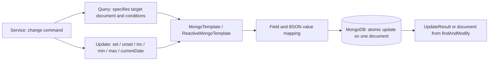

# Update with set, unset, inc, min, max, and currentDate

## 1. Why Does Field-Level Updating Differ from Saving the Whole Document?

In **Spring Data MongoDB**, `MongoTemplate` and `ReactiveMongoTemplate` let you update one or more document fields directly without loading the full entity, mutating the Java object, and calling `save`. This is especially useful when recording inventory changes, transitioning statuses, removing obsolete attributes, maintaining minimum/maximum values, or stamping processing times.

Suppose the `inventory_items` collection has a product:

```javascript
{
  _id: "item-101",
  tenantId: "shop-01",
  sku: "SKU-A",
  stock: NumberInt("10"),
  status: "ACTIVE",
  reorderThreshold: NumberInt("5"),
  lowestOfferCents: NumberLong("1700"),
  highestOfferCents: NumberLong("1900"),
  version: NumberLong("0"),
  attributes: { color: "red", origin: "VN" },
  legacyCode: "OLD-A"
}
```

A business requirement might ask to:

- Change the color to `blue`: `$set`.
- Remove the deprecated `legacyCode` field: `$unset`.
- Add 3 more units to stock: `$inc`.
- Record a lowest offer of 1,600 cents: `$min`.
- Record a highest offer of 2,100 cents: `$max`.
- Stamp the update time using MongoDB's clock: `$currentDate`.

These operations can be sent in **a single update command** targeting the same document. MongoDB applies the valid modifications of a single write operation to **a single document atomically**. That differs from sequential read/modify/`save` cycles and also differs from a multi-document transaction.

In the **Writes and Updates** chapter of the **SPRING_DATA_MONGODB** module, we will build updates using the `Update` API, choose the right operator for the business intent, handle results, concurrency, upserts, conditional queries, reactive paths, and BSON testing.

## 2. Overview of the Six Update Operators

| MongoDB Operator | Spring Data `Update` API | Core Meaning |
| --- | --- | --- |
| `$set` | `set("status", "ACTIVE")` | Writes or replaces the value of a field |
| `$unset` | `unset("legacyCode")` | Removes a field from the document |
| `$inc` | `inc("stock", 3)` | Increments a numeric value; negative numbers decrement |
| `$min` | `min("lowestOfferCents", 1600L)` | Writes the new value only if the field does not exist or the new value is smaller under BSON comparison rules |
| `$max` | `max("highestOfferCents", 2100L)` | Writes the new value only if the field does not exist or the new value is larger under BSON comparison rules |
| `$currentDate` | `currentDate("updatedAt")` | Sets the field to the current date/time from the MongoDB server, as a BSON Date |

In Spring Data MongoDB, `Update` is an object **describing the update operation**, not an immediate call to the database. The actual operation happens when you pass it along with a `Query` to `MongoTemplate.updateFirst(...)`, `updateMulti(...)`, `upsert(...)`, `findAndModify(...)`, or an equivalent API.



### 2.1. Operators Cannot Be Arbitrarily Combined on the Same Field

A single update command should not contain conflicting operations on the same path, such as both `set("stock", 10)` and `inc("stock", 3)`, or both `unset("attributes")` and `set("attributes.color", "blue")`. MongoDB may reject it due to **conflicting update paths**.

Consolidate the intent into a clear operation, use separate fields, or design an appropriate update pipeline if complex computation is needed. Putting operators in the same `Update` object **does not** mean path conflict rules can be ignored.

## 3. Preparing the Entity and Sample Data

The examples use a Java record to simplify reading results. Because updates go directly to MongoDB, there is no need to mutate the record in memory:

```java
package example.inventory;

import java.time.Instant;
import java.util.Map;
import org.springframework.data.mongodb.core.mapping.Document;
import org.springframework.data.mongodb.core.mapping.FieldType;
import org.springframework.data.mongodb.core.mapping.MongoId;

@Document(collection = "inventory_items")
public record InventoryItem(
    @MongoId(FieldType.STRING) String id,
    String tenantId,
    String sku,
    int stock,
    String status,
    Integer reorderThreshold,
    Long lowestOfferCents,
    Long highestOfferCents,
    Long version,
    Instant updatedAt,
    Map<String, String> attributes,
    String legacyCode
) {}
```

`@MongoId(FieldType.STRING)` ensures `id` is stored as a BSON String, even if the ID string happens to have a format convertible to ObjectId. In typed queries, Spring Data uses entity mapping to translate `id` to `_id`.

Sample data can be created in `mongosh`:

```javascript
db.inventory_items.insertMany([
  {
    _id: "item-101", tenantId: "shop-01", sku: "SKU-A",
    stock: NumberInt("10"), status: "ACTIVE",
    reorderThreshold: NumberInt("5"),
    lowestOfferCents: NumberLong("1700"),
    highestOfferCents: NumberLong("1900"),
    version: NumberLong("0"),
    attributes: { color: "red", origin: "VN" },
    legacyCode: "OLD-A"
  },
  {
    _id: "item-102", tenantId: "shop-01", sku: "SKU-B",
    stock: NumberInt("2"), status: "ACTIVE",
    version: NumberLong("0")
  },
  {
    _id: "item-201", tenantId: "shop-02", sku: "SKU-A",
    stock: NumberInt("20"), status: "ACTIVE",
    version: NumberLong("0")
  }
]);
```

Two tenants can share the same SKU. Update predicates in a multi-tenant application must include the **authenticated tenant**; a client-supplied SKU alone cannot be treated as proof of authorization to modify a document.

## 4. $set: Writing New Fields, Replacing Existing Fields, and Updating Nested Fields

### 4.1. Using Update.set

```java
import org.springframework.data.mongodb.core.query.Criteria;
import org.springframework.data.mongodb.core.query.Query;
import org.springframework.data.mongodb.core.query.Update;

Query filter = Query.query(
    Criteria.where("id").is("item-101")
        .and("tenantId").is("shop-01")
);

Update update = new Update()
    .set("status", "ACTIVE")
    .set("reorderThreshold", 8);
```

Equivalent BSON:

```javascript
db.inventory_items.updateOne(
  { _id: "item-101", tenantId: "shop-01" },
  {
    $set: {
      status: "ACTIVE",
      reorderThreshold: NumberInt("8")
    }
  }
);
```

`$set` creates the field if it does not yet exist, or replaces its value if it already does. If the new value equals the existing value, the document may be **matched** without being counted as **modified**.

### 4.2. Setting a Subfield Differs from Setting the Whole Object

Original document:

```javascript
attributes: { color: "red", origin: "VN" }
```

To change only the color:

```java
new Update().set("attributes.color", "blue");
```

Equivalent to:

```javascript
{ $set: { "attributes.color": "blue" } }
```

The result still retains `attributes.origin: "VN"`. Conversely:

```java
new Update().set("attributes", Map.of("color", "blue"));
```

replaces the **entire `attributes` object value**, so `origin` is no longer preserved as in the old version. Dotted paths also do not work unconditionally: if an intermediate component exists as a scalar value or null rather than a document, MongoDB may raise an error when creating the nested field.

### 4.3. $set with Null Is Not $unset

```java
new Update().set("legacyCode", null);
```

This requests setting the field to **BSON null**, not removing the key from the document. If you need to check field presence, you cannot use `get("legacyCode") == null` to distinguish null from missing: you must inspect `containsKey` or `$exists`.

## 5. $unset: Removing a Field from a Document

To remove `legacyCode`:

```java
Update update = new Update()
    .unset("legacyCode");

mongoTemplate.updateFirst(
    Query.query(
        Criteria.where("id").is("item-101")
            .and("tenantId").is("shop-01")
    ),
    update,
    InventoryItem.class
);
```

Equivalent BSON:

```javascript
db.inventory_items.updateOne(
  { _id: "item-101", tenantId: "shop-01" },
  { $unset: { legacyCode: "" } }
);
```

MongoDB removes the `legacyCode` key entirely from the document. When reading the Java entity afterward, a reference property `String legacyCode` may receive `null`, but in BSON **the field no longer exists**.

### 5.1. Comparing Three Actions

| Action | BSON After Operation | When to Use |
| --- | --- | --- |
| `set("legacyCode", "A")` | `legacyCode: "A"` | Writing a value |
| `set("legacyCode", null)` | `legacyCode: null` | Business logic intentionally stores a null value |
| `unset("legacyCode")` | Key `legacyCode` no longer present | Removing a field, cleaning up legacy schema |

When MongoDB receives a simple query `{legacyCode: null}`, it can match **both** documents with BSON null **and** documents missing the field. Distinguish the two states using:

```javascript
// Only documents without the field:
db.inventory_items.find({
  legacyCode: { $exists: false }
});

// Field exists and holds null:
db.inventory_items.find({
  legacyCode: { $exists: true, $eq: null }
});
```

### 5.2. Be Careful with Array Elements

`$unset` on a path pointing to an **array element position** does not delete and shift remaining elements; in some cases it leaves a `null` placeholder at that index. To remove array elements by value or condition, look into `$pull`, positional operators, or array filters as appropriate. This lesson only uses `unset` on document fields.

## 6. $inc: Atomic Numeric Increment/Decrement and Stock Checks

### 6.1. Adding Without Read–Modify–Save

```java
Update update = new Update()
    .inc("stock", 3);
```

Equivalent to:

```javascript
{ $inc: { stock: 3 } }
```

If `stock` is currently 10, the result is 13. `inc("stock", -3)` subtracts 3. MongoDB handles the increment/decrement of a document within an atomic write operation, avoiding a form of **lost update** where two requests both read the same value, compute locally, and overwrite each other.

Note edge cases:

- If the numeric field **does not exist**, `$inc` can create the field with the increment amount as its value.
- If the field exists with **BSON null** or a non-numeric type, the operation may be rejected.
- You must control numeric types and range limits (Int32, Int64, Double, Decimal128), rather than assuming counters have unbounded range or automatic precision/rounding.

### 6.2. Preventing Overselling Available Stock

Unsafe under concurrency:

```java
// UNSAFE PATTERN when two concurrent requests arrive:
InventoryItem item = mongoTemplate.findById(
    "item-101", InventoryItem.class
);
int remaining = item.stock() - quantity;
// Then building a set(stock, remaining) operation from the read value...
```

Two requests can both read stock 10, both subtract 7, and both set 3, failing to reflect one sale accurately. Combine a **minimum stock predicate and `inc` in the same command**:

```java
import com.mongodb.client.result.UpdateResult;
import org.springframework.data.mongodb.core.query.Criteria;
import org.springframework.data.mongodb.core.query.Query;
import org.springframework.data.mongodb.core.query.Update;

public boolean reserveStock(
        MongoTemplate template,
        String tenantId,
        String id,
        int quantity) {

    if (quantity <= 0) {
        throw new IllegalArgumentException(
            "quantity must be greater than 0"
        );
    }

    Query query = Query.query(
        Criteria.where("id").is(id)
            .and("tenantId").is(tenantId)
            .and("stock").gte(quantity)
    );

    Update update = new Update()
        .inc("stock", -quantity)
        .currentDate("updatedAt");

    UpdateResult result = template.updateFirst(
        query, update, InventoryItem.class
    );

    return result.getMatchedCount() == 1;
}
```

The condition `stock >= quantity` and the operation `$inc: {stock: -quantity}` are evaluated by MongoDB within **a single write operation on the document**. If two concurrent requests both try to subtract 7 from stock 10, only the first request in execution order satisfies the predicate; the remaining one no longer matches.

A `false` return value can have multiple causes: the item does not exist, wrong tenant, or insufficient stock. **Do not automatically infer "out of stock"** from `matchedCount == 0`. If an exact error message is needed, the service can query afterward with an appropriate observation/race-condition policy.

### 6.3. One inc Does Not Make the Entire Order Flow Atomic

Decrementing stock on a product document is atomic **for that document**. If business logic also needs to create an order document, record a payment, and update several other documents, a single `$inc` does not turn those steps into a transaction. Consider MongoDB transactions when needed and supported by your deployment, or design a workflow with compensation/idempotency to handle failures.

## 7. $min and $max: Updating Only When Crossing Previous Bounds

### 7.1. min and max Are Comparisons, Not Additions

`$min` sets the field to the new value only if the field does not yet exist or the new value is **less than** the currently stored value; `$max` does the same for a **greater** value.

```java
Update update = new Update()
    .min("lowestOfferCents", 1600L)
    .max("highestOfferCents", 2100L);
```

For a document with `lowestOfferCents = 1700` and `highestOfferCents = 1900`, the result is:

```javascript
{
  lowestOfferCents: NumberLong("1600"),
  highestOfferCents: NumberLong("2100")
}
```

If another offer arrives at 1,800 cents, `min(..., 1800L)` leaves 1,600 unchanged and `max(..., 1800L)` leaves 2,100 unchanged. Together they preserve the **min/max of observed values** provided all write paths follow the same convention.

### 7.2. Why Is set Not Equivalent to min/max?

Suppose requests A and B both record new prices:

```text
Current lowestOfferCents: 1700
Request A observes 1600
Request B observes 1650
```

If both use `$set`, the final value depends on whichever request writes last; it could become 1,650, losing the lowest offer of 1,600. With `$min`, the final result remains 1,600 once both updates are successfully applied to the same document.

Similarly, `$max` fits "highest value ever observed," "highest event milestone recorded," or an upper bound—it is **not** suitable for data meant to reflect the **latest value over time**. If the current price is allowed to go both up and down, `$min`/`$max` cannot replace a `currentPrice` field.

### 7.3. BSON Types Determine Comparison Behavior

MongoDB uses BSON comparison rules for `$min`/`$max`. If a field currently holds a String while the new value is a Long, the comparison may follow **BSON type ordering** rather than the numeric semantics business logic expects.

An easily overlooked case: a field holding **BSON null** is not the same as a missing field. `$min`/`$max` apply their respective comparison rules; for example, null ranks lower than numbers in BSON type ordering, so `$min` with a positive number will not necessarily replace null with that number. When min/max fields are required data, normalize the schema/initialize values or audit legacy data before use.

In the example, all offers are represented as **integer cents `Long`**. If using `BigDecimal` and Decimal128, verify read/write mapping as well as the actual update operators; never silently convert money values to `double`.

### 7.4. min/max Cannot Fix Bad Input Data

If a request sends 100 cents due to a unit conversion bug, `min` will keep it as the "lowest value" until an intentional data fix is run. Always validate value ranges and units before writing. Min/max enforces comparison over received inputs; **it does not guarantee the inputs themselves are valid**.

## 8. $currentDate: Timestamp from the MongoDB Server

### 8.1. Spring Data Syntax

```java
Update update = new Update()
    .set("status", "ACTIVE")
    .currentDate("updatedAt");
```

MongoDB receives an equivalent update:

```javascript
db.inventory_items.updateOne(
  { _id: "item-101", tenantId: "shop-01" },
  {
    $set: { status: "ACTIVE" },
    $currentDate: { updatedAt: true }
  }
);
```

`$currentDate` obtains the current date/time from the MongoDB server at processing time. It differs from:

```java
new Update().set("updatedAt", java.time.Instant.now());
```

With `Instant.now()`, the time comes from the **application clock**, computed before the command reaches the server. With `currentDate("updatedAt")`, the time is written by the **server**. Either can be appropriate if the business contract is clear, but do not mix them unintentionally when consistent ordering or timestamp reconciliation is required.

### 8.2. BSON Date Differs from BSON Timestamp

MongoDB `$currentDate` can update a field as either **BSON Date** or **BSON Timestamp**. `Update.currentDate("updatedAt")` expresses the standard need: storing a date/time. BSON Timestamp is primarily for specialized MongoDB internal/replication use cases and should not be assumed to be an application-level datetime type like BSON Date.

For a domain field `Instant updatedAt`, use BSON Date according to mapping conventions and verify reads/writes. Do not choose BSON Timestamp just because its name contains "timestamp."

### 8.3. currentDate Is Not Every Kind of Business Timestamp

An order may require:

- `createdAt`: when the document was created, unchanged on edits;
- `updatedAt`: when the latest update was written;
- `paidAt`: when the payment system confirmed success;
- `effectiveAt`: when the business action takes effect per contract.

`currentDate("updatedAt")` makes sense for the update operation timestamp. It cannot know when a payment was actually settled. If an event arrives late, using `currentDate` in place of `paidAt` can corrupt the business meaning.

## 9. Combining Multiple Operators in One Update

When paths do not conflict, you can combine them:

```java
import org.springframework.data.mongodb.core.query.Update;

Update update = new Update()
    .set("status", "ACTIVE")
    .set("attributes.color", "blue")
    .unset("legacyCode")
    .inc("stock", 3)
    .min("lowestOfferCents", 1600L)
    .max("highestOfferCents", 2100L)
    .currentDate("updatedAt");
```

Equivalent MongoDB operation:

```javascript
db.inventory_items.updateOne(
  { _id: "item-101", tenantId: "shop-01" },
  {
    $set: {
      status: "ACTIVE",
      "attributes.color": "blue"
    },
    $unset: { legacyCode: "" },
    $inc: { stock: 3 },
    $min: { lowestOfferCents: NumberLong("1600") },
    $max: { highestOfferCents: NumberLong("2100") },
    $currentDate: { updatedAt: true }
  }
);
```

To execute via Spring Data:

```java
Query filter = Query.query(
    Criteria.where("id").is("item-101")
        .and("tenantId").is("shop-01")
);

UpdateResult result = mongoTemplate.updateFirst(
    filter, update, InventoryItem.class
);
```

Against the existing sample document, expected outcome: stock 13, color blue, `legacyCode` removed, low 1,600, high 2,100, `updatedAt` as a BSON Date. **Atomicity here is per single document** and does not mean all documents matched by an `updateMany` form a shared atomic transaction.

## 10. updateFirst, updateMulti, findAndModify, and upsert

### 10.1. updateFirst: Updates at Most One Matching Document

```java
UpdateResult result = mongoTemplate.updateFirst(
    Query.query(
        Criteria.where("id").is("item-101")
            .and("tenantId").is("shop-01")
    ),
    new Update().set("status", "INACTIVE"),
    InventoryItem.class
);
```

`updateFirst` updates one document matching the filter, usually appropriate when the filter specifies an **ID** or unique key. If the filter matches multiple documents, do not rely on "the first document" in an unguaranteed order. If you need to select a record by sort order and return it, consider `findAndModify` with a sorted `Query`.

### 10.2. updateMulti: Updates All Matching Documents

```java
UpdateResult result = mongoTemplate.updateMulti(
    Query.query(
        Criteria.where("tenantId").is("shop-01")
            .and("status").is("INACTIVE")
    ),
    new Update().set("status", "ARCHIVED")
        .currentDate("updatedAt"),
    InventoryItem.class
);
```

This corresponds to a multi-document update (`updateMany`). Each document is updated atomically, but **the entire set of documents is not an atomic transaction** without an appropriate transaction context. One document can be modified successfully before another operation fails.

For critical bulk updates, evaluate batch size, access permissions, index impact, retryability, failure handling, and concurrency.

### 10.3. findAndModify: When You Need the State Before/After Update

```java
import org.springframework.data.mongodb.core.FindAndModifyOptions;

InventoryItem updated = mongoTemplate.findAndModify(
    Query.query(
        Criteria.where("id").is("item-101")
            .and("tenantId").is("shop-01")
    ),
    new Update().inc("stock", 2)
        .currentDate("updatedAt"),
    FindAndModifyOptions.options().returnNew(true),
    InventoryItem.class
);
```

`returnNew(true)` requests the document **after the update**. If no document matches and upsert is not enabled, the result may be `null`. Treat the returned value as a post-operation snapshot, not an object representing all future updates.

### 10.4. upsert: Update If Present, Insert If Missing

```java
Update update = new Update()
    .setOnInsert("tenantId", "shop-01")
    .setOnInsert("sku", "SKU-NEW")
    .inc("stock", 1)
    .currentDate("updatedAt");

UpdateResult result = mongoTemplate.upsert(
    Query.query(
        Criteria.where("tenantId").is("shop-01")
            .and("sku").is("SKU-NEW")
    ),
    update,
    InventoryItem.class
);
```

`$setOnInsert` applies only when upsert **creates a new document**; `$inc` can apply on both update and insert branches. This snippet illustrates the idea; ensure any other required schema fields are initialized and that no update path conflicts with fields derived from the query.

Under concurrent upserts, multiple requests may fail to find the same key and attempt to insert simultaneously. When business rules allow only one document per `tenantId + sku`, an appropriate **unique index** is required rather than relying on upsert alone.

## 11. Reading UpdateResult to Avoid False Positives

`MongoTemplate.updateFirst`, `updateMulti`, and `upsert` return `com.mongodb.client.result.UpdateResult` in standard synchronous APIs. In environments with an acknowledged write concern:

```java
UpdateResult result = mongoTemplate.updateFirst(
    filter, update, InventoryItem.class
);

if (result.wasAcknowledged()) {
    long matched = result.getMatchedCount();
    long modified = result.getModifiedCount();
    System.out.println("matched=" + matched);
    System.out.println("modified=" + modified);
}
```

| Property | Meaning | What Not to Infer |
| --- | --- | --- |
| `wasAcknowledged()` | Whether the server acknowledged the operation under the active write concern | That every business condition succeeded |
| `getMatchedCount()` | Number of documents matching the update filter | Number of documents whose values actually changed |
| `getModifiedCount()` | Number of documents recorded as modified | Document existence if the update was a no-op |
| `getUpsertedId()` | ID of the document newly inserted via upsert, if any | Returning an ID for ordinary updates |

For example, `set("status", "ACTIVE")` on a document whose status is already `ACTIVE` may yield `matched=1, modified=0`. Do not report "not found" when `modified=0`; inspect `matchedCount` and the business contract.

Conversely, `matched=0` can result from a wrong ID, wrong tenant, or an optimistic condition no longer holding. In an upsert, detect a new insert via `getUpsertedId()` rather than guessing from `matchedCount` alone.

## 12. Conditional Updates and Handling Concurrent Writes

### 12.1. Compare and Modify in One Operation

Suppose status may transition from `ACTIVE` to `INACTIVE` only when the current version is 5. One approach is adding the version condition to the query and incrementing version with `$inc`.

In this example, `version` is a **plain `Long` field without `@Version`** to clearly illustrate manual management:

```java
public boolean changeStatus(
        MongoTemplate template,
        String tenantId,
        String id,
        long expectedVersion) {

    Query filter = Query.query(
        Criteria.where("id").is(id)
            .and("tenantId").is(tenantId)
            .and("status").is("ACTIVE")
            .and("version").is(expectedVersion)
    );

    Update update = new Update()
        .set("status", "INACTIVE")
        .inc("version", 1L)
        .currentDate("updatedAt");

    UpdateResult result = template.updateFirst(
        filter, update, InventoryItem.class
    );
    return result.getMatchedCount() == 1;
}
```

If two requests both expect version 5, after the first updates it to 6, the other no longer satisfies `version == 5`. This is **compare-and-set** at the MongoDB layer. It detects modifications to the same document provided all related write paths increment the version consistently.

### 12.2. Difference from Spring Data–Managed @Version

Spring Data MongoDB provides optimistic locking via `@Version`. When an entity genuinely uses `@Version`, the infrastructure may automatically add version checks and increment the version along supported save/update paths. **Do not apply manual version increments to the same field alongside Spring-managed versioning** unless you know the exact update path behavior; doing so can cause double increments or conflicts.

For critical workflows, pick **one consistent versioning strategy**, test update conflicts, and use an appropriate write concern. `@Version` does not replace stock condition checks or tenant authorization.

### 12.3. Atomicity Does Not Mean Idempotency

`$inc` is atomic on a single document, yet **not idempotent**: sending the same operation twice adds or subtracts twice. If a service retries after a timeout without knowing whether the first request was written, the counter can change unexpectedly.

For orders or payments, use unique request identifiers, business state guards, or appropriate transactions/workflows to ensure a task executes according to policy. `$set` with the same value may be safer to repeat in some cases, though not every `$set` update is idempotent (especially when paired with `currentDate` or changing preconditions).

## 13. Schema, BSON Types, Nulls, and Dynamic Field Updates

### 13.1. Missing Fields vs. Null Fields

As distinguished earlier:

- `$set` writes a value, including null;
- `$unset` deletes the key;
- `$inc` on a missing field initializes it to the increment amount, but errors on BSON null;
- `$min` and `$max` have specific rules for initializing missing fields and comparing BSON types;
- `$currentDate` writes a server timestamp value, not an ISO 8601 String.

If a legacy document has `stock: "10"`, calling `inc("stock", 1)` should not be treated as an "automatic normalization" to a number. Run a migration/validation to convert the field to numeric before applying updates.

### 13.2. Typed Mapping and Actual Field Names

In an entity:

```java
@org.springframework.data.mongodb.core.mapping.Field("modified_at")
private java.time.Instant updatedAt;
```

When using `MongoTemplate.updateFirst(query, update, EntityClass.class)`, Spring Data uses entity metadata to map property paths like `updatedAt` to the BSON name `modified_at` in supported cases. However, a raw BSON command via the driver must reference the **actual stored field name**:

```javascript
{ $currentDate: { modified_at: true } }
```

Do not inspect only a Java getter and assume a BSON field of the same name was written. Inspect the raw document, especially with `@Field`, nested value objects, custom converters, or `@Unwrapped`.

### 13.3. Client Input Must Not Arbitrarily Control Field Names

Risky pattern:

```java
// Do not allow arbitrary clientField values to become update paths:
Update update = new Update().set(clientField, clientValue);
```

If clients choose field names freely, they could overwrite `tenantId`, `version`, prices, or internal fields. Define an **allowlist of updatable fields**, validate formats, enforce business constraints, and always attach tenant/auth filters. For JSON requests, prefer a DTO with explicitly declared updatable properties rather than accepting an arbitrary map.

### 13.4. Array Updates and Positional Operators Are a Separate Problem

`$set` on path `tags.0` modifies only a fixed index rather than performing set-like add/remove operations. Similarly, updating elements inside an array of objects may require `$[]`, `$[identifier]`, and array filters. Do not replace an entire array when the real requirement is updating a single item; and never build field paths from unvalidated user input.

## 14. ReactiveMongoTemplate: Same Update, Different Result Handling

The reactive branch uses the same `Update` and `Query` semantics, but the result is typically `Mono<UpdateResult>`:

```java
import com.mongodb.client.result.UpdateResult;
import org.springframework.data.mongodb.core.ReactiveMongoTemplate;
import org.springframework.data.mongodb.core.query.Criteria;
import org.springframework.data.mongodb.core.query.Query;
import org.springframework.data.mongodb.core.query.Update;
import reactor.core.publisher.Mono;

public Mono<Boolean> addStock(
        ReactiveMongoTemplate template,
        String tenantId,
        String id,
        int amount) {

    if (amount <= 0) {
        return Mono.error(
            new IllegalArgumentException("amount must be greater than 0")
        );
    }

    Query filter = Query.query(
        Criteria.where("id").is(id)
            .and("tenantId").is(tenantId)
    );

    Update update = new Update()
        .inc("stock", amount)
        .currentDate("updatedAt");

    return template.updateFirst(
        filter, update, InventoryItem.class
    ).map(result -> result.getMatchedCount() == 1);
}
```

The service returns the publisher so the caller/handler decides how to subscribe and handle errors; **do not call `block()` inside a WebFlux thread** just to obtain a boolean. For inventory, non-negative guards and idempotency rules remain just as necessary as in the imperative branch. Reactive only changes how I/O is scheduled; it does not automatically turn a sequence of commands into a transaction.

### 14.1. CRUD Repositories and Custom Updates

`MongoRepository.save(entity)` is an entity-saving operation, not `Update.inc` or `Update.unset`. When business logic requires conditional field updates, use `MongoTemplate`/`ReactiveMongoTemplate` in the service or a custom repository implementation. Do not construct a partial entity with only a few fields populated and call `save` as if it were a PATCH command.

## 15. Integration Testing: Verifying BSON and UpdateResult

Simply asserting Java objects before/after `save` is not enough to prove update operators behaved correctly. In Spring Data MongoDB, verify that:

1. The `set` field holds the new value.
2. The `unset` field **no longer exists** in BSON.
3. `inc` adds the exact amount.
4. `min`/`max` change values only under the right conditions.
5. `currentDate` produces a **BSON Date**, not a string.
6. `matchedCount` and `modifiedCount` reflect match vs. no-match cases.

### 15.1. Testing All Six Operators

JUnit 5 example using the Spring Boot MongoDB test slice:

```java
package example.inventory;

import static com.mongodb.client.model.Filters.eq;
import static org.junit.jupiter.api.Assertions.*;

import java.util.Map;
import java.util.UUID;
import org.bson.Document;
import org.junit.jupiter.api.Test;
import org.springframework.beans.factory.annotation.Autowired;
import org.springframework.boot.test.autoconfigure.data.mongo.DataMongoTest;
import org.springframework.data.mongodb.core.MongoTemplate;
import org.springframework.data.mongodb.core.query.Criteria;
import org.springframework.data.mongodb.core.query.Query;
import org.springframework.data.mongodb.core.query.Update;

@DataMongoTest
class InventoryUpdateTest {

    @Autowired
    MongoTemplate template;

    @Test
    void appliesSetUnsetIncMinMaxAndCurrentDate() {
        String suffix = UUID.randomUUID().toString();
        String id = "item-" + suffix;
        String tenant = "shop-" + suffix;

        template.insert(new InventoryItem(
            id, tenant, "SKU-A", 10, "ACTIVE", 5,
            1700L, 1900L, 0L, null,
            Map.of("color", "red", "origin", "VN"),
            "OLD-A"
        ));

        Query filter = Query.query(
            Criteria.where("id").is(id)
                .and("tenantId").is(tenant)
        );

        Update update = new Update()
            .set("attributes.color", "blue")
            .unset("legacyCode")
            .inc("stock", 3)
            .min("lowestOfferCents", 1600L)
            .max("highestOfferCents", 2100L)
            .currentDate("updatedAt");

        var result = template.updateFirst(
            filter, update, InventoryItem.class
        );

        assertEquals(1L, result.getMatchedCount());
        assertEquals(1L, result.getModifiedCount());

        Document raw = template.getCollection("inventory_items")
            .find(eq("_id", id))
            .first();

        assertNotNull(raw);
        assertEquals(13, raw.getInteger("stock"));
        assertEquals(1600L, raw.getLong("lowestOfferCents"));
        assertEquals(2100L, raw.getLong("highestOfferCents"));
        assertFalse(raw.containsKey("legacyCode"));
        assertNotNull(raw.getDate("updatedAt"));

        Document attributes =
            raw.get("attributes", Document.class);
        assertNotNull(attributes);
        assertEquals("blue", attributes.getString("color"));
        assertEquals("VN", attributes.getString("origin"));

        InventoryItem reloaded =
            template.findById(id, InventoryItem.class);
        assertNotNull(reloaded);
        assertEquals(13, reloaded.stock());
        assertNotNull(reloaded.updatedAt());
    }
}
```

The test reads the raw `Document` to verify field removal via `containsKey` and the Date type via `getDate`. Checking only `reloaded.legacyCode() == null` cannot distinguish BSON null from a missing field.

### 15.2. Testing Insufficient Stock Conditions

In a separate test, create an item with stock 2 and attempt to reserve 3:

```java
String suffix = UUID.randomUUID().toString();
String id = "limited-" + suffix;
String tenant = "shop-" + suffix;

template.insert(new InventoryItem(
    id, tenant, "SKU-L", 2, "ACTIVE",
    1, null, null, 0L, null, Map.of(), null
));

Query condition = Query.query(
    Criteria.where("id").is(id)
        .and("tenantId").is(tenant)
        .and("stock").gte(3)
);

var result = template.updateFirst(
    condition,
    new Update().inc("stock", -3),
    InventoryItem.class
);

assertEquals(0L, result.getMatchedCount());
assertEquals(
    2,
    template.findById(id, InventoryItem.class).stock()
);
```

This snippet goes **inside a `@Test` method** of the class above, with `template` injected. The result shows `stock >= 3` did not match, so stock was not decremented below zero.

### 15.3. Testing min/max Do Not Overwrite Better Bounds

```java
// For a document with lowest 1600, highest 2100:
Update noImprovement = new Update()
    .min("lowestOfferCents", 1800L)
    .max("highestOfferCents", 2000L);

template.updateFirst(filter, noImprovement, InventoryItem.class);

InventoryItem unchanged =
    template.findById(id, InventoryItem.class);
assertEquals(1600L, unchanged.lowestOfferCents());
assertEquals(2100L, unchanged.highestOfferCents());
```

This example continues the test in Section 15.1, where `filter` and `id` were already initialized. It checks min/max behavior even when proposed values do not improve the bounds.

### 15.4. MongoDB Test Environment

`@DataMongoTest` configures the MongoDB test slice context, but does not automatically guarantee a running MongoDB server in all environments. You can use Testcontainers MongoDB or a dedicated test instance. Imports and setup may vary by Spring Boot version; follow your project's BOM.

This lesson presents sample tests for learning and extending in dedicated code steps. No build or actual test suite was executed during this Markdown authoring phase under the current workflow.

## 16. Troubleshooting and Common Pitfalls

| Symptom | Possible Cause | Check or Fix |
| --- | --- | --- |
| `matched=1` but `modified=0` | `$set` with same value; `$min`/`$max` needed no change | Check no-op contract; do not treat as missing |
| `matched=0` | Wrong ID/tenant or stock/version condition not met | Inspect filter and access permissions |
| `$inc` errors on a field | Existing value is BSON null, String, or non-numeric | Inspect raw BSON and run migration |
| Stock subtracted twice | Retried `$inc` after timeout with unknown outcome | Design idempotency / record request ID |
| Field still appears after "delete" | Used `set(field, null)` instead of `unset` | Check `containsKey`, `$exists` |
| Lost sibling fields when updating object | `set("attributes", ...)` replaced whole subdocument | Use dotted path for the target field |
| min/max bounds fail to update from null | BSON comparison rules and missing initialization strategy | Normalize field, test null/missing |
| `updatedAt` is String instead of Date | Code wrote a string or custom conversion differs | Inspect raw BSON `$type`/`getDate` |
| Multi-document update not atomic like a transaction | `updateMulti` does not guarantee cross-document atomicity | Design a transaction or appropriate workflow |
| Upsert creates duplicate records | Missing unique index or unguaranteed key identity | Create/verify unique index, handle duplicate key |
| Update modifies another tenant | Query missing tenant or unverified client-supplied tenant | Enforce tenant from security context |
| Field path conflict | Setting parent while modifying child, or multiple operators on same field | Split or redesign the update operation |
| `save` drops unloaded fields | Using a partial projection entity as a full entity | Use typed field-level `Update` |
| Server and app clocks differ | Mixing `Instant.now()` with `$currentDate` | Standardize clock source by business rules |

### Diagnostic Checklist

1. Inspect the actual filter: `_id`, tenant, status, quantity, and version.
2. Confirm the chosen operator matches intent: `set`, `unset`, `inc`, `min`, `max`, or `currentDate`.
3. Verify raw BSON types of modified fields.
4. Read `matchedCount`, `modifiedCount`, and `upsertedId` as appropriate.
5. Check retry behavior, two concurrent requests, and multi-document updates.
6. Inspect indexes/filters with `explain` if update lookups are slow; monitor latency and hot-document contention.
7. Ensure all write paths follow the same business and versioning rules.

## 17. Practice Exercises

### Exercise 1 — Distinguishing set from unset

Create a document with `obsoleteNote: "old"`. Try `set("obsoleteNote", null)` and check with `$exists`. Then try `unset("obsoleteNote")` and inspect the raw BSON. Explain why both can produce a null Java getter while differing in MongoDB.

### Exercise 2 — Inventory and Concurrency

Create an item with stock 10. Send two concurrent requests each reserving 7 units using query `stock >= 7` and `inc(stock, -7)`. Verify only one request matches and stock never goes negative. Compare with reading stock and calling `set` with the computed value.

### Exercise 3 — min/max

Record offers of 1,700, 1,600, 1,800, and 2,100 cents in sequence. Use `$min` and `$max` to keep the lowest and highest. Test legacy data with missing fields, BSON null, and Strings to see why schema normalization matters.

### Exercise 4 — currentDate

Update status and `updatedAt` using `currentDate`. Verify the field is a BSON Date and reads back as `Instant`. Compare with `set("updatedAt", Instant.now())`, explaining pros and cons of application vs. server clocks.

### Exercise 5 — Upsert and Unique Index

Design an upsert by `tenantId + sku` to increment a view counter. Propose an appropriate unique compound index. Describe what can happen if two requests upsert concurrently and how to handle `DuplicateKeyException` or safe business-level retries.

### Exercise 6 — Versioned Updates

Add a plain version field, update conditionally on the expected version, and call `inc(version, 1)`. Simulate two requests using the same stale version and verify one fails to match. Then compare with Spring Data–managed `@Version`, avoiding unintentional mixing of both strategies.

### Self-Check Questions

- How does `$set` with `null` differ from `$unset`?
- Does `$inc` behave the same on a missing field vs. a BSON null field?
- Why must `inc(stock, -quantity)` be paired with `stock >= quantity` when selling items?
- When are `$min`/`$max` better than `$set`, and when are they the wrong choice?
- Does `currentDate` use the application clock or MongoDB's clock?
- Does `matchedCount == 1` force `modifiedCount == 1`?
- Does `updateMulti` guarantee all documents are updated as a single atomic transaction?
- Why is `$inc` not idempotent even though it is atomic?
- When should you use `findAndModify` instead of `updateFirst`?

## Key Takeaways

In **Spring Data MongoDB**, `Update` expresses how to modify fields **directly on MongoDB**: `set` writes/replaces values, `unset` deletes fields, `inc` increments/decrements numbers, `min` and `max` track low/high bounds by BSON comparison, and `currentDate` records server time. Always pair with a `Query` specifying the proper key and tenant, use atomic predicates to guard stock/version, inspect `UpdateResult`, and distinguish missing fields from BSON null. Atomic updates on **a single document** do not equal idempotency, cross-command snapshots, or multi-document transactions. Test raw BSON, concurrency, and edge cases before deploying to production.

## References

- [Spring Data MongoDB Reference — Updating Documents](https://docs.spring.io/spring-data/mongodb/reference/mongodb/template-crud-operations.html)
- [Spring Data MongoDB API — Update](https://docs.spring.io/spring-data/mongodb/docs/current/api/org/springframework/data/mongodb/core/query/Update.html)
- [MongoDB Manual — Update Operators](https://www.mongodb.com/docs/manual/reference/operator/update/)
- [MongoDB Manual — Atomicity and Transactions](https://www.mongodb.com/docs/manual/core/write-operations-atomicity/)
