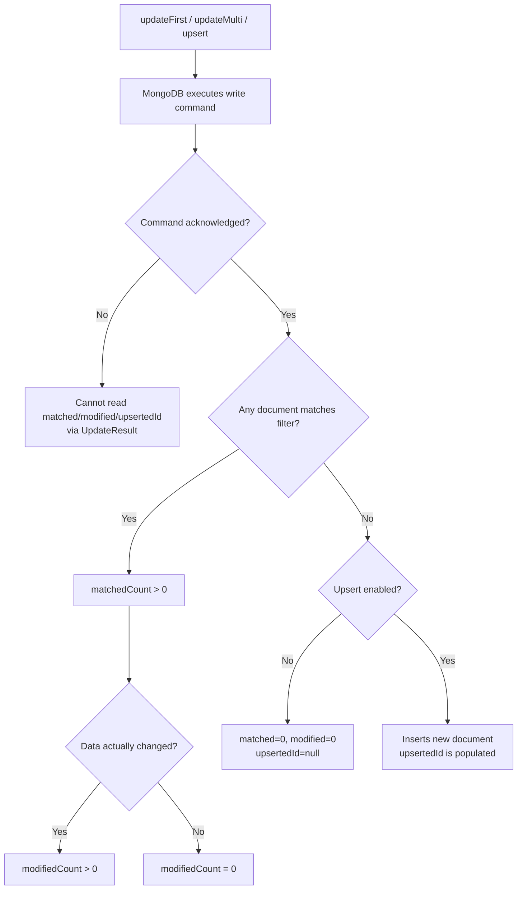

# UpdateResult: acknowledged, matchedCount, modifiedCount, and upsertedId

> **Chapter:** Writes and Updates  
> **Module:** `SPRING_DATA_MONGODB` — using Spring Data MongoDB to connect, map documents, and operate on MongoDB via `MongoTemplate` or repositories. This lesson explains **the result of an update operation** through `com.mongodb.client.result.UpdateResult`, from the exact meaning of each field to handling conflicts, upserts, write concern, testing, and performance diagnostics. It serves as the foundation for safely implementing conditional updates, aggregation updates, transactions, and reactive access.

## 1. Problem: Calling Update Does Not Mean Data Changed

Suppose a payment service wants to transition order `ORD-001` from `PENDING` to `PAID`:

```java
UpdateResult result = mongoTemplate.updateFirst(
    Query.query(Criteria.where("id").is("ORD-001")
        .and("status").is("PENDING")),
    new Update().set("status", "PAID"),
    Order.class
);
```

The command has been sent, yet the application still has to answer:

- Did MongoDB **acknowledge** the write operation?
- Did the `id` and `status` conditions match **any document**?
- Was the matched document **actually modified**?
- If **upsert** was enabled and no document was found, did the server **create a new document**?

`UpdateResult` helps answer these with four pieces of information:

```java
boolean acknowledged = result.wasAcknowledged();
long matched = result.getMatchedCount();
long modified = result.getModifiedCount();
BsonValue upsertedId = result.getUpsertedId();
```

**Note:** always check `wasAcknowledged()` before calling the other getters. If the operation used an **unacknowledged write concern**, matched/modified counts and upserted ID are not guaranteed to be available; calling the getters on an unacknowledged `UpdateResult` can throw `UnsupportedOperationException`.

### Mental Model



This diagram illustrates the **successful and acknowledged write** branches; write concern errors, duplicate key errors, dropped connections, or other failures can cause the call to **throw an exception** instead of returning a normal `UpdateResult`.

## 2. Where Does UpdateResult Come From?

In the MongoDB Java Driver, the type:

```java
import com.mongodb.client.result.UpdateResult;
import org.bson.BsonValue;
```

represents the outcome of supported update operations. In **imperative Spring Data MongoDB**, several APIs return `UpdateResult` directly:

```java
UpdateResult one =
    mongoTemplate.updateFirst(query, update, Order.class);

UpdateResult many =
    mongoTemplate.updateMulti(query, update, Order.class);

UpdateResult insertedOrUpdated =
    mongoTemplate.upsert(query, update, Order.class);
```

The three methods differ in intent:

| Method | Effect | Upserts When Unmatched? |
| --- | --- | --- |
| `MongoTemplate.updateFirst` | Updates at most one document matching the filter. | **No** in this standard call form. |
| `MongoTemplate.updateMulti` | Updates all documents matching the filter. | **No** in this standard call form. |
| `MongoTemplate.upsert` | Updates a matching document; if none exists, inserts one new document. | **Yes**. |

Other Spring Data methods may **not** return `UpdateResult`:

- `MongoRepository.save(entity)` returns the saved entity.
- `MongoTemplate.findAndModify(…)` typically returns the entity (pre- or post-update depending on options), not `UpdateResult`.
- `MongoTemplate.remove(…)` returns `DeleteResult`.
- `BulkOperations.execute()` returns `BulkWriteResult`, which carries its own statistics across multiple operations.

Do not force every write into `UpdateResult`: pick the API according to business intent and the return data required.

## 3. Exact Meaning of the Four Pieces of Information

### 3.1. `wasAcknowledged()`: Did the Server Acknowledge the Operation?

`result.wasAcknowledged()` indicates whether the result is **acknowledged** under the operation's write concern.

- `true`: the driver received a result that can report matched/modified/upserted counts on success.
- `false`: the operation is **unacknowledged**; the application must not infer matched or modified counts from the getters.

**Acknowledged does not mean majority-durable.** Write concerns `w:1` and `majority` provide different durability guarantees; both are acknowledged on success. `wasAcknowledged()` alone does not tell you whether a majority of replicas confirmed the write unless you know the active write concern.

### 3.2. `getMatchedCount()`: How Many Documents Matched the Filter?

`getMatchedCount()` is the number of documents matching the update's search predicate:

- For `updateFirst`: typically **0 or 1**.
- For `updateMulti`: can range from **0 to many documents**.
- For an **upsert that inserts** because no document matched: `matchedCount = 0`, because when the filter was evaluated no existing document was updated.

Matched **does not mean** the document changed. A document can match the filter while `$set` writes the exact value already stored.

### 3.3. `getModifiedCount()`: How Many Documents Actually Changed?

`getModifiedCount()` measures **how many documents were actually modified**, not how many fields changed, not bytes written, and not API call count.

Example:

```javascript
// Document before update:
{ _id: "ORD-001", status: "PAID", attemptCount: 2 }

// Writing the exact value already present:
db.orders.updateOne(
  { _id: "ORD-001" },
  { $set: { status: "PAID" } }
);
```

A standard acknowledged outcome is `matchedCount = 1`, `modifiedCount = 0`. The server found the document, yet needed no change to `status`.

Conversely, changing `status` from `PAID` to `REFUNDED` yields `matchedCount = 1` and `modifiedCount = 1` in a successful operation. If an `updateMulti` modifies three fields inside the same document, **`modifiedCount` still increases by only one** for that document.

### 3.4. `getUpsertedId()`: ID of the Document Newly Inserted via Upsert

When `upsert` finds no matching document and **inserts a new one**, `getUpsertedId()` typically returns a `BsonValue` holding the ID of the newly inserted document. In contrast:

- If upsert **updates an existing document**, `getUpsertedId() == null`.
- If a regular update finds no document and **upsert is off**, `getUpsertedId() == null`.

`getUpsertedId()` is a **BSON value**, not necessarily a Java `String` or `ObjectId`:

```java
BsonValue id = result.getUpsertedId();

if (id != null) {
    if (id.isObjectId()) {
        String hex = id.asObjectId().getValue().toHexString();
    } else if (id.isString()) {
        String text = id.asString().getValue();
    }
}
```

For server/driver-generated IDs, the type is typically `BsonObjectId`; for business string IDs not converted to ObjectId, it may be `BsonString`. **Do not call `asObjectId()` unconditionally**, as application data may use a different `_id` type.

## 4. Interpreting Value Combinations

Assuming every command below **is acknowledged and throws no exception**:

| Scenario | matchedCount | modifiedCount | upsertedId |
| --- | ---: | ---: | --- |
| `updateFirst` finds no matching document | 0 | 0 | `null` |
| `updateFirst` matches, but `$set` writes the existing value | 1 | 0 | `null` |
| `updateFirst` matches and changes a value | 1 | 1 | `null` |
| `updateMulti` matches 5 documents, only 3 need changes | 5 | 3 | `null` |
| `updateMulti` matches 5 documents, all 5 change | 5 | 5 | `null` |
| `upsert` matches a document and updates it | 1 | 0 or 1 | `null` |
| `upsert` does not match, inserts new document | 0 | 0 | Newly created BSON ID |

Rules for reading the table:

1. **`matchedCount > 0`**: at least one document satisfied the predicate; does not prove values changed.
2. **`modifiedCount > 0`**: at least one document was modified within the scope of the executed operation.
3. **`matchedCount = 0`**: either the ID was not found or state/version conditions did not match; for upsert, also inspect `upsertedId`.
4. **`upsertedId != null`**: a new document was created via upsert; `modifiedCount` for this insert is **0**, not 1.

The count of documents newly inserted by upserts **is not included in `modifiedCount`**. To track business metrics for "inserted vs. updated," examine `upsertedId`, `matchedCount`, and the operation's intent together.

## 5. Domain Example and MongoTemplate

### 5.1. Model Used Throughout

The application example uses two update-relevant fields: `status` and `attemptCount`.

```java
package demo.orders;

import java.time.Instant;
import org.springframework.data.annotation.Id;
import org.springframework.data.mongodb.core.mapping.Document;

@Document(collection = "orders")
public class Order {
    @Id
    private String id;
    private String status;
    private long attemptCount;
    private Instant createdAt;
    private boolean archived;

    protected Order() {}

    public Order(String id, String status, long attemptCount, Instant createdAt) {
        this(id, status, attemptCount, createdAt, false);
    }

    public Order(String id, String status, long attemptCount,
                 Instant createdAt, boolean archived) {
        this.id = id;
        this.status = status;
        this.attemptCount = attemptCount;
        this.createdAt = createdAt;
        this.archived = archived;
    }

    public String getId() { return id; }
    public String getStatus() { return status; }
    public long getAttemptCount() { return attemptCount; }
    public Instant getCreatedAt() { return createdAt; }
    public boolean isArchived() { return archived; }
}
```

In the service, use the core imports:

```java
import com.mongodb.client.result.UpdateResult;
import org.springframework.data.mongodb.core.MongoTemplate;
import org.springframework.data.mongodb.core.query.Criteria;
import org.springframework.data.mongodb.core.query.Query;
import org.springframework.data.mongodb.core.query.Update;
```

Example seeding a document:

```java
mongoTemplate.insert(
    new Order("ORD-001", "PENDING", 0L,
        Instant.parse("2026-11-20T09:00:00Z"))
);
```

`mongoTemplate` is an injected `MongoTemplate` bean in the service/test, not an ambient global variable.

### 5.2. Conditional State Transition

```java
Query filter = Query.query(
    Criteria.where("id").is("ORD-001")
        .and("status").is("PENDING")
);

Update update = new Update().set("status", "PAID");
UpdateResult result =
    mongoTemplate.updateFirst(filter, update, Order.class);

if (!result.wasAcknowledged()) {
    throw new IllegalStateException("Write was not acknowledged");
}

if (result.getMatchedCount() == 0) {
    // No document satisfied both id and PENDING status.
    // Do not jump to the conclusion that the order does not exist at all.
}

if (result.getModifiedCount() == 1) {
    // One document was modified.
}
```

Semantically equivalent to:

```javascript
db.orders.updateOne(
  { _id: "ORD-001", status: "PENDING" },
  { $set: { status: "PAID" } }
);
```

With `@Id String id` containing `ORD-001`, Spring Data uses metadata to map `id` to BSON `_id`; because this string is not a 24-hex ObjectId, the illustration stores `_id` as a BSON String. With valid 24-hex strings, the ID converter may change the BSON type; standardize data/ID types in real systems.

### 5.3. Second Run: matchedCount Changes

After the first transition `PENDING → PAID`, running the **exact same filter** `status = "PENDING"` again:

```java
UpdateResult second =
    mongoTemplate.updateFirst(filter, update, Order.class);

// Assuming no other request altered the status:
// second.getMatchedCount() == 0
// second.getModifiedCount() == 0
```

Because the filter looks only for `PENDING`, the `PAID` document **no longer matches**. This is how you write a **conditional state transition** that prevents two requests from completing the same business step based on stale state.

Compare with filtering solely by ID:

```java
Query byId =
    Query.query(Criteria.where("id").is("ORD-001"));

UpdateResult sameValue =
    mongoTemplate.updateFirst(
        byId, new Update().set("status", "PAID"), Order.class
    );

// matchedCount can be 1, modifiedCount can be 0.
```

The two different outcomes come from the **filter**, not random Spring Data behavior. Distinguishing "did not match" from "matched but needed no change" is the main purpose of `UpdateResult`.

## 6. updateMulti: matchedCount Is Not modifiedCount

Suppose five orders are selected by status:

```javascript
{ _id: "A", status: "PAID", archived: false }
{ _id: "B", status: "PAID", archived: false }
{ _id: "C", status: "PAID", archived: true  }
{ _id: "D", status: "PAID", archived: true  }
{ _id: "E", status: "PAID", archived: false }
```

To mark all `PAID` orders as archived:

```java
Query filter = Query.query(
    Criteria.where("status").is("PAID")
);

Update update = new Update().set("archived", true);

UpdateResult result =
    mongoTemplate.updateMulti(filter, update, Order.class);
```

`Order` in Section 5 already has an `archived` property, so you can test directly with the same entity. **Illustrative outcome** when all documents match the snippet above and no concurrent writes occur:

```text
matchedCount = 5
modifiedCount = 3
upsertedId = null
```

Documents `C` and `D` already had `archived: true`, so their values needed no change. Documents `A`, `B`, and `E` were changed. `modifiedCount` counts **documents**, not fields.

In production, updating multiple documents **is not automatically a multi-document transaction**. Each MongoDB document update is atomic at the document level; when all must succeed together or roll back as a unit, consider multi-document transactions on a supported topology.

### 6.1. When to Use updateFirst vs. updateMulti?

| Need | Choice |
| --- | --- |
| Modify only one order by unique `_id` | `updateFirst` |
| Transition one order if currently `PENDING` | `updateFirst` with a filter including status |
| Update a flag on all records matching a condition | `updateMulti` |
| Create a document if the ID is missing | `upsert` with suitable predicate/unique index |
| Retrieve the document before/after editing | `findAndModify` or equivalent, not just `UpdateResult` |

**Be careful with `updateFirst` without a unique filter:** if multiple documents match, only one is updated. When ordering/priority criteria apply, choose the right API and check version-specific behavior; never implicitly assume MongoDB picks the "first" record in natural order.

## 7. Upsert and the Meaning of upsertedId

**Upsert** means "update if found; insert if absent," used when creation is **intentional business behavior**, not a workaround for "update didn't find anything."

### 7.1. Example: Create If Missing

```java
import java.time.Instant;

Query query =
    Query.query(Criteria.where("id").is("ORD-NEW-001"));

Update update = new Update()
    .set("status", "PENDING")
    .setOnInsert("createdAt", Instant.parse("2026-11-20T09:00:00Z"))
    .setOnInsert("attemptCount", 0L);

UpdateResult result = mongoTemplate.upsert(
    query, update, Order.class
);
```

With an initial collection lacking `ORD-NEW-001`, MongoDB inserts a new document. Expected result:

```text
wasAcknowledged() = true
getMatchedCount() = 0
getModifiedCount() = 0
getUpsertedId() = BsonString("ORD-NEW-001")  // if _id is indeed a BSON String
```

Once the document exists and the query matches `_id`, a subsequent upsert takes the **update** branch, typically yielding:

```text
getMatchedCount() = 1
getModifiedCount() = 0 or 1
getUpsertedId() = null
```

`$setOnInsert` sets fields only when MongoDB **inserts via upsert**. It does not overwrite `createdAt` or `attemptCount` when updating an existing document. Fields in `$set` apply in both update and insert branches.

### 7.2. Do Not Use modifiedCount to Detect an Insert

Incorrect pattern:

```java
if (result.getModifiedCount() == 0) {
    // Wrong: concluding nothing was written.
}
```

When an upsert inserts a new document, `modifiedCount` is also **0**. Check properly:

```java
if (!result.wasAcknowledged()) {
    throw new IllegalStateException("Unacknowledged write");
}

if (result.getUpsertedId() != null) {
    // INSERT branch via upsert.
} else if (result.getMatchedCount() > 0) {
    // UPDATE branch on an existing document.
} else {
    // Neither update nor insert confirmed; investigate API and predicates.
}
```

For a successful upsert, the final branch is unusual and indicates something to diagnose if it violates your application contract.

### 7.3. Concurrency Considerations and Unique Indexes

Two workers can concurrently upsert the same **business key** that does not yet exist. If the filter is not backed by an appropriate unique index, concurrent upserts risk creating duplicate documents for the same business key.

Example:

```javascript
db.orders.createIndex(
  { externalOrderCode: 1 },
  { unique: true }
);
```

A unique index enforces uniqueness at the database layer. Under contention, one request may receive a duplicate key error and must handle/retry it according to business strategy. **Do not assume `UpdateResult` will return `matchedCount=0` instead of throwing a duplicate key exception.**

If using `_id` as the lookup key, MongoDB maintains a default unique index on `_id`. For other keys such as `tenantId + externalOrderCode`, design a unique compound index matching real data scope. Also ensure filters and indexes use consistent BSON types.

## 8. Acknowledged and Write Concern: Reading Results in Context

### 8.1. Write Concern Levels

MongoDB supports write concerns to define how writes are acknowledged. Depending on topology and configuration:

| Write Concern | General Meaning | UpdateResult Behavior |
| --- | --- | --- |
| `w: 0` | Client does not ask the server to acknowledge the write outcome. | Typically returns an unacknowledged `UpdateResult`; **do not call count getters**. |
| `w: 1` | Primary acknowledges the operation per the write concern level. | Returns acknowledged result with readable counts. |
| `majority` | Requires acknowledgment from a majority of voting data-bearing nodes per MongoDB rules. | On success, result is acknowledged and counts are readable. |

`w: 1` does not mean data is safe across **every failover scenario**. `majority` offers different durability guarantees and also interacts with journaling, read concern, replication topology, and write concern timeout.

**You cannot infer the write concern from `wasAcknowledged() == true`.** You must know the configuration on `MongoClient`, `MongoDatabase`, `MongoCollection`, or the active transaction.

### 8.2. Java Driver Example

```java
import com.mongodb.WriteConcern;
import com.mongodb.client.MongoCollection;
import com.mongodb.client.result.UpdateResult;
import com.mongodb.client.model.Filters;
import com.mongodb.client.model.Updates;
import org.bson.Document;

MongoCollection<Document> collection =
    mongoTemplate.getCollection("orders");

UpdateResult result = collection
    .withWriteConcern(WriteConcern.MAJORITY)
    .updateOne(
        Filters.eq("_id", "ORD-001"),
        Updates.set("status", "PAID")
    );
```

`withWriteConcern(…)` here creates a **collection view** using the specified write concern for operations invoked on that view. It **does not automatically alter `MongoTemplate.updateFirst` calls** elsewhere.

Inside a transaction, write concern should be configured at the transaction/client level per MongoDB rules; do not arbitrarily attach per-operation write concerns inside a transaction expecting standalone semantics.

### 8.3. Unacknowledged Case

```java
UpdateResult result = collection
    .withWriteConcern(WriteConcern.UNACKNOWLEDGED)
    .updateOne(Filters.eq("_id", "ORD-001"),
               Updates.set("status", "PAID"));

if (!result.wasAcknowledged()) {
    // Cannot infer how many documents matched or changed.
    // Do not call result.getMatchedCount()/getModifiedCount().
}
```

Especially for payments, balances, or critical order states, unacknowledged writes are generally unsuitable because the application cannot rely on counts or confirmations as expected.

### 8.4. Exceptions: No Successful Result to Interpret

Errors such as:

- Duplicate key on upsert or insert.
- Write concern error/timeout.
- Validation error or schema violation.
- Network interruption or server selection timeout.
- Transaction conflicts or other MongoDB write errors.

can cause the method to throw an exception. **Never write logic assuming every update call returns a valid `UpdateResult` to inspect.**

In particular, if a connection drops right after sending a command, the client **cannot know for sure** whether the server applied the write. Design retries around retryable writes, idempotency keys, and data conditions; never assume a network error means the server did not write.

## 9. Checking Results to Protect Business Logic

### 9.1. Case: "Pay Only Once"

Suppose each order may transition `PENDING → PAID` only once. The filter must include the prior state:

```java
public boolean markPaid(String orderId) {
    Query query = Query.query(
        Criteria.where("id").is(orderId)
            .and("status").is("PENDING")
    );
    Update update = new Update().set("status", "PAID");

    UpdateResult result =
        mongoTemplate.updateFirst(query, update, Order.class);

    if (!result.wasAcknowledged()) {
        throw new IllegalStateException("Unknown write outcome");
    }
    return result.getModifiedCount() == 1;
}
```

With this filter and no auxiliary updates, `modifiedCount == 1` typically means the application successfully performed the state transition. If `matchedCount == 0`, possible causes are:

1. No document exists with that ID.
2. The order is already `PAID`.
3. The order is in another state such as `CANCELLED`.
4. Another request modified the status first.

Looking solely at `matchedCount==0` **cannot distinguish** these four causes. If the API needs specific error responses (`404` not found, `409` invalid state, `200` idempotent), you can re-read the document and apply business rules. The follow-up read can also race, so define the semantics your API accepts.

### 9.2. Idempotency and No-Op Results

A command:

```java
new Update().set("status", "PAID")
```

executed multiple times may cause no further change after the first run if the filter still matches. This is an example of **`$set` with the same value acting as a no-op**.

By contrast:

```java
new Update().inc("attemptCount", 1)
```

increments the value on every execution and is **not idempotent** in the ordinary sense. When a client retries after a network error, `$inc` can increment more times than intended without proper protection; driver retryable writes cover specific scenarios but do not replace business rules when a request is re-sent as a new operation.

If business rules require "apply each payment event at most once," use transactions, unique event IDs, version predicates, or an event ledger model instead of relying solely on `modifiedCount`.

### 9.3. matchedCount = 1, modifiedCount = 0 Is Not Necessarily an Error

This outcome can represent a successful idempotent operation:

```text
Filter: { _id: "ORD-001" }
Update: { $set: { status: "PAID" } }
Document before: status="PAID"
matchedCount=1, modifiedCount=0
```

For an API meaning "ensure status is PAID," the result may be considered a success. For an API meaning "transition status from PENDING to PAID and emit an event," require the old status in the filter and emit the event only when the transition actually occurred.

**Ask the business question before mapping `modifiedCount=0` to an HTTP error.**

## 10. UpdateResult and Optimistic Locking with @Version

### 10.1. Why Matching Only _id Is Not Enough

Two requests read the same order:

```text
Request A reads ORD-001, version=3, status=PENDING.
Request B reads ORD-001, version=3, status=PENDING.
A writes PAID.
B writes CANCELLED later.
```

If both updates filter only on `_id`, request B can overwrite A's result. Both `UpdateResult` objects might report matched=1/modified=1, yet the final data no longer reflects the intended decision.

### 10.2. Querying by ID and Expected Version

```java
import org.springframework.data.annotation.Id;
import org.springframework.data.annotation.Version;
import org.springframework.data.mongodb.core.mapping.Document;

@Document(collection = "versioned_orders")
public class VersionedOrder {
    @Id private String id;
    @Version private Long version;
    private String status;

    protected VersionedOrder() {}
    public String getId() { return id; }
    public Long getVersion() { return version; }
    public String getStatus() { return status; }
}
```

When updating conditionally on the current version:

```java
long expectedVersion = 3L;

Query query = Query.query(
    Criteria.where("id").is("ORD-001")
        .and("version").is(expectedVersion)
        .and("status").is("PENDING")
);

Update update = new Update().set("status", "PAID");

UpdateResult result = mongoTemplate.updateFirst(
    query, update, VersionedOrder.class
);

if (result.wasAcknowledged() && result.getMatchedCount() == 0) {
    // Could be missing ID, wrong status, or changed version.
    // Cannot uniquely determine the cause from counts alone.
}
```

Under Spring Data MongoDB's `@Version` support, update operations that do not explicitly declare the version field in `Update` can have the framework **auto-increment the version**. What business logic must ensure is that the **filter contains the expected version**; otherwise, auto-incrementing version without checking the prior version still allows concurrent updates to overwrite one another.

With repository `save(entity)` on a versioned entity, Spring Data applies optimistic locking under its own semantics and can throw `OptimisticLockingFailureException` on version mismatch. With direct `updateFirst`, the application must read `UpdateResult` and handle `matchedCount=0` per its filter. Do not conflate the two APIs.

**Configure an appropriate acknowledged write concern** so conflicts are observable. If updates run unacknowledged, `matchedCount` cannot be used to confirm optimistic compare-and-set.

### 10.3. Avoid Checking Existence First and Writing Without Predicates

Weak pattern:

```java
if (orderRepository.existsById(orderId)) {
    mongoTemplate.updateFirst(
        Query.query(Criteria.where("id").is(orderId)),
        new Update().set("status", "PAID"),
        Order.class
    );
}
```

Between `existsById` and `updateFirst`, the document can be deleted or change state. This is a **time-of-check to time-of-use race**. It is usually better to let **a single update with a complete filter** decide whether the predicates still hold at write time, then inspect `matchedCount`.

## 11. Arrays/Operators and Unexpected modifiedCount Cases

### 11.1. $addToSet May Not Change Data

```javascript
// Before: { _id: "ORD-001", tags: ["priority"] }
db.orders.updateOne(
  { _id: "ORD-001" },
  { $addToSet: { tags: "priority" } }
);
```

If the array already contains `priority`, `$addToSet` does not add a duplicate, typically returning `matchedCount=1` and `modifiedCount=0`. This is not an error.

### 11.2. $push, $inc, and $currentDate Usually Produce Changes

Conversely, the following operators can modify the document on every execution:

```javascript
{ $push: { tags: "priority" } }
{ $inc: { attemptCount: 1 } }
{ $currentDate: { updatedAt: true } }
```

Do not infer an update is idempotent solely from `matchedCount`. You need to know the actual **operators** used. For arrays, `$addToSet`, `$pull`, and `$push` all have no-op or mutating cases depending on existing data.

### 11.3. $set Null vs. $unset

`$set: {customerNote: null}` keeps the field present as BSON Null, whereas `$unset: {customerNote: 1}` removes the field from BSON. Either operation can produce `modifiedCount=1` when it changes state, or `0` when the state already matches. This matters when legacy data mixes missing fields and explicit nulls.

Do not use `modifiedCount` to count how many fields were `$unset`: it counts **documents**, not fields.

## 12. Reactive UpdateResult: Same Semantics, Different Execution Model

`ReactiveMongoTemplate.updateFirst` typically returns `Mono<UpdateResult>`; the database command executes upon subscription in the pipeline.

```java
import com.mongodb.client.result.UpdateResult;
import org.springframework.data.mongodb.core.query.Criteria;
import org.springframework.data.mongodb.core.query.Query;
import org.springframework.data.mongodb.core.query.Update;
import reactor.core.publisher.Mono;

Query query = Query.query(
    Criteria.where("id").is("ORD-001")
        .and("status").is("PENDING")
);

Update update = new Update().set("status", "PAID");

Mono<UpdateResult> resultMono =
    reactiveMongoTemplate.updateFirst(query, update, Order.class);

Mono<Boolean> changed = resultMono.flatMap(result -> {
    if (!result.wasAcknowledged()) {
        return Mono.error(
            new IllegalStateException("Write not acknowledged")
        );
    }
    return Mono.just(result.getModifiedCount() == 1);
});
```

With a reactive repository, `save(…)` typically returns `Mono<Order>`, **not** `Mono<UpdateResult>`. The reactive template is the right choice when you need exact matched/modified/upserted metrics from a direct update.

Do not arbitrarily call `block()` on the event loop; return the `Mono` to the upper layer and let the framework manage subscription, transaction context, and cancellation. BSON fields, matched/modified counts, and write concerns **do not change meaning simply because reactive APIs are used**.

### 12.1. Why Control Retries in Reactive Pipelines?

The snippet below looks concise yet can be dangerous:

```java
return reactiveMongoTemplate.updateFirst(
    query,
    new Update().inc("attemptCount", 1),
    Order.class
).retry(3);
```

`retry(3)` can cause the publisher to re-execute the operation on error; `$inc` is not idempotent if an update already occurred and only the acknowledgement was lost. Add retries only when you understand retryable writes, filter/idempotency predicates, and which error types are safe to retry.

## 13. Transactions, Performance, and Monitoring Outcomes

### 13.1. UpdateResult Inside a Transaction

An update inside a transaction can return an `UpdateResult` reflecting the operation within the transaction, yet **the transaction can still fail on commit**. Do not treat `matchedCount=1` inside a transaction as final proof that the entire transaction committed durably.

Points to check:

- Do the transaction manager and MongoDB topology support transactions?
- Are write commands and commit acknowledged per configuration?
- If commit fails with an uncertain outcome, is the retry/recovery flow safe?
- Are events or external system side effects emitted before commit?

`UpdateResult` reports the result of **a single operation**, not a summary of the whole transaction.

### 13.2. Query Plans Determine Update Lookup Time

Example updating by `status` and `createdAt`:

```javascript
db.orders.updateMany(
  {
    status: "EXPIRED",
    createdAt: { $lt: ISODate("2026-11-01T00:00:00Z") }
  },
  { $set: { archived: true } }
);
```

To evaluate indexes and filter selectivity, you can measure an equivalent read query:

```javascript
db.orders.find({
  status: "EXPIRED",
  createdAt: { $lt: ISODate("2026-11-01T00:00:00Z") }
}).explain("executionStats");
```

A candidate index:

```javascript
db.orders.createIndex({
  status: 1,
  createdAt: 1
});
```

`explain` on `find` clarifies how documents are filtered, but **does not directly measure total update cost** such as index writes, locking, oplog, replication, or disk I/O. Measure duration, `matchedCount`/`modifiedCount`, request rate, server metrics, and write concern under realistic workloads.

### 13.3. Business Metrics from UpdateResult

A service running a multi-document job can log metrics:

```java
if (result.wasAcknowledged()) {
    log.info(
        "Bulk archive result: matched={}, modified={}, upserted={}",
        result.getMatchedCount(),
        result.getModifiedCount(),
        result.getUpsertedId() != null
    );
}
```

Here `log` is the project logger, such as SLF4J. Logs should not include private data or entire documents; include job ID, operation type, duration, and aggregate counters with controlled cardinality.

**Do not turn `matchedCount` into "business completions"** when logic requires documents to actually change. Operational metrics must clearly separate matched, modified, upserted inserts, and error counts as distinct dimensions.

## 14. Integration Testing: Distinguishing Real Branches

A test that merely invokes a method and asserts no exception was thrown is insufficient. Seed data **rich enough to distinguish** each scenario.

### 14.1. Preparing the Test Environment

Run against a real MongoDB test instance (such as Testcontainers) with an acknowledged write concern, dedicated database, and isolated seed data. Avoid running `dropCollection` against environments holding real data.

Cases:

| Test | Prior Data | Operation | Expected |
| --- | --- | --- | --- |
| No match | No `ORD-X` | `updateFirst` on `ORD-X` | 0 / 0 / null |
| Match and change | `ORD-A` status=PENDING | `$set` status=PAID | 1 / 1 / null |
| Match but no-op | `ORD-A` status=PAID | `$set` status=PAID | 1 / 0 / null |
| Multi-document update | 5 match, 3 need edit | `updateMulti` `$set` same value | 5 / 3 / null |
| Upsert insert | No `ORD-N` | `upsert` by ID | 0 / 0 / ID |
| Upsert update | `ORD-N` exists | Repeat upsert | 1 / 0 or 1 / null |
| Version conflict | Document at version=4 | Update with expected=3 | matched=0 |
| Unacknowledged | WriteConcern.UNACKNOWLEDGED | Driver update | `wasAcknowledged=false` |

In results formatted `matched / modified / upsertedId`, "null" means no new document was created via upsert.

### 14.2. JUnit 5 Example: Update and No-Op

Assuming a test class with an injected `MongoTemplate mongoTemplate` and an isolated database/collection:

```java
import static org.assertj.core.api.Assertions.assertThat;

import java.time.Instant;
import org.junit.jupiter.api.BeforeEach;
import org.junit.jupiter.api.Test;
import com.mongodb.client.result.UpdateResult;
import org.springframework.beans.factory.annotation.Autowired;
import org.springframework.boot.test.context.SpringBootTest;
import org.springframework.data.mongodb.core.MongoTemplate;
import org.springframework.data.mongodb.core.query.Criteria;
import org.springframework.data.mongodb.core.query.Query;
import org.springframework.data.mongodb.core.query.Update;

@SpringBootTest
class OrderUpdateResultTest {
    @Autowired
    private MongoTemplate mongoTemplate;

    @BeforeEach
    void seed() {
        mongoTemplate.dropCollection(Order.class);
        mongoTemplate.insert(new Order(
            "ORD-A", "PENDING", 0L,
            Instant.parse("2026-11-20T09:00:00Z")
        ));
    }

    @Test
    void distinguishesChangedAndNoOp() {
        Query byId = Query.query(Criteria.where("id").is("ORD-A"));

        UpdateResult first = mongoTemplate.updateFirst(
            byId, new Update().set("status", "PAID"), Order.class
        );
        assertThat(first.wasAcknowledged()).isTrue();
        assertThat(first.getMatchedCount()).isEqualTo(1L);
        assertThat(first.getModifiedCount()).isEqualTo(1L);
        assertThat(first.getUpsertedId()).isNull();

        UpdateResult second = mongoTemplate.updateFirst(
            byId, new Update().set("status", "PAID"), Order.class
        );
        assertThat(second.getMatchedCount()).isEqualTo(1L);
        assertThat(second.getModifiedCount()).isZero();
    }
}
```

This snippet illustrates an **integration test layout** using Spring Boot and `MongoTemplate`; you still need an isolated test MongoDB connection (such as Testcontainers) and appropriate application configuration. **Never call `dropCollection` on a shared database.** For a MongoDB slice test, `@DataMongoTest` can be used on supported versions. Verify readback of `status` to confirm the real collection was updated.

### 14.3. Upsert Test Example

```java
@Test
void upsertReturnsNewIdOnlyWhenInserted() {
    Query query = Query.query(
        Criteria.where("id").is("ORD-NEW-001")
    );
    Update update = new Update().set("status", "PENDING");

    UpdateResult first =
        mongoTemplate.upsert(query, update, Order.class);

    assertThat(first.wasAcknowledged()).isTrue();
    assertThat(first.getMatchedCount()).isZero();
    assertThat(first.getModifiedCount()).isZero();
    assertThat(first.getUpsertedId()).isNotNull();

    UpdateResult second =
        mongoTemplate.upsert(query, update, Order.class);

    assertThat(second.getMatchedCount()).isEqualTo(1L);
    assertThat(second.getUpsertedId()).isNull();
}
```

This method belongs inside a test class with `mongoTemplate` and a test database. With standardized string IDs, you can assert `first.getUpsertedId().asString().getValue()`, after verifying the raw BSON type before casting.

### 14.4. Check Counts Without Ignoring Concurrency Bugs

To test optimistic updates, issue two requests based on the same version 0:

1. Both build filters with `id` and `version=0`.
2. One request succeeds and increments the version.
3. The other request gets `matchedCount=0` once the version predicate fails.
4. Assert the final data and conflict-handling policy.

In multi-threaded environments, tests should use a latch/barrier to ensure genuine contention; do not draw concurrency conclusions solely from two sequential calls. In introductory exercises, simulating stale versions with sequential requests is still useful for validating filter conditions.

## 15. Common Pitfalls

| Symptom | Common Cause | Resolution |
| --- | --- | --- |
| `matchedCount=1` but `modifiedCount=0` | `$set` with same value, duplicate `$addToSet`, `$unset` on missing field, or no-op | Do not treat as an error by default; check operators and business rules |
| `matchedCount=0` during state transition | Missing ID, mismatched status/version, or another request modified it first | Distinguish causes using predicates and follow-up reads if needed; do not blindly return 404 |
| Upsert inserts yet `modifiedCount=0` | New inserts are not counted in `modifiedCount` | Check `upsertedId` |
| `upsertedId=null` despite calling upsert | A document matched, so it updated instead of inserting | Check `matchedCount` and actual BSON |
| `getUpsertedId().asObjectId()` throws error | New ID is `BsonString` or another BSON type | Check `isObjectId()/isString()` before casting |
| UpdateResult getters throw `UnsupportedOperationException` | Unacknowledged write concern | Check `wasAcknowledged()` and write concern config |
| `wasAcknowledged=true` yet replica failover loses data | Acknowledgment does not automatically mean majority durability | Review actual write concern level, replication, and failure model |
| Upsert creates two records with same business key | Missing unique index or concurrent requests | Add unique index at proper scope and handle duplicate key/retry |
| No UpdateResult because method threw exception | Write, validation, duplicate key, network, or write concern error | Handle exceptions separately; distinguish definite failure from uncertain outcome |
| Updates guarded by `existsById` suffer races | Check-then-update is not atomic with state predicates | Put full predicates in a single update filter |
| `updateMulti` has high matched but low modified | Some documents already held the target value | May be expected behavior; report both metrics |
| Direct write on versioned entity still overwrites | Omitted expected version from filter | Use version predicate/optimistic locking, not just version increment |
| Bulk job over-reports completed updates | Reporting `matchedCount` instead of `modifiedCount` or `upsertedId` depending on definition | Define metrics per business intent and log each separately |

**Step-by-step debugging order:** (1) identify which update method ran; (2) inspect the BSON filter and mapped field names; (3) inspect update operators; (4) check `wasAcknowledged`; (5) read matched/modified/upsertedId; (6) inspect raw document post-write; (7) check write concern, exceptions, and query plan if anomalous.

## 16. Hands-on Lab: Order Processing and Event Synchronization

**Context:** a service receives payment events, updates orders, and syncs partner records. Data uses stable business IDs.

1. Create the `Order` entity and `orders` collection with `_id`, `status`, `attemptCount`, `createdAt`, and `archived`.
2. Insert a `PENDING` order. Use `updateFirst` with `id + status` predicates to transition to `PAID`. Print `wasAcknowledged`, `matchedCount`, `modifiedCount`, and `upsertedId`.
3. Re-run the exact same update with `status = PENDING` and explain why `matchedCount=0`.
4. Change the filter to ID-only and `$set` the same `PAID` value. Explain why `matched=1, modified=0`.
5. Create five `PAID` orders, two with `archived=true`. Use `updateMulti` to `$set archived=true` and explain `matched=5, modified=3`.
6. Call `upsert` with a non-existent ID; verify `upsertedId` is populated and `modifiedCount=0`. Call a second time and verify the update branch.
7. Inspect the BSON type of `upsertedId`; test an `ObjectId`-typed ID in a separate test collection and compare against `BsonString`.
8. Test an update by `id + version`. After version increments, retry with the old version and confirm `matchedCount=0`.
9. Design a unique index on partner transaction ID or `tenantId + externalOrderCode`; simulate two competing upsert requests and handle duplicate key properly.
10. Run a multi-document job; measure `updateMulti`, filter indexes, write concern, and log matched/modified counts. Explain why total latency or durability cannot be inferred from counts alone.
11. Write a reactive version returning `Mono<UpdateResult>`, avoiding `block()` and avoiding reckless retries on `$inc`.
12. Create integration tests covering all branches, ensuring no writes hit production databases.

### Self-Check Questions

- What does `wasAcknowledged()` confirm? Does it mean data is durable on a majority of replicas?
- When is `matchedCount=1` while `modifiedCount=0`?
- Why does `modifiedCount` count documents rather than fields?
- Why does a new upsert insert yield `modifiedCount=0` even though the write succeeded?
- What return type does `getUpsertedId()` produce, and why can you not always cast it to `ObjectId`?
- Is `matchedCount=0` enough to conclude a document does not exist? Why or why not?
- How do `updateFirst`, `updateMulti`, and `upsert` differ in scope and document creation?
- Why does calling `existsById` before updating fail to eliminate race conditions?
- To prevent lost updates, what must be added to the filter when a domain entity has `@Version`?
- What is the double-increment risk when retrying `$inc` after a network error?
- Why is `UpdateResult` inside a transaction not proof that the entire transaction committed?

## 17. Key Takeaways and Official References

- **`UpdateResult`** represents the outcome of an update; check `wasAcknowledged()` before reading count getters.
- **`matchedCount`** is the count of documents matching the filter; **`modifiedCount`** is the count of documents **actually modified**, not the number of fields.
- **`upsertedId`** is populated only when an upsert **inserts a new document**; never use `modifiedCount` to detect an insert.
- **`matchedCount=0`** may result from mismatched ID, status, or version; it is insufficient to distinguish business causes alone.
- **`wasAcknowledged=true`** does not indicate durability (`w:1` vs. `majority`); write concern must be configured and understood independently.
- **Write errors can throw exceptions** instead of returning `UpdateResult`, notably duplicate keys, validation failures, write concern errors, or network errors.
- **Conditional updates on status/version** prevent races far better than separate `existsById` followed by update.
- **Idempotency depends on the update operator** (`$set` vs. `$inc`), not solely on the return type.
- **Reactive `Mono<UpdateResult>`** carries the same semantics; transactions, indexes, callbacks, and retries have their own constraints.

Official sources to verify against your project's versions:

- [Spring Data MongoDB — Template CRUD Operations](https://docs.spring.io/spring-data/mongodb/reference/mongodb/template-crud-operations.html)
- [Spring Data MongoDB — Optimistic Locking](https://docs.spring.io/spring-data/mongodb/reference/mongodb/template-crud-operations.html#mongo-template.optimistic-locking)
- [Spring Data MongoDB — Reactive Template APIs](https://docs.spring.io/spring-data/mongodb/reference/mongodb/template-crud-operations.html)
- [MongoDB — db.collection.updateOne()](https://www.mongodb.com/docs/manual/reference/method/db.collection.updateOne/)
- [MongoDB — db.collection.updateMany()](https://www.mongodb.com/docs/manual/reference/method/db.collection.updateMany/)
- [MongoDB — Write Concern](https://www.mongodb.com/docs/manual/reference/write-concern/)
- [MongoDB — $setOnInsert](https://www.mongodb.com/docs/manual/reference/operator/update/setOnInsert/)
- [MongoDB — Unique Indexes](https://www.mongodb.com/docs/manual/core/index-unique/)
