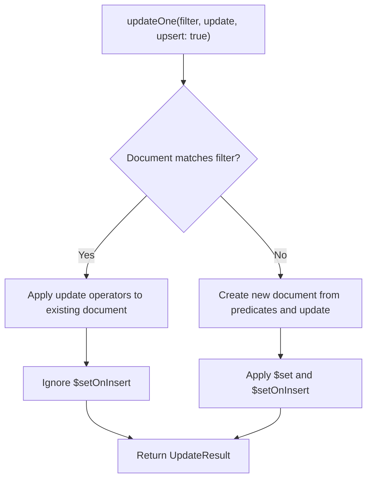

# Upsert and Insert-Only Values with setOnInsert

## 1. Problem: Create If Missing, Update If Existing

An order synchronization system receives events from an external service. Each event carries a `tenantId` and an `externalKey`. If this key is seen for the first time, the application must create a document with an initial status of `NEW` and a creation timestamp. If the document already exists, the application updates only the latest observed timestamp or specific mutable fields, **without resetting the status or creation date**.

This is the classic **upsert** problem: *update if found, insert if missing*. MongoDB provides the `upsert: true` option on certain update operations; the `$setOnInsert` operator lets you declare **values that are only assigned when the operation creates a new document**.

This lesson belongs to the **Writes and Updates** chapter of the **SPRING_DATA_MONGODB** module. Within the scope of using Spring Data MongoDB for connecting and mapping documents, operating via `MongoTemplate` or repositories, designing queries, aggregations, indexes, transactions, reactive access, testing, and performance diagnostics, upsert is a crucial mechanism because it sits at the intersection of **data correctness, concurrency, and write performance**.

After this lesson, you will be able to:

1. Accurately describe the two branches of an upsert and the role of `$setOnInsert`.
2. Distinguish `$set`, `$setOnInsert`, `insert`, `save`, and `updateFirst`.
3. Write upserts using `mongosh`, `MongoOperations`/`MongoTemplate`, and reactive APIs where supported.
4. Design business keys and **unique indexes** to prevent duplicate documents under concurrent requests.
5. Properly handle `createdAt`, initial status, `null`/missing values, duplicate key errors, and retry side effects.
6. Test both the insert branch and the update branch using real BSON, `UpdateResult`, and contention scenarios.

Examples use Java 17+ and modern imperative Spring Data MongoDB. Differences across MongoDB server, Java driver, and Spring Data versions should be verified in your project environment before production rollout.

## 2. What Is Upsert and How Does It Differ from a Regular Update?

A normal `updateOne(filter, update)` command modifies a document only if a matching document exists. If none matches, the operation returns `matchedCount = 0` without creating anything new.

When adding `upsert: true`:



| Scenario | `upsert: false` | `upsert: true` |
| --- | --- | --- |
| Matching document exists | Updates that document | Updates that document |
| No matching document | Does not create a document | Creates one new document per upsert rules |
| `$setOnInsert` when matched | No effect | No effect |
| `$setOnInsert` when unmatched | Does not create a document | Contributes values to the new document |

**Important distinction:** Upsert is an option on a write operation, not a type of document. Nor does it mean "check existence in Java first, then conditionally call insert or update": MongoDB performs the lookup and write on the server in a single operation.

### 2.1. Minimal Example in mongosh

```javascript
db.sync_records.updateOne(
  { tenantId: "tenant-a", externalKey: "evt-001" },
  {
    $set: { payloadHash: "sha256:a1", lastSeenAt: ISODate("2026-11-20T03:00:00Z") },
    $setOnInsert: {
      createdAt: ISODate("2026-11-20T03:00:00Z"),
      status: "NEW"
    }
  },
  { upsert: true }
);
```

If this is the first occurrence of key `(tenant-a, evt-001)`, a new document is created. If run again with the same filter when the document already exists, `payloadHash` and `lastSeenAt` can change, while `createdAt` and `status` **are not overwritten by `$setOnInsert`**.

Values like `ISODate(...)` in the example are BSON Dates. If real data stores timestamps as Strings or another type, define the contract and migration plan rather than assuming two types are interchangeable.

## 3. Exactly Where Do $set and $setOnInsert Differ?

This is the core of the lesson.

| Operator | Existing Document Matching Filter | New Document Created by Upsert |
| --- | --- | --- |
| `$set` | Writes or replaces the specified field | Writes the field into the new document |
| `$setOnInsert` | **Ignored** | Writes the field into the new document |
| `$inc` | Increments the current number | Initializes/increments the value per operator rules |
| `$unset` | Removes the field | Does not create that field |

An easy mental shortcut:

```text
$set          = "this must hold after the operation, whether insert or update"
$setOnInsert  = "this is assigned only when newly creating the record"
```

### 3.1. Why Putting createdAt in $set Is Wrong

An **unsuitable** example if you need to preserve the creation timestamp:

```javascript
db.sync_records.updateOne(
  { tenantId: "tenant-a", externalKey: "evt-001" },
  {
    $set: {
      status: "NEW",
      createdAt: new Date(),
      lastSeenAt: new Date()
    }
  },
  { upsert: true }
);
```

Every time the document matches, this command resets both `status` and `createdAt`. If a record is already `DONE`, re-running sync would revert it back to `NEW`—a severe business bug.

The right version when updating only the latest seen time:

```javascript
const now = new Date();

db.sync_records.updateOne(
  { tenantId: "tenant-a", externalKey: "evt-001" },
  {
    $set: { lastSeenAt: now, updatedAt: now },
    $setOnInsert: { createdAt: now, status: "NEW" }
  },
  { upsert: true }
);
```

Reusing the same `now` variable keeps timestamps consistent within one call. In distributed systems, evaluate whether using the application clock is acceptable; if database-assigned timestamps are required, consider operators like `$currentDate` for fields updated every time, paired with a dedicated contract for insert-only timestamps.

### 3.2. $setOnInsert Does Not Protect Fields From Other Operations

`$setOnInsert` is not a database-level immutability constraint. Another command:

```javascript
db.sync_records.updateOne(
  { tenantId: "tenant-a", externalKey: "evt-001" },
  { $set: { createdAt: ISODate("2030-01-01T00:00:00Z") } }
);
```

can still modify `createdAt` if no validation, permission, or other rule prevents it. `$setOnInsert` governs behavior **only within the upsert command being executed**.

## 4. Where Does the New Document Come From When Nothing Matches?

When upserting with update operator syntax, MongoDB constructs the new document from **eligible equality predicates in the filter** plus the update's modifications. Do not assume the server "verbatim copies every expression in the filter" into the document.

### 4.1. Simple Equality Filter

```javascript
db.sync_records.updateOne(
  {
    tenantId: "tenant-a",
    externalKey: "evt-002"
  },
  {
    $set: { payloadHash: "sha256:b2" },
    $setOnInsert: {
      status: "NEW",
      createdAt: ISODate("2026-11-20T03:05:00Z")
    }
  },
  { upsert: true }
);
```

The newly created document may look like:

```javascript
{
  _id: ObjectId("..."),  // Illustrative: server generates _id if absent.
  tenantId: "tenant-a",
  externalKey: "evt-002",
  payloadHash: "sha256:b2",
  status: "NEW",
  createdAt: ISODate("2026-11-20T03:05:00Z")
}
```

`ObjectId("...")` is an illustrative placeholder, **not a valid ObjectId string to copy and run**. On a real database, `_id` gets a concrete value assigned by the server/driver based on configuration and filter.

### 4.2. The Filter Is Not a Document Blueprint

Do not use filters containing `$or`, `$gte`, status predicates, or complex expressions assuming the server knows which fields and values to create. For upsert, it is best to filter on a **stable business key expressed via explicit equality**, and supply all other fields via the update.

Example to avoid:

```javascript
// Risky: status is a condition on current state,
// not part of the record's unique identifying key.
db.sync_records.updateOne(
  {
    tenantId: "tenant-a",
    externalKey: "evt-001",
    status: "NEW"
  },
  {
    $set: { payloadHash: "sha256:new" },
    $setOnInsert: { createdAt: new Date() }
  },
  { upsert: true }
);
```

If `evt-001` has already moved to `DONE`, the filter fails to match. Upsert may **attempt to insert a new record** instead of rejecting the transition. With a unique index on the business key, the operation can raise a duplicate key error; without one, it can create logical duplicates.

**Rule:** Search by key to identify **which record**; guard transitions with state predicates inside a **non-upsert update**, or design explicit error handling.

## 5. Designing Schema and Business Keys for the Example

### 5.1. Entity in Spring Data MongoDB

Suppose we store one record per external event key within each tenant:

```java
import java.time.Instant;
import org.bson.types.ObjectId;
import org.springframework.data.annotation.Id;
import org.springframework.data.mongodb.core.mapping.Document;

@Document(collection = "sync_records")
public record SyncRecord(
    @Id ObjectId id,
    String tenantId,
    String externalKey,
    String payloadHash,
    SyncStatus status,
    Instant createdAt,
    Instant updatedAt,
    Instant lastSeenAt
) {}

enum SyncStatus {
    NEW, PROCESSING, DONE, FAILED
}
```

Here `_id` is a BSON ObjectId, while the business key is the pair `tenantId + externalKey`. The two IDs serve different purposes: `_id` identifies a physical document; the business key pair identifies whether the event was already processed or synced earlier.

`SyncStatus` is a Java enum. Under standard mapping configurations, enums are written as Strings such as `"NEW"`; if the application uses a custom converter, verify the actual BSON type.

### 5.2. A Unique Index Is Mandatory for the Invariant

```javascript
db.sync_records.createIndex(
  { tenantId: 1, externalKey: 1 },
  {
    name: "uk_sync_tenant_external",
    unique: true
  }
);
```

This index helps the database prevent **two documents with the same BSON value pair** of `tenantId` and `externalKey`. It also supports equality queries looking up records by this key.

Before creating a unique index on existing data, find and resolve duplicate records. Application accounts should not necessarily hold index-creation privileges in production; managing schemas/indexes through an approved migration pipeline is standard practice.

**Do not rely solely on annotations:** `@CompoundIndex(unique = true)` declares intent on the entity, but whether the index is actually built depends on index-creation settings and deployment. Verify with `db.sync_records.getIndexes()`.

### 5.3. Keys Must Be Stable and Tenant-Scoped

In a multi-tenant system:

- `externalKey` may only be unique **within a single tenant**, so use a compound index.
- `tenantId` must come from a trusted context or be authorized by the service.
- Do not include mutable fields like `status`, `updatedAt`, or `payloadHash` in the upsert identity key unless business rules declare them immutable.
- Define string normalization, case sensitivity, and collation policies if keys are names/codes.

If `externalKey` is null or missing, unique indexes and key semantics may behave unexpectedly. Validate before upserting; never accept blank keys by "letting the database deal with it."

## 6. Spring Data MongoDB: MongoOperations.upsert(...)

### 6.1. Writing a Service Handling Both Branches Properly

An illustrative implementation:

```java
import java.time.Instant;
import com.mongodb.client.result.UpdateResult;
import org.springframework.data.mongodb.core.MongoOperations;
import org.springframework.data.mongodb.core.query.Criteria;
import org.springframework.data.mongodb.core.query.Query;
import org.springframework.data.mongodb.core.query.Update;
import org.springframework.stereotype.Service;

@Service
public class SyncRecordService {
    private final MongoOperations mongo;

    public SyncRecordService(MongoOperations mongo) {
        this.mongo = mongo;
    }

    public UpdateResult registerOrTouch(
        String authenticatedTenantId,
        String externalKey,
        String payloadHash
    ) {
        if (authenticatedTenantId == null
            || authenticatedTenantId.isBlank()
            || externalKey == null || externalKey.isBlank()) {
            throw new IllegalArgumentException("Missing stable key");
        }

        Instant now = Instant.now();

        Query query = Query.query(
            Criteria.where("tenantId").is(authenticatedTenantId)
                .and("externalKey").is(externalKey)
        );

        Update update = new Update()
            .set("payloadHash", payloadHash)
            .set("lastSeenAt", now)
            .set("updatedAt", now)
            .setOnInsert("status", SyncStatus.NEW)
            .setOnInsert("createdAt", now);

        return mongo.upsert(query, update, SyncRecord.class);
    }
}
```

In real systems, `authenticatedTenantId` must come from the authenticated security context; `payloadHash` should be validated per contract. `MongoOperations` is the interface, with `MongoTemplate` typically injected as the implementation. This method queries by **business key**, not transient state.

**Write policy in this example:** Each time an event arrives, `payloadHash` may be refreshed. This fits records representing current sync state. If the event payload must remain immutable after the first write, move `set("payloadHash", ...)` to `setOnInsert("payloadHash", ...)` and define a separate duplicate-event handling rule.

### 6.2. What Is Written on Insert?

Suppose no matching record exists yet. Upsert can produce BSON like:

```javascript
{
  _id: ObjectId("507f1f77bcf86cd799439011"),
  tenantId: "tenant-a",
  externalKey: "evt-001",
  payloadHash: "sha256:a1",
  lastSeenAt: ISODate("2026-11-20T03:00:00Z"),
  updatedAt: ISODate("2026-11-20T03:00:00Z"),
  createdAt: ISODate("2026-11-20T03:00:00Z"),
  status: "NEW"
}
```

This is an illustrative document with a concrete ObjectId for valid syntax. Actual ObjectId values, timestamps, and additional BSON metadata depend on the environment.

### 6.3. What Happens When a Record Already Exists?

Suppose the record is already:

```javascript
{
  tenantId: "tenant-a",
  externalKey: "evt-001",
  status: "DONE",
  createdAt: ISODate("2026-11-01T00:00:00Z"),
  payloadHash: "sha256:old"
}
```

When calling `registerOrTouch(...)` with that key, the update modifies `$set` fields such as `payloadHash`, `lastSeenAt`, and `updatedAt`. It **does not** reset `status: "DONE"` back to `"NEW"` and does not alter the creation date because `$setOnInsert` is skipped on the matched branch.

### 6.4. How to Read UpdateResult

```java
UpdateResult result = service.registerOrTouch(
    "tenant-a", "evt-001", "sha256:a1"
);

if (result.getUpsertedId() != null) {
    // New document creation branch.
} else if (result.getMatchedCount() > 0) {
    // Existing document matched the condition.
} else {
    // Review acknowledgment/error status and contract.
}
```

In this snippet, `service` is an injected `SyncRecordService` bean. For an acknowledged write:

| Result | Practical Meaning |
| --- | --- |
| `getUpsertedId() != null` | Server reports a document was created by upsert |
| `getMatchedCount() == 1` | Found an existing document matching the filter |
| `getModifiedCount() == 1` | Existing document actually changed due to the update |
| `getModifiedCount() == 0` | May be a no-op; **does not prove** the document doesn't exist |

Failed operations, timeouts, or unacknowledged writes must be handled via exceptions and write concern checks. Do not rely on `modifiedCount` alone to detect the insert branch. Understand the active write concern before reading counts.

## 7. What If You Only Want "Create If Absent"?

Two use cases are frequently confused:

1. **Register or touch:** Create on first sight; subsequent calls update `lastSeenAt`.
2. **Create if absent:** Create on first sight; subsequent calls **leave the document untouched**.

The second case can use `$setOnInsert` alone inside the update:

```javascript
db.sync_records.updateOne(
  { tenantId: "tenant-a", externalKey: "evt-once" },
  {
    $setOnInsert: {
      status: "NEW",
      payloadHash: "sha256:original",
      createdAt: new Date()
    }
  },
  { upsert: true }
);
```

If the record already exists, `$setOnInsert` does nothing; the initial status and payload remain unchanged **by this command**. You can treat this as a pattern for *insert-if-missing* keyed on a business key other than `_id`.

However, `$setOnInsert` does not automatically guarantee "exactly-once event processing" across external systems. If after upserting you also send emails, issue invoices, or publish messages, design **idempotency and side-effect coordination/transactions** separately.

### 7.1. Do Not Confuse Create-Only With insert(...)

`mongo.insert(entity)` creates a document by ID and typically fails with a duplicate key error if the ID already exists. With business key `tenantId + externalKey`, both insert and upsert still require an appropriate unique constraint.

| Need | Common Approach |
| --- | --- |
| Create document; error if key exists | `insert(...)` with key and appropriate unique index |
| Create on first call; subsequent calls leave record unchanged | Upsert with only `setOnInsert(...)` |
| Create on first call; subsequent calls update specific fields | Upsert with `set(...)` + `setOnInsert(...)` |
| Modify only existing documents; never create new | `updateFirst(...)` without upsert |
| Conditional state transition | Update with ID/tenant/status/version predicates, **no upsert** |

No single option fits all workflows. State the intent explicitly and test retry behavior.

## 8. Do Not Use the Same Path in Conflicting Operators

A command like this has **broken intent**:

```javascript
db.sync_records.updateOne(
  { tenantId: "tenant-a", externalKey: "evt-003" },
  {
    $set: { createdAt: new Date() },
    $setOnInsert: { createdAt: new Date() }
  },
  { upsert: true }
);
```

Two operators targeting `createdAt` can trigger a **conflicting update path**. Never expect MongoDB to "prefer `$setOnInsert` on insert and `$set` on update" for the same field.

Likewise, avoid modifying both a parent document and a child field in the same update:

```javascript
// Do not combine conflicting parent/child paths.
{
  $set: { metadata: { source: "A" } },
  $setOnInsert: { "metadata.createdAt": new Date() }
}
```

Organize fields under **one clear update path**:

- `createdAt` only in `$setOnInsert`.
- `updatedAt` in `$set` or an appropriate update-time mechanism.
- `status` in `$setOnInsert` only if it is an initial status.
- Subfields of `metadata` updated consistently via dot notation, avoiding simultaneous writes to the parent path.

With data conversions and `@Field` renames, check the BSON path **after mapping**, as two differently spelled Java properties could still point to the same physical field.

## 9. Default Values, Nulls, and Legacy Data

### 9.1. $setOnInsert Is Not "Set If Null"

This is the most common misconception:

```javascript
// Existing document, missing status.
{ tenantId: "tenant-a", externalKey: "evt-old", createdAt: ISODate("2025-01-01T00:00:00Z") }
```

When executing:

```javascript
db.sync_records.updateOne(
  { tenantId: "tenant-a", externalKey: "evt-old" },
  {
    $set: { lastSeenAt: new Date() },
    $setOnInsert: { status: "NEW" }
  },
  { upsert: true }
);
```

the document **matched the filter**, so `status` stays **missing**. `$setOnInsert` **does not** populate missing fields on existing documents; it runs solely on the document-creation branch.

### 9.2. Distinguishing Missing, Null, and Valid Values

```javascript
db.sync_records.find({ status: { $exists: false } });
db.sync_records.find({ status: { $type: "null" } });
db.sync_records.find({ status: "NEW" });
```

These three groups mean different things. Querying `{ status: null }` typically matches both BSON Null and missing fields, so avoid it when classifying data for accurate backfills.

If legacy data lacks `status`, run a **rule-verified migration/backfill**. Do not blindly set `NEW` on every old record if business logic cannot confirm they are truly unprocessed.

### 9.3. $set Null Differs From Skipping the Field

```javascript
// Writes BSON Null for the field across applicable branches.
{ $set: { payloadHash: null } }

// Initializes BSON Null only on insert; leaves existing documents untouched.
{ $setOnInsert: { optionalNote: null } }
```

If a client sends `payloadHash = null`, decide whether null means "clear the old value" or "do not update." Do not automatically call `set("payloadHash", null)` if business rules intend to preserve the existing hash when omitted from the request. To **remove a field**, `$unset` differs from setting BSON Null.

## 10. Upsert and @CreatedDate/@LastModifiedDate

In Spring Data MongoDB, entity auditing can support `@CreatedDate` and `@LastModifiedDate` when configured properly. However, do not assume every `MongoOperations.upsert(query, update, type)` call passes through the exact same entity callback flow as `insert(entity)` or `save(entity)`.

For example:

```java
@org.springframework.data.annotation.CreatedDate
Instant createdAt;

@org.springframework.data.annotation.LastModifiedDate
Instant updatedAt;
```

These two annotations express intent in the **entity lifecycle**. In an `Update`-based upsert, the clearest approach in our example is explicitly setting:

```java
Instant now = Instant.now();

Update update = new Update()
    .set("updatedAt", now)
    .setOnInsert("createdAt", now);
```

If your project uses custom callbacks, `@Version`, server timestamps, or custom conversions, test the upsert path specifically to see which fields are actually written. Never assume upsert initializes Java constructor defaults or field initializers, because the server builds the document from filter/update rather than instantiating a Java entity and calling `save`.

## 11. Unique Indexes, Race Conditions, and Duplicate Keys

### 11.1. Two Concurrent Upsert Requests

Suppose workers A and B both receive `evt-009` when no matching document exists yet:

```text
Worker A                              Worker B
   |                                     |
   | upsert (tenant-a, evt-009)          | upsert (tenant-a, evt-009)
   |                                     |
   v                                     v
MongoDB: find matching document + decide insert/update
   |
   v
Unique index (tenantId, externalKey) enforces no duplicate key invariant
```

Upsert **does not eliminate all application race conditions**. Under concurrency, one command may insert while the other updates or raises a duplicate-key error depending on timing and predicates. Guard conditions, query filters, and unique indexes all determine success.

Without a **unique index**, two competing upserts can create **two documents with the same business key**. Thus, relying on "a single atomic upsert command" never replaces a uniqueness constraint.

### 11.2. Handling Duplicate Keys Intentionally

In Spring Data, duplicate key errors can be translated to `DuplicateKeyException` or appear as a wrapped driver exception. Your handling pattern should match business rules:

1. Identify whether the duplicate occurred on the **upsert business key**.
2. For create-if-absent, re-read the document by key and verify payload/semantic compatibility.
3. For register-or-touch, perform a bounded retry under appropriate conditions once data conflict is ruled out.
4. Never catch **every** exception and treat it as a valid duplicate request.
5. Execute retries with idempotency, retry limits, backoff, and error observability.

When two requests carry the same key with different payloads, define a **conflict rule**: keep the first, keep the latest with valid versioning, or reject. A unique index cannot make that business decision for you.

### 11.3. Creating a Unique Index Does Not Fix Existing Duplicates

If a legacy collection already holds two records with the same `tenantId + externalKey`, creating a unique index will fail. Before deploying:

```javascript
db.sync_records.aggregate([
  {
    $group: {
      _id: {
        tenantId: "$tenantId",
        externalKey: "$externalKey"
      },
      count: { $sum: 1 },
      ids: { $push: "$_id" }
    }
  },
  { $match: { count: { $gt: 1 } } }
]);
```

This aggregation is for **auditing**; on huge collections, `$push`ing all IDs per group can consume considerable memory. Count first, then paginate/batch to inspect duplicate groups. Never delete duplicate documents without a business merge and rollback plan.

## 12. Do Not Use Upsert for Conditional State Transitions

An order may ship only when in `READY_TO_SHIP`. If written as:

```javascript
// Risky: may attempt to insert a record when status mismatches.
db.orders.updateOne(
  {
    _id: "order-01",
    tenantId: "tenant-a",
    status: "READY_TO_SHIP"
  },
  { $set: { status: "SHIPPED" } },
  { upsert: true }
);
```

if the order was already `CANCELLED`, the filter fails to match; the server may attempt to create a new document instead of returning "no order in an eligible status." That violates the intended semantics of a state transition.

Correct implementation:

```javascript
db.orders.updateOne(
  {
    _id: "order-01",
    tenantId: "tenant-a",
    status: "READY_TO_SHIP"
  },
  {
    $set: {
      status: "SHIPPED",
      updatedAt: new Date()
    }
  }
  // Do not pass upsert: true.
);
```

In Spring Data:

```java
Query transition = Query.query(
    Criteria.where("id").is(orderId)
        .and("tenantId").is(authenticatedTenantId)
        .and("status").is(OrderStatus.READY_TO_SHIP)
);

Update change = new Update()
    .set("status", OrderStatus.SHIPPED)
    .set("updatedAt", Instant.now());

UpdateResult result =
    mongo.updateFirst(transition, change, OrderDocument.class);
```

`OrderStatus` and `OrderDocument` in this snippet represent an order model **separate** from the `SyncRecord` used in the rest of the lesson. The command illustrates choosing the API by semantics, not adding external files beyond the lesson scope.

If `matchedCount == 0`, the service must classify the outcome appropriately (missing, wrong tenant, changed state) while avoiding leaking cross-tenant existence.

## 13. Upsert Does Not Automatically Handle Versioning or All Validation

### 13.1. About @Version

`@Version` in Spring Data MongoDB supports optimistic locking on compatible save/update paths. However, an upsert using `Query` and `Update` does not automatically imply:

- Checking the previously read entity version.
- Executing all domain business validations.
- Firing every callback/auditing hook like `save(entity)`.
- Guaranteeing the new document contains every required field from a Java constructor.

If sync events carry an upstream version, design version logic explicitly. For example, when updates are permitted only from an older version to a newer one, define predicates and conflict handling that **do not trigger unintended inserts**.

### 13.2. Server and Application Validation

MongoDB can use collection schema validation to reject documents missing required fields or having wrong BSON types. The application layer should also validate:

| Field | Recommended Rule |
| --- | --- |
| `tenantId` | Required; taken from trusted context |
| `externalKey` | Required; normalized per identity contract |
| `status` | Valid enum value; initialized only on insert |
| `createdAt` | BSON Date; required on new records |
| `payloadHash` | Consistent String/format and defined update policy |
| `updatedAt` | Valid timestamp with tested update logic |

Do not assign default values to legacy data without business evidence. `$setOnInsert` creates **new** records per contract, whereas **existing** data must go through migration/backfill when needed.

## 14. Update Variants and Scaling Considerations

### 14.1. Increment and Initial Value

Suppose you want to count how many times a key is seen. Command:

```javascript
db.sync_records.updateOne(
  { tenantId: "tenant-a", externalKey: "evt-count" },
  {
    $inc: { seenCount: 1 },
    $setOnInsert: { createdAt: new Date(), status: "NEW" }
  },
  { upsert: true }
);
```

On insert, `$inc` initializes the counter per operator rules; on match, it keeps incrementing. **Retrying** a request can increment the count again, so this does not count "unique logical events" if the same event is delivered multiple times.

Never combine `$inc: { seenCount: 1 }` and `$setOnInsert: { seenCount: 0 }` on the same path assuming the server merges them; that is a path conflict to avoid.

### 14.2. Nested Data and Path Conflicts

For embedded metadata, update explicitly:

```javascript
db.sync_records.updateOne(
  { tenantId: "tenant-a", externalKey: "evt-nested" },
  {
    $set: {
      "metadata.lastSource": "partner-b"
    },
    $setOnInsert: {
      "metadata.firstSource": "partner-a",
      createdAt: new Date()
    }
  },
  { upsert: true }
);
```

Two **different** subfields can coexist in the new metadata object. Avoid combining `$set: { metadata: {...} }` and `$setOnInsert: { "metadata.firstSource": ... }` because overlapping parent/child paths can conflict.

### 14.3. Arrays and Custom Conversions

If an insert-only default is an array or object, Spring Data converts Java types to BSON via mapping/converters. If the array will continue changing on future calls, distinguish:

- `$setOnInsert` sets only the **initial value**.
- `$addToSet` or `$push` modifies the array in subsequent updates.
- A single command containing multiple operators on the same array/path can conflict.
- Type conversions and `@Field` aliases must be tested against real BSON.

Do not rely on array defaults in a Java constructor assuming a server-side upsert automatically creates that array.

## 15. Upsert in MongoTemplate, Repositories, and the Reactive Stack

### 15.1. Why Use MongoTemplate Instead of save?

`MongoTemplate`/`MongoOperations` fits well because you can filter by business key and precisely control `$set` and `$setOnInsert`. Repository `save(entity)` does not mean "look up by `tenantId + externalKey`, insert only if missing, and preserve `createdAt` when matched."

Repositories remain useful for **reads**:

```java
import java.util.Optional;
import org.springframework.data.repository.Repository;

public interface SyncRecordReadRepository
    extends Repository<SyncRecord, ObjectId> {

    Optional<SyncRecord> findByTenantIdAndExternalKey(
        String tenantId,
        String externalKey
    );
}
```

`ObjectId` is imported from `org.bson.types.ObjectId` as in Section 5. An application service can use a narrow repository for reads, while a command adapter uses `MongoOperations.upsert(...)` for writes.

### 15.2. Is There a Fluent API?

Some versions of Spring Data MongoDB offer fluent operations for building queries/updates, though signatures and availability vary by version. This lesson uses `mongo.upsert(query, update, SyncRecord.class)` for clarity and alignment with the topic. When adopting fluent syntax, verify the API against your **locked dependency version** rather than assuming every overload exists.

### 15.3. ReactiveMongoOperations

In reactive applications, use `ReactiveMongoOperations`/`ReactiveMongoTemplate` instead of placing blocking calls on non-blocking threads:

```java
import reactor.core.publisher.Mono;
import com.mongodb.client.result.UpdateResult;
import org.springframework.data.mongodb.core.ReactiveMongoOperations;

public class ReactiveSyncWriter {
    private final ReactiveMongoOperations mongo;

    public ReactiveSyncWriter(ReactiveMongoOperations mongo) {
        this.mongo = mongo;
    }

    public Mono<UpdateResult> upsert(
        Query query,
        Update update
    ) {
        return mongo.upsert(query, update, SyncRecord.class);
    }
}
```

`Query` and `Update` are imported as in Section 6. `Mono<UpdateResult>` represents the asynchronous result of the operation; consumers must subscribe within the proper application flow. Reactive does not automatically add unique constraints, idempotency, authorization, or transactions; those still require explicit design.

## 16. Transactions, Sharding, and Version-Dependent Limits

### 16.1. Single-Document Atomicity

An `updateOne` upsert targets one document; modifications to that document are atomic. This **does not** mean upserting while also sending an email, making an HTTP call, or updating other collections automatically shares a transaction.

If business logic needs to update the sync record and another collection together, consider a MongoDB multi-document transaction on a supported topology with `MongoTransactionManager`/the corresponding reactive transaction manager. Test rollback and retries for transient failures.

### 16.2. Upsert on Sharded Collections

On sharded collections, upsert predicates, shard keys, unique indexes, and routing requirements follow rules that **depend on MongoDB version and operation shape**. For instance, different server versions impose different restrictions on requiring the full shard key in the filter.

Therefore, before deploying upserts on sharded collections:

1. Check the actual MongoDB server version and shard key.
2. Verify upsert rules against that exact version rather than mechanically applying non-sharded examples.
3. Verify uniqueness: a unique index on a sharded collection may need to follow shard-key prefix/server constraints.
4. Test the insert branch, matched branch, and multi-client contention.
5. Observe how operations route and handle duplicate-key or unroutable errors.

Do not add `hint`, transactions, or convoluted filters just hoping to make upsert "safer." Every mechanism should serve a clear invariant and be verified on the real architecture.

### 16.3. Server, Driver, and Spring Data Are Three Separate Layers

| Layer | What to Verify |
| --- | --- |
| MongoDB server | `upsert: true`, `$setOnInsert`, sharding, write concern, unique index |
| MongoDB Java driver | `updateOne(..., new UpdateOptions().upsert(true))` and `UpdateResult` |
| Spring Data MongoDB | `MongoOperations.upsert(...)`, `Update.setOnInsert(...)`, enum/ID mapping |
| Spring Boot | `MongoTemplate` bean, converters, transaction manager, and dependency versions |

Do not assume that because the server supports an operator, every convenience method across all Spring Data versions exposes the same signature.

## 17. Inspecting Queries and Upsert Performance

### 17.1. Filters Need Index Support

To upsert by `tenantId + externalKey`, maintain an appropriate index—usually the **unique compound index** shown in Section 5. Without it, MongoDB works harder to find matching documents and concurrent requests can easily produce logical duplicates.

Before measuring update performance, verify the lookup query:

```javascript
db.sync_records.find({
  tenantId: "tenant-a",
  externalKey: "evt-001"
}).explain("executionStats");
```

Check `winningPlan`, `IXSCAN`/`COLLSCAN`, `totalKeysExamined`, `totalDocsExamined`, and `nReturned`. This **examines the filter** via an equivalent `find`; it does not measure full write/lock/journal costs of an upsert.

### 17.2. Measure Both Insert and Update Branches

| Scenario | What to Measure |
| --- | --- |
| First-time insert branch | Document creation latency, index writes, write concern |
| Matched branch | Update latency, modified document count |
| Repeated call with unchanged payload | Is it a no-op? Do `updatedAt`/`lastSeenAt` really need updating? |
| Many workers on same key | Duplicate-key rate, retry rate, contention |
| Many tenants | Key distribution, index selectivity, and shard routing if sharded |
| Large BSON documents | Document growth, index maintenance, update size |

If the application demands high throughput, monitor metrics across app, driver, and MongoDB server. Never conclude from a single `find().explain(...)` on four test records that upsert will sustain thousands of requests per second.

### 17.3. Distinguishing Query Bugs From Index Bugs

If upsert keeps inserting new documents repeatedly, first check whether the **filter changes between calls**—for example, unnormalized `externalKey`, case differences, or accidentally putting `status` into the filter. Never slap on an arbitrary index to mask a broken business key.

## 18. Testing Both Branches and Concurrency

### 18.1. Minimum Test Matrix

| Test | Expectation |
| --- | --- |
| No record yet; call upsert | Creates one document; writes `createdAt` and `status=NEW` |
| Call upsert a second time with same key | Does not create a second document |
| Existing `status=DONE`; call again | `status` remains `DONE` |
| Existing old `createdAt`; call again | `createdAt` remains unchanged |
| Updating `lastSeenAt` | `$set` fields change per contract |
| `setOnInsert` only on existing document | Does not overwrite old fields |
| Legacy document missing `status` | Does not get backfilled by `setOnInsert` |
| Two concurrent upserts on same key | At most one logical record via unique index; handle errors/results |
| Two requests same key, different payload | Enforces business conflict policy |
| Wrong tenant | Never reads/writes another tenant's records |
| Missing `externalKey` | Rejected by validation |
| Upsert with status in filter | Test confirms it is not used for state transitions |
| Retry after timeout | No duplicate records, no unintended duplicate side effects |

### 18.2. Spring Data Test Example Against Real MongoDB

The JUnit 5 skeleton below assumes the test context supplies `MongoOperations` and the unique index exists in an isolated test database. It illustrates business assertions; running it requires appropriate test configuration, injection, fixtures, and cleanup:

```java
import static org.junit.jupiter.api.Assertions.*;
import java.time.Instant;
import org.junit.jupiter.api.Test;
import org.springframework.data.mongodb.core.MongoOperations;
import org.springframework.data.mongodb.core.query.Criteria;
import org.springframework.data.mongodb.core.query.Query;
import org.springframework.data.mongodb.core.query.Update;

class UpsertIntegrationTest {
    MongoOperations mongo; // Injected from MongoDB test context.

    @Test
    void setOnInsertMustNotResetExistingState() {
        String tenant = "test-tenant";
        String key = "test-event-001";
        Instant originalTime = Instant.parse("2026-11-01T00:00:00Z");
        Instant newTime = Instant.parse("2026-11-20T03:00:00Z");

        Query keyQuery = Query.query(
            Criteria.where("tenantId").is(tenant)
                .and("externalKey").is(key)
        );

        mongo.upsert(
            keyQuery,
            new Update()
                .set("payloadHash", "sha256:first")
                .setOnInsert("status", SyncStatus.NEW)
                .setOnInsert("createdAt", originalTime),
            SyncRecord.class
        );

        mongo.updateFirst(
            keyQuery,
            new Update().set("status", SyncStatus.DONE),
            SyncRecord.class
        );

        mongo.upsert(
            keyQuery,
            new Update()
                .set("payloadHash", "sha256:second")
                .set("lastSeenAt", newTime)
                .setOnInsert("status", SyncStatus.NEW)
                .setOnInsert("createdAt", newTime),
            SyncRecord.class
        );

        SyncRecord saved = mongo.findOne(keyQuery, SyncRecord.class);
        assertNotNull(saved);
        assertEquals(SyncStatus.DONE, saved.status());
        assertEquals(originalTime, saved.createdAt());
        assertEquals("sha256:second", saved.payloadHash());
        assertEquals(1L, mongo.count(keyQuery, SyncRecord.class));
    }
}
```

If timestamp or ID mapping differs from the expected contract, this test will catch it. For test isolation, use unique keys per test or controlled test collection cleanup; never run examples on production. Concurrency tests require multiple workers/threads starting together and catching the right exception type—**do not** run two sequential upserts and claim you tested race conditions.

### 18.3. Inspecting BSON in mongosh

After running the test, inspect directly:

```javascript
db.sync_records.find(
  { tenantId: "test-tenant", externalKey: "test-event-001" },
  {
    status: 1,
    createdAt: 1,
    lastSeenAt: 1,
    payloadHash: 1
  }
);
```

Do not just assert Java objects and assume BSON is right. With Spring Data custom conversions, the actual BSON types for enums/Dates/IDs form the shared data contract across services.

## 19. Common Errors

| Symptom | Possible Cause | Fix |
| --- | --- | --- |
| Re-sync resets status back to `NEW` | Used `$set` instead of `$setOnInsert` for status | Put initial status in `setOnInsert` |
| `createdAt` changes on every sync | `set("createdAt", now)` runs on matched branch | Use only `setOnInsert("createdAt", now)` |
| Old record missing `status` still lacks it | `setOnInsert` runs only on insert | Run business-ruled migration/backfill |
| Two records exist with same `externalKey` | Missing unique index or unstable filter | Add unique compound index, normalize keys |
| Duplicate key error during concurrent upsert | Two requests raced to insert the same key | Catch error on the specific key, re-read/retry safely |
| Upsert creates a record instead of reporting invalid state | Included `status` in filter with upsert enabled | Use non-upsert update for transitions |
| Server reports conflicting update path | `$set` and `$setOnInsert` touch same field or parent/child | Separate update paths cleanly |
| Upsert lacks entity default fields | Bypasses Java entity construction unlike insert/save | Explicitly declare via `setOnInsert`/`set` |
| `modifiedCount=0` yet record exists | No-op or unchanged values | Check `matchedCount` and `upsertedId` |
| Updating hash breaks event immutability | Used `set` for a write-once payload field | Switch to `setOnInsert`, define conflict policy |
| Duplicate retry triggers side effect twice | Emails/messages sent outside transaction | Use idempotency/outbox and checkpoints |
| Upsert is unusually slow | Missing key index, mismatched BSON type in query | Check filter, index, plan, and driver metrics |
| Sharded upsert fails | Invalid shard key/filter/unique index for server version | Verify topology and version docs |
| Wrong tenant's record gets written | Filtered by `externalKey` without binding tenant | Include tenant in query and enforce authorization |

## 20. Solved Exercises

### Exercise 1 — Recognizing the Insert Branch

**Prompt:** Empty collection. Run:

```javascript
db.sync_records.updateOne(
  { tenantId: "t1", externalKey: "x1" },
  {
    $set: { lastSeenAt: ISODate("2026-11-20T00:00:00Z") },
    $setOnInsert: { createdAt: ISODate("2026-11-01T00:00:00Z"), status: "NEW" }
  },
  { upsert: true }
);
```

Which fields will the new document contain?

**Solution:** It has `tenantId`/`externalKey` from the matching equality filter predicates, `lastSeenAt` from `$set`, `createdAt` and `status` from `$setOnInsert`, and an assigned `_id`. Do not assume any other fields absent from the filter/update or Java defaults will appear automatically.

### Exercise 2 — Why Is Status Not Reset?

**Prompt:** Record already has `status: "DONE"`. Re-run the exact upsert from Exercise 1.

**Solution:** `status` remains `DONE` because the document matched and `$setOnInsert` is skipped. `lastSeenAt` may be updated via `$set`; `createdAt` stays intact.

### Exercise 3 — Choosing set vs. setOnInsert

**Prompt:** Classify these fields: `createdAt`, initial `NEW` status, `lastSeenAt`, `updatedAt`, and `firstPayloadHash`.

**Solution:** If the contract states `createdAt`, initial status, and `firstPayloadHash` never change after insert, use `setOnInsert`. If `lastSeenAt` and `updatedAt` reflect the latest call, use `set`. If payloads may change, store a separate field such as `currentPayloadHash` in `set`.

### Exercise 4 — Why Is a Missing Unique Index Dangerous?

**Prompt:** Two workers concurrently upsert `(tenant-a, evt-777)` on a collection with no matching record and no unique index.

**Solution:** Both may fail to find a record and attempt to insert, creating duplicate records for the same business key. Upsert does not create a unique index; create `{ tenantId: 1, externalKey: 1 }` with `unique: true` and test contention/duplicate-key handling.

### Exercise 5 — Do Not Use Upsert for State Transitions

**Prompt:** You need to transition `READY_TO_SHIP -> SHIPPED` on an existing order. Should you use upsert with a status-inclusive filter?

**Solution:** No. If the status has changed, the filter will not match and upsert could attempt to create a new record. Use `updateFirst` or `updateOne` without upsert, filtering on ID, tenant, and current state; classify `matchedCount=0`.

### Exercise 6 — Why Doesn't setOnInsert Backfill?

**Prompt:** An old document lacks `status` but has `externalKey`. Calling upsert with `setOnInsert("status", NEW)`—does it populate `status`?

**Solution:** No. The document matched the filter, so there is no insert branch. To backfill, determine the right values per business rules and run an update/migration over the target documents.

### Exercise 7 — Analyzing UpdateResult

**Prompt:** After an upsert, `matchedCount = 0`, `modifiedCount = 0`, `upsertedId` is non-null. What happened?

**Solution:** Under an acknowledged write, `upsertedId` indicates the server inserted a new document. `matchedCount=0` is expected because no prior document matched. Do not conclude the write failed just because `modifiedCount=0`.

### Exercise 8 — Spotting Path Conflicts

**Prompt:** An `Update` uses `set("createdAt", now)` and `setOnInsert("createdAt", now)`. Is this right if you want to update the modification date on existing records?

**Solution:** No. Two operators target the same field, risking a conflicting update path; furthermore `createdAt` is not the modification date. Use `set("updatedAt", now)` and `setOnInsert("createdAt", now)`.

### Exercise 9 — Idempotency With Side Effects

**Prompt:** After upsert, the app always sends an "event created" email. If the request retries, is only one email guaranteed?

**Solution:** No. Upsert controls only the MongoDB document; sending email does not automatically share a transaction with it. Inspect the insert branch outcome and design an outbox/idempotency scheme for side effects, including timeout cases where the client doesn't know if the server wrote.

## 21. Handover Checklist

| Review Question | Verified Criterion |
| --- | --- |
| Does business logic need insert-only, update-only, or upsert? | Contract clearly named with explicit behavior |
| What is the stable business key? | Equality filter contains exact tenant and external key |
| Is there a matching unique index? | Verified via `getIndexes()` and duplicate audit |
| Which fields are initialized once? | Explicit `setOnInsert` list |
| Which fields change on every call? | Explicit `set` list |
| Do any operators target the same field/parent-child path? | Zero update path conflicts |
| Are there null/missing fields needing special policy? | Tested not to confuse `setOnInsert` with backfill |
| Are there custom enum/ID/Date conversions? | Verified against real BSON |
| Are `@CreatedDate`/`@Version` used? | Tested along upsert path, never assumed |
| Are state transitions guarded against inserts? | Uses non-upsert updates |
| How are retries and duplicate keys handled? | Conflict policy, bounded retries, idempotency |
| Are there external side effects outside MongoDB? | Outbox/reconciliation designed if needed |
| Is the collection sharded? | Verified shard key/unique constraints for server version |
| Is the query indexed? | Filter and `explain` verified on representative data |
| Are insert/matched/concurrency paths tested? | Integration tests and BSON assertions pass |
| Is tenant access enforced? | Untrusted external `tenantId` from request never trusted |

### Key Takeaways

1. **Upsert** means "update if present, insert if absent"; use it only when **both branches** are valid for the business logic.
2. **`$setOnInsert`** assigns fields only when upsert **creates a new document**. It does not run on matches, nor does it fill missing or null fields on old documents.
3. Use **`$set`** for fields that must change on normal updates; avoid using it for `createdAt` or initial statuses that must remain untouched.
4. In Spring Data MongoDB, `MongoOperations.upsert(Query, Update, EntityClass)` and `Update.setOnInsert(...)` clearly express both branches; check `UpdateResult.getUpsertedId()` and `getMatchedCount()` to distinguish outcomes.
5. Upsert **does not replace a unique index**: concurrent contention, duplicate keys, and retries still require explicit design.
6. Never use upsert for state transitions or updates allowed only on existing documents; for those, use **non-upsert** updates with proper status/tenant predicates.
7. Test BSON, indexes, concurrency, auditing, versioning, and external side effects before tuning write performance.
