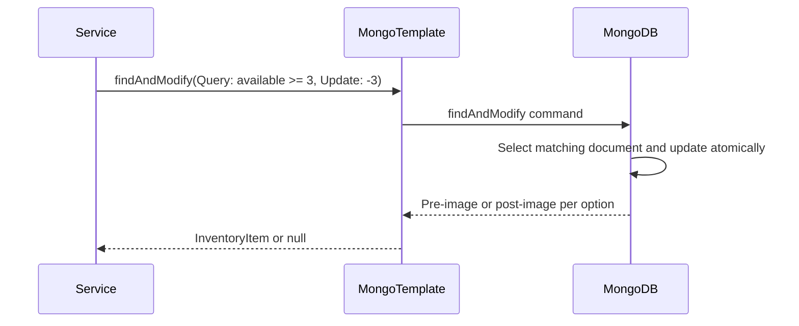

# findAndModify: Returning Data Before or After Update

In MongoDB, business logic sometimes needs to **both modify a document and know its state**: deduct inventory and return the remaining quantity, transition an order's status, or claim a pending job and mark it taken. Executing two separate calls—`findOne` followed by `updateFirst`—allows another request to modify the document in between.

**`MongoTemplate.findAndModify(…)`** in **Spring Data MongoDB** performs a single MongoDB command that **finds one matching document, updates it, and returns a version of that selected document**. By default, the returned document is the **before-update version** (*pre-image*). With `FindAndModifyOptions.options().returnNew(true)`, it returns the **after-update version** (*post-image*).

This lesson belongs to the **Writes and Updates** chapter of the `SPRING_DATA_MONGODB` module. We will combine `Query`/`Criteria`, `Update`, `MongoTemplate`, the Fluent API, typed mapping, optimistic locking, reactive access, testing, and performance diagnostics. These principles also connect to repositories, indexes, transactions, and conditional operations on BSON data.

> **Remember upfront:** `returnNew(true)` **changes only which version of the document is returned**; it **does not** alter search predicates, turn the operation into an upsert, or automatically enable optimistic locking. Those behaviors are governed by `Query`, `Update`, `upsert`, and version conditions respectively.

## 1. Learning Objectives

After reading this lesson, you will be able to:

1. Compare `findAndModify` against `findOne` + `updateFirst`, `updateFirst`, and `findAndRemove`.
2. Explain why `findAndModify` defaults to returning the **pre-image** and how to enable `returnNew(true)` for the **post-image**.
3. Distinguish all four combinations of matching/unmatching documents and upsert enabled/disabled.
4. Write `MongoTemplate.findAndModify` with query, update, options, and entity class.
5. Use `Sort` inside `Query` to determine **which document** gets updated when multiple documents match.
6. Build conditional **compare-and-set** updates directly on a single document.
7. Understand `@Version`, `matchedCount`, `null` results, and projection limits on returned data.
8. Control field mapping, projections, BSON values, indexes, write concern, and retries.
9. Use the Fluent MongoDB API and `ReactiveMongoTemplate` with matching semantics.
10. Write integration tests verifying pre-image, post-image, no match, upsert, and concurrent calls.

## 2. Problem: Updating Inventory and Knowing the Quantity

Suppose the warehouse holds a document:

```javascript
{
  _id: "INV-1001",
  warehouse_id: "WH-01",
  sku: "SKU-A",
  available: 10,
  reserved: 0,
  status: "ACTIVE",
  updated_at: ISODate("2026-11-20T08:00:00Z")
}
```

The business action "reserve 3 items" has two requirements:

1. Allow reservation only if `available >= 3`.
2. If successful, return the **remaining quantity** to display and accurately record the outcome.

Do not write this:

```java
// RACE-PRONE PATTERN:
InventoryItem before = template.findById(id, InventoryItem.class);
if (before != null && before.available() >= quantity) {
    template.updateFirst(
        Query.query(Criteria.where("id").is(id)),
        new Update().inc("available", -quantity),
        InventoryItem.class
    );
}
```

Two requests can both read `available=10` before either updates. Moreover, `before` is not guaranteed to reflect the state actually evaluated when the update runs.

Using `findAndModify` combines **stock verification and update** into a single operation on one document.



## 3. Illustrative Entity and Stored Data

We use a Java record to represent the document:

```java
package dev.learning.inventory;

import java.time.Instant;

import org.springframework.data.annotation.Id;
import org.springframework.data.mongodb.core.mapping.Document;
import org.springframework.data.mongodb.core.mapping.Field;

@Document("inventory_items")
public record InventoryItem(
        @Id String id,
        @Field("warehouse_id") String warehouseId,
        String sku,
        int available,
        int reserved,
        String status,
        @Field("updated_at") Instant updatedAt) {
}
```

In Java, the properties are `warehouseId` and `updatedAt`; in BSON, the corresponding fields are `warehouse_id` and `updated_at`.

`MongoTemplate` uses the domain class `InventoryItem.class` for mapping metadata, not solely to pick the return type. When using `Criteria.where("warehouseId")` in a typed call, Spring Data can translate it to `warehouse_id`.

Sample data:

```javascript
db.inventory_items.insertOne({
  _id: "INV-1001",
  warehouse_id: "WH-01",
  sku: "SKU-A",
  available: 10,
  reserved: 0,
  status: "ACTIVE",
  updated_at: ISODate("2026-11-20T08:00:00Z")
});
```

Run this command in an **isolated test database**. Inserting a duplicate `_id` causes a duplicate-key error; never run this verbatim repeatedly against a production collection.

## 4. MongoTemplate.findAndModify Signatures

Common overloads:

```java
<T> T findAndModify(
    Query query, UpdateDefinition update, Class<T> entityClass);

<T> T findAndModify(
    Query query, UpdateDefinition update,
    FindAndModifyOptions options, Class<T> entityClass);

<T> T findAndModify(
    Query query, UpdateDefinition update,
    Class<T> entityClass, String collectionName);

<T> T findAndModify(
    Query query, UpdateDefinition update,
    FindAndModifyOptions options,
    Class<T> entityClass, String collectionName);
```

Parameter roles:

| Parameter | Role |
| --- | --- |
| `Query` | Selection predicate, optionally carrying `Sort`, field projection, and collation. |
| `UpdateDefinition` / `Update` | Operators to apply: `$set`, `$inc`, `$unset`, `$addToSet`… |
| `FindAndModifyOptions` | Configures `returnNew`, `upsert`, and other options. |
| `entityClass` | Supplies mapping metadata for queries/updates and maps the returned document to Java. |
| `collectionName` | Explicitly specifies the collection instead of deriving it from `@Document`. |
| Return value | A mapped entity, or `null` if no document is returned. |

One `findAndModify` command acts on **at most one** matching document. It never updates all matching documents like `updateMulti`.

## 5. Returning the Pre-Update Document by Default

Example deducting available stock and adding to reserved:

```java
import org.springframework.data.mongodb.core.MongoTemplate;
import org.springframework.data.mongodb.core.query.Criteria;
import org.springframework.data.mongodb.core.query.Query;
import org.springframework.data.mongodb.core.query.Update;

Query query = Query.query(
    Criteria.where("id").is("INV-1001")
            .and("warehouseId").is("WH-01")
            .and("status").is("ACTIVE")
            .and("available").gte(3));

Update change = new Update()
    .inc("available", -3)
    .inc("reserved", 3)
    .set("updatedAt", java.time.Instant.now());

InventoryItem before = mongoTemplate.findAndModify(
    query, change, InventoryItem.class);
```

If the database initially had `available=10` and `reserved=0`:

```text
Returned value before:
  available = 10
  reserved  = 0

Document in MongoDB after command:
  available = 7
  reserved  = 3
```

This is **not a failed update**. `findAndModify` succeeded, yet **by default returns the prior state**.

When you need the quantities present **before reserving** for auditing, computing deltas, or recording initial stock, this default behavior is helpful.

Do not issue an extra `findOne` just to confirm the update succeeded if the pre-image suffices and business logic doesn't need the new value; re-reading adds a round trip and the document could already be modified further.

## 6. returnNew(true): Returning the Post-Update Document

Enable `returnNew(true)`:

```java
import org.springframework.data.mongodb.core.FindAndModifyOptions;

FindAndModifyOptions options =
    FindAndModifyOptions.options().returnNew(true);

InventoryItem after = mongoTemplate.findAndModify(
    query,
    change,
    options,
    InventoryItem.class
);
```

If run as an **independent execution** starting from `10/0`, the returned value is:

```text
Returned value after:
  available = 7
  reserved  = 3

Document after update:
  available = 7
  reserved  = 3
```

**Do not run this right after Section 5's snippet assuming `after.available()==7`:** running both deducts stock **twice** if both match. Each example illustrates an independent call against reset initial data.

Ready for direct use in a service:

```java
public InventoryItem reserveAndGetUpdated(
        String id, String warehouseId, int quantity) {

    if (quantity <= 0) {
        throw new IllegalArgumentException("quantity must be > 0");
    }

    Query query = Query.query(
        Criteria.where("id").is(id)
                .and("warehouseId").is(warehouseId)
                .and("status").is("ACTIVE")
                .and("available").gte(quantity));

    Update update = new Update()
        .inc("available", -quantity)
        .inc("reserved", quantity)
        .set("updatedAt", java.time.Instant.now());

    InventoryItem updated = mongoTemplate.findAndModify(
        query,
        update,
        FindAndModifyOptions.options().returnNew(true),
        InventoryItem.class);

    if (updated == null) {
        throw new IllegalStateException(
            "Item not found or insufficient stock");
    }
    return updated;
}
```

In a real application, `warehouseId` must fall within the caller's **authorized** scope and may need to come from the security context; never trust a warehouse ID from a request without authorization checks.

## 7. Behavior Matrix for returnNew and upsert

`FindAndModifyOptions` has two easily confused flags:

- `returnNew`: return the **before** or **after** image.
- `upsert`: when no document matches, **whether to insert a new document**.

| Matching Document? | `upsert` | `returnNew` | Operation | Typical Return Value |
| --- | --- | --- | --- | --- |
| Yes | `false` | `false` (default) | Update that document | **Pre-image** |
| Yes | `false` | `true` | Update that document | **Post-image** |
| No | `false` | `false` or `true` | Neither updates nor inserts | `null` |
| Yes | `true` | `false` | Update that document | **Pre-image** |
| Yes | `true` | `true` | Update that document | **Post-image** |
| No | `true` | `true` | **Insert** new document | Newly **inserted** document |
| No | `true` | `false` | **Insert** new document | No meaningful pre-image; **do not rely on return value to infer success** |

**Note on the final row:** at the MongoDB level, certain `upsert=true` and `returnNew=false` cases may return `null` or an empty pre-image representation depending on command and `sort`; therefore **do not build business logic around the return value on a newly upserted insert in that mode**. To receive the newly inserted document, use `upsert(true).returnNew(true)`.

When upsert is disabled, no match means **no creation**. That is the right default for **update-only** operations.

### 7.1. Do Not Equate null With "ID Does Not Exist"

A `null` return from `findAndModify` may mean:

- No document holds that ID.
- The document exists, but `status` no longer matches.
- `available >= quantity` no longer holds.
- Another request changed the version or state condition.
- The query targets the wrong database, collection, or uses the wrong BSON ID type.

If detailed HTTP error messages are needed, you can perform a follow-up read **after failure** to diagnose the cause, keeping in mind that this secondary read is not an atomic snapshot of update time and must never be used to bypass protective predicates.

## 8. Intentional Upsert and $setOnInsert

A synchronization service may support "create settings if missing, update if present."

For example, a `settings` collection with one document per tenant; this is **create-or-update**, not inventory reservation:

```java
Query query = Query.query(
    Criteria.where("id").is("SETTINGS-tenant-a")
);

Update update = new Update()
    .set("timezone", "Asia/Ho_Chi_Minh")
    .setOnInsert("createdAt", java.time.Instant.now());

TenantSettings result = mongoTemplate.findAndModify(
    query,
    update,
    FindAndModifyOptions.options()
        .upsert(true)
        .returnNew(true),
    TenantSettings.class
);
```

Assuming entity:

```java
import java.time.Instant;
import org.springframework.data.annotation.Id;
import org.springframework.data.mongodb.core.mapping.Document;

@Document("settings")
public record TenantSettings(
    @Id String id,
    String timezone,
    Instant createdAt) {
}
```

`$setOnInsert` writes `createdAt` only when **upsert inserts a new document**, leaving an existing document's creation date untouched.

Key notes:

- If the query specifies a stable `_id`, duplicate creation with the same ID is prevented by the unique index on `_id`; still handle duplicate errors on concurrent upserts when predicates/indexes are less strict.
- Never enable upsert to "update an existing record" in an **update-only** endpoint, as it can **recreate deleted documents**.
- If the query contains inequality predicates or complex conditions, the upserted document is not simply the entire query; inspect actual BSON and ensure required fields are set.
- If the entity ID is `Long` or a custom type, supply an appropriate `_id`; omitting ID lets MongoDB generate an ObjectId incompatible with your model.

## 9. Sort Chooses Which Document Gets Updated

When a `Query` matches **multiple documents**, `findAndModify` modifies **only one**. Without `sort`, never rely on a collection's natural order to guess which one.

A classic problem: claiming the highest-priority pending job.

Assuming entity `QueueJob`:

```java
package dev.learning.jobs;

import java.time.Instant;
import org.springframework.data.annotation.Id;
import org.springframework.data.mongodb.core.mapping.Document;
import org.springframework.data.mongodb.core.mapping.Field;

@Document("queue_jobs")
public record QueueJob(
    @Id String id,
    @Field("tenant_id") String tenantId,
    String status,
    int priority,
    Instant createdAt,
    String claimedBy,
    Instant claimedAt) {
}
```

Select a `READY` job ordered by `priority DESC`, then `createdAt ASC`, and finally `id ASC` for deterministic tie-breaking:

```java
import org.springframework.data.domain.Sort;

Query query = Query.query(
    Criteria.where("tenantId").is(authorizedTenantId)
            .and("status").is("READY"));

query.with(Sort.by(
    Sort.Order.desc("priority"),
    Sort.Order.asc("createdAt"),
    Sort.Order.asc("id")));

Update claim = new Update()
    .set("status", "CLAIMED")
    .set("claimedBy", workerId)
    .set("claimedAt", java.time.Instant.now());

QueueJob claimed = mongoTemplate.findAndModify(
    query,
    claim,
    FindAndModifyOptions.options().returnNew(true),
    QueueJob.class
);
```

If two workers claim jobs simultaneously:

- MongoDB executes each document update with atomic semantics.
- Once the first worker transitions `status` to `CLAIMED`, that document no longer satisfies `READY` for the next worker.
- The next worker picks another job, or receives `null` if none remains eligible.

**Keeping `status="READY"` inside the query** is the primary guard. Sorting first and updating afterward is insufficient.

### 9.1. Why Add ID to the Sort?

If two jobs share the same `priority` and `createdAt`, sorting by just those two fields leaves tie order unspecified. Adding `id` (mapped to `_id`) as a tie-breaker makes selection deterministic and index design clear.

### 9.2. Index for Queue Claiming

The query above has two equality filters and three sort keys. A candidate compound index:

```javascript
db.queue_jobs.createIndex(
  {
    tenant_id: 1,
    status: 1,
    priority: -1,
    createdAt: 1,
    _id: 1
  },
  { name: "tenant_status_priority_created_id" }
);
```

Verify the query plan with an equivalent filter/sort before declaring the index optimal; `findAndModify` also updates the document and may read the whole document to map the entity.

## 10. Conditional Updates: No Need to Read First

The check "is enough stock left?" belongs inside the query of **the update itself**:

```java
Query query = Query.query(
    Criteria.where("id").is("INV-1001")
        .and("available").gte(3));

Update update = new Update()
    .inc("available", -3)
    .inc("reserved", 3);

InventoryItem after = mongoTemplate.findAndModify(
    query, update,
    FindAndModifyOptions.options().returnNew(true),
    InventoryItem.class
);
```

If `after == null`, no stock was reserved. Competing requests are evaluated serially against the document's write state; this prevents negative inventory **provided all write paths enforce the same invariant**.

Comparison:

| Approach | Where Are Predicate and Update? | Risk |
| --- | --- | --- |
| `findOne` then `save` without version | Check and write in two commands | Lost update, stale state |
| `findOne` then `updateFirst` by ID | Checked upfront, update filters only by ID | Can write after invariant broke |
| `findAndModify` with `available >= q` | Check and update in one command | Preserves single-document invariant if all writers obey |
| `updateFirst` with `available >= q` | Check and update in one command | Also atomic, returns only `UpdateResult` |
| `save` versioned entity | Version checked by locking mechanism | Fits saving complete aggregates with conflict handling |

**Key distinction:** both conditional `updateFirst` and `findAndModify` provide atomic single-document updates. `findAndModify` shines when the application **needs the pre- or post-update document**, or **needs sorting to pick one document**.

## 11. @Version and Optimistic Locking

Spring Data MongoDB supports `@Version` on entities. With `findAndModify` on a versioned entity, Spring Data docs note that **version can be auto-incremented** if `Update` does not specify it. However, **auto-incrementing version does not mean automatically checking the caller's expectedVersion**.

Example versioned entity:

```java
import org.springframework.data.annotation.Id;
import org.springframework.data.annotation.Version;
import org.springframework.data.mongodb.core.mapping.Document;

@Document("versioned_orders")
public record VersionedOrder(
    @Id String id,
    String status,
    @Version Long version) {
}
```

To allow `DRAFT → SUBMITTED` only if the document is still at the version the service read:

```java
public VersionedOrder submitIfUnchanged(
        MongoTemplate template,
        String orderId,
        long expectedVersion) {

    Query query = Query.query(
        Criteria.where("id").is(orderId)
            .and("version").is(expectedVersion)
            .and("status").is("DRAFT"));

    Update update = new Update()
        .set("status", "SUBMITTED");

    VersionedOrder result = template.findAndModify(
        query,
        update,
        FindAndModifyOptions.options().returnNew(true),
        VersionedOrder.class
    );

    if (result == null) {
        throw new IllegalStateException(
            "Not found or version/status already changed");
    }
    return result;
}
```

If two requests read `version=0`:

```text
Request A: filter id=X, version=0, status=DRAFT
Request B: filter id=X, version=0, status=DRAFT

A updates successfully -> version increments to 1
B matches no document -> findAndModify returns null
```

Difference from `repository.save` on a versioned entity: with this custom query, a mismatch returns **`null`**, **not automatically** `OptimisticLockingFailureException` simply because the query mentions `version`. The service should translate `null` into an appropriate conflict error.

Notes:

- When using `Update` with `@Version`, check your specific API behavior to avoid **double-incrementing version** (do not combine manual `inc("version", 1)` with framework auto-increment).
- An **acknowledged** write concern is required for reliable write/conflict detection.
- If raw Java Driver writes bypass version increments or predicates, system-wide locking guarantees break down.
- Version does not replace unique indexes; duplicate ID creation still requires duplicate-key error handling.

## 12. Pre-Image, Post-Image, and Auditing

Each return mode serves distinct business needs.

### 12.1. When You Need the Pre-Image

- Knowing stock levels **before** deduction.
- Capturing old state to compute deltas.
- Recording an audit event with *old* values (when paired with a reliable audit mechanism).
- Inspecting pre-operation values as part of find-and-update.

Example:

```java
InventoryItem before = template.findAndModify(
    query,
    new Update().inc("available", -1),
    InventoryItem.class
);

if (before != null) {
    int previousAvailable = before.available();
}
```

**Warning:** if the application reads the pre-image and writes an audit record to another collection in a separate command, **the two writes are not automatically atomic together**. When inventory updates and audit/outbox writes must succeed together, use transactions on a supported topology or an equivalent pattern.

### 12.2. When You Need the Post-Image

- Returning the new state from an API after reserving stock.
- Returning the claimed job, including worker and claim time.
- Obtaining the new version after a state transition.
- Avoiding a second read just to fetch the modified fields.

```java
InventoryItem updated = template.findAndModify(
    query,
    new Update().inc("reserved", 1),
    FindAndModifyOptions.options().returnNew(true),
    InventoryItem.class
);
```

### 12.3. One Command Does Not Return Both Images

Standard `findAndModify` selects **one** image, not both a full `before` and a full `after` object simultaneously. If you need both:

- You can derive certain post-values from the pre-image and `Update` **only if the transformation is completely deterministic and free of external logic**; not suitable for every update.
- Or design a dedicated operation with versioning/transactions/outbox per contract.
- Or use MongoDB change streams / document pre- and post-images when auditing/event needs genuinely justify the configuration and cost.

Do not call `findOne` after an update and call it "the atomic post-image of that update": another writer could modify the document before the read runs.

## 13. Projection: Returning Fewer Fields, Understanding the Impact

You can restrict fields in the returned document using `Query.fields()`:

```java
Query query = Query.query(
    Criteria.where("id").is("INV-1001"));

query.fields()
    .include("id")
    .include("available")
    .include("reserved");

InventoryItem partial = mongoTemplate.findAndModify(
    query,
    new Update().inc("available", -1),
    FindAndModifyOptions.options().returnNew(true),
    InventoryItem.class
);
```

With such a projection, `partial` is only a **partially loaded representation**: `warehouseId`, `sku`, `status`, and `updatedAt` may be null or defaulted in Java. If the entity is a record with required validation in its constructor, mapping can fail due to missing properties.

Therefore:

- Use projections only when the target type safely tolerates missing fields.
- **Never `save` back** a partially loaded entity: doing so can overwrite or drop unloaded data.
- If the API returns a read DTO, use an appropriate DTO/projection type and test the fields actually populated.
- `_id` is included by default in many inclusion projections unless explicitly excluded.

Limiting returned fields reduces network bandwidth and object materialization, yet MongoDB still updates the full document; do not confuse projection with covered queries or skipping document writes.

## 14. Field Mapping and Data Types With findAndModify

Because you pass `InventoryItem.class`, Spring Data knows:

```java
Query q = Query.query(
    Criteria.where("warehouseId").is("WH-01"));

Update u = new Update()
    .set("updatedAt", java.time.Instant.now());
```

BSON intent:

```javascript
{
  query: { warehouse_id: "WH-01" },
  update: { $set: { updated_at: ISODate("...") } }
}
```

`@Id` also maps `id` to `_id`. With `@Id String`, 24-hex character strings can be converted to BSON ObjectId; with `@MongoId String`, type conversion semantics differ. Always test against the actual ID types in your collection.

Common traps:

- Using Java name `warehouseId` in raw Java Driver APIs will not auto-map to `warehouse_id`.
- `Instant` converts to BSON Date per configured conversions; verify precision/time zone.
- `BigDecimal` may store as string or Decimal128 depending on settings, affecting `$gte`/`$lt`.
- Custom converters can change how value objects serialize in both writes and queries.
- For nested field updates, use the proper property path: `Update.set("address.city", "Hue")` can be mapped by Spring Data according to `@Field` on the nested object.

When targeting a collection with a non-default name while preserving domain mapping, use the overload:

```java
InventoryItem value = mongoTemplate.findAndModify(
    query, update, options,
    InventoryItem.class, "inventory_items_2026");
```

Do not confuse the **collection name** overload with omitting the domain class: `InventoryItem.class` is still present here for mapping.

## 15. Comparison With updateFirst, save, findAndRemove, and findAndReplace

| API | Operation | Return Value | When to Use |
| --- | --- | --- | --- |
| `updateFirst` | Updates first matching document; no auto-upsert | `UpdateResult` (matched/modified counts) | Pre/post image not needed |
| `findAndModify` | Finds and updates one document | Pre-image or post-image, nullable | Need document data and/or sorted target selection |
| `findAndRemove` | Finds and deletes one document | Deleted document or `null` | Need the deleted document's data |
| `findAndReplace` | Finds and **replaces entire document** | Pre/post image per options | Need full document replacement |
| `save` | Saves entity; insert/upsert or replacement per state/version | Saved entity | Saving a complete aggregate |
| `upsert` | Updates or inserts if unmatched | `UpdateResult` | Create-or-update without needing post-image |

**`findAndRemove`** is cleaner to read when deleting and returning the removed document. `FindAndModifyOptions` exposes a low-level `remove` flag, though mixing deletion into standard update flows is discouraged.

**`findAndReplace`** differs from `findAndModify` with `$set`: replacement overwrites the whole document, so fields omitted from the replacement can be lost.

If you only need `matchedCount`, `updateFirst` usually incurs less return-payload overhead. `findAndModify` does not return `UpdateResult` with `matchedCount`/`modifiedCount`; it returns the mapped document or `null`.

## 16. Fluent API for findAndModify

`MongoTemplate` provides a Fluent update API when you prefer placing the domain type upfront:

```java
InventoryItem before = mongoTemplate
    .update(InventoryItem.class)
    .matching(Query.query(
        Criteria.where("id").is("INV-1001")
            .and("available").gte(2)))
    .apply(new Update().inc("available", -2))
    .findAndModifyValue();
```

By default, `before` is the pre-image.

To retrieve the post-image:

```java
InventoryItem after = mongoTemplate
    .update(InventoryItem.class)
    .matching(Query.query(
        Criteria.where("id").is("INV-1001")
            .and("available").gte(2)))
    .apply(new Update().inc("available", -2))
    .withOptions(
        FindAndModifyOptions.options().returnNew(true))
    .findAndModifyValue();
```

These are **two separate alternative snippets**. Running them back-to-back deducts twice. The Fluent API does not alter semantics; it makes the operation pipeline easier to read and highlights the entity type.

If an `Optional<T>` result is desired, Fluent APIs provide matching variants in supported Spring Data versions. With `findAndModifyValue()`, you still must handle a **nullable result** per method contract.

## 17. ReactiveMongoTemplate: Mono of Before/After

For reactive access, `ReactiveMongoTemplate.findAndModify` carries the same semantics while returning `Mono<T>`.

```java
import reactor.core.publisher.Mono;

Mono<InventoryItem> afterMono =
    reactiveMongoTemplate.findAndModify(
        query,
        new Update().inc("available", -1),
        FindAndModifyOptions.options().returnNew(true),
        InventoryItem.class
    );
```

Key differences:

- When no document matches, the `Mono` typically **completes empty** rather than emitting `null` (Reactor forbids `null` as an `onNext` value).
- Use `switchIfEmpty` to translate emptiness into an error or fallback business branch.
- `Mono` is normally a *cold* publisher; **subscribing multiple times** can execute the update multiple times. Watch out for retries, resubscriptions, and shared chains.
- Never arbitrarily call `block()` on a reactive event loop.
- With `ReactiveMongoRepository`, do not expect `save` to provide pre-/post-images like `findAndModify`; each API has distinct semantics.

Example:

```java
Mono<InventoryItem> result =
    reactiveMongoTemplate.findAndModify(
        query,
        update,
        FindAndModifyOptions.options().returnNew(true),
        InventoryItem.class
    ).switchIfEmpty(Mono.error(
        new IllegalStateException(
            "Not found or condition not satisfied")));
```

If business logic needs idempotency across HTTP retries or message consumers, guard with an explicit business key. An **application-level** retry can trigger a brand-new operation, unlike driver-level retryable writes.

## 18. Transactions, Atomicity, Write Concern, and Retries

### 18.1. Single-Document Atomicity

MongoDB guarantees writes on **one document** are atomic under server semantics. When `findAndModify` includes a conditional predicate such as `available >= quantity`, checking and modifying the document execute within one command.

However:

- Two different documents are **not automatically** updated as a single transaction.
- Writing an audit log to another collection in a subsequent call does **not automatically** belong to the same transaction.
- Data read or synced earlier from elsewhere may already be stale.
- Multi-document transactions require an appropriate topology, session, and transaction manager.

### 18.2. Write Concern

Under unacknowledged write concerns, the application cannot reliably detect update outcomes or conflicts. For optimistic locking, Spring Data requires an acknowledged write concern to report conflicts reliably.

Inside transactions, write concern is typically configured at the transaction level per policy; do not inject per-command write concerns inside a transaction if incompatible with MongoDB's contract.

### 18.3. Retryable Writes and Cost

Per MongoDB documentation, under retryable writes `findAndModify` may need to copy the full document to an internal structure across replica set members prior to updating. Consequently, for large documents or large replica sets, it **can be more expensive than `updateOne`** when pre/post images aren't needed.

If an API only needs "updated" status or match counts, `updateFirst` may be preferable. When the exact post-image of the operation is required, `findAndModify` is valuable, though its real cost should be measured.

**Idempotency:** if the application manually re-invokes the same `findAndModify` with `$inc` after a timeout, it can increment/decrement **a second time** if the query still matches. Driver retryable writes and service-level business retries are not the same thing. For payments, reservations, or job claims with side effects, use idempotency keys and strategies for uncertain outcomes.

## 19. Performance: Sort, Indexes, and Returned Payload Size

### 19.1. Query by ID

When querying by `_id`, MongoDB provides a default unique index on `_id`. This is already a highly selective path for a single document; do not add extra indexes solely because you use `findAndModify`.

### 19.2. Priority-Ordered Job Claim Query

A command picking jobs by `tenant_id`/`status` sorted by `priority`/`createdAt` should evaluate a compound index:

```javascript
db.queue_jobs.createIndex(
  { tenant_id: 1, status: 1, priority: -1, createdAt: 1, _id: 1 },
  { name: "tenant_status_priority_created_id" }
);
```

Inspect the equivalent lookup query:

```javascript
db.queue_jobs.find({
  tenant_id: "tenant-a",
  status: "READY"
}).sort({
  priority: -1,
  createdAt: 1,
  _id: 1
}).limit(1).explain("executionStats");
```

Examine `winningPlan`, `totalKeysExamined`, `totalDocsExamined`, and whether a `SORT` stage appears. A `find` plan is a **helpful indicator** of access path, not a full measure of `findAndModify` cost and concurrency. Use appropriate profiler/command monitoring to inspect actual updates.

### 19.3. Practical Metrics

- Rate of `null` returns on no-match.
- p50/p95/p99 latency of `findAndModify`.
- Returned document/BSON payload size.
- Frequency of CAS/version conflicts.
- Timeout, retry, and duplicated-work rates.
- `keysExamined/docsExamined` for the filter/sort.
- Lock contention and write load on the MongoDB server.

Evaluate on **real data or representative workloads**; never draw conclusions from a collection with a few dozen documents.

## 20. Integration Testing: Pre-Image and Post-Image

The tests below illustrate behavior with Spring Boot, `MongoTemplate`, and an isolated test MongoDB instance. Never run against production.

### 20.1. Test Setup Example

```java
package dev.learning.inventory;

import static org.assertj.core.api.Assertions.assertThat;

import java.time.Instant;
import java.util.UUID;

import org.junit.jupiter.api.Test;
import org.springframework.beans.factory.annotation.Autowired;
import org.springframework.boot.test.context.SpringBootTest;
import org.springframework.data.mongodb.core.FindAndModifyOptions;
import org.springframework.data.mongodb.core.MongoTemplate;
import org.springframework.data.mongodb.core.query.Criteria;
import org.springframework.data.mongodb.core.query.Query;
import org.springframework.data.mongodb.core.query.Update;

@SpringBootTest
class FindAndModifyIntegrationTest {

    @Autowired
    MongoTemplate template;

    private String insertInventory(int available, int reserved) {
        String id = "INV-" + UUID.randomUUID();
        template.insert(new InventoryItem(
            id, "WH-01", "SKU-A",
            available, reserved, "ACTIVE",
            Instant.parse("2026-11-20T08:00:00Z")));
        return id;
    }

    private static Query eligible(String id, int quantity) {
        return Query.query(
            Criteria.where("id").is(id)
                .and("warehouseId").is("WH-01")
                .and("status").is("ACTIVE")
                .and("available").gte(quantity));
    }

    @Test
    void defaultReturnsPreImage() {
        String id = insertInventory(10, 0);

        InventoryItem before = template.findAndModify(
            eligible(id, 3),
            new Update()
                .inc("available", -3)
                .inc("reserved", 3),
            InventoryItem.class);

        assertThat(before).isNotNull();
        assertThat(before.available()).isEqualTo(10);
        assertThat(before.reserved()).isEqualTo(0);

        InventoryItem stored =
            template.findById(id, InventoryItem.class);

        assertThat(stored).isNotNull();
        assertThat(stored.available()).isEqualTo(7);
        assertThat(stored.reserved()).isEqualTo(3);
    }

    @Test
    void returnNewGivesPostImage() {
        String id = insertInventory(10, 0);

        InventoryItem after = template.findAndModify(
            eligible(id, 3),
            new Update()
                .inc("available", -3)
                .inc("reserved", 3),
            FindAndModifyOptions.options().returnNew(true),
            InventoryItem.class);

        assertThat(after).isNotNull();
        assertThat(after.available()).isEqualTo(7);
        assertThat(after.reserved()).isEqualTo(3);
    }

    @Test
    void failedConditionDoesNotUpdate() {
        String id = insertInventory(2, 0);

        InventoryItem result = template.findAndModify(
            eligible(id, 3),
            new Update().inc("available", -3),
            FindAndModifyOptions.options().returnNew(true),
            InventoryItem.class);

        assertThat(result).isNull();

        InventoryItem stored =
            template.findById(id, InventoryItem.class);

        assertThat(stored).isNotNull();
        assertThat(stored.available()).isEqualTo(2);
    }
}
```

Each test uses a prefixed random ID to minimize cross-test interference and avoid strings shaped like 24-hex ObjectIds. `MongoTemplate` must point to a test database configured via URI or Testcontainers/Service Connection per project setup.

### 20.2. Testing upsert + returnNew

An additional test:

```java
@Test
void upsertReturnsInsertedDocumentWhenReturnNewIsTrue() {
    String id = "SETTINGS-" + java.util.UUID.randomUUID();

    TenantSettings created = template.findAndModify(
        Query.query(Criteria.where("id").is(id)),
        new Update()
            .set("timezone", "Asia/Ho_Chi_Minh")
            .setOnInsert("createdAt",
                java.time.Instant.parse("2026-11-20T08:00:00Z")),
        FindAndModifyOptions.options()
            .upsert(true)
            .returnNew(true),
        TenantSettings.class);

    assertThat(created).isNotNull();
    assertThat(created.id()).isEqualTo(id);
    assertThat(created.timezone())
        .isEqualTo("Asia/Ho_Chi_Minh");
}
```

This test can live in its own test class for `TenantSettings`; if placed in the same class, share the injected `MongoTemplate` and import the relevant classes.

### 20.3. Concurrency Testing

Create an inventory item with `available=5`, and launch two concurrent tasks each trying to reserve `3`. When both use query `available >= 3` and update `available -= 3` in **one command**, expect:

- One operation succeeds and returns the document.
- The other finds no matching document and returns `null`.
- Final `available` is 2, and `reserved` incremented exactly once.

For reliable testing, use a `CountDownLatch`/barrier so both operations start nearly simultaneously against a real test MongoDB instance; never run two sequential calls and label it a "concurrency test." If verifying idempotency on application retries, add a scenario with a reservation ID or dedicated operation key.

### 20.4. Testing Sorted Job Selection

Create multiple `READY` `QueueJob` records with varying priorities as well as tied priorities/timestamps. Use `Query.with(Sort.by(...))` and `findAndModify` to change status to `CLAIMED`. Assert:

- The returned document has the highest priority with deterministic tie-breaking.
- Only one document transitions to `CLAIMED`.
- A subsequent call does not return the already claimed document.
- Documents of other tenants are untouched.

## 21. Common Mistakes

| Mistake | Why It Is Wrong | Fix |
| --- | --- | --- |
| Calling `findAndModify` expecting the new quantity | Defaults to returning the pre-image | Pass `returnNew(true)`. |
| Setting `returnNew(true)` thinking it creates documents | Only selects which image is returned | Set `upsert(true)` **only if creation is allowed**. |
| Getting `null` and assuming the ID does not exist | Query may also filter on status, available, or version | Handle no-match uniformly; read separately only for diagnostics. |
| Running pre and post examples back-to-back without resetting | The update runs twice | Give each test its own fixture. |
| Calling `findOne` then `updateFirst` by ID | Race window between read and write | Put business conditions inside the update query itself. |
| Thinking `findAndModify` modifies all matching documents | Modifies only one document | Use `updateMulti` when updating multiple documents. |
| Omitting sort when multiple documents match | Selected document is nondeterministic | Add sort with `_id` tie-breaker. |
| Sorting without a supporting index | Can scan/sort many documents | Design a compound index and inspect `explain`. |
| Thinking `@Version` auto-increment checks expected version | Update query does not know which version caller saw | Include `version` in filter for CAS. |
| Relying on pre-image with `returnNew(false)` on new upsert | No meaningful prior document exists | Use `returnNew(true)` and test upsert. |
| Calling `save` on a partially projected return entity | Can drop unloaded fields | Use a read DTO or avoid saving partials. |
| Reading pre-image then writing audit outside transaction | Audit and update are not atomic together | Use transaction/outbox as required. |
| Letting clients supply tenant in cursor/job queries | Can access unauthorized data | Derive tenant from authenticated principal and check permissions. |
| Retrying `$inc` unconditionally | Can increment/decrement again | Use idempotency keys and business predicates. |
| Using `findAndModify` for updates that don't need returned data | Unnecessary overhead, especially on large documents | Use `updateFirst` and `UpdateResult` when appropriate. |

## 22. Practice Exercises

### Exercise 1 — Pre-Image or Post-Image?

Given inventory `available=8`, `reserved=1`, execute `$inc available:-2, reserved:+2`. Predict the return values when `returnNew=false` vs. `returnNew=true`.

*Hint:* pre-image `8/1`, post-image `6/3`. The two outcomes belong to two **independent** runs.

### Exercise 2 — Rejecting Insufficient Stock

Write a `Query` filtering on `id` and `available>=quantity`, and an `Update` deducting stock. Predict the outcome when `available=2`, `quantity=3` and explain why stock never becomes negative.

### Exercise 3 — Picking Priority Jobs

A collection contains `READY` jobs across three priority levels. Use `Sort.desc("priority")`, `Sort.asc("createdAt")`, and `Sort.asc("id")` to claim jobs with `findAndModify`. Add a matching index and test two workers claiming concurrently.

### Exercise 4 — Upsert and New Documents

Write a `findAndModify` with `upsert(true).returnNew(true)` for tenant settings. Use `$setOnInsert` to set the creation timestamp and explain why upsert must not be used on an update-only endpoint.

### Exercise 5 — Optimistic Compare-and-Set

An entity has `@Version Long version`. Two requests both read version 0. Write a query adding `version=0` and updating status, and predict the outcome of the second call.

### Exercise 6 — Returning Pre-Image for Auditing

Design a flow that needs the old state while writing an audit record to another collection. Explain why `findAndModify` alone does not guarantee both update and audit succeed together, and when a transaction or outbox is needed.

### Exercise 7 — Reactive No-Match

Write a `Mono<InventoryItem>` using `ReactiveMongoTemplate.findAndModify`, using `switchIfEmpty` to return an error without calling `block()`.

### Exercise 8 — Choosing the API and Measuring Performance

When a service only needs `matchedCount`, compare `findAndModify` against `updateFirst`. Suggest metrics and `explain` checks for a large collection with supporting indexes.

## 23. Pre-Release Checklist

- [ ] Clarified whether the caller needs **pre-image**, **post-image**, or only match counts.
- [ ] For post-image, enabled `FindAndModifyOptions.options().returnNew(true)`.
- [ ] Enabled `upsert(true)` only if creating new documents is permitted.
- [ ] Handled `null`/`Mono.empty()` when no document matches.
- [ ] Placed business invariants inside the **Query of the update command itself**.
- [ ] For CAS, included expected version/status; not relying solely on auto-increment.
- [ ] Added `Sort` with a tie-breaker when queries can match multiple documents.
- [ ] Used typed entity class to map `@Field`, ID, BSON, and version.
- [ ] Never called `save` on a partially loaded entity from a projection.
- [ ] Ensured tenant/user filters come from authenticated sources.
- [ ] Tested pre-image, post-image, no-match, upsert, and concurrent requests.
- [ ] Evaluated `findAndModify` cost on large documents and under retryable writes.
- [ ] Retained acknowledged write concern and designed retry/idempotency handling.
- [ ] Used transactions/outbox when **multi-document** atomicity is required.
- [ ] Verified queries/indexes via profiler and `explain`, not just by reading code.

## 24. Official Documentation

1. [Spring Data MongoDB — Saving, Updating, and Removing Documents](https://docs.spring.io/spring-data/mongodb/reference/mongodb/template-crud-operations.html): `findAndModify`, `returnNew`, `upsert`, `@Version`, and Fluent API.
2. [Spring Data MongoDB — MongoOperations Javadoc](https://docs.spring.io/spring-data/mongodb/docs/current/api/org/springframework/data/mongodb/core/MongoOperations.html): `findAndModify` overloads and nullable return types.
3. [Spring Data MongoDB — FindAndModifyOptions Javadoc](https://docs.spring.io/spring-data/mongodb/docs/current/api/org/springframework/data/mongodb/core/FindAndModifyOptions.html): `options()`, `returnNew(boolean)`, `upsert(boolean)`, and `remove(boolean)`.
4. [Spring Data MongoDB — Querying Documents](https://docs.spring.io/spring-data/mongodb/reference/mongodb/template-query-operations.html): `Query`, `Criteria`, `Sort`, field projection, and type mapping.
5. [MongoDB Manual — findAndModify Command](https://www.mongodb.com/docs/manual/reference/command/findandmodify/): single-document update, selection, pre/post-image, sort, and upsert.
6. [MongoDB Manual — findAndModify Helper](https://www.mongodb.com/docs/manual/reference/method/db.collection.findandmodify/): behavior matrix and retryable write overhead; this `mongosh` helper is superseded by `findOneAndUpdate/…` methods, while Spring Data still exposes `findAndModify`.
7. [MongoDB Manual — Atomicity and Transactions](https://www.mongodb.com/docs/manual/core/write-operations-atomicity/): single-document atomicity and conditional updates.
8. [MongoDB Manual — Indexes and Sort](https://www.mongodb.com/docs/manual/tutorial/sort-results-with-indexes/): choosing indexes for sorted queries.
9. [MongoDB Manual — Explain Results](https://www.mongodb.com/docs/manual/reference/explain-results/): inspecting plans and documents/keys examined.

**Conclusion:** `findAndModify` enables Spring Data MongoDB to **find and update one document while returning a version of that exact document**. By default it returns the **before** image; `returnNew(true)` returns the **after** image. Keep the returned image choice separate from `upsert`, put business conditions into the atomic query, use appropriate sorting/indexing, and thoroughly test concurrent conflicts. When no returned document is needed, consider `updateFirst` to save overhead.
