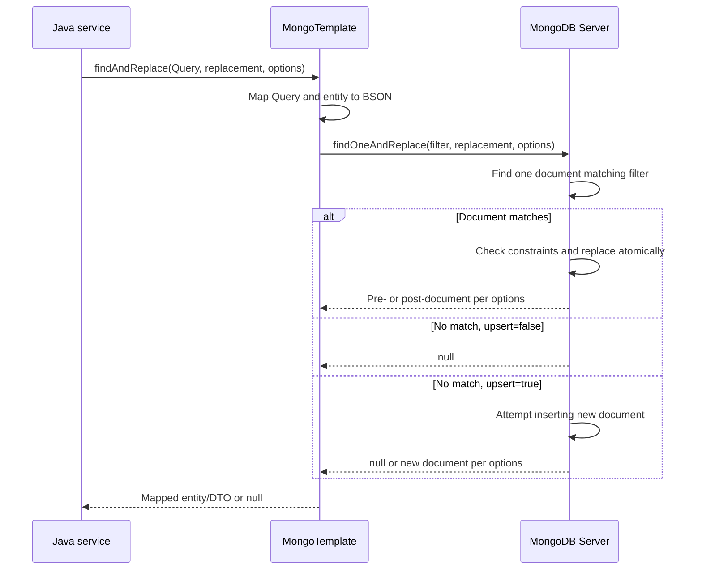

# `findAndReplace` and Conditional Replacement

In **Spring Data MongoDB**, there is a vital difference between **updating a few fields** and **replacing an entire document**. When changing a single property like `stock` or `status`, `$set`/`$inc` operators are usually preferable. However, when business logic requires replacing **the entire managed state of a document**—while executing only if the record still matches the expected status, tenant, or version—`MongoTemplate.findAndReplace(...)` is an option worth considering.

`findAndReplace` sends a find-and-replace operation for **a single document**; it accepts a `Query` instead of relying solely on ID like `save`. MongoDB Server checks the predicate and performs the replacement in **a single operation on the document**, letting the application build **compare-and-swap (CAS)** on `revision` or status. However, replacing **does not preserve fields missing from the replacement object**. Confusing a read DTO/projection with full state can silently wipe out existing data.

This lesson belongs to the **Writes and Updates** chapter of the `SPRING_DATA_MONGODB` module: connecting and mapping BSON via `MongoTemplate` or repositories, querying, indexing, transactions, reactive access, testing, and data diagnostics. It focuses on **`findAndReplace` and conditional replacement**, rather than equating them with `save`, `findAndModify`, or `updateFirst`.

After this lesson, you will be able to:

- Distinguish `findAndReplace`, `save`, `replace`, `findAndModify`, and `$set` updates.
- Construct a `Query` with `_id`, `tenantId`, `status`, or `revision` to **replace a document only while conditions hold**.
- Explain the **immutable `_id`** rule and why **the replacement entity should not carry an ID** in `findAndReplace`.
- Control **before/after images**, unmatched results, ordering when multiple documents match, upserts, and unique indexes.
- Implement optimistic concurrency via `revision`, avoid overwriting with partially loaded entities, and test against real MongoDB.

## 1. Distinguishing Replace From Field-Level Update

Given an initial document:

```javascript
// Collection: catalogItems
{
  _id: "ITEM-101",
  tenantId: "T-A",
  sku: "BK-101",
  name: "Notebook",
  status: "DRAFT",
  priceVnd: NumberLong("85000"),
  stock: 42,
  description: "Hardcover",
  tags: ["office", "gift"],
  revision: NumberLong("3"),
  updatedAt: ISODate("2026-11-01T00:00:00Z")
}
```

If only updating the name:

```javascript
db.catalogItems.updateOne(
  { _id: "ITEM-101", tenantId: "T-A" },
  { $set: { name: "New notebook" } }
);
```

Fields `stock`, `description`, and `tags` **remain**. By contrast, when replacing the document:

```javascript
// Run only in a test database: example INTENTIONALLY omits fields.
db.catalogItems.findOneAndReplace(
  { _id: "ITEM-101", tenantId: "T-A" },
  {
    tenantId: "T-A",
    name: "New notebook",
    status: "ACTIVE"
    // Other fields are omitted from the replacement.
  },
  { returnDocument: "after" }
);
```

Old fields absent from the replacement (`sku`, `stock`, `description`, `tags`, `revision`, etc.) **may be dropped from the stored document**. MongoDB preserves the existing `_id` when the replacement omits `_id`; that is **not** a mechanism for merging remaining fields.

| Operation | Purpose | Unmentioned Data |
| --- | --- | --- |
| `updateOne` with `$set`/`$inc` | Modifies specified fields | Preserves all other fields |
| `MongoTemplate.updateFirst` | Field-level conditional update via Spring Data | Preserves all other fields except listed operators |
| `MongoTemplate.findAndModify` | Updates via operators and returns pre-/post-image | Preserves untouched fields |
| `MongoTemplate.findAndReplace` | Finds via query and **replaces one document**; can return pre-/post-image | Fields unmapped in replacement may be lost |
| `MongoTemplate.replace` | Replaces one document by query, returns `UpdateResult` | Also a replacement, different return type |
| `MongoTemplate.save` | Saves entity per mapping/ID and version rules | Not a partial update; may replace document |

**Selection rule:** when an API represents `PATCH /catalog/{id}/status`, prefer `$set` with business conditions. When an API carries `PUT` semantics—**replacing the entire representation** with explicit validation—replace can fit. Never make a PATCH endpoint call `findAndReplace` just to obtain the updated document.

## 2. How Does `findAndReplace` Work?



Key points to remember:

1. **Only one document** is replaced, even if the filter matches multiple documents. If not uniquely constrained, `sort` (if declared) can influence selection.
2. Filtering and replacement execute on the server in a single operation, avoiding a gap between separate `findOne` and `replaceOne` calls.
3. By default, **upsert is off**. If nothing matches, the API returns `null` (or `Optional.empty()` in the fluent API).
4. By default, the returned value is the **document before replacement**; `returnNew()` requests the new document.
5. **`_id` cannot be changed**. Spring Data guidance for `findAndReplace` requires **the replacement entity not to carry its own ID** so MongoDB preserves the existing `_id`.
6. The replacement is a **complete document**, rejecting top-level update operators such as `$set`.

### 2.1. Why Is Knowing the ID Alone Not Enough?

Suppose an admin screen loads a product at `revision = 3`. While the staff member edits, another system updates the product to `revision = 4`. If the save searches only by ID and replaces, the user can **overwrite newer data**.

A conditional filter:

```javascript
{
  _id: "ITEM-101",
  tenantId: "T-A",
  revision: NumberLong("3"),
  status: "DRAFT"
}
```

Matches only if **all** conditions still hold when MongoDB processes the command. If it has moved to revision 4 or another status, replacement **does not occur**. This is the foundation of conditional replacement.

### 2.2. `findAndReplace` Differs From `findAndModify`

Similar names, yet the inputs determine their nature:

```java
// PATCH: changes only status, keeping other fields intact.
template.findAndModify(
        query,
        new Update().set("status", "ACTIVE"),
        FindAndModifyOptions.options().returnNew(true),
        CatalogItem.class);

// REPLACE: writes the entire state, not just status.
template.findAndReplace(
        query,
        completeReplacement,
        FindAndReplaceOptions.options().returnNew());
```

These are service code snippets assuming `template`, `query`, and `completeReplacement` are declared. `FindAndModifyOptions` and `FindAndReplaceOptions` are separate types; do not swap options between the two APIs. `findAndModify` takes `Update`/`UpdateDefinition`, whereas `findAndReplace` takes a **replacement entity**.

## 3. Entity and Practice Data

We use an entity with a stable String ID and an **application-managed `revision` field**. `@Version` is omitted in the main example to keep the version filter and **replacement** revision values explicit.

```java
import java.time.Instant;
import java.util.List;
import org.springframework.data.mongodb.core.mapping.Document;
import org.springframework.data.mongodb.core.mapping.MongoId;

@Document(collection = "catalogItems")
public record CatalogItem(
        @MongoId String id,
        String tenantId,
        String sku,
        String name,
        String status,
        long priceVnd,
        int stock,
        String description,
        List<String> tags,
        long revision,
        Instant updatedAt
) {}
```

In `findAndReplace`, the Java object passed as replacement should have `id == null`. The search query specifies the `_id` to replace, and MongoDB keeps the old document's `_id`. To read the ID in the outcome, `returnNew()` returns the entity mapped from the post-operation document.

Seed sample data in a test database:

```javascript
db.catalogItems.insertOne({
  _id: "ITEM-101",
  tenantId: "T-A",
  sku: "BK-101",
  name: "Notebook",
  status: "DRAFT",
  priceVnd: NumberLong("85000"),
  stock: 42,
  description: "Hardcover",
  tags: ["office", "gift"],
  revision: NumberLong("3"),
  updatedAt: ISODate("2026-11-01T00:00:00Z")
});
```

In test environments, insert only when the document does not yet exist or reset fixtures cleanly. Never run this against production. To enforce unique SKUs **per tenant**, use:

```javascript
db.catalogItems.createIndex(
  { tenantId: 1, sku: 1 },
  { unique: true }
);
```

This unique index enforces a business constraint; it does not auto-increment `revision` and does not automatically check tenants on every query. The service must obtain `tenantId` from an authenticated context rather than trusting arbitrary client-supplied values.

## 4. Practicing Revision-Conditional `findAndReplace`

Business requirement: a staff member edits all details of `ITEM-101` while the product is still `DRAFT` at `revision = 3`. If someone else updated it concurrently, **reject the overwrite** instead of "saving what is currently held."

### 4.1. Building a Complete Replacement

Example service receiving all intended post-save data after validation:

```java
import java.time.Instant;
import java.util.List;
import org.springframework.data.mongodb.core.FindAndReplaceOptions;
import org.springframework.data.mongodb.core.MongoTemplate;
import org.springframework.data.mongodb.core.query.Criteria;
import org.springframework.data.mongodb.core.query.Query;
import org.springframework.stereotype.Service;

@Service
public class CatalogReplaceService {

    private final MongoTemplate template;

    public CatalogReplaceService(MongoTemplate template) {
        this.template = template;
    }

    public CatalogItem publishDraft(
            String itemId, String authorizedTenantId,
            long expectedRevision, String sku, String name,
            long priceVnd, int stock, String description,
            List<String> tags
    ) {
        if (itemId == null || itemId.isBlank()
                || authorizedTenantId == null || authorizedTenantId.isBlank()) {
            throw new IllegalArgumentException("Missing ID or tenant");
        }
        if (expectedRevision < 0 || priceVnd < 0 || stock < 0
                || name == null || name.isBlank()
                || sku == null || sku.isBlank()) {
            throw new IllegalArgumentException("Invalid input data");
        }
        if (expectedRevision == Long.MAX_VALUE) {
            throw new IllegalArgumentException("Revision cannot increment");
        }

        Query query = Query.query(
                Criteria.where("_id").is(itemId)
                        .and("tenantId").is(authorizedTenantId)
                        .and("status").is("DRAFT")
                        .and("revision").is(expectedRevision));

        // Important: id == null in the replacement!
        CatalogItem replacement = new CatalogItem(
                null,
                authorizedTenantId,
                sku,
                name,
                "ACTIVE",
                priceVnd,
                stock,
                description,
                tags == null ? List.of() : List.copyOf(tags),
                expectedRevision + 1,
                Instant.now()
        );

        CatalogItem after = template.findAndReplace(
                query,
                replacement,
                FindAndReplaceOptions.options().returnNew());

        if (after == null) {
            throw new CatalogReplaceConflictException(
                    "No document matching tenant/status/revision");
        }
        return after;
    }
}
```

In the example, `CatalogReplaceConflictException` is a simple domain exception definable as:

```java
public class CatalogReplaceConflictException
        extends RuntimeException {
    public CatalogReplaceConflictException(String message) {
        super(message);
    }
}
```

**What this code does:**

1. `Query` carries `_id`, `tenantId`, `status`, and the **expected** `revision`.
2. `replacement` carries **all fields to persist after replacement**, including `sku`, `stock`, `description`, `tags`, tenant, and incremented revision.
3. `id = null` in the replacement avoids introducing a new or conflicting `_id`; MongoDB retains the original ID.
4. `FindAndReplaceOptions.options().returnNew()` requests **the post-replacement document**; upsert remains disabled.
5. On no match, `after == null`: possibly missing ID, wrong tenant, changed status, or stale revision. The service should avoid leaking cross-tenant existence when reporting errors.

Place the example inside a Spring Data MongoDB application with a configured `MongoTemplate` and scanned entities/repositories. If an input DTO contains only a subset of fields, **never use it to construct a replacement as if it held complete state**. Verify required-field completeness and field deletion rules before calling.

### 4.2. Equivalent Semantics on MongoDB Server

```javascript
db.catalogItems.findOneAndReplace(
  {
    _id: "ITEM-101",
    tenantId: "T-A",
    status: "DRAFT",
    revision: NumberLong("3")
  },
  {
    tenantId: "T-A",
    sku: "BK-101",
    name: "Premium notebook",
    status: "ACTIVE",
    priceVnd: NumberLong("99000"),
    stock: 42,
    description: "Hardcover, heavy paper",
    tags: ["office", "premium"],
    revision: NumberLong("4"),
    updatedAt: ISODate("2026-11-20T03:00:00Z")
  },
  { returnDocument: "after" }
);
```

When the original document matches, the result is the new document with `_id: "ITEM-101"` and `revision: 4`. If a second request still sends `revision = 3`, it fails to match after the first replacement and receives `null`, **without replacing the document again**. MongoDB evaluates the filter and replacement on **one document** with document-level atomic semantics.

### 4.3. Why Not Split find and replace Into Two Commands?

An error-prone approach:

```java
// Anti-pattern: insufficient to prevent concurrent overwrites.
CatalogItem before = template.findById("ITEM-101", CatalogItem.class);
if (before != null && before.status().equals("DRAFT")) {
    // Another request may have modified the document right here.
    template.save(someOtherCopy);
}
```

Between read and write lies a **race window**. Moving predicates into the `findAndReplace` filter prevents writing if state changed (provided all related write paths also maintain `revision` consistently).

### 4.4. Retrieving the Old vs. New Document

By default `findAndReplace(query, replacement)` returns the document **before** replacement when matched, whereas `returnNew()` returns the new document. Example:

```java
CatalogItem before = template.findAndReplace(query, replacement);

CatalogItem after = template.findAndReplace(
        anotherQuery,
        anotherReplacement,
        FindAndReplaceOptions.options().returnNew());
```

These two calls are **two distinct write operations**; the snippet compares API signatures and **must not be run sequentially against the same data to "get before and after."** If both states are required, design an appropriate data/audit mechanism; standard `findAndReplace` chooses one via options rather than returning both in one response.

| Option | Document Matches | No Match, Upsert Off |
| --- | --- | --- |
| Default | Returns document **before** replace | `null` |
| `returnNew()` | Returns document **after** replace | `null` |
| Fluent API `findAndReplace()` | Typically returns `Optional<T>` | `Optional.empty()` |

Many programs see a `null` result and assume "no document has that ID." That is **inaccurate** whenever the filter also checks `tenantId`, `status`, or `revision`. A `null` result only means **no document satisfied all requested conditions**, aside from explicit write errors.

## 5. The `_id` Rule: Immutable on Replacement

MongoDB documentation specifies that a replacement document **cannot specify an `_id` different from the `_id` of the document being replaced**. Spring Data documentation for `findAndReplace` further emphasizes: **the replacement entity should not contain an ID**, because MongoDB preserves the existing document's ID.

### 5.1. Why `id = null` Is Correct Here

Example:

```java
CatalogItem replacement = new CatalogItem(
        null, "T-A", "BK-101", "New name", "ACTIVE",
        99_000L, 42, "New description", List.of("premium"),
        4L, Instant.now());

// Query still targets ITEM-101:
Query query = Query.query(Criteria.where("_id").is("ITEM-101"));

CatalogItem result = template.findAndReplace(
        query, replacement,
        FindAndReplaceOptions.options().returnNew());
```

MongoDB retains `_id = "ITEM-101"` in the new document. Thus `result.id()` will be `"ITEM-101"` even though `replacement.id()` was `null`. **Use the returned object as the post-operation data**; never expect an immutable record `replacement` to mutate its own ID.

### 5.2. Never Change ID via Replace

Do not attempt:

```javascript
db.catalogItems.findOneAndReplace(
  { _id: "ITEM-101" },
  { _id: "ITEM-999", tenantId: "T-A", name: "New name" }
);
// Error due to attempting to change _id on an existing document.
```

If business logic needs to change a display code, use a business field like `sku` or `displayCode` rather than changing `_id`. Migrating an existing document's ID usually requires a **migration that creates a new record + updates references + deletes the old record** with a dedicated consistency strategy.

### 5.3. BSON Type of ID Must Match

`"507f1f77bcf86cd799439011"` is a BSON String, **different from** `ObjectId("507f1f77bcf86cd799439011")`. With `@MongoId String id` as in this lesson, the ID remains a String per mapping. With `@Id String id`, Spring Data may convert valid 24-hex strings into ObjectId.

When a query fails to match despite looking identical, inspect raw BSON:

```javascript
db.catalogItems.aggregate([
  {
    $project: {
      _id: 1,
      idType: { $type: "$_id" },
      revisionType: { $type: "$revision" }
    }
  },
  { $limit: 10 }
]);
```

String/ObjectId mapping mismatches often show up as `result == null` rather than a write error. Never conclude a document is missing without verifying BSON types and the actual query.

## 6. `upsert`: Enable Only When Business Rules Allow Creation

By default `findAndReplace` **does not create a document** if the filter fails to match. `FindAndReplaceOptions.options().upsert()` changes behavior to "**replace if found; otherwise attempt insert.**" This is a fundamentally different business requirement from "edit only if revision still matches."

### 6.1. Example Upserting by Stable ID

Suppose a system ingests full catalog items from an authoritative feed; ID `"ITEM-NEW-1"` is confirmed as a unique identifier. When absent, allow creation; when present, replace all managed data.

```java
import java.time.Instant;
import java.util.List;
import org.springframework.data.mongodb.core.FindAndReplaceOptions;
import org.springframework.data.mongodb.core.MongoTemplate;
import org.springframework.data.mongodb.core.query.Criteria;
import org.springframework.data.mongodb.core.query.Query;

// Service method snippet with injected MongoTemplate.
CatalogItem replaceOrCreate(
        MongoTemplate template,
        String id,
        String authorizedTenantId
) {
    if (id == null || id.isBlank()) {
        throw new IllegalArgumentException("ID must be explicit");
    }

    Query query = Query.query(
            Criteria.where("_id").is(id)
                    .and("tenantId").is(authorizedTenantId));

    // Replacement has no ID: _id comes from Query equality,
    // or is preserved by MongoDB if the old document exists.
    CatalogItem replacement = new CatalogItem(
            null, authorizedTenantId, "BK-NEW",
            "Imported notebook", "ACTIVE", 120_000L, 10,
            "Authoritative source data", List.of("imported"),
            1L, Instant.now());

    return template.findAndReplace(
            query,
            replacement,
            FindAndReplaceOptions.options()
                    .upsert()
                    .returnNew());
}
```

Under MongoDB semantics, when no document matches and the filter contains an equality predicate `_id = id`, upsert can use that ID for the inserted document. If **`_id` is absent from both query and replacement**, the server generates an `ObjectId`, which may **not match the entity/domain ID type**.

This is why you should not enable `upsert` on a broad query like `{ status: "DRAFT" }`: when no DRAFT document exists, the operation can **create an unintended document**. With upserts in multi-tenant applications, enforce identity constraints and always verify the tenant.

### 6.2. Never Enable Upsert for Revision-Based CAS

Consider a document currently at `revision = 4`, while a stale client sends `expectedRevision = 3`. With query:

```javascript
{ _id: "ITEM-101", tenantId: "T-A", revision: NumberLong("3") }
```

the document exists yet **fails to match the filter**. With `upsert = true`, MongoDB may attempt to **insert another document from the query** instead of simply signaling a conflict. Because `_id = "ITEM-101"` already exists, this can raise a **duplicate key** error depending on filter and data.

For "edit only if unchanged," keep `upsert = false`, check for `null`, and return an appropriate conflict/not-found error. Use upsert only when the true goal is **create-or-replace** and the filter key is designed for it.

### 6.3. Unique Indexes and Contention

Two concurrent requests upserting by a business key are not guaranteed to "create at most one document" without a unique constraint. Use a **stable `_id`** or a unique index such as `{tenantId:1, sku:1}`, and handle duplicate keys/retries per business rules.

`upsert` does not replace ID, tenant, schema, or write-permission validation. External callers must never supply another tenant's ID and use replace-or-create to write unauthorized data.

## 7. Queries Must Select Exactly **One** Document

### 7.1. When Filters Are Too Broad

Dangerous example:

```java
Query query = Query.query(
        Criteria.where("status").is("DRAFT"));

// Unclear which DRAFT gets replaced if multiple documents exist.
template.findAndReplace(query, replacement);
```

`findAndReplace` replaces **one** document from the matched set. If 100 DRAFT documents exist without a deterministic sort, "the first document" is **not a stable business rule**.

Ideally look up by `_id` or a **unique key** combined with tenant. If business logic genuinely wants "the oldest DRAFT," add an explicit sort:

```java
import org.springframework.data.domain.Sort;

Query query = Query.query(
        Criteria.where("tenantId").is("T-A")
                .and("status").is("DRAFT"));

query.with(Sort.by(
        Sort.Order.asc("updatedAt"),
        Sort.Order.asc("id")));

CatalogItem old = template.findAndReplace(
        query, replacement);
```

This still replaces only **one document**. For concurrent workloads and bulk replacements, design an appropriate workflow; never loop indefinitely over a broad query without bounded execution controls.

### 7.2. Mapped Query Field Names

For Java properties annotated with `@Field("field_name")` or using converters, `MongoTemplate` maps field names in `Query` from entity metadata. Stay consistent when writing predicates for `tenantId`, `revision`, and `_id`; inspect raw BSON when external systems write directly without Spring mapping.

For example, when `sku` is stored as `product_code` via `@Field`, a query written using Java property `sku` is typically mapped to the corresponding BSON field. Never randomly mix Java and physical names and rely on tiny test datasets to notice.

### 7.3. Result Projection Is Not Replacement Projection

You can request only selected fields of the returned pre-/post-image via query fields, e.g.:

```java
Query query = Query.query(
        Criteria.where("_id").is("ITEM-101")
                .and("tenantId").is("T-A"));

query.fields()
        .include("name")
        .include("status")
        .include("revision");
```

Projection applies to the **document returned to the caller**; it **does not turn the replacement into `$set`**. The server still receives the full replacement and drops omitted fields. If the returned result is mapped to domain `CatalogItem`, it may hold only partial values; **never pass this partial entity back to `save`**.

If an API needs a response DTO, Spring Data supports fluent find-and-replace with `.as(ProjectionType.class)` in supported versions. Verify constructor/property mapping and never treat that DTO as full replacement state.

## 8. `findAndReplace`, `replace`, `save`, or `updateFirst`?

"Writing a document" does not always need a find-and-return-image operation. The table below guides selection by intent:

| Need | Preferred API | Key Difference |
| --- | --- | --- |
| Create new document; duplicate ID must fail | `repository.insert` / `MongoTemplate.insert` | Insert-only, never replaces |
| Save complete entity by ID and mapping/version | `repository.save` or `MongoTemplate.save` | Understand new/existing and `@Version` behavior |
| Replace entire single document by query, need pre/post image | **`MongoTemplate.findAndReplace`** | Atomic single-document find + replace, supports `returnNew` |
| Replace entire single document, need only matched/modified counts | **`MongoTemplate.replace`** | Returns `UpdateResult`, avoids fetching old/new doc |
| Modify only a few fields or increment a number | `MongoTemplate.updateFirst` with `$set`/`$inc` | Preserves all other fields |
| Modify a few fields and need pre/post image | `MongoTemplate.findAndModify` | Accepts `Update` instead of replacement |
| Multiple update commands with distinct filters | `MongoTemplate.bulkOps` | Multiple operations; not automatically a transaction |

### 8.1. `replace` When Only `UpdateResult` Is Needed

Spring Data MongoDB can replace a document without loading pre/post state back to Java:

```java
import com.mongodb.client.result.UpdateResult;
import org.springframework.data.mongodb.core.ReplaceOptions;

UpdateResult result = template.replace(
        Query.query(Criteria.where("_id").is("ITEM-101")
                .and("tenantId").is("T-A")
                .and("revision").is(3L)),
        replacement,
        ReplaceOptions.none());

if (result.getMatchedCount() == 0) {
    // No document matched all conditions.
}
```

This snippet assumes `template` and a full `replacement` are in scope. `replace` carries the same risk of losing omitted fields, and existing `_id` cannot change. Its advantage is returning `UpdateResult` with matched/modified counts; when you don't need to transfer a large document back, this is leaner.

### 8.2. `findAndModify` When Only Changing Status

If an endpoint only wants to transition `DRAFT → ACTIVE`, use:

```java
import org.springframework.data.mongodb.core.FindAndModifyOptions;
import org.springframework.data.mongodb.core.query.Update;

CatalogItem after = template.findAndModify(
        Query.query(
            Criteria.where("_id").is(itemId)
                    .and("tenantId").is(tenantId)
                    .and("status").is("DRAFT")
                    .and("revision").is(expectedRevision)),
        new Update()
                .set("status", "ACTIVE")
                .inc("revision", 1)
                .set("updatedAt", Instant.now()),
        FindAndModifyOptions.options().returnNew(true),
        CatalogItem.class);
```

This command **modifies only three fields** and keeps `sku`, `priceVnd`, `stock`, `description`, and `tags`. When only patching, `findAndModify` expresses intent more safely than `findAndReplace`. Still handle `after == null` and enforce tenant/role checks.

### 8.3. Never Save a Partially Loaded Entity

Suppose the app previously ran a projection fetching only `_id`, `name`, and `revision`. Building a replacement from that incomplete entity risks wiping out `stock` and `tags`. This happens even if **revision still matches**: optimistic concurrency does not restore unloaded data.

For a valid full-document replacement, the data source must be:

- A **complete, validated** command/DTO conforming to an explicit schema version; or
- A **fully loaded** entity from the database updated under appropriate predicates.

Even a fully loaded entity risks lost updates without revision/version checks. Conversely, field-level updates preserve unrelated data yet still need CAS conditions if multiple requests edit the same field.

## 9. Manual Revision, `@Version`, and Consistency

In this lesson, `CatalogItem.revision` is a **plain numeric field** without `@Version`. The service explicitly specifies:

- Filter: `revision == expectedRevision`.
- Replacement: `revision == expectedRevision + 1`.
- No match: signal conflict/not-found and skip replacement.

This is **application-managed CAS**, not Spring Data auto-incrementing revision. To stay reliable, **every write path touching the same document** must obey the revision rule; if another job updates `priceVnd` with `$set` **without incrementing revision**, a concurrent CAS request may fail to detect that change.

### 9.1. What About Using `@Version`?

Spring Data MongoDB supports `@Version` for optimistic locking on supported operations like `save` on a versioned entity. During `save`, the framework can include the prior version in the condition, increment it, and throw `OptimisticLockingFailureException` on mismatch under acknowledged writes.

However, **do not automatically assume `findAndReplace` applies all `@Version` mechanics identically to `save`**. Version handling and callback execution depend on the API, metadata, and Spring Data version. If choosing `findAndReplace` for strict CAS, verify behavior via real tests or use explicit **filter version + replacement version** as shown here.

Avoid mixing conflicting version-increment strategies—such as manually incrementing in a replacement while another path calls `save` under a different convention. If using `@Version`, align every writer (repositories, templates, bulk, raw driver, and migration jobs) on one consistent protocol.

### 9.2. Status Checks Belong Inside the Filter

When an admin may publish only `DRAFT` items, checking:

```java
if ("DRAFT".equals(item.status())) {
    // ...
}
```

beforehand in Java is insufficient, because another request could change status in the meantime. Put `status == "DRAFT"` **directly in the replace query**. Even for invalid transitions like `ARCHIVED → ACTIVE`, including `status` in the query rejects stale client state.

Similarly, an order should be fully replaced only when both `tenantId` is valid and `revision` matches. Never filter solely by `_id` when IDs operate across multi-tenant/permission boundaries.

### 9.3. Unmatched Query vs. MongoDB Errors

Distinguish outcomes:

| Scenario | Typical Behavior | Application Handling |
| --- | --- | --- |
| Filter matches, valid replacement | Replaces, returns pre-/post-image | Return success |
| No match, upsert off | Returns `null` | Handle not-found/conflict per policy |
| Stale revision in filter | No match, returns `null` | Prompt reload and resend with new revision |
| Replacement violates unique `sku` index | Duplicate key error | Return SKU conflict; do not treat as `null` |
| Replacement tries changing `_id` | Write/mapping error | Fix ID contract; do not retry verbatim |
| Network error while sending | Client unsure whether server wrote | Reconcile by ID/revision, retry per idempotency rules |
| BSON document exceeds 16 MiB | Rejected by driver/server | Shrink document or split data |

**Never write `catch (Exception) { return null; }`** because that conflates "filter did not match" with duplicate keys, network errors, schema violations, and server failures. Handle conflict/not-found separately from system faults.

## 10. Atomicity, Transactions, and Multi-Document State

MongoDB guarantees write operations on **one document** are atomic, including `findOneAndReplace`. When a query checks `revision = 3` and the replacement writes `revision = 4`, no competing write can slip **between evaluating the filter and applying the replacement** on that document.

However, this **does not turn a multi-document business flow into a transaction**. For example, publishing a product might also require:

1. Replacing the `catalogItems` document.
2. Inserting an `auditEvents` document.
3. Updating `categoryStatistics` or publishing a message to another system.

Only the first step is covered by `findAndReplace`. Steps two and three do not automatically commit/roll back together. If multiple documents must succeed atomically, use a **MongoDB transaction** on a supported topology with an appropriate transaction manager. When notifying external systems, use outbox/idempotency workflows or compensation; MongoDB transactions cannot roll back an already-sent HTTP call.

### 10.1. Transaction Boundary Example

```java
import org.springframework.transaction.annotation.Transactional;

@Transactional
public void publishAndAudit(/* validated input */) {
    // 1. Call findAndReplace with status/revision predicates.
    // 2. If result == null, throw domain exception to roll back.
    // 3. Insert auditEvents once replacement succeeds.
}
```

This is a **structural illustration**, not complete production code. `@Transactional` takes effect with MongoDB only when a transaction manager is configured and the deployment topology supports it. Verify proxy invocation, session/transaction context, and exception rollback rules. Do not enable multi-document transactions by default for single-document replacements, as they add overhead.

### 10.2. Should Audits Rely Solely on Return Values?

By default `findAndReplace` returns the **pre-replacement** document, which helps compute deltas/audits. `returnNew()` returns the new document. Still, **returning the before or after image does not guarantee an audit record was persisted**; you still need transactions/outbox or recovery logic.

For strict auditing requirements, clarify:

- Does the audit store before, after, or both?
- Who is allowed to edit/delete logs and personal data?
- If inserting the audit fails after replacement succeeded, is there rollback or compensation?
- If a client retries after a timeout, could duplicate audit events be created?

Do not habitually dump sensitive document fields into application logs.

## 11. Reactive `findAndReplace`

In reactive applications, `ReactiveMongoTemplate`/`ReactiveMongoOperations` provides equivalent methods returning `Mono<T>`. Whole-document replacement semantics and query predicates **remain unchanged**; the differences lie in subscription, error handling, and cancellation.

```java
import reactor.core.publisher.Mono;
import org.springframework.data.mongodb.core.FindAndReplaceOptions;
import org.springframework.data.mongodb.core.ReactiveMongoTemplate;
import org.springframework.data.mongodb.core.query.Criteria;
import org.springframework.data.mongodb.core.query.Query;

public class ReactiveCatalogReplaceService {
    private final ReactiveMongoTemplate template;

    public ReactiveCatalogReplaceService(
            ReactiveMongoTemplate template) {
        this.template = template;
    }

    public Mono<CatalogItem> replaceIfRevisionMatches(
            String itemId,
            String authorizedTenantId,
            long expectedRevision,
            CatalogItem replacement
    ) {
        if (replacement == null || replacement.id() != null
                || !authorizedTenantId.equals(replacement.tenantId())
                || replacement.revision() != expectedRevision + 1) {
            return Mono.error(
                    new IllegalArgumentException("Invalid replacement"));
        }

        Query query = Query.query(
                Criteria.where("_id").is(itemId)
                        .and("tenantId").is(authorizedTenantId)
                        .and("revision").is(expectedRevision));

        return template.findAndReplace(
                query,
                replacement,
                FindAndReplaceOptions.options().returnNew())
                .switchIfEmpty(Mono.error(
                        new CatalogReplaceConflictException(
                                "Document did not match revision")));
    }
}
```

This example illustrates return types and predicates; production code also needs `itemId`/tenant validation, overflow checks on `expectedRevision + 1`, allowlists for editable fields, and completeness checks on all replacement fields. `Mono.empty()` is converted to a conflict error per application contract.

Never call blocking `MongoTemplate.findAndReplace` on an event loop wrapped in `Mono.just(...)`; in a reactive application, use the reactive API. Configure reactive transaction management separately if workflows span multiple documents atomically.

## 12. Testing Conditional Replacement

Unit tests can verify `Query`/entity construction, yet cannot prove:

- `_id` is preserved when the replacement has a null ID.
- Filtering on `tenantId + status + revision` blocks overwrites properly.
- Replacements missing fields drop data.
- `returnNew()` vs. default pre-image return different versions.
- Unique indexes, BSON types, and `upsert` failures behave as designed.

Write **integration tests against a real MongoDB test instance** (for example via Testcontainers) with `@DataMongoTest`, never against production or shared collections.

### 12.1. Testing Replace by Revision and ID

Example with Spring Boot 3.x, Java 17+, and `CatalogItem` from Section 3:

```java
import static org.assertj.core.api.Assertions.assertThat;

import java.time.Instant;
import java.util.List;
import org.junit.jupiter.api.BeforeEach;
import org.junit.jupiter.api.Test;
import org.springframework.beans.factory.annotation.Autowired;
import org.springframework.boot.test.autoconfigure.data.mongo.DataMongoTest;
import org.springframework.data.mongodb.core.FindAndReplaceOptions;
import org.springframework.data.mongodb.core.MongoTemplate;
import org.springframework.data.mongodb.core.query.Criteria;
import org.springframework.data.mongodb.core.query.Query;

@DataMongoTest
class FindAndReplaceIntegrationTest {

    @Autowired
    MongoTemplate template;

    @BeforeEach
    void seed() {
        // Only on an isolated test MongoDB instance.
        template.remove(new Query(), CatalogItem.class);
        template.insert(new CatalogItem(
                "ITEM-TEST", "T-A", "BK-TEST", "Old name",
                "DRAFT", 85_000L, 42,
                "Original description", List.of("office", "gift"),
                3L, Instant.parse("2026-11-01T00:00:00Z")));
    }

    @Test
    void conditionalReplaceKeepsIdAndRejectsStaleRevision() {
        Query query = Query.query(
                Criteria.where("_id").is("ITEM-TEST")
                        .and("tenantId").is("T-A")
                        .and("status").is("DRAFT")
                        .and("revision").is(3L));

        CatalogItem replacement = new CatalogItem(
                null, "T-A", "BK-TEST", "New name",
                "ACTIVE", 99_000L, 30,
                "New description", List.of("premium"),
                4L, Instant.parse("2026-11-20T00:00:00Z"));

        CatalogItem after = template.findAndReplace(
                query,
                replacement,
                FindAndReplaceOptions.options().returnNew());

        assertThat(after).isNotNull();
        assertThat(after.id()).isEqualTo("ITEM-TEST");
        assertThat(after.name()).isEqualTo("New name");
        assertThat(after.revision()).isEqualTo(4L);
        assertThat(after.tags()).containsExactly("premium");

        // Old query revision=3 no longer matches.
        CatalogItem rejected = template.findAndReplace(
                query,
                replacement,
                FindAndReplaceOptions.options().returnNew());

        assertThat(rejected).isNull();
        CatalogItem stored =
                template.findById("ITEM-TEST", CatalogItem.class);
        assertThat(stored).isNotNull();
        assertThat(stored.revision()).isEqualTo(4L);
    }

    @Test
    void mismatchedTenantCannotReplaceDocument() {
        Query wrongTenant = Query.query(
                Criteria.where("_id").is("ITEM-TEST")
                        .and("tenantId").is("T-B"));

        CatalogItem replacement = new CatalogItem(
                null, "T-B", "BK-OTHER", "Wrong tenant",
                "ACTIVE", 1L, 1, null, List.of(),
                1L, Instant.now());

        CatalogItem result = template.findAndReplace(
                wrongTenant, replacement);
        assertThat(result).isNull();

        CatalogItem stored =
                template.findById("ITEM-TEST", CatalogItem.class);
        assertThat(stored).isNotNull();
        assertThat(stored.tenantId()).isEqualTo("T-A");
        assertThat(stored.name()).isEqualTo("Old name");
    }

    @Test
    void defaultReturnsOldDocumentButDatabaseHasNewData() {
        Query query = Query.query(
                Criteria.where("_id").is("ITEM-TEST")
                        .and("tenantId").is("T-A"));

        CatalogItem replacement = new CatalogItem(
                null, "T-A", "BK-TEST", "Replaced name",
                "DRAFT", 85_000L, 42,
                "New description", List.of("office"),
                4L, Instant.parse("2026-11-20T00:00:00Z"));

        // returnNew disabled: result is the document before replacement.
        CatalogItem before = template.findAndReplace(
                query, replacement);

        assertThat(before).isNotNull();
        assertThat(before.name()).isEqualTo("Old name");

        CatalogItem stored =
                template.findById("ITEM-TEST", CatalogItem.class);
        assertThat(stored).isNotNull();
        assertThat(stored.name()).isEqualTo("Replaced name");
        assertThat(stored.id()).isEqualTo("ITEM-TEST");
    }

    @Test
    void upsertNeedsExplicitStableIdInQuery() {
        Query query = Query.query(
                Criteria.where("_id").is("ITEM-UP-1")
                        .and("tenantId").is("T-A"));

        CatalogItem replacement = new CatalogItem(
                null, "T-A", "BK-UP", "New product",
                "DRAFT", 10_000L, 0,
                "Seeded data", List.of(),
                1L, Instant.parse("2026-11-20T00:00:00Z"));

        CatalogItem result = template.findAndReplace(
                query, replacement,
                FindAndReplaceOptions.options().upsert().returnNew());

        assertThat(result).isNotNull();
        assertThat(result.id()).isEqualTo("ITEM-UP-1");
        assertThat(template.findById(
                "ITEM-UP-1", CatalogItem.class)).isNotNull();
    }
}
```

`@DataMongoTest` configures the appropriate slice; it **does not guarantee a running MongoDB Server**. The project must configure a test MongoDB instance, isolated URI/database, and cleanup between cases. Verifying mapped `CatalogItem` objects above does not replace raw BSON and index checks in additional tests.

### 12.2. Edge Cases to Add

| Scenario | Expected Outcome to Verify |
| --- | --- |
| Document has `revision = 3`, request expects 3 | Replacement succeeds, revision becomes 4 |
| Document has `revision = 4`, request expects 3 | No matching document; data unchanged |
| Query tenant differs from document tenant | Other tenant's document untouched |
| Query status is `DRAFT`, actual is `ACTIVE` | Document untouched |
| Replacement carries an ID differing from original | Rejected by server/mapping; cannot change `_id` |
| Replacement has null ID | Existing document's `_id` is preserved |
| Replacement omits `stock`/`tags` | Test reproduces field loss/reset; never use such replacement in prod |
| `returnNew()` off | Java result is pre-operation document |
| `returnNew()` on | Java result is post-operation document |
| No match and `upsert` off | No new record created |
| No match and `upsert` on | Document created; ID/unique key match design |
| Concurrent `upsert` on same SKU | Unique index prevents duplicates; governed retry |
| Replacement changes `sku` to existing SKU | Unique index error, does not silently return `null` |
| Two documents match a non-unique query | Only one replaced; add sort if selection policy exists |
| Query uses ObjectId while stored `_id` is String | No match; verify BSON types |
| Another update path skips incrementing revision | CAS fails to detect change; align all writers' conventions |
| Connection fails after sending command | Do not assume definite failure; reconcile persisted state |

### 12.3. Inspecting Raw BSON After Replacement

Spring Data may apply converters or defaults on Java fields; reading back the mapped entity does not always show whether a field is **missing**, **null**, or **changed type**. Inspect in `mongosh`:

```javascript
db.catalogItems.findOne({ _id: "ITEM-TEST" });

db.catalogItems.aggregate([
  { $match: { _id: "ITEM-TEST" } },
  {
    $project: {
      _id: 1,
      revision: 1,
      revisionType: { $type: "$revision" },
      skuType: { $type: "$sku" },
      stockType: { $type: "$stock" },
      tagsType: { $type: "$tags" },
      descriptionType: { $type: "$description" }
    }
  }
]);
```

`$type` reveals missing fields via `"missing"`. If code accidentally replaces a document while omitting fields, inspect/restore from backups, event sources, or authoritative data; **there is no automatic undo in `findAndReplace` for dropped state**.

### 12.4. Checking Filters and Indexes

For ID-based CAS queries, the default `_id` index locates the target document. Adding `tenantId`, `status`, and `revision` to the filter remains vital for **enforcing correctness**, even though `_id` already provides high selectivity.

```javascript
db.catalogItems.find({
  _id: "ITEM-101",
  tenantId: "T-A",
  status: "DRAFT",
  revision: NumberLong("3")
}).explain("executionStats");
```

`explain` inspects the plan of the **equivalent lookup query**, without modeling full replace cost, BSON response size, or network overhead. When looking up by `tenantId + sku` instead of `_id`, add a supporting index (and make it unique if each tenant permits only one SKU).

Do not create a compound index over every field simply because CAS filters list them. For unique `_id` equality lookups, evaluate whether extra indexes help real workloads enough to justify write overhead.

## 13. Troubleshooting Common Issues

| Symptom | Possible Cause | Fix |
| --- | --- | --- |
| `findAndReplace` returns `null` | Missing ID, wrong tenant, mismatched status, or stale revision | Check each filter condition against authorized data |
| Returns **old** data despite database updating | Default returns pre-replacement document | Enable `FindAndReplaceOptions.options().returnNew()` |
| `description`, `tags`, `stock` disappeared | Incomplete replacement; full-doc replacement semantics | Use field-level update or supply complete representation |
| Tried placing `$set` inside replacement | Replace rejects top-level update operators | Use `findAndModify`/`updateFirst` with `Update` |
| Error when replacement carries a different ID | `_id` is immutable | Leave replacement ID null and filter on existing ID |
| Upsert generates `ObjectId` mismatching entity ID | Omitted `_id` from query/replacement | Provide explicit ID key/normalized mapping before upsert |
| Enabled upsert on stale-revision query | Attempts inserting a new document and hits duplicate key | Disable upsert for compare-and-swap |
| Duplicate `sku` documents after upsert | Missing unique index or inconsistent logical key | Add unique index, enforce key/tenant, handle retries |
| Revision behaves unexpectedly | Writers use inconsistent revision/version increment rules | Standardize one rule and test every write path |
| ID query "looks right" yet never matches | `String` vs. `ObjectId` BSON type mismatch | Inspect `$type`, `@Id`/`@MongoId`, converters |
| Request replaced the wrong document | Non-unique filter, missing sort, or missing tenant | Use `_id`/unique key, add tenant, add sort if truly needed |
| Unsure if update succeeded after timeout | Response lost while server may have completed command | Reconcile by ID/revision, use idempotency/command ID |
| Old data missing after enabling result projection | Projection restricts returned fields only | Distinguish **returned** data from **stored** data |
| Fast in tests, slow in production | Large collections, wrong indexes, big payloads, contention | Measure command latency, indexes, payload, write concern, concurrent load |

### 13.1. Investigating a Conflict

For a `DRAFT → ACTIVE` transition expecting `revision = 3`:

1. Confirm `itemId`, tenant, and client-supplied revision are **authorized**.
2. Read the document by `_id + tenantId` within authorized scope; check current `revision` and `status`.
3. If `revision` changed, return conflict and ask the caller to reload state (or apply controlled business merge rules).
4. If `status` is no longer `DRAFT`, explain why the transition was rejected rather than forcing a write.
5. If the document is gone, return not-found per tenant-privacy policy.
6. If document and predicates appear to match yet result was still `null`, check **BSON types**, converters, field names, and concurrent writes at that exact moment.

Never strip the query down to `{ _id: id }` just to "make it succeed" when the original goal was preventing overwrites; that hides the bug by dropping critical guards.

### 13.2. When Outcome Is Unknown After a Network Error

`findAndReplace` may have been processed by the server before the client lost connection prior to receiving the response. With revision CAS, retrying **the exact same `expectedRevision`** can return `null` precisely because the first attempt succeeded and incremented the revision.

Thus, **`null` on retry does not prove the first attempt failed to write**. When retries require exact outcomes, design request IDs/idempotency keys, persist command status, or reconcile the stored document against the expected revision/content. Never blindly increment revision again just because a client reported a timeout.

## 14. Exercise: Replace an Order Only While Still `PENDING`

Suppose the `orders` collection contains:

```javascript
{
  _id: "ORDER-500",
  tenantId: "SHOP-A",
  status: "PENDING",
  customerId: "CUS-101",
  shippingAddress: { city: "Da Nang", street: "Street A" },
  lines: [
    { sku: "BK-101", quantity: 2, unitPriceVnd: NumberLong("85000") }
  ],
  totalVnd: NumberLong("170000"),
  revision: NumberLong("5")
}
```

Business requirements:

1. Staff may **replace the full shipping address and order lines** only while the order is still `PENDING` and revision matches.
2. `_id` and `tenantId` must never change.
3. On successful replacement, revision must increment by exactly one.
4. If revision differs or the order is already `PAID`, do not replace.
5. Return the **post-replacement** document for UI rendering.
6. If staff only want to update the shipping address, which operation should be chosen?

### 14.1. `findAndReplace` Solution

Logical filter:

```javascript
{
  _id: "ORDER-500",
  tenantId: "SHOP-A",
  status: "PENDING",
  revision: NumberLong("5")
}
```

The complete replacement must carry **every system-owned field** to preserve after replacement, not just the two updated fields. Illustrative MongoDB operation:

```javascript
db.orders.findOneAndReplace(
  {
    _id: "ORDER-500",
    tenantId: "SHOP-A",
    status: "PENDING",
    revision: NumberLong("5")
  },
  {
    tenantId: "SHOP-A",
    status: "PENDING",
    customerId: "CUS-101",
    shippingAddress: { city: "Da Nang", street: "Street B" },
    lines: [
      { sku: "BK-101", quantity: 3, unitPriceVnd: NumberLong("85000") }
    ],
    totalVnd: NumberLong("255000"),
    revision: NumberLong("6")
  },
  { returnDocument: "after" }
);
```

When the filter matches, the ID stays `"ORDER-500"`, book quantity updates from 2 to 3, total is recalculated accurately, and revision becomes 6. If another request already moved the order to `PAID` or revision 6, the filter fails to match and no replacement occurs.

**Important:** Never accept an arbitrary client-supplied `totalVnd` without verification; recompute from authoritative prices and quantities, validate pricing policies, and verify `lines` consistency. An atomic replace operation does not validate input correctness.

### 14.2. What If Only the Address Changes?

A PATCH changing only `shippingAddress` maps cleanly to:

```javascript
db.orders.findOneAndUpdate(
  {
    _id: "ORDER-500",
    tenantId: "SHOP-A",
    status: "PENDING",
    revision: NumberLong("5")
  },
  {
    $set: { shippingAddress: { city: "Da Nang", street: "Street B" } },
    $inc: { revision: NumberLong("1") }
  },
  { returnDocument: "after" }
);
```

Here `lines` and `totalVnd` remain untouched. This exemplifies **choosing the operation by change scope**: use replace when genuinely replacing full state, and update operators when patching.

### 14.3. Critical Review Questions

- If an `orders` document carries a new `fraudReview` metadata field written by a fraud-detection service, will a replacement from an older app version preserve it? **Not automatically.** Define schema ownership, use field-level updates, or separate document models.
- If a query filters only on `status: "PENDING"` across millions of PENDING orders, which document gets replaced? **Business-wise nondeterministic** without a unique key or explicit sort.
- If upsert is enabled when revision mismatches, is the outcome guaranteed to be a clean conflict? **No**; it can trigger an insert attempt/duplicate key error.
- If you also need to write an audit log and publish a message, does a single replace cover them? **No**; a separate transaction/workflow is needed.

## 15. Pre-Deployment Checklist

1. **Do you truly intend to replace the whole document?** If only changing a few fields, use `$set`/`$inc` via `updateFirst`/`findAndModify`.
2. **Is the replacement dataset complete and validated?** Never build a replacement from a projection or partially loaded entity.
3. **Does the replacement omit its own ID?** In Spring Data `findAndReplace`, keep `id == null` so the existing `_id` is retained.
4. **Does the filter include a unique identifier and authenticated tenant?** Never replace on a broad status filter without clear selection rules.
5. **Do you need status/revision in the filter?** For CAS, embed the check directly in the replace filter and increment revision once.
6. **Do all other write paths maintain revision?** Otherwise CAS will miss concurrent modifications.
7. **Do you want the before or after document?** Default returns before; pass `returnNew()` when the new state is required.
8. **How will `null` be handled?** Separate unmatched filters from MongoDB errors; avoid leaking cross-tenant data.
9. **Is upsert enabled?** Enable only for create-or-replace flows with a stable filter key and unique constraint.
10. **Do BSON types and indexes align?** Check String/ObjectId, unique keys, and query `explain`.
11. **Are transactions or external audits needed?** Replace is atomic only at the single-document level.
12. **Using reactive?** Choose reactive APIs and handle `Mono.empty()`/errors without blocking the event loop.
13. **Do integration tests run against real MongoDB?** Test preserved ID, conflicts, versioning, upserts, omitted fields, and raw BSON.

**Rule to remember:** **`findAndReplace` means "find one document by condition and replace the entire document," not `$set`.** Conditional replacement is safe when **the filter carries the key and expected revision/status**, the replacement holds **complete target state**, the ID stays intact, and the application handles pre/post/unmatched results cleanly. When modifying only selected properties, choose **`findAndModify` or `updateFirst`** to prevent accidental data loss.

### References

- [Spring Data MongoDB — Saving, Updating, and Removing Documents](https://docs.spring.io/spring-data/mongodb/reference/mongodb/template-crud-operations.html): `findAndReplace`, `replace`, `save`, and ID rules.
- [Spring Data MongoDB — MongoOperations API](https://docs.spring.io/spring-data/mongodb/docs/current/api/org/springframework/data/mongodb/core/MongoOperations.html): `findAndReplace` overloads and return types.
- [Spring Data MongoDB — FindAndReplaceOptions API](https://docs.spring.io/spring-data/mongodb/docs/current/api/org/springframework/data/mongodb/core/FindAndReplaceOptions.html): `upsert()` and `returnNew()`.
- [MongoDB — `db.collection.findOneAndReplace()`](https://www.mongodb.com/docs/manual/reference/method/db.collection.findoneandreplace/): filter, replacement, `_id`, return document, and upsert.
