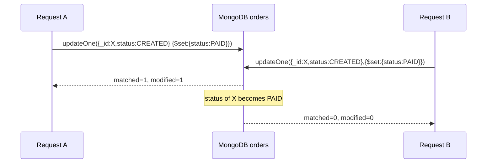
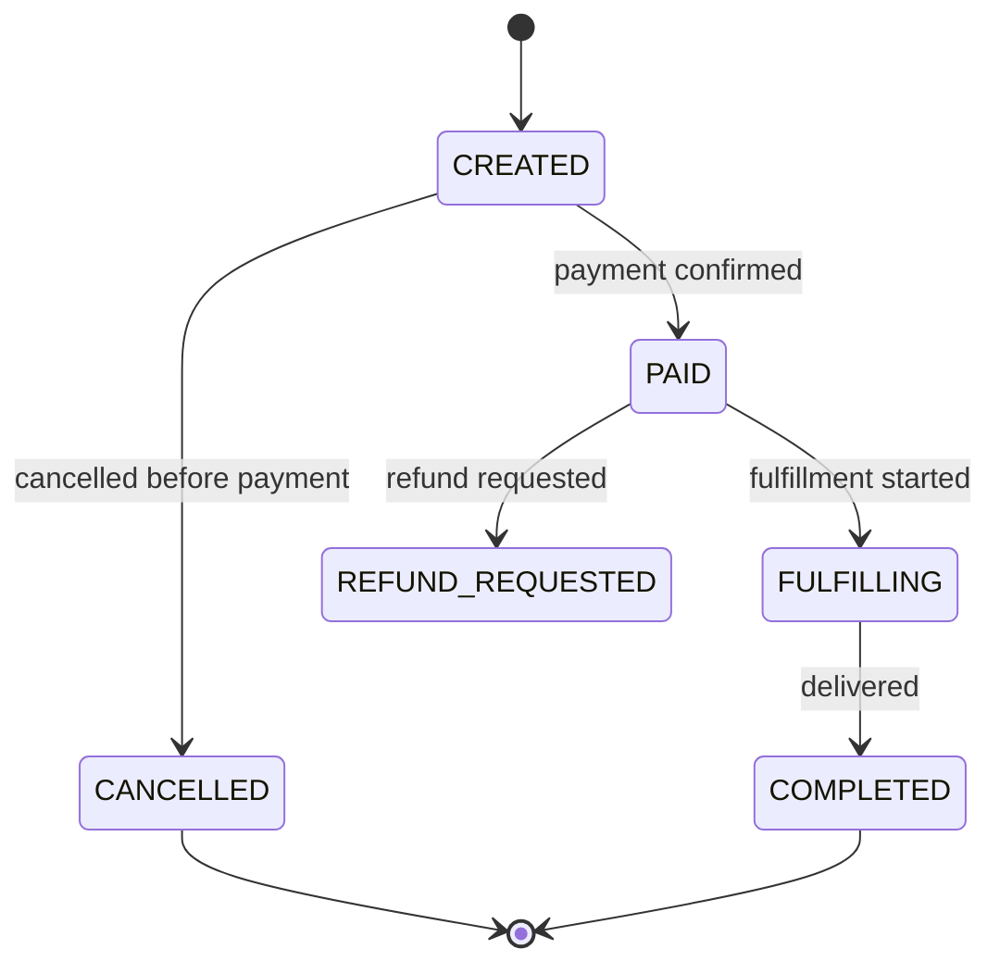

# Atomic Conditional Updates Enforcing Business Rules

## 1. Problem: Updating Correctly Under Concurrent Requests

In a **Spring Data MongoDB** application, an update rarely means merely "set a field to a new value." It must also uphold **business invariants**: an order moves from `CREATED` to `PAID` only upon valid payment, inventory must never drop below zero, a coupon cannot exceed its usage cap, or a job must not be claimed by two workers simultaneously.

Suppose two requests both read an order in state `CREATED`. Both validate it and both attempt to transition it to `PAID`. If the check lives **only in Java**, both requests can convince themselves they won. The flaw is even clearer when two shoppers simultaneously try to buy the last unit in stock.

The core solution is a **conditional atomic update**: placing both the **precondition** and the **state mutation** inside a single MongoDB write operation. General pattern:

```javascript
db.collection.updateOne(
  { _id: someId, condition: expectedValue },
  { $set: { condition: newValue } }
)
```

MongoDB guarantees that a write on a **single document** is atomic, even when modifying multiple fields within that document. When two concurrent operations race, each update's predicate is evaluated against the document state as writes serialize. Once the first operation invalidates the second operation's predicate, the second operation updates nothing.

In Spring Data MongoDB, the key building blocks are:

| Component | Role |
| --- | --- |
| `Criteria` | Expresses business conditions that must hold **at update time** |
| `Query` | Combines predicates on ID, tenant, status, quantities, etc. |
| `Update` | Expresses atomic mutations such as `set`, `inc`, `unset`, `currentDate` |
| `MongoTemplate.updateFirst(...)` | Updates the first document satisfying conditions, returning `UpdateResult` |
| `MongoTemplate.findAndModify(...)` | Conditionally updates and returns the pre- or post-image document |
| `@Version` | Supports optimistic locking in entity save flows |
| Unique index | Enforces **uniqueness** invariants at the database level, not just in Java |

This lesson focuses on two rules:

1. **Orders:** transition `CREATED → PAID` at most once for an eligible document.
2. **Inventory:** reserve `quantity` units only when `available >= quantity`, never letting stock go negative during updates.

We then distinguish single-document atomicity from multi-document transactions, interpret results, handle retries and idempotency, and write concurrency tests.

## 2. Understanding the Exact Scope of "Atomicity"

MongoDB guarantees atomicity for **one write operation on one document**. A single `updateOne` can check predicates, `$set` a status, `$inc` a counter, and stamp a timestamp without exposing a "half-updated" state of that document to concurrent readers.



This diagram illustrates one possible schedule: request A wins and request B no longer matches the old status. If B arrives first, the outcome reverses; **there is no guarantee which request wins first**.

Important boundaries:

- **One document:** multiple fields within that document update atomically in one command.
- **Multiple documents:** two `updateOne` calls across `orders` and `inventory` are **two independent operations**; calling them back-to-back in one Java method does not make them a transaction.
- **Multiple documents in `updateMany`:** each document updates atomically on its own, yet the whole batch has no cross-document atomic transaction guarantee.
- **Network and return values:** a timeout or dropped connection after sending a command does not prove the database did not write. Retries must account for idempotency and uncertain outcomes.
- **Query predicates:** predicates must guard the invariants, not just `_id`. An `$inc` without a balance guard can drive stock negative even though the decrement itself runs atomically.
- **Durability:** operation atomicity differs from write acknowledgment policies and crash/failover durability. Choose write/read concerns matching system guarantees.

**Distinction:** atomicity prevents torn intermediate states within **a single write**; it does not automatically make an entire workflow involving external payments, emails, and multiple collections happen all at once.

## 3. Data and Entities for Practice

Suppose database `shop_atomic_demo` has two collections:

- `orders`: each order carries ID, tenant, status, and payment timestamp.
- `inventory`: each tenant's SKU tracks `available` (sellable) and `reserved` (held) units.

### Sample BSON Documents

```javascript
use shop_atomic_demo

db.orders.insertMany([
  {
    _id: "ORD-1001",
    tenant_id: "SHOP-A",
    status: "CREATED",
    paid_at: null
  },
  {
    _id: "ORD-1002",
    tenant_id: "SHOP-A",
    status: "PAID",
    paid_at: ISODate("2026-11-10T08:00:00Z")
  }
])

db.inventory.insertOne({
  _id: "SHOP-A:BOOK-101",
  tenant_id: "SHOP-A",
  sku: "BOOK-101",
  available: NumberLong("3"),
  reserved: NumberLong("0")
})
```

Run these inserts only on an **empty practice database**. Re-running with the same `_id` triggers duplicate key errors. Never test stock deductions or status flips on production data.

### Entity `OrderDocument`

Examples use Java 17 and standard Spring Boot 3.x APIs with `spring-boot-starter-data-mongodb`. Local MongoDB configuration might look like `spring.data.mongodb.uri=mongodb://localhost:27017/shop_atomic_demo`; real-environment credentials and connections must be configured separately.

```java
package com.example.shop;

import java.time.Instant;
import org.springframework.data.mongodb.core.mapping.Document;
import org.springframework.data.mongodb.core.mapping.Field;
import org.springframework.data.mongodb.core.mapping.FieldType;
import org.springframework.data.mongodb.core.mapping.MongoId;

@Document(collection = "orders")
public class OrderDocument {

    @MongoId(FieldType.STRING)
    private String id;

    @Field("tenant_id")
    private String tenantId;

    private String status;

    @Field("paid_at")
    private Instant paidAt;

    protected OrderDocument() {}

    public OrderDocument(
            String id, String tenantId, String status, Instant paidAt) {
        this.id = id;
        this.tenantId = tenantId;
        this.status = status;
        this.paidAt = paidAt;
    }

    public String getId() { return id; }
    public String getTenantId() { return tenantId; }
    public String getStatus() { return status; }
    public Instant getPaidAt() { return paidAt; }
}
```

### Entity `InventoryDocument`

```java
package com.example.shop;

import org.springframework.data.mongodb.core.mapping.Document;
import org.springframework.data.mongodb.core.mapping.Field;
import org.springframework.data.mongodb.core.mapping.FieldType;
import org.springframework.data.mongodb.core.mapping.MongoId;

@Document(collection = "inventory")
public class InventoryDocument {

    @MongoId(FieldType.STRING)
    private String id;

    @Field("tenant_id")
    private String tenantId;

    private String sku;
    private long available;
    private long reserved;

    protected InventoryDocument() {}

    public InventoryDocument(
            String id, String tenantId, String sku,
            long available, long reserved) {
        this.id = id;
        this.tenantId = tenantId;
        this.sku = sku;
        this.available = available;
        this.reserved = reserved;
    }

    public String getId() { return id; }
    public String getTenantId() { return tenantId; }
    public String getSku() { return sku; }
    public long getAvailable() { return available; }
    public long getReserved() { return reserved; }
}
```

Both entities use `@MongoId(FieldType.STRING)` to map `id` to `_id` as BSON String. `@Field("tenant_id")` and `@Field("paid_at")` specify stored field names. `Criteria.where("tenantId")` inside entity-typed `MongoTemplate` calls maps to `tenant_id`; in `mongosh`, use the physical BSON names.

## 4. Broken Pattern: Read First, Check in Java, Write Later

The snippet below shows an approach that is **unsafe under concurrent requests**:

```java
// DO NOT use this as a state-transition guard.
OrderDocument order =
    mongoTemplate.findById("ORD-1001", OrderDocument.class);

if (order != null && "CREATED".equals(order.getStatus())) {
    // Another request can change status right after this if statement.
    Query byId = Query.query(Criteria.where("id").is(order.getId()));
    mongoTemplate.updateFirst(
        byId,
        new Update().set("status", "PAID"),
        OrderDocument.class
    );
}
```

The flaw sits between **read** and **write**:

1. Request A reads `status = CREATED`.
2. Request B also reads `status = CREATED`.
3. A updates `status = PAID`.
4. B still proceeds to update because B evaluated its predicate earlier in Java memory.

If concurrent requests trigger downstream actions like granting access, sending notifications, or confirming transactions, the system risks double processing. Even adding `synchronized` in one JVM fails across multiple instances or pods.

**Proper fix:** place `status = CREATED` inside the **write command's filter** and proceed only when the write result reports the transition succeeded.

## 5. Compare-and-Set: Conditional Order Status Transition

Requirement:

> Only order `ORD-1001` of `SHOP-A` currently in `CREATED` may transition to `PAID`, recording the payment timestamp at the same time.

In `mongosh`:

```javascript
db.orders.updateOne(
  {
    _id: "ORD-1001",
    tenant_id: "SHOP-A",
    status: "CREATED"
  },
  {
    $set: {
      status: "PAID",
      paid_at: ISODate("2026-11-20T08:00:00Z")
    }
  }
)
```

On the first call against sample data, typical output reports `matchedCount: 1` and `modifiedCount: 1`. Re-running the exact command finds `status` is no longer `CREATED`, yielding `matchedCount: 0` and `modifiedCount: 0`. This is classic **compare-and-set (CAS)**: transition only from the expected state to the new state.

### `MongoTemplate.updateFirst` Example

```java
import java.time.Instant;
import com.mongodb.client.result.UpdateResult;
import org.springframework.data.mongodb.core.query.Criteria;
import org.springframework.data.mongodb.core.query.Query;
import org.springframework.data.mongodb.core.query.Update;

String authorizedTenantId = "SHOP-A";
String orderId = "ORD-1001";
Instant paidAt = Instant.parse("2026-11-20T08:00:00Z");

Query query = Query.query(
    Criteria.where("id").is(orderId)
        .and("tenantId").is(authorizedTenantId)
        .and("status").is("CREATED")
);

Update change = new Update()
    .set("status", "PAID")
    .set("paidAt", paidAt);

UpdateResult result =
    mongoTemplate.updateFirst(query, change, OrderDocument.class);

boolean transitioned = result.getModifiedCount() == 1;
```

`id` maps to `_id`, `tenantId` to `tenant_id`, and `paidAt` to `paid_at` via `OrderDocument` metadata.

**Explanation:** no Java lock is needed around read–write because **compare and mutate** travel together in one MongoDB command. When two requests race on the same order, at most one succeeds with `status = CREATED`, provided all status-changing paths honor the same rules.

The `tenantId` predicate does not perform authentication on its own. `authorizedTenantId` must come from an authenticated/authorized security context—never treat a caller-supplied tenant string as proof of access.

## 6. Understanding `matchedCount`, `modifiedCount`, and Failure Outcomes

`MongoTemplate.updateFirst(...)` returns `com.mongodb.client.result.UpdateResult` when acknowledged by the driver. Key properties:

| Property | Meaning |
| --- | --- |
| `getMatchedCount()` | Documents matching the filter; typically 0 or 1 for `updateFirst` |
| `getModifiedCount()` | Documents whose stored data actually changed; may be lower than matched |
| `getUpsertedId()` | ID of a newly inserted document when upsert is used |
| Write exceptions | Network errors, duplicate keys, write concern failures, etc.; not all errors return count = 0 |

For `CREATED → PAID`, a matched document necessarily changes `status`, so `modifiedCount == 1` signals a successful transition. However, **do not apply that assumption universally**:

```javascript
// If status was already "PAID", this command may yield:
// matchedCount = 1, modifiedCount = 0.
db.orders.updateOne(
  { _id: "ORD-1002" },
  { $set: { status: "PAID" } }
)
```

For an idempotent operation meaning "ensure final status is PAID," `matchedCount = 1, modifiedCount = 0` is not a failure. Conversely, in a **conditional state transition** requiring `status = CREATED` to `$set status = PAID`, `modifiedCount = 0` indicates the transition did not occur under that condition.

When `matchedCount = 0`, possible causes include:

- The order does not exist.
- The order belongs to another tenant or caller lacks access.
- The order is already `PAID`, `CANCELLED`, or in a state other than `CREATED`.
- Another concurrent request transitioned the status right before this write executed.

**Do not guess the cause from zero alone.** If the API must return distinct responses, re-read the document within authorized scope to inspect current state—keeping in mind this secondary read occurs after the failed write and state may keep shifting; it reflects only the read instant. Where cross-tenant existence must stay confidential, intentionally return a generic error.

### Handling the Result in the Service Layer

```java
package com.example.shop;

import java.time.Instant;
import com.mongodb.client.result.UpdateResult;
import org.springframework.data.mongodb.core.MongoTemplate;
import org.springframework.data.mongodb.core.query.Criteria;
import org.springframework.data.mongodb.core.query.Query;
import org.springframework.data.mongodb.core.query.Update;
import org.springframework.stereotype.Service;

@Service
public class OrderPaymentService {

    private final MongoTemplate template;

    public OrderPaymentService(MongoTemplate template) {
        this.template = template;
    }

    public boolean markPaidOnce(
            String authorizedTenantId,
            String orderId,
            Instant paidAt) {
        if (authorizedTenantId == null
                || authorizedTenantId.isBlank()
                || orderId == null || orderId.isBlank()
                || paidAt == null) {
            throw new IllegalArgumentException("Invalid input");
        }

        Query precondition = Query.query(
            Criteria.where("id").is(orderId)
                .and("tenantId").is(authorizedTenantId)
                .and("status").is("CREATED")
        );

        Update change = new Update()
            .set("status", "PAID")
            .set("paidAt", paidAt);

        UpdateResult result =
            template.updateFirst(precondition, change,
                OrderDocument.class);

        return result.getModifiedCount() == 1;
    }
}
```

Returning `true` means **the database state transition succeeded**; `false` means no `CREATED → PAID` transition happened in this call. The service itself does not settle money with an external payment gateway: actual payment confirmation must come from an authenticated, properly integrated payment flow.

## 7. `findAndModify`: Updating and Returning the Resulting Document

Sometimes an API needs the **post-update state**, not just a boolean. Writing `updateFirst` followed by `findById` splits into two operations, letting another request modify the document in between.

`MongoTemplate.findAndModify(...)` conditionally updates and returns the document in a single `findAndModify` command:

```java
import java.time.Instant;
import org.springframework.data.mongodb.core.FindAndModifyOptions;
import org.springframework.data.mongodb.core.query.Criteria;
import org.springframework.data.mongodb.core.query.Query;
import org.springframework.data.mongodb.core.query.Update;

Query condition = Query.query(
    Criteria.where("id").is("ORD-1001")
        .and("tenantId").is("SHOP-A")
        .and("status").is("CREATED")
);

Update change = new Update()
    .set("status", "PAID")
    .set("paidAt", Instant.parse("2026-11-20T08:00:00Z"));

OrderDocument updated = mongoTemplate.findAndModify(
    condition,
    change,
    FindAndModifyOptions.options().returnNew(true),
    OrderDocument.class
);

if (updated == null) {
    // No document matched the conditions at write time.
} else {
    // updated.getStatus() is "PAID" for this transition.
}
```

Key differences:

- `returnNew(true)` requests the **post-update** document; otherwise the API defaults to returning the **pre-update** document.
- `updated == null` indicates no document satisfied the conditions (with upsert off).
- This does not scan the whole collection; keep the filter tight (such as `_id` + tenant + status).
- When returning data in one shot, it saves a second call compared to update-then-find; still measure document-return overhead when `UpdateResult` alone would suffice.

In multi-worker job queues, the same pattern uses `findAndModify` on `status = "PENDING"` with a sort to transition to `PROCESSING`. Condition and claim happen atomically, though post-claim execution still requires leases/timeouts and crash recovery.

## 8. Keeping Inventory Non-Negative With `$gte` and `$inc`

Business invariant:

\[
\text{available} \ge 0
\]

When a customer reserves `quantity` units, we decrease `available` and increase `reserved` while keeping total stock constant:

\[
\begin{aligned}
\text{available}_{new} &= \text{available}_{old} - \text{quantity}\\
\text{reserved}_{new}  &= \text{reserved}_{old} + \text{quantity}
\end{aligned}
\]

**Do not write**:

```java
// UNSAFE under concurrent requests.
InventoryDocument item = mongoTemplate.findById(
    "SHOP-A:BOOK-101", InventoryDocument.class);

if (item != null && item.getAvailable() >= 2) {
    // Stock may no longer be sufficient when update executes.
    mongoTemplate.updateFirst(
        Query.query(Criteria.where("id").is(item.getId())),
        new Update().inc("available", -2)
            .inc("reserved", 2),
        InventoryDocument.class
    );
}
```

Two requests can both read `available = 3`, both pass the check, and both subtract 2—leaving `available = -1` even though each `$inc` is atomic.

**Correct:** place `available >= quantity` inside the update filter itself:

```javascript
db.inventory.updateOne(
  {
    _id: "SHOP-A:BOOK-101",
    tenant_id: "SHOP-A",
    available: { $gte: NumberLong("2") }
  },
  {
    $inc: {
      available: NumberLong("-2"),
      reserved: NumberLong("2")
    }
  }
)
```

Starting with `available = 3`, if two requests both try to reserve 2 units: **only one can succeed**; the second fails `available >= 2`. After the winner succeeds, `available = 1` and `reserved = 2`.

### Executing the Inventory Guard in `MongoTemplate`

```java
import com.mongodb.client.result.UpdateResult;
import org.springframework.data.mongodb.core.query.Criteria;
import org.springframework.data.mongodb.core.query.Query;
import org.springframework.data.mongodb.core.query.Update;

long quantity = 2L;

Query enoughStock = Query.query(
    Criteria.where("id").is("SHOP-A:BOOK-101")
        .and("tenantId").is("SHOP-A")
        .and("available").gte(quantity)
);

Update reserve = new Update()
    .inc("available", -quantity)
    .inc("reserved", quantity);

UpdateResult result = mongoTemplate.updateFirst(
    enoughStock,
    reserve,
    InventoryDocument.class
);

boolean reserved = result.getModifiedCount() == 1;
```

Call only when `quantity > 0` and within valid bounds. If `quantity = 0`, `$inc` changes nothing while still matching; if negative, `available >= quantity` loses its reservation meaning. For `quantity > 0`, a successful reservation updates both counters.

### Complete Service for One SKU

```java
package com.example.shop;

import com.mongodb.client.result.UpdateResult;
import org.springframework.data.mongodb.core.MongoTemplate;
import org.springframework.data.mongodb.core.query.Criteria;
import org.springframework.data.mongodb.core.query.Query;
import org.springframework.data.mongodb.core.query.Update;
import org.springframework.stereotype.Service;

@Service
public class InventoryReservationService {

    private final MongoTemplate template;

    public InventoryReservationService(MongoTemplate template) {
        this.template = template;
    }

    public boolean reserve(
            String authorizedTenantId, String sku, long quantity) {
        if (authorizedTenantId == null
                || authorizedTenantId.isBlank()
                || sku == null || sku.isBlank()
                || quantity <= 0 || quantity > 1_000_000) {
            throw new IllegalArgumentException(
                "Invalid reservation input");
        }

        String inventoryId = authorizedTenantId + ":" + sku;

        Query query = Query.query(
            Criteria.where("id").is(inventoryId)
                .and("tenantId").is(authorizedTenantId)
                .and("sku").is(sku)
                .and("available").gte(quantity)
        );

        Update update = new Update()
            .inc("available", -quantity)
            .inc("reserved", quantity);

        UpdateResult result = template.updateFirst(
            query, update, InventoryDocument.class);

        return result.getModifiedCount() == 1;
    }
}
```

This models a system where each tenant and SKU has **one inventory document** keyed by a deterministic ID. String-joining with `:` is safe only if tenant/SKU codes are sanitized against delimiters; in production, consider a technical UUID plus a **compound unique index** on `(tenant_id, sku)` instead of manual ID concatenation.

Reserving **one SKU in one document** is protected by predicates on that document. Reserving **multiple SKUs** while creating an order or issuing a voucher in other collections spans multiple documents and requires a different strategy when all-or-nothing atomicity is needed.

## 9. Multi-Field Atomic Updates Are Not Optimistic Locking

For a document holding status and attempt counters, one `Update` can combine multiple changes:

```java
Update update = new Update()
    .set("status", "PROCESSING")
    .inc("attempts", 1)
    .currentDate("updatedAt");
```

Used with `updateFirst` and an appropriate `updatedAt` mapping, these fields change atomically on the **same document** without exposing partial intermediate state. Still, this **differs** from optimistic locking:

- **Conditional update:** filters by specific business predicates such as `status == CREATED` or `available >= quantity`.
- **Optimistic locking:** relies on a previously read version; updates only if the version hasn't changed, catching any concurrent edit that bumped the version.

`@Version` in Spring Data MongoDB supports optimistic locking in appropriate entity-save flows. Yet when calling `MongoTemplate.updateFirst` manually, **do not assume the framework attaches a filter matching the version the caller previously read**. If version-based CAS is required, include `version = expectedVersion` in the write query or use an optimistic-locking save API.

### Explicit Version-Conditional Update Example

Suppose a settings document tracks an integer `version`:

```javascript
db.settings.updateOne(
  { _id: "shop-a:rules", version: NumberLong("3") },
  {
    $set: { enabled: true },
    $inc: { version: NumberLong("1") }
  }
)
```

If two requests both read `version = 3` and submit this update, only the first bumps version to 4; the second fails to match. This is **version-based compare-and-set**. Standardize the BSON numeric type, guard overflow, and handle conflict outcomes explicitly.

### Entity Example With `@Version`

```java
import org.springframework.data.annotation.Version;

@Version
private Long version;
```

Place this field on entities requiring optimistic locking. Spring Data checks version during concurrent writes along its versioning-aware paths, such as appropriate `save` calls. Under acknowledged write concerns, conflicts raise `OptimisticLockingFailureException`.

**Do not add `@Version` expecting it to "magically solve everything":** versioning does not prevent duplicate business keys across documents, does not replace `available >= quantity`, and does not make two collections atomic together.

## 10. Idempotency: Atomic Does Not Mean Safe to Repeat Blindly

A concept often confused with atomicity is **idempotency**: repeating the same request produces the same business outcome as executing it once.

The `CREATED → PAID` transition guarded by `status = CREATED` has a helpful property: after succeeding once, subsequent retries **cannot apply the same transition again**. However, that alone does not make the broader external payment flow idempotent, because payment gateways and downstream events have their own lifecycles.

For inventory, `available >= quantity` alone is **not request-idempotent**. While ample stock remains:

```text
Initial stock: available = 10, reserved = 0
Request reserves 2:   available = 8, reserved = 2   (succeeds)
Retry reserves 2:     available = 6, reserved = 4   (also succeeds)
```

Each decrement is atomic and non-negative, yet **the same request** reserved stock twice. Solve this with a **unique request key** like `reservationId`/`idempotencyKey`, ensuring only one write is credited per key.

### Single-Document Idempotency Marker Pattern

When the number of recorded requests per item is **small and bounded**, an `applied_request_ids` array can track processed keys while updating stock and recording the key in **one single-document command**:

```javascript
const requestId = "RES-ORDER-5001";
const quantity = NumberLong("2");
const negativeQuantity = NumberLong("-2");

db.inventory.updateOne(
  {
    _id: "SHOP-A:BOOK-101",
    tenant_id: "SHOP-A",
    available: { $gte: quantity },
    applied_request_ids: { $ne: requestId }
  },
  {
    $inc: {
      available: negativeQuantity,
      reserved: quantity
    },
    $addToSet: {
      applied_request_ids: requestId
    }
  }
)
```

The predicate `applied_request_ids: { $ne: requestId }` permits the write only if that request key has not been recorded on the document. `$inc` and `$addToSet` execute inside one atomic single-document update; a retry carrying **the same key** will not deduct stock again.

**Critical limitation:** this array grows with every request; MongoDB caps single BSON documents at 16 MiB, making this unsuitable for SKUs with unbounded reservation history. Do not delete old markers while retries for those requests remain possible, or future retries could re-apply.

At larger scale, use a **dedicated request-tracking collection with a unique index**, paired with transactions or a workflow guaranteeing consistency between recording the key and updating inventory. **Writing two separate documents in two commands without a transaction does not guarantee idempotency** if one succeeds and the other fails.

### Retrying When Write Outcome Is Uncertain

If the app sends a command and loses connection before receiving a response, it cannot tell whether the write succeeded. Never blindly re-run an unkeyed `$inc`. Beyond driver retryable writes (which have specific scopes and conditions), systems need **business-level idempotency** for client or job retries of whole requests.

For `CREATED → PAID`, if a retry receives `matchedCount = 0`, distinguish "previous attempt already succeeded" from "order was cancelled by another flow" using business rules and current state. Never automatically assume a retry didn't match solely because your earlier attempt succeeded.

## 11. State Transitions Following a Business State Machine

Order statuses typically follow a clear state machine:



Never expose an arbitrary `set("status", newStatus)` endpoint accepting any target status. Every transition needs a **source-state predicate**, authorization check, required data validation, and well-defined side effects.

Example `CREATED → CANCELLED` transition:

```java
Query query = Query.query(
    Criteria.where("id").is(orderId)
        .and("tenantId").is(authorizedTenantId)
        .and("status").is("CREATED")
);

Update change = new Update()
    .set("status", "CANCELLED")
    .set("cancelledAt", java.time.Instant.now());

UpdateResult result =
    mongoTemplate.updateFirst(query, change, OrderDocument.class);

boolean cancelled = result.getModifiedCount() == 1;
```

This snippet illustrates adding `cancelledAt` when business logic tracks cancellation time; in a complete app, declare the field on the entity with `@Field("cancelled_at")` or your standardized BSON name rather than leaving Java/BSON naming ambiguous.

**If a cancel request and a payment request race**, sharing the `status = CREATED` filter ensures **at most one transition** out of `CREATED` wins on that document. Still, if funds were already captured externally, flipping status to `CANCELLED` does not automatically refund money; a separate refund workflow is required.

### Adding Time or Secondary State Conditions

A rule might allow "cancel only if order has not expired," or "worker claims a task only if its lease expired." Add those conditions directly into the filter:

```java
Query query = Query.query(
    Criteria.where("id").is(orderId)
        .and("status").is("CREATED")
        .and("expiresAt").gt(java.time.Instant.now())
);
```

This requires storing `expiresAt` as a BSON Date and having trustworthy application clocks; if multiple nodes suffer clock skew, standardize the time source or use an appropriate clock mechanism. Every status-writing endpoint must obey valid transitions, or another API could bypass the invariant.

## 12. Documents With Arrays: Conditioning and Updating Elements

Sometimes business constraints live inside an **array element**—for example, order `lines` containing `sku` and `remaining`. To deduct remaining shippable quantity for a line item, the same element must match both SKU and sufficient remaining quantity.

MongoDB example:

```javascript
{
  _id: "ORD-2001",
  tenant_id: "SHOP-A",
  lines: [
    { sku: "BOOK-101", remaining: NumberLong("3") },
    { sku: "BOOK-202", remaining: NumberLong("1") }
  ]
}
```

Use `$elemMatch` in the filter and the **positional update operator** `$` to update the first matching element:

```javascript
db.orders.updateOne(
  {
    _id: "ORD-2001",
    tenant_id: "SHOP-A",
    lines: {
      $elemMatch: {
        sku: "BOOK-101",
        remaining: { $gte: NumberLong("2") }
      }
    }
  },
  {
    $inc: { "lines.$.remaining": NumberLong("-2") }
  }
)
```

Meaning: decrement `remaining` on a `BOOK-101` line only if **that exact line element** has at least 2 units left. Never write two separate predicates `"lines.sku"` and `"lines.remaining"` when targeting the same element: separate predicates can match two different array elements.

When an SKU can repeat in the array, positional `$` updates only the first matching element. If multiple elements need conditional updates, MongoDB supports `arrayFilters` and other positional operators, though duplicate SKU rules must be carefully designed. Usually it is cleaner to assign a unique `lineId` per item or keep SKUs unique per order.

**Boundary:** array updates remain atomic **within one document**, yet updating inventory in a separate collection does not become cross-collection atomic from this command alone.

## 13. `upsert`, Unique Indexes, and Insert Preconditions

`upsert` means: if no document matches the filter, **insert** a new document instead of only updating. Useful for settings or counters, yet hazardous in operations requiring "update only if old state is valid."

**Never use this to confirm payment**:

```javascript
// UNSUITABLE for a transition requiring an existing order.
db.orders.updateOne(
  { _id: "ORD-9999", status: "CREATED" },
  { $set: { status: "PAID" } },
  { upsert: true }
)
```

If no matching order exists, upsert can create a brand-new `PAID` document out of thin air. If `_id` already exists with another status, upsert may trigger a duplicate key error or unexpected conflict depending on predicates. That is not a valid state transition.

**Rule:** for `CREATED → PAID` or `available >= quantity`, use **non-upsert updates**, because failing to match is the signal you want to catch.

When genuinely needing "create if missing," `upsert` must:

- Specify an exact identity key or **unique index** within business scope.
- Supply insert-only defaults via `$setOnInsert` when appropriate.
- Handle concurrent insert races, including duplicate key exceptions rather than expecting automatic merges.
- Distinguish `matchedCount`, `modifiedCount`, and `upsertedId` in `UpdateResult`.
- Never rely on "`find` then `insert`" for uniqueness due to race conditions.

Example tenant-scoped setting with unique ID:

```javascript
db.shop_settings.updateOne(
  { _id: "SHOP-A:CHECKOUT" },
  {
    $set: { enabled: true },
    $setOnInsert: { created_by: "system" }
  },
  { upsert: true }
)
```

This suits **create-settings-if-absent**, though it does not enforce CAS over every setting field. To protect configuration versions, add version predicates or appropriate invariants.

## 14. When Do You Need Multi-Document Transactions or an Outbox?

"Reserve stock if sufficient" on `InventoryDocument` fits **single-document** atomic updates nicely. Yet a checkout flow might require:

1. Transitioning the order from `CREATED` to `CONFIRMED`.
2. Decreasing available and increasing reserved units on inventory documents.
3. Recording an event to notify shipping or payment systems.

If step 1 succeeds and step 2 fails for insufficient stock, the database could hold an invalid confirmed order. Two sequential Java calls **do not form an ACID cross-document transaction**.

### MongoDB Transactions When Genuinely Needed

MongoDB supports multi-document transactions on compatible deployments—typically a **replica set or sharded cluster**, not a standalone server. Spring Data MongoDB provides `MongoTransactionManager` so imperative operations participate in a transaction.

Basic configuration example:

```java
package com.example.shop;

import org.springframework.context.annotation.Bean;
import org.springframework.context.annotation.Configuration;
import org.springframework.data.mongodb.MongoDatabaseFactory;
import org.springframework.data.mongodb.MongoTransactionManager;

@Configuration
public class MongoTransactionConfig {

    @Bean
    MongoTransactionManager transactionManager(
            MongoDatabaseFactory databaseFactory) {
        return new MongoTransactionManager(databaseFactory);
    }
}
```

Illustrative service creating an order and reserving inventory:

```java
package com.example.shop;

import java.time.Instant;
import org.springframework.data.mongodb.core.MongoTemplate;
import org.springframework.stereotype.Service;
import org.springframework.transaction.annotation.Transactional;

@Service
public class CheckoutService {

    private final InventoryReservationService inventory;
    private final MongoTemplate template;

    public CheckoutService(
            InventoryReservationService inventory,
            MongoTemplate template) {
        this.inventory = inventory;
        this.template = template;
    }

    @Transactional
    public void createAndReserve(
            String authorizedTenantId, String orderId,
            String sku, long quantity) {

        boolean reserved =
            inventory.reserve(authorizedTenantId, sku, quantity);

        if (!reserved) {
            throw new IllegalStateException(
                "Insufficient stock or invalid SKU");
        }

        template.insert(new OrderDocument(
            orderId, authorizedTenantId, "CONFIRMED",
            (Instant) null));
    }
}
```

This example illustrates only **transaction boundaries**—omitting input validation, order ID generation, idempotency, and pricing. In a properly configured environment, if inserting the order throws an exception that triggers rollback, the stock reservation inside the same transaction also rolls back. This requires:

- `MongoTransactionManager` registered and used with the active template/transaction context.
- MongoDB deployment supporting transactions (valid replica set or sharded cluster).
- Invoking through the Spring transaction proxy (never assume self-invocation activates `@Transactional`).
- Handling transaction errors, write conflicts, and safely retrying the **entire transaction**.

Do not enable transactions indiscriminately for every single-document update: they add overhead and complexity. When only one document must change atomically, a single conditional atomic update is enough.

### Outbox and External Systems

**MongoDB transactions cannot roll back an external payment API call or already-sent email.** For "update order + emit event," consider the **transactional outbox** pattern: store both the state change and the outbox event inside one database transaction, then let a worker publish the event and mark it processed. Consumers also need idempotency because events may be delivered more than once.

If a small event flag fits inside the **order document itself**, recording the pending event alongside the transition lets a worker scan and dispatch it, keeping document growth, lifecycle, and delivery reliability in mind. Never fire a webhook assuming `updateFirst` success guarantees the webhook runs exactly once.

## 15. Indexes and Performance of Conditional Updates

Atomic conditions must be **business-correct first**, then indexed. Even so, an inefficiently filtered update can overload large collections.

### Queries by `_id`

```javascript
db.orders.updateOne(
  { _id: "ORD-1001", tenant_id: "SHOP-A", status: "CREATED" },
  { $set: { status: "PAID" } }
)
```

Because `_id` is unique with a built-in index, looking up a specific ID yields at most one candidate. Adding tenant and status to the filter **enforces business invariants**; you do not automatically need a compound index over all three fields for `_id`-keyed updates.

### Queries by Business Key

When inventory is queried by `tenant_id` and `sku` rather than `_id`, use a compound unique index:

```javascript
db.inventory.createIndex(
  { tenant_id: 1, sku: 1 },
  {
    unique: true,
    name: "inventory_tenant_sku_unique"
  }
)
```

This prevents two inventory documents for the same tenant/SKU while accelerating key lookups. Before building a unique index on existing data, locate and resolve duplicate keys, missing/null keys, and SKU normalization rules.

A predicate like `available >= quantity` is evaluated on the matched SKU document. Once narrowed by a unique ID/key, do not add extra indexes on `available` merely because it appears in the filter.

### Measuring the Document Lookup Path

Inspect an **equivalent `find` query** matching the update filter:

```javascript
db.inventory.find({
  _id: "SHOP-A:BOOK-101",
  tenant_id: "SHOP-A",
  available: { $gte: NumberLong("2") }
}).explain("executionStats")
```

This measures the **document lookup path**, not the full cost of `updateOne`. Examine `winningPlan`, `IXSCAN`/`COLLSCAN`, `totalKeysExamined`, `totalDocsExamined`, and `nReturned`. Real update latency also includes lock contention, index writes, journaling, write concern, replication, and retries.

If many requests hammer **one hot inventory document**, even an ideal index cannot eliminate write contention on that single document. You may need to revisit data design, rate-limit, queue work, or partition stock per real demand—never split documents in ways that violate "total stock >= 0."

## 16. Reactive Conditional Updates

In reactive Spring Data MongoDB, predicates and mutations still use `Query` and `Update`. Replace `MongoTemplate` with `ReactiveMongoTemplate`; update methods return `Mono<UpdateResult>` instead of a synchronous `UpdateResult`:

```java
import java.time.Instant;
import org.springframework.data.mongodb.core.ReactiveMongoTemplate;
import org.springframework.data.mongodb.core.query.Criteria;
import org.springframework.data.mongodb.core.query.Query;
import org.springframework.data.mongodb.core.query.Update;
import reactor.core.publisher.Mono;

Query condition = Query.query(
    Criteria.where("id").is(orderId)
        .and("tenantId").is(authorizedTenantId)
        .and("status").is("CREATED")
);

Update change = new Update()
    .set("status", "PAID")
    .set("paidAt", Instant.now());

Mono<Boolean> transitioned =
    reactiveMongoTemplate
        .updateFirst(condition, change, OrderDocument.class)
        .map(result -> result.getModifiedCount() == 1);
```

This snippet sits inside a component with an injected `ReactiveMongoTemplate` and variables `orderId`, `authorizedTenantId`. Reactive repositories and templates do not alter MongoDB's **single-document** atomicity.

Key notes:

- `Mono` executes upon subscription; never mutate shared `Query`/`Update` instances across concurrent subscriptions.
- Never call `block()` inside reactive request pipelines just to await the result.
- When multi-document transactions are needed in reactive flows, use the **reactive** transaction manager and context; imperative `MongoTransactionManager` does not manage reactive transactions.
- Reactor retries such as `retryWhen(...)` must account for **idempotency**. Never blindly retry an `$inc` operation whose prior execution may have succeeded without the client receiving the response.

The reactive template also offers `findAndModify` to return documents when needed, with CAS predicates still passed in the query. Reactive APIs do not replace unique indexes or authorization checks.

## 17. Testing Against Real MongoDB, Including Concurrent Contention

Concurrency invariants must be tested against **real MongoDB** in an isolated test environment, such as a dedicated test server or Testcontainers. A mock returning a fake `UpdateResult` never proves an update behaves atomically under load.

The example below uses Spring Boot 3.x and `@DataMongoTest`. It seeds data matching both entities' BSON types. Configure an isolated test MongoDB connection before running.

```java
package com.example.shop;

import java.time.Instant;
import java.util.concurrent.Callable;
import java.util.concurrent.CountDownLatch;
import java.util.concurrent.ExecutorService;
import java.util.concurrent.Executors;
import java.util.concurrent.Future;
import org.bson.Document;
import org.junit.jupiter.api.BeforeEach;
import org.junit.jupiter.api.Test;
import org.springframework.beans.factory.annotation.Autowired;
import org.springframework.boot.test.autoconfigure.data.mongo.DataMongoTest;
import org.springframework.data.mongodb.core.MongoTemplate;

import static org.assertj.core.api.Assertions.assertThat;

@DataMongoTest
class ConditionalAtomicUpdateTest {

    @Autowired
    MongoTemplate template;

    private OrderPaymentService payments;
    private InventoryReservationService inventory;

    @BeforeEach
    void seedIsolatedDatabase() {
        // ONLY use on an isolated test database.
        template.getCollection("orders")
            .deleteMany(new Document());
        template.getCollection("inventory")
            .deleteMany(new Document());

        template.insert(new OrderDocument(
            "ORD-1001", "SHOP-A", "CREATED", null));

        template.insert(new InventoryDocument(
            "SHOP-A:BOOK-101", "SHOP-A", "BOOK-101",
            3, 0));

        payments = new OrderPaymentService(template);
        inventory = new InventoryReservationService(template);
    }

    @Test
    void aPaymentTransitionSucceedsOnlyOnce() {
        Instant paidAt =
            Instant.parse("2026-11-20T08:00:00Z");

        assertThat(payments.markPaidOnce(
            "SHOP-A", "ORD-1001", paidAt)).isTrue();

        assertThat(payments.markPaidOnce(
            "SHOP-A", "ORD-1001", paidAt)).isFalse();

        OrderDocument stored =
            template.findById("ORD-1001", OrderDocument.class);

        assertThat(stored).isNotNull();
        assertThat(stored.getStatus()).isEqualTo("PAID");
        assertThat(stored.getPaidAt()).isEqualTo(paidAt);
    }

    @Test
    void reservationNeverMakesStockNegative() {
        assertThat(inventory.reserve(
            "SHOP-A", "BOOK-101", 2)).isTrue();

        assertThat(inventory.reserve(
            "SHOP-A", "BOOK-101", 2)).isFalse();

        InventoryDocument stored = template.findById(
            "SHOP-A:BOOK-101", InventoryDocument.class);

        assertThat(stored).isNotNull();
        assertThat(stored.getAvailable()).isEqualTo(1);
        assertThat(stored.getReserved()).isEqualTo(2);
    }

    @Test
    void twoConcurrentReservationsCannotBothTakeTwo()
            throws Exception {
        ExecutorService pool =
            Executors.newFixedThreadPool(2);
        CountDownLatch gate = new CountDownLatch(1);

        try {
            Callable<Boolean> request = () -> {
                gate.await();
                return inventory.reserve(
                    "SHOP-A", "BOOK-101", 2);
            };

            Future<Boolean> first = pool.submit(request);
            Future<Boolean> second = pool.submit(request);
            gate.countDown();

            int successCount = (first.get() ? 1 : 0)
                + (second.get() ? 1 : 0);

            assertThat(successCount).isEqualTo(1);

            InventoryDocument stored = template.findById(
                "SHOP-A:BOOK-101", InventoryDocument.class);

            assertThat(stored).isNotNull();
            assertThat(stored.getAvailable()).isEqualTo(1);
            assertThat(stored.getReserved()).isEqualTo(2);
        } finally {
            pool.shutdownNow();
        }
    }
}
```

**Limitations of this test example:**

- `deleteMany(new Document())` deletes **every document** in the collection on the connected database. Never run against production or shared databases.
- `@DataMongoTest` loads Spring Data components, yet does not provision a test MongoDB instance by itself; configure an isolated test database.
- Both threads share connections from the configured `MongoTemplate`; this test does not verify atomicity across external systems or multi-collection transactions.
- Repeat concurrency tests under representative load and supplement with fault-injection, timeout/retry, and write-concern tests when high reliability is required.

### Additional Test Cases to Cover

| Case | Expectation |
| --- | --- |
| First transition from `CREATED` | One update succeeds; `status` and `paid_at` update together |
| Re-running transition after `PAID` | `paid_at` stays unchanged; transition count is 0 |
| Order belonging to another tenant | Untouched, no data leakage |
| Order in `CANCELLED` state | Cannot become `PAID` via `CREATED → PAID` transition |
| Two concurrent transition requests | At most one succeeds |
| Stock 3, two requests reserve 2 | Only one succeeds; final stock stays non-negative |
| Stock 3, request reserves 0 or -1 | Service rejects before sending query |
| Two requests sharing one idempotency key | Business request applies at most once per design |
| Connection drops after sending write | Handles uncertain outcome and retries safely |
| Transaction creating order + reserving stock | Either both commit, or both roll back on failure |
| `available` has wrong BSON type | Never silently treated as a valid number |

## 18. Common Errors and How to Fix Them

| Symptom | Common Cause | Fix |
| --- | --- | --- |
| Two requests both "succeed" in Java | Checked state via `find` upfront, updated filtering only by ID | Put expected state inside the update command's filter |
| Inventory goes negative despite `$inc` | Omitted `available >= quantity` from filter | Pair `$gte` with `$inc` in one command |
| `modifiedCount = 0` treated as database failure | Unmatched filter or no-op value | Distinguish matched/modified and transition semantics |
| Retrying `$inc` reserves stock twice | Operation is atomic, not request-idempotent | Use an idempotency key and consistent marker storage |
| Status transition retry returns false though order is `PAID` | State is no longer `CREATED` | Define retry response semantics, check current state/request identity |
| Updated right order ID under wrong tenant | Filter lacked tenant or trusted client tenant | Bind authenticated scope into update predicate |
| `findAndModify` returns old status | Forgot `returnNew(true)` | Pass post-image return option |
| Upsert creates an invalid order | Used `upsert(true)` on a state transition | Keep upsert off for transitions requiring existing documents |
| Two collections fall out of sync | Updated multiple documents via independent commands | Use transactions where needed/supported, or saga/compensation |
| Payment events sent twice | Emitted external event outside DB without idempotency/outbox | Use transactional outbox and consumer deduplication |
| Entity has `@Version` yet updates overwrite | Raw/template update lacked expected version in filter | Verify commands; use optimistic `save` or explicit CAS |
| Update is slow despite indexes | Heavy contention on a single hot document | Measure contention, revisit partitioning/throughput design |
| Reactive `retryWhen` duplicates operations | Retried `$inc` whose prior outcome was uncertain | Design idempotency before enabling retries |
| `@LastModifiedDate` stays unchanged | Partial update skips entity save callbacks | Set timestamp explicitly or verify auditing setup |

**Diagnostic principle:** never collapse all `modifiedCount = 0` outcomes into "out of stock." Filters often check ID, tenant, SKU, status, and quantity simultaneously. An API may issue a follow-up read after failure for informative messaging while maintaining authorization and avoiding treating the re-read as immutable truth.

## 19. Checklist for Applying Conditional Atomic Updates

Before shipping a Spring Data MongoDB write flow, answer:

1. **Which invariant must always hold?** E.g., `available >= 0` or only valid `status` transitions.
2. **Does the invariant span one document or multiple?** If one, prefer a single conditional update.
3. **Does the filter include all expected values?** E.g., `status = CREATED`, `available >= quantity`, or `version = expectedVersion`.
4. **Is the filter bound to the authenticated tenant and identity?** Tenant must come from a trusted security context.
5. **Are related mutations inside one command?** Use `$set`/`$inc`/`$unset` across related fields in the same document.
6. **How is the result interpreted?** Distinguish `matchedCount`, `modifiedCount`, and exceptions.
7. **Is the post-update document needed?** Consider `findAndModify(..., returnNew(true))`.
8. **If retried, is the operation idempotent?** Especially critical for `$inc` and external side effects.
9. **Are multiple collections or external systems involved?** Consider transactions, sagas/outbox, and deduplication.
10. **Are indexes and unique constraints in place?** Check lookup paths and contention hotspots.
11. **Were concurrency and failure cases tested?** Test racing requests, retries, timeouts, and wrong field types.
12. **Using reactive?** Keep conditional `Query`/`Update`, use the reactive template, and never `block()` inside requests.

### Exercise 1: Proper Stock Deduction

**Question:** A product has 5 units left; two concurrent requests each try to buy 4. Which MongoDB predicate prevents negative stock?

**Answer:** Filter by product ID (and tenant) plus `available: { $gte: 4 }`, and update `$inc: { available: -4 }`. Only one request can decrement from 5 to 1.

### Exercise 2: Are Atomic and Idempotent the Same?

**Question:** Why can an `$inc` stock deduction guarded by `available >= quantity` still double-process a single request?

**Answer:** Each call executes atomically and stays non-negative, yet as long as enough stock remains, retrying the same request deducts again. You need an idempotency key and consistent deduplication recording.

### Exercise 3: Competing Statuses

**Question:** An order is `CREATED`; `PAID` and `CANCELLED` requests arrive simultaneously. How do you ensure only one transition wins?

**Answer:** Both updates must filter on `_id`, tenant, and `status = CREATED`, then `$set` their target status. Once one update succeeds, the other's predicate no longer matches.

### Exercise 4: Uncertain Outcome

**Question:** A client hits a timeout after sending a stock-deduction command; can it immediately re-run the same `$inc`?

**Answer:** Never retry recklessly without idempotency controls. The first attempt may have committed; use a request ID, recorded status, and a safe retry policy.

### Exercise 5: Multiple Documents

**Question:** Calling `updateFirst` on `inventory` followed by `insert` on `orders` in one Java method—is it atomic across both documents?

**Answer:** No. For cross-document invariants, use a properly configured MongoDB transaction or a compensation/idempotency workflow.

### Exercise 6: Choosing `UpdateResult` vs. `findAndModify`

**Question:** If an API only needs a boolean indicating whether `CREATED → PAID` succeeded, what should you use? What if it needs the updated status document?

**Answer:** `updateFirst` returning `UpdateResult` suffices for a boolean transition check. When you need the updated document in the same operation, use `findAndModify` with `returnNew(true)`.

**Conclusion:** **Conditional atomic updates enforcing business rules** put both the **required precondition** and the **mutation** into one single-document MongoDB command. In Spring Data MongoDB, `Criteria` + `Query` + `Update` paired with `MongoTemplate.updateFirst` or `findAndModify` cleanly implement guarded transitions and invariants like non-negative stock. Yet **atomicity does not equal idempotency**, does not automatically bind multiple documents into one commit, and does not replace authorization, indexing, transactions, or error handling. Test contention, interpret write results accurately, and design retries before going to production.
