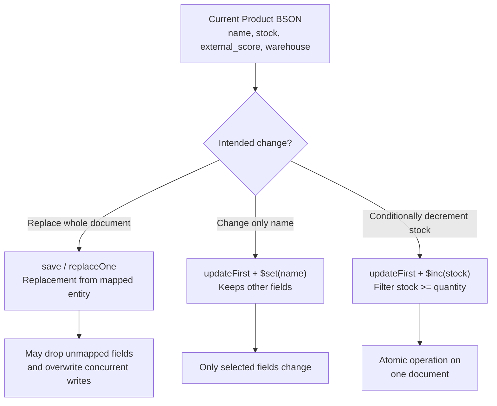

# Choosing Save vs. Update to Prevent Unintended Overwrites

## 1. Context and Objectives

In **Spring Data MongoDB**, the exact same business intent—such as "rename a product"—can be implemented via `repository.save(product)`, `mongoTemplate.save(product)`, `mongoTemplate.updateFirst(...)`, or a BSON `$set` update. These options **do not share the same semantics**.

In a **Mini Commerce** system with `Product`, `Customer`, and `Order`, the wrong choice can cause serious damage:

- Overwriting inventory quantities just updated by another transaction.
- Dropping fields managed by an external service, even if the Java field is annotated with `@ReadOnlyProperty`.
- Saving an entity loaded via a projection, wiping out unloaded fields.
- Lost updates when two requests read and `save` a stale copy of a document.
- Replacing the entire `OrderLine` array when intending to edit a single field.

This lesson belongs to the **Writes and Updates** chapter of Spring Data MongoDB. We focus on choosing accurately between **full-document saves**, **partial updates**, **conditional updates**, **upserts**, and **find-and-modify**. These techniques connect directly to mapping, repositories, queries/aggregations, indexes, transactions, reactive access, testing, and data performance diagnostics.

After this lesson, you will be able to:

1. Explain the differences between `insert`, `save`, and `MongoTemplate`'s `update` operations.
2. Recognize why `save` on an existing document can **replace all mapped contents**.
3. Use `$set`, `$inc`, `$unset`, `$addToSet`, and `$setOnInsert` to modify only the target fields.
4. Write **conditional atomic** stock deductions instead of race-prone "read → compute → save" cycles.
5. Apply `@Version`/optimistic locking, inspect `UpdateResult`, and design sensible retry/idempotency strategies.
6. Understand the effects of `@ReadOnlyProperty`, `@Transient`, projections, mapping callbacks, and auditing.
7. Update embedded fields or array elements without replacing the entire object or array.
8. Test raw BSON before/after updates, verify indexes, and know when transactions are required.

**Prerequisites:** Java 17+, Spring Boot with `spring-boot-starter-data-mongodb`, a running MongoDB instance, and familiarity with `@Document`, `@Id`, `MongoRepository`, `MongoTemplate`, `Query`/`Criteria`, BSON, and MongoDB update operators. Examples use the imperative API; the reactive counterpart is compared near the end.

## 2. Core Mindset: A Document Is a Storage Unit

Suppose the `products` collection stores this document:

```json
{
  "_id": "prod-001",
  "sku": "LAP-001",
  "name": "Mini Mechanical Keyboard",
  "category": "accessories",
  "active": true,
  "stock": 20,
  "price": { "$numberDecimal": "129900.00" },
  "external_score": { "$numberDecimal": "9.50" },
  "warehouse": {
    "aisle": "A1",
    "shelf": "S2"
  }
}
```

In Mini Commerce, `Product.name` is owned by the catalog service; `stock` is updated by the inventory service; `external_score` is updated by an external scoring pipeline; and `warehouse` may be maintained by the warehouse system. If a Java `Product` object lacks all of these fields and gets persisted via **document replacement**, any field omitted from the replacement will **vanish**.

### 2.1. Document Replacement and Field Updates Are Distinct Operations



| Goal | Usually Appropriate Approach | What to Watch Out For |
| --- | --- | --- |
| Create new product; never overwrite | `insert` | Duplicate `_id`/unique key must error |
| Save a complete, consistently owned entity | `save` | Rewrites entire document; risks dropping absent fields |
| Change one or a few fields | `updateFirst` with `$set` | Verify filter and `UpdateResult` |
| Deduct stock when quantity is sufficient | `$inc` with `stock >= qty` predicate | Never use unguarded read-modify-save |
| Update multiple matching documents | `updateMulti` | Atomic per document; does not automatically form a full transaction |
| Update and receive the new document | `findAndModify` with `returnNew(true)` | Predicates, sorting, projections, and concurrency |
| Create if missing | `upsert` + `$setOnInsert` | Unique index/idempotency to guard races |
| Intentionally replace entire document | `findAndReplace` or `replaceOne` | Preserve `_id`; verify no needed fields are lost |

**Guiding rule:** pick the operation by **business intent**, not by which method takes fewer lines of code.

## 3. Creating Sample Data: Product and Repository

To highlight the risks, `Product` includes a read-only `externalScore` field and omits the `warehouse` field from the Java entity.

```java
package com.example.minicommerce.domain;

import java.math.BigDecimal;

import org.springframework.data.annotation.Id;
import org.springframework.data.annotation.ReadOnlyProperty;
import org.springframework.data.mongodb.core.mapping.Document;
import org.springframework.data.mongodb.core.mapping.Field;
import org.springframework.data.mongodb.core.mapping.FieldType;

@Document(collection = "products")
public class Product {

    @Id
    private String id;

    private String sku;
    private String name;
    private String category;
    private boolean active;
    private int stock;

    @Field(targetType = FieldType.DECIMAL128)
    private BigDecimal price;

    @ReadOnlyProperty
    @Field("external_score")
    private BigDecimal externalScore;

    public Product() {}

    public Product(String id, String sku, String name,
                   String category, boolean active,
                   int stock, BigDecimal price) {
        this.id = id;
        this.sku = sku;
        this.name = name;
        this.category = category;
        this.active = active;
        this.stock = stock;
        this.price = price;
    }

    public String getId() { return id; }
    public void setId(String id) { this.id = id; }

    public String getSku() { return sku; }
    public void setSku(String sku) { this.sku = sku; }

    public String getName() { return name; }
    public void setName(String name) { this.name = name; }

    public String getCategory() { return category; }
    public void setCategory(String category) {
        this.category = category;
    }

    public boolean isActive() { return active; }
    public void setActive(boolean active) { this.active = active; }

    public int getStock() { return stock; }
    public void setStock(int stock) { this.stock = stock; }

    public BigDecimal getPrice() { return price; }
    public void setPrice(BigDecimal price) { this.price = price; }

    public BigDecimal getExternalScore() { return externalScore; }
}
```

In this example:

- `@Id` maps `id` to BSON `_id`.
- `@Field(targetType = FieldType.DECIMAL128)` stores money as BSON Decimal128.
- `@ReadOnlyProperty` allows reading `external_score` while **excluding it when serializing back to BSON**.
- `warehouse` exists in the stored document yet **has no property** on the Java class.

Repository:

```java
package com.example.minicommerce.repository;

import org.springframework.data.mongodb.repository.MongoRepository;
import com.example.minicommerce.domain.Product;

public interface ProductRepository
        extends MongoRepository<Product, String> {
}
```

`Product` and `ProductRepository` live in two separate Java files. The examples use String ID `"prod-001"` to keep `String ↔ ObjectId` conversions out of scope for this lesson.

## 4. insert: Create Only and Error on Key Collision

`insert` is used when **the intent is creating a new record**:

```java
Product product = new Product(
    "prod-001",
    "LAP-001",
    "Mini Mechanical Keyboard",
    "accessories",
    true,
    20,
    new BigDecimal("129900.00")
);

Product created = mongoTemplate.insert(product);
```

Semantically equivalent call on the repository:

```java
Product created = productRepository.insert(product);
```

If a document with the same `_id` already exists, MongoDB rejects the insert with a duplicate key error. This behavior is **desirable** when you never want a "create new" request to silently turn into "overwrite existing."

**Do not confuse:**

- `insert`: always requests inserting a new document.
- `save`: inserts if the entity is detected as new; for existing entities, can perform document save/replacement.
- A create request may also require a **unique index on `sku`**, not just `_id`. Two documents with different IDs could share the same SKU unless a unique constraint prevents it.

Create a unique index for SKU when business rules require uniqueness:

```javascript
db.products.createIndex({ sku: 1 }, { unique: true });
```

Before creating an index on existing data, audit duplicate SKUs and prepare a cleanup plan. Calling `existsBySku` before `insert` only improves error messages; it **does not replace a unique index** because two requests can pass the check concurrently.

## 5. save: Writes the Whole Document, Not a PATCH

### 5.1. MongoTemplate.save and MongoRepository.save

```java
Product loaded =
    mongoTemplate.findById("prod-001", Product.class);

if (loaded == null) {
    throw new IllegalStateException("Product not found");
}

loaded.setName("Mini Mechanical Keyboard V2");
mongoTemplate.save(loaded);
```

With the repository:

```java
Product loaded = productRepository.findById("prod-001")
    .orElseThrow();

loaded.setName("Mini Mechanical Keyboard V2");
productRepository.save(loaded);
```

Both go through entity mapping. For an existing document, `save` essentially **writes the entity state as a replacement document**, rather than emitting an update solely for the `name` field changed by the setter.

Because the Java entity lacks `warehouse` and marks `externalScore` with `@ReadOnlyProperty`, the replacement BSON **omits both fields**. Existing database fields are not automatically retained.

### 5.2. Before/After Breakdown

Before `save`:

```javascript
{
  _id: "prod-001",
  sku: "LAP-001",
  name: "Mini Mechanical Keyboard",
  stock: 20,
  price: NumberDecimal("129900.00"),
  external_score: NumberDecimal("9.50"),
  warehouse: { aisle: "A1", shelf: "S2" }
}
```

After loading `Product`, changing `name`, and calling `save`, the document can become:

```javascript
{
  _id: "prod-001",
  sku: "LAP-001",
  name: "Mini Mechanical Keyboard V2",
  category: null,
  active: false,
  stock: 20,
  price: NumberDecimal("129900.00"),
  _class: "com.example.minicommerce.domain.Product"
}
```

This "after" document is a **risk illustration**, not an exact BSON snapshot across every configuration or null-serialization setting. Actual results depend on whether the entity was fully loaded, null mapping, converters, and metadata. The key point: `warehouse` and `external_score` **can be lost** because the replacement omits them. Never assume `@ReadOnlyProperty` means "the framework preserves the existing database value during `save`."

Constructing a fresh object with an existing ID and populating only a couple of fields before calling `save` creates an **even higher** risk of data loss. `save` does not read the old document and merge missing fields for you.

### 5.3. When Is save Appropriate?

`save` remains a good fit when:

- The entity is an **aggregate root** wholly owned by one component.
- The object is **completely loaded**, with mapping omitting no fields that must be kept.
- Proper concurrency guards exist, such as `@Version` to catch lost updates.
- Business intent truly is **replacing the entire entity state**.
- Schema/contract rules confirm dropping unmapped fields in replacements is intended.

Conversely, if multiple services own different parts of one document, or a request edits only one field, prefer **partial updates**.

## 6. Special Hazards: Projections, @Transient, and @ReadOnlyProperty

### 6.1. A Projection Is Not a Complete Entity

Suppose a product listing API needs only `sku` and `name`:

```java
Query summaryQuery = Query.query(
    Criteria.where("active").is(true));

summaryQuery.fields()
    .include("sku")
    .include("name");

List<Product> summaries =
    mongoTemplate.find(summaryQuery, Product.class);
```

`Product` objects populated from a projection may lack `stock`, `price`, `category`, or other fields. Passing `summary` to `save(summary)` risks **overwriting the document with incomplete data**.

**Safe practice:** return a DTO/interface projection for read screens; never pass a partially loaded entity into `save`. When a user renames an item from a list screen, have the service accept ID + new name and run `$set("name", ...)` with authorization checks.

### 6.2. @Transient Does Not Preserve BSON Fields

`@Transient` excludes a property from persistence mapping. If the stored document currently holds that field, calling `save` on an entity ignoring it can still drop the field on replacement.

`@ReadOnlyProperty` differs in that the field **is read into** the entity yet **omitted when writing** to BSON. It is not a "merge and keep old value" directive. Only **partial updates** or an intentional replacement strategy satisfy the requirement to leave unowned fields untouched.

### 6.3. Unknown Fields From Other Services

Because MongoDB allows flexible schemas, a newer service may add `warehouse.lastCountedAt` to documents. An older service version unaware of that property that calls `save` on the full `Product` can erase the new field. This is a classic hazard during **rolling deployments** across versions or multi-writer collections.

Never use `save` on a multi-owner aggregate without controlling schema ownership and write contracts across every writer.

## 7. Partial Updates With Query and Update

### 7.1. Renaming Only the Product With $set

In Spring Data MongoDB:

```java
import com.mongodb.client.result.UpdateResult;
import org.springframework.data.mongodb.core.query.Criteria;
import org.springframework.data.mongodb.core.query.Query;
import org.springframework.data.mongodb.core.query.Update;

Query filter = Query.query(
    Criteria.where("id").is("prod-001"));

Update changes = new Update()
    .set("name", "Mini Mechanical Keyboard V2");

UpdateResult result =
    mongoTemplate.updateFirst(filter, changes, Product.class);

if (result.getMatchedCount() == 0) {
    throw new IllegalStateException("Product not found");
}
```

The filter uses **Java property `id`**, which maps to BSON `_id` when executed with `Product.class`. `updateFirst` sends the BSON `$set` modifier rather than replacing the whole document.

Equivalent BSON:

```javascript
db.products.updateOne(
  { _id: "prod-001" },
  { $set: { name: "Mini Mechanical Keyboard V2" } }
);
```

Other fields like `stock`, `price`, `warehouse`, and `external_score` **remain untouched**, unless another writer modifies them.

### 7.2. MatchedCount Differs From ModifiedCount

`UpdateResult` exposes:

| Property | Meaning |
| --- | --- |
| `getMatchedCount()` | Number of documents matching the filter |
| `getModifiedCount()` | Number of documents actually modified |
| `getUpsertedId()` | ID inserted by upsert, if any |
| `wasAcknowledged()` | Whether the server acknowledged the write under active write concern |

Updating `name` to its existing value may return `matchedCount = 1` and `modifiedCount = 0`. Never assume `modifiedCount == 0` means the document was not found.

For conditional updates checking permissions or sufficient stock, `matchedCount == 0` is usually the meaningful failure signal. Ensure the app uses an **acknowledged write concern** when reading these counts or catching optimistic lock failures; unacknowledged writes provide no equivalent guarantee.

### 7.3. $unset Differs From $set Null

```java
Update removeLegacyValue = new Update()
    .unset("legacyPromoCode");
```

Equivalent to:

```javascript
{ $unset: { legacyPromoCode: "" } }
```

`$unset` deletes the **field**, whereas `$set: { legacyPromoCode: null }` keeps the field present as BSON Null. That distinction affects `$exists`, validation, aggregations, and indexes. Choose per schema rather than treating them as identical.

### 7.4. Setting Multiple Fields in One Command

```java
Update change = new Update()
    .set("name", "Keyboard V2")
    .set("active", true)
    .currentDate("updatedAt");

mongoTemplate.updateFirst(
    Query.query(Criteria.where("id").is("prod-001")),
    change,
    Product.class);
```

An update modifying multiple fields **on one document** is atomic at the document level. `updatedAt` should be clearly defined in the schema; `currentDate` generates the timestamp on the server rather than the JVM. If the entity does not declare `updatedAt`, verify mapping for that new field before relying on it.

## 8. The Inventory Problem: Why Read → Compute → Save Fails

Suppose `prod-001` has `stock = 20`. Two customers place orders concurrently:

```text
Request A: reads stock = 20
Request B: reads stock = 20

Request A: buys 3 -> computes stock = 17
Request B: buys 5 -> computes stock = 15

Request A: saves Product(stock=17)
Request B: saves Product(stock=15)

Final stock = 15, though it should be 12
```

This is a **lost update**. The last write wins, erasing A's deduction on `stock` (and potentially clobbering other fields). Wrapping each isolated read/save inside a transaction is not enough either without proper conflict control; use conditional server-side operations or optimistic locking.

### 8.1. Using $inc With a Sufficient-Stock Predicate

In Spring Data:

```java
public boolean reserveStock(
        String productId, int quantity, MongoTemplate template) {

    if (quantity <= 0) {
        throw new IllegalArgumentException(
            "Quantity must be positive");
    }

    Query enoughStock = Query.query(
        Criteria.where("id").is(productId)
            .and("active").is(true)
            .and("stock").gte(quantity));

    Update decrement = new Update()
        .inc("stock", -quantity);

    UpdateResult result = template.updateFirst(
        enoughStock, decrement, Product.class);

    return result.getMatchedCount() == 1;
}
```

MongoDB logic:

```javascript
db.products.updateOne(
  {
    _id: "prod-001",
    active: true,
    stock: { $gte: 3 }
  },
  { $inc: { stock: -3 } }
);
```

This is **one atomic write on a single document**: `stock >= quantity` is verified inside the same update, so competing requests cannot drive stock below zero through **this update path**.

If two requests buy 3 and 5 starting from stock 20, sequential `$inc` executions leave stock at **12**. If only 2 remain and a request asks for 3, the filter matches nothing (`matchedCount == 0`), allowing the service to report insufficient stock or handle the state cleanly.

**Warning:** `$inc` is **not idempotent**. If a client retries the same call after a connection drop without knowing whether the first attempt succeeded, stock may be deducted **twice**. Real order flows require a request ID/idempotency key, unique order record, transactions, or proper orchestration.

### 8.2. Stock Adjustments Without Replacement Side Effects

`$inc` does not rely on an in-JVM entity snapshot as truth; it mutates the current server value directly. That is why it beats `stock = loaded.stock - quantity` under concurrent requests.

However, `$inc` guarantees atomicity only within **one Product document**. If an `Order` spans three products, deducting all three and inserting the Order consistently requires transactional coordination; see the transactions section.

### 8.3. Never Use $set From a Stale Stock Read

Error-prone example:

```java
Product loaded = mongoTemplate.findById(
    "prod-001", Product.class);

int newStock = loaded.getStock() - quantity;

mongoTemplate.updateFirst(
    Query.query(Criteria.where("id").is("prod-001")),
    new Update().set("stock", newStock),
    Product.class);
```

This uses a partial update yet **still suffers lost updates** because `newStock` was computed from an old read. **Partial updates do not eliminate race conditions** if the new value derives from stale data. Prefer `$inc` for increments/decrements, and version conditions or compare-and-set for complex mutations.

## 9. @Version and Optimistic Locking When save Is Needed

When an aggregate genuinely requires full `save`, Spring Data MongoDB supports optimistic locking with `@Version`.

Standalone illustrative entity:

```java
package com.example.minicommerce.domain;

import org.springframework.data.annotation.Id;
import org.springframework.data.annotation.Version;
import org.springframework.data.mongodb.core.mapping.Document;

@Document(collection = "versioned_products")
public class VersionedProduct {

    @Id
    private String id;
    private String name;
    private int stock;

    @Version
    private Long version;

    public VersionedProduct() {}

    public VersionedProduct(String id, String name, int stock) {
        this.id = id;
        this.name = name;
        this.stock = stock;
    }

    public String getId() { return id; }
    public String getName() { return name; }
    public void setName(String name) { this.name = name; }
    public int getStock() { return stock; }
    public void setStock(int stock) { this.stock = stock; }
    public Long getVersion() { return version; }
}
```

`version` is a persistence field used by Spring Data to detect write conflicts. Initial values and increments can vary between wrapper and primitive types and entity lifecycle state, so avoid hardcoding an assumed starting version number in business logic.

### 9.1. Two Concurrent Edits on One Record

```java
VersionedProduct first = mongoTemplate.findById(
    "prod-v1", VersionedProduct.class);
VersionedProduct second = mongoTemplate.findById(
    "prod-v1", VersionedProduct.class);

first.setName("Keyboard Edition A");
mongoTemplate.save(first); // Saves and increments version.

second.setName("Keyboard Edition B");
mongoTemplate.save(second); // Can throw OptimisticLockingFailureException.
```

Suppose both read version `v`. `save(first)` writes only if the stored version is still `v` and advances it to the next version. When `save(second)` submits the stale version, the condition fails and Spring Data signals a conflict.

To rely on this mechanism:

- Enable an **acknowledged write concern** (e.g., `ACKNOWLEDGED`).
- Ensure every critical write path **respects versioning**; raw driver writes can bypass Spring Data's version checks.
- Never swallow `OptimisticLockingFailureException` and report success.
- Return conflict errors, reload/merge, or perform bounded business retries.

**Limitation:** `@Version` prevents lost updates among writers sharing the protocol, yet **does not retain unknown or `@ReadOnlyProperty` fields** when `save` replaces the BSON document. These are **two distinct hazards**: write concurrency vs. replacement schema loss.

### 9.2. Partial Updates With @Version: Do Not Assume Auto-Locking

Spring Data supports incrementing version across many `MongoTemplate.update*` operations when `@Version` is omitted from `Update`. Still, **auto-incrementing version** does not mean the query verified the **request's expected version**.

For compare-and-set, put the expected version into the **filter**:

```java
long expectedVersion = 7L;

Query matchingVersion = Query.query(
    Criteria.where("id").is("prod-v1")
        .and("version").is(expectedVersion));

Update change = new Update()
    .set("name", "New keyboard");

UpdateResult result = mongoTemplate.updateFirst(
    matchingVersion, change, VersionedProduct.class);

if (result.getMatchedCount() == 0) {
    throw new IllegalStateException(
        "Product not found or version conflict");
}
```

If the framework auto-increments `@Version` on that update, **do not increment version manually a second time**. If the application controls version explicitly, standardize one protocol across all paths and test post-write BSON to avoid double-incrementing or skipping bumps.

## 10. findAndModify: Atomic Update and Returning the Document

`updateFirst` returns `UpdateResult`, not the post-update entity. If business logic needs the **state after update**, use `findAndModify`:

```java
import org.springframework.data.mongodb.core.FindAndModifyOptions;
import org.springframework.data.mongodb.core.query.Criteria;
import org.springframework.data.mongodb.core.query.Query;
import org.springframework.data.mongodb.core.query.Update;

public Product reserveAndReturn(
        String productId, int quantity, MongoTemplate template) {

    if (quantity <= 0) {
        throw new IllegalArgumentException("Invalid quantity");
    }

    Query query = Query.query(
        Criteria.where("id").is(productId)
            .and("active").is(true)
            .and("stock").gte(quantity));

    Update decrement = new Update().inc("stock", -quantity);

    return template.findAndModify(
        query,
        decrement,
        FindAndModifyOptions.options().returnNew(true),
        Product.class
    );
}
```

- Returning `null`: no matching document (non-existent, inactive, or insufficient stock).
- With `returnNew(true)`: returns the **post-update** entity. Without it, find-and-modify APIs typically return the **pre-update** version.
- Stock predicate and `$inc` execute in one server-side operation.
- The returned object is mapped via `Product.class`, so do not treat it as proof of all unmapped BSON fields.

**Distinguish two steps:** calling `updateFirst` then `findById` is **two separate operations** with a race window in between. `findAndModify` returns the document resulting from that exact atomic single-document update.

When multiple documents can match, `findAndModify` may need `Query.with(Sort...)` to select deterministically; when querying by unique ID, no ambiguity exists.

## 11. updateFirst vs. updateMulti: Impact Scope

Deactivating **one** product by SKU:

```java
mongoTemplate.updateFirst(
    Query.query(Criteria.where("sku").is("LAP-001")),
    new Update().set("active", false),
    Product.class);
```

Deactivating **all** products in a category:

```java
UpdateResult result = mongoTemplate.updateMulti(
    Query.query(Criteria.where("category").is("accessories")),
    new Update().set("active", false),
    Product.class);
```

With `updateMulti`, each document updates atomically, yet **the group of documents does not form a single transaction**. If an error interrupts midway, inspect results and design retry/rollback handling.

**Safety checklist:**

1. Always verify filter predicates; an empty `new Query()` passed to `updateMulti` updates the entire collection.
2. Add `tenantId`, soft-delete flags, or authorization checks as required.
3. Consider business limits or batching for very large document sets.
4. Log operation purpose, batch ID, and modified counts; never dump sensitive payloads into logs.

## 12. upsert and $setOnInsert: Create If Missing

`upsert` combines **query + update**: update if matched, insert a new document if absent. It differs from calling `save` on a full entity.

Suppose a catalog sync service ingests products by SKU:

```java
public UpdateResult upsertCatalogProduct(
        String sku, String name,
        BigDecimal price, MongoTemplate template) {

    if (sku == null || sku.isBlank()) {
        throw new IllegalArgumentException("SKU is required");
    }

    Query bySku = Query.query(Criteria.where("sku").is(sku));

    Update change = new Update()
        .set("name", name)
        .set("price", price)
        .setOnInsert("sku", sku)
        .setOnInsert("stock", 0)
        .setOnInsert("active", false);

    return template.upsert(bySku, change, Product.class);
}
```

Meaning:

- If `sku` already exists: only `name` and `price` are `$set`; **stock and active are not reset**.
- If missing: MongoDB creates the document, applying `$set` and `$setOnInsert` per schema.
- When inserted, `UpdateResult.getUpsertedId()` provides the new ID.
- If the entity uses `@Version`, test initial version creation/bump rules rather than assuming identical lifecycle behavior to `save`.

### 12.1. Why Does Upsert Still Need a Unique Index?

Two concurrent requests both failing to find `sku` can race to insert. A **unique index on `sku`** is the ultimate database guard ensuring no two products share the same business key (when uniqueness is required).

`upsert` is not a replacement for unique constraints or idempotency. When a duplicate-key exception occurs under contention, the service can re-read and decide whether to retry **per business rules**.

### 12.2. Preventing Overwrites With $setOnInsert

If business rules mean "insert defaults only if absent, leaving existing records untouched," use:

```java
Update defaults = new Update()
    .setOnInsert("sku", sku)
    .setOnInsert("name", defaultName)
    .setOnInsert("stock", 0);

mongoTemplate.upsert(
    Query.query(Criteria.where("sku").is(sku)),
    defaults,
    Product.class);
```

When a document already exists, `$setOnInsert` **does not alter existing values**—a very different contract from putting defaults into `$set`.

## 13. Updating Embedded Objects and Arrays: Keeping Scope Exact

### 13.1. Changing Only the City Inside an Embedded Address

`Order` holds `shippingAddressSnapshot` with `recipient`, `street`, `city`, and `country`. To edit only `city`, target the exact path:

```java
Update changeCity = new Update()
    .set("shippingAddressSnapshot.city", "Da Nang");

mongoTemplate.updateFirst(
    Query.query(Criteria.where("id").is("order-001")),
    changeCity,
    Order.class);
```

BSON:

```javascript
db.orders.updateOne(
  { _id: "order-001" },
  { $set: { "shippingAddressSnapshot.city": "Da Nang" } }
);
```

Calling `.set("shippingAddressSnapshot", newAddress)` replaces **the entire embedded object** at that path, potentially dropping other embedded fields. Likewise, `save(Order)` rewrites the whole root document from entity state.

In Mini Commerce, an order's shipping address is typically a **snapshot captured at checkout**. Modifying snapshots post-payment must obey business/audit rules, not just update API capabilities.

### 13.2. OrderLine Array: Updating Exactly One Element

Suppose `Order.lines` is an array of `OrderLine` elements:

```javascript
{
  _id: "order-001",
  lines: [
    { sku: "LAP-001", quantity: 1, unitPrice: NumberDecimal("129900.00") },
    { sku: "MOU-001", quantity: 2, unitPrice: NumberDecimal("49000.00") }
  ]
}
```

To update `quantity` on the line with matching SKU inside the array, MongoDB supports **arrayFilters**:

```javascript
db.orders.updateOne(
  { _id: "order-001" },
  {
    $set: {
      "lines.$[line].quantity": 3
    }
  },
  {
    arrayFilters: [
      { "line.sku": "LAP-001" }
    ]
  }
);
```

In Spring Data MongoDB, `Update.filterArray(...)` binds the identifier condition:

```java
Update updateLine = new Update()
    .set("lines.$[line].quantity", 3)
    .filterArray("line.sku", "LAP-001");

mongoTemplate.updateFirst(
    Query.query(Criteria.where("id").is("order-001")),
    updateLine,
    Order.class);
```

**Notes:**

- `$[line]` matches **every element** satisfying the `line` array filter; if an SKU appears multiple times in one order, multiple lines will change. To target a single line uniquely, give each line a unique `lineId` and filter by ID.
- Conditions passed to `filterArray` follow their own conversion rules; some overloads pass straight through to the driver **without entity field-name mapping**. Always verify exact BSON field names.
- Never replace the entire `lines` array from an old read just to change one element.
- In commerce systems, modifying finalized line quantities may also require recalculating `lineTotal`, `totalAmount`, and adjusting inventory consistently.

### 13.3. $push and $addToSet

For `Product`'s tag array:

```java
Update appendEveryTime = new Update()
    .push("tags", "featured");

Update addIfAbsent = new Update()
    .addToSet("tags", "featured");
```

`$push` allows duplicate entries; `$addToSet` adds only if no equal value is already present under BSON comparison rules. Pick per requirement. For arrays that grow indefinitely, watch the document size limit and consider alternative modeling.

## 14. findAndReplace: When Is Full Document Replacement Intentional?

When the requirement genuinely is "replace the entire aggregate with new state," `findAndReplace` (or raw `replaceOne`) expresses that intent more clearly than `$set`.

Conceptual flow:

```java
// Conceptual example: replacement is a complete Product,
// validated and carrying all aggregate fields.
Product replacement = loadCompleteReplacementFromTrustedSource();

Query byId = Query.query(
    Criteria.where("id").is("prod-001"));

Product previousOrNew = mongoTemplate.findAndReplace(
    byId, replacement);
```

This illustrates the API using a hypothetical `loadCompleteReplacementFromTrustedSource()` helper that **your application must implement**; it is not a standalone snippet. To control pre/post return images or upsert, use the `FindAndReplaceOptions` overloads matching your Spring Data version.

Before replacing a document:

- `_id` is immutable; the replacement must not change ID.
- The replacement must include **all data that must survive**.
- Unknown fields and converter-omitted fields vanish if excluded from the replacement.
- If `@Version` is used, follow explicit version-checking/filter conditions.
- Test against real BSON to compare before/after field sets.

**If only modifying two fields, do not use replacement.**

## 15. Lifecycle Callbacks, Auditing, and Timestamps

Reading and saving an entity via `save` can trigger Spring Data entity callbacks and auditing, such as populating `@CreatedDate` or `@LastModifiedDate` when auditing is enabled.

By contrast, `MongoTemplate.updateFirst(...)` performs a **field-level update directly at the database**, bypassing the full entity materialization and `save(entity)` callback lifecycle. Never assume every entity validation or lifecycle event runs during partial updates.

Example explicitly setting `updatedAt`:

```java
Update change = new Update()
    .set("name", "Mini Keyboard V3")
    .currentDate("updatedAt");

mongoTemplate.updateFirst(
    Query.query(Criteria.where("id").is("prod-001")),
    change, Product.class);
```

This is an **explicit timestamp update policy**, not proof that entity callbacks executed. If your project relies on `@LastModifiedDate` in `save`, standardize how timestamps update across **every write path**: repositories, templates, raw driver, batches, and migrations.

Same applies to bean validation and domain invariants:

- `@NotNull` on DTOs/entities does not block raw MongoDB updates.
- MongoDB JSON Schema validation can enforce collection-level rules when configured.
- Services must validate permissions and business rules before issuing updates.
- Pipeline updates and bulk operations may differ from `save` in lifecycle behavior; test them directly.

## 16. BulkOperations: Faster Does Not Mean Safer

When syncing thousands of products, `MongoTemplate.bulkOps(...)` batches multiple update commands.

```java
import org.springframework.data.mongodb.core.BulkOperations;
import org.springframework.data.mongodb.core.query.Query;
import org.springframework.data.mongodb.core.query.Update;

BulkOperations bulk = mongoTemplate.bulkOps(
    BulkOperations.BulkMode.ORDERED,
    Product.class);

bulk.updateOne(
    Query.query(Criteria.where("sku").is("LAP-001")),
    new Update().set("active", false));

bulk.updateOne(
    Query.query(Criteria.where("sku").is("MOU-001")),
    new Update().set("active", false));

bulk.execute();
```

These are **partial updates**, not two full-document `save` calls.

Important caveats:

- `ORDERED` runs commands sequentially and stops on error per bulk semantics; `UNORDERED` can optimize throughput differently without preserving order.
- Bulk operations do not automatically create a multi-document transaction.
- Entity-lifecycle features such as callbacks and `@Version` optimistic locking **must not be assumed to behave identically to `save`** inside bulk operations.
- Batches may be retried; **idempotent** `$set` commands behave very differently from non-idempotent `$inc` commands.
- Track aggregate results, logging, and partial-failure recovery.

## 17. Transactions: When Multi-Document Updates Must Be Consistent

A single `updateFirst` on **one** Product document is executed atomically by MongoDB. Yet placing a real order may require:

1. Deducting stock across three distinct Products.
2. Inserting the Order and OrderLines.
3. Recording payment status or an outbox event.

If the invariant demands **all succeed together or all roll back**, consider a multi-document transaction on a supported MongoDB topology via `MongoTransactionManager` and Spring transaction management.

Conceptual service outline:

```java
import org.springframework.transaction.annotation.Transactional;

@Transactional
public void placeOrder(PlaceOrderCommand command) {
    // 1. For each product: update stock >= quantity via $inc.
    // 2. If any update yields matchedCount == 0:
    //    throw an error so the transaction rolls back.
    // 3. Insert Order with validated price/line snapshots.
    // 4. Commit only when every operation succeeds.
}
```

This is a **conceptual skeleton**, not a full implementation; `PlaceOrderCommand` must be defined, and the service requires an active transaction manager and MongoDB replica set/sharded topology.

**Four key reminders:**

- Transactions do not turn a full-replacement `save` into a partial update.
- Transactions do not eliminate logical conflicts or non-idempotent retries.
- When external services participate (payments/email), design outbox/saga patterns or explicit coordination; a MongoDB transaction cannot roll back external HTTP calls.
- Transactions carry overhead and topology constraints; never wrap a single-field edit of one document in a multi-document transaction.

## 18. Reactive MongoDB: Same Semantics, Different Execution

With `ReactiveMongoTemplate`, updates return publishers, e.g.:

```java
import com.mongodb.client.result.UpdateResult;
import org.springframework.data.mongodb.core.query.Criteria;
import org.springframework.data.mongodb.core.query.Query;
import org.springframework.data.mongodb.core.query.Update;
import reactor.core.publisher.Mono;

Query enough = Query.query(
    Criteria.where("id").is("prod-001")
        .and("stock").gte(3));

Update decrement = new Update().inc("stock", -3);

Mono<UpdateResult> result =
    reactiveMongoTemplate.updateFirst(
        enough, decrement, Product.class);
```

This snippet assumes an injected `ReactiveMongoTemplate` in the service; execution occurs upon **subscription**. To map the result to business logic:

```java
Mono<Boolean> reserved = reactiveMongoTemplate
    .updateFirst(enough, decrement, Product.class)
    .map(update -> update.getMatchedCount() == 1);
```

Never call `block()` on a WebFlux event loop; never perform blocking I/O inside reactive converters or callbacks. **Reactive does not alter** the semantics of `save`, `$set`, `$inc`, `upsert`, optimistic locking, or transactions; it changes only how I/O is scheduled.

If a reactive chain uses retries, watch closely for `$inc` re-executing on resubscribe/retry and double-deducting stock. Idempotency remains a business requirement rather than a built-in Reactor feature.

## 19. Performance Diagnostics and Checking Update Queries

Updates still need well-indexed filters, especially at high frequency on large collections.

### 19.1. Indexes by ID and Business Key

MongoDB maintains a default `_id` index. For a stock-deduction filter:

```javascript
{
  _id: "prod-001",
  active: true,
  stock: { $gte: 3 }
}
```

The `_id` index locates the unique document quickly; `active` and `stock` are evaluated against that single document. **Do not automatically create extra compound indexes** over all three fields just because the filter includes three conditions when `_id` already narrows to one document.

For SKU-based `upsert` or category queries:

```javascript
db.products.createIndex({ sku: 1 }, { unique: true });

db.products.createIndex({ category: 1, active: 1 });
```

Add the second index based on real workload: only if category/active queries run frequently enough to benefit. Every index adds write overhead, storage, and maintenance cost.

### 19.2. Explain for Filters

```javascript
db.products.find({
  sku: "LAP-001"
}).explain("executionStats");
```

Watch `winningPlan`, `totalKeysExamined`, `totalDocsExamined`, and `nReturned`. `find().explain(...)` inspects a **similar query shape**, not necessarily the exact execution plan of every `updateOne`; use database profiling or command monitoring to inspect real updates on your running MongoDB version.

### 19.3. Monitoring Errors and Write Outcomes

Every critical write path should track:

- Operation name and business key (e.g. `orderId`, `productId`) at an appropriate log level.
- Matched/modified counts or newly upserted IDs.
- Clear distinction between "unmatched because missing," "insufficient stock," "version conflict," and "write failure" when required by the API contract.
- Bounded retry policies; auto-retry only operations and errors designed to be **idempotent** or guarded by a request ID.
- Before/after verification, including fields the application **does not own**.

Never log customer phone numbers, payment tokens, or full sensitive documents just to diagnose an update.

## 20. Testing Against Real MongoDB: Catching Data Loss

Mocking `MongoTemplate` never proves `save` deletes unknown fields while `$set` preserves them. Run tests against real MongoDB or Testcontainers using a dedicated test database.

### 20.1. Test Proving Partial Updates Preserve External Fields

```java
package com.example.minicommerce;

import static org.junit.jupiter.api.Assertions.*;

import java.math.BigDecimal;

import org.bson.Document;
import org.bson.types.Decimal128;
import org.junit.jupiter.api.Test;
import org.springframework.beans.factory.annotation.Autowired;
import org.springframework.boot.test.context.SpringBootTest;
import org.springframework.data.mongodb.core.MongoTemplate;
import org.springframework.data.mongodb.core.query.Criteria;
import org.springframework.data.mongodb.core.query.Query;
import org.springframework.data.mongodb.core.query.Update;

import com.example.minicommerce.domain.Product;

@SpringBootTest
class ProductPartialUpdateIntegrationTest {

    @Autowired
    MongoTemplate template;

    @Test
    void setChangesOnlyNameAndPreservesExternalFields() {
        String id = "update-test-001";
        var raw = template.getCollection("products");
        raw.deleteOne(new Document("_id", id));

        try {
            raw.insertOne(new Document("_id", id)
                .append("sku", "UPDATE-001")
                .append("name", "Initial name")
                .append("category", "accessories")
                .append("active", true)
                .append("stock", 10)
                .append("price",
                    new Decimal128(new BigDecimal("129900.00")))
                .append("external_score",
                    new Decimal128(new BigDecimal("9.50")))
                .append("warehouse",
                    new Document("aisle", "A1")));

            template.updateFirst(
                Query.query(Criteria.where("id").is(id)),
                new Update().set("name", "New name"),
                Product.class);

            Document after =
                raw.find(new Document("_id", id)).first();
            assertNotNull(after);
            assertEquals("New name", after.getString("name"));
            assertEquals(10, after.getInteger("stock"));
            assertTrue(after.containsKey("external_score"));
            assertTrue(after.containsKey("warehouse"));
        } finally {
            raw.deleteOne(new Document("_id", id));
        }
    }
}
```

The test uses the raw driver to seed two fields **outside `Product`'s write scope**, then verifies `$set` preserves them. Clean up fixtures only inside a **dedicated test database**.

### 20.2. Test Exposing save's Overwrite Risk

In a **separate** test with its own ID, seed a similar document, load it as `Product`, rename it, and call `save`:

```java
Product loaded = template.findById(
    "update-test-002", Product.class);
assertNotNull(loaded);

loaded.setName("Name after save");
template.save(loaded);

Document after = template.getCollection("products")
    .find(new Document("_id", "update-test-002"))
    .first();

assertNotNull(after);
assertFalse(after.containsKey("warehouse"));
assertFalse(after.containsKey("external_score"));
```

This snippet assumes fixture `update-test-002` **was already seeded** with `warehouse` and `external_score` as in Test 20.1; wrap in `try/finally` to clean up when placing into a real test class. Its purpose is **exposing replacement behavior**, not advocating `save` to wipe data.

### 20.3. Testing Conditional Stock Deduction

Test snippet starting with `stock = 5`:

```java
Query enough = Query.query(
    Criteria.where("id").is("stock-test-001")
        .and("stock").gte(3));

Update decrement = new Update().inc("stock", -3);

UpdateResult first =
    template.updateFirst(enough, decrement, Product.class);
assertEquals(1L, first.getMatchedCount());

UpdateResult second =
    template.updateFirst(enough, decrement, Product.class);
assertEquals(0L, second.getMatchedCount());
```

This assumes fixture `stock-test-001` exists with `stock = 5` and imports `UpdateResult`, `Query`, `Criteria`, `Update`. After the first deduction, stock is 2, so the second call fails `stock >= 3`. Add a raw BSON assertion verifying `stock == 2` and clean up the fixture in a complete test.

Testing two sequential updates confirms **conditional semantics**, though it does not replace multi-threaded concurrency stress tests or end-to-end Order + idempotency tests.

### 20.4. Recommended Test Matrix

| Case | Expected Outcome |
| --- | --- |
| `insert` duplicate `_id` | Duplicate key error, no overwrite |
| `save` complete entity | Persists mapped content |
| `save` entity with unknown fields | Unknown fields may be dropped |
| `save` with `@ReadOnlyProperty` | Read-only field is not automatically preserved |
| `save` entity loaded by projection | Exposes data-loss risk |
| `updateFirst` with `$set("name")` | Preserves `stock`, `warehouse`, and `external_score` |
| `$unset` vs. `$set(null)` | Distinguishes missing from BSON Null |
| `$inc` with sufficient stock | Matched = 1, stock decrements accurately |
| `$inc` with insufficient stock | Matched = 0, stock never negative |
| `$set(stock)` from stale read | Test exposes lost-update hazard |
| `@Version` two entities at same version | Second save raises optimistic locking conflict |
| Upsert by SKU | Inserts new or modifies only targeted fields |
| `$setOnInsert` on existing document | Does not reset stock/active |
| `arrayFilters` by `lineId` | Only the selected line item updates |
| Audit timestamp on update | Enforces consistent policy |
| Bulk update | Tracks counts and handles partial failures |
| Reactive update | Publisher returns proper counts without `block()` |

## 21. Common Mistakes and How to Fix Them

| Symptom | Cause | Fix |
| --- | --- | --- |
| Renaming product wipes `warehouse` | `save` replaces whole document from incomplete entity | Use `$set` for the target field |
| `@ReadOnlyProperty` still vanishes on save | Read-only does not mean BSON merge/preserve | Use partial updates or align field ownership |
| Loading projection then calling `save` drops price/stock | Incomplete entity persisted back | Use read DTOs; update by ID and target fields |
| Wrong final stock after concurrent orders | Read-modify-save or `$set` from stale read | `$inc` with `stock >= qty`, or optimistic locking |
| Stock deducted twice on retry | `$inc` is not idempotent | Use request ID / idempotency protocol |
| `modifiedCount == 0` treated as not found | Update wrote the existing value | Check `matchedCount` |
| Duplicate SKU created despite `exists` check | Check-then-insert race | Add unique index and handle duplicate key |
| `@Version` misses raw driver conflicts | External writer ignores version protocol | Standardize write paths and concurrency policy |
| Update bumps version yet still loses updates | Filter lacked expected version | Put expected version in filter for CAS |
| Updating city wipes street/recipient | `$set` whole address instead of dotted field | `$set("shippingAddressSnapshot.city", ...)` |
| Updating line item edits multiple lines with same SKU | Array filter didn't pick a unique element | Use `lineId`/unique filter |
| Upserting resets stock on existing items | Put defaults in `$set` instead of `$setOnInsert` | Separate create defaults from update fields |
| Bulk writes corrupt data on retry | No idempotency or partial failure tracking | Design batch IDs and safe retries |
| `@LastModifiedDate` doesn't update | Partial update skips save callbacks | Set timestamp explicitly in update |
| `updateMulti` modifies entire collection | Empty/overly broad query or missing tenant filter | Validate filters, scope, and authorization |
| Write succeeded yet API returns stale entity | `updateFirst` returns only `UpdateResult` | Use `findAndModify(returnNew)` when post-state is needed |
| Transaction didn't prevent field loss | Transactions don't change replacement semantics | Scope patches properly and test schemas |

## 22. Practice Exercises

**Exercise 1 — Comparing insert/save/update.** Create a `Product` with SKU, name, price, and stock. Call `insert` twice with the same ID to observe duplicate key errors. Then rename via `save` and via `updateFirst + $set`, recording the raw BSON shapes.

**Exercise 2 — External fields.** Use the raw driver to add `external_score` and `warehouse` to a Product. Load the entity and call `save`, observing the lost fields; then reset the fixture and run `$set("name")` to prove external fields survive.

**Exercise 3 — Partial projection.** Use `Query.fields().include("sku").include("name")` to load an incomplete entity; explain why `save` must never be called on it. Write a PATCH endpoint accepting only ID and new name.

**Exercise 4 — Atomic inventory.** Starting at stock 5, issue two concurrent requests buying 3. Use `$inc` with `stock >= qty` and confirm only one succeeds. Explain why the update is not idempotent on retry.

**Exercise 5 — Optimistic locking.** Create an entity with `@Version` in a dedicated test collection, load two copies at the same version, save A then save B. Catch the conflict, reload, and design a merge/retry strategy.

**Exercise 6 — Upsert and $setOnInsert.** Configure an upsert by SKU with defaults `stock=0` and `active=false`. Run once and twice, verifying stock/active are not reset on existing documents. Test two concurrent calls and explain the unique index's role.

**Exercise 7 — Embedded objects and arrays.** Create an Order with an embedded address and two OrderLines. Use dotted `$set` to edit only `city`; then use `arrayFilters` to update one `lineId`. Prove all sibling fields stay intact.

**Exercise 8 — Observability and transactions.** Build an order-placement flow deducting stock across two Products and inserting an Order. Identify invariants needing a transaction; add an idempotency key and explain how to handle retries when a request committed but the HTTP response was lost.

**Bonus exercise — Reactive/bulk.** Write `ReactiveMongoTemplate.updateFirst` returning `Mono<UpdateResult>`; verify `matchedCount` using `StepVerifier`. Or batch-sync products via `BulkOperations` with safe retry rules that preserve externally owned fields.

### Self-Check Questions

1. Why is `save` poorly suited for an HTTP PATCH modifying one field?
2. How do `insert`, `save`, and `upsert` differ?
3. When a Java entity omits `warehouse`, what can happen when calling `save` on a document storing that field?
4. Why does `@ReadOnlyProperty` not guarantee preserving a field during `save`?
5. Why does `$inc("stock", -quantity)` paired with `stock >= quantity` prevent negative stock while `$set(stock = loaded.stock - quantity)` fails?
6. How do `matchedCount` and `modifiedCount` differ?
7. What class of bugs does `@Version` prevent, and why doesn't it solve unknown fields?
8. When should you pick `findAndModify(returnNew(true))` over `updateFirst`?
9. How is `$setOnInsert` useful in upserts?
10. How do updating one embedded field, replacing the whole embedded object, and updating one array element differ?
11. Why might updating multiple Products require a transaction while a single `$inc` on one Product does not?
12. Which raw BSON tests help catch unintended overwrites before deployment?

**Expected outcomes:** learners know to choose **insert for creating new records**, **save only when owning the full document with concurrency guards**, **partial updates for field edits**, **conditional `$inc` for inventory**, **upsert/$setOnInsert for create-if-absent**, and **findAndModify when post-write state is needed**. Making the right choice protects Mini Commerce data, avoids lost updates, preserves other services' fields, and establishes solid foundations for transactions, reactive access, testing, and operations.

## References

- [Spring Data MongoDB — Saving, Updating, and Removing Documents](https://docs.spring.io/spring-data/mongodb/reference/mongodb/template-crud-operations.html): `insert`, `save`, `Update`, `findAndModify`, `upsert`, and bulk operations.
- [Spring Data MongoDB — Optimistic Locking](https://docs.spring.io/spring-data/mongodb/reference/mongodb/template-crud-operations.html#mongo-template.optimistic-locking): `@Version` and optimistic lock exceptions.
- [Spring Data MongoDB — Object Mapping](https://docs.spring.io/spring-data/mongodb/reference/mongodb/mapping/mapping.html): mapping, field aliases, and property lifecycles.
- [Spring Data MongoDB — Auditing](https://docs.spring.io/spring-data/mongodb/reference/mongodb/auditing.html): auditing and callbacks.
- [MongoDB — Update Documents](https://www.mongodb.com/docs/manual/tutorial/update-documents/): `$set`, `$inc`, `$unset` modifiers and field-level updates.
- [MongoDB — Replace Documents](https://www.mongodb.com/docs/manual/reference/method/db.collection.replaceOne/): replacement and immutable `_id`.
- [MongoDB — Update Operators](https://www.mongodb.com/docs/manual/reference/operator/update/): `$setOnInsert`, `$addToSet`, and update operators.
- [MongoDB — Array Filters](https://www.mongodb.com/docs/manual/reference/operator/update/positional-filtered/): `$[identifier]` for array elements.
- [MongoDB — Atomicity and Transactions](https://www.mongodb.com/docs/manual/core/write-operations-atomicity/): single-document atomicity, conditional updates, and transactions.
