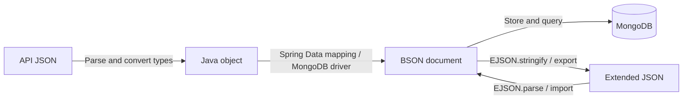

# JSON, Extended JSON, BSON, and the Significance of Data Types

MongoDB is often introduced as a database that stores *JSON-like documents*. That description is helpful for visualizing data structure, but it is not sufficient when building real applications: MongoDB uses **BSON** to represent documents, while **Extended JSON** is a way to write BSON types as exchangeable JSON text. Distinguishing these three concepts helps prevent losing numeric precision, confusing strings with dates, querying `_id` incorrectly, or mis-mapping data in Spring Data MongoDB.

In the **SPRING_DATA_MONGODB** module, this knowledge is the foundation for connecting to MongoDB, mapping documents to Java objects, and operating through `MongoTemplate` or repositories. It also directly impacts query design, aggregation, indexing, transactions, reactive access, testing, and data performance diagnostics: if data is stored with the wrong type, operations in later steps easily produce unexpected results.

## 1. Learning objectives

After this lesson, you will be able to:

1. Explain the roles of JSON, Extended JSON, and BSON within a single MongoDB data flow.
2. Recognize key BSON types and read both Extended JSON formats: *Canonical* and *Relaxed*.
3. Choose appropriate types for identifiers, currency, counters, timestamps, binary files, and nested documents.
4. Use `mongosh` to inspect the actual type of a field and distinguish a `null` field from a missing field.
5. Map BSON types to Java types with Spring Data MongoDB and prevent errors during import, export, or API integration.

## 2. Three layers of representing a document

| Concept | Nature | Where it is used | Key takeaway |
| --- | --- | --- | --- |
| **JSON** | Text format with object, array, string, number, boolean, and `null` | HTTP APIs, configuration files, inter-service messages | Has no dedicated ObjectId, date, Decimal128, or binary types. |
| **BSON** (*Binary JSON*) | Binary format with type tags for each value | MongoDB document storage and driver communication | Has more types than JSON; type is part of the data, not just display formatting. |
| **Extended JSON** (*EJSON*) | JSON convention containing special structures to represent BSON types | Export/import, logs, sample data, exchanging documents as text | Keys like `$oid`, `$date`, `$numberLong` express the corresponding BSON type. |

Example of a pure JSON object:

```json
{
  "_id": "507f1f77bcf86cd799439011",
  "orderedAt": "2025-01-01T00:00:00Z",
  "total": 19.90,
  "itemCount": 2
}
```

This text does not specify whether `_id` is a string or an `ObjectId`, whether `orderedAt` is a string or a BSON Date, whether `total` is a floating-point number or Decimal128, or whether `itemCount` is a 32-bit or 64-bit integer. Those decisions depend on the parser and how the application constructs the document.

A document with the same business meaning represented in **Extended JSON v2, Canonical mode**:

```json
{
  "_id": { "$oid": "507f1f77bcf86cd799439011" },
  "orderedAt": { "$date": { "$numberLong": "1735689600000" } },
  "total": { "$numberDecimal": "19.90" },
  "itemCount": { "$numberInt": "2" }
}
```

Here `orderedAt` is a BSON Date representing milliseconds since the Unix epoch, `total` is BSON Decimal128, `itemCount` is BSON Int32, and `_id` is BSON ObjectId. When the data is written to MongoDB, the driver converts these values to BSON; MongoDB does not literally store keys like `$numberDecimal` or `$oid` as subfields of the document when they are processed properly as EJSON.



**Important distinction:** syntax such as `ObjectId("...")`, `ISODate("...")`, or `NumberDecimal("...")` in `mongosh` are shell helper functions, **not standard JSON syntax**. A valid `.json` file cannot directly contain calls to these functions.

## 3. What data types does BSON have?

BSON attaches a type tag to every value. The following types are commonly encountered in MongoDB development:

| BSON type | Example in `mongosh` | Typical Canonical EJSON | Use case |
| --- | --- | --- | --- |
| String | `"Ha Noi"` | `"Ha Noi"` | Names, alphanumeric business codes, descriptions. |
| ObjectId | `ObjectId("507f1f77bcf86cd799439011")` | `{"$oid":"507f1f77bcf86cd799439011"}` | Common default `_id` of a document. |
| Int32 | `NumberInt(2)` | `{"$numberInt":"2"}` | Quantities, counters within the 32-bit range. |
| Int64 (Long) | `NumberLong("9007199254740993")` | `{"$numberLong":"9007199254740993"}` | Large counters, 64-bit integer values. |
| Double | `19.9` | `{"$numberDouble":"19.9"}` | Measurements, calculations that tolerate binary floating-point error. |
| Decimal128 | `NumberDecimal("19.90")` | `{"$numberDecimal":"19.90"}` | Currency, decimal calculations requiring precision control. |
| Boolean | `true` | `true` | True/false flags. |
| Null | `null` | `null` | Explicitly stored empty/null value. |
| Date | `ISODate("2025-01-01T00:00:00Z")` | `{"$date":{"$numberLong":"1735689600000"}}` | Instant when an event occurred. |
| Embedded Document | `{ "city": "Da Nang" }` | Nested JSON object | Structured data belonging to the same entity. |
| Array | `["java", "mongo"]` | JSON array | Lists of tags, line items, short histories. |
| Binary | `BinData(0, "AQID")` | `{"$binary":{"base64":"AQID","subType":"00"}}` | Byte data and binary subtype classification. |
| Regular Expression | `/^sp/i` | `{"$regularExpression":{"pattern":"^sp","options":"i"}}` | Regex value stored in BSON form. |
| Timestamp | `Timestamp({t: 1, i: 1})` | `{"$timestamp":{"t":1,"i":1}}` | Specialized type commonly seen in internal mechanisms such as the oplog. |
| MinKey / MaxKey | `MinKey()` / `MaxKey()` | `{"$minKey":1}` / `{"$maxKey":1}` | Special boundary values in BSON sort order. |

There are also less common or legacy types such as `Undefined`, `Symbol`, `JavaScript`, and several internal-purpose types. When designing a new schema, do not use deprecated types just to substitute for `null` or String.

### 3.1. Integers, floating-point numbers, and decimals

This is the group most prone to bugs:

- **Int32** stores signed integers from `-2147483648` to `2147483647`.
- **Int64** stores signed integers from `-9223372036854775808` to `9223372036854775807`.
- **Double** is IEEE 754 binary floating-point, suitable for many statistical and measurement problems, though it cannot represent every decimal fraction such as `0.1` exactly.
- **Decimal128** is decimal floating-point with up to 34 significant digits. It is useful for monetary amounts and values with specific rounding rules, though it still has range and precision limits.

Example:

```javascript
db.measurements.insertOne({
  readings: NumberInt(25),
  totalEvents: NumberLong("9007199254740993"),
  average: 0.1,
  charge: NumberDecimal("0.10")
});
```

In JavaScript, the `Number` type can represent every integer accurately only up to `2^53 - 1` (`9007199254740991`). Large integers should be passed as strings to the corresponding Int64 constructor rather than going through a `Number` value that has already lost precision. For the same reason, do not convert a large BSON Long into a plain JSON number and assume a JavaScript application will receive the exact value back.

MongoDB can compare numeric types against each other by numeric value in many queries, but **BSON type still matters** for `$type`, type conversion, arithmetic, serialization, and data consistency. Do not treat Int32, Int64, Double, and Decimal128 as interchangeable in schema design.

For monetary fields, pick a clear convention: Decimal128 for decimal amounts, or storing integers in the smallest currency unit (e.g., VND/cents if the domain model permits). Using Double for money can introduce unexpected errors during addition, subtraction, reconciliation, or rounding.

### 3.2. ObjectId and identifier strings

`ObjectId` is a 12-byte BSON value, usually displayed as a 24-character hex string. MongoDB creates a unique index on the `_id` field; the `_id` type can be ObjectId, String, or another supported type depending on the design.

The following two values look nearly identical but have **different types**:

```javascript
{ _id: ObjectId("507f1f77bcf86cd799439011") }
{ _id: "507f1f77bcf86cd799439011" }
```

If `_id` is actually an ObjectId, querying directly with a plain string is not equivalent to querying with an ObjectId:

```javascript
db.users.findOne({ _id: ObjectId("507f1f77bcf86cd799439011") });
```

ObjectId contains an approximate creation timestamp at one-second resolution, but it **does not replace a business timestamp field** such as `createdAt`. Do not rely on ObjectId to infer strict creation ordering across documents created on different machines.

### 3.3. Date vs. String and vs. Timestamp

BSON Date stores an instant as a **64-bit integer in milliseconds since the UTC Unix epoch**. Time zones are a matter of interpretation/display in the application; BSON Date does not store a time zone name such as `Asia/Ho_Chi_Minh`.

```javascript
// BSON Date: supports time comparisons by point-in-time value.
{ createdAt: ISODate("2025-01-01T00:00:00Z") }

// BSON String: just text that looks like a timestamp.
{ createdAt: "2025-01-01T00:00:00Z" }
```

These two values do not have the same type. If you use dates for range queries, TTL indexes, or date arithmetic, store proper BSON Dates. The BSON **Timestamp** type (`t` and `i`) serves a different purpose from Date, typically related to MongoDB operations; do not use it as a regular application timestamp field.

### 3.4. Nested documents, arrays, null, and missing fields

A document can contain nested objects and arrays:

```javascript
{
  customer: { name: "An", address: { city: "Hue" } },
  items: [{ sku: "BK-01", quantity: NumberInt(2) }],
  note: null
}
```

`note: null` means the field exists with a Null value; a document **without `note`** is a missing field. These two states may require different application logic. MongoDB allows array elements to have mixed types, but homogeneously typed arrays are easier to test, index, and map to `List<T>`. A regular BSON document has a maximum size limit of **16 MiB**; for large data, consider an appropriate storage model instead of stuffing everything into one document.

## 4. Extended JSON v2: Canonical and Relaxed

Extended JSON has two commonly used representations:

| Mode | Goal | Example of an Int32 | Consequence |
| --- | --- | --- | --- |
| **Canonical** | Preserve type information explicitly in text form | `{"$numberInt":"2"}` | Suitable when reading/writing exact BSON types is required. |
| **Relaxed** | Human-readable, close to regular JSON | `2` | Some numeric type details cannot be inferred from text alone. |

For the same document from section 2, **Relaxed Extended JSON** looks like this:

```json
{
  "_id": { "$oid": "507f1f77bcf86cd799439011" },
  "orderedAt": { "$date": "2025-01-01T00:00:00Z" },
  "total": { "$numberDecimal": "19.90" },
  "itemCount": 2
}
```

Details to remember:

1. **ObjectId** is represented via `$oid`; **Decimal128** via `$numberDecimal` in both modes.
2. **Date** in Canonical mode uses `$date` wrapping `$numberLong` (UTC milliseconds). Relaxed mode typically uses an ISO 8601 string inside `$date` for timestamps within the range supported for that format.
3. **Int32/Int64/Double** in Canonical mode have their respective wrappers; Relaxed mode prefers plain JSON numbers when possible, so it cannot always preserve type distinctions when passed through standard JSON tools.
4. **Binary** uses `$binary` with `base64` and `subType`; do not strip subtype information when you need to restore the original type.
5. **Special Doubles** such as `NaN` or `Infinity` are not valid standard JSON numbers; Extended JSON uses a wrapper, such as `{"$numberDouble":"NaN"}`.

Extended JSON does not turn every JSON program into a BSON-aware program. If an API receives `{ "$date": "..." }` as a plain JSON object without an EJSON decoder, it may interpret it as an object with a field named `$date`, rather than a Date. Conversely, for pure JSON exchange, sometimes the right approach is to expose an API contract like `id: string`, `createdAt: ISO-8601 string`, `amount: decimal string`, and convert types in a controlled way at the API boundary.

### 4.1. Observing in `mongosh` yourself

The following examples run in **`mongosh`**, not inside a static JSON file:

```javascript
const doc = {
  _id: ObjectId("507f1f77bcf86cd799439011"),
  orderedAt: ISODate("2025-01-01T00:00:00Z"),
  total: NumberDecimal("19.90"),
  itemCount: NumberInt(2)
};

print(EJSON.stringify(doc, null, 2, { relaxed: false })); // Canonical
print(EJSON.stringify(doc, null, 2, { relaxed: true }));  // Relaxed

const restored = EJSON.parse(EJSON.stringify(doc, null, 0, { relaxed: false }));
print(EJSON.stringify(restored, null, 2, { relaxed: false }));
```

For data exchanged between systems, agree on an EJSON version and type conversion rules. Reading an export with a plain JSON parser and writing it back can lose type information or precision, especially for large integers, Dates, and Decimal128.

## 5. Data types determine query behavior

Suppose the `orders` collection is created with the following command in `mongosh`:

```javascript
db.orders.insertOne({
  _id: ObjectId("507f1f77bcf86cd799439011"),
  orderedAt: ISODate("2025-01-01T00:00:00Z"),
  total: NumberDecimal("19.90"),
  itemCount: NumberInt(2),
  customer: { code: "C001", city: "Ha Noi" },
  tags: ["online", "paid"]
});
```

### 5.1. Checking the actual stored type

The aggregation operator `$type` returns the BSON type name of an expression:

```javascript
db.orders.aggregate([
  {
    $project: {
      _id: 0,
      idType: { $type: "$_id" },
      orderedAtType: { $type: "$orderedAt" },
      totalType: { $type: "$total" },
      itemCountType: { $type: "$itemCount" },
      tagsType: { $type: "$tags" }
    }
  }
]);
```

For the newly inserted document, the results are `objectId`, `date`, `decimal`, `int`, and `array`, respectively. This is a useful check when you suspect data was imported with the wrong type.

In a *query predicate*, `$type` is used to filter documents:

```javascript
db.orders.find({ total: { $type: "decimal" } });
db.orders.find({ orderedAt: { $type: "string" } });
```

These two uses of `$type` have different contexts: one is an **aggregation expression** returning a type name, and the other is a **query condition** selecting documents by BSON type.

### 5.2. Date comparisons and distinguishing null/missing

```javascript
// Range [2025-01-01, 2025-02-01): use BSON Date.
db.orders.find({
  orderedAt: {
    $gte: ISODate("2025-01-01T00:00:00Z"),
    $lt: ISODate("2025-02-01T00:00:00Z")
  }
});

// Note: { field: null } matches both Null values and missing fields.
db.orders.find({ couponCode: null });

// Match only documents whose value actually has type Null.
db.orders.find({ couponCode: { $type: "null" } });

// Match only documents that do not have this field.
db.orders.find({ couponCode: { $exists: false } });
```

MongoDB uses comparison rules per BSON type; many query comparisons apply *type bracketing*. Numeric types support cross-numeric comparison, but date strings do not automatically become Dates just because they look like ISO 8601. Choosing the wrong type can cause queries to miss documents, or cause sort order not to reflect business meaning.

### 5.3. Indexes and mixed-type data

Suppose the same `total` field is stored inconsistently:

```javascript
{ total: NumberDecimal("19.90") }
{ total: "19.90" }
{ total: 19.90 }
```

The three documents use Decimal128, String, and Double respectively. An index on `total` can still store these keys, but querying, sorting, aggregation, and type conversion become much harder to control. In particular, strings `"100"` and `"20"` have a lexicographical order different from normal numeric order (unless using collation rules aligned with the goal). Therefore:

- Lock down the type of each field before writing data.
- Use `$type` to detect schema-drifted documents.
- Measure query performance with `explain()` after choosing types and creating indexes; the mere existence of an index does not guarantee an optimal query.
- For schemas with critical constraints, consider **collection validation** using `$jsonSchema`.

Example of creating a new collection with type validation:

```javascript
db.createCollection("typed_orders", {
  validator: {
    $jsonSchema: {
      bsonType: "object",
      required: ["total", "orderedAt", "itemCount"],
      properties: {
        total: { bsonType: "decimal" },
        orderedAt: { bsonType: "date" },
        itemCount: { bsonType: "int" }
      }
    }
  }
});
```

This example illustrates type constraints only. `required` rules, value ranges, `_id` type, handling of legacy documents, and validation enforcement levels should be designed according to actual requirements.

## 6. Mapping BSON with Java and Spring Data MongoDB

A Java application should not rely on JSON appearance to guess types. Spring Data MongoDB uses its mapping layer and the MongoDB Java Driver to convert between Java objects and BSON; annotations can help specify how data is stored.

| Model data type | Typical BSON type | Mapping notes |
| --- | --- | --- |
| `String` | String | String identifiers may require explicit configuration when related to `_id`. |
| `Integer` / `int` | Int32 | Watch out for legacy fields that may have been stored as Long or Double. |
| `Long` / `long` | Int64 | Avoid passing large numbers through JavaScript JSON numbers. |
| `Double` / `double` | Double | Used for data where binary floating-point is acceptable. |
| `BigDecimal` | String under common Spring Data default mapping, or Decimal128 when specified | Use `@Field(targetType = FieldType.DECIMAL128)` to store BSON Decimal128. |
| `Instant` / `Date` | BSON Date | Well suited for UTC instants; control time zones at application boundaries. |
| `List<T>` | BSON Array | Element types must match the stored data. |
| Nested POJO/record | Embedded document | Used for components of a parent document. |
| `byte[]` or corresponding binary type | Binary | May need attention to binary subtype/codec depending on the data. |

Example defining a document with a Java record (in Spring Data MongoDB projects that support Java records):

```java
import java.math.BigDecimal;
import java.time.Instant;
import java.util.List;

import org.springframework.data.annotation.Id;
import org.springframework.data.mongodb.core.mapping.Document;
import org.springframework.data.mongodb.core.mapping.Field;
import org.springframework.data.mongodb.core.mapping.FieldType;

@Document(collection = "orders")
public record OrderDocument(
    @Id String id,
    @Field(targetType = FieldType.DECIMAL128) BigDecimal total,
    Instant orderedAt,
    int itemCount,
    List<LineItem> lines
) {
    public record LineItem(String sku, int quantity) {}
}
```

A repository can work directly with this domain type:

```java
import java.math.BigDecimal;
import java.util.List;

import org.springframework.data.mongodb.repository.MongoRepository;

public interface OrderRepository
        extends MongoRepository<OrderDocument, String> {
    List<OrderDocument> findByTotalGreaterThan(BigDecimal amount);
}
```

The `@Field(targetType = FieldType.DECIMAL128)` annotation expresses the intent to store the monetary amount as BSON Decimal128; if left at the default, `BigDecimal` mapping behavior must be verified against the converter configuration and Spring Data version in use. Do not assume that whatever JSON Jackson outputs is how MongoDB stores BSON.

### 6.1. Points to check in a project

**The `_id` field:** Spring Data has conversion logic for fields annotated with `@Id`. A `String` that matches a valid ObjectId format may be converted to BSON ObjectId on save or query, while other String values may be kept as-is. If `_id` must always be a BSON String or an ObjectId, define an explicit ID strategy and consider `@MongoId` with the corresponding `FieldType` rather than relying solely on data appearance.

**Currency:** Java's `BigDecimal` provides a decimal representation suitable for many monetary problems, but it is stored as Decimal128 only when mapping is configured appropriately. Decimal128 has finite precision; define conventions for scale, rounding, and out-of-range inputs.

**Timestamps:** `Instant` represents a point on the timeline, convenient for storing as BSON Date. `LocalDate` or `LocalDateTime` do not carry time zone information on their own: before turning them into UTC instants, define conversion rules. If the business requires storing the original time zone, store the time zone separately alongside the instant.

**Legacy data types:** when the same field was previously stored as String, Long, and Decimal128, converters or queries may encounter inconsistent cases. Inspect existing data before changing model annotations.

### 6.2. Checking BSON types with `MongoTemplate`

Example querying by Date and data type using Spring Data APIs directly:

```java
import java.time.Instant;
import java.util.Date;

import org.springframework.data.mongodb.core.MongoTemplate;
import org.springframework.data.mongodb.core.query.Criteria;
import org.springframework.data.mongodb.core.query.Query;

public final class OrderQueries {
    private final MongoTemplate mongoTemplate;

    public OrderQueries(MongoTemplate mongoTemplate) {
        this.mongoTemplate = mongoTemplate;
    }

    public long countOrdersSince(Instant start) {
        Query query = new Query(
            Criteria.where("orderedAt").gte(Date.from(start))
        );
        return mongoTemplate.count(query, OrderDocument.class);
    }
}
```

In the example above, `Date.from(start)` states the intent to query by instant. For fields with special mapping annotations, use the Java type matching the domain field and verify actual queries in integration tests. Queries based on monetary amounts must use the same Decimal128 convention from the model down to BSON.

## 7. Common errors and diagnostics

| Symptom | Possible cause | How to check / fix |
| --- | --- | --- |
| Query on `_id` finds no document | `_id` is ObjectId while the argument is String, or vice versa | Run aggregation `$type` on `$_id`; standardize the ID policy in mapping. |
| Date range query misses records | Some documents store the date as a String | Group by `$type` and migrate data to BSON Date with clear time zone rules. |
| Monetary totals are off in the last few digits | Values passed through Double or JS Number | Trace the type from the source; store Decimal128 or integers in the smallest unit. |
| Large Long changes after JSON export/import | JSON parser handles numbers as IEEE 754 Double | Use Canonical EJSON or an API contract that passes large integers as String. |
| Java converter encounters unexpected data | Field in the collection mixes multiple types | Inspect with `$type`, create a cleanup strategy, and test against legacy data. |
| Query `field: null` returns too many documents | This condition matches both Null and missing fields | Use `$type: "null"` or `$exists: false` depending on intent. |
| JSON log shows regular numbers but DB has another type | Viewing Relaxed EJSON or JSON from another serializer | Export Canonical EJSON or inspect with `$type`. |

To count the types currently present in a field, you can use aggregation:

```javascript
db.orders.aggregate([
  { $group: { _id: { $type: "$total" }, count: { $sum: 1 } } },
  { $sort: { count: -1 } }
]);
```

The output might include `_id: "decimal"`, `"string"`, `"double"`, or `"missing"`. That is the reconnaissance step before fixing the schema. When migrating legacy data, determine the conversion order, precision, invalid values, and recovery plan; converting a String or Double to Decimal128 cannot restore digits already lost in an earlier step.

## 8. Short practice

### Exercise 1: distinguish types after inserting data

Run in a test collection:

```javascript
db.bson_lab.insertMany([
  { key: "A", amount: NumberDecimal("12.50"), at: ISODate("2025-01-01T00:00:00Z") },
  { key: "B", amount: "12.50", at: "2025-01-01T00:00:00Z" },
  { key: "C", amount: 12.50, at: ISODate("2025-01-01T00:00:00Z") }
]);

db.bson_lab.aggregate([
  {
    $project: {
      _id: 0,
      key: 1,
      amountType: { $type: "$amount" },
      atType: { $type: "$at" }
    }
  }
]);
```

**Expected answer:** `A` has `amountType: "decimal"`, `atType: "date"`; `B` has `"string"`, `"string"`; `C` has `"double"`, `"date"`. Displayed string or numeric appearance does not determine the actual data type.

### Exercise 2: accurately export a large integer

```javascript
const bigId = { value: NumberLong("9007199254740993") };
print(EJSON.stringify(bigId, null, 2, { relaxed: false }));
```

**Expected answer:** the `value` field is represented as `{"$numberLong":"9007199254740993"}`. If converted to a JSON number and processed with JavaScript `Number`, this value risks being rounded.

### Exercise 3: choose types for a retail application

An order has an identifier, unit price, quantity, order timestamp, and a list of line items. Propose BSON types, then explain your choices.

**Suggested answer:** `_id` uses ObjectId if the system opts for MongoDB-generated IDs; `unitPrice` uses Decimal128 per currency convention; `quantity` uses Int32 if the range is suitable; `orderedAt` uses Date; `lines` uses an Array of embedded documents with a stable schema. When the application uses Spring Data MongoDB, confirm that `BigDecimal` maps to Decimal128 and `Instant` maps to Date, and test `_id` on both writes and queries.

## 9. Principles to carry into the next lessons

1. **Design types before designing queries.** The same value visible on screen could be BSON String, Int32, Int64, Double, Decimal128, ObjectId, or Date.
2. **Use Canonical Extended JSON when verifying type integrity.** Relaxed mode is convenient for reading, but it is not complete proof of the original numeric type.
3. **Establish conversion rules at system boundaries.** JSON APIs, Java code, the MongoDB driver, and BSON on the server must agree on how IDs, dates/times, monetary amounts, and large integers are represented.
4. **Measure with real data.** Use `$type`, `aggregate()`, schema validation, and integration tests to catch discrepancies before building complex queries, aggregations, indexes, or migrations.

Mastering these principles ensures that repositories, `MongoTemplate`, and Spring Data MongoDB queries express the true semantics of your data, rather than merely working by coincidence on a handful of sample documents.
