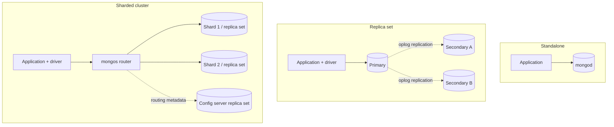
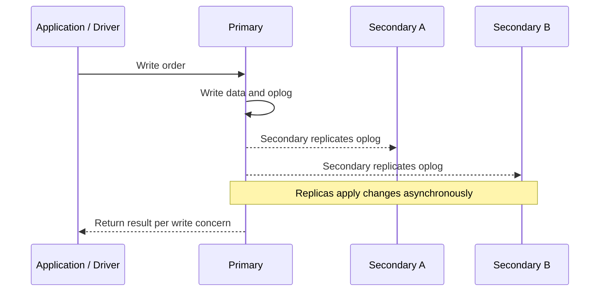

# Standalone, Replica Set, Sharded Cluster, and MongoDB Atlas

> **Chapter:** MongoDB Foundations  
> **Module scope:** `SPRING_DATA_MONGODB` — using Spring Data MongoDB to connect, map documents, and work with MongoDB through `MongoTemplate` or repositories; followed by query design, aggregation, indexing, transactions, reactive access, testing, and performance diagnostics. This lesson explains how MongoDB is deployed and why topology directly shapes Spring application behavior.

## 1. Why understand topology before writing repositories?

Two applications both using `MongoRepository<Order, String>` can store documents and invoke the same `findById()` method, yet fault tolerance, latency, query routing, and transactions behave very differently if the underlying MongoDB is deployed in different topologies.

**Topology** is how MongoDB processes, roles, and connections are organized. Four concepts must be distinguished:

- **Standalone:** a single `mongod` process operating independently.
- **Replica set:** multiple `mongod` processes maintaining copies of the same dataset to support high availability and recovery when a node fails.
- **Sharded cluster:** a collection's data can be distributed across multiple **shards** to scale storage capacity and read/write load horizontally. Each shard in a production deployment is typically a replica set.
- **MongoDB Atlas:** a managed MongoDB cloud service. Atlas can provision different deployment configurations, including replica sets and sharded clusters; **Atlas is not a new replication or sharding mechanism alongside the three topologies above**.

### Conceptual diagram



This is a role diagram, not a complete deployment configuration. For example, production typically uses **multiple `mongos`** instances and multiple members per replica set; the driver can connect directly to multiple replica set node addresses to automatically discover the current primary.

## 2. Standalone: a single independent MongoDB server

In standalone mode, a single `mongod` manages its data alone, without participating in a replica set consensus or primary election protocol. The application sends requests directly to that process.

```text
Spring Boot / MongoTemplate / MongoRepository
                 |
                 v
        mongod:27017 (standalone)
                 |
                 v
                data
```

**Strengths:** simple setup, few components, well suited for learning CRUD commands, queries, aggregation, experimenting with indexes, or a short-lived development environment. **Limitations:** if the process, host, or storage fails, no other MongoDB member can automatically take over. Periodic backups help restore data, but backups **do not replace failover**.

For modern features that rely on sessions/transactions, note carefully: **multi-document transactions are not supported on standalone**. Therefore, testing `@Transactional` with MongoDB must run against a compatible topology, such as a single-node replica set in test environments or a multi-node replica set when testing failover. Atomic updates on a **single document** remain a core MongoDB capability and do not require multi-document transactions.

Example URI for MongoDB running on a development machine:

```properties
MONGODB_URI=mongodb://localhost:27017/shop
```

This URI illustrates a server without authentication. In real deployments, the URI may require credentials, TLS, timeouts, and other options. `localhost` means **the machine running the application**; if the application runs inside a container, that is usually not the hostname of another MongoDB container.

## 3. Replica set: replication and automatic primary election

A replica set is a group of `mongod` processes maintaining the same logical dataset. Under normal operation, there is **one primary** accepting write operations and multiple **secondaries** replicating changes from the oplog. Secondaries can serve read operations if read preference allows.

### 3.1. Primary, secondary, election, and oplog



- **Primary:** handles normal application writes; when the primary is no longer eligible to act as primary, the replica set can hold an election.
- **Secondary:** tails and applies operations from the **oplog** (operations log of replicable writes). Because replication is asynchronous, a secondary can lag behind the primary.
- **Election:** voting members coordinate to elect a new primary. A member must qualify and receive enough votes under majority rules; during primary transition, the application may see transient errors or increased latency.
- **Arbiter:** can participate in elections but **does not store a copy of the data**. An arbiter does not replace a data-bearing secondary when higher durability and resilience are needed.

A common high-availability layout is **three data-bearing, voting members** placed across appropriate failure domains. This is a design example, not a universal formula for every workload and budget. If the system loses a voting majority, it may end up with no primary able to accept writes even while some nodes are still running. Replication also does not stop business logic bugs or accidental deletes from propagating to members; a backup/restore strategy is still mandatory.

### 3.2. Read preference, write concern, and read concern

Three settings that are often confused:

| Mechanism | Question it answers | Typical implication |
| --- | --- | --- |
| **Read preference** | Which member should reads go to? | `primary` is the common default; `secondary`/`secondaryPreferred` can distribute read load but risks stale reads. |
| **Write concern** | What level of acknowledgment does a write require? | `w: "majority"` requires acknowledgment from a majority of data-bearing voting members per MongoDB rules, increasing the likelihood an acknowledged write survives failover compared to single-node acknowledgment. |
| **Read concern** | What visibility guarantee should reads see? | `majority` reads majority-committed data, subject to the conditions and semantics of the version in use. |

These three settings are not equivalent. `readPreference=secondary` does **not** guarantee the freshest data. `writeConcern=majority` does **not** mean the application will never have to retry or handle unknown outcomes. A system requiring immediate reads of just-written changes needs appropriate semantics, such as reading from primary or using a causally consistent session when supported and guarantees are met.

**Business example:** right after payment succeeds, the UI navigates immediately to the order details page. If the next read is routed to a lagging secondary, the UI may see the old `PENDING` status. That is a consistency/latency trade-off in the application, not a bug in the repository. For this flow, reading from primary is usually more predictable.

### 3.3. Connecting a replica set from Spring Data MongoDB

```properties
# Hostnames must be resolvable and reachable by the application.
MONGODB_URI=mongodb://db1.example.net:27017,db2.example.net:27017,db3.example.net:27017/shop?replicaSet=rs0&readPreference=primary&w=majority
```

The driver performs **topology discovery**, tracks primary changes, and selects an appropriate server for each operation. Specify addresses actually reachable from the application's environment. The initial seed list does not replace proper replica set member configuration on the server; the hostnames advertised by the replica set itself must also be resolvable and reachable.

Failover does not mean every in-flight request will automatically succeed: some commands may fail, time out, or end with uncertain outcomes. Retryable reads/writes have specific eligibility rules. At the business layer, use idempotency keys or conditional updates for commands affecting finances, inventory, and event publishing.

**A replica set improves availability and read options; it does not distribute a single collection's writes across multiple primaries.** When you need to partition data and writes across multiple server groups, look at sharding.

## 4. Sharded cluster: partitioning data across shards

A sharded cluster combines **data partitioning** with routing and metadata components:

| Component | Role |
| --- | --- |
| **Shard** | Holds a subset of sharded data; production deployments typically run a replica set for each shard. |
| **`mongos`** | Router that receives queries from the application, determines which shards to access using metadata, and merges results when needed. |
| **Config server replica set (CSRS)** | Stores sharding configuration metadata and cluster routing information. |
| **Balancer** | Mechanism coordinating movement of data ranges/chunks to balance data across shards per active policies. |
| **Shard key** | Field or combination of fields determining how a collection's data is distributed and routed. |

Within a cluster, not every collection has to be sharded; unsharded collections are placed according to cluster policy. Applications normally connect to **`mongos`**, not directly to individual shards or config servers for business requests.

### 4.1. Shard key determines more than data distribution

Suppose the `orders` collection has hundreds of millions of documents and most queries filter by `customerId`. You might consider a shard key based on `customerId`; however, you must evaluate customer count, load skew across customers, `_id` lookups, time-range queries, and write patterns.

MongoDB supports partitioning strategies, most commonly:

- **Ranged sharding:** splits along value ranges of the shard key. Useful for range queries and targeted routing, though a monotonically increasing key like a timestamp can create a write hotspot if poorly designed.
- **Hashed sharding:** distributes by a hash of the shard key, often spreading diverse key values and write load evenly; the trade-off is that range queries on the original key generally cannot route to a single contiguous shard range.

**Cardinality** (value diversity), frequency distribution, monotonicity, data size per key, and **actual query patterns** are critical criteria. A key with few distinct values or dominated by a few hot values can concentrate data and load. Sharding cannot fix a poor query design.

### 4.2. Targeted queries and scatter-gather

Example of a collection sharded by `customerId`:

```javascript
// Includes shard key condition: mongos can usually route to the relevant shard.
db.orders.find({ customerId: "C-42", status: "PAID" })

// Missing shard key: may have to broadcast to multiple shards and merge results.
db.orders.find({ status: "PAID" })
```

The second query can become a **scatter-gather** query, increasing the number of shards touched and merge overhead. An index on `status` on each shard still helps, but an index does not replace routing information from the shard key. Also, depending on key type and range boundaries, a query including the shard key may still hit multiple shards; do not assume every query with a shard key hits exactly one node.

### 4.3. Chunks, balancing, and changing a shard key

MongoDB tracks sharded data ranges via metadata; how chunks are split and migrated can vary by version and cluster state. As data grows or becomes uneven, the balancer may migrate chunks/ranges across shards to rebalance. Migrations consume network and disk I/O and can affect latency, so monitor them during growth and maintenance windows.

Choosing the wrong shard key can be expensive to fix. Some MongoDB versions support operations such as **refine shard key** or **reshard collection**, but these are operational procedures whose prerequisites, resource impact, and timing must be carefully assessed. Do not assume changing a shard key is as trivial as renaming a Java field.

### 4.4. Transactions and cross-shard limits

A **single-document** update remains atomic. Multi-document transactions can run on a sharded cluster when topology and version support them, even when data spans multiple shards; the trade-off is extra distributed coordination, operational requirements, and latency cost. That capability does not make a sharded cluster the default optimal choice for every tightly coupled relational workload.

Example URI connecting to `mongos` routers reachable by the application:

```properties
MONGODB_URI=mongodb://router1.example.net:27017,router2.example.net:27017/shop?retryWrites=true&w=majority
```

Do not specify `replicaSet=...` of **one shard** when connecting to `mongos` routers; the cluster has multiple shards with separate replica sets. In practice, options and retry capabilities must align with driver/server versions and cluster configuration.

## 5. MongoDB Atlas: managed MongoDB in the cloud

**MongoDB Atlas** is a service by MongoDB, Inc. for deploying, monitoring, and operating MongoDB on supported cloud providers. Users select a deployment tier, region, resource sizing, security, and related features; Atlas handles many infrastructure tasks according to the selected tier's capabilities.

Common features include:

- **Provisioning, node management, and maintenance:** reduces manual setup and configuration of each MongoDB process.
- **Connection security:** manages database users, network restrictions (IP access list, private endpoints, or private networking depending on tier), TLS, and access policies.
- **Monitoring and diagnostics:** observe latency, query load, indexes, and cluster health depending on available features.
- **Backup/restore and availability:** depends on cluster type, tier, configuration, and enabled options; verify specific RPO/RTO and backup policies.
- **Topology selection:** suitable tiers/deployment types can provide replica sets or sharded clusters; autoscaling and partitioning capabilities depend on the plan.

Atlas **does not replace** decisions about document modeling, shard keys, indexes, `readPreference`, `writeConcern`, least-privilege permissions, or data protection. Atlas eases server operations, yet still carries cloud costs, tier limits, network latency, data governance requirements, and deployment region constraints.

### Workflow to connect a Spring application to Atlas

1. Create a deployment matching your requirements, select a region close to the application, and review redundancy needs.
2. Create a **database user** with the required privileges; do not use full admin credentials for every service.
3. Configure network access for the application runtime environment; production prefers restricted IP ranges and private networking when appropriate. Avoid opening broad public network access unnecessarily.
4. Obtain the MongoDB connection string from Atlas, store it in a secret manager or environment variable, and verify DNS SRV resolution and TLS connectivity from the application environment.
5. Test reads, writes, timeouts, reconnect behavior, and consistency requirements under the real configuration.

Atlas URIs commonly use the **`mongodb+srv://`** format, where the driver queries DNS SRV/TXT records to discover endpoints and connection string options:

```text
mongodb+srv://<db-user>:<url-encoded-password>@<cluster-hostname>/shop?retryWrites=true&w=majority
```

This is an illustrative syntax; use the hostname provided by Atlas. Passwords containing special characters must be URL-encoded per connection string rules. Never commit real passwords to repositories, logs, or tutorials; if connecting over private networking or enterprise policies, configure accordingly.

## 6. Comparing deployment choices

| Criterion | Standalone | Replica set | Sharded cluster | MongoDB Atlas |
| --- | --- | --- | --- | --- |
| Primary goal | Simplicity, testing | High availability, data replication | Scale storage and load across shards | Managed MongoDB deployment service |
| Data replication | None at topology level | Members hold the same logical data | Typically each shard has a replica set | Depends on chosen deployment/tier |
| Automatic failover | No | Can elect a new primary when eligible | Follows shard replica sets and cluster design | Depends on deployment and service conditions |
| Scaling writes on one collection | Primarily vertical scaling | Primarily vertical scaling on primary and model optimization | Can distribute across shards via shard key | Depends on replica set/sharded config, tier, and scaling |
| Self-managed operational complexity | Low | Moderate | High | Atlas handles many infra tasks, while app still manages data operations |
| Multi-document transactions | No | Yes when prerequisites are met | Yes when prerequisites are met, with potential distributed overhead | Depends on topology and deployment features |
| Common use case | Learning, local dev | Production services not yet needing sharding | Large data/load with proven need to shard | Teams wanting managed MongoDB in the cloud |

**How to decide in practice:**

1. Assess availability, backup/restore, data volume, throughput, latency, and budget requirements.
2. For production applications needing node-failure recovery, consider a replica set instead of standalone; plan regions/zones, voting members, and business consistency requirements.
3. Measure actual limits of your data model/indexes/primary and scale appropriately before deciding to shard; sharding adds operational cost and depends heavily on the shard key.
4. Evaluate **Atlas alongside topology selection**, based on internal ops capacity, region, security, cost control, and tier capabilities. Choosing Atlas does not automatically mean you must shard.

## 7. Direct impact on Spring Data MongoDB

Applications still use `MongoTemplate`, `MongoRepository`, `ReactiveMongoTemplate`, or `ReactiveMongoRepository`. These abstractions let Java code work similarly with documents across topologies, but **they cannot hide server-side limits**.

### 7.1. URI and driver configuration

In a Spring Boot application whose version supports the following property:

```yaml
# application.yml
spring:
  data:
    mongodb:
      uri: ${MONGODB_URI}
```

Auto-configuration property names can vary across Spring Boot generations; **check the documentation for your specific version**. The MongoDB connection string and topology roles themselves remain MongoDB Java Driver concepts. The `MONGODB_URI` environment variable can hold a standalone, replica set, `mongos`, or Atlas URI as shown above; you can also append timeouts, pool sizes, retry policies, and other operational settings.

Do not hardcode the current primary's address in code: the primary can change after an election. The driver must discover members via reachable network addresses. With Docker/Kubernetes or cross-network setups, issues with advertised hostnames, DNS/TLS, firewalls, IP allowlists, and connection pools are easily mistaken for Spring Data bugs.

### 7.2. Transactions are not enabled by the annotation alone

```java
@Service
public class PaymentService {
    @Transactional
    public void confirmOrder(String orderId) {
        // Illustrates where the transaction boundary sits in the service.
        // Actual MongoDB operations must use the same transaction context.
    }
}
```

This snippet only shows annotation placement—it is **not a working transaction simply by copying it**. For `@Transactional` to manage a MongoDB transaction, you need a supporting MongoDB topology, appropriate driver/session support, **`MongoTransactionManager`** for the imperative stack or **`ReactiveMongoTransactionManager`** for the reactive stack, plus transaction management configuration and proper invocation context. Having a transaction manager available does not automatically enroll operations outside the session into the same transaction. On standalone, multi-document transactions will not work.

### 7.3. Queries, aggregations, and indexes must still match topology

```java
public interface OrderRepository extends MongoRepository<Order, String> {
    List<Order> findByCustomerIdOrderByCreatedAtDesc(String customerId);
}
```

On a replica set, the index `{ customerId: 1, createdAt: -1 }` can serve this method well. On a sharded collection, ask an additional question: **is `customerId` included in the shard key?** Without routing information, the query may be sent to multiple shards even if every shard has a good index. Likewise, aggregations using `MongoTemplate` may have to gather results across shards, incurring significant network/resource cost.

With reactive access, using the reactive driver changes the application's I/O model, **not** election rules, shard routing, or server transaction prerequisites. Do not conclude reactive is faster simply because the cluster is Atlas or sharded.

### 7.4. Choosing the right test environment per feature

| Test suite | Minimum suitable topology | Reason |
| --- | --- | --- |
| CRUD and `@Document`, `@Id` mapping | Standalone is usually sufficient | Verifies Java ↔ BSON conversion and basic repositories. |
| Multi-document transactions and rollback | Replica set configured for transactions | Standalone does not support this type of transaction. |
| Election, failover, secondary lag | Multi-member replica set | A single-node replica set cannot simulate primary handoff across nodes. |
| Scatter-gather, shard key, balancer | Sharded cluster | Replica sets have no shard-key partitioning mechanism. |
| Atlas connection, DNS SRV, TLS, network rules | Atlas deployment or an intentionally equivalent environment | Cloud networking and policies cannot be verified by unit tests alone. |

You can use Testcontainers MongoDB or a dedicated test environment to spin up the needed topology, but verify that the container/setup actually exposes the feature under test. Do not conclude a transaction test passed on standalone just because a service returned HTTP 200: verify that the transaction actually started, committed, and rolled back on failure.

## 8. Observing and diagnosing by topology

A few `mongosh` commands help distinguish topology issues from query bugs. Run them against the right endpoint using an account with appropriate privileges:

```javascript
// The server reports its node type and status in the hello response.
db.adminCommand({ hello: 1 })

// Use only when connected to a replica set with appropriate privileges.
rs.status()

// Use only when connected to a sharded cluster's mongos.
sh.status()

// Inspect how MongoDB executes a query where data resides.
db.orders.find({ customerId: "C-42" })
  .sort({ createdAt: -1 })
  .explain("executionStats")
```

| Symptom | Initial troubleshooting direction |
| --- | --- |
| Can reach one node, but app reports server selection timeout | Advertised replica set hostnames, DNS, firewall, TLS, URI `replicaSet`, election state. |
| Writes temporarily fail after a node failure | Current primary, majority, write concern, timeouts, retryable writes, and business idempotency. |
| Reads return stale state | Read preference, secondary lag, read concern, sessions, and read-after-write requirements. |
| Slow queries on a sharded cluster | Shard key in filter, number of shards accessed, indexes on shards, skew/hot shard, aggregation overhead. |
| App cannot connect to Atlas though local CRUD works | Network access, private endpoint, DNS SRV, TLS, credentials, database permissions, region, and secrets. |
| Slow writes while CPU remains low | Write concern, disk I/O, replication lag, hot shard, connection pool, and tier limits. |

Tools such as metrics, profiler, slow query log, and `explain("executionStats")` must be read in context of query shape, real workload, and access permissions. In a sharded cluster, `explain` can show plans across multiple shards; do not look at a single total time number while ignoring routing, scanned documents, and returned payload size.

## 9. Topology selection scenarios

**Scenario A — learning application:** you are building document CRUD and trying out `MongoRepository`. A local standalone instance is enough to learn document mapping, queries, and indexes. Once the lesson moves to multi-document rollback, switch to a suitable replica set in the test environment.

**Scenario B — production order-processing system:** the service must continue operating when a node fails and can normally manage data within one node group. A replica set is commonly considered; plan backups, monitoring, read/write concerns, and application error-recovery logic.

**Scenario C — multi-tenant data platform with very large datasets:** write load and storage exceed what one primary group can reasonably scale to. A sharded cluster can fit if queries have a strong routing key and the team can operate shard keys, balancing, and skewed data scenarios. Validate with benchmarks and representative data.

**Scenario D — team wants to reduce database ops burden:** the team can choose Atlas for managed cloud deployment and monitoring, and **still must select** the right replica set or sharded cluster setup based on workload and tier. The Atlas decision primarily answers *who manages MongoDB infrastructure and with what service*, whereas the sharding decision answers *how data is distributed*.

## 10. Self-check questions and practice exercise

1. Why are three independent `mongod` nodes not equivalent to a three-node replica set? Which components participate in electing a primary?
2. When a primary changes and an API request times out, why must retries, idempotency, and write concern be evaluated together?
3. Does `readPreference=secondary` guarantee that a user immediately reads the latest state after a write? Describe a scenario where stale data is read.
4. Why is choosing a shard key a decision affecting both storage **and** query performance? What happens to a query missing the shard key?
5. When using Atlas, does a Spring application need different `MongoTemplate`/repository code compared to self-managed MongoDB? What changes in connectivity and operations?
6. Choose the minimum topology for a test verifying rollback when updating two documents; explain why standalone is not enough.

**Suggested practice:** create an `orders` collection with `customerId`, `status`, and `createdAt`; write a repository fetching history by customer. In an appropriate MongoDB environment, run the query and inspect `explain("executionStats")`. Next, describe what would differ if deployed as a replica set and then a sharded cluster by `customerId`: driver connection path, failover, which nodes handle operations, and how `mongos` routes queries. You do not need to spin up a sharded cluster to answer using diagrams and query analysis.

## 11. Key takeaways

- **Standalone** prioritizes simplicity, fitting learning and basic data operations, but provides no failover via replication.
- **Replica set** replicates the same data across nodes, elects a primary, and supports high availability; you must account for lag, majority, read/write concerns, and retries.
- **Sharded cluster** distributes data by shard key, uses `mongos` for routing, and config servers for metadata; effectiveness depends on query patterns and data partitioning.
- **Atlas** is a managed MongoDB service, not a topology alternative to replica sets/sharding.
- With **Spring Data MongoDB**, repositories and templates simplify Java code, yet transaction correctness, fault tolerance, and performance still depend on topology, driver configuration, and data design.
