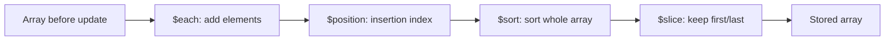

# push, each, position, slice, and sort

## 1. Why Must Array Operations Be Designed Carefully?

In applications using **Spring Data MongoDB**, a document often contains arrays to represent data whose lifecycle depends on the parent document: product tags, recent visits, top scores, or a short list of historical statuses.

For example, a player profile has two arrays:

- `recentActions`: keep only the **4 most recent actions**, newest first.
- `bestRuns`: keep only the **3 highest-scoring runs**, sorted descending by `score`, with ties broken by `runId`.

If you use Java to read the document, add elements to a `List`, and call `repository.save(...)`, the application can run into three issues:

1. Two requests reading the same stale copy and calling `save` can overwrite each other's changes.
2. The entire document and all arrays must be loaded and mapped, even when adding a single element.
3. Enforcing order and size limits gets scattered across services, easily producing inconsistent data.

MongoDB provides the **`$push`** update operator, combined with the **`$each`**, **`$position`**, **`$slice`**, and **`$sort`** modifiers. In a single update command, you can append multiple elements, choose an insertion position, sort **the entire array after insertion**, and slice the array to a limit. Spring Data MongoDB expresses these operations via `Update.push(...)` and `MongoTemplate.updateFirst(...)` or related update APIs.

This lesson belongs to the **Array Operations** chapter of the **SPRING_DATA_MONGODB** module. The goal is to understand exact BSON and update semantics, write `mongosh` commands, build updates in Java, and handle concurrency, indexes, reactive access, transactions, testing, and performance diagnostics.

**Distinguish immediately:** `$sort`/`$slice` *inside `$push`* are **modifiers on an array write operation**; they are not query `sort`, the aggregation `$sort` stage, or read-only projection `$slice`.

## 2. Preparing Sample Data

Use the `player_profiles` collection in a **test database**:

```javascript
db.player_profiles.insertOne({
  _id: "player-01",
  displayName: "Alex Miller",
  active: true,
  recentActions: ["login", "open-dashboard"],
  bestRuns: [
    { runId: "r1", score: 72 },
    { runId: "r2", score: 90 },
    { runId: "r3", score: 81 }
  ],
  updatedAt: ISODate("2026-11-20T02:00:00Z")
});
```

A document has these fields:

| BSON field | BSON type | Purpose |
| --- | --- | --- |
| `_id` | `string` | Profile identifier |
| `recentActions` | `array` of `string` | Compact activity history |
| `bestRuns` | `array` of `object` | Up to three highest-scoring runs |
| `bestRuns[].runId` | `string` | Run ID |
| `bestRuns[].score` | `int` (for small numbers written normally in the shell) | Score |
| `updatedAt` | `date` | Last updated timestamp |

In this example, scores are integers. If a legacy collection mixes `score` values of string, int, double, and null, sorting can produce surprising results because MongoDB compares across BSON types. Verify actual stored data before relying on sort for critical business rules.

There is no default constraint guaranteeing `runId` is unique inside the array. `$push` does not enforce uniqueness automatically.

## 3. Map of Operators and Modifiers

`$push` is an **update operator**. Modifiers inside it change how the array is updated:

| Component | Effect | Example |
| --- | --- | --- |
| `$push` | Appends a value to an array field | `{$push:{recentActions:"checkout"}}` |
| `$each` | Adds multiple values as **individual elements** | `{$each:["a","b"]}` |
| `$position` | Chooses the insertion index for new values | `{$position:0}` |
| `$slice` | Keeps the first/last N elements after update | `{$slice:4}` or `{$slice:-4}` |
| `$sort` | Sorts the entire array after insertion | `{$sort:{score:-1}}` |
| `$addToSet` | A different operator: adds a value only if not already present per MongoDB equality | `{$addToSet:{tags:"java"}}` |

General syntax:

```javascript
db.player_profiles.updateOne(
  { _id: "player-01" },
  {
    $push: {
      someArray: {
        $each: [value1, value2],
        $position: 0,
        $sort: { someField: -1 },
        $slice: 5
      }
    }
  }
);
```

This is a **syntax skeleton**, not a command to run verbatim, because `someArray` and `value1`/`value2` are placeholder names.

**Mandatory rule:** to use `$position`, `$sort`, or `$slice` inside `$push`, you must include `$each`; when you only need to sort or slice an existing array, you can specify `$each: []`.

### 3.1. Execution Order Does Not Depend on Modifier Order

MongoDB processes `$push` with modifiers in this order:

1. **Insert elements** at the specified position (`$position`, or the end of the array if omitted).
2. **Sort the entire array** after insertion, if `$sort` is present.
3. **Slice the array** according to `$slice`, if present.
4. **Write the resulting array** into the document.



For example, placing `$slice` before `$sort` in BSON does not mean MongoDB slices first and sorts afterward. **The order of modifiers in JSON does not determine execution order.**

When combining `$position` and `$sort`, the initial insertion order may no longer appear in the final result because `$sort` reorders the entire array. Combine both only when genuinely needed and their semantics are clear.

## 4. Basic `$push`: Adding a Single Element

Append one action at the **end** of the array:

```javascript
db.player_profiles.updateOne(
  { _id: "player-01" },
  { $push: { recentActions: "view-product" } }
);
```

If `recentActions` initially is:

```json
["login", "open-dashboard"]
```

then the result is:

```json
["login", "open-dashboard", "view-product"]
```

`$push` appends the new element to the end by default; it **does not automatically slice**, sort, or check for duplicates.

### 4.1. Missing Field, Null Field, and Non-Array Field

| State Before Update | `$push` Behavior |
| --- | --- |
| Field does not exist | MongoDB creates the array field with the new value |
| Field is already an array | Appends the value per rules |
| Field is `null` | Error because it is not a valid array |
| Field is a string/object/other scalar | Error because it is not an array |

If a legacy collection contains `recentActions: null`, `$push` is not an “auto-fix schema” command for all cases. Define a schema migration or validate old data rather than expecting `null` to turn into `[]`.

### 4.2. Pushing an Array vs. Pushing Multiple Elements

Suppose you want to add two tags:

```javascript
db.products.updateOne(
  { _id: "product-01" },
  { $push: { tags: ["spring", "mongodb"] } }
);
```

If `tags` is an array, the value `["spring","mongodb"]` is inserted as **a single nested array element**, for example:

```javascript
{ tags: ["java", ["spring", "mongodb"]] }
```

To add two separate tags, you must use `$each`. This is a common mistake when passing a Java `List<String>` into `Update.push(...).value(list)`.

## 5. `$each`: Adding Multiple Elements Properly

### 5.1. Basic Case

```javascript
db.player_profiles.updateOne(
  { _id: "player-01" },
  {
    $push: {
      recentActions: {
        $each: ["view-product", "add-to-cart"]
      }
    }
  }
);
```

Starting with `["login","open-dashboard"]`, the result is:

```json
[
  "login",
  "open-dashboard",
  "view-product",
  "add-to-cart"
]
```

The two values become **two separate elements**. If the application records events chronologically, ensure the order inside `$each` reflects business rules; MongoDB does not infer timestamps or newer/older ordering from string contents.

### 5.2. Empty `$each` Is Useful for Sort/Slice

This is valid syntax:

```javascript
db.player_profiles.updateOne(
  { _id: "player-01" },
  {
    $push: {
      bestRuns: {
        $each: [],
        $sort: { score: -1, runId: 1 },
        $slice: 3
      }
    }
  }
);
```

No new elements are added, yet the existing array can still be **sorted and sliced**. This can be a technique to fix the order or cap of an existing array. Test on a data copy before running it as a bulk migration.

Do not confuse `$each: []` inside a modifier structure with an empty `$push: {}`. Starting in MongoDB 5.0, empty update operator expressions have their own no-op semantics; do not use empty expressions as a substitute for array control logic.

## 6. `$position`: Inserting at the Beginning, Middle, or Near the End

### 6.1. Inserting at the Beginning with `$position: 0`

To keep the **newest activity first**, use:

```javascript
db.player_profiles.updateOne(
  { _id: "player-01" },
  {
    $push: {
      recentActions: {
        $each: ["open-help", "read-guide"],
        $position: 0
      }
    }
  }
);
```

Starting with the array:

```json
["login", "open-dashboard"]
```

the result is:

```json
["open-help", "read-guide", "login", "open-dashboard"]
```

`$position:0` means start inserting at the beginning of the array. The order of the two elements in `$each` is preserved in the inserted slice. If the “newest first” convention applies to each individual event, the caller must supply events in the proper order rather than relying on `$position` alone.

### 6.2. Inserting at a Positive Position

`$position: 1` inserts **before the existing element at index 1**, shifting elements from that position onward:

```javascript
db.examples.insertOne({
  _id: "position-demo",
  values: ["A", "D"]
});

db.examples.updateOne(
  { _id: "position-demo" },
  {
    $push: {
      values: {
        $each: ["B", "C"],
        $position: 1
      }
    }
  }
);

// values: ["A", "B", "C", "D"]
```

The position is a **zero-based index**, not a page number or 1-based offset. If the index exceeds the array length, elements may be appended at the end; verify the exact behavior on the target server version.

### 6.3. Negative Positions

MongoDB supports negative `$position` values in corresponding versions: `-1` represents a position relative to the end of the array, e.g., before the last element. When `$each` has multiple elements and `$position` is negative, the final position semantics have specific rules, so do not assume it behaves identically to `list.add(index, value)` in Java.

For a simple “append to end” requirement, **omit `$position`** for clarity. For “newest first”, use `0`. Only use negative positions when backed by explicit tests for the expected elements and result.

## 7. `$slice` Inside `$push`: Keeping Arrays Bounded

**`$slice` in a `$push` update** decides how many elements to keep **after insertion and sorting (if specified)**.

| Value | Behavior |
| --- | --- |
| `$slice: 4` | Keeps the **first 4 elements** |
| `$slice: -4` | Keeps the **last 4 elements** |
| `$slice: 0` | Empties the array |
| Omitted | Does not automatically trim length |

### 7.1. Newest First and Keeping 4 Elements

Suppose `recentActions` currently holds:

```json
["open-dashboard", "login", "previous-session"]
```

Command:

```javascript
db.player_profiles.updateOne(
  { _id: "player-01" },
  {
    $push: {
      recentActions: {
        $each: ["view-product", "add-to-cart"],
        $position: 0,
        $slice: 4
      }
    }
  }
);
```

Result:

```json
[
  "view-product",
  "add-to-cart",
  "open-dashboard",
  "login"
]
```

The value `"previous-session"` is dropped because there are 5 elements after insertion and only the first 4 are kept.

**Understand “newest first” from the data source perspective:** if `"add-to-cart"` occurred *after* `"view-product"`, yet `$each` sends them in the order above, the first element is not actually the newest event. The application should order `$each` according to convention, or store timestamps and use `$sort` instead of treating insertion position as proof of time.

### 7.2. Appending at the End and Keeping the 4 Most Recent Elements

If the array is ordered **oldest → newest**, omit `$position` and use `$slice: -4`:

```javascript
db.player_profiles.updateOne(
  { _id: "player-01" },
  {
    $push: {
      recentActions: {
        $each: ["view-product", "add-to-cart"],
        $slice: -4
      }
    }
  }
);
```

Starting with `["login","open-dashboard","previous-session"]`, the result is:

```json
[
  "open-dashboard",
  "previous-session",
  "view-product",
  "add-to-cart"
]
```

The oldest first element `"login"` is dropped. **The sign of `$slice` carries different business meaning**: positive keeps the head, negative keeps the tail.

### 7.3. Beware of `$slice: 0`

```javascript
db.player_profiles.updateOne(
  { _id: "player-01" },
  {
    $push: {
      recentActions: {
        $each: [],
        $slice: 0
      }
    }
  }
);
```

This command **empties the entire array**. Do not treat `0` as “unlimited” or “do nothing”. When the retention size comes from configuration, validate the value so a misconfiguration does not wipe history.

## 8. `$sort` Inside `$push`: Sorting the Entire Array

### 8.1. Sorting an Array of Scalars

Example score array:

```javascript
db.examples.insertOne({
  _id: "score-demo",
  scores: [75, 95, 80]
});

db.examples.updateOne(
  { _id: "score-demo" },
  {
    $push: {
      scores: {
        $each: [88, 99],
        $sort: -1,
        $slice: 3
      }
    }
  }
);

// scores: [99, 95, 88]
```

Here:

- `$sort: -1` sorts descending by **each scalar element's value**.
- `$sort: 1` sorts ascending.
- `$slice: 3` keeps the top three scores **after sorting**.

A common pattern for maintaining a “top K” is **`$each + $sort + $slice` in a single update**.

### 8.2. Sorting an Array of Subdocuments

For `bestRuns`, each element is an object with `runId` and `score`:

```javascript
db.player_profiles.updateOne(
  { _id: "player-01" },
  {
    $push: {
      bestRuns: {
        $each: [
          { runId: "r4", score: 95 },
          { runId: "r5", score: 84 }
        ],
        $sort: {
          score: -1,
          runId: 1
        },
        $slice: 3
      }
    }
  }
);
```

Starting with:

```json
[
  {"runId":"r1","score":72},
  {"runId":"r2","score":90},
  {"runId":"r3","score":81}
]
```

Result:

```json
[
  {"runId":"r4","score":95},
  {"runId":"r2","score":90},
  {"runId":"r5","score":84}
]
```

MongoDB sorts **both existing and new elements** before slicing. When two runs have the same score, `runId:1` provides a secondary key for predictable ordering. If `runId` is not unique within the array, or all sort keys are equal, the relative order among tied elements may not carry stable business meaning.

**Important syntax rule:** inside `$push`'s `$sort`, the field `score` is a path **relative to each element**. Writing `$sort: {"bestRuns.score": -1}` is not the right way to sort subdocuments by `score`.

### 8.3. Collation and Data Types When Sorting

For string elements, comparison rules can depend on the update operation's collation. If locale-specific case-insensitive sorting is required, design collation deliberately and test against real data; do not assume `$sort:1` always matches UI sorting.

For scores, keep BSON types consistent: `int` or `long` per the contract. If `score` is stored sometimes as `"100"` (string) and sometimes as `100` (number), MongoDB uses BSON type comparison rules and will not parse strings as numbers. That can corrupt rankings.

## 9. Distinguishing Types of `sort` and `slice`

Applications use the word “sort” in three places:

| Syntax | What Is Sorted |
| --- | --- |
| `query.with(Sort.by(...))` | The **list of documents** returned by a query |
| `{$push:{runs:{$each:[], $sort:{score:-1}}}}` | **Elements inside the `runs` array** of the updated document |
| `{$sort:{score:-1}}` in aggregation | Documents flowing through the pipeline stage |

Similarly, “slice” has three contexts:

| Syntax | Effect |
| --- | --- |
| `$slice` in `$push` update | **Modifies the stored array** and keeps head/tail |
| `{arrayField:{$slice:3}}` in `find` projection | **Only limits the array in read results**, does not modify the document |
| `$slice` in aggregation expression | Extracts an array slice while constructing/transforming pipeline output |

Read projection example:

```javascript
db.player_profiles.find(
  { _id: "player-01" },
  {
    _id: 1,
    recentActions: { $slice: 2 }
  }
);
```

This command only returns the first two elements of `recentActions`; **the full array remains in the database**. By contrast, `$slice` in `$push` modifies the persisted data. Do not confuse the two mechanisms when building list APIs or processing history.

## 10. Writing the Spring Data MongoDB Entity

Suppose the application has this model:

```java
import java.time.Instant;
import java.util.List;

import org.springframework.data.mongodb.core.mapping.Document;
import org.springframework.data.mongodb.core.mapping.FieldType;
import org.springframework.data.mongodb.core.mapping.MongoId;

@Document(collection = "player_profiles")
public record PlayerProfile(
    @MongoId(FieldType.STRING)
    String id,
    String displayName,
    boolean active,
    List<String> recentActions,
    List<ScoreEntry> bestRuns,
    Instant updatedAt
) {
    public record ScoreEntry(
        String runId,
        int score
    ) {}
}
```

A few design notes:

- `id` is the string BSON primary key `_id` via `@MongoId(FieldType.STRING)`.
- `recentActions` and `bestRuns` are both arrays in MongoDB.
- `ScoreEntry` is a **subdocument** and does not need a separate collection if it only has meaning inside a profile.
- If scores need more fields such as season, timestamp, or source, you can add fields to the subdocument and redesign the sort.
- `updatedAt` should be updated in the same update operation if used for UI sync or background jobs.

Loading `PlayerProfile` via a repository, editing the `List` in Java, and calling `save` creates overwrite risks when multiple requests update concurrently. In the examples below, we use **`MongoTemplate.updateFirst(...)`** to send an atomic single-document update.

## 11. Java Builder: `Update.push(...).value(...)` and `.each(...)`

### 11.1. Pushing a Single Value

```java
import com.mongodb.client.result.UpdateResult;

import org.springframework.data.mongodb.core.MongoTemplate;
import org.springframework.data.mongodb.core.query.Criteria;
import org.springframework.data.mongodb.core.query.Query;
import org.springframework.data.mongodb.core.query.Update;

public long appendAction(
    MongoTemplate template,
    String playerId,
    String action
) {
    Query q = Query.query(
        Criteria.where("_id").is(playerId)
    );

    Update update = new Update()
        .push("recentActions")
        .value(action);

    UpdateResult result =
        template.updateFirst(q, update, PlayerProfile.class);

    return result.getModifiedCount();
}
```

`Update.push("recentActions")` returns **`Update.PushOperatorBuilder`**. `value(action)` terminates the simple `$push` operation and returns `Update`. This example appends at the end; if you only want to keep a subset of history, combine `$each` with `$slice` in the next section.

### 11.2. Pushing Multiple Values

```java
Update update = new Update()
    .push("recentActions")
    .each("view-product", "add-to-cart");
```

Equivalent in meaning to:

```javascript
{
  $push: {
    recentActions: {
      $each: ["view-product", "add-to-cart"]
    }
  }
}
```

**Java syntax to remember:** in Spring Data MongoDB, `.each(Object...)` **returns `Update`**, whereas `.atPosition(...)`, `.slice(...)`, and `.sort(...)` return `PushOperatorBuilder`. Therefore modifiers must be placed **before `.each(...)`** when chaining on the same builder.

Correct:

```java
Update update = new Update()
    .push("recentActions")
    .atPosition(0)
    .slice(4)
    .each("view-product", "add-to-cart");
```

Incorrect chaining API usage:

```java
// Wrong: each(...) returns Update, no longer PushOperatorBuilder.
Update update = new Update()
    .push("recentActions")
    .each("view-product", "add-to-cart")
    .slice(4); // Not a slice method on Update.
```

Even though modifier order in BSON does not determine execution order, **Java builder call order affects compilation**.

## 12. Java: `atPosition`, `slice`, and `sort`

### 12.1. Keeping the Four Newest Actions at the Front

```java
import java.time.Instant;

import com.mongodb.client.result.UpdateResult;

import org.springframework.data.mongodb.core.MongoTemplate;
import org.springframework.data.mongodb.core.query.Criteria;
import org.springframework.data.mongodb.core.query.Query;
import org.springframework.data.mongodb.core.query.Update;

public boolean prependRecentActions(
    MongoTemplate template,
    String playerId,
    String first,
    String second,
    Instant now
) {
    Query query = Query.query(
        Criteria.where("_id").is(playerId)
            .and("active").is(true)
    );

    Update update = new Update()
        .push("recentActions")
        .atPosition(0)
        .slice(4)
        .each(first, second);

    // Update has been returned by the builder; $set can be added.
    update.set("updatedAt", now);

    UpdateResult result = template.updateFirst(
        query,
        update,
        PlayerProfile.class
    );

    return result.getModifiedCount() == 1;
}
```

The command above:

1. Updates only active profiles.
2. Inserts two actions at the start of the array.
3. Keeps at most the first four elements.
4. Updates `updatedAt` in the **same write operation**.
5. Returns `false` if no document was actually modified.

If `first` and `second` are in a chronological order different from the business convention, sort those two values before calling. `$position` does not determine which one is “newest”.

### 12.2. Keeping the Top Three Scores with a Secondary Sort Key

```java
import java.time.Instant;

import org.springframework.data.domain.Sort;
import org.springframework.data.mongodb.core.query.Update;

PlayerProfile.ScoreEntry newEntry =
    new PlayerProfile.ScoreEntry("r4", 95);

Update topThree = new Update()
    .push("bestRuns")
    .sort(
        Sort.by(
            Sort.Order.desc("score"),
            Sort.Order.asc("runId")
        )
    )
    .slice(3)
    .each(newEntry);

topThree.set("updatedAt", Instant.now());
```

When executed with `MongoTemplate.updateFirst(...)`, Spring Data converts `ScoreEntry` into a subdocument and emits `$sort`/`$slice` into the update BSON. `sort(Sort)` is used for **arrays of objects**, while `sort(Sort.Direction)` is useful for **arrays of scalars**.

Example with an integer array:

```java
Update scores = new Update()
    .push("scores")
    .sort(Sort.Direction.DESC)
    .slice(5)
    .each(91, 77, 100);
```

You can add `.atPosition(0)` before `.sort(...)` if there is a reason, but when sorting the whole array, insertion position will not determine final positions.

### 12.3. Field Names in Sort and Mapping

If `ScoreEntry` uses `@Field("score_value")` instead of the property `score`, inspect the actual BSON of the generated update command. `$sort` inside `$push` applies to **fields of each BSON subdocument**, so it must target the stored field path. Do not assume nested field mapping in every case follows the exact same logic as `Query.sort` on an entity.

To keep this lesson easy to cross-reference, the examples keep `runId` and `score` identical between Java and BSON. When using custom converters, field naming strategies, or legacy schemas, write integration tests verifying array order and actual field names.

## 13. An Atomic Update Is Better Than Read-Modify-Save Under Concurrent Requests

Suppose two requests both want to add a `ScoreEntry` to `bestRuns`.

**Approach prone to lost updates:**

```text
T1: Request A reads PlayerProfile with bestRuns = [r1, r2]
T2: Request B reads the same bestRuns = [r1, r2]
T3: A adds r3 in Java then calls save()
T4: B adds r4 on the old copy then calls save()
→ Risk that r3 is lost in the final document.
```

**Approach using an update operator:**

```java
Update update = new Update()
    .push("bestRuns")
    .sort(Sort.by(
        Sort.Order.desc("score"),
        Sort.Order.asc("runId")
    ))
    .slice(3)
    .each(new PlayerProfile.ScoreEntry("r4", 95));

template.updateFirst(
    Query.query(Criteria.where("_id").is("player-01")),
    update,
    PlayerProfile.class
);
```

MongoDB applies a single update on one document **atomically**, including insertion, sorting, and slicing within that command. Concurrent requests are serialized on the same document according to MongoDB's write behavior. Thus there is no need to load `bestRuns` into Java and replace the entire array.

However, there are two limitations:

- `$push` **does not prevent duplicate writes**. Retrying the same request can add a duplicate `runId`.
- Single-document atomicity **does not** make multiple documents or external services commit/rollback together.

For leaderboards requiring each run to be unique, store each run in a separate collection with a unique index on `runId` and update the top-K array as derived data, or enforce business-level deduplication rules. Do not assume appending an element with a new `runId` is automatically safe across retries.

## 14. Add Only If Absent: `$addToSet` vs. `$push`

MongoDB has `$addToSet` to add an element only if the corresponding value is not already in the array:

```javascript
db.products.updateOne(
  { _id: "product-01" },
  {
    $addToSet: {
      tags: { $each: ["spring", "mongodb"] }
    }
  }
);
```

Comparison:

| Criterion | `$push` | `$addToSet` |
| --- | --- | --- |
| Allows duplicate values | Yes | Prevents adding values considered already present |
| Supports `$each` | Yes | Yes |
| Supports `$position` | Yes | No |
| Supports `$sort` modifier | Yes | No |
| Supports `$slice` modifier | Yes | No |
| Enforces true set semantics for pre-existing duplicates | No | Does not remove old duplicates automatically |

For subdocument arrays, equality comparison also depends on document structure/values. Two objects with the same `runId` but different `score` values **are not treated as the same element**. Therefore `$addToSet` is not a unique constraint on a subfield.

If you want “each `runId` appears at most once” under concurrent requests, you can combine a filter checking that `runId` is not yet in the array with a tested atomic update, or better yet use a separate collection with a unique index if the data has an independent lifecycle and high volume.

## 15. Condition Checks and Preventing Invalid Writes

### 15.1. Filter So Updates Only Run in Allowed States

For example, add an action only when the profile is active:

```java
Query q = Query.query(
    Criteria.where("_id").is("player-01")
        .and("active").is(true)
);

Update update = new Update()
    .push("recentActions")
    .atPosition(0)
    .slice(4)
    .each("open-guide");

UpdateResult result = template.updateFirst(
    q, update, PlayerProfile.class
);

if (result.getMatchedCount() != 1) {
    throw new IllegalStateException(
        "Profile does not exist or is inactive"
    );
}
```

Here `getMatchedCount()` reports how many documents matched the filter, while `getModifiedCount()` reports how many documents actually changed. For a valid push operation, both counts are often the same, though they should not be used interchangeably for every update, especially when an update can be a no-op.

### 15.2. Preventing Duplicates with an Idempotency Key

If `POST /scores` may be retried due to network errors, use a request identifier or `runId` that stays unchanged across retries. A robust solution usually is:

1. Store one record per `runId` in a results collection with a **unique index** on the appropriate business key.
2. Only when the new record is accepted, insert it into the top-K array or emit an event to update the leaderboard.
3. Design the top-K update so it can be re-run without corrupting data; if it is derived data, it can be rebuilt from the source.
4. If writes across multiple collections must commit/rollback together, consider MongoDB transactions on a supported deployment or an eventual consistency/idempotent strategy.

Do not assume a MongoDB transaction covers payment gateways, message brokers, or external APIs. Within a single document, query filters and update operators solve many problems without needing multi-document transactions.

### 15.3. Optimistic Locking and `@Version`

For **read-modify-save** operations needing protection against concurrent updates, Spring Data supports `@Version`. However, do not assume every arbitrary `MongoTemplate.updateFirst(...)` command automatically enforces version checks in the filter the way `repository.save(entity)` does. If you need optimistic concurrency with update operators, design consistent version predicates and increment handling, test the exact Spring Data version behavior, and avoid double-incrementing if the framework already manages the version.

## 16. Array Growth Limits and Document Size

`$push` looks convenient, but an unbounded array can cause a document to grow indefinitely. MongoDB has a **16 MiB** limit for standard BSON documents; in addition, long arrays increase write, read, and serialization costs and impact indexes.

### 16.1. When Are Small Arrays Appropriate?

Suitable:

- 3–10 fixed-length top-K results.
- A controlled set of product tags.
- A window of a few dozen recent actions for UI display.

Consider a separate child collection:

- Millions of events/audit logs per user.
- Multi-year chat messages.
- Payment histories or records requiring immutability and independent querying.
- Unbounded one-to-many relationships or cases needing per-item pagination.

If you only need “latest N” for display, separate the **full source of truth** from the **cached/materialized recent N**. `$slice` discards elements outside the top N from the array; do not store *only* a sliced array if business reconciliation still needs full history.

### 16.2. Array Updates and Index Costs

MongoDB can use a **multikey index** on a field inside an array, for example:

```javascript
db.player_profiles.createIndex({
  "bestRuns.score": -1
});
```

This index can support queries filtering documents by element score:

```javascript
db.player_profiles.find({
  "bestRuns.score": { $gte: 90 }
});
```

However, **an element index is not required** to perform `$sort` inside `$push`. Update `$sort` sorts the array inside one document, which is not the same as the query planner using an index to sort across documents.

Frequently modifying an array with a multikey index increases index maintenance overhead. Do not create an index just because `$sort` appears inside `$push`; choose indexes based on **read query patterns**. Measure with `explain("executionStats")` and monitor write latency.

## 17. Querying and Projecting Data After an Update

Reading a profile:

```javascript
db.player_profiles.findOne({
  _id: "player-01"
});
```

Reading only the top 2 runs for display without modifying the stored array:

```javascript
db.player_profiles.find(
  { _id: "player-01" },
  {
    _id: 1,
    bestRuns: { $slice: 2 }
  }
);
```

In Spring Data MongoDB, `Query.fields()` provides corresponding projection APIs depending on version. For simple cases, you can use a JSON query or aggregation `$project` if complex computation is needed.

Aggregation example returning element count and head of the array:

```javascript
db.player_profiles.aggregate([
  { $match: { _id: "player-01" } },
  {
    $project: {
      displayName: 1,
      bestRunCount: { $size: "$bestRuns" },
      topTwo: { $slice: ["$bestRuns", 2] }
    }
  }
]);
```

`$size` requires an array operand; if legacy data has missing fields or null, use type/value checks before calling it. Aggregation results have a different shape from the entity and can be mapped to a DTO or `org.bson.Document` using `MongoTemplate.aggregate(...)`.

If `bestRuns` must always stay a sorted top 3, integration tests must verify the **persisted data itself**; a top-2 projection does not prove the underlying array was sliced.

## 18. ReactiveMongoTemplate: Non-Blocking Array Updates

For Spring WebFlux applications, `ReactiveMongoTemplate` also supports update operations with `Query` and `Update` similar to the imperative API, returning reactive publishers.

```java
import com.mongodb.client.result.UpdateResult;

import org.springframework.data.domain.Sort;
import org.springframework.data.mongodb.core.ReactiveMongoTemplate;
import org.springframework.data.mongodb.core.query.Criteria;
import org.springframework.data.mongodb.core.query.Query;
import org.springframework.data.mongodb.core.query.Update;

import reactor.core.publisher.Mono;

public Mono<UpdateResult> addScoreReactive(
    ReactiveMongoTemplate template,
    String playerId,
    PlayerProfile.ScoreEntry entry
) {
    Query query = Query.query(
        Criteria.where("_id").is(playerId)
    );

    Update update = new Update()
        .push("bestRuns")
        .sort(
            Sort.by(
                Sort.Order.desc("score"),
                Sort.Order.asc("runId")
            )
        )
        .slice(3)
        .each(entry);

    return template.updateFirst(
        query,
        update,
        PlayerProfile.class
    );
}
```

The reactive API does not turn `$push` into a “multi-document atomic” operation and does not automatically solve duplicate retries. Publishers must be subscribed to through the reactive pipeline; never call `block()` on the WebFlux event loop.

If multi-document transactions are needed on a supported MongoDB deployment, use `ReactiveMongoTransactionManager` with the proper reactive transaction context; do not use an imperative transaction manager and assume it participates in the same transaction.

## 19. Integration Testing: Ensuring the Array Is Truly Correct After Update

Unit tests inspecting only the `Update` object do not prove MongoDB processed the modifiers properly or that Spring Data mapped field names accurately. Write **integration tests against a real MongoDB**, such as using Testcontainers with Spring Boot test setup.

### 19.1. Scenarios to Verify

| Scenario | Outcome to Verify |
| --- | --- |
| Push one scalar | One element appended at the end |
| Push a `List` as a single value | Nested array created, not multiple elements |
| Push `$each` | Each value becomes a separate element |
| `$position:0` | New elements appear at the front in the right order |
| `$slice:4` | Keeps first four elements |
| `$slice:-4` | Keeps last four elements |
| `$slice:0` | Array becomes empty |
| `$sort:-1` on numbers | Scalar values sorted descending |
| `$sort:{score:-1,runId:1}` on objects | Score and tie-breaker order is correct |
| `$each:[]` + sort/slice | Sorts/slices existing array without adding new elements |
| Missing field | `$push` creates the array |
| Null or scalar field | Server reports type error |
| Retry with same `runId` | Verify deduplication or idempotency policy |
| Two concurrent requests updating | No lost updates from read-modify-save |
| Nested converter/`@Field` | BSON field names and order verified |

### 19.2. JUnit 5 Example with `MongoTemplate`

The following test sample assumes the project has an isolated test MongoDB, `@DataMongoTest` is configured, and the document does not yet exist:

```java
import static org.assertj.core.api.Assertions.assertThat;

import java.time.Instant;
import java.util.List;

import org.bson.Document;
import org.junit.jupiter.api.Test;
import org.springframework.beans.factory.annotation.Autowired;
import org.springframework.boot.test.autoconfigure.data.mongo.DataMongoTest;
import org.springframework.data.domain.Sort;
import org.springframework.data.mongodb.core.MongoTemplate;
import org.springframework.data.mongodb.core.query.Criteria;
import org.springframework.data.mongodb.core.query.Query;
import org.springframework.data.mongodb.core.query.Update;

@DataMongoTest
class PlayerArrayUpdateIntegrationTest {

    @Autowired MongoTemplate template;

    @Test
    void pushesSortsAndSlicesTopThreeRuns() {
        String id = "array-update-test-01";

        template.insert(new PlayerProfile(
            id,
            "Alex Miller",
            true,
            List.of("login"),
            List.of(
                new PlayerProfile.ScoreEntry("r1", 72),
                new PlayerProfile.ScoreEntry("r2", 90),
                new PlayerProfile.ScoreEntry("r3", 81)
            ),
            Instant.parse("2026-11-20T02:00:00Z")
        ));

        Update update = new Update()
            .push("bestRuns")
            .sort(
                Sort.by(
                    Sort.Order.desc("score"),
                    Sort.Order.asc("runId")
                )
            )
            .slice(3)
            .each(
                new PlayerProfile.ScoreEntry("r4", 95),
                new PlayerProfile.ScoreEntry("r5", 84)
            );

        template.updateFirst(
            Query.query(Criteria.where("_id").is(id)),
            update,
            PlayerProfile.class
        );

        PlayerProfile result =
            template.findById(id, PlayerProfile.class);

        assertThat(result).isNotNull();
        assertThat(result.bestRuns())
            .extracting(PlayerProfile.ScoreEntry::runId)
            .containsExactly("r4", "r2", "r5");

        Document raw = template.getCollection("player_profiles")
            .find(com.mongodb.client.model.Filters.eq("_id", id))
            .first();

        assertThat(raw).isNotNull();
        assertThat(raw.get("bestRuns")).isInstanceOf(List.class);
        assertThat(raw.getList("bestRuns", Document.class))
            .hasSize(3);
    }
}
```

The test verifies both **Java mapping** and raw BSON via the driver. To make tests repeatable, isolate the database or clean up only the test `id`, without dropping shared collections. This is illustrative code; tests/Gradle were **not executed** during authoring.

### 19.3. Testing Position and Array Slicing

An additional test should:

1. Create `recentActions=["A","B","C"]`.
2. Call `Update.push("recentActions").atPosition(0).slice(4).each("X","Y")`.
3. Re-read the array and expect `["X","Y","A","B"]`.
4. Test changing to `slice(-4)` and verify keeping the last four elements per that operation.
5. Test `$slice:0` on a separate test record to observe an empty array.
6. Test `recentActions: null` and assert the server error rather than swallowing exceptions.

For concurrency tests, run two requests actually calling `updateFirst` on the same document; verify afterward that top-K size and sort order are never violated. Because two concurrent requests may be serialized by MongoDB in either order, do not assert that a specific request always applies first.

## 20. Diagnostics: When an Array Update Produces Unexpected Results

| Symptom | What to Check |
| --- | --- |
| After push, one element is itself an array | `$push` was passed an array directly instead of `$each` |
| Newest/oldest order is reversed | Wrong `$position` or wrong order of values inside `$each` |
| Wrong end of array was sliced | Wrong sign on `$slice` |
| Array became empty | `$slice:0` |
| Sort does not order by score | Used `{"bestRuns.score":-1}` instead of `{"score":-1}` in `$sort` modifier |
| `.slice(...)` fails to compile after `.each(...)` | `each` returns `Update`; modifiers must precede `each` |
| Document did not change | Wrong `_id`/`active` filter, BSON ID type mismatch, or update was a no-op |
| Server reports cannot push | Target field is null/scalar instead of an array |
| Array has duplicate `runId` | `$push` does not deduplicate by subfield |
| Top-K results shift on tied scores | Missing deterministic secondary key like `runId`/`achievedAt` |
| Write cost increases | Large array, multikey index, growing document size, high update frequency |
| Projection returns 2 items but DB still has 100 | Used read projection `$slice`, not update `$slice` |
| Concurrent requests lose updates | Read-modify-save pattern on entity instead of update operator |
| Scores sort in strange order | Mixed BSON types: string, number, null |
| Cannot analyze sliced-off history | Used top-K array as the sole data source |

When troubleshooting, inspect the actual document in `mongosh` and use `$type` to verify the field is an array and elements have expected types:

```javascript
db.player_profiles.aggregate([
  { $match: { _id: "player-01" } },
  {
    $project: {
      _id: 0,
      recentActionsType: { $type: "$recentActions" },
      bestRunsType: { $type: "$bestRuns" },
      bestRunsCount: {
        $cond: [
          { $isArray: "$bestRuns" },
          { $size: "$bestRuns" },
          null
        ]
      }
    }
  }
]);
```

This is a read-only observation and does not alter data. If a collection is large and many records violate the schema, aggregate counts by `$type` over an authorized scope before migrating.

## 21. Performance, Indexes, and Keeping Data Bounded

A `$push` with modifiers reduces round-trips compared to `findById → edit in Java → save`, but it still has costs:

- MongoDB must update the array and potentially sort many elements inside the document.
- If the field has a multikey index, changes can incur index update costs.
- If nested arrays/data grow too large, writes consume more memory and risk hitting the document size limit.
- A single document becomes a hotspot when many clients concurrently update its array, causing write conflicts or elevated latency.

For a **small, fixed** top K, `$push + $sort + $slice` is usually a clean design. For large or unbounded datasets, consider a separate `player_runs` collection with an index supporting top-N queries:

```javascript
db.player_runs.createIndex({
  playerId: 1,
  score: -1,
  runId: 1
});

db.player_runs.find({ playerId: "player-01" })
  .sort({ score: -1, runId: 1 })
  .limit(3)
  .explain("executionStats");
```

With a child-collection model, leaderboards can be queried without maintaining a top-K array on the profile. If you still want a cached top K for the UI, design synchronization and recovery after failures.

**Index note:** `$sort` inside an update has no dedicated index to optimize sorting elements inside the array. `explain("executionStats")` is useful for **read queries** against `player_runs` or queries on array fields; do not treat it as a direct measure of total update cost. To measure writes, monitor write latency, profiler/metrics, and index maintenance on realistic data.

## 22. Official Documentation and Version Compatibility

Key APIs in Spring Data MongoDB:

- `Update.push(String)` opens the builder for `$push`.
- `PushOperatorBuilder.value(Object)` writes a single value (terminates builder).
- `PushOperatorBuilder.each(Object...)` writes multiple elements via `$each` (returns `Update`).
- `PushOperatorBuilder.atPosition(int)` adds `$position`.
- `PushOperatorBuilder.slice(int)` adds `$slice`.
- `PushOperatorBuilder.sort(Sort)` or `sort(Sort.Direction)` adds `$sort`.

The signatures `sort`, `slice`, `atPosition`, and `each` are available in mainstream Spring Data MongoDB lines, though projects should still check **Javadoc for their exact dependency version**, especially when using custom converters, field mappings, or additional fluent APIs.

References:

- [Spring Data MongoDB – Update.PushOperatorBuilder](https://docs.spring.io/spring-data/mongodb/docs/current/api/org/springframework/data/mongodb/core/query/Update.PushOperatorBuilder.html)
- [Spring Data MongoDB – Update API](https://docs.spring.io/spring-data/mongodb/reference/api/java/org/springframework/data/mongodb/core/query/Update.html)
- [MongoDB Manual – `$push`](https://www.mongodb.com/docs/manual/reference/operator/update/push/)
- [MongoDB Manual – `$each`](https://www.mongodb.com/docs/manual/reference/operator/update/each/)
- [MongoDB Manual – `$position`](https://www.mongodb.com/docs/manual/reference/operator/update/position/)
- [MongoDB Manual – `$slice` (update)](https://www.mongodb.com/docs/manual/reference/operator/update/slice/)
- [MongoDB Manual – `$sort` (update)](https://www.mongodb.com/docs/manual/reference/operator/update/sort/)

## 23. Hands-On Lab and Pre-Deployment Checklist

### 23.1. Hands-On Lab

1. Create a profile document with `recentActions` and `bestRuns` as in the example.
2. Append one element with `$push`, verifying default placement at the end.
3. Try pushing an array directly to observe a nested array; then use `$each` to add elements properly.
4. Prepend two actions using `$position:0`, keeping at most four elements with `$slice:4`.
5. Switch to the “oldest first” convention and try `$slice:-4`.
6. Try `$sort:-1` on a scalar score array and `$sort:{score:-1,runId:1}` on a subdocument array.
7. Push `r4` and `r5` while keeping only top 3, and compare with the actual BSON result.
8. Write the same operation with `new Update().push(...).sort(...).slice(...).each(...)`; try putting `each(...)` before modifiers and explain why Java fails to compile.
9. Use `MongoTemplate.updateFirst` with filter `active=true`; inspect `matchedCount`/`modifiedCount`.
10. Send the same request twice to see that `$push` is not idempotent; propose a `runId`-based solution.
11. Write integration tests for documents with missing/null/scalar arrays and sort tie-breakers.
12. Compare the top-K array model with a child collection and indexes as data grows.

### 23.2. Checklist

| Question | What to Verify |
| --- | --- |
| Can the array grow unbounded? | Cap elements or split into a child collection |
| Use `$push` or `$addToSet`? | Whether duplicates are allowed or different semantics are needed |
| Need multiple values? | Use `$each` to avoid accidental nested arrays |
| Where to insert? | `$position` defaults to end; `0` is start |
| Which part to keep? | `$slice:N` keeps head; `-N` keeps tail; `0` empties |
| How to sort? | `$sort:1/-1` for scalars, object sort spec for subdocuments |
| In what order do modifiers execute? | Insert → sort → slice, regardless of BSON key order |
| Is the Java builder called properly? | `atPosition/sort/slice` before `each` |
| Are field names and BSON types right? | `@Field` mapping, array type, score type |
| Need deduplication/concurrency control? | Idempotency, unique index, filters, and atomic updates |
| Could it hit the document size limit? | Bounded array and planned snapshot data |
| Any multikey indexes? | Create only for read queries; measure write cost |
| Reactive or transactions needed? | Use proper template/context; do not equate single-doc with multi-doc atomicity |
| Tested against real MongoDB? | Write via Spring Data, inspect raw BSON, verify order and bounds |

**Conclusion:** In Spring Data MongoDB, `Update.push(...)` combined with **`$each`**, **`$position`**, **`$sort`**, and **`$slice`** lets you manage an array in **a single atomic document update**. `$each` adds multiple elements; `$position` picks the insertion point; MongoDB always executes **insert → sort → slice**; `$slice` caps the retained elements. Remember to end the Java builder chain with `each(...)`, distinguish update modifiers from read projections, design idempotency, bound array growth, and verify against real BSON to prevent data drift.
