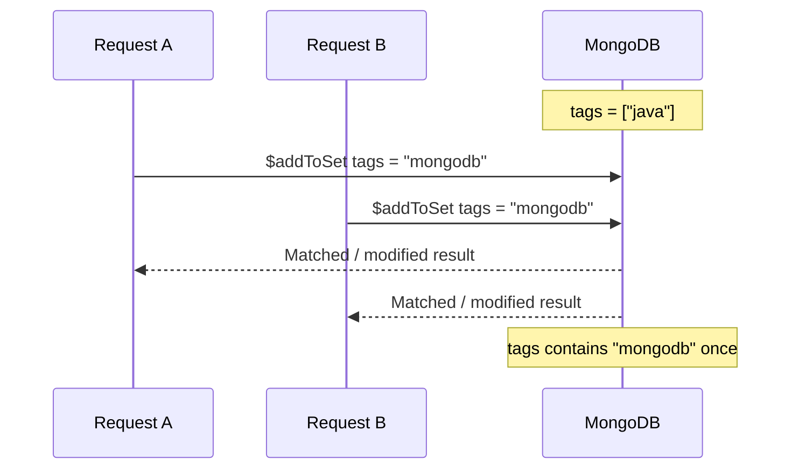

# addToSet and Its Uniqueness Limits

In **Spring Data MongoDB**, a document may contain array fields such as tags (`tags`), assignees (`reviewers`), product SKU lists (`skuIds`), or status labels. When adding an element, the question is not only **“append to the end of the array”** but also **“if the element is already present, should it be added again?”**. MongoDB provides the **`$addToSet`** operator to add a value to an array **only if the array does not already contain a value MongoDB considers equal to it**.

This lesson belongs to the **Array Operations** chapter in the **SPRING_DATA_MONGODB** module. The focus is on using `Update.addToSet(...)` and `$each` with `MongoTemplate`, understanding element equality criteria, deduplication limits, single-document atomicity when multiple requests update the same document, and when a different data model is required. In particular, **`$addToSet` is not a general UNIQUE constraint** across arbitrary properties or across documents.

## 1. What Problem Does $addToSet Solve?

Suppose an article has a list of tags:

```javascript
{
  _id: ObjectId("674000000000000000000301"),
  tenant_id: "T1",
  title: "Spring Data MongoDB",
  tags: ["java", "mongodb"]
}
```

Using `$push` to add the tag `"java"`:

```javascript
db.articles.updateOne(
  {
    _id: ObjectId("674000000000000000000301"),
    tenant_id: "T1"
  },
  { $push: { tags: "java" } }
);
```

The result can become `["java", "mongodb", "java"]` — a duplicated element. If the requirement is that **each tag string appears only once**, use `$addToSet`:

```javascript
db.articles.updateOne(
  {
    _id: ObjectId("674000000000000000000301"),
    tenant_id: "T1"
  },
  { $addToSet: { tags: "java" } }
);
```

Since `"java"` is already present, the operation does not add another copy. If the value is changed to `"spring-data"` and it is absent, MongoDB adds the element to the array:

```javascript
db.articles.updateOne(
  {
    _id: ObjectId("674000000000000000000301"),
    tenant_id: "T1"
  },
  { $addToSet: { tags: "spring-data" } }
);
```

Core differences:

| Operator | If Value Is Absent | If Value Is Present |
| --- | --- | --- |
| `$push` | Adds one element | **Still adds**, can create duplicates |
| `$addToSet` | Adds one element | **Does not add a new copy** if equal |
| `$pull` | Not applicable for adding | Removes array elements matching a condition |
| `$set` on entire array field | Replaces the array value as specified | Does not check uniqueness automatically |

The name **“ToSet”** expresses set-like intent, yet the field in MongoDB **remains a BSON Array** and does not become a separate BSON Set type. MongoDB does not sort the array or convert it to a Java `Set`; display order and array semantics still depend on business requirements.

## 2. Four Limitations to Remember Up Front

1. **Does not remove pre-existing duplicates.** If the array currently holds `["java", "java"]`, calling `$addToSet: {tags: "java"}` keeps both copies; the operator only prevents **adding a new copy** of that value.
2. **Compares the entire BSON value**, without understanding business keys. Two objects with the same `userId` but different `role` are still **two different documents** in the array.
3. **Does not enforce uniqueness across multiple documents.** Two different articles may both contain `"java"` unless a separate data constraint is designed.
4. **Does not normalize strings, arrays, or structures.** `"Java"`, `"java"`, and `" java "` may be treated as distinct values depending on comparison/collation rules; the application must define proper normalization.

Therefore, distinguish two goals: **uniqueness by compared value** within **one array of one document**, versus **uniqueness by a business attribute** within one or across multiple documents. `$addToSet` directly serves only the first goal.

## 3. Atomicity Within a Single Document

When two nearly concurrent requests both try to add `"mongodb"` to `tags` on **the same document**, using `$addToSet` on the server avoids the classic race condition of read-modify-write in Java:



MongoDB executes the update **atomically at the single-document level**. Provided the array field has the right type and the values compare equal, two `$addToSet` operations do not require the service to read the array first and check membership itself. The server checks element existence during the update.

Compare with the approach to avoid:

```java
Article loaded = articleRepository.findById(articleId).orElseThrow();

if (!loaded.getTags().contains("mongodb")) {
    loaded.getTags().add("mongodb");
    articleRepository.save(loaded);
}
```

That code has at least two issues:

- Two requests can **both read the old array** before the other saves; checking `contains` is not atomic on the server.
- `save(entity)` can **save/replace broader document state**, causing lost updates or dropping unmapped fields, especially if the entity lacks proper `@Version`.

Using `$addToSet` solves adding an element by exact value, but it does not automatically resolve other concurrent business constraints — such as capping participants, preserving priority order, or updating multiple documents together.

## 4. Data and Entity for Spring Data MongoDB Practice

Collection `articles`:

```javascript
{
  _id: ObjectId("674000000000000000000301"),
  tenant_id: "T1",
  title: "Spring Data MongoDB",
  tags: ["java", "mongodb"],
  reviewers: [
    { userId: "U-01", role: "EDITOR" }
  ]
}
```

Java entity and value object:

```java
import java.util.List;
import org.bson.types.ObjectId;
import org.springframework.data.annotation.Id;
import org.springframework.data.mongodb.core.mapping.Document;
import org.springframework.data.mongodb.core.mapping.Field;

record Reviewer(String userId, String role) {}

@Document(collection = "articles")
public class Article {
    @Id
    private ObjectId id;

    @Field("tenant_id")
    private String tenantId;

    private String title;
    private List<String> tags;
    private List<Reviewer> reviewers;

    public Article() {}

    public ObjectId getId() { return id; }
    public String getTenantId() { return tenantId; }
    public String getTitle() { return title; }
    public List<String> getTags() { return tags; }
    public List<Reviewer> getReviewers() { return reviewers; }
}
```

`List<String>` and `List<Reviewer>` accurately mirror BSON Arrays. We do not use `Set<String>` merely because the operator is named `addToSet`: Java sets have their own `equals/hashCode` rules, whereas MongoDB checks BSON values in the array, and reading a document that already contains duplicates requires observing the real stored data.

For lookups, `MongoRepository` can serve as the read API:

```java
import org.bson.types.ObjectId;
import org.springframework.data.mongodb.repository.MongoRepository;

interface ArticleRepository
        extends MongoRepository<Article, ObjectId> {
}
```

However, **atomic array element writes** are better expressed via `MongoTemplate` or a custom repository using `MongoOperations`, rather than loading `Article`, mutating `List`, and calling `save`.

## 5. MongoTemplate.Update.addToSet

Select an article within the **right tenant** via `Query`, then apply `Update`:

```java
import com.mongodb.client.result.UpdateResult;
import org.bson.types.ObjectId;
import org.springframework.data.mongodb.core.MongoTemplate;
import org.springframework.data.mongodb.core.query.Criteria;
import org.springframework.data.mongodb.core.query.Query;
import org.springframework.data.mongodb.core.query.Update;

public class ArticleTagService {
    private final MongoTemplate template;

    public ArticleTagService(MongoTemplate template) {
        this.template = template;
    }

    public UpdateResult addTag(
            ObjectId articleId, String tenantId, String tag) {

        Query target = Query.query(
            Criteria.where("id").is(articleId)
                    .and("tenantId").is(tenantId)
        );

        Update update = new Update()
            .addToSet("tags", tag);

        return template.updateFirst(target, update, Article.class);
    }
}
```

The filter maps to BSON `_id` and `tenant_id`; `tags` is the field name. `Update.addToSet("tags", tag)` maps to `$addToSet` in the MongoDB command. Remaining fields in the document are not replaced.

```javascript
db.articles.updateOne(
  {
    _id: ObjectId("674000000000000000000301"),
    tenant_id: "T1"
  },
  {
    $addToSet: { tags: "spring-data" }
  }
);
```

**MongoDB does not return a new `Article` entity** from `updateFirst`; the method returns `UpdateResult`. If the API needs the updated array back, you can re-read it or consider `findAndModify` with `returnNew(true)` to update and fetch the new document in one operation.

In multi-tenant systems, `tenantId` must come from a trusted authentication context; never accept a client-supplied parameter alone and treat it as authorization.

## 6. $each: Adding Multiple Values While Avoiding Duplicates

To add multiple tags in a single update, use the **`$each` modifier** of `$addToSet`:

```javascript
db.articles.updateOne(
  { _id: ObjectId("674000000000000000000301"), tenant_id: "T1" },
  {
    $addToSet: {
      tags: {
        $each: ["java", "reactive", "mongodb", "spring-data"]
      }
    }
  }
);
```

Assuming `tags` is already `["java", "mongodb"]`, only values **not yet considered present in the array** are added; `"java"` and `"mongodb"` do not create new copies. In Spring Data:

```java
Update update = new Update()
    .addToSet("tags")
    .each("java", "reactive", "mongodb", "spring-data");

UpdateResult result = mongoTemplate.updateFirst(
    Query.query(Criteria.where("id").is(articleId)
                        .and("tenantId").is("T1")),
    update,
    Article.class
);
```

**Critical difference:** passing a Java `List` into `addToSet("tags", list)` is not equivalent to `$each`. A value that is an **array** can be added whole as **a single nested array element**, altering the expected schema.

Example in `mongosh`:

```javascript
// If field tags is initially []:
db.articles.updateOne(
  { _id: someId },
  { $addToSet: { tags: ["java", "mongodb"] } }
);
// Can produce: tags = [["java", "mongodb"]]
// instead of: ["java", "mongodb"].

// Correct when adding individual values:
db.articles.updateOne(
  { _id: someId },
  { $addToSet: { tags: { $each: ["java", "mongodb"] } } }
);
// tags = ["java", "mongodb"] if neither was present before.
```

Even when `$each` processes multiple values, MongoDB **does not guarantee the final order** of elements added by `$addToSet`. Do not rely on array position as business ordering after this operation; if ordering is needed, sort on read or manage a different data model.

## 7. Missing Field, Non-Array Field, and Pre-Duplicated Arrays

Three input states behave differently.

| Current Field Value | `$addToSet: {tags: "java"}` |
| --- | --- |
| Field `tags` **does not exist** | MongoDB creates the array field and adds `"java"` |
| `tags: []` | Adds `"java"` |
| `tags: ["java"]` | Does not add |
| `tags: ["java", "java"]` | **Keeps both existing duplicates**, does not add a third |
| `tags: "java"` | Error because the current field is not an array |
| `tags: null` | Error because the current field is not an array |
| `tags: ["Java"]` | Compares `"java"` against existing value per BSON/collation rules; does not normalize case |

For legacy schemas where `tags` is inconsistent, audit data types before rolling out `$addToSet` broadly:

```javascript
db.articles.aggregate([
  {
    $group: {
      _id: { $type: "$tags" },
      count: { $sum: 1 }
    }
  },
  { $sort: { count: -1 } }
]);
```

Results may include `array`, `null`, `missing`, or `string`. If fields have the wrong type, run a migration/clean-up process; **do not assume `$addToSet` converts a string into an array**.

In particular, when an array **already contains duplicates**, re-running `$addToSet` does not repair the data. Cleaning duplicates requires an intentional migration that defines equality rules, handles ordering, and accounts for related references. Do not arbitrarily replace whole arrays while active writers are running.

## 8. BSON Values Determine What “Equal” Means

MongoDB does not invoke Java's `equals()` when updating arrays on the server. It compares elements by **BSON value** according to operator semantics and applicable query/collation configuration.

### 8.1. Strings: Normalize on the Application Side

These strings may mean the same thing to users, yet are not necessarily equal values:

```javascript
["Java", "java", " java ", "JAVA"]
```

`$addToSet` does not automatically trim, lowercase, Unicode-normalize, or choose a canonical tag name. A simple policy for slug-like tags might be:

```java
import java.util.Locale;

public final class Tags {
    private Tags() {}

    public static String normalize(String raw) {
        if (raw == null) {
            throw new IllegalArgumentException("Missing tag");
        }
        String tag = raw.trim().toLowerCase(Locale.ROOT);
        if (tag.isEmpty() || tag.length() > 64) {
            throw new IllegalArgumentException("Invalid tag");
        }
        return tag;
    }
}
```

The service layer calls `Tags.normalize(raw)` **before** passing the value to `addToSet`. Depending on the app, specify rules for Unicode normalization, diacritics, whitespace, allowed characters, and collation. If queries use a **collation** or the collection/index has a custom collation, string comparison results can differ from byte-for-byte expectations; test against real MongoDB with the active collation settings.

Do not rewrite the entire array on every write just to ensure consistency of one new tag; it is better to enforce uniform normalization across **all write paths** and run a controlled one-time migration for legacy data.

### 8.2. BSON Types: Numeric String Is Not a Number

`"42"` (BSON String) and `42` (BSON numeric type) do not share the same type semantics. Similarly, `ObjectId("...")` and its hex string are not the same BSON value. If an array stores IDs, decide explicitly between **`List<ObjectId>` vs. `List<String>`** and test round-trips.

Avoid building ID arrays that store BSON ObjectId sometimes and BSON String other times simply because both render similarly. In membership queries or duplicate checks, type mismatches can cause lookups to miss.

### 8.3. Embedded Documents: Full-Document Comparison

Suppose the `reviewers` array contains:

```javascript
reviewers: [
  { userId: "U-01", role: "EDITOR" }
]
```

The following operation adds no new document if the **entire document value** already matches:

```javascript
db.articles.updateOne(
  { _id: someId },
  {
    $addToSet: {
      reviewers: { userId: "U-01", role: "EDITOR" }
    }
  }
);
```

But if `role` changes, MongoDB can add a second element even though `userId` is unchanged:

```javascript
db.articles.updateOne(
  { _id: someId },
  {
    $addToSet: {
      reviewers: { userId: "U-01", role: "REVIEWER" }
    }
  }
);
// Both elements with userId="U-01" may exist.
```

**Even more importantly:** MongoDB requires **the same fields, same values, and same field order** when comparing embedded documents for `$addToSet`. Two BSON documents `{userId:"U-01",role:"EDITOR"}` and `{role:"EDITOR",userId:"U-01"}` are not treated as duplicates under this comparison. Therefore, if an application constructs embedded documents via different serializers, preserving uniqueness based on the entire BSON object becomes even less predictable.

In Java, `new Reviewer("U-01","EDITOR")` may be converted by the converter into a BSON document, but you **should not** use `Reviewer.equals()` or `hashCode()` as proof that `$addToSet` will reach the same conclusion on duplicates. To guarantee uniqueness by `userId`, use a different strategy.

## 9. When You Only Want Uniqueness on One Attribute: $addToSet Is Not Enough

A common requirement: **each `userId` may appear at most once in `reviewers`**, while each element also carries role, joinedAt, status, etc. Here `$addToSet` on the whole subdocument cannot solve the problem, because two subdocuments with the same `userId` but different other fields are considered distinct.

There are three design options.

### A. Store Only a List of IDs

If you only need membership tracking, store:

```javascript
reviewer_ids: ["U-01", "U-02"]
```

And use:

```java
new Update().addToSet("reviewerIds", "U-03");
```

Pros: duplicates are determined by the **ID value itself**; the system stays simple if no per-member metadata is needed.

Cons: if you need roles or mutable per-member attributes, you need another model for metadata or lookups to another collection.

### B. Conditional $push by userId

If you still want an array of subdocuments and must **block adding a new element with the same `userId`**, you can use an **atomic update with a non-existence filter**:

```javascript
db.articles.updateOne(
  {
    _id: ObjectId("674000000000000000000301"),
    tenant_id: "T1",
    reviewers: {
      $not: {
        $elemMatch: { userId: "U-03" }
      }
    }
  },
  {
    $push: {
      reviewers: { userId: "U-03", role: "REVIEWER" }
    }
  }
);
```

The filter requires that **no `reviewers` element has `userId="U-03"`**, and then `$push` appends the new element. For a single document, the predicate and update execute on the server as **one atomic write**: competing requests do not rely on stale Java reads. If an element with the same userId already exists, `matchedCount` can be 0 even when the article exists.

Spring Data MongoTemplate:

```java
Query target = Query.query(
    Criteria.where("id").is(articleId)
        .and("tenantId").is("T1")
        .and("reviewers").not()
            .elemMatch(Criteria.where("userId").is("U-03"))
);

Update change = new Update().push(
    "reviewers", new Reviewer("U-03", "REVIEWER")
);

UpdateResult added = mongoTemplate.updateFirst(
    target, change, Article.class
);
```

Run an **integration test on your actual Spring Data version** to confirm `Criteria.not().elemMatch(...)` maps properly, especially when fields/embedded properties use `@Field`. This condition assumes a valid array schema; existing duplicates are not cleaned up. When updating an existing person's `role`, use a conditional element update or `arrayFilters` by `userId` rather than adding a new subdocument.

### C. Extract Into a Separate Join Collection

If reviewers form a many-to-many relationship with metadata, require indexing for lookup by reviewer, receive frequent role updates, or grow large in count, consider:

```javascript
// article_reviewers
{
  article_id: ObjectId("674000000000000000000301"),
  user_id: "U-03",
  role: "REVIEWER"
}
```

Create a **compound unique index**:

```javascript
db.article_reviewers.createIndex(
  { article_id: 1, user_id: 1 },
  { unique: true, name: "article_reviewer_unique" }
);
```

This index enforces **one userId per article** directly on the join collection, even under concurrent writes. If a business action must update both `articles` and `article_reviewers`, evaluate multi-document transactions and an appropriate consistency policy.

## 10. A Unique Multikey Index Does Not Prevent Duplicates Within the Same Array

An important misconception is “just put a unique index on the `tags` array and every value in the array will be unique”. **False.**

MongoDB's **unique multikey index** enforces uniqueness on **index keys across different documents**; it **does not forbid duplicate elements within the same array of a single document**. For example, the index:

```javascript
db.articles.createIndex(
  { tenant_id: 1, tags: 1 },
  { unique: true }
);
```

is not a solution for unique `tags` **within each article**. On the contrary, it can **prevent two different articles in the same tenant** from both containing `"java"`, which most tagging systems **do not want**.

| Goal | More Suitable Solution |
| --- | --- |
| One article does not add duplicate exact tag values | `$addToSet` on `tags` |
| Tags normalized case-insensitively per convention | Normalize input, clean old data, and test collation |
| No duplicate `reviewers.userId` within one article | Conditional `$push` with `$elemMatch`, or separate collection |
| No two documents share a business key | Unique index on that field/compound fields |
| At most one record per article–reviewer with metadata | Join collection + unique `(article_id,user_id)` |

An index for membership queries such as `{tags:1}` can still help find articles with a tag; do not mark it `unique` just to assist `$addToSet`.

## 11. What Happens on Retry or Upsert?

### Repeating the Same $addToSet

When all values are normalized and comparison rules match, repeating `$addToSet` on **an existing document** will not add exact-duplicate elements. This property is helpful for handling retries when clients hit network errors or users resubmit requests.

However, do not declare an entire request **idempotent** solely because of `$addToSet` if the service also sends emails, writes audit logs, increments counters, or updates other fields. Furthermore, a network error while awaiting acknowledgment does not prove whether the server applied the write; design the whole workflow around true idempotency requirements.

### $addToSet Combined with Upsert

When using `mongoTemplate.upsert` with `$addToSet`, if no matching document exists, MongoDB can **create a new document** with the array field containing the added value. Note carefully:

- The filter must clearly specify the business key/`_id` and tenant scope.
- Required fields of the new document should be supplied via `$setOnInsert` or a separate document creation flow.
- If multiple concurrent requests upsert by a business key without a unique index, multiple documents may be created instead of one.
- If you only intend to add tags to an **existing article**, prefer `updateFirst` **without upsert** and check `matchedCount`.

An `upsert` example that must be used intentionally:

```java
Update upsert = new Update()
    .addToSet("tags", "java")
    .setOnInsert("tenantId", "T1")
    .setOnInsert("title", "New Article");

UpdateResult result = mongoTemplate.upsert(
    Query.query(Criteria.where("id").is(articleId)
                        .and("tenantId").is("T1")),
    upsert,
    Article.class
);
```

This is only an API illustration: if the entity has many required fields or complex validation, separating creation from tag addition is easier to control. Check how equality predicates in the filter are populated into inserted documents for your MongoDB version and mapping, rather than relying on implicit side effects.

## 12. UpdateResult: Interpreting Results Correctly

`MongoTemplate.updateFirst(...)` returns `UpdateResult`, not the count of newly added elements. For one article:

```java
UpdateResult r = mongoTemplate.updateFirst(
    target,
    new Update().addToSet("tags", "java"),
    Article.class
);

long matched = r.getMatchedCount();
long modified = r.getModifiedCount();
```

| Result | How to Interpret |
| --- | --- |
| `matched = 0` | No document matched the ID, tenant, and other predicates |
| `matched = 1, modified = 1` | Document changed because the update had an effect |
| `matched = 1, modified = 0` | Document matched, but the update made no BSON change; with `$addToSet` alone, likely because the value was already present |
| `modified = 1` with multiple update operators | Do not conclude from this count alone that **the tag** was added; another field may have changed |

If the entity uses `@Version`, some `MongoTemplate` update paths may also update the version field; in that case even an `$addToSet` that adds no element can mark the document modified due to the version bump. Thus, to use `modifiedCount` as proof that **“the new tag value was added”**, ensure no other operator/metadata update caused the modification.

`UpdateResult` has no count for “how many elements from `$each` were newly added”. If business logic must know the exact set of newly inserted values, read the state under an appropriate consistency model or use a separate write mechanism backed by unique IDs/constraints.

## 13. Diagnostics with Raw BSON and Indexes

When `$addToSet` “does not work” or throws an error, inspect the real document:

```javascript
db.articles.findOne(
  { _id: ObjectId("674000000000000000000301"), tenant_id: "T1" },
  { tags: 1, reviewers: 1 }
);
```

For inconsistent schemas, use `$type` to classify field types or inspect specific sample documents before migrating.

To look up articles by tag, BSON arrays support membership queries:

```javascript
db.articles.find({ tenant_id: "T1", tags: "java" });
```

A useful index:

```javascript
db.articles.createIndex(
  { tenant_id: 1, tags: 1 },
  { name: "articles_by_tenant_tag" }
);
```

This is a **non-unique multikey index** supporting queries for articles containing a tag; it does not impose uniqueness across articles. Verify with:

```javascript
db.articles.find({ tenant_id: "T1", tags: "java" })
    .explain("executionStats");
```

Check `winningPlan`, `totalKeysExamined`, `totalDocsExamined`, and tag selectivity. A tag present on most articles may make the index less selective; consider additional query filters, sorting, and real data distribution.

With large arrays, every addition also incurs document/index update costs and risks hitting the **16 MiB BSON document size limit**. `$addToSet` does not automatically cap the number of elements in an array. If you need at most 10 reviewers, enforce an explicit update predicate/validation; if tens of thousands of elements are expected, consider a separate relational-style collection instead of embedding everything.

## 14. Comparing $push, $addToSet, $pull, and arrayFilters

These operations all work on arrays but serve distinct purposes:

| Intent | Choice | Limitation |
| --- | --- | --- |
| Append event logs, duplicates allowed | `$push` | Does not deduplicate |
| Add a tag if exact value is absent | `$addToSet` | Does not clean old duplicates; not unique by a single field |
| Add multiple tags by value | `$addToSet + $each` | Does not guarantee ordering |
| Remove all elements equal to / matching a condition | `$pull` | Check predicates to avoid over-deleting |
| Change a property on an array element | Positional operator / `arrayFilters` | Must select the right element; does not default to a single match |
| Enforce uniqueness by a specific key across documents | Unique index on the right collection | Unique multikey index does not prevent duplicates inside one array |

Example removing a tag:

```java
UpdateResult removed = mongoTemplate.updateFirst(
    Query.query(Criteria.where("id").is(articleId)
                        .and("tenantId").is("T1")),
    new Update().pull("tags", "java"),
    Article.class
);
```

`$pull` removes matching elements from the array; if two copies of `"java"` existed previously, it removes **both**, unlike the unique-addition intent of `$addToSet`. When operating on subdocument arrays, pay attention to predicate semantics so you do not accidentally update or delete multiple elements.

## 15. Integration Testing: Verify the Actual Array in MongoDB

Do not merely mock `MongoTemplate` and assume `$addToSet` keeps data deduplicated. Integration tests need a real MongoDB (e.g., Testcontainers) and should read the **raw BSON document** to verify what was stored.

JUnit 5 + Spring Boot test slice example:

```java
import static org.assertj.core.api.Assertions.assertThat;

import java.util.List;
import java.util.UUID;
import org.bson.Document;
import org.bson.types.ObjectId;
import org.junit.jupiter.api.Test;
import org.springframework.beans.factory.annotation.Autowired;
import org.springframework.boot.test.autoconfigure.data.mongo.DataMongoTest;
import org.springframework.data.mongodb.core.MongoTemplate;
import org.springframework.data.mongodb.core.query.Criteria;
import org.springframework.data.mongodb.core.query.Query;
import org.springframework.data.mongodb.core.query.Update;

import static com.mongodb.client.model.Filters.eq;

@DataMongoTest
class ArticleAddToSetIntegrationTest {
    @Autowired MongoTemplate template;

    @Test
    void addToSetPreventsNewDuplicatesButDoesNotCleanOldOnes() {
        ObjectId id = new ObjectId();
        String tenant = "test-" + UUID.randomUUID();

        template.getCollection("articles").insertOne(
            new Document("_id", id)
                .append("tenant_id", tenant)
                .append("title", "Test article")
                .append("tags", List.of("java", "java"))
        );

        Query byIdAndTenant = Query.query(
            Criteria.where("id").is(id)
                .and("tenantId").is(tenant)
        );

        var same = template.updateFirst(
            byIdAndTenant,
            new Update().addToSet("tags", "java"),
            Article.class
        );
        assertThat(same.getMatchedCount()).isEqualTo(1);
        assertThat(same.getModifiedCount()).isZero();

        var add = template.updateFirst(
            byIdAndTenant,
            new Update().addToSet("tags").each(
                "mongodb", "mongodb", "spring-data"),
            Article.class
        );
        assertThat(add.getModifiedCount()).isEqualTo(1);

        Document raw = template.getCollection("articles")
            .find(eq("_id", id)).first();

        assertThat(raw).isNotNull();
        List<String> tags = raw.getList("tags", String.class);

        assertThat(tags)
            .containsExactlyInAnyOrder(
                "java", "java", "mongodb", "spring-data");
    }

    @Test
    void addToSetCreatesMissingArray() {
        ObjectId id = new ObjectId();
        String tenant = "test-" + UUID.randomUUID();

        template.getCollection("articles").insertOne(
            new Document("_id", id)
                .append("tenant_id", tenant)
                .append("title", "No tags")
        );

        Query target = Query.query(
            Criteria.where("id").is(id).and("tenantId").is(tenant)
        );

        template.updateFirst(
            target,
            new Update().addToSet("tags", "java"),
            Article.class
        );

        Document raw = template.getCollection("articles")
            .find(eq("_id", id)).first();

        assertThat(raw).isNotNull();
        assertThat(raw.getList("tags", String.class))
            .containsExactly("java");
    }
}
```

The tests insert raw BSON to stay independent of the entity write path. They confirm three rules: **an existing value does not add a new copy**, **an already-duplicated array can remain duplicated**, and **a missing field can be created as an array**. Tests use an isolated database; never run these inserts/updates against production collections.

Other important tests to add:

1. `tags: "java"` or `tags: null`: `$addToSet` must error because the field is not an array.
2. Adding an array without `$each`: verify the nested array risk.
3. Two embedded documents with the same `userId` but different `role`: confirm `$addToSet` does not enforce uniqueness by `userId`.
4. Changing field order in embedded documents: inspect BSON equality behavior.
5. Two concurrent updates adding the same tag: verify the array ends up with only one copy of that tag when starting from a valid schema.
6. Wrong tenant filter: `matchedCount=0` and documents in other tenants remain untouched.
7. Conditional `$push` with `$not/$elemMatch`: verify a reviewer with the same userId cannot be added, even with a different role.
8. Reading the array via Java repository and calling save: observe concurrency and write-path differences versus an atomic update.
9. Field with `@Version`: verify version predicates and how `modifiedCount` is affected.

## 16. ReactiveMongoTemplate and $addToSet

In WebFlux applications, updates still rely on MongoDB's `$addToSet`, while the call path uses the reactive driver and returns publishers:

```java
import com.mongodb.client.result.UpdateResult;
import org.bson.types.ObjectId;
import org.springframework.data.mongodb.core.ReactiveMongoTemplate;
import org.springframework.data.mongodb.core.query.Criteria;
import org.springframework.data.mongodb.core.query.Query;
import org.springframework.data.mongodb.core.query.Update;
import reactor.core.publisher.Mono;

Mono<UpdateResult> addTagReactive(
        ReactiveMongoTemplate template,
        ObjectId articleId,
        String tenantId,
        String tag) {

    Query target = Query.query(
        Criteria.where("id").is(articleId)
            .and("tenantId").is(tenantId)
    );

    return template.updateFirst(
        target,
        new Update().addToSet("tags", Tags.normalize(tag)),
        Article.class
    );
}
```

`Mono<UpdateResult>` describes the operation: execution typically occurs upon **subscription**. Do not call `block()` inside the WebFlux event loop or manually `subscribe()` and ignore write errors. If business logic must write multiple documents together, consider `ReactiveMongoTransactionManager` with Reactor Context and supporting MongoDB topology.

Single-document atomicity of `$addToSet` remains the same whether Java uses sync or reactive APIs. The difference lies in the I/O model and publisher lifecycle, not uniqueness semantics.

## 17. Common Mistakes

| Mistake | Consequence | Fix |
| --- | --- | --- |
| Assuming `$addToSet` turns an array into a deduplicated set | Old duplicates remain | Clean legacy data in a controlled migration |
| Assuming matching `userId` alone makes subdocuments equal | Multiple subdocuments with the same userId can be added | Use conditional updates or a separate collection |
| Ignoring embedded document field order | BSON subdocuments may differ if field order differs | Standardize serialization or avoid using whole docs as keys |
| Using `addToSet("tags", List.of(...))` to add multiple tags | Can create a nested array | Use `addToSet("tags").each(...)` |
| Using `$addToSet` on scalar/null fields | Update command errors | Migrate/validate schema beforehand |
| Assuming a unique multikey index forbids duplicates inside one array | Does not enforce the desired constraint | Choose a proper unique index collection/key or `$addToSet` |
| Treating read–contains–save as atomic | Race conditions, lost updates | Use server-side operators |
| Assuming `modifiedCount=0` always means the tag existed | Document may not have matched or another update applied | Inspect matchedCount and all operators |
| Not normalizing tags | `"Java"` and `"java"` become two logically identical tags | Normalize and test collation |
| Not bounding array size | Large documents, higher update/index costs | Enforce a cap or use a separate collection |
| Sharing an array across tenants without a tenant filter | Cross-tenant write risk | Always bind tenant from auth context |
| Ignoring write concern/retry handling | Unclear whether the server applied the update | Use idempotency and acknowledged writes |

## 18. Self-Check Questions and Practice Exercise

**1.** `tags=["java","java"]`; calling `$addToSet tags="java"` leaves how many `"java"` elements?  
**Answer:** Still **two**; the operator does not remove pre-existing duplicates.

**2.** Does `$addToSet` prevent duplicates by `userId` if each element is `{userId, role}`?  
**Answer:** No; it compares the entire BSON document, not a single property.

**3.** Can you replace `addToSet("tags").each("java","mongodb")` with `addToSet("tags", List.of(...))`?  
**Answer:** No; passing an array as a single value can insert it as one nested array element.

**4.** Why is `Update.addToSet` better than `getTags().contains(...)` followed by `repository.save` when two requests update one article concurrently?  
**Answer:** The server performs the existence check and append in a single atomic document update, avoiding simple read-modify-write races.

**5.** If the `tags` field does not exist yet, does `$addToSet` create it?  
**Answer:** Yes, MongoDB creates the array with the new value. If the field already exists and is not an array, it can error.

**6.** Does a unique multikey index `{tenant_id:1,tags:1}` guarantee each article has no duplicate tags?  
**Answer:** No; it constrains index keys across different documents, not duplicates within one array of the same document.

**7.** If each article may have only one reviewer per `userId` while also storing role, what should you do?  
**Answer:** Use a conditional `$push` with `$not/$elemMatch`, or split into a collection with a unique index on `(article_id,user_id)`.

**8.** Can you rely solely on array order after `$addToSet` for priority permissions?  
**Answer:** No; MongoDB does not guarantee the ordering of elements added by this operator. Use an explicit order field if required by business logic.

**Practice Exercise:** Create an `articles` document with `tags=["java","java"]`, use `MongoTemplate.updateFirst` to call `addToSet("tags","java")` and then `addToSet("tags").each("mongodb","spring-data")`; read the raw BSON to confirm old duplicates remain while new tags appear once. Test missing fields, scalars, embedded reviewers with changed roles, conditional `$push` by `userId`, and a unique multikey index in a separate test collection. Finally, measure queries/filters with `explain("executionStats")` and run two concurrent requests updating the same article.

**Conclusion:** **`$addToSet` only prevents adding a duplicate value under BSON comparison semantics within one array of a single document at update time**. It **does not clean old duplicates**, **does not enforce uniqueness on one property of an embedded document**, **does not enforce uniqueness across documents**, and **does not bound array size**. In Spring Data MongoDB, choose `Update.addToSet` or `$each` for the right scenarios; for business keys, large datasets, or complex uniqueness rules, add normalization, conditional updates, unique indexes, or a separate collection design.
