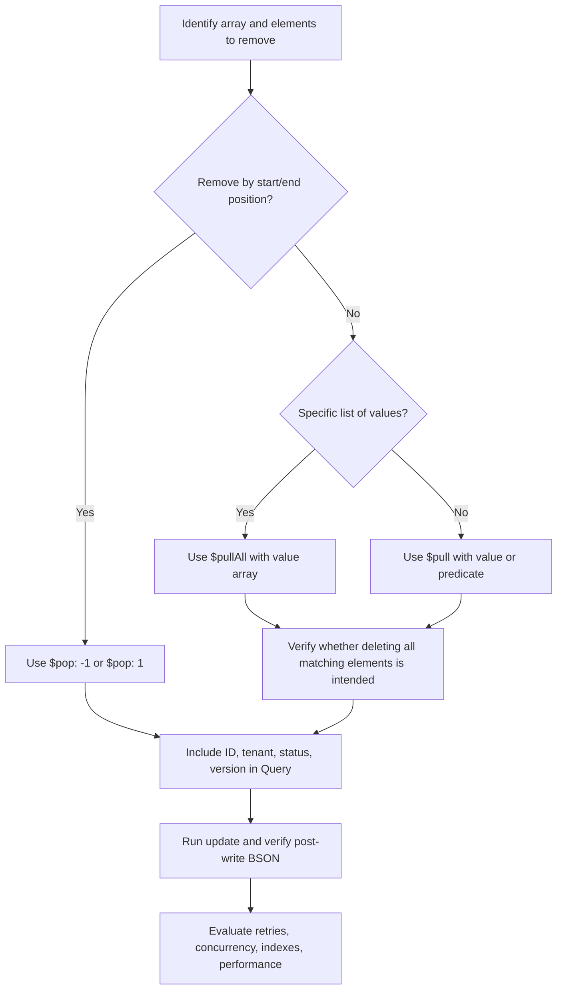

# pull, pullAll, and pop

In MongoDB, a document can contain multiple **arrays**: product tags (`tags`), handled error codes (`errorCodes`), shopping cart items (`items`), or a short list of events (`recentEvents`). When you need to remove elements, replacing the entire array by loading the entity, modifying the `List` in Java, and calling `save` is usually not ideal: between the read and write, another request may have added or modified elements, leading to overwritten data.

**Spring Data MongoDB** provides `MongoTemplate` and `Update` to send array operators directly to MongoDB. Three key operators serve distinct purposes:

- **`$pull`**: removes **all elements** matching a value or condition.
- **`$pullAll`**: removes **all occurrences** of **each value** in a specified list.
- **`$pop`**: removes **one element** from the **beginning** or **end** of an array by position, regardless of content.

This lesson belongs to the **Array Operations** chapter and focuses on BSON behavior, `mongosh` syntax, equivalent `MongoTemplate` APIs, conditional queries, optimistic locking, testing, and performance diagnostics. These techniques let you modify documents accurately without replacing whole entities, while still requiring proper authorization, state checks, and business consistency.

After this lesson, you will be able to:

1. Clearly distinguish `$pull`, `$pullAll`, and `$pop` with concrete data and expected outputs.
2. Use `$pull` with scalar values and embedded-document predicates.
3. Use `$pullAll` with multiple values and understand how it differs from `$pull` with `$in`.
4. Use `$pop: -1` and `$pop: 1` to remove the first or last element.
5. Write equivalent operations using `Update.pull`, `Update.pullAll`, and `Update.pop` with `MongoTemplate`.
6. Enforce tenant, ID, status, and version predicates in the same update command.
7. Identify idempotent operations, retry risks, duplicate elements, race conditions, and index shifts.
8. Test BSON contents, element order, and `matchedCount`/`modifiedCount` accurately.

## 1. Data Model and Array Principles

Suppose we have a test cart document:

```javascript
{
  _id: ObjectId("665f1f2a4b6c7d8e9f001234"),
  tenantId: "T1",
  status: "DRAFT",
  tags: ["sale", "new", "sale", "outdated"],
  errorCodes: ["E01", "E02", "E01", "E03"],
  items: [
    { lineId: "L1", sku: "BK-01", quantity: 2 },
    { lineId: "L2", sku: "PEN-01", quantity: 5 },
    { lineId: "L3", sku: "BK-01", quantity: 1 }
  ],
  recentEvents: ["created", "item-added", "coupon-applied"]
}
```

MongoDB stores `tags`, `errorCodes`, `items`, and `recentEvents` as **BSON arrays**. Arrays are ordered and may contain duplicate elements. MongoDB does not treat `tags` as a `Set` by default.

| Scenario | Intent | Operator |
| --- | --- | --- |
| Remove **all** `sale` tags, even duplicates | Filter by value | `$pull` |
| Remove both `E01` and `E03` everywhere | Target list of values | `$pullAll` |
| Remove all line items with `sku = BK-01` | Condition on fields of each element | `$pull` |
| Drop the oldest event at the front | Remove by first position | `$pop: -1` |
| Drop the last event | Remove by last position | `$pop: 1` |
| Remove only **one** copy of X among duplicate X elements | Not directly supported by `$pull`/`$pullAll` | Requires a controlled strategy using element IDs or positions |

**Key takeaway:** `$pull` and `$pullAll` do not remove “the first matching element”; they remove **every matching element** in the array. `$pop` always targets one end of the array and never searches by value.

## 2. `$pull`: Removing All Elements by Value or Condition

### 2.1. Removing All Occurrences of a Scalar

Example array:

```javascript
tags: ["sale", "new", "sale", "outdated"]
```

Command:

```javascript
db.cart_array_lab.updateOne(
  { _id: cartId, tenantId: trustedTenantId, status: "DRAFT" },
  { $pull: { tags: "sale" } }
);
```

Expected result:

```javascript
tags: ["new", "outdated"]
```

**Both** `"sale"` values are removed. The remaining elements preserve their relative order in the array. There is no need to look up the index of each occurrence.

`$pull` is well suited for cleaning tags, removing a code from a list, removing child records by status, or dropping embedded documents matching a condition.

### 2.2. Removing Numbers Matching a Comparison

```javascript
// Example document has scores: [45, 60, 90, 75, 100].
db.test_scores.updateOne(
  { _id: scoreDocumentId },
  { $pull: { scores: { $lt: 60 } } }
);
// Result: scores = [60, 90, 75, 100].
```

`{ $lt: 60 }` is a **predicate** applied to each element in `scores`. It does not mean “remove elements at index less than 60”.

Query operators like `$gt`, `$gte`, `$lte`, `$in`, and `$nin` can be used when appropriate for the BSON type and desired condition. For monetary amounts, timestamps, or IDs, ensure the BSON type matches before comparing.

### 2.3. `$pull` on an Array of Embedded Documents

Suppose:

```javascript
items: [
  { lineId: "L1", sku: "BK-01", quantity: 2 },
  { lineId: "L2", sku: "PEN-01", quantity: 5 },
  { lineId: "L3", sku: "BK-01", quantity: 1 }
]
```

To remove lines sharing a `sku`:

```javascript
db.cart_array_lab.updateOne(
  { _id: cartId, tenantId: trustedTenantId, status: "DRAFT" },
  { $pull: { items: { sku: "BK-01" } } }
);
```

Only this remains:

```javascript
items: [
  { lineId: "L2", sku: "PEN-01", quantity: 5 }
]
```

**Important note:** `{ sku: "BK-01" }` matches **every embedded document with that `sku`**, even though the object also has `lineId`, `quantity`, and other fields. If a cart has multiple lines with the same SKU and each line has an independent lifecycle, remove **by unique `lineId`**, not by SKU:

```javascript
{
  $pull: {
    items: { lineId: "L1" }
  }
}
```

This condition deletes only line `lineId = L1` provided that value is genuinely unique in the array. Uniqueness inside an array does not automatically exist just because Java code names a field `lineId`; enforce data invariants/validation.

### 2.4. Multiple Conditions Must Match on the **Same Element**

```javascript
db.cart_array_lab.updateOne(
  { _id: cartId, tenantId: trustedTenantId },
  {
    $pull: {
      items: {
        sku: "BK-01",
        quantity: { $lte: 1 }
      }
    }
  }
);
```

MongoDB evaluates both `sku` and `quantity` against **the same embedded document** in `items`. On the unmodified data from section 2.3, only line L3 is removed while L1 (`quantity = 2`) is kept.

You do not need to wrap an element's predicates in `$elemMatch` inside `$pull`. The `$pull` operator already evaluates the condition against **each array element** to decide which ones to remove.

### 2.5. Using `$in` for a Set of Values

```javascript
db.cart_array_lab.updateOne(
  { _id: cartId, tenantId: trustedTenantId },
  {
    $pull: {
      tags: { $in: ["sale", "outdated"] }
    }
  }
);
```

For an array of String scalars, this removes all `sale` and `outdated` entries, matching the intent of `$pullAll` with those two values. However, `$pull` can also express **predicates** such as `$lte`, embedded-document conditions, and more complex filter expressions.

### 2.6. Do Not Confuse the Document Filter with the Element-Removal Condition

An update command has two layers of conditions:

```javascript
db.cart_array_lab.updateOne(
  {
    tenantId: "T1",
    status: "DRAFT",
    "items.sku": "BK-01"
  },
  {
    $pull: { items: { sku: "BK-01" } }
  }
);
```

- Query `{ tenantId, status, "items.sku" }` selects which **parent document** to update.
- `$pull: { items: { sku: "BK-01" } }` selects which **array elements** to remove.

If the filter checks `"items.sku": "BK-01"` while the update runs `$pull: { tags: "sale" }`, MongoDB will remove the `sale` tag from carts containing that SKU — not remove the SKU from `items`. Always review **both layers** before executing.

## 3. `$pullAll`: Removing All Occurrences of Multiple Values

### 3.1. Syntax and Behavior

Given:

```javascript
errorCodes: ["E01", "E02", "E01", "E03"]
```

Command:

```javascript
db.cart_array_lab.updateOne(
  { _id: cartId, tenantId: trustedTenantId },
  {
    $pullAll: {
      errorCodes: ["E01", "E03"]
    }
  }
);
```

Result:

```javascript
errorCodes: ["E02"]
```

`$pullAll` accepts an **array of values to remove**; it removes every element equal to any of those values. Because `E01` appears twice, both are removed. The order of values in the `$pullAll` input list does not dictate removal order.

### 3.2. Comparing `$pullAll` and `$pull` with `$in`

```javascript
// Exact list of scalar values:
{ $pullAll: { tags: ["sale", "outdated"] } }

// $in condition on each value:
{ $pull: { tags: { $in: ["sale", "outdated"] } } }
```

For a String array `tags`, both aim to remove every `sale` and `outdated`. Still, by design:

| `$pullAll` | `$pull` |
| --- | --- |
| List of values to remove | A single value or **predicate** identifying elements to remove |
| Best for scalar arrays with known target values | Suitable for scalars and embedded documents with predicates |
| Not for expressing `quantity <= 0` as a filter | Supports `{ quantity: { $lte: 0 } }` on objects in arrays |
| Removes all occurrences of target values | Removes all elements matching the predicate |

Do not pass a query operator document such as `{ $lte: 0 }` as a “value” to `$pullAll` expecting it to act like `$pull`. `$pullAll` matches **values in a list**, rather than interpreting list items as arbitrary query conditions.

### 3.3. Embedded Documents and the Equality Problem

When removing child objects by a field such as `sku`, use `$pull` with a predicate:

```javascript
{ $pull: { items: { sku: "BK-01" } } }
```

`$pullAll` should not be the first choice for complex embedded documents. To use it, you must match the **exact object value**, including BSON shape; differences in extra fields or representation can prevent expected matches. `$pull` by `lineId` or an appropriate business field is generally more resilient as schemas evolve.

### 3.4. Empty Input Collections and Validation

A service might receive a list of tags to remove from an API. If the list is empty, the clearest handling is **not calling update**, returning a “nothing changed” result. This avoids relying on operator edge-case behavior with empty operands across MongoDB versions.

For lists from requests, bound the number of elements, the length of each value, allowed values, and deduplicate the **input list** when duplicates are unnecessary. Those guards reduce load and make the API contract explicit.

## 4. `$pop`: Removing Exactly One Element at the Start or End

### 4.1. Removing the Last Element

```javascript
recentEvents: ["created", "item-added", "coupon-applied"]
```

```javascript
db.cart_array_lab.updateOne(
  { _id: cartId, tenantId: trustedTenantId },
  { $pop: { recentEvents: 1 } }
);
// Result: ["created", "item-added"]
```

The value `1` means **remove the last element**. It does not mean “remove an element equal to 1”.

### 4.2. Removing the First Element

```javascript
db.cart_array_lab.updateOne(
  { _id: cartId, tenantId: trustedTenantId },
  { $pop: { recentEvents: -1 } }
);
// On the original array: ["item-added", "coupon-applied"].
```

The value `-1` means **remove the first element**. The result above assumes running this command **on the original array**, not after the tail-removal in section 4.1.

### 4.3. How Does `$pop` Differ from `$pull`?

| Input Data | Operation | Result |
| --- | --- | --- |
| `["A","B","A"]` | `$pull: { tags: "A" }` | `["B"]` |
| `["A","B","A"]` | `$pullAll: { tags: ["A"] }` | `["B"]` |
| `["A","B","A"]` | `$pop: { tags: 1 }` | `["A","B"]` |
| `["A","B","A"]` | `$pop: { tags: -1 }` | `["B","A"]` |

`$pop` cannot remove “the first element equal to A” while keeping the trailing A if A sits in the middle of the array. It only targets **one end** of the array. If you must select by condition, model each element with an ID or choose a suitable design; never pick `$pop` just because you want to delete “one” element.

### 4.4. Do Not Treat `$pop` as a Complete Reliable Queue/Stack

An array can mimic a short queue, but `$pop` **does not return the removed element's content**. If multiple workers need to “claim an element and process it”, calling `$pop` alone does not tell the worker which element it popped, nor does it solve retries or auditing.

If you need atomic “claim and mark a job” by condition, consider a collection of individual job documents with `findAndModify` or a dedicated workflow. For short in-document history, `$pop` can be useful to trim the head/tail according to retention rules.

## 5. Behavior When the Array Is Empty, Missing, or Wrong BSON Type

MongoDB array update operators operate on **BSON arrays**, not arbitrary types.

| Field State | Behavior with `$pull`/`$pullAll`/`$pop` |
| --- | --- |
| Array with matching elements | Removes per operator rules |
| Array with elements, none matching `$pull`/`$pullAll` | Removes nothing |
| Empty array `[]` | Nothing to remove; usually leaves document unchanged |
| Field does not exist | No array to remove from; normally no change |
| Field is scalar String, Number, or object instead of array | Can be rejected because path is not an array; inspect data |
| Array contains `null` or mixed BSON types | Matching depends on BSON type and operator; do not guess from JSON display |

If a collection has inconsistent historical data, inspect first with `$type`:

```javascript
db.cart_array_lab.aggregate([
  {
    $group: {
      _id: { tagsType: { $type: "$tags" } },
      documents: { $sum: 1 }
    }
  }
]);
```

If `tags` is a String in some documents and an array in others, do not run a bulk update assuming all records succeed. Plan a migration or validation to normalize the schema.

### Duplicate Elements Are Not an Error in MongoDB

`["sale","sale"]` is a valid array. If the domain requires each tag to appear once, protect the invariant on the **write path**, such as considering `$addToSet` instead of `$push` when adding tags, alongside auditing legacy data. `$pull` cleans existing duplicates, but it does not stop future requests from adding duplicate tags again.

## 6. Mapping Arrays to Java with Spring Data MongoDB

A sample entity using a separate collection for experimentation:

```java
import java.util.ArrayList;
import java.util.List;
import org.bson.types.ObjectId;
import org.springframework.data.annotation.Id;
import org.springframework.data.annotation.Version;
import org.springframework.data.mongodb.core.mapping.Document;

@Document(collection = "cart_array_lab")
public class CartDocument {
    @Id
    private ObjectId id;

    private String labRun;
    private String tenantId;
    private String status;
    private List<String> tags = new ArrayList<>();
    private List<String> errorCodes = new ArrayList<>();
    private List<CartLine> items = new ArrayList<>();
    private List<String> recentEvents = new ArrayList<>();

    @Version
    private Long version;

    protected CartDocument() {}

    public CartDocument(
            String labRun,
            String tenantId,
            String status,
            List<String> tags,
            List<String> errorCodes,
            List<CartLine> items,
            List<String> recentEvents) {
        this.labRun = labRun;
        this.tenantId = tenantId;
        this.status = status;
        this.tags = tags;
        this.errorCodes = errorCodes;
        this.items = items;
        this.recentEvents = recentEvents;
    }

    public ObjectId getId() { return id; }
    public String getLabRun() { return labRun; }
    public String getTenantId() { return tenantId; }
    public String getStatus() { return status; }
    public List<String> getTags() { return tags; }
    public List<String> getErrorCodes() { return errorCodes; }
    public List<CartLine> getItems() { return items; }
    public List<String> getRecentEvents() { return recentEvents; }
    public Long getVersion() { return version; }

    public static class CartLine {
        private String lineId;
        private String sku;
        private int quantity;

        protected CartLine() {}

        public CartLine(
                String lineId,
                String sku,
                int quantity) {
            this.lineId = lineId;
            this.sku = sku;
            this.quantity = quantity;
        }

        public String getLineId() { return lineId; }
        public String getSku() { return sku; }
        public int getQuantity() { return quantity; }
    }
}
```

`List<String>` generally maps to a BSON array of Strings, and `List<CartLine>` maps to a BSON array of embedded documents. `@Id` maps Java `id` to `_id` in MongoDB. `@Version` enables Spring Data write paths that support it to manage optimistic locking/version increments; verify exact version-update behavior in your project's Spring Data MongoDB version.

**You do not have to load the entire entity just to remove one element.** With `MongoTemplate`, you can build a `Query` and `Update` and send the command directly to MongoDB. This reduces the risk of overwriting other fields compared to reading `List`, editing it in Java, and calling `save` to replace the document.

## 7. `MongoTemplate.Update.pull` — Removing by Value or Condition

### 7.1. Removing a Tag by String Value

```java
import com.mongodb.client.result.UpdateResult;
import org.bson.types.ObjectId;
import org.springframework.data.mongodb.core.MongoTemplate;
import org.springframework.data.mongodb.core.query.Criteria;
import org.springframework.data.mongodb.core.query.Query;
import org.springframework.data.mongodb.core.query.Update;

public UpdateResult removeTag(
        MongoTemplate template,
        ObjectId cartId,
        String trustedTenantId,
        String tag) {

    Query scope = Query.query(
        Criteria.where("id").is(cartId)
            .and("tenantId").is(trustedTenantId)
            .and("status").is("DRAFT")
    );

    Update change = new Update().pull("tags", tag);

    return template.updateFirst(
        scope, change, CartDocument.class
    );
}
```

With `tag = "sale"`, the update part is equivalent to:

```javascript
{ $pull: { tags: "sale" } }
```

Every `"sale"` element is removed. `Update.pull` accepts Java values and **does not parse raw JSON into a query**. Thus a user supplying `{"$ne":"sale"}` remains a literal String when passed as `String`; it does not turn into a `$ne` operator.

Still, validate `tag` length, format, and allowed values per business rules. Safe parameter binding and business validation are two separate responsibilities.

### 7.2. Removing a Line by `lineId`

For an array of embedded documents, construct a server-side BSON predicate:

```java
import org.bson.Document;

public UpdateResult removeLine(
        MongoTemplate template,
        ObjectId cartId,
        String trustedTenantId,
        String lineId) {

    Query scope = Query.query(
        Criteria.where("id").is(cartId)
            .and("tenantId").is(trustedTenantId)
            .and("status").is("DRAFT")
    );

    Update change = new Update().pull(
        "items",
        new Document("lineId", lineId)
    );

    return template.updateFirst(
        scope, change, CartDocument.class
    );
}
```

Here `lineId` is a String value and the field name `lineId` is fixed in code. `Document` is constructed from validated values, not `Document.parse(...)` on arbitrary client JSON.

**Mapping note:** when building a predicate inside `$pull` with a raw `Document`, use the **actual BSON field name of the child field**. If `CartLine.lineId` is stored under `@Field("line_id")`, check mapping results and adjust the predicate for the BSON schema rather than assuming raw `Document("lineId", ...)` gets renamed like a Java property path. Integration tests verify this.

### 7.3. Removing Lines with Zero or Negative Quantity

```java
Update clearEmptyLines = new Update().pull(
    "items",
    new Document("quantity", new Document("$lte", 0))
);

UpdateResult result = template.updateFirst(
    Query.query(
        Criteria.where("id").is(cartId)
            .and("tenantId").is(trustedTenantId)
            .and("status").is("DRAFT")
    ),
    clearEmptyLines,
    CartDocument.class
);
```

The predicate `quantity <= 0` is evaluated on each object in `items`. If the array contains multiple matching lines, **all** are removed in one update on the parent document.

A pitfall to avoid: removing lines with `quantity <= 0` via `$pull` does not replace **preventing negative quantities on write**. It is a cleanup operation for existing items, not a complete inventory rule.

## 8. `MongoTemplate.Update.pullAll` — Specific List of Values

In Spring Data MongoDB, `Update.pullAll` accepts an array of Java values. Example:

```java
public UpdateResult removeErrorCodes(
        MongoTemplate template,
        ObjectId cartId,
        String trustedTenantId) {

    Query scope = Query.query(
        Criteria.where("id").is(cartId)
            .and("tenantId").is(trustedTenantId)
            .and("status").is("DRAFT")
    );

    Update change = new Update().pullAll(
        "errorCodes",
        new Object[] { "E01", "E03" }
    );

    return template.updateFirst(
        scope, change, CartDocument.class
    );
}
```

Update BSON portion:

```javascript
{
  $pullAll: {
    errorCodes: ["E01", "E03"]
  }
}
```

This removes all occurrences of `E01` and `E03`, regardless of the order in which they appear.

### 8.1. When Input Is an API List

```java
import java.util.Collection;
import java.util.LinkedHashSet;

public Update createRemoveTagsUpdate(
        Collection<String> requestedTags) {

    if (requestedTags == null || requestedTags.isEmpty()) {
        throw new IllegalArgumentException(
            "At least one tag is required for removal"
        );
    }
    if (requestedTags.size() > 20) {
        throw new IllegalArgumentException(
            "Cannot remove more than 20 tags in one request"
        );
    }

    for (String tag : requestedTags) {
        if (tag == null || tag.isBlank() || tag.length() > 40) {
            throw new IllegalArgumentException(
                "Invalid tag"
            );
        }
    }

    Object[] tags = new LinkedHashSet<>(requestedTags).toArray();
    return new Update().pullAll("tags", tags);
}
```

This is a helper that constructs an `Update`, without calling MongoDB itself. In the service, you still build a Query with the ID and trusted tenant, then call `template.updateFirst(...)`. Deduplicating the **input** does not change the semantics of removing all occurrences of those tags from the BSON array.

### 8.2. When to Switch to `$pull` with `$in`?

If a service adds conditions such as “remove codes in set A **and** matching an object property”, `$pullAll` cannot express that. For scalar arrays, `$pull` with `$in` accepts the same list; for embedded documents, write an explicit field predicate.

Avoid passing an `Object[]` of query-operator `Document` objects to `pullAll` as if each `Document` were a condition. They are treated as **values** to match under `$pullAll` semantics.

## 9. `MongoTemplate.Update.pop` — Removing from Either End

Spring Data MongoDB supports `Update.Position.FIRST` and `Update.Position.LAST` to indicate the removal end:

```java
public UpdateResult discardOldestEvent(
        MongoTemplate template,
        ObjectId cartId,
        String trustedTenantId) {

    Query scope = Query.query(
        Criteria.where("id").is(cartId)
            .and("tenantId").is(trustedTenantId)
            .and("status").is("DRAFT")
    );

    Update change = new Update().pop(
        "recentEvents", Update.Position.FIRST
    );

    return template.updateFirst(
        scope, change, CartDocument.class
    );
}
```

Equivalent to:

```javascript
{ $pop: { recentEvents: -1 } }
```

To remove the last element:

```java
Update change = new Update().pop(
    "recentEvents", Update.Position.LAST
);
```

Equivalent to:

```javascript
{ $pop: { recentEvents: 1 } }
```

**Do not confuse** `Update.Position.FIRST` with `index = 0` in general query paths: in this API it specifically instructs `$pop` at the start of the array. Likewise, `LAST` means the end of the array, not the element with the largest value.

### 9.1. Avoiding Uncontrolled `$pop` Retries

For array `["created", "updated", "confirmed"]`:

```text
pop FIRST attempt 1 -> ["updated", "confirmed"]
pop FIRST attempt 2 -> ["confirmed"]
```

Two consecutive `$pop` calls drop **two** elements. If a client times out and resends **a new business request** without an idempotency key or guard condition, the result can deviate from intent.

MongoDB Driver retryable writes have rules to avoid applying the same recognized retried command twice, but that **does not mean** every retry at the HTTP/service layer is automatically recognized as the same operation. If you need “remove only once per request”, design an idempotency key, expected state/version, or element-ID operation.

### 9.2. `$pop` Does Not Return the Removed Element

`MongoTemplate.updateFirst(...)` returns `UpdateResult`, not the popped element. If the requirement is “fetch the first event to process and remove it”, `$pop` alone does not return it. Do not read the first element in a separate query, call `$pop`, and assume the removed item is the one you read: concurrent writes can change the head of the array.

For reliable job queues, you typically need a dedicated document collection and a `findAndModify` claim operation or proper queue infrastructure.

## 10. Update Results: `matchedCount`, `modifiedCount`, and Version

When calling `MongoTemplate.updateFirst`:

```java
UpdateResult result = template.updateFirst(
    scope,
    new Update().pull("tags", "sale"),
    CartDocument.class
);

if (!result.wasAcknowledged()) {
    throw new IllegalStateException(
        "Write concern did not acknowledge the result"
    );
}

long matched = result.getMatchedCount();
long modified = result.getModifiedCount();
```

| Metric | Interpretation |
| --- | --- |
| `matchedCount = 0` | No parent document matched the query (wrong ID, tenant, or status) |
| `matchedCount = 1` | One parent document matched the `updateFirst` filter |
| `modifiedCount = 0` | No document was recorded as modified by the update command |
| `modifiedCount = 1` | One document was modified; does **not** mean exactly one array element was removed |

A single `$pull` can remove **multiple elements** in **one document**, yet `modifiedCount` is still 1. `UpdateResult` does not directly report “how many array elements were deleted”. To inspect contents, re-read the document or use appropriate test assertions.

### 10.1. Impact of `@Version`

Suppose `CartDocument` uses `@Version`. In Spring Data update paths that manage versioning, the version may be auto-incremented when absent from `Update`; a `$pull` that finds no matching element can still **modify the document due to the version increment**.

Therefore:

- **Do not** treat `modifiedCount = 1` as proof that an array element was removed.
- If the client sends `expectedVersion`, include it in the query to verify the read version:

```java
Query scope = Query.query(
    Criteria.where("id").is(cartId)
        .and("tenantId").is(trustedTenantId)
        .and("status").is("DRAFT")
        .and("version").is(expectedVersion)
);

UpdateResult result = template.updateFirst(
    scope, new Update().pull("tags", tag),
    CartDocument.class
);
```

When matchedCount is 0, the cause could be a missing document, insufficient permissions, disallowed status, or a changed version. Handle conflicts per API policy without leaking whether a document exists in another tenant.

With `Query`-based updates, having the framework **increment version** and having it **compare the client's expected version** are two different things. Put version into the Query if you need compare-and-set; do not assume an `@Version` field on the class automatically enforces the client's seen version on every update command.

### 10.2. Idempotency: Account for Both Filters and Metadata

On an **idle** array considering only array contents:

- Repeating `$pull` with the same value/condition: after the first run, no matching elements remain.
- Repeating `$pullAll` with the same list: after the first run, none of those values remain.
- Repeating `$pop`: keeps removing one more element each time until the array is empty.

However, if the overall update also **increments version**, **updates `updatedAt`**, or another worker can re-add elements between calls, retrying `$pull`/`$pullAll` is not strictly side-effect-free on the system. Separate **operator idempotency on array content** from **idempotency of the full business API**.

## 11. `mongosh` Lab: Comparing All Three Operators on Isolated Data

The goal is to observe each outcome without affecting anyone else's data. These commands use database `spring_data_training` and collection `cart_array_lab`, generating a unique `labRun` marker per session.

### 11.1. Creating the Data

Open `mongosh` connected to a **test** MongoDB instance and run:

```javascript
use spring_data_training

const lab = db.getCollection("cart_array_lab");
const labRun = "array-operations-004-" + new ObjectId().toHexString();
const tenant1 = labRun + "-T1";
const tenant2 = labRun + "-T2";

const ownCart = lab.insertOne({
  labRun: labRun,
  tenantId: tenant1,
  status: "DRAFT",
  tags: ["sale", "new", "sale", "outdated"],
  errorCodes: ["E01", "E02", "E01", "E03"],
  items: [
    { lineId: "L1", sku: "BK-01", quantity: 2 },
    { lineId: "L2", sku: "PEN-01", quantity: 5 },
    { lineId: "L3", sku: "BK-01", quantity: 1 }
  ],
  recentEvents: ["created", "item-added", "coupon-applied"]
});

const anotherTenant = lab.insertOne({
  labRun: labRun,
  tenantId: tenant2,
  status: "DRAFT",
  tags: ["sale"],
  errorCodes: ["E01"],
  items: [{ lineId: "L9", sku: "BK-01", quantity: 3 }],
  recentEvents: ["created"]
});

const finalCart = lab.insertOne({
  labRun: labRun,
  tenantId: tenant1,
  status: "CONFIRMED",
  tags: ["sale"],
  errorCodes: ["E03"],
  items: [],
  recentEvents: ["created", "confirmed"]
});

const cartId = ownCart.insertedId;

printjson({
  labRun: labRun,
  tenant1: tenant1,
  tenant2: tenant2,
  cartId: cartId
});

print(lab.countDocuments({ labRun: labRun })); // Expected: 3.
```

Continue running the commands in **the same `mongosh` session** to preserve `lab`, `labRun`, `tenant1`, `tenant2`, and `cartId`.

### 11.2. `$pull` All Duplicate Tags

```javascript
const pullResult = lab.updateOne(
  {
    _id: cartId,
    labRun: labRun,
    tenantId: tenant1,
    status: "DRAFT"
  },
  { $pull: { tags: "sale" } }
);

printjson({
  matchedCount: pullResult.matchedCount,
  modifiedCount: pullResult.modifiedCount
});
printjson(lab.findOne(
  { _id: cartId },
  { _id: 0, tags: 1 }
));
// Expected: tags = ["new", "outdated"].
```

Both occurrences of `sale` are removed in one command. `modifiedCount = 1` indicates the document was modified, **not** “one element was deleted”. You can inspect before/after element counts via separate raw reads in the exercise.

### 11.3. `$pullAll` Multiple Error Codes

```javascript
const pullAllResult = lab.updateOne(
  { _id: cartId, labRun: labRun, tenantId: tenant1 },
  {
    $pullAll: {
      errorCodes: ["E01", "E03"]
    }
  }
);

printjson(pullAllResult);
printjson(lab.findOne(
  { _id: cartId },
  { _id: 0, errorCodes: 1 }
));
// Expected: errorCodes = ["E02"].
```

If you again remove `E01` or `E03` from an array that no longer contains them, the array has nothing left to change. On this raw update (without Spring Data's automatic version bump), `modifiedCount` is normally 0.

### 11.4. `$pull` with Conditions on Embedded Documents

Remove only line L1:

```javascript
lab.updateOne(
  { _id: cartId, labRun: labRun, tenantId: tenant1 },
  {
    $pull: {
      items: { lineId: "L1" }
    }
  }
);

printjson(lab.findOne(
  { _id: cartId },
  { _id: 0, items: 1 }
));
// Remaining: L2 (PEN-01) and L3 (BK-01).
```

Then remove SKU BK-01 lines with low quantity:

```javascript
lab.updateOne(
  { _id: cartId, labRun: labRun, tenantId: tenant1 },
  {
    $pull: {
      items: {
        sku: "BK-01",
        quantity: { $lte: 1 }
      }
    }
  }
);

printjson(lab.findOne(
  { _id: cartId },
  { _id: 0, items: 1 }
));
// Expected: only line L2 remains.
```

This example shows `sku` and `quantity` evaluated together on each array object. Other fields on the parent document are not overwritten by a full save.

### 11.5. `$pop` Head and Tail

```javascript
lab.updateOne(
  { _id: cartId, labRun: labRun, tenantId: tenant1 },
  { $pop: { recentEvents: -1 } }
);

printjson(lab.findOne(
  { _id: cartId },
  { _id: 0, recentEvents: 1 }
));
// Expected: ["item-added", "coupon-applied"].

lab.updateOne(
  { _id: cartId, labRun: labRun, tenantId: tenant1 },
  { $pop: { recentEvents: 1 } }
);

printjson(lab.findOne(
  { _id: cartId },
  { _id: 0, recentEvents: 1 }
));
// Expected: ["item-added"].
```

If you run another `$pop: -1`, `item-added` is removed and the array becomes empty. Subsequent `pop` calls have no elements left to remove; the application should proactively decide when to stop.

### 11.6. Verifying Tenant and Status Guards

Attempt to remove `sale` from the CONFIRMED document:

```javascript
const blockedByStatus = lab.updateOne(
  {
    _id: finalCart.insertedId,
    labRun: labRun,
    tenantId: tenant1,
    status: "DRAFT"
  },
  { $pull: { tags: "sale" } }
);

printjson({
  matchedCount: blockedByStatus.matchedCount,
  modifiedCount: blockedByStatus.modifiedCount
});
// Expected: 0, 0. CONFIRMED status does not match.
```

Attempt a wrong-tenant query:

```javascript
const blockedByTenant = lab.updateOne(
  {
    _id: anotherTenant.insertedId,
    labRun: labRun,
    tenantId: tenant1
  },
  { $pull: { tags: "sale" } }
);

printjson({
  matchedCount: blockedByTenant.matchedCount,
  modifiedCount: blockedByTenant.modifiedCount
});
// Expected: 0, 0. This document belongs to tenant2.

printjson(lab.findOne(
  { _id: anotherTenant.insertedId },
  { _id: 0, tenantId: 1, tags: 1 }
));
// tags is still ["sale"].
```

**Note:** in a real system, `tenant1` must never be taken directly from unverified input. When handling a request for T1, the service extracts the tenant from a verified session/token and puts it into the MongoDB filter.

### 11.7. Inspecting BSON Types of the Arrays

```javascript
lab.aggregate([
  { $match: { _id: cartId } },
  {
    $project: {
      _id: 0,
      tagsType: { $type: "$tags" },
      itemsType: { $type: "$items" },
      eventsType: { $type: "$recentEvents" },
      tagCount: { $size: "$tags" },
      lineCount: { $size: "$items" }
    }
  }
]);
// Expected: types = "array", tagCount = 2, lineCount = 1.
```

`$size` in aggregation requires an array operand; if data has the wrong type, use validation or type-checking expressions first. This example applies only to `cartId` created with the standard schema.

### 11.8. Cleaning Up Only This Session's Data

```javascript
const beforeCleanup = lab.countDocuments({ labRun: labRun });
print("Documents to clean up: " + beforeCleanup);

const deleted = lab.deleteMany({ labRun: labRun });
printjson({ deletedCount: deleted.deletedCount });

print(lab.countDocuments({ labRun: labRun })); // 0.
```

Cleanup removes only the **three documents created in this session** assuming no other documents share the marker. Do not replace `{ labRun: labRun }` with `{}` and never call `drop()` on a shared collection.

## 12. Atomicity, Concurrency, and Business Limits

### 12.1. One Document: Array Updates Are Atomic

A command:

```javascript
db.cart_array_lab.updateOne(
  { _id: cartId, tenantId: trustedTenantId, status: "DRAFT" },
  {
    $pull: {
      tags: "sale"
    }
  }
);
```

is applied atomically by MongoDB to the **parent document**. Array elements are removed within the same document operation, with no intermediate state of that `$pull` where another query sees half of the array updated.

However, **an atomic operation on one document** does not make a multi-document or multi-collection workflow transactional. When synchronizing a cart with inventory, orders, or audit records in other collections, design appropriate consistency, transactions, or compensating mechanisms.

### 12.2. Do Not Load and Rewrite the Entire List Just to Delete One Element

Pattern prone to lost updates:

```java
// RISK ILLUSTRATION; not recommended for simple updates.
CartDocument cart = template.findById(
    cartId, CartDocument.class
);
cart.getTags().removeIf("sale"::equals);
template.save(cart);
```

Between `findById` and `save`, another request can add a tag or modify the list. `save` replaces/writes the document from the loaded entity, risking lost updates without optimistic locking/concurrency control. By contrast, `Update.pull` acts directly on the array when MongoDB executes the operation.

If business logic must recalculate multiple fields with complex rules, you may need an update pipeline, compare-and-set, version checks, or transactions; do not force `$pull` to fit every kind of mutation.

### 12.3. Array Element Indexes Shift After Removal

An array is an ordered list. Removing an element shifts subsequent element indexes:

```text
Before: [L1, L2, L3]  (index 0, 1, 2)
Remove L1
After:  [L2, L3]      (index 0, 1)
```

If a client holds `index = 1` while another request removes L1, the client may accidentally modify **L3** instead of L2. For elements with independent identities, assign an immutable `lineId` and filter by that ID. Avoid treating array positions as durable identifiers.

### 12.4. Array Queries vs. Array Updates Are Different Behaviors

`$elemMatch` is typically used to **select parent documents** containing an array element matching multiple criteria. `$pull` uses a condition to **remove elements**. To find carts containing a line with `sku = BK-01` and `quantity <= 1` on the **same line**, a query can use:

```javascript
db.cart_array_lab.find({
  items: {
    $elemMatch: {
      sku: "BK-01",
      quantity: { $lte: 1 }
    }
  }
});
```

Whereas when removing:

```javascript
{
  $pull: {
    items: {
      sku: "BK-01",
      quantity: { $lte: 1 }
    }
  }
}
```

Distinguish them clearly so you do not write an overly broad document-selection query or an update that drops unintended elements.

### 12.5. Do Not Use `$pop` Where Specific Removal Confirmation Is Needed

For instance, a worker needs to claim “job A” from a queue. `$pop` only removes from the head/tail and does not return the job; another worker could prepend a job or alter structure mid-workflow. When elements require identity, choose a storage model with per-item status/IDs and conditional claim commands. For an event history keeping only the latest N items, consider a bounded array design and appropriate retention policy.

## 13. Indexes, Performance, and Multi-Document Updates

### 13.1. Selecting Target Documents Before Inspecting Array Elements

With many carts in a tenant, you can find documents containing a SKU:

```javascript
db.cart_array_lab.find({
  tenantId: "T1",
  status: "DRAFT",
  "items.sku": "BK-01"
});
```

A compound index to evaluate:

```javascript
db.cart_array_lab.createIndex(
  {
    tenantId: 1,
    status: 1,
    "items.sku": 1
  },
  { name: "idx_tenant_status_sku" }
);
```

Because `items.sku` is inside an array of embedded documents, the index is a **multikey index**. It helps MongoDB identify documents **having a matching element** in many cases, though the engine still inspects array elements in the matched document when executing `$pull`.

Before creating an index, evaluate query frequency, selectivity of tenant/status/SKU, array size, and index maintenance overhead on writes. Do not index every field simply because it appears in JSON.

### 13.2. `explain` Checks the Equivalent Read Condition

```javascript
db.cart_array_lab.find({
  tenantId: "ACTUAL_TENANT",
  status: "DRAFT",
  "items.sku": "BK-01"
}).explain("executionStats");
```

Inspect `winningPlan`, `totalKeysExamined`, `totalDocsExamined`, `nReturned`, and scan stages. A three-document dataset is insufficient to conclude an index is optimal in production. For updates, beyond finding documents quickly, factor in BSON rewrite cost, index updates, replication, write volume, and concurrency impact.

### 13.3. `updateMulti` Is Not an All-or-Nothing Transaction

To clean the `deprecated` tag from **all** DRAFT carts of T1:

```java
Query scope = Query.query(
    Criteria.where("tenantId").is(trustedTenantId)
        .and("status").is("DRAFT")
);

UpdateResult result = template.updateMulti(
    scope,
    new Update().pull("tags", "deprecated"),
    CartDocument.class
);
```

`updateMulti` can affect many documents; each single-document operation is individually atomic, but **the entire set of documents is not automatically committed/rolled back as a transaction**. Handle partial failures, mid-run errors, retries, and consistency goals.

Never let an arbitrary user API trigger `updateMulti` on a shared collection with a loose filter. Broad operations need explicit scope policies, batch limits, observability on counts, and environment-appropriate recovery.

### 13.4. Document Size and Large Arrays

MongoDB imposes a BSON document size limit (typically **16 MiB**). An unbounded array can cause write failures and make queries/updates expensive. `$pull`, `$pullAll`, and `$pop` help remove elements, but they do not replace deciding **which data belongs in the same document**.

If `recentEvents` can reach hundreds of thousands of events, a separate `events` collection where each document has an ID, timestamp, and index makes retention, pagination, and auditing much easier to manage than a huge array inside a parent document.

When you only need the last few events, consider a bounded array policy on **insert** (such as `$push` with `$each`/`$slice`) rather than relying on repeated `$pop` calls to trim history. The choice depends on data characteristics and ordering requirements.

## 14. Integration Testing: The Difference Lies in Array Contents

A unit test checking only that `Update.pull("tags", "sale")` was built does not prove MongoDB removed **all** duplicate elements. Test against a real database or Testcontainers MongoDB using fixtures with duplicates, embedded documents, and another tenant.

### 14.1. Test Matrix

| Case | Input Data | What to Verify |
| --- | --- | --- |
| `$pull` scalar with duplicates | `["A","B","A"]` | `["B"]` remains |
| `$pull` missing scalar | `["A","B"]`, pull C | No elements lost |
| `$pull` embedded document by ID | L1, L2, and L3 | Only lines with target `lineId` removed |
| `$pull` multiple conditions | BK-01 with quantities 2 and 1 | Only line matching quantity removed |
| `$pullAll` | `["E01","E02","E01","E03"]` | `["E02"]` remains |
| `$pop` FIRST | `["A","B","C"]` | `["B","C"]` remains |
| `$pop` LAST | `["A","B","C"]` | `["A","B"]` remains |
| Different tenant | T2's document | Unchanged when queried scoped to T1 |
| Disallowed status | CONFIRMED cart | Unchanged when restricted to DRAFT |
| Empty array | `[]` | No phantom elements created, no app logic error |
| Query with stale version | Version already incremented by another request | No document matches when using expected version |
| Wrong BSON type | `tags` is a String instead of an array | Detect schema mismatch and plan migration |

Most importantly, assert **array contents after the write**, not just `modifiedCount`; with `@Version`, a document may be modified by the version increment even when the array had no elements to remove.

### 14.2. `@DataMongoTest` Example with JUnit 5

This example assumes the Spring Boot app has an isolated test MongoDB configured; imports/test slices may vary across Spring Boot versions. `CartDocument` is the entity from section 6.

```java
import static org.junit.jupiter.api.Assertions.*;
import static com.mongodb.client.model.Filters.eq;

import java.util.List;
import java.util.UUID;
import org.bson.Document;
import org.junit.jupiter.api.Test;
import org.springframework.beans.factory.annotation.Autowired;
import org.springframework.boot.test.autoconfigure.data.mongo.DataMongoTest;
import org.springframework.data.mongodb.core.MongoTemplate;
import org.springframework.data.mongodb.core.query.Criteria;
import org.springframework.data.mongodb.core.query.Query;
import org.springframework.data.mongodb.core.query.Update;

@DataMongoTest
class CartArrayOperationsTest {
    @Autowired
    MongoTemplate template;

    private CartDocument newCart(
            String run, String tenant, String status) {
        return new CartDocument(
            run,
            tenant,
            status,
            List.of("sale", "new", "sale", "outdated"),
            List.of("E01", "E02", "E01", "E03"),
            List.of(
                new CartDocument.CartLine("L1", "BK-01", 2),
                new CartDocument.CartLine("L2", "PEN-01", 5),
                new CartDocument.CartLine("L3", "BK-01", 1)
            ),
            List.of("created", "item-added", "coupon-applied")
        );
    }

    private Query scope(
            CartDocument cart, String trustedTenantId) {
        return Query.query(
            Criteria.where("id").is(cart.getId())
                .and("tenantId").is(trustedTenantId)
                .and("status").is("DRAFT")
        );
    }

    private Document raw(CartDocument cart) {
        Document doc = template.getCollection("cart_array_lab")
            .find(eq("_id", cart.getId()))
            .first();
        assertNotNull(doc);
        return doc;
    }

    private void cleanup(String run) {
        template.remove(
            Query.query(Criteria.where("labRun").is(run)),
            CartDocument.class
        );
    }

    @Test
    void pullAndPullAllRemoveEveryMatchingValue() {
        String run = UUID.randomUUID().toString();
        String tenant = run + "-T1";
        CartDocument cart = template.insert(
            newCart(run, tenant, "DRAFT")
        );

        try {
            template.updateFirst(
                scope(cart, tenant),
                new Update().pull("tags", "sale"),
                CartDocument.class
            );

            template.updateFirst(
                scope(cart, tenant),
                new Update().pullAll(
                    "errorCodes",
                    new Object[] { "E01", "E03" }
                ),
                CartDocument.class
            );

            Document stored = raw(cart);
            assertEquals(
                List.of("new", "outdated"),
                stored.getList("tags", String.class)
            );
            assertEquals(
                List.of("E02"),
                stored.getList("errorCodes", String.class)
            );
        } finally {
            cleanup(run);
        }
    }

    @Test
    void pullEmbeddedLinesByStableLineId() {
        String run = UUID.randomUUID().toString();
        String tenant = run + "-T1";
        CartDocument cart = template.insert(
            newCart(run, tenant, "DRAFT")
        );

        try {
            template.updateFirst(
                scope(cart, tenant),
                new Update().pull(
                    "items", new Document("lineId", "L1")
                ),
                CartDocument.class
            );

            List<Document> items = raw(cart).getList(
                "items", Document.class
            );

            assertEquals(2, items.size());
            assertEquals("L2", items.get(0).getString("lineId"));
            assertEquals("L3", items.get(1).getString("lineId"));
        } finally {
            cleanup(run);
        }
    }

    @Test
    void popFirstThenLastAndRejectWrongTenant() {
        String run = UUID.randomUUID().toString();
        String tenant = run + "-T1";
        String otherTenant = run + "-T2";
        CartDocument cart = template.insert(
            newCart(run, tenant, "DRAFT")
        );

        try {
            long noMatch = template.updateFirst(
                scope(cart, otherTenant),
                new Update().pop(
                    "recentEvents", Update.Position.FIRST
                ),
                CartDocument.class
            ).getMatchedCount();

            assertEquals(0L, noMatch);

            template.updateFirst(
                scope(cart, tenant),
                new Update().pop(
                    "recentEvents", Update.Position.FIRST
                ),
                CartDocument.class
            );
            assertEquals(
                List.of("item-added", "coupon-applied"),
                raw(cart).getList("recentEvents", String.class)
            );

            template.updateFirst(
                scope(cart, tenant),
                new Update().pop(
                    "recentEvents", Update.Position.LAST
                ),
                CartDocument.class
            );
            assertEquals(
                List.of("item-added"),
                raw(cart).getList("recentEvents", String.class)
            );
        } finally {
            cleanup(run);
        }
    }
}
```

This test suite verifies **actual stored BSON values**, remaining element order, and tenant scoping. If tests use Spring Data MongoDB with `@Version`, version may increment on each update; the tests intentionally do not infer removed element counts from `modifiedCount`.

Code in this lesson is **illustrative** and was not executed in the workspace while authoring. Before using it in a project, configure an isolated test MongoDB, compatible Spring Boot/Spring Data versions, and verify the APIs compile and pass.

### 14.3. Concurrency and Retry Tests

Beyond testing individual commands, simulate:

1. Clients A and B both read a CartDocument at version 2.
2. B updates the array first, changing the version.
3. A sends an update with `expectedVersion = 2`.
4. Verify A no longer matches and does not overwrite B's change.

Also simulate a `pop FIRST` request resent **as a new request**; analyze the result against the service's idempotency contract. If the business API must delete only once, design it so a resubmission does not accidentally remove the next element.

## 15. Common Pitfalls and How to Fix Them

| Symptom | Common Cause | Resolution |
| --- | --- | --- |
| Wanted to delete one tag, but all duplicates disappeared | `$pull` removes **every matching element** | If elements need individual identity, use objects with IDs or a different model |
| Wanted to drop line L1, but all lines with the same SKU disappeared | `$pull` filtered by non-unique `sku` | Filter by unique `lineId` and test the invariant |
| `$pullAll` does not act like a predicate | Operand list items are **values**, not query conditions | Use `$pull` for conditions like `$lte` |
| `$pullAll` fails to remove expected embedded documents | Object value does not match stored BSON | Use `$pull` on specific fields; inspect raw BSON |
| `$pop: 1` removes the wrong element | `1` means the **end** of the array | Use `-1` to remove from the start |
| `$pop` retried and drops extra elements | Resent request triggers another update | Design idempotency and state guards |
| `$pop` does not return the removed element | `UpdateResult` does not include pre-image array elements | Choose a queue workflow/system with explicit claim semantics |
| `modifiedCount = 1` but tag did not disappear | Document may have changed due to `@Version` or another field | Read BSON afterward; do not infer element deletions from count |
| `matchedCount = 0` despite valid ID | Tenant, status, version, or another condition failed | Review the full Query and error policy |
| Wrong element edited after deletion | Array indexes shifted; client held old index | Use stable IDs for elements |
| Raw script used wrong field name | `@Field` renamed BSON field while script used Java name | Check actual field in MongoDB and integration tests |
| Query matched document, but no element removed | Parent filter matched; `$pull` predicate did not match array | Inspect both Query and Update, BSON types, and contents |
| Bulk update wiped another tenant's data | Query omitted tenant scope or placed it inside wrong OR branch | Keep tenant outside `$or`; test cross-tenant isolation |
| Array update failed | Field contains BSON String/object instead of array | Audit with `$type`; add migration/validator |
| Duplicates return on next write after `$pull` | Add path uses `$push` without checks | Consider `$addToSet` and domain constraints |
| Overly long array slows queries/updates | Unbounded embedding; large document and multikey index | Bounded arrays, retention, separate collection, or batching |
| Tests miss over-deletion | Asserted only `modifiedCount` | Assert raw array, ordering, and remaining IDs |

## 16. Operator Selection Workflow



Before deploying to production, review:

1. **How many elements should be removed?** One element by position or all elements matching a value/condition?
2. **What does the array contain?** Scalars, embedded documents, or mixed BSON types?
3. **Is the predicate narrow enough?** Will deleting by SKU drop lines that should stay? Is there a proper `lineId`?
4. **Which parent documents may be modified?** Does the Query include ID, trusted tenant, status, and concurrency guards?
5. **Must the removed element be returned?** `UpdateResult` only returns document counts, not pre-image elements.
6. **Can retries occur?** `$pop` is not idempotent if a retried request acts as a new operation; `$pull`/`$pullAll` also have metadata side effects when updating version/`updatedAt`.
7. **Is array size bounded?** Does embedding in one document fit, or is a separate collection needed?
8. **Are duplicates tested?** Fixtures must include two identical elements and cross-tenant/wrong-status cases.
9. **Are indexes evaluated?** Indexes help locate documents, while array rewrites and index maintenance still carry write costs.
10. **Are multiple collections updated?** A single-document update is not automatically a multi-document transaction.

## 17. Practice Exercises

**Exercise 1 — Predict the Result.** Given array `["A","B","A","C"]`, determine the separate results for `$pull: {x:"A"}`, `$pullAll: {x:["A","C"]}`, `$pop: {x:-1}`, and `$pop: {x:1}`. Explain why the number of removed elements differs.

**Exercise 2 — Removing a Scalar.** Create a document with `tags = ["sale","new","sale","old"]`. Use `mongosh` to pull `sale`, re-read BSON, and confirm `["new","old"]` remains. Write the equivalent `Update.pull(...)` in Spring Data MongoDB.

**Exercise 3 — Removing Multiple Values.** With `errorCodes = ["E01","E02","E01","E03"]`, write `$pullAll` to remove `E01` and `E03`. Compare with `$pull` using `$in`. When can `$pull` not be replaced by `$pullAll`?

**Exercise 4 — Embedded Documents.** Data `items` has L1 and L3 sharing SKU BK-01 with different quantities. Write one `$pull` command removing only `lineId = L1`, and another removing BK-01 lines with `quantity <= 1`. Predict each result and explain why `$pop` is not used.

**Exercise 5 — Start and End of an Array.** Create `recentEvents = ["created","updated","confirmed"]`, run `$pop -1` and then `$pop 1`. Inspect the remaining array order. Write the Java code using `Update.Position.FIRST`/`LAST`.

**Exercise 6 — Retries.** A client sends `pop FIRST`, the request times out, and the client retries. Using a three-element array, describe the risk. Propose an idempotency contract or an ID-backed event/job model to prevent misprocessing.

**Exercise 7 — Tenant and Status.** Write `MongoTemplate.updateFirst` removing a tag only when `id` matches, `tenantId` comes from a trusted context, and `status = DRAFT`. Create a CONFIRMED document and a tenant T2 document to verify neither is modified.

**Exercise 8 — Version.** Create an entity with `@Version`; client A reads an old version, and client B updates first. Have A send `$pull` with expected version and verify `matchedCount = 0`. Explain the difference between “auto-incrementing version” and “matching the read version”.

**Exercise 9 — BSON Testing.** Write a `@DataMongoTest` storing `tags` with duplicates, call `Update.pull`, and read the raw `Document` from the driver to assert the exact post-update array. Explain why asserting only `modifiedCount == 1` is insufficient.

**Exercise 10 — Data Model.** A system stores 200,000 events in one document and wants to use `$pop` as a processing queue. Analyze BSON size, write load, concurrency, retries, and auditing; propose a separate job/event collection if appropriate.

**Exercise 11 — Indexes.** Given queries by `tenantId`, `status`, and `items.sku`, propose a compound index, run `explain("executionStats")` on a representative dataset, and describe which parts of an array update an index does not eliminate for the server.

**Exercise 12 — Wrong Field Type.** Some documents have `tags` as a BSON String while others have an array. Write an aggregation using `$type` to summarize the distribution and propose a migration or validator before executing a bulk `$pull`.

**Exercise 13 — Business Logic.** Removing a cart item in `carts` must also release reserved stock in the `inventory` collection. Explain why an atomic `$pull` on the cart does not guarantee consistency across both collections. Design an appropriate transaction or compensating/idempotent workflow.

### Key Takeaways

**`$pull` removes all elements matching a value or condition; `$pullAll` removes all occurrences of each listed value; `$pop` removes one element from the start (`-1`) or end (`1`) of an array.** In Spring Data MongoDB, these map to `Update.pull(...)`, `Update.pullAll(...)`, and `Update.pop(..., Update.Position.FIRST/LAST)`, typically executed with `MongoTemplate.updateFirst(...)` or `updateMulti(...)` depending on scope.

To operate safely, ensure **the query selects the right parent document**, **the predicate targets the right array elements**, and **the application never confuses modified document count with removed element count**. Verify actual BSON, retry behavior, versioning, tenant isolation, duplicate elements, and array size bounds before using these operations under concurrent traffic.
