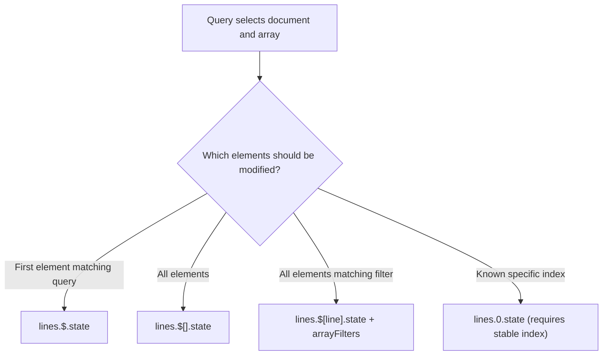
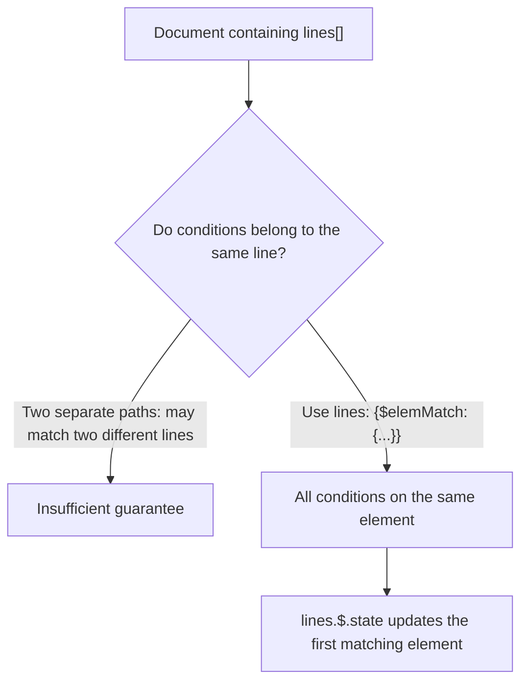

# Positional Operator $ and Element-Matching Conditions

## 1. The Problem: Updating Exactly One Element in an Array

In **Spring Data MongoDB**, documents commonly contain arrays of values or arrays of child objects: order line items, approval states, product tags, action histories, or contact details. When you only want to modify **a single element** of an array, loading the entire document and replacing the whole array is not always the best choice.

Suppose an order is stored as follows:

```javascript
{
  _id: "order-101",
  tenantId: "shop-01",
  status: "OPEN",
  lines: [
    {
      lineId: "line-1",
      sku: "SKU-A",
      quantity: NumberInt("2"),
      state: "OPEN"
    },
    {
      lineId: "line-2",
      sku: "SKU-B",
      quantity: NumberInt("5"),
      state: "OPEN"
    },
    {
      lineId: "line-3",
      sku: "SKU-A",
      quantity: NumberInt("1"),
      state: "OPEN"
    }
  ]
}
```

Requirement: **change the state of the line with `lineId = "line-2"` to `RESERVED`**, leaving all other lines unchanged.

MongoDB provides the **positional update operator `$`**, which references the **first** array element matching the query condition:

```javascript
db.orders.updateOne(
  {
    _id: "order-101",
    tenantId: "shop-01",
    "lines.lineId": "line-2"
  },
  {
    $set: { "lines.$.state": "RESERVED" }
  }
);
```

Idea: the query condition selects both the document and the target array element; the path `lines.$.state` updates `state` on the element identified by that match. When lines are uniquely identified, the application does not have to load, mutate, and overwrite the whole array.

**Lesson objectives** in the *Array Operations* chapter of the **SPRING_DATA_MONGODB** module: understand the semantics of `$`, build element-matching conditions with `Query`/`Criteria`, distinguish `$elemMatch` from independent predicates, handle limitations of `$`, apply `MongoTemplate`/`ReactiveMongoTemplate`, and test accurate updates with duplicate data or concurrent writes.

## 2. Comparing Four Ways to Reference Array Elements

| Syntax | Meaning | Example |
| --- | --- | --- |
| `lines.0.state` | Fixed index 0 position in the array | `$set: {"lines.0.state": "OPEN"}` |
| `lines.$.state` | **First element matching the query's array condition** | `$set: {"lines.$.state": "RESERVED"}` |
| `lines.$[].state` | **All elements** in the array of matching documents | `$set: {"lines.$[].state": "CANCELLED"}` |
| `lines.$[line].state` | **All elements matching the array filter** for identifier `line` | `$set: {"lines.$[line].state": "RESERVED"}` |

The three symbols `$`, `$[]`, and `$[identifier]` are not interchangeable:

- **`$`** binds to the array element *matched by the query*; it updates only the first matching element in each updated document.
- **`$[]`** affects all elements of the array, even if the initial query only filters documents.
- **`$[identifier]`** affects elements satisfying `arrayFilters` passed with the update; it can update multiple elements in the same document.



In a system where multiple lines can share the same SKU, using `lineId` is clearer than using SKU to identify a line. However, **MongoDB does not automatically guarantee `lineId` is unique *within an array* just because the parent document has `_id`**; the application must enforce that invariant.

## 3. Spring Data Entity and Sample Data

The example uses two Java records. To make BSON easy to inspect, `_id` is stored as a BSON String.

```java
package example.orders;

public record OrderLine(
    String lineId,
    String sku,
    int quantity,
    String state
) {}
```

```java
package example.orders;

import java.util.List;
import org.springframework.data.mongodb.core.mapping.Document;
import org.springframework.data.mongodb.core.mapping.FieldType;
import org.springframework.data.mongodb.core.mapping.MongoId;

@Document(collection = "orders")
public record PurchaseOrder(
    @MongoId(FieldType.STRING) String id,
    String tenantId,
    String status,
    List<OrderLine> lines
) {}
```

`@MongoId(FieldType.STRING)` makes explicit that the ID is a string and prevents ObjectId-shaped strings from being auto-converted into BSON ObjectId. In typed queries via `MongoTemplate`, the `id` field maps to `_id`.

A basic repository:

```java
package example.orders;

import org.springframework.data.mongodb.repository.MongoRepository;

public interface PurchaseOrderRepository
        extends MongoRepository<PurchaseOrder, String> {
}
```

The repository can be used for standard CRUD operations; for array element updates with `$`, the examples below use `MongoTemplate` to express the exact filter and update. This avoids loading a full entity and overwriting the array when only one field needs changing.

## 4. Positional $: The First Element Identified by the Query

### 4.1. MongoDB Syntax

```javascript
db.orders.updateOne(
  {
    _id: "order-101",
    tenantId: "shop-01",
    "lines.lineId": "line-2"
  },
  { $set: { "lines.$.state": "RESERVED" } }
);
```

After the command, only line-2 has `state = "RESERVED"`. `quantity`, `sku`, and the other lines remain unchanged.

The `$` in `lines.$.state` is a **positional placeholder for the matched element**, **not a literal field name containing `$` stored in the document**. MongoDB resolves the matching position from the query filter and applies the update.

### 4.2. Spring Data MongoTemplate Code

```java
package example.orders;

import com.mongodb.client.result.UpdateResult;
import org.springframework.data.mongodb.core.MongoTemplate;
import org.springframework.data.mongodb.core.query.Criteria;
import org.springframework.data.mongodb.core.query.Query;
import org.springframework.data.mongodb.core.query.Update;

public class OrderLineUpdateService {

    private final MongoTemplate template;

    public OrderLineUpdateService(MongoTemplate template) {
        this.template = template;
    }

    public boolean reserveLine(
            String authorizedTenantId,
            String orderId,
            String lineId) {

        Query query = Query.query(
            Criteria.where("id").is(orderId)
                .and("tenantId").is(authorizedTenantId)
                .and("lines.lineId").is(lineId)
        );

        Update update = new Update()
            .set("lines.$.state", "RESERVED");

        UpdateResult result = template.updateFirst(
            query, update, PurchaseOrder.class
        );

        return result.getMatchedCount() == 1;
    }
}
```

`Update` is only a descriptor; the operation runs when calling `updateFirst`. With a unique ID, `updateFirst` targets one document, and `$` resolves the first matching array element in that document.

**Why are all three predicates needed?**

1. `id` identifies the order.
2. `tenantId` enforces tenant scope at the query layer; the tenant value must come from a server-verified authentication source.
3. `lines.lineId` lets MongoDB determine the `$` position. If the document exists without that lineId, the query does not match and no update occurs.

Do not use only `Criteria.where("id").is(orderId)` with `set("lines.$.state", ...)`: without an element-matching condition, the server has no array position for the `$` operator.

### 4.3. matchedCount Differs from modifiedCount

If line-2 already has state `RESERVED`, the update can return `matchedCount == 1` and `modifiedCount == 0`. This is not a “not found” case, but a write that **changed no stored values**.

```java
UpdateResult result = template.updateFirst(
    query, update, PurchaseOrder.class
);

if (result.wasAcknowledged()) {
    System.out.println("matched=" + result.getMatchedCount());
    System.out.println("modified=" + result.getModifiedCount());
}
```

`matchedCount == 0` can mean the order does not exist, the tenant does not match, or no line matched. If the API needs to return distinct error responses for these causes, the service must add extra checks while keeping in mind data can change between commands.

## 5. Using $ with Arrays of Simple Values

The positional operator is not limited to arrays of objects. With a String array:

```javascript
{
  _id: "product-101",
  tags: ["sale", "featured", "sale"]
}
```

Change the **first occurrence** of the `sale` tag:

```javascript
db.products.updateOne(
  { _id: "product-101", tags: "sale" },
  { $set: { "tags.$": "clearance" } }
);
```

After the update:

```javascript
{
  _id: "product-101",
  tags: ["clearance", "featured", "sale"]
}
```

The predicate `tags: "sale"` matches a document having an array element equal to `sale`; `tags.$` points to the **first matching element**. The trailing `sale` element at the end of the array stays unchanged.

In Spring Data:

```java
Query query = Query.query(
    Criteria.where("id").is("product-101")
        .and("tags").is("sale")
);

Update update = new Update().set("tags.$", "clearance");
```

This example assumes a `Product` entity with `List<String> tags`; execute it via `updateFirst(query, update, Product.class)` using your application's mapping. If the requirement is to **change every `sale` tag**, `$` cannot do that; use `$[identifier]` or an appropriate array strategy.

## 6. Why Can Multiple Conditions on the Same Array Match the Wrong Element?

### 6.1. Independent Path Predicate Trap

Suppose an order is:

```javascript
{
  _id: "order-ambiguous",
  tenantId: "shop-01",
  lines: [
    { lineId: "line-A", sku: "SKU-A", quantity: 2, state: "OPEN" },
    { lineId: "line-B", sku: "SKU-B", quantity: 9, state: "OPEN" }
  ]
}
```

Requirement: **mark SKU-A's line RESERVED if that line's quantity is at least 5**.

A filter that looks right at first glance:

```javascript
{
  "lines.sku": "SKU-A",
  "lines.quantity": { $gte: 5 }
}
```

However, MongoDB can match the document because **SKU-A is in the first element** while **quantity >= 5 is in the second element**. Two independent path predicates **do not enforce the same element**.

Updating via `lines.$.state` based on such an ambiguous multi-predicate array query can target an element that does not actually meet the business condition.

### 6.2. Using $elemMatch to Bind to the Same Element

```javascript
db.orders.updateOne(
  {
    _id: "order-ambiguous",
    tenantId: "shop-01",
    lines: {
      $elemMatch: {
        sku: "SKU-A",
        quantity: { $gte: 5 }
      }
    }
  },
  { $set: { "lines.$.state": "RESERVED" } }
);
```

This query **does not match** the example document, because no single line has both SKU-A and quantity >= 5. Thus it avoids mistakenly updating SKU-B's line.



### 6.3. Criteria.elemMatch in Spring Data

```java
Query query = Query.query(
    new Criteria().andOperator(
        Criteria.where("id").is("order-ambiguous"),
        Criteria.where("tenantId").is("shop-01"),
        Criteria.where("lines").elemMatch(
            Criteria.where("sku").is("SKU-A")
                .and("quantity").gte(5)
        )
    )
);

Update update = new Update()
    .set("lines.$.state", "RESERVED");

UpdateResult result = template.updateFirst(
    query, update, PurchaseOrder.class
);
```

On the sample document, `result.getMatchedCount() == 0`. If you change the SKU-A line's quantity to 7, the query matches and `$` updates the SKU-A line.

**Rule of thumb:** when position is determined by **multiple properties of an array object**, `$elemMatch` explicitly enforces that all predicates hold on **the same element**. It also safeguards conditional updates involving inventory or state transitions.

## 7. Combining $ with Quantity Conditions for Atomic Updates

In business logic, a line may only decrement quantity if enough remains. Avoid:

```java
// UNSAFE under two concurrent requests:
PurchaseOrder order = template.findById(
    orderId, PurchaseOrder.class
);
// Find line, subtract quantity in Java, then save the whole entity.
```

Two requests can read the same quantity, compute the remainder independently, and overwrite each other. A better choice is placing **both the guard condition and decrement in the same update command**.

```java
import com.mongodb.client.result.UpdateResult;
import org.springframework.data.mongodb.core.query.Criteria;
import org.springframework.data.mongodb.core.query.Query;
import org.springframework.data.mongodb.core.query.Update;

public boolean reserveQuantity(
        MongoTemplate template,
        String authorizedTenantId,
        String orderId,
        String lineId,
        int requested) {

    if (requested <= 0) {
        throw new IllegalArgumentException(
            "requested must be greater than 0"
        );
    }

    Query query = Query.query(
        new Criteria().andOperator(
            Criteria.where("id").is(orderId),
            Criteria.where("tenantId").is(authorizedTenantId),
            Criteria.where("lines").elemMatch(
                Criteria.where("lineId").is(lineId)
                    .and("quantity").gte(requested)
                    .and("state").is("OPEN")
            )
        )
    );

    Update update = new Update()
        .inc("lines.$.quantity", -requested);

    UpdateResult result = template.updateFirst(
        query, update, PurchaseOrder.class
    );

    return result.getMatchedCount() == 1;
}
```

MongoDB equivalent:

```javascript
db.orders.updateOne(
  {
    _id: "order-101",
    tenantId: "shop-01",
    lines: {
      $elemMatch: {
        lineId: "line-2",
        quantity: { $gte: 3 },
        state: "OPEN"
      }
    }
  },
  { $inc: { "lines.$.quantity": -3 } }
);
```

If line-2 has quantity 5, the first subtraction of 3 leaves 2. A subsequent request with `quantity >= 3` no longer matches, preventing negative quantities.

**Scope of guarantee:** this is an atomic update **on a single MongoDB document**. It does not bundle other actions—such as recording payment, creating a shipment, or updating inventory in another collection—into a transaction. If the request is retried, `$inc` is still not idempotent; control request IDs/transactions/workflows if double subtraction is disallowed.

### 7.1. Enforce Unique lineId Within the Array

If corrupted data has two elements sharing `lineId`, `$` only updates the **first matching element**. Do not use `$` as a tool to update both elements simultaneously, and do not assume uniqueness merely because the field is named `lineId`.

Define rules for generating lineId, validate before writes, and test duplicate data. **A unique multikey index does not prevent duplicate values inside the same array of a single document** in the way some assume; enforce intra-array uniqueness at the domain level.

## 8. How Do updateFirst and updateMulti Differ with Positional $?

Two questions must be kept separate:

1. **How many documents are updated?** Decided by `updateFirst` vs. `updateMulti`.
2. **Inside each document, how many array elements are modified?** Decided by `$`, `$[]`, or `$[identifier]`.

Suppose two orders both contain SKU-A. Using:

```java
Query query = Query.query(
    Criteria.where("tenantId").is("shop-01")
        .and("lines.sku").is("SKU-A")
);
Update update = new Update()
    .set("lines.$.state", "CHECKED");

// One matching document:
template.updateFirst(query, update, PurchaseOrder.class);

// Every matching document; within each document, only the first matched element:
template.updateMulti(query, update, PurchaseOrder.class);
```

`updateMulti` with `$` **does not** mean every SKU-A element in the same order is updated. It means multiple documents can be updated, and **within each document only the first matching element** is updated by positional `$`.

To update **every SKU-A line within an order**, use `$[identifier]` with `arrayFilters` (section 9).

## 9. When to Replace $ with $[] or $[identifier]?

### 9.1. $[]: Every Element of the Array

Requirement to cancel all lines of an order:

```javascript
db.orders.updateOne(
  { _id: "order-101", tenantId: "shop-01" },
  { $set: { "lines.$[].state": "CANCELLED" } }
);
```

Spring Data:

```java
Update update = new Update()
    .set("lines.$[].state", "CANCELLED");
```

No array filter is needed in the query to select individual elements because `$[]` means **all** elements in the array of the selected document. This is a broad update: restrict documents by ID/tenant/status and verify business permissions.

### 9.2. $[identifier]: Every Element Matching arrayFilters

Requirement: change the state of **all** SKU-A lines in an order:

```javascript
db.orders.updateOne(
  { _id: "order-101", tenantId: "shop-01" },
  { $set: { "lines.$[line].state": "CHECKED" } },
  {
    arrayFilters: [
      { "line.sku": "SKU-A" }
    ]
  }
);
```

On the sample document, both line-1 and line-3 are updated, not just line-1.

Spring Data MongoDB provides `Update.filterArray`:

```java
import org.springframework.data.mongodb.core.query.Criteria;
import org.springframework.data.mongodb.core.query.Update;

Update update = new Update()
    .set("lines.$[line].state", "CHECKED")
    .filterArray(Criteria.where("line.sku").is("SKU-A"));
```

When using typed operations, note: the **array filter** is passed directly to the driver and does not necessarily undergo field-name mapping like typed `Query` criteria. For fields with `@Field`, verify the **actual BSON name** in the array filter; using an unmapped Java name can silently match zero elements.

Key notes:

- The name `line` in `$[line]` must match the identifier `line` in the array filter.
- Array filters select **elements**; they do not replace **document** selection or tenant checks.
- A document that matches the query but has no element matching the array filter can produce `matchedCount > 0` and `modifiedCount == 0`.
- Multiple conditions can be placed on the identifier if required, such as `line.sku` and `line.state`.

### 9.3. Multi-Level Arrays Require Filtered Positional Operators

Suppose a document has `batches[]` and each batch contains `lines[]`. Standard positional `$` **cannot traverse multiple levels of nested arrays** by repeating `$`. MongoDB supports combining `$[]` and `$[identifier]` with arrayFilters to target elements at each level.

```javascript
db.orders.updateOne(
  { _id: "order-nested", tenantId: "shop-01" },
  {
    $set: {
      "batches.$[batch].lines.$[line].state": "CHECKED"
    }
  },
  {
    arrayFilters: [
      { "batch.batchId": "batch-1" },
      { "line.lineId": "line-2" }
    ]
  }
);
```

This example describes a `batches` model distinct from `PurchaseOrder` in section 3; define corresponding entities/mappings if implementing it for real. Test nested updates against actual BSON data before deploying to production.

## 10. Important Limitations of the Positional $ Operator

### 10.1. The Query Must Identify the Array to Update

Incorrect intent:

```javascript
db.orders.updateOne(
  { _id: "order-101" },
  { $set: { "lines.$.state": "RESERVED" } }
);
```

The filter only identifies the document, **not an element of `lines`**. MongoDB has no matched position for `$`. Add a condition on `lines` to the query or switch to `$[]`/`$[identifier]` as appropriate.

### 10.2. Do Not Use Positional $ for Document-Creating Upserts

In an upsert, if **no document matches**, MongoDB must insert a new document. Positional `$` has no existing array element to reference, so it is invalid on the insert branch:

```javascript
// Do not use this pattern when an insert may occur:
db.orders.updateOne(
  { _id: "order-new", "lines.lineId": "line-1" },
  { $set: { "lines.$.state": "OPEN" } },
  { upsert: true }
);
```

To add a new order, initialize the document/array explicitly per schema. To add a line to an existing order, use `$push` or `$addToSet` with deduplication rules; do not use `$` as a way to create elements.

### 10.3. Avoid Direct Negation Predicates on Arrays

Array queries using negations such as `$ne`, `$not`, or `$nin` have limitations when paired with `$`. When a negation predicate is necessary, MongoDB requires an appropriate match structure, often wrapped in `$elemMatch` to pinpoint the element.

For instance, “update a line whose state is not `CANCELLED`” cannot simply use `lines.state: {$ne: "CANCELLED"}` and assume `lines.$` picks the intended element. `$ne` on an array field evaluates against the whole array/missing-field semantics rather than directly identifying **which element** to modify.

It is usually clearer to filter on allowed positive states such as `state: "OPEN"`, or use `$[line]` with a validated array filter when targeting multiple elements.

### 10.4. Multiple Arrays in the Filter Introduce Ambiguity

If a query matches both `lines` and `coupons` arrays, positional `$` cannot reliably specify the position of the target array in complex cases. With multiple arrays, simplify the query, split business steps, or use `$[identifier]` with explicit filters.

**Rule:** use `$` when the query clearly matches a single array; use `$elemMatch` when predicates must bind to the same element; use filtered positional operators for multiple elements, multiple arrays, or nested levels.

### 10.5. Document Sorting Does Not Select Array Elements

Adding `query.with(Sort.by(...))` can control which document is selected in APIs that support sort, but it **is not an element selection mechanism** inside `lines`. `$` is always determined by the array match condition. If you need “the newest line” or “the lowest-priced line”, store a deterministic key or use an aggregation/update pipeline rather than assuming document sort reorders array elements for `$`.

## 11. Deleting a Field vs. Deleting an Array Element

A common mistake is calling `$unset` expecting the array to shrink.

### 11.1. Removing a Property Inside an Element

```javascript
db.orders.updateOne(
  { _id: "order-101", "lines.lineId": "line-2" },
  { $unset: { "lines.$.legacyCode": "" } }
);
```

This deletes the **`legacyCode` field inside the matched line**, while keeping that line in the array.

### 11.2. Unsetting a Position Is Not the Same as Pulling an Element

If `$unset` targets an array element directly such as `"lines.$"`, MongoDB can replace that element with `null` to preserve positions rather than **shifting remaining elements left**.

If the business requirement is to **remove the line with `lineId` completely** from the array:

```javascript
db.orders.updateOne(
  { _id: "order-101", tenantId: "shop-01" },
  { $pull: { lines: { lineId: "line-2" } } }
);
```

`$pull` removes all elements matching the predicate, not just the first match. If `lineId` is duplicated, multiple elements may be removed; thus maintaining the unique-lineId invariant remains critical.

## 12. findAndModify and Updates Needing the Updated Document

`MongoTemplate.updateFirst` returns `UpdateResult`, not the post-update document. When a service needs the new state in the same operation, use `findAndModify`:

```java
import org.springframework.data.mongodb.core.FindAndModifyOptions;
import org.springframework.data.mongodb.core.query.Criteria;
import org.springframework.data.mongodb.core.query.Query;
import org.springframework.data.mongodb.core.query.Update;

Query query = Query.query(
    Criteria.where("id").is("order-101")
        .and("tenantId").is("shop-01")
        .and("lines.lineId").is("line-2")
);

Update update = new Update()
    .set("lines.$.state", "RESERVED");

PurchaseOrder updated = template.findAndModify(
    query,
    update,
    FindAndModifyOptions.options().returnNew(true),
    PurchaseOrder.class
);
```

`returnNew(true)` requests the **post-modification document**. If no document matches and upsert is disabled, the return value can be `null`. Note that the entire `PurchaseOrder` entity is returned—for documents with very large arrays, I/O and mapping costs are also high. If you only need confirmation of modification, `UpdateResult` is lighter.

Do not read the document first and mutate it in Java if your goal is protecting concurrency on a single element; query predicates + update operators are much more direct.

## 13. Atomicity, Idempotency, and Concurrent Writes

MongoDB guarantees that a valid update command on **one document** is atomic. When an `$inc` operation includes an `$elemMatch` condition on quantity, matching and modifying that document are not split into a client-side read-then-write.

Keep three concepts distinct:

| Concept | Example | Limit |
| --- | --- | --- |
| **Atomic update** | Decrement `lines.$.quantity` if sufficient | Guarantees atomicity only for the updated document |
| **Idempotency** | Resending a request must not subtract again | `$inc` is not automatically idempotent |
| **Multi-document transaction** | Decrement inventory and create payment/order records | Requires dedicated transaction/workflow handling |

For state transitions:

```java
Query query = Query.query(
    new Criteria().andOperator(
        Criteria.where("id").is(orderId),
        Criteria.where("tenantId").is(authorizedTenantId),
        Criteria.where("lines").elemMatch(
            Criteria.where("lineId").is(lineId)
                .and("state").is("OPEN")
        )
    )
);

Update update = new Update()
    .set("lines.$.state", "RESERVED");
```

Because `state == "OPEN"` is inside the **same filter** with `lineId`, only an OPEN line transitions. Once the first request changes it to RESERVED, a second request no longer matches. However, if a workflow can transition RESERVED back to OPEN, a late duplicate request could still cause an unintended transition. When strict deduplication is needed, use request IDs, versions, or a state machine with business-level idempotency.

### 13.1. Version on the Parent Document

If multiple operations updating different parts of the same order must respect a version condition, add a version field on the **parent document** and perform compare-and-set:

```java
Query query = Query.query(
    new Criteria().andOperator(
        Criteria.where("id").is(orderId),
        Criteria.where("tenantId").is(authorizedTenantId),
        Criteria.where("version").is(expectedVersion),
        Criteria.where("lines").elemMatch(
            Criteria.where("lineId").is(lineId)
                .and("state").is("OPEN")
        )
    )
);

Update update = new Update()
    .set("lines.$.state", "RESERVED")
    .inc("version", 1L);
```

This is **manual version management** with a plain numeric field. If the real entity carries `@Version` and Spring Data auto-increments version on that update path, pick one consistent strategy so you do not increment version twice or introduce conflicts. Also, a parent-document version does not turn multi-document writes into a transaction.

## 14. ReactiveMongoTemplate: Same Operators, Returning Mono

In **Spring Data MongoDB reactive** applications, the same `Query` and `Update` objects apply:

```java
package example.orders;

import org.springframework.data.mongodb.core.ReactiveMongoTemplate;
import org.springframework.data.mongodb.core.query.Criteria;
import org.springframework.data.mongodb.core.query.Query;
import org.springframework.data.mongodb.core.query.Update;
import reactor.core.publisher.Mono;

public class ReactiveOrderLineService {

    private final ReactiveMongoTemplate template;

    public ReactiveOrderLineService(ReactiveMongoTemplate template) {
        this.template = template;
    }

    public Mono<Boolean> reserveLine(
            String authorizedTenantId,
            String orderId,
            String lineId) {

        Query query = Query.query(
            new Criteria().andOperator(
                Criteria.where("id").is(orderId),
                Criteria.where("tenantId").is(authorizedTenantId),
                Criteria.where("lines").elemMatch(
                    Criteria.where("lineId").is(lineId)
                        .and("state").is("OPEN")
                )
            )
        );

        Update update = new Update()
            .set("lines.$.state", "RESERVED");

        return template.updateFirst(
            query, update, PurchaseOrder.class
        ).map(result -> result.getMatchedCount() == 1);
    }
}
```

`Mono<Boolean>` represents the asynchronous update result. Upon completion, the application handles true/false and driver errors in the service/controller layer; **never call `block()` inside a WebFlux thread** just to unwrap the result.

The reactive model does not change the semantics of `$`, `$elemMatch`, or single-document atomicity. Nor does it automatically provide idempotency or tenant authorization.

## 15. Indexes and Performance When Finding Elements in Arrays

### 15.1. Indexing by Tenant and lineId

For queries such as:

```javascript
db.orders.find({
  tenantId: "shop-01",
  "lines.lineId": "line-2"
});
```

a candidate index is:

```javascript
db.orders.createIndex(
  { tenantId: 1, "lines.lineId": 1 },
  { name: "by_tenant_lineId" }
);
```

Because `lines` is an array, MongoDB creates a **multikey index** on `lines.lineId`. The index helps locate documents containing a matching line. It **does not select the element** for the update if the query lacks clear conditions, and it does not enforce lineId uniqueness within an array.

For commands targeting a specific `_id`, the built-in `_id` index may already be fast enough to locate the document; only add a compound index on `tenantId + lines.lineId` after verifying the workload actually needs it. Indexes on large arrays also add write and storage overhead.

### 15.2. Indexing Multiple Fields of the Same Element

If queries often use:

```javascript
{
  tenantId: "shop-01",
  lines: {
    $elemMatch: {
      sku: "SKU-A",
      quantity: { $gte: 5 }
    }
  }
}
```

you can evaluate an index on `tenantId` and fields of the same array:

```javascript
db.orders.createIndex({
  tenantId: 1,
  "lines.sku": 1,
  "lines.quantity": 1
});
```

`$elemMatch` clarifies that both conditions belong to the same element and can allow MongoDB to intersect/combine multikey index bounds in appropriate queries. Still, effectiveness depends on MongoDB version, data distribution, query shape, and index key order; never assume a compound index is a universal cure.

### 15.3. Checking Reality with explain

```javascript
db.orders.find({
  tenantId: "shop-01",
  "lines.lineId": "line-2"
}).explain("executionStats");

db.orders.getIndexes();
```

Inspect `winningPlan`, `totalKeysExamined`, and `totalDocsExamined`. Do not judge performance on a collection with only a handful of documents or assume adding indexes always improves write-heavy workloads.

If each order holds tens of thousands of elements updated continuously, evaluate the BSON document size limit, array growth, hot-document contention, and splitting lines into a separate collection. Embedded arrays work best when elements share the parent's lifecycle and remain bounded in volume.

## 16. Data Safety and Choosing Element Keys

### 16.1. lineId Is Better Than Positional Index When Arrays Can Change

If a client sends `index = 1` and the server updates `lines.1.state`, another request may have inserted, removed, or reordered elements before execution, causing index 1 to refer to the wrong line.

Using an immutable element key like `lineId` binds the request to a **business identifier** instead of a transient position. Ensure uniqueness when creating/editing the array; if lineId duplicates exist, `$` updates only one element and the system may not notice the broken invariant.

### 16.2. Do Not Let Clients Supply Arbitrary Field Paths

Dangerous:

```java
// Do not construct update paths from untrusted strings:
Update update = new Update().set(clientPath, clientValue);
```

A caller could target protected fields like `tenantId`, prices, version, or approval status. Instead, the API should accept a DTO with explicit allowed fields, and the service should hardcode queries, operators, and field paths **in code**, validating values and authenticating the tenant.

### 16.3. Do Not Equate Document Updates with Authorization

An `updateFirst` command with explicit filters prevents updating documents outside those conditions, but it **does not automatically verify the user has permission for that tenant or order**. Authorization must derive tenant/order/role from server-side identity, not from a client-supplied `tenantId`.

When modifying an array containing sensitive state, enforce permissions on both the parent document and the element's state transition. For example, disallow cancelling a line that has already shipped even though the query and `$set` are syntactically valid.

## 17. Integration Testing: Verifying the Right Element and Unchanged Data

Tests should verify the **actual BSON document**, not just a Java object before and after `save`. Specifically test:

- Only the target lineId changes, while the other two lines remain unchanged.
- Duplicate SKUs do not cause the wrong element to be updated.
- Two conditions on a line must belong to the same element.
- Non-matching queries return `matchedCount == 0`.
- `$[identifier]` updates every filtered element, unlike `$`.
- Conditional quantity decrement never makes quantity negative.

### 17.1. JUnit Test with MongoTemplate and Raw BSON

Integration example using Spring Boot's Mongo test slice and a reachable test MongoDB instance:

```java
package example.orders;

import static com.mongodb.client.model.Filters.eq;
import static org.junit.jupiter.api.Assertions.*;

import java.util.List;
import java.util.UUID;
import org.bson.Document;
import org.junit.jupiter.api.Test;
import org.springframework.beans.factory.annotation.Autowired;
import org.springframework.boot.test.autoconfigure.data.mongo.DataMongoTest;
import org.springframework.data.mongodb.core.MongoTemplate;
import org.springframework.data.mongodb.core.query.Criteria;
import org.springframework.data.mongodb.core.query.Query;
import org.springframework.data.mongodb.core.query.Update;

@DataMongoTest
class PositionalUpdateTest {

    @Autowired
    MongoTemplate template;

    @Test
    void changesOnlyTheMatchedLine() {
        String suffix = UUID.randomUUID().toString();
        String id = "order-" + suffix;
        String tenant = "tenant-" + suffix;

        template.save(new PurchaseOrder(
            id, tenant, "OPEN",
            List.of(
                new OrderLine("line-1", "SKU-A", 2, "OPEN"),
                new OrderLine("line-2", "SKU-B", 5, "OPEN"),
                new OrderLine("line-3", "SKU-A", 1, "OPEN")
            )
        ));

        Query query = Query.query(
            Criteria.where("id").is(id)
                .and("tenantId").is(tenant)
                .and("lines.lineId").is("line-2")
        );

        var result = template.updateFirst(
            query,
            new Update().set("lines.$.state", "RESERVED"),
            PurchaseOrder.class
        );

        assertEquals(1L, result.getMatchedCount());
        assertEquals(1L, result.getModifiedCount());

        Document raw = template.getCollection("orders")
            .find(eq("_id", id))
            .first();
        assertNotNull(raw);

        List<Document> lines = raw.getList(
            "lines", Document.class
        );
        assertNotNull(lines);
        assertEquals(3, lines.size());
        assertEquals("OPEN", lines.get(0).getString("state"));
        assertEquals("RESERVED", lines.get(1).getString("state"));
        assertEquals("OPEN", lines.get(2).getString("state"));
        assertEquals(5, lines.get(1).getInteger("quantity"));

        PurchaseOrder loaded =
            template.findById(id, PurchaseOrder.class);
        assertNotNull(loaded);
        assertEquals("line-2", loaded.lines().get(1).lineId());
        assertEquals("RESERVED", loaded.lines().get(1).state());
    }
}
```

The test updates only `state` of line-2; SKU-A data in line-1 and line-3 stays intact. Reading raw BSON confirms the update happened at the right position rather than only inspecting an in-memory Java object.

`@DataMongoTest` does not automatically start a MongoDB server in all environments. Use Testcontainers MongoDB or an isolated test instance with configuration/annotations matching your project's Spring Boot/Spring Data version.

### 17.2. Testing $elemMatch Prevents Mixing Conditions Across Two Lines

Add a test with two lines:

```java
@Test
void elementMatchPreventsCrossElementConditions() {
    String suffix = UUID.randomUUID().toString();
    String id = "order-mix-" + suffix;
    String tenant = "tenant-" + suffix;

    template.save(new PurchaseOrder(
        id, tenant, "OPEN",
        List.of(
            new OrderLine("line-A", "SKU-A", 2, "OPEN"),
            new OrderLine("line-B", "SKU-B", 9, "OPEN")
        )
    ));

    Query query = Query.query(
        new Criteria().andOperator(
            Criteria.where("id").is(id),
            Criteria.where("tenantId").is(tenant),
            Criteria.where("lines").elemMatch(
                Criteria.where("sku").is("SKU-A")
                    .and("quantity").gte(5)
            )
        )
    );

    var result = template.updateFirst(
        query,
        new Update().set("lines.$.state", "RESERVED"),
        PurchaseOrder.class
    );

    assertEquals(0L, result.getMatchedCount());

    PurchaseOrder unchanged =
        template.findById(id, PurchaseOrder.class);
    assertNotNull(unchanged);
    assertEquals("OPEN", unchanged.lines().get(0).state());
    assertEquals("OPEN", unchanged.lines().get(1).state());
}
```

This test method is added **inside the `PositionalUpdateTest` class** above, sharing the Spring-injected `template`. It proves SKU-A and quantity >= 5 must appear on the same element rather than being satisfied across two different elements.

### 17.3. Testing Multiple Elements with Filtered Positional Operator

```java
@Test
void filteredPositionalChangesAllMatchingSkus() {
    String suffix = UUID.randomUUID().toString();
    String id = "order-filtered-" + suffix;
    String tenant = "tenant-" + suffix;

    template.save(new PurchaseOrder(
        id, tenant, "OPEN",
        List.of(
            new OrderLine("line-1", "SKU-A", 2, "OPEN"),
            new OrderLine("line-2", "SKU-B", 5, "OPEN"),
            new OrderLine("line-3", "SKU-A", 1, "OPEN")
        )
    ));

    Query query = Query.query(
        Criteria.where("id").is(id)
            .and("tenantId").is(tenant)
    );

    Update update = new Update()
        .set("lines.$[line].state", "CHECKED")
        .filterArray(Criteria.where("line.sku").is("SKU-A"));

    var result = template.updateFirst(
        query, update, PurchaseOrder.class
    );
    assertEquals(1L, result.getMatchedCount());

    PurchaseOrder loaded =
        template.findById(id, PurchaseOrder.class);
    assertNotNull(loaded);
    assertEquals("CHECKED", loaded.lines().get(0).state());
    assertEquals("OPEN", loaded.lines().get(1).state());
    assertEquals("CHECKED", loaded.lines().get(2).state());
}
```

The test illustrates the difference between `$` and `$[line]`: both elements with SKU-A are modified. For full-array updates, a similar test can use `$[]` and verify all elements change.

### 17.4. Testing Conditional Quantity Decrement

For a line with quantity 2, calling `reserveQuantity(..., requested=3)` must return false, because no element satisfies `quantity >= 3`. Then re-read raw BSON to confirm quantity is still 2. With requested=1, assert quantity becomes 1 and only the selected line changes.

Add concurrency tests with two competing requests when critical, using fixtures designed to reproduce races in a controlled way. A single passing run does not prove read–modify–`save` is safe; atomicity guarantees come from MongoDB's write operation semantics.

## 18. Common Mistakes and Troubleshooting

| Symptom | Possible Cause | Resolution |
| --- | --- | --- |
| MongoDB reports no positional match | Query filters only the document, lacking an array predicate | Add an element-matching condition or use `$[]`/`$[id]` |
| Wrong line updated when querying multiple attributes | Array conditions matched different elements | Use `$elemMatch` |
| Only the first line changed despite multiple lines sharing SKU | `$` updates only the first matching element | Use `$[identifier]` if all matching elements must update |
| All lines updated unexpectedly | Used `$[]` when only one line was intended | Switch to `$` or `$[identifier]` |
| Upsert failed with `lines.$` | No array element exists on the insert branch | Separate document initialization from positional updates |
| `matched=1` but `modified=0` | Field already held the value, or arrayFilter matched no element | Inspect state and `UpdateResult` |
| `matched=0` | Wrong ID, tenant, or line condition not satisfied | Inspect filter and access permissions |
| Quantity decremented twice | `$inc` retried without idempotency | Use request IDs/state machine or business transactions |
| `$unset` did not shrink array | Unsetting an array position can leave null | Use `$pull` to remove elements |
| Multiple lines with same lineId | Missing intra-array invariant | Validate uniqueness within the order |
| ArrayFilters fail to match after adding `@Field` | ArrayFilters are not mapped like typed Query | Use actual BSON field names in the filter |
| Slow queries on large arrays | Missing suitable index or oversized/hot document | Run `explain` and consider extracting a child collection |
| Reactive update differs from expectations | Bad query/array match syntax, not caused by Mono | Inspect raw BSON and publisher errors |
| Updated wrong tenant | Tenant taken from client or filter omitted | Bind tenant from server security context |

### Quick Investigation Workflow

1. Inspect the raw document: does the array exist, have the right BSON type, and what elements are inside?
2. State the goal explicitly: **first matching element**, **all elements**, or **all elements matching a condition**?
3. Verify the query has a condition on the **right array** that `$` references.
4. If multiple conditions target the element, confirm `$elemMatch` is used.
5. Verify BSON field names, especially with `@Field` and `arrayFilters`.
6. Inspect `matchedCount`, `modifiedCount`, and driver errors.
7. Reproduce with fixtures having duplicate SKUs, duplicate lineIds, or cross-element matching lines.
8. Evaluate indexes, array size, and authorization checks.

## 19. Practice Exercises

### Exercise 1 — Update Exactly One Line

Create an order with three lines as in section 1, where SKU-A appears twice with different lineIds. Use `MongoTemplate` with `lines.lineId` and `Update.set("lines.$.state", ...)` to update line-3. Inspect raw BSON and verify line-1 is untouched.

### Exercise 2 — $elemMatch and Cross-Element Conditions

Create two lines: `{sku:"A",quantity:2}` and `{sku:"B",quantity:9}`. Compare a query using `lines.sku == "A"` and `lines.quantity >= 5` with a query using `lines: {$elemMatch:{sku:"A",quantity:{$gte:5}}}`. Explain why document matches differ and how this impacts updating `lines.$`.

### Exercise 3 — One, All, and Filtered

On an array with three `OPEN` lines, use:

1. `$` to update the first element matching SKU-A.
2. `$[]` to update every element.
3. `$[line]` with `arrayFilters` to update all lines with SKU-A.

Compare how many elements changed, `matchedCount`, and `modifiedCount`.

### Exercise 4 — Safe Quantity Decrement

Write a service accepting `lineId` and `requested`, filtering via `$elemMatch` with `quantity >= requested`, and executing `inc("lines.$.quantity", -requested)`. Prove insufficient stock never goes negative, and analyze what happens if the same request is retried twice.

### Exercise 5 — Deleting a Field vs. Deleting an Element

On a lines array containing `legacyCode`, use `$unset` to remove `legacyCode` only on line-2; then use `$pull` to remove line-2 from the array. Inspect raw BSON and explain why unset is not equivalent to pull.

### Exercise 6 — Nested Arrays

Design a `batches[]` document containing `lines[]`. Write an update with `$[batch]` and `$[line]` using two array filters. Explain why you should not try to use two positional `$` operators to traverse two array levels.

### Self-Check Questions

- Why does `$` update only the first matching element of an array?
- Do `lines.sku == "A"` and `lines.quantity >= 5` guarantee the same line?
- When should you use `$elemMatch`?
- How does `$` differ from `$[]` and `$[identifier]`?
- Why is `$` unsuitable for the insert branch of an upsert?
- If two lines share the same lineId, does `$` update both?
- When `matchedCount = 1` and `modifiedCount = 0`, is the query necessarily wrong?
- Why can `$inc` on an element be atomic yet not idempotent?
- Does a unique multikey index automatically prevent two duplicate lineIds inside the same array of one document?
- Why is `$unset` on an array element not used to delete and compact elements?

## Key Takeaways

In **Spring Data MongoDB**, the positional update operator **`$`** references the **first array element identified by the query condition**. When multiple properties must match **on the same child object**, use **`$elemMatch`** to avoid cross-element mismatches. To update **all elements**, use **`$[]`**; to update **all elements matching a custom condition**, use **`$[identifier]` with `arrayFilters`**. Never use `$` for document-creating upserts, never expect `$unset` to remove array elements, and never treat atomic updates as automatic idempotency. Verify raw BSON, field names, tenant filters, `UpdateResult`, and test with duplicate data when building safe array operations.

## References

- [MongoDB Manual — Positional $ Update Operator](https://www.mongodb.com/docs/manual/reference/operator/update/positional/)
- [MongoDB Manual — All Positional $[] Operator](https://www.mongodb.com/docs/manual/reference/operator/update/positional-all/)
- [MongoDB Manual — Filtered Positional $[identifier] Operator](https://www.mongodb.com/docs/manual/reference/operator/update/positional-filtered/)
- [MongoDB Manual — $elemMatch Query Operator](https://www.mongodb.com/docs/manual/reference/operator/query/elemMatch/)
- [Spring Data MongoDB Reference — Updating Documents](https://docs.spring.io/spring-data/mongodb/reference/mongodb/template-crud-operations.html)
- [Spring Data MongoDB API — Update](https://docs.spring.io/spring-data/mongodb/docs/current/api/org/springframework/data/mongodb/core/query/Update.html)
