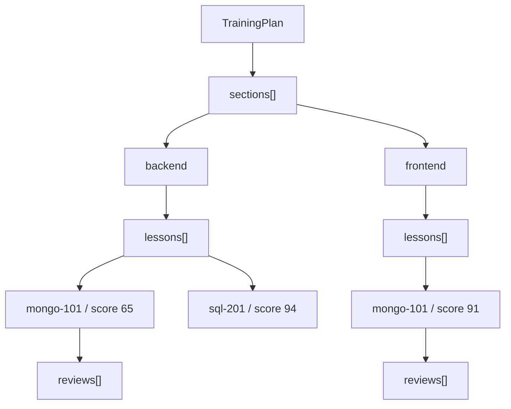

# Nested Arrays and Combining Multiple Conditions

In MongoDB, a document can contain multiple levels of nested arrays: `sections[]` containing `lessons[]`, and each lesson containing `reviews[]`. Storing this structure lets you read a complete aggregate in one document, yet querying and updating require answering accurately: **must multiple conditions hold on the same element, or may they match across different elements?**

This lesson belongs to the **Array Operations** chapter of the `SPRING_DATA_MONGODB` module. We combine `MongoTemplate`, `Query`, `Criteria`, `Update`, `$elemMatch`, `$[]`, `$[identifier]`, `arrayFilters`, aggregation, multikey indexes, and testing to handle multi-level arrays. These techniques also connect to query derivation, transactions, reactive access, schema mapping, and performance tuning.

> **Principle:** `Query` selects **documents**; `$elemMatch` forces multiple conditions onto **one array element**; `arrayFilters` with `$[identifier]` selects **elements to update**. With multiple array levels, specify the scope accurately at **each level**.

## 1. Learning Objectives

After this lesson, you will be able to:

1. Explain why dot notation can match across **different array elements**.
2. Use `$elemMatch` on an array of objects and nest `$elemMatch` across multiple levels.
3. Combine `AND`, `OR`, `$in`, `$all`, `$size`, and `$not`, distinguishing existential conditions from universal conditions.
4. Write Java `Criteria.elemMatch` matching the MongoDB BSON query.
5. Distinguish `$elemMatch` in queries, projections, and aggregation `$filter`.
6. Choose accurately between positional operators `$`, `$[]`, and `$[identifier]`.
7. Update nested arrays with `Update.filterArray` and understand why this filter **is not auto-mapped by Spring Data**.
8. Combine document filters, filtered positional updates, and optimistic versions in a single atomic document update.
9. Design multikey indexes and inspect `explain("executionStats")`.
10. Write integration tests that catch false positives, out-of-scope updates, and concurrent edits.

## 2. Sample Data: sections, lessons, reviews

Suppose a training platform stores a `training_plans` collection. One document:

```javascript
{
  _id: "PLAN-MIXED",
  tenant_id: "tenant-a",
  sections: [
    {
      code: "backend",
      lessons: [
        {
          key: "mongo-101", status: "READY", score: 65,
          reviews: [
            { reviewer: "mentor", approved: false },
            { reviewer: "qa", approved: true }
          ]
        },
        { key: "sql-201", status: "READY", score: 94, reviews: [] }
      ]
    },
    {
      code: "frontend",
      lessons: [
        {
          key: "mongo-101", status: "READY", score: 91,
          reviews: [{ reviewer: "mentor", approved: true }]
        }
      ]
    }
  ],
  version: NumberLong("0")
}
```

Structure:



Suppose the requirement is to find a **backend section containing lesson mongo-101 in READY status with score ≥80**. `PLAN-MIXED` **does not** qualify: inside backend, mongo-101 has score 65; sql-201 has 94 but the wrong key; and mongo-101 with score 91 belongs to frontend.

Insert a second document `PLAN-OK` as a positive test case:

```javascript
{
  _id: "PLAN-OK",
  tenant_id: "tenant-a",
  sections: [
    {
      code: "backend",
      lessons: [
        {
          key: "mongo-101", status: "READY", score: 88,
          reviews: [
            { reviewer: "mentor", approved: true },
            { reviewer: "qa", approved: false }
          ]
        },
        { key: "sql-201", status: "READY", score: 94, reviews: [] }
      ]
    },
    {
      code: "frontend",
      lessons: [
        { key: "mongo-101", status: "READY", score: 91, reviews: [] }
      ]
    }
  ]
}
```

`PLAN-OK` genuinely has backend/mongo-101/READY/88. Put both documents into a **dedicated test database** to verify matching and non-matching queries.

### 2.1. Domain Model for Spring Data

```java
package dev.learning.training;

import java.util.List;
import org.springframework.data.annotation.Id;
import org.springframework.data.annotation.Version;
import org.springframework.data.mongodb.core.mapping.Document;
import org.springframework.data.mongodb.core.mapping.Field;

@Document("training_plans")
public record TrainingPlan(
    @Id String id,
    @Field("tenant_id") String tenantId,
    List<Section> sections,
    @Version Long version) {}

public record Section(String code, List<Lesson> lessons) {}

public record Lesson(
    String key,
    String status,
    int score,
    List<Review> reviews) {}

public record Review(String reviewer, boolean approved) {}
```

Each `public record` must be placed in its **own Java file**. `@Field("tenant_id")` demonstrates a Java property name differing from its BSON field name; fields inside the arrays keep matching names for readability. `@Version` is used in the concurrency section.

## 3. Dot Notation Can Combine Conditions Across Multiple Elements

A query that looks reasonable:

```javascript
db.training_plans.find({
  tenant_id: "tenant-a",
  "sections.code": "backend",
  "sections.lessons.key": "mongo-101",
  "sections.lessons.status": "READY",
  "sections.lessons.score": { $gte: 80 }
});
```

**`PLAN-MIXED` can still match.** Predicates on separate array paths are evaluated independently:

- `sections.code="backend"` comes from the backend section.
- `sections.lessons.key="mongo-101"` can come from any lesson.
- `sections.lessons.score>=80` can come from `sql-201` or `frontend/mongo-101`.
- `status="READY"` is also not bound to the same lesson as key/score.

Even a **single-array** example suffers false positives:

```javascript
{
  lessons: [
    { key: "mongo-101", score: 40 },
    { key: "sql-201", score: 95 }
  ]
}
```

```javascript
// Still matches even though mongo-101 only scored 40:
db.collection.find({
  "lessons.key": "mongo-101",
  "lessons.score": { $gte: 80 }
});
```

Dot notation describes **paths**, without enforcing that all conditions hold on **a single element**.

## 4. One Level: $elemMatch Forces Conditions Onto the Same Element

With `lessons` directly at the root:

```javascript
db.collection.find({
  lessons: {
    $elemMatch: {
      key: "mongo-101",
      score: { $gte: 80 }
    }
  }
});
```

`$elemMatch` requires **at least one lesson** having both key mongo-101 **and** score ≥80. The two fields cannot come from different lessons.

Equivalent Java `Criteria`:

```java
import org.springframework.data.mongodb.core.query.Criteria;
import org.springframework.data.mongodb.core.query.Query;

Query query = Query.query(
    Criteria.where("lessons").elemMatch(
        Criteria.where("key").is("mongo-101")
                .and("score").gte(80)
    )
);
```

This applies when `lessons` sits directly at the root. For `TrainingPlan` with an outer `sections[]` array, it is **not enough**.

### Constraining Only the Lesson, Not the Section

```javascript
db.training_plans.find({
  "sections.code": "backend",
  "sections.lessons": {
    $elemMatch: { key: "mongo-101", score: { $gte: 80 } }
  }
});
```

This query binds key + score to the same lesson, yet does not require that lesson to live inside the backend section. On `PLAN-MIXED`, frontend/mongo-101 with score 91 still matches.

## 5. Two Levels: Nesting $elemMatch at Each Array

The **correct** query:

```javascript
db.training_plans.find({
  tenant_id: "tenant-a",
  sections: {
    $elemMatch: {
      code: "backend",
      lessons: {
        $elemMatch: {
          key: "mongo-101",
          status: "READY",
          score: { $gte: 80 }
        }
      }
    }
  }
});
```

Now one section must simultaneously have code `backend` **and** contain a lesson satisfying key + status + score.

| Document | Independent Dot Notation | Two Nested `$elemMatch` |
| --- | --- | --- |
| `PLAN-MIXED` | False match | **Does not match** |
| `PLAN-OK` | Matches | **Matches** |

Java `MongoTemplate`:

```java
Criteria lesson = Criteria.where("key").is("mongo-101")
    .and("status").is("READY")
    .and("score").gte(80);

Criteria section = Criteria.where("code").is("backend")
    .and("lessons").elemMatch(lesson);

Query query = Query.query(
    Criteria.where("tenantId").is("tenant-a")
        .and("sections").elemMatch(section)
);

List<TrainingPlan> plans =
    mongoTemplate.find(query, TrainingPlan.class);
```

`tenantId` in `Query` maps to `tenant_id` via domain metadata. Field names inside `$elemMatch` are scoped to the corresponding array element.

## 6. Three Levels: Adding a Condition on reviews

Requirement: a backend section containing a READY mongo-101 lesson, and inside that lesson an approved mentor review.

```javascript
db.training_plans.find({
  sections: {
    $elemMatch: {
      code: "backend",
      lessons: {
        $elemMatch: {
          key: "mongo-101",
          status: "READY",
          reviews: {
            $elemMatch: { reviewer: "mentor", approved: true }
          }
        }
      }
    }
  }
});
```

`PLAN-MIXED` does not match: the mentor review inside backend/mongo-101 has `approved: false`, even though the qa review in the same lesson is true and the mentor review in frontend is true. `PLAN-OK` matches.

```java
Criteria review = Criteria.where("reviewer").is("mentor")
    .and("approved").is(true);

Criteria lesson = Criteria.where("key").is("mongo-101")
    .and("status").is("READY")
    .and("reviews").elemMatch(review);

Criteria section = Criteria.where("code").is("backend")
    .and("lessons").elemMatch(lesson);

Query query = Query.query(
    Criteria.where("sections").elemMatch(section)
);
```

Think in quantifiers:

```text
Exists section s in sections:
  s.code == backend
  AND exists lesson l in s.lessons:
    l.key == mongo-101 AND l.status == READY
    AND exists review r in l.reviews:
      r.reviewer == mentor AND r.approved == true
```

**The query only selects root documents**; it does not automatically trim arrays down to matching elements.

## 7. Combining AND, OR, IN, and Multiple Distinct Elements

### AND Within One Element

```javascript
{
  lessons: {
    $elemMatch: {
      key: "mongo-101",
      status: "READY",
      score: { $gte: 80 }
    }
  }
}
```

Fields inside a single `$elemMatch` are combined with AND by default.

### OR on a Single Field

If allowed statuses are READY or RETRY:

```javascript
{
  lessons: {
    $elemMatch: {
      key: "mongo-101",
      status: { $in: ["READY", "RETRY"] },
      score: { $gte: 80 }
    }
  }
}
```

### OR Between Two Condition Groups

```javascript
{
  lessons: {
    $elemMatch: {
      $or: [
        { status: "READY", score: { $gte: 80 } },
        { status: "RETRY", score: { $gte: 90 } }
      ]
    }
  }
}
```

Placing `$or` **inside** `$elemMatch` ensures **one lesson** satisfies one of the branches. Spring Data:

```java
Criteria variants = new Criteria().orOperator(
    Criteria.where("status").is("READY").and("score").gte(80),
    Criteria.where("status").is("RETRY").and("score").gte(90)
);

Criteria hasLesson = Criteria.where("lessons")
    .elemMatch(variants);
```

### Requiring Two Different Elements

If a **single section** must contain **one READY lesson** and **one DONE lesson** (not necessarily the same lesson), combine multiple `$elemMatch` blocks with `$all`:

```javascript
{
  sections: {
    $elemMatch: {
      code: "backend",
      lessons: {
        $all: [
          { $elemMatch: { status: "READY" } },
          { $elemMatch: { status: "DONE" } }
        ]
      }
    }
  }
}
```

These are two independent **existential** checks on `lessons`, both scoped **within the same section**. Because the two statuses are mutually exclusive, two distinct elements must satisfy them.

## 8. $size, null/missing, and Negation

| Operator | Meaning | Note |
| --- | --- | --- |
| `$size` | Array has exact length N | Does not count elements matching a complex predicate. |
| `$all` | Array contains all required values/element specs | Does not mean all conditions apply to the same element. |
| `$exists` | Field is present or absent | Present does not mean non-null. |
| `$ne` | Not-equal comparison | With non-null values, can match documents missing the field. |
| `$not` | Negates a field predicate | Consider empty arrays or missing fields explicitly. |
| `$elemMatch` | At least one element matches all predicates | Does not mean **every** element matches. |

```javascript
// Exactly two sections:
db.training_plans.find({ sections: { $size: 2 } });
```

To find plans **with no lesson having a negative score**, you cannot just write `score != -1`. One logical formulation is negating the **existence** of any section containing a lesson with a negative score:

```javascript
db.training_plans.find({
  sections: {
    $not: {
      $elemMatch: {
        lessons: {
          $elemMatch: { score: { $lt: 0 } }
        }
      }
    }
  }
});
```

Documents missing `sections` can match the negation. If business logic requires `sections` to exist, be non-null, and be non-empty, **add schema validation or explicit presence predicates**.

A scalar array like `tags:["mongo","java"]` can check membership of `"mongo"` with simple equality; `$elemMatch` is unnecessary when checking a single scalar value.

## 9. Projection vs. Query: Returning One or Multiple Elements?

Query:

```javascript
db.training_plans.find({
  sections: { $elemMatch: { code: "backend" } }
});
```

selects **root documents** having at least one backend section. Without projection, the returned document still includes the **entire `sections[]` and `lessons[]`**.

To return only **the first backend section element**:

```javascript
db.training_plans.find(
  { tenant_id: "tenant-a" },
  { sections: { $elemMatch: { code: "backend" } } }
);
```

In a **projection**, MongoDB `$elemMatch` returns only the **first** matching element; it does not filter the nested lessons inside it.

Spring Data:

```java
Query query = Query.query(
    Criteria.where("tenantId").is("tenant-a")
);

query.fields().elemMatch(
    "sections",
    Criteria.where("code").is("backend")
);

List<TrainingPlan> results =
    mongoTemplate.find(query, TrainingPlan.class);
```

This is a **partial read**. Never call `save` on a partially loaded entity: doing so can drop unread sections or trigger optimistic locking errors.

### Returning Every Matching Lesson: Use $filter and $map

```javascript
db.training_plans.aggregate([
  { $match: { tenant_id: "tenant-a" } },
  {
    $project: {
      tenant_id: 1,
      sections: {
        $map: {
          input: {
            $filter: {
              input: "$sections",
              as: "s",
              cond: { $eq: ["$$s.code", "backend"] }
            }
          },
          as: "s",
          in: {
            code: "$$s.code",
            lessons: {
              $filter: {
                input: "$$s.lessons",
                as: "l",
                cond: {
                  $and: [
                    { $eq: ["$$l.key", "mongo-101"] },
                    { $gte: ["$$l.score", 80] }
                  ]
                }
              }
            }
          }
        }
      }
    }
  }
]);
```

This aggregation retains **every backend section** and **every lesson** in it meeting the criteria. If a backend section has zero qualifying lessons, it may still appear with `lessons:[]`; add another filter step if empty sections should be excluded.

## 10. Positional Updates: $, $[], and $[identifier]

| Update Path | Elements Modified | Limitation |
| --- | --- | --- |
| `array.$.field` | First element bound by the query filter | Unsuitable for multi-level nested array traversal; ambiguous with multiple arrays in query. |
| `array.$[].field` | **All** elements in the array of matching documents | No per-element filtering. |
| `array.$[x].field` | **All** elements with identifier `x` matching `arrayFilters` | Must declare a filter for each identifier. |

Positional `$` on a **single root-level array**:

```javascript
db.sample.updateOne(
  { "lessons.key": "mongo-101" },
  { $set: { "lessons.$.status": "DONE" } }
);
```

Do not use `$` to traverse nested arrays; use `$[]`/`$[identifier]` to target each level explicitly.

**Updating all elements**:

```javascript
db.training_plans.updateOne(
  { _id: "PLAN-OK" },
  { $set: { "sections.$[].lessons.$[].status": "ARCHIVED" } }
);
```

This updates every lesson across every section in `PLAN-OK`. Do not use it when only one lesson should change.

**Filtered update at two levels**:

```javascript
db.training_plans.updateOne(
  { _id: "PLAN-OK" },
  {
    $set: {
      "sections.$[sec].lessons.$[lesson].status": "DONE"
    }
  },
  {
    arrayFilters: [
      { "sec.code": "backend" },
      { "lesson.key": "mongo-101", "lesson.status": "READY" }
    ]
  }
);
```

Meaning: inside backend sections, update **all** READY mongo-101 lessons. frontend/mongo-101 is untouched, though if backend has multiple lessons with the same key, **multiple elements** will be modified.

## 11. MongoTemplate Update.filterArray: Differences from Typed Query

```java
import com.mongodb.client.result.UpdateResult;
import org.springframework.data.mongodb.core.MongoTemplate;
import org.springframework.data.mongodb.core.query.Criteria;
import org.springframework.data.mongodb.core.query.Query;
import org.springframework.data.mongodb.core.query.Update;

String planId = "PLAN-OK";
String authorizedTenant = "tenant-a";

Query query = Query.query(
    Criteria.where("id").is(planId)
        .and("tenantId").is(authorizedTenant)
);

Update update = new Update()
    .set("sections.$[sec].lessons.$[lesson].status", "DONE")
    .filterArray(Criteria.where("sec.code").is("backend"))
    .filterArray(Criteria.where("lesson.key").is("mongo-101")
        .and("lesson.status").is("READY"));

UpdateResult result = mongoTemplate.updateFirst(
    query, update, TrainingPlan.class);
```

On the sample structure, the expected outcome is:

```text
backend / mongo-101: READY -> DONE
backend / sql-201:   READY (unchanged)
frontend / mongo-101: READY (unchanged)
```

### filterArray Does Not Automatically Map Field Names

Javadoc for `Update.filterArray(CriteriaDefinition)` and `Update.filterArray(String,Object)` notes that filters **are passed directly to the driver without further type/field mapping**. Hence `arrayFilters` must use **actual BSON names**.

Suppose `Lesson.key` later gains an alias:

```java
public record Lesson(
    @org.springframework.data.mongodb.core.mapping.Field("lesson_key")
    String key,
    String status,
    int score,
    java.util.List<Review> reviews) {}
```

When the physical BSON field is `lesson_key`:

```java
// WRONG: filterArray does not translate lesson.key to lesson.lesson_key
update.filterArray(Criteria.where("lesson.key").is("mongo-101"));

// RIGHT: use the BSON name under the identifier.
update.filterArray(
    Criteria.where("lesson.lesson_key").is("mongo-101"));
```

| Where Field Is Written | Domain Mapping Applied? | Convention |
| --- | --- | --- |
| `Criteria.where("tenantId")` in typed `Query` | Yes | Java property |
| `Update.set(...)` with entity class | Update path mapped per API; placeholders preserved | Property path; verify command if aliased |
| `Update.filterArray(...)` | **No**, filter goes straight to driver | **BSON** name under identifier |
| `mongosh` or raw `org.bson.Document` | No | BSON name |

### One Identifier, One Filter Document

```java
Update update = new Update()
    .set("sections.$[sec].lessons.$[lesson].status", "DONE")
    .filterArray(Criteria.where("sec.code").is("backend"))
    .filterArray(Criteria.where("lesson.key").is("mongo-101")
        .and("lesson.status").is("READY"));
```

Right: `lesson.key` and `lesson.status` reside in the **same filter document** for identifier `lesson`. MongoDB forbids declaring two separate filter documents with the same identifier name. Identifiers must start with a lowercase letter and use only alphanumeric characters, e.g., `sec`, `lesson`, `review`.

## 12. Query Selects Documents; arrayFilters Selects Elements

If `Query` filters only by `_id`, MongoDB can **match the document** even when no element satisfies `arrayFilters`. Therefore:

- `matchedCount=1` means the document matched the query, **not** that a lesson was modified.
- `modifiedCount=0` can happen when no element matched or the new value equaled the old value.
- If `@Version` or another Update field changes, the document may still show as modified even though the target lesson did not change.

To make “READY → DONE” fail when no eligible element exists, put nested `$elemMatch` into the **Query of the same write command**:

```java
Criteria readyLesson = Criteria.where("key").is("mongo-101")
    .and("status").is("READY");

Criteria matchingSection = Criteria.where("code").is("backend")
    .and("lessons").elemMatch(readyLesson);

Query query = Query.query(
    Criteria.where("id").is(planId)
        .and("tenantId").is(authorizedTenant)
        .and("sections").elemMatch(matchingSection)
);

Update update = new Update()
    .set("sections.$[sec].lessons.$[lesson].status", "DONE")
    .filterArray(Criteria.where("sec.code").is("backend"))
    .filterArray(Criteria.where("lesson.key").is("mongo-101")
        .and("lesson.status").is("READY"));

UpdateResult result = mongoTemplate.updateFirst(
    query, update, TrainingPlan.class);
```

If no READY lesson remains in the backend section, `matchedCount` is 0. These predicates are checked inside the **same update command** on the document, avoiding a separate `findOne` that invites race conditions.

**Note:** `$[lesson]` still updates **all matching elements**, not just one. If you need “exactly one lesson”, enforce a unique business key inside each section or redesign the data model. A unique multikey index **does not automatically guarantee** uniqueness across elements inside the same document.

## 13. Updating Three Array Levels with Multiple Identifiers

Requirement: approve only the **mentor** review currently having `approved=false` under lesson `mongo-101` of section `backend`, without changing the `qa` review or frontend lessons.

```javascript
db.training_plans.updateOne(
  { _id: "PLAN-MIXED", tenant_id: "tenant-a" },
  {
    $set: {
      "sections.$[sec].lessons.$[lesson].reviews.$[rev].approved": true
    }
  },
  {
    arrayFilters: [
      { "sec.code": "backend" },
      { "lesson.key": "mongo-101" },
      { "rev.reviewer": "mentor", "rev.approved": false }
    ]
  }
);
```

Three identifiers filter in sequence:

1. `sec`: sections with code backend.
2. `lesson`: lessons with key mongo-101 inside those sections.
3. `rev`: reviews with reviewer mentor and approved false inside those lessons.

Spring Data:

```java
Update update = new Update()
    .set(
        "sections.$[sec].lessons.$[lesson].reviews.$[rev].approved",
        true)
    .filterArray(Criteria.where("sec.code").is("backend"))
    .filterArray(Criteria.where("lesson.key").is("mongo-101"))
    .filterArray(Criteria.where("rev.reviewer").is("mentor")
        .and("rev.approved").is(false));

UpdateResult result = mongoTemplate.updateFirst(
    Query.query(Criteria.where("id").is("PLAN-MIXED")
        .and("tenantId").is("tenant-a")),
    update,
    TrainingPlan.class
);
```

On `PLAN-MIXED`, the mentor review inside backend/mongo-101 switches false → true; the qa review remains true, and the mentor review in frontend (already true) stays unchanged.

**Distinction:** `rev.approved=false` inside `arrayFilters` only limits which elements are edited; if the query only checks ID, `matchedCount` can still be 1 even when no false review exists. Add the matching nested `$elemMatch` to `Query` or use expected version when you need to detect an actual state transition.

### 13.1. Using $[] on Outer Level and $[identifier] on Inner Level

To archive every READY mongo-101 lesson **regardless of section**:

```javascript
db.training_plans.updateOne(
  { _id: "PLAN-OK" },
  {
    $set: {
      "sections.$[].lessons.$[lesson].status": "ARCHIVED"
    }
  },
  {
    arrayFilters: [
      { "lesson.key": "mongo-101", "lesson.status": "READY" }
    ]
  }
);
```

`sections.$[]` selects every section; `lessons.$[lesson]` selects lessons matching the filter. **Frontend can be updated too.** If you want only backend, replace the outer level with `$[sec]` and add a code filter.

### 13.2. Do Not Use Positional $ Across Nested Arrays

MongoDB explicitly notes that positional `$` only replaces the element position of a single array bound by the query; it is **not suitable for traversing multiple nested arrays**. When queries span multiple array fields, resolving `$`'s position also becomes ambiguous. Use `$[identifier]` or `$[]` to specify each level explicitly.

## 14. Limits of arrayFilters, Upserts, and Missing Data

Rules to remember:

- Each identifier in the update path needs **exactly one** filter document in `arrayFilters`.
- Identifier names start with a lowercase letter and contain only alphanumeric characters.
- `arrayFilters` cannot use `$expr`, `$text`, or `$where`.
- `arrayFilters` is not used in the same way with **aggregation pipeline updates**.
- When `upsert=true` and no document matches (requiring an **insert**), updates with `$[identifier]` or `$[]` require an **exact equality match** on the corresponding array field in the query; otherwise the server can reject the command.
- Array paths used for updates must have the proper structure; MongoDB does not build nested objects/arrays simply because placeholders appear in the path.

**Recommendation:** updating existing lessons/reviews should be **update-only**, never arbitrary upserts. Creating a new plan/section/lesson belongs in a separate flow with schema validation, uniqueness checks, and idempotency testing.

### 14.1. Empty Arrays and Missing Fields

If `sections:[]`, there are no elements for `sections.$[sec]`. If `sections` is missing or not an array, nested path updates can do nothing or fail depending on the operator and structure. **Define the schema and test** all three cases: empty array, null, and missing field.

Do not assume `$elemMatch` treats a single object like an array; validating legacy data shapes and migrating them is the system's responsibility.

### 14.2. Do Not Use Multiple arrayFilters to Replace Query Logic

`arrayFilters` is evaluated at the element level **inside already-selected documents**; it does not enforce tenant permissions or validate root business invariants. Always place `tenantId`/`id`/expectedVersion in `Query`, sourced from the authenticated server context.

## 15. $push, $addToSet, $pull in Nested Arrays

Beyond modifying fields of existing elements, MongoDB provides operators to add/remove elements in arrays:

| Operator | Use Case | What to Avoid |
| --- | --- | --- |
| `$push` | Append elements; supports `$each`/`$slice`/`$sort` | Adding duplicates or letting arrays grow unbounded. |
| `$addToSet` | Add only if the **entire value** is absent | Does not guarantee uniqueness by an object's `key` field. |
| `$pull` | Remove all elements matching a condition | Can delete multiple if business keys repeat. |
| `$pop` | Remove first or last element | Does not search by business key. |
| `$set` | Replace a field or element | Not an append operator; requires a valid path. |

### 15.1. Adding a Lesson to an Existing Section

```javascript
db.training_plans.updateOne(
  { _id: "PLAN-OK" },
  {
    $push: {
      "sections.$[sec].lessons": {
        key: "redis-301",
        status: "READY",
        score: 0,
        reviews: []
      }
    }
  },
  { arrayFilters: [{ "sec.code": "backend" }] }
);
```

If **multiple sections** share code `backend`, `$[sec]` selects all of them. To keep “one section per code” safe, the application must enforce that uniqueness invariant independently rather than assuming an identifier implies a single section.

### 15.2. addToSet Does Not Deduplicate by lesson.key

Suppose `lessons[]` already contains:

```javascript
{ key: "mongo-101", status: "READY", score: 88 }
```

And you try adding:

```javascript
{ key: "mongo-101", status: "DONE", score: 88 }
```

The two subdocuments are **different**, so `$addToSet` can append the new element despite the duplicate `key`. A unique multikey index also **does not automatically** prevent duplicate keys across elements inside the same document. When uniqueness by `key` is required, use conditional insertion logic or redesign the model.

### 15.3. Removing a Lesson Only from the Backend Section

```javascript
db.training_plans.updateOne(
  { _id: "PLAN-OK" },
  {
    $pull: {
      "sections.$[sec].lessons": { key: "sql-201" }
    }
  },
  { arrayFilters: [{ "sec.code": "backend" }] }
);
```

`$pull` removes **every lesson** with key `sql-201` from the `lessons` array of matched backend sections. It does not delete the whole section or anything outside those removed lessons.

## 16. When to Use Aggregation Instead of Array Queries?

`$elemMatch` finds **root documents containing at least one matching element**. When you want to **return all matching elements**, count qualifying lessons, or reshape multi-level arrays, aggregation is usually clearer.

| Aggregation Operator | Purpose |
| --- | --- |
| `$unwind` | Splits each array element into a pipeline row. |
| `$filter` | Retains only elements matching a condition. |
| `$map` | Transforms each element into a new structure. |
| `$reduce` | Computes an accumulated value over an array. |
| `$size` | Counts elements in an output array. |
| `$group` | Groups and aggregates after unwinding/projecting. |

### 16.1. Counting READY Lessons by Section

```javascript
db.training_plans.aggregate([
  { $match: { tenant_id: "tenant-a" } },
  { $unwind: "$sections" },
  { $unwind: "$sections.lessons" },
  { $match: { "sections.lessons.status": "READY" } },
  {
    $group: {
      _id: {
        planId: "$_id",
        section: "$sections.code"
      },
      readyCount: { $sum: 1 }
    }
  }
]);
```

After two `$unwind` stages, each pipeline document corresponds to **one lesson of a specific section**. The subsequent `$match` filters the current lesson. However, `$unwind` can multiply pipeline document volume significantly; when only checking **existence**, an `$elemMatch` query is usually simpler.

### 16.2. AggregationUpdate Does Not Use arrayFilters

Spring Data offers `AggregationUpdate` to compute updates from current document state using a pipeline. MongoDB does not permit `arrayFilters` on aggregation pipeline updates. To transform nested arrays via pipeline updates, build them with `$map`, `$cond`, and `$filter` and test separately; do not carry over `Update.filterArray(...)` from regular document updates.

## 17. Multikey Indexes and Same-Element Constraints

When indexing an array field, MongoDB creates a **multikey index**. A document with many elements generates many index entries.

Candidate indexes for different queries:

```javascript
db.training_plans.createIndex(
  { tenant_id: 1, "sections.code": 1 },
  { name: "tenant_section" }
);

db.training_plans.createIndex(
  { tenant_id: 1, "sections.lessons.key": 1 },
  { name: "tenant_lesson" }
);
```

These are **two separate indexes**, not both mandatory. Choose based on workload and verify with `explain`. For compound indexes spanning multiple array paths, MongoDB enforces **parallel array restrictions**; not every combination of independent array fields is valid.

### 17.1. $elemMatch Helps Combine Multikey Index Bounds

Single-level example:

```javascript
db.samples.createIndex({
  "lessons.key": 1,
  "lessons.score": 1
});

db.samples.find({
  lessons: {
    $elemMatch: {
      key: "mongo-101",
      score: { $gte: 80 }
    }
  }
});
```

`$elemMatch` on the **lessons path** binds both predicates to the same element and, under suitable conditions, lets MongoDB **combine index bounds** more tightly.

Writing separate predicates:

```javascript
db.samples.find({
  "lessons.key": "mongo-101",
  "lessons.score": { $gte: 80 }
});
```

introduces false positives and can prevent tighter compound bounds on a single element. For nested arrays, place `$elemMatch` at the right shared array path; an `$elemMatch` on `sections` alone may not combine bounds for two fields deeper inside `sections.lessons`.

### 17.2. Avoid Inferring Performance from Syntax Alone

- Multikey indexes grow large when documents contain many lessons/reviews.
- An array index does not automatically make `$elemMatch` a covered query.
- Sorting by multikey fields has limitations and can trigger in-memory sorts.
- Too many indexes increase disk usage, cache pressure, and write overhead.

Test `explain("executionStats")` on representative data, checking `winningPlan`, `totalKeysExamined`, `totalDocsExamined`, and `nReturned`. Inspect `indexBounds` and check for separate `SORT` stages.

## 18. Single-Document Atomicity, Versions, and Race Conditions

A MongoDB update on **one document** is atomic under server semantics: query predicates and document modifications execute together. Yet atomicity alone **does not automatically enforce** all business invariants.

### 18.1. Updating with expectedVersion

If the client already read a `TrainingPlan` version, include that version in the query itself:

```java
Query query = Query.query(
    Criteria.where("id").is(planId)
        .and("tenantId").is(authorizedTenant)
        .and("version").is(expectedVersion)
        .and("sections").elemMatch(
            Criteria.where("code").is("backend")
                .and("lessons").elemMatch(
                    Criteria.where("key").is("mongo-101")
                        .and("status").is("READY"))
        )
);

Update update = new Update()
    .set("sections.$[sec].lessons.$[lesson].status", "DONE")
    .filterArray(Criteria.where("sec.code").is("backend"))
    .filterArray(Criteria.where("lesson.key").is("mongo-101")
        .and("lesson.status").is("READY"));

UpdateResult result = mongoTemplate.updateFirst(
    query, update, TrainingPlan.class);

if (result.getMatchedCount() != 1) {
    throw new IllegalStateException(
        "Not found, unauthorized, stale version, or invalid state");
}
```

In some typed update APIs, Spring Data may auto-increment `@Version` if omitted from `Update`. Still, auto-incrementing version **does not mean the query checks the caller's `expectedVersion`** unless you put it in the query.

Never manually call `inc("version",1)` while expecting Spring Data to also auto-increment; verify exact semantics and run integration tests for your project version.

### 18.2. matchedCount/modifiedCount Are Not Element Counts

`UpdateResult.getMatchedCount()` counts **matched documents**, not lessons/reviews in arrays. `getModifiedCount()` counts **modified documents**, not modified inner elements. `modifiedCount=1` can correspond to **multiple lessons** updated in the same document.

### 18.3. Concurrency Guards Do Not Replace Idempotency

If an HTTP timeout causes a retry of an `$inc` command, it can modify values twice unless protected by an idempotency key or state guard. Likewise, calling `save` on a previously loaded full entity after a filtered array update can cause lost updates without versioning.

When a business action must write across two documents (e.g., `TrainingPlan` and `AuditLog`), single-document atomicity does not cover both; use transactions/outbox or an appropriate consistency design.

## 19. When Should You Extract a Nested Array Into Its Own Collection?

Embedding offers advantages: reading an aggregate in one document, atomically updating inner elements, and reducing joins. Still, evaluate:

- MongoDB has a BSON document size limit, typically **16 MiB**.
- Continuously growing arrays bloat both documents and multikey indexes.
- Concurrent requests updating different lessons/reviews inside **the same document** still create write contention.
- Querying or aggregating lessons/reviews across many plans requires array traversal, multikey indexes, or `$unwind`.
- Different access permissions across elements can complicate read/write logic.

Extract `LessonProgress` or `Review` into separate documents when elements grow unbounded or face high-frequency independent updates/queries. In exchange, updates across multiple lessons are no longer atomic within one document, so transactions or deliberate eventual consistency may be required.

There is no universal “always embed” or “always extract” rule; decide based on **read patterns, write frequency, size, atomicity requirements, and indexes**.

## 20. Reactive Access Shares the Same Array Semantics

With `ReactiveMongoTemplate`, `$elemMatch` and `arrayFilters` carry the same MongoDB semantics; only the return types differ:

```java
import reactor.core.publisher.Flux;
import reactor.core.publisher.Mono;

Flux<TrainingPlan> found =
    reactiveMongoTemplate.find(query, TrainingPlan.class);

Mono<com.mongodb.client.result.UpdateResult> updated =
    reactiveMongoTemplate.updateFirst(
        query, update, TrainingPlan.class);
```

When no document matches, an update typically emits an `UpdateResult` with `matchedCount=0`, not necessarily `Mono.empty()`. Handle results per the method contract.

Never call `block()` arbitrarily on the event loop. Converters and filters must not perform blocking I/O. Reactive APIs do not automatically add multi-document transactions, enforce authorization, or replace optimistic locking and idempotency.

## 21. Integration Testing: Catching False Positives and Level Accuracy

Tests use Spring Boot and an **isolated test MongoDB**. Configure appropriate dependencies and URI/Testcontainers; never run against production.

### 21.1. Building Both Fixtures with Records

```java
package dev.learning.training;

import static org.assertj.core.api.Assertions.assertThat;

import java.util.List;
import java.util.UUID;
import org.junit.jupiter.api.Test;
import org.springframework.beans.factory.annotation.Autowired;
import org.springframework.boot.test.context.SpringBootTest;
import org.springframework.data.mongodb.core.MongoTemplate;
import org.springframework.data.mongodb.core.query.Criteria;
import org.springframework.data.mongodb.core.query.Query;
import org.springframework.data.mongodb.core.query.Update;

@SpringBootTest
class NestedArrayIntegrationTest {

    @Autowired MongoTemplate template;

    private TrainingPlan mixed(String tenant, String id) {
        return new TrainingPlan(id, tenant, List.of(
            new Section("backend", List.of(
                new Lesson("mongo-101", "READY", 65,
                    List.of(new Review("mentor", false),
                            new Review("qa", true))),
                new Lesson("sql-201", "READY", 94, List.of())
            )),
            new Section("frontend", List.of(
                new Lesson("mongo-101", "READY", 91,
                    List.of(new Review("mentor", true)))
            ))
        ), null);
    }

    private TrainingPlan valid(String tenant, String id) {
        return new TrainingPlan(id, tenant, List.of(
            new Section("backend", List.of(
                new Lesson("mongo-101", "READY", 88,
                    List.of(new Review("mentor", true),
                            new Review("qa", false))),
                new Lesson("sql-201", "READY", 94, List.of())
            )),
            new Section("frontend", List.of(
                new Lesson("mongo-101", "READY", 91, List.of())
            ))
        ), null);
    }

    @Test
    void nestedElemMatchRejectsCrossElementFalsePositive() {
        String tenant = "tenant-" + UUID.randomUUID();
        String badId = "PLAN-BAD-" + UUID.randomUUID();
        String goodId = "PLAN-GOOD-" + UUID.randomUUID();

        template.insert(mixed(tenant, badId));
        template.insert(valid(tenant, goodId));

        Query loose = Query.query(
            Criteria.where("tenantId").is(tenant)
                .and("sections.code").is("backend")
                .and("sections.lessons.key").is("mongo-101")
                .and("sections.lessons.score").gte(80)
        );

        List<String> looseIds = template.find(
            loose, TrainingPlan.class
        ).stream().map(TrainingPlan::id).toList();

        assertThat(looseIds).contains(badId, goodId);

        Criteria lesson = Criteria.where("key").is("mongo-101")
            .and("status").is("READY").and("score").gte(80);

        Criteria section = Criteria.where("code").is("backend")
            .and("lessons").elemMatch(lesson);

        Query strict = Query.query(
            Criteria.where("tenantId").is(tenant)
                .and("sections").elemMatch(section)
        );

        List<String> strictIds = template.find(
            strict, TrainingPlan.class
        ).stream().map(TrainingPlan::id).toList();

        assertThat(strictIds).contains(goodId);
        assertThat(strictIds).doesNotContain(badId);
    }
}
```

To run the remaining tests below, add them inside **the same class** `NestedArrayIntegrationTest` above; they reuse `template` and the `valid` helper.

### 21.2. Testing Backend Update Without Touching Frontend

```java
@Test
void filteredUpdateTargetsOnlyBackendLesson() {
    String tenant = "tenant-" + java.util.UUID.randomUUID();
    String id = "PLAN-UPDATE-" + java.util.UUID.randomUUID();

    template.insert(valid(tenant, id));

    Criteria target = Criteria.where("code").is("backend")
        .and("lessons").elemMatch(
            Criteria.where("key").is("mongo-101")
                .and("status").is("READY"));

    Query query = Query.query(
        Criteria.where("id").is(id)
            .and("tenantId").is(tenant)
            .and("sections").elemMatch(target)
    );

    Update change = new Update()
        .set("sections.$[sec].lessons.$[lesson].status", "DONE")
        .filterArray(Criteria.where("sec.code").is("backend"))
        .filterArray(Criteria.where("lesson.key").is("mongo-101")
            .and("lesson.status").is("READY"));

    var result = template.updateFirst(
        query, change, TrainingPlan.class);

    assertThat(result.getMatchedCount()).isEqualTo(1);

    TrainingPlan saved = template.findById(id, TrainingPlan.class);
    assertThat(saved).isNotNull();

    Section backend = saved.sections().get(0);
    Section frontend = saved.sections().get(1);

    assertThat(backend.lessons().get(0).status()).isEqualTo("DONE");
    assertThat(backend.lessons().get(1).status()).isEqualTo("READY");
    assertThat(frontend.lessons().get(0).status()).isEqualTo("READY");
}
```

If `sections.$[sec]` were changed to `sections.$[]`, frontend/mongo-101 would also be modified, and the assertions would catch it.

### 21.3. Testing When READY Target No Longer Exists

After the update sets `DONE`, re-run the query requiring `READY` in backend/mongo-101: `matchedCount` must be 0. Also test stale `expectedVersion` and multiple lessons sharing a key to verify the “**all matching elements**” behavior of `$[identifier]`.

### 21.4. Verifying Raw BSON and Actual Commands

```java
org.bson.Document raw = template
    .getCollection("training_plans")
    .find(new org.bson.Document("_id", id))
    .first();

assertThat(raw).isNotNull();
assertThat(raw.getString("tenant_id")).isEqualTo(tenant);
```

Inspect real BSON names and use a **MongoDB Java Driver CommandListener** or profiler in test environments when you need to observe the final update paths/`arrayFilters`. Never log production documents or sensitive personal data. Viewing `update.getUpdateObject()` alone may not reflect every mapping step before the command is sent.

## 22. Common Pitfalls

| Symptom | Cause | Resolution |
| --- | --- | --- |
| Query returns a plan without a lesson meeting all criteria | Dot notation matched across different elements | Place `$elemMatch` at the right level. |
| Right lesson but wrong section | `$elemMatch` only on lessons | Add `$elemMatch` on sections. |
| Review from another lesson matched | Did not constrain all three levels | Nest `$elemMatch` down to reviews. |
| Update unexpectedly changed frontend | Used `sections.$[]` | Use `$[sec]` with a code filter. |
| Update changed nothing despite existing document | Wrong BSON name inside `filterArray` | Inspect raw BSON and commands. |
| `matchedCount=1` yet no lesson changed | Query matched root; filter matched no element | Add nested predicate into Query. |
| Error about multiple filter documents for one identifier | Violated `arrayFilters` rule | Combine conditions into one Criteria. |
| Positional `$` edited unexpected element | Query involved multiple arrays or nested arrays | Use `$[identifier]`. |
| Used `$addToSet` yet key still duplicated | Compares entire object, not business key | Implement dedicated uniqueness checks. |
| `$pull` deleted too many elements | Removes **all** matching elements | Check business keys and filters. |
| Filtered positional upsert reported missing path | No exact array equality on insert | Separate creation flow; avoid careless upsert. |
| `$elemMatch` query returned whole array | Query only selects documents | Use projection or aggregation `$filter`. |
| Saving a projected entity dropped elements | Entity was only partially loaded | Use read DTOs; never save partial entities. |
| Index does not help query | Multikey bounds or index shape mismatch | Run `explain` and align `$elemMatch` paths. |
| Compound index rejected | Parallel array restriction | Choose another index or schema design. |
| Document keeps growing | Unbounded nested arrays | Analyze 16 MiB limit and split collection if needed. |

## 23. Practice Exercises

**Exercise 1 — False Positive.** Given `PLAN-MIXED`, explain why a dotted query for backend/mongo-101/score≥80 can falsely match.

**Exercise 2 — Two-Level `$elemMatch`.** Write the MongoDB query and Java `Criteria` so `PLAN-OK` matches while `PLAN-MIXED` does not.

**Exercise 3 — Three-Level `$elemMatch`.** Find plans with a backend section, a READY mongo-101 lesson, and a mentor review with approved=true inside that same lesson.

**Exercise 4 — AND/OR.** A lesson is accepted when (READY and score≥80) or (RETRY and score≥90). Write `$or` inside the right `$elemMatch`.

**Exercise 5 — Two Distinct Statuses.** Find a backend section containing at least one READY lesson and one DONE lesson. Explain why two different elements can satisfy them.

**Exercise 6 — Two-Level Update.** Change only backend/mongo-101 from READY to DONE using `Update.filterArray`. Verify frontend stays unchanged.

**Exercise 7 — Alias.** Add `@Field("lesson_key")` on `Lesson.key`; identify where typed queries get mapped automatically and where `filterArray` must use the BSON name manually.

**Exercise 8 — Update Review.** Use three identifiers `sec`, `lesson`, and `rev` to approve only the mentor review inside backend/mongo-101.

**Exercise 9 — UpdateResult.** Create two lessons sharing the same key. Explain why `matchedCount=1` does not mean only one lesson was updated.

**Exercise 10 — Negation.** Find plans where no lesson has a negative score; add predicates distinguishing empty arrays from missing fields per business rules.

**Exercise 11 — Indexes.** Evaluate index `{tenant_id:1,"sections.lessons.key":1}` and an `$elemMatch` query on a sufficiently large test dataset using `explain`.

**Exercise 12 — Design.** For a plan with 100,000 reviews and thousands of updates/minute, weigh keeping reviews embedded versus extracting them into a separate collection.

## 24. Deployment Checklist and Official References

Before deploying nested-array queries/updates to production:

- [ ] Express requirements as “exists section → exists lesson → exists review” when applicable.
- [ ] Place `$elemMatch` at **each level** where multiple conditions must hold on the same element.
- [ ] Never use independent dotted predicates when binding conditions to one element.
- [ ] Distinguish `$elemMatch` in queries, projections, and aggregation `$filter`.
- [ ] Pick `$`, `$[]`, or `$[identifier]` matching exact modification scope.
- [ ] Write exactly one filter document per identifier and use **BSON names** in `filterArray`.
- [ ] Block upserts lacking exact array equality when using filtered positional updates.
- [ ] Put target predicates into the **Query of the same update command** when match detection matters.
- [ ] Use tenant filters from an authenticated principal and `expectedVersion` when CAS is needed.
- [ ] Check for duplicate business keys inside arrays and handle idempotency on retries.
- [ ] Never `save` an entity loaded from a field projection.
- [ ] Test false positives, wrong-section updates, duplicate-key elements, and missing schemas.
- [ ] Inspect raw BSON, actual commands, and index plans.
- [ ] Evaluate document size, multikey index entry counts, and growth bounds.

### Official Sources

1. [MongoDB Manual — Query an Array of Embedded Documents](https://www.mongodb.com/docs/manual/tutorial/query-array-of-documents/): dot notation and `$elemMatch` on the same element.
2. [MongoDB Manual — $elemMatch Query Operator](https://www.mongodb.com/docs/manual/reference/operator/query/elemMatch/): combining conditions on one array element.
3. [MongoDB Manual — $elemMatch Projection](https://www.mongodb.com/docs/manual/reference/operator/projection/elemmatch/): returns only the first matching element.
4. [MongoDB Manual — Filtered Positional $[identifier]](https://www.mongodb.com/docs/manual/reference/operator/update/positional-filtered/): `arrayFilters` and updating nested arrays.
5. [MongoDB Manual — All Positional $[]](https://www.mongodb.com/docs/manual/reference/operator/update/positional-all/): updating every element.
6. [MongoDB Manual — Positional $](https://www.mongodb.com/docs/manual/reference/operator/update/positional/): limitations across multiple arrays.
7. [Spring Data MongoDB — Querying Documents](https://docs.spring.io/spring-data/mongodb/reference/mongodb/template-query-operations.html): `Criteria.elemMatch` and `Query.fields()`.
8. [Spring Data MongoDB — Update API](https://docs.spring.io/spring-data/mongodb/reference/api/java/org/springframework/data/mongodb/core/query/Update.html): `filterArray` forwarded straight to driver without field/type mapping.
9. [Spring Data MongoDB — CRUD Operations](https://docs.spring.io/spring-data/mongodb/reference/mongodb/template-crud-operations.html): `updateFirst`, `Update`, and versioning.
10. [MongoDB Manual — Multikey Indexes](https://www.mongodb.com/docs/manual/core/indexes/index-types/index-multikey/): indexing arrays and compound multikey limits.
11. [MongoDB Manual — Multikey Index Bounds](https://www.mongodb.com/docs/manual/core/indexes/index-types/index-multikey/multikey-index-bounds/): same-element constraint for compound bounds.
12. [MongoDB Manual — $filter Aggregation](https://www.mongodb.com/docs/manual/reference/operator/aggregation/filter/): returning all matching elements.
13. [MongoDB Manual — Atomicity and Transactions](https://www.mongodb.com/docs/manual/core/write-operations-atomicity/): single-document atomic update rules.

**Conclusion:** With multi-level arrays, separate **which documents are selected** from **which elements are selected**. Nested `$elemMatch` enforces parent–child relationships among predicates; `$[identifier]` and `arrayFilters` target elements to update. Spring Data supports typed queries and updates, yet `arrayFilters` still uses raw BSON names. Test counterexamples, concurrency conditions, and indexes on representative data before deploying.
