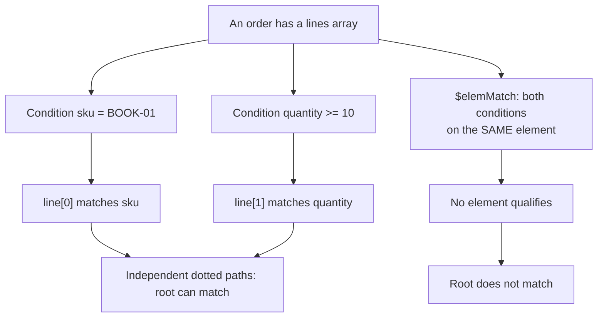

# elemMatch so Conditions Match the Same Element

> **Chapter:** Array Operations  
> **Module:** `SPRING_DATA_MONGODB` — using Spring Data MongoDB to connect, map documents, and work with MongoDB via repositories or `MongoTemplate`. This lesson explains MongoDB's **`$elemMatch`** operator in array queries, how to use it via `Criteria` and `@Query`, and its implications for aggregations, multikey indexes, array updates, transactions, reactive access, testing, and performance diagnostics.

## 1. The Problem: Two Conditions Hold, Yet Not on the Same Line Item

An order contains a `lines` array of objects:

```json
{
  "_id": "ORD-101",
  "status": "PAID",
  "lines": [
    { "sku": "BOOK-01", "quantity": 2, "fulfilled": false },
    { "sku": "PEN-02", "quantity": 30, "fulfilled": false }
  ]
}
```

Business requirement: **find orders containing at least one line with `sku = BOOK-01` and `quantity >= 10`**.

A way of writing it that looks reasonable:

```javascript
db.orders.find({
  "lines.sku": "BOOK-01",
  "lines.quantity": { $gte: 10 }
});
```

However, this query **still matches `ORD-101`**:

- The first element has `sku = BOOK-01` (yet `quantity = 2`).
- The second element has `quantity = 30` (yet `sku = PEN-02`).

MongoDB can use **two different elements of the same array** to satisfy independent dotted-path conditions. In this order **no single line item** has both that book SKU and quantity at least 10.

To require multiple conditions to **hold simultaneously on one array element**, use `$elemMatch`:

```javascript
db.orders.find({
  lines: {
    $elemMatch: {
      sku: "BOOK-01",
      quantity: { $gte: 10 }
    }
  }
});
```

**`ORD-101` no longer matches** because no single element satisfies both conditions. This is the core meaning of `$elemMatch`.



**Remember:** `$elemMatch` is an operator that **filters documents by array contents**. It does not mean “return only the matching element” — that is a separate **projection** concern.

## 2. Test Dataset for Verification

To avoid guessing, use a dataset intentionally separating independent predicates from same-element predicates. Run `drop()` only in a **test database**:

```javascript
db.orders.drop();

db.orders.insertMany([
  {
    _id: "ORD-101",
    status: "PAID",
    lines: [
      { sku: "BOOK-01", quantity: 2, fulfilled: false },
      { sku: "PEN-02", quantity: 30, fulfilled: false }
    ]
  },
  {
    _id: "ORD-102",
    status: "PAID",
    lines: [
      { sku: "BOOK-01", quantity: 12, fulfilled: false },
      { sku: "PEN-02", quantity: 1, fulfilled: true }
    ]
  },
  {
    _id: "ORD-103",
    status: "PENDING",
    lines: [
      { sku: "BOOK-01", quantity: 5, fulfilled: false },
      { sku: "BOOK-01", quantity: 15, fulfilled: true }
    ]
  },
  {
    _id: "ORD-104",
    status: "PAID",
    lines: []
  },
  {
    _id: "ORD-105",
    status: "PENDING",
    lines: [
      { sku: "BOOK-01", quantity: 1, fulfilled: false }
    ]
  },
  {
    _id: "ORD-106",
    status: "PAID"
  }
]);
```

To inspect only the IDs:

```javascript
db.orders.find(
  {
    lines: {
      $elemMatch: {
        sku: "BOOK-01",
        quantity: { $gte: 10 }
      }
    }
  },
  { _id: 1 }
).sort({ _id: 1 });
```

**Expected result:** `ORD-102` and `ORD-103`. In `ORD-103`, the **second line** satisfies both conditions; not all lines of the order need to satisfy them.

| Order | Has `sku=BOOK-01`? | Has `quantity>=10`? | Has **the same line** matching both? |
| --- | :---: | :---: | :---: |
| `ORD-101` | Yes | Yes | **No** |
| `ORD-102` | Yes | Yes | **Yes** |
| `ORD-103` | Yes | Yes | **Yes** |
| `ORD-104` | No | No | **No** |
| `ORD-105` | Yes | No | **No** |
| `ORD-106` | Missing array | Missing array | **No** |

On this dataset, the dotted-path query returns `ORD-101`, `ORD-102`, `ORD-103`; the `$elemMatch` query returns only `ORD-102`, `ORD-103`. Keep this dataset for cross-checking the Java examples below.

## 3. Exactly How Does $elemMatch Evaluate Conditions?

Given an array `A = [e1, e2, ..., en]` and two conditions `P`, `Q`:

- Independent dotted-path predicates correspond to **`exists i: P(ei)`** and **`exists j: Q(ej)`**, where `i` and `j` can be **different**.
- `$elemMatch` requires **`exists i: P(ei) and Q(ei)`** on **the same element**.

Written logically:

\[
(\exists i: P(e_i)) \land (\exists j: Q(e_j))
\quad\not\equiv\quad
\exists k: [P(e_k) \land Q(e_k)].
\]

This distinction matters whenever each element is an object representing a transaction, line item, state, device, event record, or any pair of internally related fields.

### 3.1. $elemMatch Is Existential, Not “Every Element”

The query:

```javascript
db.orders.find({
  lines: {
    $elemMatch: { sku: "BOOK-01", quantity: { $gte: 10 } }
  }
});
```

requires only **at least one** qualifying element. It does not check every line item. To ask “no line violates a rule”, express it as the non-existence of a violating element by combining `$not` with `$elemMatch` deliberately, and check missing/null array cases carefully.

### 3.2. Empty Arrays, Missing Fields, and Scalars Do Not Match

`$elemMatch` requires the target field to have **array type** to match elements:

- `lines: []`: no elements, so does not match.
- Missing `lines`: does not match.
- `lines: null`: does not match.
- `lines: {sku:"BOOK-01",quantity:12}`: a **single object**, not an array, so it does not match `$elemMatch` even if the object has matching properties.

Conversely, a dotted-path query can traverse a single object when applicable. Thus `$elemMatch` also helps **confirm array shape** in collections with mixed historical schemas.

### 3.3. Allowed Operators Inside

`$elemMatch` accepts ordinary query predicates such as `$gte`, `$lt`, `$in`, `$exists`, `$regex`, and `$and`/`$or` where applicable. Do not put `$where` or `$text` inside `$elemMatch`; MongoDB restricts those operators.

Example finding book lines with quantity at least 10 and unfulfilled:

```javascript
db.orders.find({
  lines: {
    $elemMatch: {
      sku: { $in: ["BOOK-01", "BOOK-02"] },
      quantity: { $gte: 10 },
      fulfilled: false
    }
  }
});
```

With the dataset in section 2, `ORD-102` matches while `ORD-103` does not: the `BOOK-01` line with `quantity=15` in `ORD-103` already has `fulfilled=true`. All conditions must apply to **the same line**, never borrowing `fulfilled=false` from another line.

## 4. Comparing with $and and Dotted Paths

Many try adding `$and` to solve the problem:

```javascript
db.orders.find({
  $and: [
    { "lines.sku": "BOOK-01" },
    { "lines.quantity": { $gte: 10 } }
  ]
});
```

**Does not fix it.** `$and` merely requires both predicates on the root document to hold. It **does not bind** both to the same array element. `ORD-101` can still match.

| Syntax | Same Element? | Meaning |
| --- | :---: | --- |
| `{"lines.sku":"BOOK-01","lines.quantity":{$gte:10}}` | No | Can match across two different lines. |
| `{$and:[{"lines.sku":"BOOK-01"},{"lines.quantity":{$gte:10}}]}` | No | Only combines root-level predicates. |
| `{lines:{$elemMatch:{sku:"BOOK-01",quantity:{$gte:10}}}}` | **Yes** | At least one line satisfies both. |

**Selection rule:** when fields represent related properties **within the same record inside an array**, mark the array boundary itself with `$elemMatch`.

## 5. $elemMatch with Arrays of Scalar Values

`$elemMatch` is not only for arrays of objects. Suppose:

```javascript
db.exams.insertMany([
  { _id: "E-1", scores: [50, 95] },
  { _id: "E-2", scores: [85, 70] },
  { _id: "E-3", scores: [60, 75] },
  { _id: "E-4", scores: [] }
]);
```

Goal: find exams having **a single score in the interval [80, 90)**.

If you write:

```javascript
db.exams.find({
  scores: { $gte: 80, $lt: 90 }
});
```

`E-1` matches because **95 >= 80** and **50 < 90**, even though **no score is in [80,90)**.

Correct form:

```javascript
db.exams.find({
  scores: {
    $elemMatch: { $gte: 80, $lt: 90 }
  }
});
```

Only `E-2` matches (value 85).

### What If There Is Only One Condition?

On a standard scalar array, `{scores:{$gte:80}}` already means **some element meets threshold 80**. Wrapping a single predicate in `$elemMatch` is usually unnecessary. Still, `$elemMatch` can enforce that the **field is genuinely an array** when mixed scalar values exist in data.

## 6. Nested Arrays and Constraint Levels

Consider an order containing multiple packages, each containing line items:

```json
{
  "_id": "ORD-PACK",
  "packages": [
    {
      "packageCode": "PK-1",
      "items": [
        { "sku": "BOOK-01", "quantity": 3 },
        { "sku": "PEN-02", "quantity": 20 }
      ]
    },
    {
      "packageCode": "PK-2",
      "items": [
        { "sku": "BOOK-01", "quantity": 12 }
      ]
    }
  ]
}
```

To find **a package `PK-2`** containing **an item `BOOK-01` with quantity at least 10**, use two levels of `$elemMatch`:

```javascript
db.orders.find({
  packages: {
    $elemMatch: {
      packageCode: "PK-2",
      items: {
        $elemMatch: {
          sku: "BOOK-01",
          quantity: { $gte: 10 }
        }
      }
    }
  }
});
```

The outer `$elemMatch` binds **to the same package**; the inner `$elemMatch` binds **to the same item within that package**. Using only dotted paths `packages.packageCode` and `packages.items.quantity` could match across two different packages.

For an embedded object that is **not an array**, dot notation suffices to reach properties, e.g., `"shippingAddress.city"`. Place `$elemMatch` specifically at **array** boundaries whose elements must satisfy multiple conditions together.

## 7. Using Criteria.elemMatch with MongoTemplate

### 7.1. Java Domain Model

An immutable model with embedded value objects, Java 17+:

```java
package demo.orders;

import java.util.List;
import org.springframework.data.annotation.Id;
import org.springframework.data.mongodb.core.mapping.Document;

@Document(collection = "orders")
public record Order(
    @Id String id,
    String status,
    List<OrderLine> lines
) {}

record OrderLine(
    String sku,
    int quantity,
    boolean fulfilled
) {}
```

`OrderLine` is stored **embedded inside `Order`'s `lines` array**; it does not need its own collection. `@DocumentReference` or `@DBRef` is a different model and does not let `$elemMatch` automatically join into another collection.

### 7.2. Correct Query with Criteria

```java
import java.util.List;
import org.springframework.data.mongodb.core.query.Criteria;
import org.springframework.data.mongodb.core.query.Query;

Criteria sameLine = Criteria.where("sku").is("BOOK-01")
    .and("quantity").gte(10);

Query query = Query.query(
    Criteria.where("lines").elemMatch(sameLine)
);

List<Order> orders = mongoTemplate.find(query, Order.class);
```

`mongoTemplate` is an injected `MongoTemplate` bean in the service/test. This query expresses:

```javascript
{ lines: { $elemMatch: { sku: "BOOK-01", quantity: { $gte: 10 } } } }
```

Crucially, `elemMatch(…)` is called on the **array field `lines`**, not on `lines.sku` or `lines.quantity`.

### 7.3. Incorrect Query vs. Clear Comparison

```java
// DOES NOT guarantee same element:
Query unsafe = Query.query(
    Criteria.where("lines.sku").is("BOOK-01")
        .and("lines.quantity").gte(10)
);

// Guarantees same element:
Query safe = Query.query(
    Criteria.where("lines").elemMatch(
        Criteria.where("sku").is("BOOK-01")
            .and("quantity").gte(10)
    )
);
```

On the dataset from section 2:

- `unsafe` returns `ORD-101`, `ORD-102`, `ORD-103`.
- `safe` returns only `ORD-102`, `ORD-103`.

If business rules also require `PAID` orders only:

```java
Query paidOrders = Query.query(
    Criteria.where("status").is("PAID")
        .and("lines").elemMatch(
            Criteria.where("sku").is("BOOK-01")
                .and("quantity").gte(10)
        )
);
```

Now only `ORD-102` matches the sample dataset, because `ORD-103` is `PENDING`. `status` sits on the **root**, whereas `sku` and `quantity` belong together on one **element of `lines`**.

### 7.4. Field Mapping and @Field

If the domain uses:

```java
// Inside OrderLine in another variant of the model:
@Field("item_code") String sku
```

then the BSON field inside `lines` is named `item_code`. With `MongoTemplate.find(query, Order.class)`, Spring Data applies mapping metadata per entity type; to be certain filters use the right BSON paths on custom schemas, verify executed queries in integration tests.

In `mongosh` and the raw Java Driver, always use the **actual BSON name**:

```javascript
db.orders.find({
  lines: {
    $elemMatch: {
      item_code: "BOOK-01",
      quantity: { $gte: 10 }
    }
  }
});
```

Never assume Java property names and BSON field names match when `@Field`, custom converters, or legacy schemas exist.

## 8. Repository @Query and Limits of Derived Queries

### 8.1. Explicit Declaration with @Query

```java
package demo.orders;

import java.util.List;
import org.springframework.data.mongodb.repository.MongoRepository;
import org.springframework.data.mongodb.repository.Query;

public interface OrderRepository extends MongoRepository<Order, String> {

    @Query("{ 'lines': { '$elemMatch': { 'sku': ?0, 'quantity': { '$gte': ?1 } } } }")
    List<Order> findWithLineHavingSkuAndMinQuantity(
        String sku, int minQuantity
    );

    @Query("{ 'status': ?0, 'lines': { '$elemMatch': " +
           "{ 'sku': ?1, 'quantity': { '$gte': ?2 }, 'fulfilled': false } } }")
    List<Order> findUnfulfilledLines(
        String status, String sku, int minQuantity
    );
}
```

`?0`, `?1`, and `?2` are **parameter placeholders** bound by Spring Data, not string-concatenation slots for user input. This is a JSON query annotation, not a cross-collection or server-side join.

### 8.2. Derived Method Name Pitfall

In some models, someone might write:

```java
List<Order> findByLinesSkuAndLinesQuantityGreaterThanEqual(
    String sku, int quantity
);
```

That method name expresses **two nested-path conditions**, yet **does not automatically bind them to the same array element**. Spring Data MongoDB can generate a filter with two dotted predicates equivalent to `lines.sku` and `lines.quantity`, risking false matches like `ORD-101`.

When same-element matching is mandatory, use `@Query` with `$elemMatch` or `MongoTemplate`/`Criteria.elemMatch`. With custom repositories, give the method a clear business name and implement it via `MongoTemplate` to avoid long JSON strings.

### 8.3. Pagination and Count

```java
import org.springframework.data.domain.Page;
import org.springframework.data.domain.Pageable;

@Query("{ 'lines': { '$elemMatch': { 'sku': ?0, 'quantity': { '$gte': ?1 } } } }")
Page<Order> pageByQualifiedLine(
    String sku, int minQuantity, Pageable pageable
);
```

This is an **additional method inside the repository interface**, not a standalone top-level method. When returning `Page`, Spring Data may run a count query with the same filter to compute totals. `$elemMatch` in the content filter and count filter must share **exact semantics**; avoid a custom count query using dotted predicates that mismatches the content total.

When pages only need to know whether more results exist, consider `Slice` to avoid count overhead. Provide stable sorting and supporting indexes when order counts grow large.

## 9. Query $elemMatch vs. Projection $elemMatch

**These are two different usages sharing the same operator name in different places.**

### 9.1. Query $elemMatch Filters Parent Documents

```javascript
db.orders.find({
  lines: {
    $elemMatch: {
      sku: "BOOK-01",
      quantity: { $gte: 10 }
    }
  }
});
```

MongoDB returns **qualifying orders**, and by default the `lines` array in each returned document still contains **all elements**. For instance, `ORD-102` still includes both `BOOK-01` and `PEN-02`.

### 9.2. Projection $elemMatch Returns Only the First Matching Element

```javascript
db.orders.find(
  { _id: "ORD-103" },
  {
    status: 1,
    lines: {
      $elemMatch: {
        sku: "BOOK-01",
        quantity: { $gte: 10 }
      }
    }
  }
);
```

In a **projection**, `$elemMatch` selects the **first element of the array** matching the condition and places only that element in the output array. For `ORD-103`, only the line `BOOK-01, quantity=15` appears in `lines`. This **does not** modify or delete other lines in the database.

To return **all** matching elements in the response, use aggregation `$filter` or an appropriate projection rather than relying on projection `$elemMatch`, which returns only the first element.

### 9.3. Spring Data Projection with Field.elemMatch

```java
Query oneMatchingLine = Query.query(
    Criteria.where("id").is("ORD-103")
);

oneMatchingLine.fields().elemMatch(
    "lines",
    Criteria.where("sku").is("BOOK-01")
        .and("quantity").gte(10)
);

Order projected =
    mongoTemplate.findOne(oneMatchingLine, Order.class);
```

This merely illustrates the `Query.fields().elemMatch(…)` API. If you return a full `Order` entity when projection truncated the array, the loaded object is an **incomplete aggregate snapshot**; **never call `save` on it**, or you risk overwriting the full array with the truncated one. In real applications, map read-only queries to dedicated DTOs/projections.

## 10. $filter When You Need Every Matching Element Returned

Aggregation `$filter` constructs a new array containing only elements satisfying a condition:

```javascript
db.orders.aggregate([
  {
    $match: {
      lines: {
        $elemMatch: {
          sku: "BOOK-01",
          quantity: { $gte: 10 }
        }
      }
    }
  },
  {
    $project: {
      status: 1,
      matchingLines: {
        $filter: {
          input: "$lines",
          as: "line",
          cond: {
            $and: [
              { $eq: ["$$line.sku", "BOOK-01"] },
              { $gte: ["$$line.quantity", 10] }
            ]
          }
        }
      }
    }
  }
]);
```

Roles of the two stages:

1. `$match` with `$elemMatch` **selects orders** having at least one qualifying line.
2. `$project` with `$filter` **selects every qualifying line** inside each matched order.

On `ORD-103`, `matchingLines` contains the quantity-15 line. If an order has three matching lines, `$filter` returns all three, whereas projection `$elemMatch` returns only the first.

Note `$filter` is an aggregation expression and does not mutate arrays on the server. On large collections, measure aggregation cost, output size, and query plans; projections cannot rescue an unindexed or overly broad `$match`.

## 11. Using $elemMatch for Array Updates: Still Requires a Positional Operator

`$elemMatch` **selects documents** by array contents, while **selecting which elements to modify** belongs to the update path and positional operators. Do not assume using `$elemMatch` in the query automatically tells MongoDB to update fields in all matching elements.

### 11.1. Updating the First Matching Element with $

Example marking **one** qualifying line fulfilled:

```javascript
db.orders.updateOne(
  {
    _id: "ORD-102",
    lines: {
      $elemMatch: {
        sku: "BOOK-01",
        quantity: { $gte: 10 }
      }
    }
  },
  {
    $set: { "lines.$.fulfilled": true }
  }
);
```

Positional `$` in an update locates the **first array element matching the query's array condition**. It does not mean “all matching elements”. Be careful with multiple arrays, negated queries, and deep updates; choose the right positional operator/API and test against raw BSON.

Spring Data MongoDB:

```java
Query matchingOrder = Query.query(
    Criteria.where("id").is("ORD-102")
        .and("lines").elemMatch(
            Criteria.where("sku").is("BOOK-01")
                .and("quantity").gte(10)
        )
);

Update markFirst = new Update()
    .set("lines.$.fulfilled", true);

UpdateResult result =
    mongoTemplate.updateFirst(matchingOrder, markFirst, Order.class);
```

`UpdateResult.getMatchedCount()` counts matched **parent documents**, and `getModifiedCount()` counts modified **parent documents** — **not** the number of modified array elements.

### 11.2. Updating All Matching Elements with $[identifier]

To update every `BOOK-01` line with `quantity >= 10` in one document, use the **filtered positional operator** and `arrayFilters`:

```javascript
db.orders.updateOne(
  { _id: "ORD-103" },
  { $set: { "lines.$[line].fulfilled": true } },
  {
    arrayFilters: [
      {
        "line.sku": "BOOK-01",
        "line.quantity": { $gte: 10 }
      }
    ]
  }
);
```

Spring Data:

```java
Query byId = Query.query(
    Criteria.where("id").is("ORD-103")
);

Update markAll = new Update()
    .set("lines.$[line].fulfilled", true)
    .filterArray(
        Criteria.where("line.sku").is("BOOK-01")
            .and("line.quantity").gte(10)
    );

UpdateResult updated =
    mongoTemplate.updateFirst(byId, markAll, Order.class);
```

**Important:** `Update.filterArray(…)` forwards the filter to the driver per API rules (Spring Data does not automatically map field names/types the way entity-typed queries do). When BSON uses aliases, write the **exact BSON names** inside `arrayFilters` and test on your actual Spring Data/driver version. `$[line]` and `arrayFilters` are update syntax, not Java property names.

With `updateOne` above, `modifiedCount` is still **1** even when two or more array elements inside the document were updated.

### 11.3. Do Not Split Check and Update Into Two Separate Steps

Risky pattern:

```java
boolean exists = mongoTemplate.exists(
    Query.query(Criteria.where("lines").elemMatch(
        Criteria.where("sku").is("BOOK-01")
            .and("quantity").gte(10)
    )),
    Order.class
);

// Another request may modify the array in between.
// Subsequent update assumes data still matches what exists() saw.
```

To guard the condition, include `$elemMatch` directly in the **filter of the update itself**, and use optimistic locking/versions or transactions if concurrency spans multiple documents. MongoDB guarantees atomicity at the **single-document level** for one update; `updateMulti` does not provide cross-document atomicity.

## 12. $all and Multiple Independent Requirements on One Array

Suppose an order must contain **a book line of at least 10** and **a pen line of at least 5**. These are **two independent existential requirements** on the same array, not one element carrying two SKUs simultaneously.

You can use `$all` with multiple `$elemMatch` clauses:

```javascript
db.orders.find({
  lines: {
    $all: [
      {
        $elemMatch: {
          sku: "BOOK-01",
          quantity: { $gte: 10 }
        }
      },
      {
        $elemMatch: {
          sku: "PEN-02",
          quantity: { $gte: 5 }
        }
      }
    ]
  }
});
```

These two `$elemMatch` blocks do not need to match the same element; each can be satisfied by a different element. This models **two kinds of line items**, each meeting its own minimum quantity.

Conversely, when **a single line** must meet multiple attributes at once, use **one `$elemMatch`** holding all relevant predicates. For scalar arrays, `$all` can also assert that specific values appear in the array; however, `$all` never replaces `$elemMatch` when binding attributes of a single embedded document.

## 13. Multikey Indexes and How $elemMatch Benefits Query Plans

### 13.1. Indexing Array Fields

For the `orders` collection, a candidate index:

```javascript
db.orders.createIndex({
  "lines.sku": 1,
  "lines.quantity": 1
});
```

This is a **compound multikey index** on two fields of the same embedded-document array. MongoDB imposes specific rules on compound multikey indexes (especially when indexing multiple array paths), so only create indexes matching actual shapes and test creation on existing data.

With the query:

```javascript
db.orders.find({
  lines: {
    $elemMatch: {
      sku: "BOOK-01",
      quantity: { $gte: 10 }
    }
  }
}).explain("executionStats");
```

`$elemMatch` not only makes the query **logically right**; because all predicates share a single array path, it can also help MongoDB **combine (compound/intersect) index bounds** on the multikey index when applicable.

With only:

```javascript
db.orders.find({
  "lines.sku": "BOOK-01",
  "lines.quantity": { $gte: 10 }
}).explain("executionStats");
```

the planner cannot assume both predicates target the same array element. Hence you should not expect the same index-bound utilization or result set as `$elemMatch`. Actual index selection still depends on cardinality, MongoDB version, data size, and other filters.

### 13.2. Do Not Treat elemMatch as an Unconditional Speedup

Even with `$elemMatch`, MongoDB may still need to **FETCH documents to verify predicates**, depending on the index and query. `$elemMatch` does not guarantee a covered query.

When diagnosing, inspect:

- `winningPlan`, `IXSCAN`/`COLLSCAN`, and `FETCH`.
- `indexBounds` for `lines.sku` and `lines.quantity`.
- `totalKeysExamined`, `totalDocsExamined`, and documents returned.
- Sort/pagination cost if the API adds `Sort` or `Pageable`.
- Distribution of array lengths and duplicate value frequencies.

An array with thousands of elements per document has very different indexing, update, and document-size costs than an array with 2–3 elements. For unbounded arrays (e.g., millions of events), store them in a **separate child collection** with a parent key and dedicated indexes instead of embedding indefinitely.

### 13.3. Combining Root and Array Conditions

If APIs often filter `status=PAID` alongside `$elemMatch` on `lines`, you can evaluate an index:

```javascript
db.orders.createIndex({
  status: 1,
  "lines.sku": 1,
  "lines.quantity": 1
});
```

This is a candidate to **benchmark**, not a mandatory index. Weigh it against the rest of the workload, write overhead, multikey bounds, and real data. Before creating it in production, check existing index counts, server limits, sharding compatibility, and write throughput impact.

## 14. Null, Missing, Inconsistent BSON Types, and Legacy Data

### 14.1. Fields Inside Elements Can Be Missing

Consider:

```javascript
{ _id: "N-1", lines: [{ sku: "BOOK-01" }] }
{ _id: "N-2", lines: [{ sku: "BOOK-01", quantity: null }] }
{ _id: "N-3", lines: [{ sku: "BOOK-01", quantity: 10 }] }
```

The filter:

```javascript
{
  lines: {
    $elemMatch: {
      sku: "BOOK-01",
      quantity: { $gte: 10 }
    }
  }
}
```

should not be thought of as “defaulting quantity=0”; it evaluates stored values under MongoDB comparison semantics. Across the three documents, `N-3` matches with numeric 10; `N-1` lacks quantity and `N-2` has null.

If you write `quantity: null` inside `$elemMatch`, MongoDB applies null-or-missing semantics to subfields, so **both `quantity: null` and missing `quantity`** match. To match only explicit BSON Null, use `{quantity:{$type:"null"}}`; to require field presence, use `$exists: true`.

### 14.2. Avoid Mixing Strings with Numbers

```javascript
{ _id: "N-4", lines: [{ sku: "BOOK-01", quantity: "12" }] }
```

`quantity` is stored as a **BSON String**, not a numeric type. Never expect `$gte: 10` to parse `"12"` into integer 12. If a collection has mixed schemas, audit BSON types and migrate before relying on indexes or range queries.

### 14.3. Embedded Documents vs. Document References

`$elemMatch` inspects **array contents embedded in the queried document**. If `lines` is `List<LineReference>` in Java while MongoDB stores only IDs or DBRefs, queries like `"lines.sku"` do not automatically join across collections.

Options in that case:

- Query the separate line-item collection by `orderId` and child predicates.
- Denormalize query-critical fields onto the root with a clear synchronization policy.
- Use aggregation `$lookup` and appropriate stages when server-side joins are required.

Switching from embedding to references **changes the BSON schema**; you cannot just change Java types and keep derived queries intact.

## 15. Reactive Access and Memory Control When Querying Arrays

### 15.1. ReactiveMongoTemplate

`ReactiveMongoTemplate` uses the same `Query`/`Criteria` syntax, returning a reactive publisher:

```java
import reactor.core.publisher.Flux;
import org.springframework.data.mongodb.core.query.Criteria;
import org.springframework.data.mongodb.core.query.Query;

Query query = Query.query(
    Criteria.where("lines").elemMatch(
        Criteria.where("sku").is("BOOK-01")
            .and("quantity").gte(10)
    )
);

Flux<Order> found =
    reactiveMongoTemplate.find(query, Order.class);
```

Upon subscription, the driver executes the query reactively; **`$elemMatch` semantics remain unchanged**. Reactive access also does not turn queries over collection references into automatic joins.

### 15.2. Fetch Only What You Need

If the UI shows one summary per order while documents carry thousands of lines, use projection/aggregation to cut network payload; avoid calling `collectList()` on an unbounded `Flux` just to turn it into a Java list. Use `limit`/`Pageable`, indexes, backpressure, and bounded concurrency.

Be mindful of projection `$elemMatch`: it returns only **the first matching element**, which is wrong if the API needs all qualifying lines. Use `$filter`/appropriate DTOs instead.

### 15.3. Transactions and Consistency

An update modifying only one document's array is atomic at the **document level**; if multiple documents must update together (e.g., orders and inventory in another collection), use transactions on a supporting MongoDB topology. `$elemMatch` only defines a filter and **never opens a transaction or locks other documents**.

## 16. Integration Testing: Include Data That “Tricks” Dotted Queries

If every element has `sku=BOOK-01` and `quantity>=10`, both query styles return the same result — such a test **fails to catch the logic bug**. Test fixtures must include **`ORD-101`**: one line with the right SKU but low quantity, and another line with high quantity but the wrong SKU.

### 16.1. Seeding Real Data

Assume an isolated test MongoDB, Spring Boot/Spring Data, and JUnit 5. Seed real data:

```java
import java.util.List;
import org.bson.Document;
import static org.assertj.core.api.Assertions.assertThat;

mongoTemplate.getCollection("orders").insertMany(List.of(
    new Document("_id", "ORD-101")
        .append("status", "PAID")
        .append("lines", List.of(
            new Document("sku", "BOOK-01").append("quantity", 2)
                .append("fulfilled", false),
            new Document("sku", "PEN-02").append("quantity", 30)
                .append("fulfilled", false)
        )),
    new Document("_id", "ORD-102")
        .append("status", "PAID")
        .append("lines", List.of(
            new Document("sku", "BOOK-01").append("quantity", 12)
                .append("fulfilled", false)
        ))
));
```

**Note:** this seed snippet belongs **inside an integration test with `MongoTemplate` injected**, not as a standalone Java file. Clean/isolate the collection before tests, and never run `dropCollection` on shared or production databases.

### 16.2. Asserting the Crucial Difference

```java
Query dotted = Query.query(
    Criteria.where("lines.sku").is("BOOK-01")
        .and("lines.quantity").gte(10)
);

Query sameElement = Query.query(
    Criteria.where("lines").elemMatch(
        Criteria.where("sku").is("BOOK-01")
            .and("quantity").gte(10)
    )
);

var dottedIds = mongoTemplate.find(dotted, Order.class)
    .stream().map(Order::id).toList();

var elemMatchIds = mongoTemplate.find(sameElement, Order.class)
    .stream().map(Order::id).toList();

assertThat(dottedIds)
    .containsExactlyInAnyOrder("ORD-101", "ORD-102");
assertThat(elemMatchIds)
    .containsExactly("ORD-102");
```

This test proves the logic bug is prevented: `ORD-101` is a false positive when predicates are allowed to match across two different elements.

### 16.3. Additional Test Cases to Include

| Scenario | What to Verify |
| --- | --- |
| One line meets both conditions | `$elemMatch` returns the order. |
| Two lines split the two conditions | Dotted query returns the order; `$elemMatch` does not. |
| Two lines both qualify | `$elemMatch` returns the order once without duplicating the root document. |
| Empty array or missing array field | Does not match `$elemMatch`. |
| `quantity` is null/missing/String | Not mistaken for a valid integer. |
| Nested packages/items arrays | Requires matching `$elemMatch` levels to bind conditions within one package/item. |
| Projection `$elemMatch` | Only the first matching element is returned. |
| Aggregation `$filter` | Returns all matching elements in the projection. |
| Positional update `$` | Modifies only the first match, leaving other lines untouched. |
| `arrayFilters` and `$[line]` | Matching elements are updated; `modifiedCount` counts documents. |
| Compound multikey index | `explain` shows actual bounds and execution plan. |
| Reactive query | Logical results match the imperative query on the same BSON. |

### 16.4. Inspecting Query Plans

On a sufficiently large test dataset, measure separately:

```javascript
db.orders.find({
  "lines.sku": "BOOK-01",
  "lines.quantity": { $gte: 10 }
}).explain("executionStats");

db.orders.find({
  lines: {
    $elemMatch: {
      sku: "BOOK-01",
      quantity: { $gte: 10 }
    }
  }
}).explain("executionStats");
```

Compare `nReturned` **and** `totalDocsExamined`/`totalKeysExamined`; more matches from the dotted query reflect **different semantics**, so do not judge speed solely by raw time when result counts differ. Meaningful performance comparisons must account for the fact that the two queries **are not logically equivalent**.

## 17. Common Pitfalls and Diagnostics

| Symptom | Cause | Resolution |
| --- | --- | --- |
| Order with book quantity 2 still matches quantity >= 10 | Two dotted predicates matched two different elements. | Wrap both in one `$elemMatch` on `lines`. |
| Added `$and`, yet still getting wrong matches | `$and` combines root predicates, not same-element bounds. | Group conditions inside `$elemMatch`. |
| `$elemMatch` does not match despite object having fields | Field is a single object or reference ID, not an array of embedded docs. | Inspect raw BSON and align query/schema. |
| `$elemMatch` returns whole root rather than trimming array | Query filter is not a projection. | Use projection `$elemMatch` or aggregation `$filter`. |
| Projection `$elemMatch` returns only one line | Projection returns only the first matching element. | Use `$filter` if all matches are needed. |
| Nested array condition matched across two packages | Missing `$elemMatch` at the package level. | Add nested `$elemMatch` at every array boundary to bind. |
| Update modified only one line when multiple qualified | Positional `$` targets the first matching element. | Use `$[identifier]` with `arrayFilters` for all matches. |
| Right query, yet reading huge arrays | Root returns the entire array after matching. | Design DTO/projection or `$filter`; check memory. |
| Query slow despite index | Unoptimized multikey bounds, huge arrays, unselective filter, wrong index. | Inspect `explain` and real index paths. |
| Java property name mismatches BSON | `@Field`, legacy schema, or converter. | Check `MongoTemplate` mapping and raw document. |
| Page count differs from content | Count query used dotted predicates instead of `$elemMatch`. | Ensure both use identical filter logic. |
| Data changed mid-update | Separate check/write steps, missing status/version guard. | Put predicates in the update filter; use optimistic locking if needed. |

**Short debug checklist:** (1) inspect raw document; (2) identify which fields are arrays; (3) trace which element satisfies each predicate; (4) place `$elemMatch` on the target array; (5) test query in `mongosh`; (6) translate to Spring Data; (7) test with false-positive fixtures; (8) inspect `explain` if tuning is needed.

## 18. Hands-On Exercise: Checking Batch Quantities

**Context:** a warehouse system receives orders containing `lines`; each line has `sku`, `quantity`, and `fulfilled`. The team needs to find orders with **a qualifying line**, display matching lines, and update fulfillment status.

1. Create `Order` and `OrderLine` entities from section 7, and seed `ORD-101` through `ORD-106`.
2. Run the dotted query `lines.sku=BOOK-01` and `lines.quantity>=10`, recording matching IDs. Explain why `ORD-101` is a false positive.
3. Write `Criteria.where("lines").elemMatch(...)` and the `@Query` version; prove both return `ORD-102`, `ORD-103`.
4. Add root predicate `status=PAID`. Prove `ORD-103` is excluded despite having a qualifying line.
5. Write another query requiring `BOOK-01`, quantity >= 10, and `fulfilled=false` **on the same element**. Analyze results for each order.
6. Use projection `$elemMatch` and compare the returned array against the root-filtering query.
7. Use aggregation `$filter` to return **every** qualifying line, explaining why it differs from projection `$elemMatch`.
8. Write an update with `lines.$.fulfilled` to update the first match. Then try `lines.$[line].fulfilled` with `arrayFilters` to update every qualifying element.
9. Create a compound multikey index `{ "lines.sku": 1, "lines.quantity": 1 }` and compare `explain("executionStats")` on a sizable dataset.
10. Add a document with `packages` containing `items`; write nested `$elemMatch` requiring package code and item quantity in the same package.
11. Write integration tests including a “trap” document like `ORD-101`, plus empty array, missing field, null, and mistyped BSON cases.
12. Write a reactive version using `ReactiveMongoTemplate.find` and verify the ID set matches the imperative version.

### Self-Check Questions

- Why can `lines.sku` and `lines.quantity` match two different elements?
- Does `$and` guarantee the same element? Why or why not?
- Is `$elemMatch` placed on `lines` or on `lines.sku`?
- Does `$elemMatch` require every element in the array to qualify?
- How does `$elemMatch` behave on numeric array `[50,95]` for interval `[80,90)`?
- With arrays nested inside arrays, what is needed to keep package and item coupled?
- How does query `$elemMatch` differ from projection `$elemMatch`?
- Why is aggregation `$filter` better for returning all matching elements?
- How does positional `$` differ from `$[line]` with `arrayFilters`?
- Why does `modifiedCount=1` not mean only one line was updated?
- How can `$elemMatch` affect MongoDB's use of a compound multikey index?
- Why should you inspect raw BSON before writing queries over object references or `@Field` aliases?

## 19. Takeaways and Reference Documentation

- **Independent dotted predicates** on an array can match **different elements**.
- **`$elemMatch`** requires **at least one element** of the array to satisfy **all conditions** inside it.
- **`$and` does not replace `$elemMatch`** when requiring the same element.
- Spring Data MongoDB uses `Criteria.where("lines").elemMatch(...)` or `@Query` to express this explicitly.
- **Query `$elemMatch` filters parent documents**; **projection `$elemMatch` returns only the first matching element**; `$filter` returns all matching elements in the output array.
- With nested arrays, put `$elemMatch` at **each array level** where predicates must bind together.
- In updates, `$elemMatch` only identifies the root document; use `$` or `$[identifier]`/`arrayFilters` to control which elements are modified.
- `$elemMatch` can help **combine multikey index bounds** on the same array path, though `explain` must be checked on real data.
- Missing/null/mistyped BSON data, document references, and partial entity projections are key bug sources to test.
- Keep content query, count query, and update filters aligned to **exact business semantics**; reactive APIs or transactions do not alter `$elemMatch` meaning.

Official documentation to consult for your exact MongoDB/Spring Data version:

- [MongoDB — `$elemMatch` (query)](https://www.mongodb.com/docs/manual/reference/operator/query/elemMatch/)
- [MongoDB — Query an Array of Embedded Documents](https://www.mongodb.com/docs/manual/tutorial/query-array-of-documents/)
- [MongoDB — `$elemMatch` (projection)](https://www.mongodb.com/docs/manual/reference/operator/projection/elemMatch/)
- [MongoDB — `$filter` (aggregation)](https://www.mongodb.com/docs/manual/reference/operator/aggregation/filter/)
- [MongoDB — Multikey Index Bounds](https://www.mongodb.com/docs/manual/core/indexes/index-types/index-multikey/multikey-index-bounds/)
- [MongoDB — Filtered Positional Operator `$[<identifier>]`](https://www.mongodb.com/docs/manual/reference/operator/update/positional-filtered/)
- [Spring Data MongoDB — Template Query Operations](https://docs.spring.io/spring-data/mongodb/reference/mongodb/template-query-operations.html)
- [Spring Data MongoDB — Updating Documents](https://docs.spring.io/spring-data/mongodb/reference/mongodb/template-crud-operations.html)
- [Spring Data MongoDB — Criteria API](https://docs.spring.io/spring-data/mongodb/reference/api/java/org/springframework/data/mongodb/core/query/Criteria.html)
