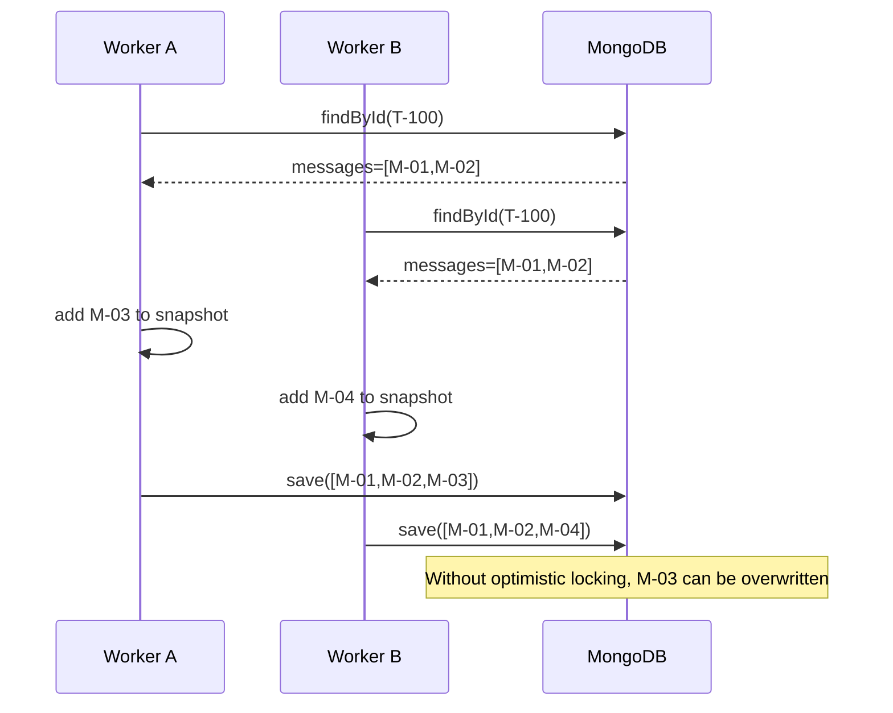

# Write Contention and Size Limits When Arrays Grow Continuously in Spring Data MongoDB

## 1. Context: Arrays Are Convenient for Reads, Not Infinite Storage

**Spring Data MongoDB** helps Java applications work with MongoDB documents via repositories or `MongoTemplate`. A common pattern is embedding lists inside a parent document: ticket messages, order status histories, group member lists, interactions, or recent events.

Initially this looks attractive: reading a single document retrieves all data needed for display, and many updates touch only **one document**. Yet as an array grows continuously, two problems emerge:

1. **Write contention:** many requests concurrently append, remove, or edit elements of **the same parent document**. Sequential updates from stale snapshots can lose data; even atomic updates can create a throughput hotspot.
2. **BSON size:** MongoDB caps **a single BSON document at 16 MiB**. This limit covers the array, all other fields, field names, and BSON overhead—not 16 MiB dedicated solely to string payloads or array elements.

This lesson in the **Array Operations** chapter explains how to choose among `$push`, `$addToSet`, `$pull`, `$set`, optimistic locking, atomic conditional updates, bounded arrays, and when to extract each element into its own document. The goal is preserving data correctness under concurrent workloads, measuring real limits, and designing schemas that scale over time.

### 1.1. Running Example: Customer Support Ticket

A ticket with messages:

```javascript
{
  _id: "T-100",
  status: "OPEN",
  messageCount: 2,
  messages: [
    {
      messageId: "M-01",
      authorId: "U-01",
      body: "I need support",
      createdAt: ISODate("2026-02-01T08:00:00Z")
    },
    {
      messageId: "M-02",
      authorId: "U-02",
      body: "We have received your request",
      createdAt: ISODate("2026-02-01T08:01:00Z")
    }
  ]
}
```

Suppose hundreds of messages arrive every minute for the same ticket. You could keep all messages in `messages`, keep only the 50 most recent messages, or store each message as its own document. These three options have **different complexity, consistency, and capacity limits**.

### 1.2. Distinguishing Four Requirements Before Choosing a Write Pattern

| Business Requirement | Property to Guarantee | Technical Approach to Consider |
|---|---|---|
| Append every event with no record loss | Unbounded storage over time | Child collection, one document per event |
| Display the 50 newest events | Only a recent window is needed | `$push` with `$each`/`$slice` |
| Add ID to a set without duplicates | Uniqueness by clear rules | `$addToSet` or unique index on child collection |
| At most 100 members/messages in one document | Check and write must be atomic | Conditional update with `$push`/`$inc` and state filter |

Never embed data in an array merely because MongoDB supports arrays. **Write frequency, query needs, data lifecycle, and document limits** must be evaluated during schema modeling.

## 2. Atomicity of Single-Document Updates

MongoDB guarantees **every write operation on a single document is atomic within that document**, even when modifying multiple fields or array elements. This is the key foundation behind update operators.

```mermaid
sequenceDiagram
    participant A as Request A
    participant B as Request B
    participant DB as MongoDB: ticket T-100
    A->>DB: $push messages += M-03
    B->>DB: $push messages += M-04
    DB-->>A: Write complete
    DB-->>B: Write complete
    Note over DB: Both single-doc updates are atomic; write order may differ from request order
```

Two independent `$push` commands targeting the same array execute sequentially on the server: if both succeed and no `$slice` drops elements, **both values end up in the array** rather than the later request overwriting the entire list from the earlier request.

However, **atomicity does not eliminate contention**:

- If very high write traffic targets the same `_id`, that document becomes a hotspot.
- The order of elements appended by concurrent requests is **not guaranteed to match business chronological order**.
- A retried `$push` after a timeout can append **duplicate elements** without idempotency protection.
- A `$push + $slice` update trims old elements, so the final array does not necessarily keep every event ever added.
- When a business operation spans **multiple documents**, single-document atomicity does not cover all steps together.

### 2.1. $push: Appending to an Array Without Rewriting an Old Snapshot

```javascript
db.tickets.updateOne(
  { _id: "T-100" },
  {
    $push: {
      messages: {
        messageId: "M-03",
        authorId: "U-01",
        body: "Please share an update",
        createdAt: ISODate("2026-02-01T08:02:00Z")
      }
    },
    $inc: { messageCount: 1 }
  }
);
```

`$push` appends the element to the array while `$inc` increments the counter in **the same atomic update**. If the command succeeds, ordinary single-document reads never observe an intermediate state where the count incremented without the message added.

For the counter to stay accurate, **every write path modifying the array must update the count consistently**. A deletion or backfill path forgetting `messageCount` causes drift. If keeping only the 50 most recent messages, name and define `messageCount` explicitly as either **total messages ever received** or **elements currently stored**—never mix both meanings in one field.

### 2.2. $addToSet: Avoiding Duplicates by BSON Equality

When storing an array of IDs or tags:

```javascript
db.tickets.updateOne(
  { _id: "T-100" },
  { $addToSet: { watcherIds: "U-03" } }
);
```

`$addToSet` inserts only if the array does not already contain an **equal value under MongoDB comparison rules**. Two concurrent requests adding `"U-03"` do not produce two identical copies. Still, remember:

- It **does not remove** duplicates that already existed.
- For embedded documents, field order and full content affect whether two values count as equal.
- It does not enforce uniqueness by a business key like `messageId` if two objects differ in `body` or `createdAt`.
- `$addToSet` does not cap element counts; the array can still grow until hitting the BSON limit.

To guarantee business uniqueness across millions of messages, a child collection with a **unique index** on `(ticketId, messageId)` is far clearer than an embedded array.

### 2.3. $pull, $pop, and Element Updates

Removing all array elements matching a condition:

```javascript
db.tickets.updateOne(
  { _id: "T-100" },
  { $pull: { messages: { messageId: "M-02" } } }
);
```

`$pull` removes **every matching element**, not only the first. If you maintain a count on the same document, account accurately for how many elements were actually deleted; **do not** blindly pair `$pull` with `$inc: -1` when zero or multiple elements may match.

`$pop: { messages: 1 }` removes the last element; `$pop: { messages: -1 }` removes the first element. This operates by **position**, not by business key. Under concurrent additions/removals, never use `$pop` expecting to delete “user X's message”.

## 3. Lost Updates When Reading–Modifying–Saving the Entire Document

### 3.1. Why Reasonable-Looking Java Code Still Fails

A common pattern:

```java
Ticket ticket = mongoTemplate.findById("T-100", Ticket.class);
ticket.getMessages().add(newMessage);
mongoTemplate.save(ticket);
```

With one request at a time, this appears fine. Yet if two requests read **the same version** of the ticket before saving:



`save(...)` rewrites entity state and does not merge two lists edited from stale snapshots. **Atomicity of each individual save does not prevent lost updates between two operations.**

> Note: on an entity with `@Version` and properly configured optimistic locking, saving from a stale snapshot can be rejected instead of silently overwriting. This section illustrates the risk of read–modify–save **without conflict detection**.

### 3.2. Prefer Atomic Operators for Local Changes

If the intent is only **appending one message**, there is no need to load the whole array into Java. Update on the server:

```java
import com.mongodb.client.result.UpdateResult;
import org.springframework.data.mongodb.core.MongoTemplate;
import org.springframework.data.mongodb.core.query.Criteria;
import org.springframework.data.mongodb.core.query.Query;
import org.springframework.data.mongodb.core.query.Update;

Query byId = Query.query(Criteria.where("id").is(ticketId));
Update change = new Update()
    .push("messages", newMessage)
    .inc("messageCount", 1);

UpdateResult result = mongoTemplate.updateFirst(
    byId, change, Ticket.class);

if (result.getMatchedCount() != 1L) {
    throw new IllegalArgumentException("Ticket not found");
}
```

`Ticket.class` supplies Spring Data field mapping; properties like `messages` and `messageCount` map to their BSON names. Never call `save(...)` after `updateFirst(...)` just to “confirm” the update: an extra read–write cycle can introduce unnecessary races.

**When is read–modify–save still appropriate?** When a business rule must inspect multiple entity fields, compute a complex update, and use `@Version` to reject stale snapshots. When only `$push`, `$pull`, or `$set` on an element is needed, atomic updates are usually simpler and safer.

### 3.3. Never Use Array Index as a Stable Identity

Two requests reading “the 3rd element” and updating via:

```javascript
{ $set: { "messages.2.body": "Edited" } }
```

can edit the wrong element if another task ran `$pull`, `$pop`, or reordered the array. Index positions reflect **current placement**, not durable identity.

When editing a message by `messageId`, filter by that element key or consider extracting messages into independent documents.

## 4. Java Model Used in Spring Data Examples

Sample entity:

```java
import java.util.ArrayList;
import java.util.List;
import org.springframework.data.annotation.Id;
import org.springframework.data.annotation.Version;
import org.springframework.data.mongodb.core.mapping.Document;

@Document("tickets")
public class Ticket {
    @Id
    private String id;
    private String status;
    private List<TicketMessage> messages = new ArrayList<>();
    private long messageCount;

    @Version
    private Long version;

    protected Ticket() {}

    public Ticket(String id) {
        this.id = id;
        this.status = "OPEN";
    }

    public String getId() { return id; }
    public String getStatus() { return status; }
    public List<TicketMessage> getMessages() { return messages; }
    public long getMessageCount() { return messageCount; }
    public Long getVersion() { return version; }
}
```

Value object for a message:

```java
import java.time.Instant;

public record TicketMessage(
    String messageId,
    String authorId,
    String body,
    Instant createdAt
) {}
```

Here:

- `@Id` binds the entity to BSON `_id`.
- `messages` is an embedded array. Spring Data maps `TicketMessage` and `Instant` via active converters.
- `messageCount` remains accurate only when kept synchronized across every add/remove path per business rules.
- `@Version` enables optimistic locking on entity operations like `save(...)`; it is **not a distributed lock** and does not turn an array into an independent database.

In raw BSON examples, fields like `version` or type hint `_class` may appear depending on the write/mapping path; illustrative raw schemas do not always list every Spring Data metadata field.

## 5. Optimistic Locking with @Version and Conditional Updates

### 5.1. What Conflicts Does @Version Solve?

Suppose two users edit a ticket using **read–modify–save**. With `@Version Long version` on `Ticket`, Spring Data MongoDB includes the version in the condition of supported entity save/update paths and increments it on success. If the object was loaded from a stale version, the write throws `OptimisticLockingFailureException` instead of overwriting newer state.

Repository example:

```java
import org.springframework.data.mongodb.repository.MongoRepository;

public interface TicketRepository
        extends MongoRepository<Ticket, String> {
}
```

```java
import org.springframework.dao.OptimisticLockingFailureException;

Ticket ticket = ticketRepository.findById("T-100")
    .orElseThrow();

ticket.getMessages().add(new TicketMessage(
    "M-05", "U-03", "Additional info", java.time.Instant.now()));

try {
    ticketRepository.save(ticket);
} catch (OptimisticLockingFailureException conflict) {
    // Reload latest state, re-evaluate business rules,
    // then decide whether to retry, return 409, or ask the user to retry.
    throw conflict;
}
```

Key takeaways:

1. `@Version` **detects** optimistic conflicts; it does not auto-merge two lists.
2. When retrying, **reload the latest state and reapply the intended change**; never repeat `save` on the stale object.
3. An operation might have succeeded on the server before the client lost the response; design idempotency before retrying so the same message is not appended twice.
4. Failure detection requires an acknowledged write concern; with `WriteConcern.UNACKNOWLEDGED`, the application cannot rely on write acknowledgments for optimistic locking.

Under high write throughput, if all requests mutate a hot ticket via `save` with `@Version`, they will constantly conflict and retry. That does not magically scale throughput; when only appending elements, compare against atomic `$push`.

### 5.2. Do Not Assume Typed updateFirst Checks Stale Versions Automatically

Spring Data may auto-increment an `@Version` field on some update operations if the update itself omits the version field, yet that **does not mean an arbitrary `updateFirst(...)` automatically checks the read version**. To achieve *compare-and-set*, the query filter must explicitly include the expected version or the business status condition to guard.

Example updating only while status and version match:

```java
long expectedVersion = 3L; // Obtained from the loaded ticket.

Query predicate = Query.query(
    Criteria.where("id").is("T-100")
        .and("version").is(expectedVersion)
        .and("status").is("OPEN"));

Update update = new Update()
    .set("status", "RESOLVED");

var outcome = mongoTemplate.updateFirst(
    predicate, update, Ticket.class);

if (outcome.getMatchedCount() == 0L) {
    // Ticket was closed, version changed, deleted, or missing.
    // Do not assume this always means "not found".
}
```

Here `version` is a mapped property of `Ticket`. Whether typed updates auto-increment version depends on the active Spring Data version semantics; to **explicitly manage version**, verify the update API, auto-increment behavior, and test raw documents. Never accidentally increment version twice if the framework already increments it.

To prevent `RESOLVED` from being overwritten by another request, include `status = OPEN` directly in the update filter. When the server executes a single-document update, predicates are evaluated atomically against the current document state; if no longer matching, no update occurs.

## 6. Capping Element Counts Under Write Contention

### 6.1. Checking Length First and Then Calling $push Is Unsafe

Suppose a ticket may hold at most 100 messages in one document. This approach has a race condition:

```java
Ticket ticket = mongoTemplate.findById(ticketId, Ticket.class);
if (ticket.getMessages().size() < 100) {
    mongoTemplate.updateFirst(
        Query.query(Criteria.where("id").is(ticketId)),
        new Update().push("messages", newMessage),
        Ticket.class);
}
```

Two requests can both read `size = 99`, both proceed, and leave the array with 101 elements. Even though **each `$push` is atomic**, the size check in Java **is outside** the atomic update.

### 6.2. Combining the Check and Write in One Atomic Conditional Update

If the document maintains `messageCount` matching the current stored count and **every update maintains that count**, place the cap directly in the query:

```javascript
db.tickets.updateOne(
  {
    _id: "T-100",
    messageCount: { $lt: 100 },
    "messages.messageId": { $ne: "M-NEW" }
  },
  {
    $push: {
      messages: {
        messageId: "M-NEW",
        authorId: "U-03",
        body: "A message",
        createdAt: ISODate("2026-02-01T08:03:00Z")
      }
    },
    $inc: { messageCount: 1 }
  }
);
```

The predicate and update execute as **one single-document operation**. Provided initial data is consistent and all writers obey the same rules:

- Once count reaches 100, subsequent requests fail to match; the array never exceeds the cap.
- Two requests that previously saw count 99 cannot both bypass the cap: the predicate is evaluated during update execution, so one succeeds and the other gets `matchedCount = 0`.
- `"messages.messageId": { $ne: "M-NEW" }` prevents duplicate IDs **as long as that ID remains in the array**.

Do not assume `matchedCount = 0` definitely means “full”: it could also mean the ticket does not exist, the message ID is a duplicate, the status is invalid, or another predicate failed. Re-read for diagnostics if needed to craft the right error, without turning that read into an external check followed by an unguarded write.

### 6.3. Implementing the Same Logic in MongoTemplate

```java
public boolean appendIfCapacity(
        MongoTemplate template,
        String ticketId,
        TicketMessage message) {

    final long MAX_MESSAGES = 100L;

    Query filter = Query.query(
        Criteria.where("id").is(ticketId)
            .and("messageCount").lt(MAX_MESSAGES)
            .and("messages.messageId").ne(message.messageId()));

    Update modification = new Update()
        .push("messages", message)
        .inc("messageCount", 1);

    return template.updateFirst(filter, modification, Ticket.class)
        .getMatchedCount() == 1L;
}
```

`TicketMessage` needs a deterministic `messageId`. Derive `messageId` from a server-controlled/validated idempotency key rather than text content. In multi-tenant systems, add a trusted tenant filter when collections are shared across tenants; this simplified snippet illustrates the single-ticket cap.

**Limitations of this example:**

- `messageCount` must be accurate initially; legacy count drift can defeat the cap.
- Every delete/move path must adjust count accurately; with `$pull` removing multiple elements, never blindly subtract 1.
- `messages` must actually be an array; if the field holds another type, `$push` fails.
- If the document hits **16 MiB before reaching 100 messages**, writes still fail due to the BSON size limit.
- With arrays sliced to the latest N items, older IDs drop out, so “ID not in array” **does not provide permanent idempotency**.

### 6.4. What If the Count Can Drift?

You can check current array length via `$size` in aggregation/query expressions, though this complicates queries and limits index usage. A materialized counter improves simple filter performance at the cost of **maintaining the invariant across all write paths**.

If “at most 100 elements” is a critical invariant, run concurrent-writer integration tests, add schema validators, and clean legacy data. If element counts are expected to grow continuously, consider **migrating to a child collection** instead of repeatedly raising `MAX_MESSAGES`.

## 7. Bounded Arrays: Keeping Only the Latest N Elements

For activity feeds, chat previews, or recent interactions, often only the latest 50–100 items are needed. MongoDB supports `$push` with `$each` and `$slice` modifiers in **one atomic update**.

### 7.1. $push + $each + $slice

```javascript
db.tickets.updateOne(
  { _id: "T-100" },
  {
    $push: {
      recentMessages: {
        $each: [
          {
            messageId: "M-06",
            createdAt: ISODate("2026-02-01T08:06:00Z"),
            body: "New update"
          }
        ],
        $slice: -50
      }
    }
  }
);
```

With `$slice: -50`, MongoDB keeps the **last 50 elements** after appending. With `$slice: 50`, MongoDB keeps the **first 50 elements** in the array's current order. Both cap length yet serve opposite ordering conventions. `$each` is mandatory when combining modifiers like `$slice`; even a single item must be wrapped in a one-element array.

Contrast with `$pull`:

- `$slice` in `$push` caps the **post-update array window**.
- `$pull` deletes elements **matching a condition**, not for keeping the latest N items.
- Read-query projection `$slice` only caps **elements returned on read**, without shrinking the stored array; see section 10.

### 7.2. Spring Data MongoTemplate

```java
Update bounded = new Update()
    .push("recentMessages")
    .slice(-50)
    .each(newMessage);

mongoTemplate.updateFirst(
    Query.query(Criteria.where("id").is(ticketId)),
    bounded,
    Ticket.class);
```

This snippet assumes `Ticket` adds `List<TicketMessage> recentMessages` or an equivalent entity; declare that field in the real model so mapping is explicit. `Update.PushOperatorBuilder` expresses `$each`/`$slice`; check the exact fluent API syntax for your Spring Data MongoDB version.

A **bounded array does not store full history**. Items sliced off the array are gone from that document. If the product requires auditing or historical lookup, persist full history **elsewhere**, such as in a `ticket_messages` collection, before using a bounded preview.

### 7.3. $sort + $slice When Chronological Order Matters

Keeping the 50 newest messages sorted ascending by `createdAt`:

```javascript
db.tickets.updateOne(
  { _id: "T-100" },
  {
    $push: {
      recentMessages: {
        $each: [
          {
            messageId: "M-07",
            createdAt: ISODate("2026-02-01T08:07:00Z"),
            body: "Follow-up"
          }
        ],
        $sort: { createdAt: 1, messageId: 1 },
        $slice: -50
      }
    }
  }
);
```

In a single operation, MongoDB inserts the item, sorts the array by the specified keys, and retains the last 50 elements. Adding tie-breaker `messageId` keeps order deterministic when two messages share a timestamp. Still:

- `createdAt` must have a uniform BSON type—never mix Strings and Dates.
- Business chronology still depends on the timestamp source; late-arriving requests can carry older `createdAt` values.
- `$sort` on an array incurs processing cost proportional to current length; if N is large or write rates are high, the document can still become a hotspot.
- Array ordering is not a guarantee of **commit** order across independent requests.

### 7.4. Bounded Arrays Do Not Automatically Eliminate Hot-Document Contention

Capping at 50 items prevents unbounded document growth, yet **every request still updates the same `T-100` document**. At 10,000 requests/second on a single ticket, bounding array length does not distribute write load.

For high-volume append histories and time-range queries, storing each message as its own document scales far better in growth and partitioning. You may still maintain `recentMessages` as a **cache/preview** on the parent document, provided you clearly define the *source of truth* and consistency policy.

## 8. The 16 MiB BSON Limit and Measuring Actual Size

### 8.1. MongoDB Caps Document Size, Not a Fixed Element Count

MongoDB enforces a **16 MiB limit per BSON document**. Since the array lives inside the parent document:

```text
Total BSON document
  = _id, status, version, ...
  + full contents of the messages array
  + field names, BSON type metadata, and overhead
  + all other fields in the ticket

Must be less than or equal to the BSON document limit supported by MongoDB.
```

There is no universal “max 10,000 elements per array” rule across schemas. An array of 100,000 small integers and an array of 1,000 long strings have vastly different byte footprints. BSON encodes arrays as documents with stringified index keys, so **index-key and BSON structural overhead also grow with element count**.

When an update pushes a document over the limit, MongoDB rejects the command with a size error; never expect the server to auto-truncate the array or split one document into two.

### 8.2. Measure with $bsonSize Instead of Guessing from JSON

MongoDB provides the `$bsonSize` aggregation expression:

```javascript
db.tickets.aggregate([
  {
    $project: {
      _id: 1,
      documentBytes: { $bsonSize: "$$ROOT" },
      messageCountStored: {
        $cond: [
          { $isArray: "$messages" },
          { $size: "$messages" },
          0
        ]
      }
    }
  },
  { $sort: { documentBytes: -1 } },
  { $limit: 20 }
]);
```

`$bsonSize: "$$ROOT"` computes the **BSON size of the document** in the pipeline. `messageCountStored` reflects the current stored array length, which will differ from a business `messageCount` if a separate counter has drifted.

On large datasets, be cautious sorting on computed `documentBytes`: MongoDB may scan many documents before returning the top 20. Run only on bounded scopes, with filters, or during controlled monitoring. In multi-tenant systems, filter by trusted tenant before measuring if appropriate.

Other inspection commands:

```javascript
db.tickets.stats();

db.tickets.findOne(
  { _id: "T-100" },
  { _id: 1, messageCount: 1 }
);
```

`stats()` reports collection-level server metrics such as total data size and average object size; it **does not replace measuring the BSON size of a specific document**. `find` projections reduce network payload, yet reveal nothing about how large the full stored document is unless measured.

### 8.3. Set Warning Thresholds Well Below 16 MiB

Never wait until documents hit the hard limit to redesign. Establish internal alerts when documents exceed a fraction of the max size—choosing concrete thresholds (e.g., a few MiB) based on growth rates and message size, **not waiting on MongoDB's default limit**.

Factors to account for:

- Maximum size of a single message, including body, metadata, and future fields.
- Average growth rate and traffic spikes on hot tickets.
- Skewed data distributions: a few outlier tickets accumulating hundreds of thousands of messages.
- Cost of reading an oversized document even when UI shows only a few items.
- Multikey index overhead when indexing array fields, and document reallocation during growth.

Notably, **even a 50-element bounded array can exceed 16 MiB** if each item carries huge text bodies or metadata. Validate payload lengths, cap element sizes, and avoid embedding large files/binaries inside messages. For large binary payloads, use dedicated file storage such as object storage or GridFS where appropriate; never use GridFS merely to avoid splitting ordinary event/message records into separate documents.

### 8.4. Do Not Confuse BSON Size with Storage Size and Heap Memory

| Metric | Meaning |
|---|---|
| `$bsonSize` | Serialized BSON byte size of a single document |
| `collStats`/`stats()` | Collection/storage/index aggregates reported by the server |
| Java object/heap size | Application-side materialization cost, often larger than BSON |
| Projected response payload | Bytes returned by a query; does not shrink stored documents |
| 16 MiB limit | **BSON document** limit, not an app-calculated string character count |

The size printed by `Document.toJson()` is not an accurate BSON measurement: Extended JSON uses a different text representation and byte encoding.

## 9. Multikey Indexes, Array Queries, and Write Overhead

### 9.1. Indexes on Array Elements Are Multikey

If you frequently look up a message by ID inside a ticket:

```javascript
db.tickets.createIndex(
  { "messages.messageId": 1 },
  { name: "ix_ticket_message_id" }
);
```

MongoDB builds a **multikey index** because `messages` is an array. Documents with many elements generate many index entries. Appending, removing, or modifying elements incurs index maintenance costs, and a large-array document remains a single contested write unit.

Do not index every message property without measuring workload. Excessive indexes bloat storage, amplify writes, and add maintenance overhead.

### 9.2. A Unique Multikey Index Does Not Enforce Element Uniqueness Within the Same Document

Crucially, a **unique multikey index** does not stop a single document from holding two array elements with the same `messageId`. Unique constraints on multikey indexes enforce uniqueness on index keys **across different documents** per MongoDB rules; duplicate keys generated from the same document do not collide across separate documents as people sometimes expect.

If each `messageId` must appear at most once per ticket:

- For small arrays and strict schemas, use a **conditional update** requiring `"messages.messageId": { $ne: id }`.
- For large histories or high concurrency, use a **child collection** with a unique compound index `{ ticketId: 1, messageId: 1 }`.

Never assume `@Indexed(unique = true)` on a nested array field enforces uniqueness **among elements of the same document**.

### 9.3. $elemMatch Prevents Matching Across Two Different Elements

Example array of embedded messages:

```javascript
{
  messages: [
    { authorId: "U-01", kind: "QUESTION" },
    { authorId: "U-02", kind: "ANSWER" }
  ]
}
```

Query:

```javascript
{
  "messages.authorId": "U-01",
  "messages.kind": "ANSWER"
}
```

matches because **the two conditions hold on two different elements**. To require a single message from `U-01` to have `kind = "ANSWER"`, use:

```javascript
{
  messages: {
    $elemMatch: {
      authorId: "U-01",
      kind: "ANSWER"
    }
  }
}
```

In Spring Data:

```java
Query q = Query.query(
    Criteria.where("messages").elemMatch(
        Criteria.where("authorId").is("U-01")
            .and("kind").is("ANSWER")
    )
);
```

This assumes the real message model includes `kind`; the simplified `TicketMessage` in section 4 omits it. This illustrates query semantics rather than code to copy directly into that entity.

### 9.4. Updating with arrayFilters Avoids Index Dependency

To edit the body of message `messageId = "M-05"` without knowing its array position:

```javascript
db.tickets.updateOne(
  { _id: "T-100" },
  { $set: { "messages.$[m].body": "Edited content" } },
  { arrayFilters: [{ "m.messageId": "M-05" }] }
);
```

`$[m]` is the filtered positional operator, modifying only elements matching `arrayFilters`. Distinguish from:

- `messages.$`: positional operator bound to the query's matched element under its limitations.
- `messages.$[]`: all elements of the array.
- `messages.$[m]`: elements satisfying the filter predicate for identifier `m`.

In Spring Data MongoDB, use `Update.filterArray(...)`:

```java
Update change = new Update()
    .set("messages.$[m].body", "Edited content")
    .filterArray("m.messageId", "M-05");

mongoTemplate.updateFirst(
    Query.query(Criteria.where("id").is("T-100")),
    change,
    Ticket.class
);
```

For `filterArray(...)`, consult your API version documentation: array filter conditions are passed to the driver and **not all filter parts are automatically renamed like ordinary property paths**. When `@Field` or custom converters exist inside embedded messages, inspect the final BSON command.

Array filters avoid stale index positions, yet **do not turn an embedded message into an independent document**. Large bodies, sorting, and index updates still impact the parent document, and concurrent writers still contend on it.

## 10. Reading a Partial Array Does Not Fix Write Limits

Suppose a ticket already holds 20,000 messages and the UI only needs the latest 20. You can use projection `$slice`:

```javascript
db.tickets.find(
  { _id: "T-100" },
  { messages: { $slice: -20 }, status: 1, messageCount: 1 }
);
```

In Spring Data:

```java
Query q = Query.query(
    Criteria.where("id").is("T-100"));

q.fields().include("status")
    .include("messageCount")
    .slice("messages", -20);

Ticket partial = mongoTemplate.findOne(q, Ticket.class);
```

**Notes**:

1. Projection shrinks only what is **returned to the request**; it does not delete the remaining 19,980 items from MongoDB.
2. The document still approaches **16 MiB**, and all writers still update the same parent document.
3. `partial` holds only a slice of the array—**never call `save(partial)`** as if it were the full entity, or you risk losing the rest of the array.
4. This read pattern suits bounded arrays or small workloads; if deep pagination over huge histories is needed, a child collection indexed by time is much cleaner.

Projection and storage modeling serve different roles. **`$slice` in an update** modifies the stored array; **`$slice` in a find projection** only trims read output.

## 11. When to Extract an Array Into a Child Collection?

When each ticket can accumulate **unbounded messages**, storing each message as its own document is usually far safer for scalability.

### 11.1. One Document per Message Model

Instead of:

```javascript
// One ever-growing document:
{
  _id: "T-100",
  messages: [
    { messageId: "M-01", ... },
    { messageId: "M-02", ... }
  ]
}
```

use two collections:

```javascript
// tickets
{ _id: "T-100", status: "OPEN" }

// ticket_messages
{
  _id: "MSG-001",
  ticketId: "T-100",
  messageId: "M-01",
  authorId: "U-01",
  body: "I need support",
  createdAt: ISODate("2026-02-01T08:00:00Z")
}
{
  _id: "MSG-002",
  ticketId: "T-100",
  messageId: "M-02",
  authorId: "U-02",
  body: "We have received your request",
  createdAt: ISODate("2026-02-01T08:01:00Z")
}
```

Because each message is a separate BSON document, a ticket's message count never bloats the **ticket document** toward infinity. Individual message documents still observe the 16 MiB limit, so validate `body` and metadata sizes sensibly.

### 11.2. Indexes for Ticket Queries and Uniqueness

```javascript
db.ticket_messages.createIndex(
  { ticketId: 1, messageId: 1 },
  { unique: true, name: "ux_ticket_message_id" }
);

db.ticket_messages.createIndex(
  { ticketId: 1, createdAt: -1, _id: -1 },
  { name: "ix_ticket_message_recent" }
);
```

The first index prevents duplicate `(ticketId, messageId)` pairs. The second supports filtering by ticket and fetching newest messages in a deterministic order even when timestamps tie:

```javascript
db.ticket_messages.find({ ticketId: "T-100" })
  .sort({ createdAt: -1, _id: -1 })
  .limit(50);
```

Query design must also enforce authorization: in multi-tenant systems, include `tenantId` in filters/indexes or isolate data through controlled architecture. Never treat a request-supplied ticket ID alone as proof of access rights.

### 11.3. Spring Data Model for the Child Collection

```java
import java.time.Instant;
import org.springframework.data.annotation.Id;
import org.springframework.data.mongodb.core.mapping.Document;

@Document("ticket_messages")
public class StoredTicketMessage {
    @Id
    private String id;
    private String ticketId;
    private String messageId;
    private String authorId;
    private String body;
    private Instant createdAt;

    protected StoredTicketMessage() {}

    public StoredTicketMessage(
            String id, String ticketId, String messageId,
            String authorId, String body, Instant createdAt) {
        this.id = id;
        this.ticketId = ticketId;
        this.messageId = messageId;
        this.authorId = authorId;
        this.body = body;
        this.createdAt = createdAt;
    }

    public String getId() { return id; }
    public String getTicketId() { return ticketId; }
    public String getMessageId() { return messageId; }
    public String getAuthorId() { return authorId; }
    public String getBody() { return body; }
    public Instant getCreatedAt() { return createdAt; }
}
```

Repository:

```java
import org.springframework.data.domain.Page;
import org.springframework.data.domain.Pageable;
import org.springframework.data.mongodb.repository.MongoRepository;

public interface TicketMessageRepository
        extends MongoRepository<StoredTicketMessage, String> {

    Page<StoredTicketMessage> findByTicketId(
        String ticketId, Pageable pageable);
}
```

Example:

```java
import org.springframework.data.domain.PageRequest;
import org.springframework.data.domain.Sort;

PageRequest recentPage = PageRequest.of(
    0,
    50,
    Sort.by(
        Sort.Order.desc("createdAt"),
        Sort.Order.desc("id"))
);

var messages = ticketMessageRepository.findByTicketId(
    "T-100", recentPage);
```

`findByTicketId(...)` is a derived query; `createdAt` and `id` map via the child entity. `Page` can run a count query. For long histories that only need infinite scrolling, consider `Slice` or keyset/range pagination instead of deep offsets, depending on consistency and scale needs.

### 11.4. One Message, One Insert: Reducing Hot-Document Write Contention

```java
StoredTicketMessage newEntry = new StoredTicketMessage(
    "MSG-003",
    "T-100",
    "M-03",
    "U-01",
    "Please share an update",
    java.time.Instant.now()
);

ticketMessageRepository.insert(newEntry);
```

Two requests inserting two independent messages write **two separate documents**. Contention on the parent ticket document drops if the app does not update `tickets` on every message. Still:

- The unique compound index catches duplicate messages per ticket; handle duplicate key exceptions as business/idempotency cases rather than silently swallowing all errors.
- Indexes, sharding, and workload patterns can still introduce other hotspots (e.g., monotonically increasing keys on one shard/range).
- If every message insert immediately updates `tickets.messageCount` or `tickets.recentMessages`, **the parent ticket remains a hotspot**. Decide whether counts/previews can update asynchronously, in batches, or via another mechanism.

### 11.5. Idempotency, Summaries, and Two-Collection Transactions

When message-sending APIs can retry, keep `messageId` stable across retries and enforce uniqueness on `(ticketId, messageId)`. Upon receiving `DuplicateKeyException`, verify the existing message shares the same content/owner as the request before returning an idempotent success. Never ignore duplicate key errors unconditionally when genuine conflicts can occur.

If a business operation must **insert a message** and **update the ticket's total count** atomically together, consider MongoDB multi-document transactions on a replica set/sharded cluster with `MongoTransactionManager` properly configured. Note that transactions **do not remove contention** if all requests still update the same `tickets` document.

Another option: treat `ticket_messages` as the source of truth, making `messageCount`/`recentMessages` on `tickets` an **eventually consistent** summary or cache updated via background workers/change streams. If choosing this approach, expose the eventual consistency semantics explicitly and build reconciliation/repair paths.

### 11.6. TTL and Retention

MongoDB TTL indexes delete entire **documents** by age; a TTL index cannot automatically delete individual **embedded elements** from an array while leaving the parent document intact. For per-message expiration, a child collection with an `expiresAt` field can use a TTL index:

```javascript
db.ticket_messages.createIndex(
  { expiresAt: 1 },
  { expireAfterSeconds: 0, name: "ttl_ticket_messages" }
);
```

MongoDB's TTL cleanup is not a strict real-time scheduler deleting at the exact millisecond; business workflows must not rely on instant deletion. If audit retention or legal holds apply, design explicit archival, backup, and access-control policies.

## 12. Data Modeling Options and Trade-Offs

| Model | Strengths | Weaknesses / Risks | Best Fit When |
|---|---|---|---|
| Unbounded embedded array | One read fetches all messages | Grows toward 16 MiB, hot document, poor deep pagination | Only when element count is **bounded by business rules** |
| Bounded array `$push + $slice` | Compact, single atomic update, bounded size | Drops older items from array; hot document remains | Recent preview, small N |
| Array with conditional count | Atomic cap enforcement | Must maintain count on every write path; still 16 MiB limit | Small member lists, hard cap |
| Child collection, one doc per item | No single-doc array cap; flexible indexes/pagination | More documents; requires query/join/summary design | Histories, chat, audits, unbounded events |
| Bucketing by count/time window | Balances document count and bucket size | Complex rotation/concurrency/indexes; each bucket still 16 MiB | Time-series data with clear workload |
| Ticket + recent preview + child collection | Fast UI read for latest N while retaining full history | Needs clear source of truth and preview sync/repair | Systems needing both fast feeds and complete history |

The **Bucket pattern** groups 100–500 messages per bucket document, though opening new buckets concurrently must be atomic/idempotent. Bucketing still cannot exceed 16 MiB per bucket. If buckets are keyed by ticket and sequence number, design sequence allocation, bucket-full races, and cross-bucket pagination carefully.

Regarding sharding, **a single document cannot be split across shards just because its array is large**. Sharding distributes separate documents across shards, yet never fixes an oversized or overly hot single ticket. Choosing a shard key for a child collection must account for ticket distribution, read patterns per ticket, uniqueness/index rules, and your MongoDB version's constraints.

## 13. Testing Write Contention and Capacity Limits

### 13.1. Test Against Real MongoDB, Not Just Mocked MongoTemplate

Mocking `MongoTemplate.updateFirst(...)` only checks that your code invoked the method; it never proves concurrent requests will not lose messages. For invariants relying on atomic updates, run integration tests against a real MongoDB instance, such as an isolated test server or Testcontainers.

Minimum test suite:

| Test Case | What to Prove |
|---|---|
| Two writers `$push` distinct IDs | Both messages persist without snapshot overwrites |
| N writers `$push` + `$inc` | Array length and `messageCount` both equal N without errors |
| N writers `$addToSet` same watcher ID | Only one copy of that String appears in the array |
| N writers race for last slot at count = 99, cap 100 | No writer pushes count past cap |
| Two writers `save` same version | One succeeds; stale write is rejected |
| Retry with same `messageId` | No duplicate created per idempotency contract |
| `$push + $slice: -50` with N > 50 | Array length stays at most 50 per retention rule |
| `$sort + $slice` | 50 retained items follow deterministic order even on timestamp ties |
| `$pull` multiple elements | Count updated accurately or reconciled |
| Document near BSON limit | Size error handled cleanly; no silent data drop |
| Query with `$elemMatch` | Conditions bind to the same element |
| Read with `$slice` projection then save | System **forbids** saving partial entities |

### 13.2. Concurrent-Writer Integration Test Using Atomic $push

JUnit 5 example assuming `spring-boot-starter-test`, `spring-boot-starter-data-mongodb`, and an isolated test MongoDB:

```java
import java.time.Instant;
import java.util.ArrayList;
import java.util.List;
import java.util.concurrent.CountDownLatch;
import java.util.concurrent.ExecutorService;
import java.util.concurrent.Executors;
import java.util.concurrent.Future;

import org.junit.jupiter.api.Test;
import org.springframework.beans.factory.annotation.Autowired;
import org.springframework.boot.test.autoconfigure.data.mongo.DataMongoTest;
import org.springframework.data.mongodb.core.MongoTemplate;
import org.springframework.data.mongodb.core.query.Criteria;
import org.springframework.data.mongodb.core.query.Query;
import org.springframework.data.mongodb.core.query.Update;

import static org.assertj.core.api.Assertions.assertThat;

@DataMongoTest
class TicketConcurrentAppendTest {
    @Autowired
    MongoTemplate template;

    @Test
    void concurrentAtomicPushesKeepEveryMessage() throws Exception {
        final String id = "T-TEST-CONCURRENT";
        template.getCollection("tickets").deleteOne(
            new org.bson.Document("_id", id));
        template.insert(new Ticket(id));

        final int workers = 40;
        CountDownLatch begin = new CountDownLatch(1);
        ExecutorService executor = Executors.newFixedThreadPool(12);
        List<Future<?>> pending = new ArrayList<>();

        try {
            for (int i = 0; i < workers; i++) {
                final int number = i;
                pending.add(executor.submit(() -> {
                    begin.await();
                    TicketMessage msg = new TicketMessage(
                        "M-" + number, "U-01", "test", Instant.now());
                    var result = template.updateFirst(
                        Query.query(Criteria.where("id").is(id)),
                        new Update()
                            .push("messages", msg)
                            .inc("messageCount", 1),
                        Ticket.class);
                    if (result.getMatchedCount() != 1L) {
                        throw new IllegalStateException("No ticket matched");
                    }
                    return null;
                }));
            }
            begin.countDown();
            for (Future<?> future : pending) {
                future.get();
            }
        } finally {
            executor.shutdownNow();
        }

        Ticket result = template.findById(id, Ticket.class);
        assertThat(result).isNotNull();
        assertThat(result.getMessages()).hasSize(workers);
        assertThat(result.getMessageCount()).isEqualTo(workers);
        assertThat(result.getMessages())
            .extracting(TicketMessage::messageId)
            .doesNotHaveDuplicates();
    }
}
```

**Result explanation:** messages use distinct IDs, each worker pushes once, and no `$slice` trims elements, so after 40 successful writes all 40 messages exist. The test **does not assert element order** because concurrent scheduling order is non-deterministic.

Never treat a single green run as complete proof against all races: run multiple iterations, vary thread counts, inject retries/faults, and test under realistic topology. Never run this test's setup/cleanup on shared or production databases.

### 13.3. Testing the Final Slot Race on a Capped Array

For `appendIfCapacity(...)` from section 6, seed an empty ticket with count 0 and fire **120 concurrent requests** with 120 distinct `messageId` values. Each request includes `messageCount < 100` **inside the update filter**. Expected result:

```text
Total requests:
  120
Matched and succeeded updates:
  100
Rejected updates (capacity full / no longer matched):
  20
Final elements in messages:
  100
Final messageCount:
  100
Zero duplicate messageIds.
```

If duplicate IDs or other writers exist during the test, success counts may differ from 100 because predicates reject on both uniqueness and capacity; isolate the test environment and **ensure distinct IDs**. Assert both `modifiedCount`/`matchedCount` and final stored state rather than inferring write counts from exceptions.

### 13.4. Dedicated Optimistic Locking Test

With `TicketRepository` and a `@Version` entity:

1. Create a ticket and save once to initialize version.
2. Load the ticket into **two separate Java instances** before editing.
3. Add `M-A` to the first instance and save successfully.
4. Add `M-B` to the second instance (stale snapshot) and attempt to save.
5. With optimistic locking and acknowledged writes, the second save must detect the stale version and throw `OptimisticLockingFailureException`.
6. Reload the ticket and handle retrying `M-B` per idempotency rules.

Never share **the same Java object instance** between both test writers; doing so creates Java heap contention rather than simulating two requests holding independent MongoDB snapshots.

## 14. Diagnosing Rising Array Sizes and Write Latency

### 14.1. Symptoms, Causes, and Investigation Steps

| Symptom | Possible Cause | Check / Resolution |
|---|---|---|
| Lost message after two `save` calls | Both requests loaded same snapshot and rewrote whole entity | Use atomic `$push` or `@Version` with conflict handling |
| Duplicate message after retry | `$push` lacks idempotency | Attach stable `messageId`, conditional update, or child collection unique index |
| `$addToSet` still stored two objects with same `messageId` | Objects differ in another field or BSON key order | Do not rely on `$addToSet` as unique-by-business-key |
| Array exceeded cap under concurrent requests | Checked size in Java, wrote separately afterward | Move capacity predicate into the same atomic update |
| `messageCount` disagrees with `messages.length` | Delete/backfill path skipped counter update | Audit all write paths and reconcile invariant |
| Document exceeded BSON limit error | Array/bodies grew near or past 16 MiB | Measure `$bsonSize`, bound message sizes, extract collection |
| Writes to one ticket growing slower | Hot document, huge array, heavy multikey indexes | Measure per-ticket latency, size/indexes; extract child docs |
| Reading one ticket consumes high RAM | Materializing whole array via repository/template | Use safe projection, bounded preview, or paginated child collection |
| `$pull` deleted multiple messages | Multiple elements matched predicate | Filter by unique identity; remember `$pull` deletes all matches |
| `$set messages.2` modified wrong message | Array shifted due to insert/delete/reorder | Use `arrayFilters` by `messageId` |
| Unique index on array missed intra-doc duplicate | Multikey uniqueness does not apply inside one document like separate docs | Use conditional update or child collection |
| TTL did not expire old messages in embedded array | TTL deletes documents, not individual array elements | Use separate message collection or explicit cleanup |
| `$push + $slice` missing older messages | Trimmed from bounded preview | Never use preview as audit source |
| Adding shards still bottlenecks on one ticket | A hot single document cannot split across shards | Split messages into separate documents or buckets |

### 14.2. Analyzing a Failed or Slow Update

Slow updates or `matchedCount = 0` can stem from multiple causes. Investigation sequence:

1. **Inspect the actual command:** is `updateFirst` using `$push` or a full `save` replacement? What `$slice`, `$sort`, `$inc`, `arrayFilters`, and version/capacity conditions are included?
2. **Distinguish non-match from errors:** `matchedCount=0` is a normal predicate miss; network errors, BSON size errors, duplicate keys, and write-concern errors are failures.
3. **Measure the document:** check `$bsonSize`, array length, largest element size, and growth over time.
4. **Inspect indexes:** are indexes on `messages.messageId`/nested fields actually used, and do they justify write maintenance?
5. **Identify hotspots:** are many requests hitting the **exact same `ticketId`**? Separate single-document contention from pool/network/cluster bottlenecks.
6. **Check retries:** timeouts do not prove a write failed; retrying non-idempotent `$push` can duplicate elements.
7. **Reconcile counts:** compare `messageCount` against actual array lengths on sample tickets and clarify count semantics (cumulative total vs. currently stored items).

Never push a bulk repair script to production just because `messageCount` drifted on a few documents. First locate **the source of drift**, handle concurrent writers, and design a safe backfill.

### 14.3. Proactive Monitoring

Useful metrics:

- **BSON document size** distribution (p50/p95/p99) and largest outliers.
- **Array length** per entity type and growth rate.
- **Write latency** and update rate by `ticketId`/hot-key bucket, sampled safely without leaking sensitive data.
- Counts of optimistic locking failures, duplicate key errors, write conflicts, and document-size-exceeded errors.
- Retry counts, ambiguous timeouts, and `matchedCount=0` rates on conditional appends.
- Index sizes, index update latency, documents scanned on history reads, and preview/summary sync lag.

Never log full message payloads just to spot hot tickets. Log restricted internal IDs, counts, and byte metrics instead of personal or sensitive content.

## 15. Hands-On Lab: Designing Contention-Resilient Ticket History

**Context:** a customer support service uses Spring Data MongoDB. Each ticket may receive dozens of concurrent messages, and some tickets accumulate hundreds of thousands of messages over years. The UI only needs the 50 newest messages, yet business workflows require full history retrieval and deduplicated retries.

### 15.1. Part A — Observing the Race Condition

1. Create `Ticket` and `TicketMessage` as in section 4.
2. In a test database, create a ticket with two messages and simulate two requests loading the same snapshot.
3. Remove `@Version` **only in a dedicated test variant** to observe how one `save` can overwrite the other request's message.
4. Restore `@Version`, repeat, and verify the stale write is caught, explaining why you must reload before retrying.
5. Switch the append path to `MongoTemplate.updateFirst(..., $push + $inc)` and run the multi-writer test from section 13.2.

### 15.2. Part B — Comparing Array-Limiting Mechanisms

1. Test `$addToSet` with String watcher IDs. Repeat the same ID multiple times and verify no duplicate Strings are added.
2. Test `$addToSet` with two embedded objects sharing `messageId` yet differing in `body`; explain why it is insufficient for message-ID idempotency.
3. Cap `messages` at 100 elements via conditional update using `messageCount < 100`; run 120 concurrent requests with unique IDs.
4. Build `recentMessages` using `$push + $each + $slice: -50`. Verify length stays ≤50 and older entries drop out of the preview.
5. Add `$sort` by `createdAt` with tie-breaker `messageId`; send a message carrying an older timestamp late.
6. Compare update `$slice` with find projection `$slice`; prove projection does not reduce the document's `$bsonSize`.

### 15.3. Part C — Testing Limits and Changing the Model

1. Use `$bsonSize` to inspect ticket sizes relative to message counts and average body length.
2. Expand message bodies in a controlled test environment to observe updates failing past the document size limit—never test on live data.
3. Create collection `ticket_messages`, one document per message, with unique compound index `{ ticketId: 1, messageId: 1 }`.
4. Use the repository to fetch the 50 newest messages sorted by `createdAt`/`_id` with page limits.
5. Keep `recentMessages` on `tickets` as an optional preview; designate the **source of truth** and how stale previews are repaired.
6. Benchmark append throughput/latency when writing all messages into one document versus writing separate message documents.
7. Summarize implications for indexes, transactions, TTL retention, and sharding when tickets have huge histories.

### 15.4. Completion Criteria

Learners succeed when they can explain and demonstrate:

- How **single-document atomic updates** differ from **read–modify–save** under concurrency.
- How `$push`, `$addToSet`, and `$pull` differ in semantics, and why `$addToSet` is not field-level uniqueness inside objects.
- Why `@Version` detects conflicts without auto-merging data or removing hotspot contention.
- Why capacity checks must sit **inside the update operation**, not in Java before writing.
- How `$push + $slice` maintains a bounded preview without retaining full history.
- Why BSON documents have a **16 MiB** cap that must be measured properly.
- Why a hot single document still bottlenecks even when its array is bounded.
- Why a child collection with proper unique indexes/pagination fits unbounded histories.

## 16. Summary and Decision Checklist

| Question | Recommended Action |
|---|---|
| Only appending one element to an array? | Use atomic `$push` instead of loading and calling `save` on the whole entity |
| Adding only if the value is absent? | Use `$addToSet`, keeping BSON equality and object-uniqueness limits in mind |
| Multiple writers with a capacity invariant? | Put capacity predicate + update into **one command** |
| Modifying an element by identity? | Use `arrayFilters` or a child collection; avoid stale array indexes |
| Need stale-snapshot detection? | Use `@Version`/CAS and idempotent retries |
| Need only the latest N items? | `$push` with `$each` and `$slice`; consider `$sort` |
| Need to read N items while retaining all items? | Use find projection `$slice`, though it does not fix write limits |
| Document approaching 16 MiB? | Measure `$bsonSize`, trim embedding, extract to a child collection |
| Array stores unbounded historical data? | One document per item or bounded buckets; never grow one doc endlessly |
| Have a unique multikey index? | Do not assume it prevents duplicate elements **inside one document** |
| Need per-event retention? | Child collection with appropriate lifecycle/TTL |
| Sharded cluster yet one hot ticket? | Sharding cannot split one document; change storage granularity |
| Need summaries alongside history? | Choose a clear source of truth and consistency strategy |

**Conclusion:** Embedded arrays work well when size stays bounded and updates are not heavily concentrated on a single document. When arrays grow continuously or face high write contention, prefer **atomic update operators, invariant-protecting write predicates, idempotency, and real BSON size measurements**. For unbounded histories, the decisive improvement is rarely raising timeouts or pool sizes—it is **splitting storage granularity so each element can be persisted, indexed, queried, and managed independently**.

**References:** [MongoDB — Atomicity and Transactions](https://www.mongodb.com/docs/manual/core/write-operations-atomicity/), [MongoDB — BSON Document Size](https://www.mongodb.com/docs/manual/reference/limits/), [MongoDB — $push](https://www.mongodb.com/docs/manual/reference/operator/update/push/), [MongoDB — $addToSet](https://www.mongodb.com/docs/manual/reference/operator/update/addToSet/), [MongoDB — Multikey Indexes](https://www.mongodb.com/docs/manual/core/indexes/index-types/index-multikey/), [Spring Data MongoDB — Template Update Operations](https://docs.spring.io/spring-data/mongodb/reference/mongodb/template-crud-operations.html), and [Spring Data MongoDB — Optimistic Locking](https://docs.spring.io/spring-data/mongodb/reference/mongodb/template-crud-operations.html#mongo-template.optimistic-locking). Verify driver APIs, annotations, `arrayFilters`, and transaction behavior against your exact Spring Data MongoDB and MongoDB Server versions.
