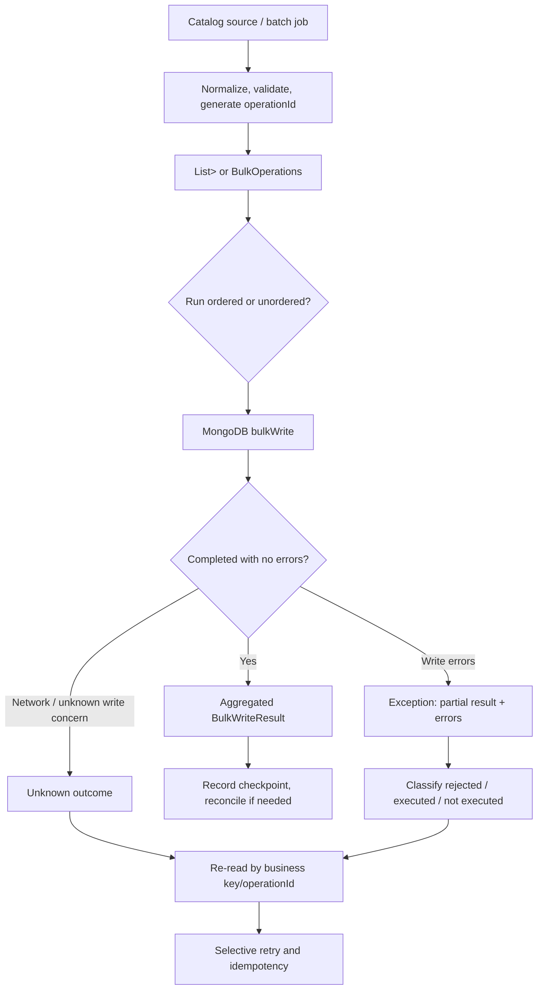

# Reading BulkWriteResult and Handling Partial Failures

## 1. Context and Objectives

In **Spring Data MongoDB**, **bulk write** operations allow sending multiple insert, update, upsert, or delete commands to MongoDB as a group instead of calling the server for each command individually. This mechanism fits **Mini Commerce** well when syncing the `Product` catalog, updating `Order` statuses, importing `Customer` lists, or processing thousands of records from an upstream system.

However, bulk write does not mean “all succeed together”. A batch might insert 70 products, update 20 products, hit 2 duplicate key errors, and leave several operations unexecuted. If the application merely logs “bulk failed” and reruns the entire batch, data can be duplicated, overwritten, or have **inventory deducted twice**.

This lesson belongs to the **Bulk Writes** chapter and focuses on two capabilities:

1. **Reading `BulkWriteResult`** to understand how many operations/documents were confirmed written.
2. **Handling partial failures**: identifying which operations were rejected, which executed, which did not run, and which cannot be confirmed; then reconciling and retrying safely.

Upon completion, you will be able to:

- Explain the counters `getInsertedCount()`, `getMatchedCount()`, `getModifiedCount()`, `getDeletedCount()`, and `getUpserts()`.
- Distinguish **document counts** from **command counts**, `matched` from `modified`, and inserts from upserts.
- Choose `BulkOperations.BulkMode.ORDERED` or `UNORDERED` according to business dependencies.
- Read the Java driver's `MongoBulkWriteException` when multiple write errors occur, including error lists tagged with **request indices**.
- Handle duplicate keys, validation errors, write concern/network errors, and **unknown outcomes** differently.
- Design batches with **business keys**, operation IDs, idempotency, and post-error checkpointing/reconciliation.
- Recognize the limits of `BulkOperations` regarding `@Version`, entity callbacks/auditing, transactions, raw driver usage, reactive flows, and sharded deployments.
- Test both ordered/unordered modes and benchmark batches against real MongoDB.

**Prerequisites:** Java 17+, Spring Boot using `spring-boot-starter-data-mongodb`, a running MongoDB instance, and familiarity with `MongoTemplate`, `Query`/`Criteria`, `Update`, and update operators `$set`/`$inc`. These examples do not replace production import pipelines equipped with backups, authentication, tenant controls, and monitoring.

## 2. Mini Commerce Model and Sync Goals

Main collections:

| Collection | Entity | Relevant Fields | Typical Bulk Workloads |
| --- | --- | --- | --- |
| `products` | `Product` | `_id`, `sku`, `name`, `stock`, `unit_price`, `active` | Insert new SKUs, edit names/prices, enable/disable sales |
| `customers` | `Customer` | `_id`, `email`, `fullName` | Import customers from a trusted source |
| `orders` | `Order` | `_id`, `customerId`, `status`, `placedAt` | Update statuses of eligible orders |

Example catalog source record:

```json
{
  "operationId": "catalog-job-20261120-0001",
  "sku": "KBD-001",
  "name": "Mini Keyboard",
  "price": "129900.00",
  "active": true
}
```

`operationId` is an **application-managed** business identifier for tracing and deduplication. MongoDB does not inherently treat it as a bulk request ID; you must design how it is stored and checked. In Java, `price` uses `BigDecimal`, which on products can map to BSON Decimal128.

Catalog sync typically aims to **upsert by `sku`**, modifying only catalog-owned fields while **never resetting `stock`** owned by the warehouse system. Hence a combination of `$set`/`$setOnInsert` usually fits better than full-document replacement via `save`.

### 2.1. Sample Data

```javascript
use mini_commerce

db.products.insertMany([
  {
    _id: "bulk-p1",
    sku: "KBD-001",
    name: "Old Keyboard",
    active: true,
    stock: 10,
    unit_price: NumberDecimal("99000.00")
  },
  {
    _id: "bulk-p2",
    sku: "MOU-001",
    name: "Old Mouse",
    active: true,
    stock: 6,
    unit_price: NumberDecimal("59000.00")
  }
]);
```

Run this only on a dedicated practice database and verify before inserting; rerunning with the same `_id` causes a duplicate-key error. In Java examples, **Java property names** may differ from BSON field names via `@Field`, whereas the raw driver/`mongosh` uses exact BSON keys.

## 3. Spring Data BulkOperations and Java Driver bulkWrite

There are two common execution paths:

1. **Spring Data MongoDB `BulkOperations`**: accepts `Query`, `Update`, and an entity class, leverages `MongoTemplate`'s mapping capabilities, and returns `com.mongodb.bulk.BulkWriteResult` when `execute()` succeeds.
2. **Java Sync Driver `MongoCollection.bulkWrite(...)`**: accepts a list of `WriteModel<Document>` or `WriteModel<T>` and `BulkWriteOptions`. When operating on a `Document` collection from `mongoTemplate.getCollection(...)`, commands **bypass Java entity mapping**; your code must supply exact BSON field names, BSON values, and validation.

| Aspect | Spring Data `BulkOperations` | Native Java Driver |
| --- | --- | --- |
| Write specification | `insert(entity)`, `updateOne(Query, Update)`, `updateMulti(...)`, `upsert(...)`, `remove(...)` | `InsertOneModel`, `UpdateOneModel`, `UpdateManyModel`, `DeleteOneModel`, ... |
| Entity metadata | Supports entity/`@Field` mapping | Depends on document/codec; raw `Document` ignores Spring annotations |
| Mode selection | `BulkMode.ORDERED` / `UNORDERED` | `BulkWriteOptions.ordered(true/false)` |
| Success result | `BulkWriteResult` | `BulkWriteResult` |
| Partial error reporting | Exceptions may be translated/wrapped by Spring; inspect root cause and version | `MongoBulkWriteException` provides write errors and partial result |
| Correlating error index to input | Must verify how your API builds/groups commands | 0-based index matching the submitted `WriteModel` list |
| Entity callbacks/`@Version` | **Does not** share the same contract as `save(entity)` | No Spring callbacks/version protocol |

When you need **exact operation indices** to recover individual source records, the raw driver API with an application-built 1-to-1 `WriteModel` list is often easier to correlate. When you want entity-mapping convenience without row-level error reporting, `BulkOperations` can be more concise.

### 3.1. Processing Flow Diagram



**Never equate “no response received” with “the server did not write”**. Losing connectivity after the server has executed part or all of a batch is a real operational scenario.

## 4. Writing a Bulk with MongoTemplate

A minimal `Product` entity:

```java
package com.example.minicommerce.domain;

import java.math.BigDecimal;
import org.springframework.data.annotation.Id;
import org.springframework.data.mongodb.core.mapping.Document;
import org.springframework.data.mongodb.core.mapping.Field;
import org.springframework.data.mongodb.core.mapping.FieldType;

@Document(collection = "products")
public class Product {
    @Id
    private String id;
    private String sku;
    private String name;
    private boolean active;
    private int stock;

    @Field(name = "unit_price", targetType = FieldType.DECIMAL128)
    private BigDecimal price;

    public Product() {}
    public String getId() { return id; }
    public void setId(String id) { this.id = id; }
    public String getSku() { return sku; }
    public void setSku(String sku) { this.sku = sku; }
    public String getName() { return name; }
    public void setName(String name) { this.name = name; }
    public boolean isActive() { return active; }
    public void setActive(boolean active) { this.active = active; }
    public int getStock() { return stock; }
    public void setStock(int stock) { this.stock = stock; }
    public BigDecimal getPrice() { return price; }
    public void setPrice(BigDecimal price) { this.price = price; }
}
```

Upserting by SKU with `BulkOperations`:

```java
import java.math.BigDecimal;

import com.mongodb.bulk.BulkWriteResult;
import org.springframework.data.mongodb.core.BulkOperations;
import org.springframework.data.mongodb.core.MongoTemplate;
import org.springframework.data.mongodb.core.query.Criteria;
import org.springframework.data.mongodb.core.query.Query;
import org.springframework.data.mongodb.core.query.Update;

public BulkWriteResult syncCatalog(MongoTemplate template) {
    BulkOperations bulk = template.bulkOps(
        BulkOperations.BulkMode.UNORDERED,
        Product.class);

    bulk.upsert(
        Query.query(Criteria.where("sku").is("KBD-001")),
        new Update()
            .set("name", "Mini Keyboard V2")
            .set("price", new BigDecimal("129900.00"))
            .set("active", true)
            .setOnInsert("stock", 0));

    bulk.upsert(
        Query.query(Criteria.where("sku").is("MOU-001")),
        new Update()
            .set("name", "Mini Mouse V2")
            .set("price", new BigDecimal("69000.00"))
            .setOnInsert("stock", 0));

    return bulk.execute();
}
```

`BulkOperations.execute()` returns a result **when the batch completes successfully under the write concern**. If the server reports write errors, do not assume it still returns a normal `BulkWriteResult`: execution enters the appropriate exception path.

Notes on the example:

- `Query` uses the **Java property `sku`**; `Update.set("price", ...)` maps via the entity, using the `unit_price` alias and BSON Decimal128.
- `$setOnInsert("stock", 0)` applies only when **upsert creates a new document**. If the SKU already exists, stock is neither deleted nor reset.
- If two writers upsert the same SKU concurrently when no document exists yet, you need a **unique index on SKU**, not application logic alone.
- Use `UNORDERED` when SKUs are independent and the system can handle individual SKU failures without halting the batch.
- This example lacks operation ID persistence and is not a complete production sync job.

## 5. What Does BulkWriteResult Represent?

The Java driver's result class:

```java
import com.mongodb.bulk.BulkWriteResult;

BulkWriteResult result = bulk.execute();
```

Key APIs:

| API | Unit Counted | Interpretation |
| --- | --- | --- |
| `wasAcknowledged()` | Boolean | Whether the server acknowledged the write per write concern |
| `getInsertedCount()` | Document | Documents inserted by insert operations |
| `getMatchedCount()` | Document | Documents matched in update operations |
| `getModifiedCount()` | Document | Documents whose values actually changed, if reported by server |
| `isModifiedCountAvailable()` | Boolean | Whether `getModifiedCount()` is available |
| `getDeletedCount()` | Document | Documents removed by delete operations |
| `getUpserts()` | List | Upserts that **created new documents**, with command index and new ID |

Example reading the result:

```java
BulkWriteResult result = bulk.execute();

if (!result.wasAcknowledged()) {
    throw new IllegalStateException(
        "Bulk write was not acknowledged");
}

System.out.println("inserted = " + result.getInsertedCount());
System.out.println("matched  = " + result.getMatchedCount());
System.out.println("deleted  = " + result.getDeletedCount());

if (result.isModifiedCountAvailable()) {
    System.out.println("modified = " + result.getModifiedCount());
}

result.getUpserts().forEach(upsert ->
    System.out.println(
        "upsert request index=" + upsert.getIndex() +
        ", new _id=" + upsert.getId()));
```

**Never sum all these numbers to get “succeeded requests”.** They count different things, and a single `updateMany` or `deleteMany` command can touch **many documents**.

### 5.1. Matched Is Not Modified

Suppose this already exists:

```javascript
{ _id: "bulk-p1", sku: "KBD-001", active: true }
```

Update:

```javascript
db.products.updateOne(
  { sku: "KBD-001" },
  { $set: { active: true } }
);
```

The server can acknowledge:

```text
matchedCount  = 1
modifiedCount = 0
```

There is no error: the document already held the desired value. Similarly, an update whose filter matches nothing produces `matchedCount = 0`, which is not necessarily a write error; the application must know whether the filter was **required** to match.

### 5.2. Inserts vs. Upserts Creating New Documents

Suppose a batch has:

- One `InsertOneModel` inserting `prod-new-1`.
- One `UpdateOneModel(..., upsert=true)` creating `prod-new-2` because the filter missed.
- One `UpdateOneModel(..., upsert=true)` matching `prod-existing` and renaming it.

A result might show:

```text
insertedCount = 1
matchedCount  = 1
modifiedCount = 1
upserts.size  = 1
```

Newly created upserts are recorded in `getUpserts()`, **not counted in `insertedCount` for InsertOne**. If you want to report “total newly created documents” in business terms, you can compute `insertedCount + upserts.size()` **after verifying the result, semantics, and command mix**.

### 5.3. updateMany and deleteMany Commands

If one `UpdateManyModel` matches 100 documents, `matchedCount` increases by 100 from a **single command**. If one `DeleteManyModel` deletes 7 documents, `deletedCount` increases by 7. Thus:

```text
Submitted requests: 3
Matched documents: 100
Deleted documents: 7
```

There is no contradiction. `BulkWriteResult` summarizes **document impact**, not a per-request report for `#0/#1/#2`.

### 5.4. Unacknowledged Writes

When using a write concern that does not require acknowledgement, you cannot rely on counters or standard exceptions to conclude success. Several getters on `BulkWriteResult` are **unavailable** for unacknowledged writes.

For catalog imports, inventory updates, order status writes, and any job requiring checkpoints, choose an **acknowledged write concern** appropriate for your durability needs. Never disable acknowledgement to chase throughput while still logging “successfully processed N records”.

## 6. ORDERED and UNORDERED Determine Error Scope

### 6.1. ORDERED: Stops at the First Write Error

In **ordered** mode, MongoDB processes operations in their logical order within the bulk and **stops upon hitting a write error**. This is helpful when commands depend on each other or you want to ensure “do not run steps after an error”.

Example:

```text
Operation #0: UPDATE Product A -> succeeds
Operation #1: INSERT Product X with existing _id -> duplicate key
Operation #2: UPDATE Product B -> does not run because ordered stops at #1
```

Failure does not mean rollback:

- Update `#0` that already succeeded **is not automatically reversed**.
- Insert `#1` is rejected.
- Operation `#2` is skipped per ordered bulk stopping semantics.

`ORDERED` **does not turn a bulk into a transaction**.

### 6.2. UNORDERED: Independent Commands Can Continue

In **unordered** mode, the driver/server may reorder operations and continue other commands even if one fails with a write error:

```text
Operation #0: UPDATE Product A -> may succeed
Operation #1: INSERT Product X duplicate _id -> duplicate key
Operation #2: UPDATE Product B -> may still succeed
```

Unordered **does not guarantee completion order**. If the same document is modified twice with `$set` using different values, the final value may not match the order you appended commands to the list. Design independent operations, or place order-dependent operations into a separate flow.

In major failures, connection drops, or environments where continuation is impossible, **there is no guarantee that all remaining commands executed**. Always inspect exceptions and reconcile when results are incomplete.

| Criterion | ORDERED | UNORDERED |
| --- | --- | --- |
| Execution order | Has ordering contract | Must not depend on order |
| On write error | Stops at first error per ordered semantics | Can continue independent commands |
| Commands succeeded before error | Do not roll back automatically | Do not roll back automatically |
| Guarantees all-or-nothing? | **No** | **No** |
| Suitable scenarios | Order-sensitive ops, easily checkpointed batches | Independent SKUs, maximize processed items |
| Needs partial-failure reconciliation? | Yes | Yes, especially with multiple errors |

### 6.3. Illustrative Command in mongosh

```javascript
db.products.bulkWrite(
  [
    {
      updateOne: {
        filter: { _id: "bulk-p1" },
        update: { $set: { name: "Keyboard V2" } }
      }
    },
    {
      insertOne: {
        document: {
          _id: "bulk-p2",
          sku: "DUPLICATE-KEY"
        }
      }
    },
    {
      updateOne: {
        filter: { _id: "bulk-p2" },
        update: { $set: { name: "Mouse V2" } }
      }
    }
  ],
  { ordered: false }
);
```

Given the fixture containing `bulk-p2`, insert `#1` collides on `_id`. With unordered, command `#2` **can still update** `bulk-p2`. Using `ordered: true` stops after the insert error, so `#2` does not run; in both cases, update `#0` which succeeded does not roll back automatically.

## 7. Reading the Java Driver's MongoBulkWriteException

When you need to know **which command failed** and correlate it with the source record, you can build a `List<WriteModel<Document>>` in your application and call `MongoCollection.bulkWrite(...)`.

Important classes:

```java
import com.mongodb.MongoBulkWriteException;
import com.mongodb.bulk.BulkWriteError;
import com.mongodb.bulk.BulkWriteResult;

import com.mongodb.client.MongoCollection;
import com.mongodb.client.model.BulkWriteOptions;
import com.mongodb.client.model.InsertOneModel;
import com.mongodb.client.model.UpdateOneModel;
import com.mongodb.client.model.WriteModel;
import com.mongodb.client.model.Filters;
import com.mongodb.client.model.Updates;

import org.bson.Document;
```

### 7.1. Request List with Stable IDs

```java
MongoCollection<Document> products =
    mongoTemplate.getCollection("products");

List<WriteModel<Document>> commands = List.of(
    new UpdateOneModel<>(
        Filters.eq("_id", "bulk-p1"),
        Updates.set("name", "Keyboard V2")),
    new InsertOneModel<>(
        new Document("_id", "bulk-p2")
            .append("sku", "DUPLICATE-KEY")),
    new UpdateOneModel<>(
        Filters.eq("_id", "bulk-p2"),
        Updates.set("name", "Mouse V2"))
);

BulkWriteOptions options = new BulkWriteOptions()
    .ordered(false);
```

This example assumes `MongoTemplate mongoTemplate` and `import java.util.List`. Because raw `Document` is used, all paths `"_id"`, `"name"`, `"sku"` are **BSON keys**, not Spring-mapped property aliases.

In a real import program, maintain a parallel `operationIds` list aligned with `commands`:

```java
List<String> operationIds = List.of(
    "catalog-job-001",
    "catalog-job-002",
    "catalog-job-003"
);

// commands.get(i) corresponds to operationIds.get(i)
```

Never filter or reorder only one of the two lists before sending. A cleaner approach in larger systems is a `BatchOperation` record holding both the business ID and the `WriteModel`, building both lists in a **single pass**.

### 7.2. Catching Write Errors and Partial Results

```java
import java.util.HashSet;
import java.util.Set;

try {
    BulkWriteResult result = products.bulkWrite(
        commands, options);

    reportSuccessfulBatch(result);

} catch (MongoBulkWriteException ex) {
    BulkWriteResult partial = ex.getWriteResult();

    if (partial != null && partial.wasAcknowledged()) {
        System.out.println(
            "inserted=" + partial.getInsertedCount());
        System.out.println(
            "matched=" + partial.getMatchedCount());
        System.out.println(
            "deleted=" + partial.getDeletedCount());
    }

    Set<Integer> failedIndices = new HashSet<>();

    for (BulkWriteError error : ex.getWriteErrors()) {
        int index = error.getIndex();
        failedIndices.add(index);

        String operationId = operationIds.get(index);

        System.out.println(
            "operation=" + operationId +
            ", requestIndex=" + index +
            ", code=" + error.getCode() +
            ", message=" + error.getMessage());
    }

    if (ex.getWriteConcernError() != null) {
        System.out.println(
            "Bulk also reported a write concern error");
    }

    // Do not treat indices absent from failedIndices as definitely
    // committed; evaluate ordered/unordered, write concern, and
    // network state, then reconcile.
}
```

`reportSuccessfulBatch(result)` is an application-defined helper for logging/metrics/checkpointing, **not a built-in Spring Data API**. The snippet belongs inside a method/service with upper-layer handling for other exceptions (disconnects, mapping errors).

Key points to read:

- `ex.getWriteErrors()` is the list of write errors reported by the server/driver; each `BulkWriteError` carries a **0-based index**, **error code**, and message.
- `ex.getWriteResult()` holds **the success counters reflected in the partial result**, not a per-operation outcome breakdown.
- `ex.getWriteConcernError()`, if non-null, requires separate handling: some writes may have executed even though confirmation/durability requirements were not met.
- `error.getIndex()` on the raw driver maps to the `WriteModel` position in the bulk request; mapping back to SKU or operation ID requires maintaining your own lookup.
- When large batches are split by the driver, interpret errors and indices according to your driver API/version; do not guess if Spring reorders or regroups operations.

### 7.3. Catching the Wrong Exception Type Can Lose Information

`MongoTemplate.bulkOps(...).execute()` may go through Spring Data **exception translation/wrapping**, depending on error kind and version. Therefore, do not assume every `BulkOperations` failure arrives at the service layer directly as `MongoBulkWriteException`.

Recommended approach:

1. Catch/record the exception type matching the API you **actually invoke** (Spring Data or driver exceptions).
2. Inspect `cause` if the exception was translated or wrapped.
3. Access partial results/write errors only when the concrete exception **actually provides them**.
4. When per-operation indices or reliable results are unavailable, mark **`UNKNOWN_OUTCOME`** and reconcile via business keys.

Never write production code assuming “any thrown exception definitely exposes `getWriteErrors()`”. Test against the exact Spring Data MongoDB and MongoDB Java driver versions managed by your BOM.

## 8. Classifying Errors and Partial Result Meanings

### 8.1. Four Useful Job Statuses

A batch orchestrator should distinguish:

| Status | Meaning | Action |
| --- | --- | --- |
| `CONFIRMED_SUCCESS` | Proof exists that the command/business condition was applied properly | Record checkpoint; do not retry blindly |
| `REJECTED` | Server rejected a write with a clear error code/index | Classify error and fix input or policy |
| `NOT_EXECUTED` | Proof exists that the command did not run, e.g., after an error in an ordered batch | Plan resumption from the appropriate point |
| `UNKNOWN_OUTCOME` | Cannot prove whether the write took effect | Read back / reconcile before retrying |

A successful bulk's `BulkWriteResult` does not return `CONFIRMED_SUCCESS` for **each individual** `updateOne` match check. If you need certainty that a specific command updated one document, design strict filters/identifiers and verify post-write—or consider a single-operation API returning individual results.

### 8.2. Common Errors

| Error | Signal | Recommended Handling |
| --- | --- | --- |
| Duplicate key | Typically MongoDB code **11000** | Check `_id`/SKU; if data matches/is idempotent it may count as applied, otherwise report conflict |
| Document validation failure | Typically code **121** | Log failed record, fix schema/input; never retry identical bad input forever |
| Immutable field / invalid update | Server rejects `_id` mutation or invalid path | Fix update model; do not retry as-is |
| Write concern error | Server failed to meet confirmation/durability target | State may be uncertain; read back/reconcile |
| Network/timeout | Lost response or unknown progress | Never infer “not written” from timeout; reconcile |
| Concurrent business conflict | `matchedCount == 0` in conditional update; **not necessarily** a write error | Re-read version/stock/status and classify per business logic |
| Rate/resource pressure | Timeouts, overload, transient write errors | Shrink batch size, backoff, monitor server, keep idempotency |

**Code 11000 or 121 is only an initial signal**, not an automatic recovery verdict. For example, a duplicate SKU during an import is **not necessarily a success**: a matching SKU with different name/price can be a conflict requiring human or upstream-priority resolution.

### 8.3. Knowing Some Operations Failed Does Not Account for All Operations

In an unordered bulk, you might learn `#3` and `#8` hit duplicate keys without having proof that every other operation committed under your write concern. In an ordered bulk, operations after the first write error normally **do not run**, yet if a connection error or incomplete result accompanies it, you must still verify what the server confirmed.

An `updateOne` whose filter matches nothing is treated by MongoDB as a **valid operation** and does not emit a `BulkWriteError`. If a job requires “every SKU must update exactly one record”, aggregate matched count cannot tell which SKU missed. Reconcile per SKU or run commands that return individual outcomes.

## 9. Limits of Inferring from Counters

Suppose 5 operations are submitted:

```text
#0: updateOne SKU=A, $set name
#1: updateOne SKU=B, $set name
#2: updateMany category=X, $set active
#3: insertOne SKU=C
#4: deleteOne SKU=D
```

Result:

```text
matchedCount  = 12
modifiedCount = 9
insertedCount = 1
deletedCount  = 0
upserts       = []
```

You **cannot conclude** from these counters that:

- Both `#0` and `#1` found exactly one SKU.
- `#2` modified exactly 10 documents.
- `#4` errored (`deleteOne` matching nothing still succeeds with `deletedCount = 0`).
- `matchedCount - modifiedCount` equals the number of failed operations.

Proving per-record outcomes requires **business keys**, conditional filters, and a dedicated verification/status step. Counters work well for aggregate metrics, not as a **transaction ledger**.

## 10. Building a Reconcilable Batch

### 10.1. Every Source Record Needs a Stable Identifier

A minimal plan:

```java
record CatalogChange(
    String operationId,
    String sku,
    String newName,
    String sourceVersion
) {}
```

Meaningful fields:

- `operationId`: identifies **one change**, preserved across retries.
- `sku`: business key identifying a product.
- `sourceVersion`: upstream version/sequence to prevent stale events from overwriting newer ones.
- `newName`: intentional update payload rather than a full pre-loaded entity.

Processing steps:

1. Validate that no two conflicting operations target the same SKU in an unordered batch.
2. Build an **operation plan** maintaining order, index, and operation ID.
3. Record batch metadata, input range, schema version, and expected operation count.
4. Execute the bulk; inspect result and exceptions.
5. Reconcile failed or ambiguous records by SKU/`sourceVersion`; record per-operation status.
6. Retry safe operations with backoff and attempt limits.

### 10.2. Putting Version in the Filter

If the source provides monotonically increasing versions, guard against stale overwrites:

```javascript
db.products.updateOne(
  {
    sku: "KBD-001",
    sourceVersion: { $lt: 42 }
  },
  {
    $set: {
      name: "Mini Keyboard V2",
      sourceVersion: 42
    }
  }
);
```

This is a **source-version policy example**: the application must ensure field presence, numeric type, and version generation rules. If existing documents lack `sourceVersion`, the filter must handle legacy/missing fields in a tested manner rather than assuming this query matches everything.

This update is safer than an unconditional `$set` when an older event replays after a newer one. Still, when `matchedCount == 0`, you must distinguish “record does not exist” from “a newer version is already present”. Aggregate `BulkWriteResult` cannot answer this per SKU.

### 10.3. Idempotency Techniques by Command Type

| Operator / Operation | Always Safe to Retry with Same Input? | Notes |
| --- | --- | --- |
| `$set` same value | Value-wise typically **idempotent** | Can still overwrite **newer** updates if version guard is missing |
| `$setOnInsert` with unique business key | Generally favorable for create-if-absent | Needs unique index and race handling |
| `$addToSet` with one element | Avoids duplicate element by BSON equality | Does not resolve concurrent array modifications outside the set |
| `$inc` | **Not idempotent** | Retries can add/subtract again |
| `$push` | **Not idempotent** | Retries can append duplicate items |
| `deleteOne` by explicit `_id` | Repeat finds nothing left to delete | With a non-unique filter, retry could delete a different document |
| `insertOne` with stable `_id`/business key | Second attempt may hit duplicate | Must verify duplicate is the exact already-inserted record |
| Complex update pipeline | Depends on expressions and current state | Never assume safe solely from identical payload |

In Mini Commerce, bulk catalog imports can safely retry version-guarded `$set`, whereas **bulk stock deductions with `$inc`** require a stronger idempotency protocol, such as a reservation record carrying an order/operation ID backed by a unique index and a transaction when needed.

## 11. Retrying After Failure: Matching the Certainty Level

### 11.1. Deterministic Write Error Branch

Suppose operation `#4` fails with a duplicate key error:

1. Read `error.getIndex()` and map it to `operationId`.
2. Read the target document by `_id`/`sku`.
3. If the stored data is equivalent and the operation is idempotent, mark it as **desired state already achieved** per policy.
4. If the business key collides with different data, raise a **conflict** rather than pretending success.
5. For validation errors, fix or route the record to **dead-letter/quarantine**; never infinitely retry bad payloads.

### 11.2. Network or Unknown Write Concern Branch

If the application times out after sending:

```text
send bulk #0..#99
       |
       +-- server executes part or all
       |
       +-- connection drops before client gets response
```

The client cannot conclude `#0..#99` never ran. A safer process:

- **Do not** immediately retry the whole batch if it contains `$inc`, `$push`, or order-dependent commands.
- Re-read by business key and `operationId`/version to inspect **final state**.
- Retry only operations not yet in the desired state or covered by a reliable apply-once mechanism.
- Keep the same operation ID across attempts, recording attempt count and verification results.
- If state cannot be determined, halt for investigation rather than mutating data irreversibly.

The MongoDB driver provides retryable writes under supported conditions/commands, yet **never assume complex multi-document bulks or user-level retries execute exactly once**. Application-level idempotency still has to be designed.

### 11.3. Do Not Retry Based Solely on getModifiedCount

A `$set` that changes no field value yields `modified=0` even when it matched the right document. Retrying on “if modified is less than command count, resend everything” is wrong. Likewise, `updateMany` can modify many documents so `modified` exceeds command count.

Use business state and meaningful checks rather than forcing aggregate counters to mean “operations processed”.

## 12. Checkpointing, Chunking, and Large Batches

When importing 100,000 products, split the input into **bounded chunks** to:

- Bound JVM memory and request sizes.
- Checkpoint by record range or operation ID.
- Isolate errors and quarantine malformed records.
- Shrink the reconciliation scope after a timeout.
- Tune concurrency/rate to MongoDB's real capacity.

Workflow example:

```text
Job catalog-20261120
  chunk-0001: operations 0..499    -> completed / reconciled
  chunk-0002: operations 500..999  -> partial / conflict
  chunk-0003: operations 1000..1499 -> pending
```

**Do not** mark a checkpoint “chunk done” just because `execute()` was invoked. Checkpoint only after receiving an acknowledged result or completing reconciliation for ambiguous operations.

The MongoDB driver enforces server batch write limits and BSON/message size limits and splits internally; explicit application chunking remains useful anyway. Never hardcode a single batch size for all versions/topologies; benchmark throughput, errors, and latency in your real environment.

### 12.1. Ordered Does Not Replace Transactions and Checkpoints

An ordered chunk failing at operation `#350` may have committed hundreds of earlier operations. To resume, do not restart blindly from `#0` if operations are not idempotent. Instead:

1. Record the error index and partial result.
2. Reconcile operations before the error if evidence is insufficient.
3. Resolve `#350`'s error or quarantine it.
4. Submit the remainder in a controlled way while keeping original operation IDs.

If the batch involves event ordering for the same SKU, subsequent operations must wait for conflict resolution or be restructured with versions. **Unordered** is not a cure-all for throughput issues.

## 13. Cleaning Up an Error Case: Duplicate Keys and Upsert

During catalog sync, multiple upstream feeds may send the same SKU:

```javascript
db.products.createIndex(
  { sku: 1 },
  { unique: true }
);
```

Upsert is safer than “if absent then insert” because it performs an atomic update-or-insert on the server, yet it **does not replace a unique index** under competing writers.

```java
Update catalogUpdate = new Update()
    .set("name", "Mini Keyboard V2")
    .set("active", true)
    .setOnInsert("stock", 0);

bulk.upsert(
    Query.query(Criteria.where("sku").is("KBD-001")),
    catalogUpdate);
```

If the SKU already exists, `$setOnInsert` does not reset stock. If a new SKU is created, the upsert appears in `BulkWriteResult.getUpserts()` when acknowledged properly.

**Do not assume every duplicate key from upsert is benign.** An import might collide with another tenant's data, a newer version, or a manually edited record. Always verify business key, tenant, and version.

## 14. @Version, Callbacks, Auditing, and Bulk Writes

`BulkOperations` does not behave like a `repository.save(entity)` loop with respect to entity lifecycle.

Limitations to know:

- **Optimistic locking with `@Version` is not supported under the same per-entity contract when using bulk operations**. Do not assume a bulk update checks each object's expected version or throws `OptimisticLockingFailureException` like `save`.
- **Entity lifecycle callbacks / auditing** do not run like individual `save(entity)` calls per record. If a job requires `updatedAt`, set it explicitly in the update or establish a consistent server policy.
- If an entity uses converters or `@Field` aliases, use the mapping API and test raw BSON; with native driver `Document`, supply exact BSON names and values.
- For Decimal128 prices, never send raw JavaScript doubles or BSON Strings expecting Spring Data mapping to fix them in the native driver.

If version-based compare-and-set is needed, add the version predicate to the **filter** and increment the version in the **same update**:

```java
Query expected = Query.query(
    Criteria.where("sku").is("KBD-001")
        .and("version").is(7L));

Update change = new Update()
    .set("name", "Keyboard New Edition")
    .inc("version", 1L);

bulk.updateOne(expected, change);
```

**This is an application-managed protocol**, not automatic optimistic locking from `BulkOperations`. Because the result only reports an **aggregate** matched count, identifying which specific SKU conflicted requires re-reading documents or a separate check. Do not combine mapper-driven `@Version` auto-incrementing with manual `inc("version")` without verifying your exact version's behavior.

## 15. Transactions and Atomicity Boundaries

MongoDB guarantees atomicity for **each write operation on a single document**, without turning an entire list of bulk operations into an all-or-nothing unit.

### 15.1. When Transactions Are Not Needed

Syncing 5,000 independent products using version-guarded `$set`, with a unique index per SKU and separate checkpoints: occasional failures can be reprocessed without rolling back the entire job. Here, unordered bulk + reconciliation is usually practical.

### 15.2. When Transactions Are Needed

An order-placement flow may have to **deduct stock across several Products** and then **create an Order**. If all must succeed or all fail, consider a multi-document transaction on a supported MongoDB topology using `MongoTransactionManager` or its reactive counterpart.

Inside a transaction, write errors and aborts can still occur; individual bulk results **do not mean** the transaction committed. Record the “order placed” checkpoint only after commit is confirmed. A transaction also does not replace idempotency if the client loses the commit response.

**Do not cram an import batch of hundreds of thousands of documents into one giant transaction merely to avoid partial-failure handling.** Transactions have duration, resource, and topology limits; choose them for business invariants rather than as a substitute for batch design.

### 15.3. Sharded Clusters and Write Concern

Sharding, write concern, and network topology affect when and how results are confirmed. Unordered bulks can be split and routed across multiple shards; do not depend on completion order. Write concern errors can leave confirmation insufficient even after the server processed part of the data.

For high-reliability systems, specify write concern, reconciliation read preference/read concern, and job durability requirements explicitly. Never infer majority durability or exactly-once delivery merely from seeing a `BulkWriteResult`.

## 16. Reactive Access and Performance

With `ReactiveMongoTemplate`, Spring Data provides bulk operations returning `Mono<BulkWriteResult>`:

```java
import com.mongodb.bulk.BulkWriteResult;
import org.springframework.data.mongodb.core.BulkOperations;
import reactor.core.publisher.Mono;

Mono<BulkWriteResult> result =
    reactiveMongoTemplate.bulkOps(
        BulkOperations.BulkMode.UNORDERED,
        Product.class)
    .updateOne(
        Query.query(Criteria.where("sku").is("KBD-001")),
        new Update().set("active", true))
    .execute();
```

In the reactive API, operations execute when the publisher is **subscribed**. Use Reactor operators to handle success/error and record checkpoints after acknowledged outcomes; never call `block()` on a non-blocking WebFlux thread.

Do not assume reactive automatically reduces write errors, changes ordered/unordered semantics, or makes `$inc` idempotent. Reactive changes **how I/O is orchestrated**, not data invariants.

### 16.1. Throughput Does Not Depend Solely on Batch Size

Factors to benchmark:

- Filter selectivity and indexes (unique `sku`, default `_id`).
- Document size, number of modified fields, and number of updated indexes.
- Ordered/unordered, concurrency, and inter-command dependencies.
- Write concern and network round-trip latency.
- Application-side BSON encoding, mapping, and validation.
- Replica set/sharding topology and server load.
- Chunk size and post-error reconciliation/retry duration.

Very large batches can cut command-dispatch overhead while lengthening post-error recovery time. Optimize end-to-end for throughput **of verified records**, not raw requests/second.

## 17. Integration Testing: Ordered, Unordered, and Partial Results

To trust your error handling, test against **real MongoDB or Testcontainers**. Mocking `BulkOperations` cannot accurately simulate duplicate-key errors, index errors, ordered/unordered behavior, or server partial results.

### 17.1. Core Test: Unordered Still Applies Operations After an Error

The following `@SpringBootTest` uses the raw Java driver via `MongoTemplate.getCollection(...)` to preserve exact **indices in the `WriteModel` list**.

```java
package com.example.minicommerce;

import static org.junit.jupiter.api.Assertions.*;

import java.util.List;

import com.mongodb.MongoBulkWriteException;
import com.mongodb.WriteConcern;
import com.mongodb.bulk.BulkWriteResult;
import com.mongodb.client.MongoCollection;
import com.mongodb.client.model.BulkWriteOptions;
import com.mongodb.client.model.Filters;
import com.mongodb.client.model.InsertOneModel;
import com.mongodb.client.model.UpdateOneModel;
import com.mongodb.client.model.Updates;
import com.mongodb.client.model.WriteModel;

import org.bson.Document;
import org.junit.jupiter.api.Test;
import org.springframework.beans.factory.annotation.Autowired;
import org.springframework.boot.test.context.SpringBootTest;
import org.springframework.data.mongodb.core.MongoTemplate;

@SpringBootTest
class BulkWritePartialFailureIntegrationTest {

    @Autowired
    MongoTemplate template;

    @Test
    void unorderedReportsDuplicateAndAppliesOtherWrites() {
        String idA = "bulk-test-A";
        String idDuplicate = "bulk-test-DUP";
        String idB = "bulk-test-B";
        List<String> ids = List.of(idA, idDuplicate, idB);

        MongoCollection<Document> coll =
            template.getCollection("products")
                .withWriteConcern(WriteConcern.ACKNOWLEDGED);

        coll.deleteMany(Filters.in("_id", ids));
        try {
            coll.insertMany(List.of(
                new Document("_id", idA)
                    .append("sku", "BULK-TEST-A")
                    .append("stock", 10),
                new Document("_id", idDuplicate)
                    .append("sku", "BULK-TEST-DUP"),
                new Document("_id", idB)
                    .append("sku", "BULK-TEST-B")
                    .append("active", true)
            ));

            List<WriteModel<Document>> writes = List.of(
                new UpdateOneModel<>(
                    Filters.eq("_id", idA),
                    Updates.inc("stock", -2)),
                new InsertOneModel<>(
                    new Document("_id", idDuplicate)
                        .append("sku", "DUPLICATE")),
                new UpdateOneModel<>(
                    Filters.eq("_id", idB),
                    Updates.set("active", false))
            );

            MongoBulkWriteException ex = assertThrows(
                MongoBulkWriteException.class,
                () -> coll.bulkWrite(
                    writes,
                    new BulkWriteOptions().ordered(false)));

            assertEquals(1, ex.getWriteErrors().size());
            assertEquals(1, ex.getWriteErrors().get(0).getIndex());
            assertEquals(11000, ex.getWriteErrors().get(0).getCode());

            BulkWriteResult partial = ex.getWriteResult();
            assertTrue(partial.wasAcknowledged());
            assertEquals(2, partial.getMatchedCount());
            assertTrue(partial.isModifiedCountAvailable());
            assertEquals(2, partial.getModifiedCount());
            assertEquals(0, partial.getInsertedCount());

            Document afterA =
                coll.find(Filters.eq("_id", idA)).first();
            Document afterB =
                coll.find(Filters.eq("_id", idB)).first();

            assertNotNull(afterA);
            assertNotNull(afterB);
            assertEquals(8, afterA.getInteger("stock"));
            assertEquals(false, afterB.getBoolean("active"));
        } finally {
            coll.deleteMany(Filters.in("_id", ids));
        }
    }
}
```

In this test:

- Operation `#0` deducts stock from 10 down to 8.
- Operation `#1` attempts to insert an existing `_id` and raises error **11000**.
- With `ordered(false)`, operation `#2` still updates `active = false`.
- The partial result reflects 2 matched and modified documents; readback verifies **final data**.

This result holds on an isolated fixture with acknowledged write concern and no competing writers. Never conclude from it that every unordered bulk over an unstable network always finishes all non-failing operations.

### 17.2. Testing Ordered: Operations After Error Do Not Run

To test ordered mode, create a **new** fixture with three distinct IDs and send the same three command types, setting:

```java
MongoBulkWriteException ex = assertThrows(
    MongoBulkWriteException.class,
    () -> coll.bulkWrite(
        writes,
        new BulkWriteOptions().ordered(true)));

assertEquals(1, ex.getWriteErrors().get(0).getIndex());

// Re-read the document corresponding to operation #2:
Document afterB =
    coll.find(Filters.eq("_id", idB)).first();

assertNotNull(afterB);
assertEquals(true, afterB.getBoolean("active"));
```

This snippet **assumes** `coll`/`writes`/`idB` were initialized on a separate fixture like test 17.1 with `active = true`. Place it inside a test method and clean up with `try/finally`. When running ordered, the server stops at the duplicate-`_id` insert before operation `#2`, so `active` stays unchanged.

### 17.3. Testing Spring Data BulkOperations

Alongside the native driver test, add an integration test for your Spring Data setup:

```java
BulkOperations operations = template.bulkOps(
    BulkOperations.BulkMode.UNORDERED,
    Product.class);

operations.updateOne(
    Query.query(Criteria.where("sku").is("BULK-TEST-A")),
    new Update().set("name", "Name from bulk"));

BulkWriteResult result = operations.execute();
assertTrue(result.wasAcknowledged());
assertEquals(1, result.getMatchedCount());
```

This test **assumes** the fixture has exactly one `Product` with SKU `BULK-TEST-A`; seed and clean up as above. It verifies Spring Data mapping/configuration, while the driver test verifies retrieving error indices and partial results.

**Do not assume every Spring Data exception exposes the same class or getters as `MongoBulkWriteException`.** Before going to production, add a test provoking a duplicate-key error through `BulkOperations.execute()` itself to observe what exception the framework translates it into.

### 17.4. Additional Test Matrix

| Scenario | What to Prove |
| --- | --- |
| Ordered with error at `#1` | `#0` remains applied, `#1` errors, `#2` does not run |
| Unordered with error at `#1` | Other independent commands can succeed |
| Error-free batch | `BulkWriteResult` has expected counters |
| Update setting identical value | Matched = 1, modified = 0 |
| Update with unmatched filter | Not a write error, matched does not increment |
| UpdateMany matching 10 documents | Matched counts documents, not requests |
| Upsert creating new document | Appears in `getUpserts()`, not counted in `insertOne` |
| Upsert matching existing document | Matched increments, no new upsert entry |
| Duplicate `_id`/`sku` | Error code/index correlates to exact operation ID |
| Validation failure | Bad record quarantined, never retried infinitely |
| Lost response | `UNKNOWN` status assigned and readback runs |
| Retrying `$inc` | Demonstrates potential double mutation |
| Retrying versioned `$set` | Stale event does not overwrite newer version |
| `@Field("unit_price")` | Spring Data mapping clearly differs from raw BSON |
| `@Version`/auditing | Do not assume bulk behaves like `save(entity)` |
| Reactive | Publisher emits result/error on subscribe |
| Transaction | Checkpoints only after commit confirmation |

## 18. Operations: Metrics, Logging, and Dead-Lettering

A batch report might look like:

```text
jobId:             catalog-20261120
chunkId:           chunk-0021
requestedOps:      500
bulkMode:          UNORDERED
acknowledged:      true
insertedDocs:      12
matchedDocs:       476
modifiedDocs:      430
deletedDocs:       0
upsertedDocs:      4
writeErrorCount:   2
unknownOps:        0 (after reconciliation)
reconciledOps:     2
completedAt:       [timestamp from the job]
```

This is only a **report shape example**, not real data. Document counts **do not have to sum to 500 operations**, due to `updateMany`, zero-matches, upserts, and counter semantics.

Log the following:

- `jobId`, `chunkId`, `operationId`, and permitted business keys.
- Mode (`ordered`/`unordered`), submitted operation count, duration, write concern.
- `BulkWriteResult` counters and error counts grouped by error code.
- Final reconciliation status and dead-letter record count.
- Source data version/schema for controlled replays.

Never log full `Customer` PII, tokens, phone numbers, or payment details. If failed payloads must be stored for replay, enforce proper access controls, retention, and encryption.

### 18.1. Why Is Dead-Letter / Quarantine Needed?

A record with invalid schema, missing SKU, or validation errors will never fix itself on retry. If the system keeps resubmitting it, the batch will fail repeatedly and waste load.

The workflow should:

1. Persist the failing record with ID and reason (with sensitive fields scrubbed).
2. Allow correction/normalization and checking for source duplicates or versions.
3. Replay with the **exact same operation ID** under the idempotency policy.
4. Mark the record resolved and store decision history.

## 19. Common Pitfalls

| Symptom | Cause | Resolution |
| --- | --- | --- |
| `execute()` throws even though many writes succeeded | Bulk **partial success** | Inspect partial result/write errors if available, then reconcile |
| Adding `inserted + matched + deleted` for command count | Counters count documents; `updateMany` can match many | Track separate metrics for requests and documents |
| `getModifiedCount()` smaller than `getMatchedCount()` | Document matched but value already matched or unchanged | Do not treat as an error |
| `getModifiedCount()` unavailable | Driver/server or write concern does not provide it | Check `wasAcknowledged`/`isModifiedCountAvailable` |
| Newly created upsert missing from `insertedCount` | New upserts are reported via `getUpserts()` | Read the upserted IDs list |
| Duplicate key on one SKU halts the whole batch | Using `ORDERED` | Choose mode by independence; handle conflicts |
| Unordered yields results out of input order | No ordering guarantee | Do not put dependent updates on the same target in unordered |
| Retry deducts stock twice | `$inc` is not idempotent | Operation ID, reservation ledger, reconciliation |
| Retried `$set` overwrites newer data | Missing version/expected state | Filter with `sourceVersion`, CAS, or serialization |
| Two error indices known without knowing which SKUs | Missing `index → business key` mapping | Build an operation plan before sending |
| Spring Data exception lacks `getWriteErrors()` | Translated/wrapped, different from raw driver exception | Inspect `cause`/version contract, test error paths |
| `updateOne` misses without throwing | `matched=0` is a valid update outcome | Reconcile per SKU if matching is mandatory |
| Network timeout treated as “nothing wrote” | Unknown outcome | Read back before retrying |
| Upsert creates duplicate business keys | Missing unique index or tenant-unscoped filter | Unique index + conflict rules |
| `@Version` fails to prevent lost updates in bulk | Bulk lacks per-entity `save` optimistic locking | Filter/version CAS or use another API |
| Timestamps/auditing not updated | Bulk bypasses `save` callback lifecycle | Set timestamps explicitly and test |
| Money written with wrong BSON type | Raw driver does not apply `@Field`/`BigDecimal` mapping | Use Decimal128 and exact BSON keys |
| Huge bulk overloads server/hard to recover | Unbounded chunks | Chunk, checkpoint, and apply backpressure |
| Ordered bulk treated as a transaction | No batch-wide atomicity | Use transactions when invariants demand them |
| Metrics look green yet SKUs are wrong | Relying only on aggregate counters | Reconcile state by business key |

## 20. Practice Exercises and Completion Criteria

**Exercise 1 — Reading counters.** Build a batch containing `insertOne`, an `updateOne` setting the same value, an `updateMany`, and a `deleteOne`. Before running, predict `inserted`, `matched`, `modified`, and `deleted`, then compare with `BulkWriteResult`. Explain why the sum does not equal the request count.

**Exercise 2 — Upsert.** Use `BulkOperations` to upsert two existing SKUs and one new SKU. Ensure existing SKU `stock` is not reset thanks to `$setOnInsert`, then read `getUpserts()` and count total newly created documents.

**Exercise 3 — Ordered vs. unordered.** Build a three-command batch where the second inserts a duplicate `_id`. Run ordered and unordered on separate fixtures. Record errors, partial results, and the document state of the third operation.

**Exercise 4 — Error indices and operation IDs.** Design a `List<BatchOperation>` holding `operationId`, `sku`, and `WriteModel`. Trigger two duplicate errors and prove each `BulkWriteError.getIndex()` links back to the right source record. Do not name the index variable as “completion order”.

**Exercise 5 — Reconciliation.** Simulate a timeout before the application receives a result. Use `sku`/`sourceVersion` to inspect state and build a retry list; never blindly resend `$inc`.

**Exercise 6 — Blocking stale events.** Send two name updates for the same SKU, versions 41 and 42, in reverse order. Test the `sourceVersion < newVersion` filter and explain why `matched=0` is not treated as a write error by default.

**Exercise 7 — Validation and quarantine.** Enable MongoDB JSON Schema validation on a test collection. Send one valid and one invalid record, catch the write error, move the invalid record to dead-letter, then fix and replay it with the same operation ID.

**Exercise 8 — Chunk tuning.** Import a large test dataset in chunks of 100, 500, and 1,000. Measure throughput, latency, reconciliation cost, and error counts. Evaluate ordered vs. unordered for the workload instead of assuming the largest chunk is always best.

**Bonus Exercise — Reactive/transactions.** Write a reactive catalog bulk and verify `Mono<BulkWriteResult>`. Simulate an order flow updating multiple Products and creating an Order; identify when a transaction plus a dedicated idempotency mechanism are needed.

### Self-Check Questions

1. Why can `BulkWriteResult` not tell you for certain which `updateOne` command matched?
2. How do `getInsertedCount()` and `getUpserts()` differ?
3. How do `matched` and `modified` differ when the new value equals the old value?
4. When one `updateMany` updates 50 documents, how many “requests” occurred?
5. How do ordered and unordered handle commands after a duplicate-key error differently?
6. Why does ordered bulk still lack all-or-nothing guarantees?
7. Which source data must `BulkWriteError.getIndex()` be joined against?
8. When must you assign `UNKNOWN_OUTCOME` instead of `REJECTED`?
9. Why should you not retry an entire `$inc` batch after a timeout?
10. Do `@Version` and auditing behave differently in bulk compared to `save(entity)`?
11. Why can Spring Data `BulkOperations` and the raw Java driver differ in mapping and exceptions?
12. When is a multi-document transaction needed instead of reconciliation checkpoints?

**Expected outcome:** learners accurately read `BulkWriteResult` metrics, handle `MongoBulkWriteException`, distinguish executed/unexecuted/unknown commands, and design bulks with **reconciliation, idempotency, selective retries, unique indexes, and operational observability**. This forms the foundation for catalog imports, order updates, and Spring Data MongoDB write optimization without trading correctness for throughput.

## References

- [Spring Data MongoDB — Bulk Operations](https://docs.spring.io/spring-data/mongodb/reference/mongodb/template-crud-operations.html): `BulkOperations`, ordered/unordered, and lifecycle/optimistic locking behavior.
- [Spring Data MongoDB — BulkOperations API](https://docs.spring.io/spring-data/mongodb/docs/current/api/org/springframework/data/mongodb/core/BulkOperations.html): `insert`, `updateOne`, `updateMulti`, `upsert`, `remove`, and `execute`.
- [MongoDB Java Driver — Bulk Write Operations](https://www.mongodb.com/docs/drivers/java/sync/current/crud/bulk/): `WriteModel`, `BulkWriteOptions`, `BulkWriteResult`, and exceptions.
- [MongoDB Java Driver — BulkWriteResult API](https://mongodb.github.io/mongo-java-driver/5.2/apidocs/mongodb-driver-core/com/mongodb/bulk/BulkWriteResult.html): counters and upserts list.
- [MongoDB Manual — Bulk Write Operations](https://www.mongodb.com/docs/manual/core/bulk-write-operations/): execution order, partial success, and performance.
- [MongoDB Manual — db.collection.bulkWrite()](https://www.mongodb.com/docs/manual/reference/method/db.collection.bulkWrite/): command structure, `ordered`, and write results.
- [MongoDB Manual — Write Concern](https://www.mongodb.com/docs/manual/reference/write-concern/): confirmation levels and meaning of write concern errors.
- [MongoDB Manual — Atomicity and Transactions](https://www.mongodb.com/docs/manual/core/write-operations-atomicity/): single-document atomicity and non-transactional bulk limits.
