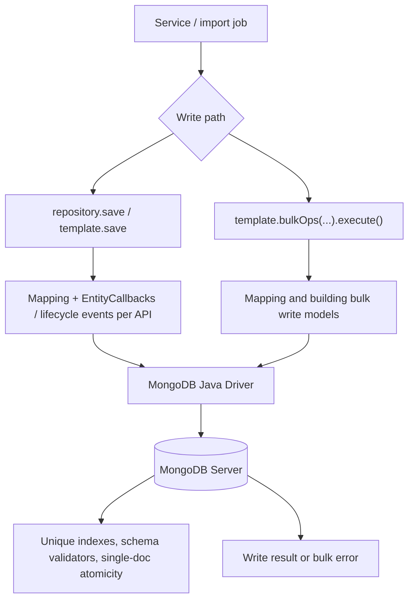
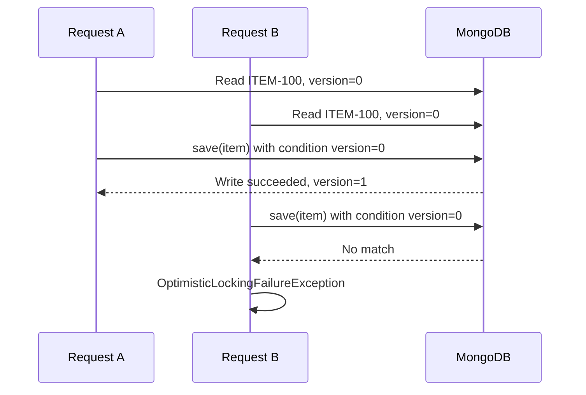

# Limits of Optimistic Locking, Callbacks, and Lifecycle Events in Bulk Writes

**Bulk write** is a way to group multiple write operations sent to MongoDB, such as adding products, updating inventory, marking discontinued items, or deleting old records. In **Spring Data MongoDB**, `MongoTemplate.bulkOps(...)` exposes the `BulkOperations` interface to build `insert`, `updateOne`, `updateMulti`, `upsert`, `remove`, and certain replacement operations depending on the API version. Bulk writes help reduce the coordination overhead of many requests, yet **they do not mean each operation is processed like `repository.save(entity)`**.

Three limitations to understand before taking bulk writes to production are:

1. **Optimistic locking:** `@Version` automatically protects supported entity save paths, but you must not assume bulk generates version checks, throws `OptimisticLockingFailureException` per element, or returns per-item CAS results.
2. **Entity callbacks and lifecycle events:** bulk does not offer the same per-entity callback/event contract as `MongoTemplate.insert/save` paths. Consequently, logic relying on `BeforeConvertCallback`, `BeforeSaveCallback`, `AbstractMongoEventListener`, or auditing may **not run as expected**.
3. **Results and atomicity:** a bulk is **a set of multiple write operations**, not automatically an all-or-nothing transaction. `BulkWriteResult` generally reports aggregate impact counts rather than a detailed per-entity result map.

This lesson belongs to the **Bulk Writes** chapter of the `SPRING_DATA_MONGODB` module: working with MongoDB via repositories or `MongoTemplate`, controlling BSON mapping, querying, aggregation, indexing, transactions, reactive access, testing, and performance diagnostics. It focuses on the **limits of optimistic locking, callbacks, and lifecycle events in bulk**, along with safe design patterns when you cannot rely on single-entity write conveniences.

After this lesson, you will be able to:

- Distinguish `MongoRepository.saveAll`, `MongoTemplate.insert(Collection)`, and `BulkOperations` in terms of intent, callbacks, versioning, and result counts.
- Explain `@Version`-based optimistic locking on `save` and how to implement manual **compare-and-set (CAS)** in bulk.
- Understand why `BeforeConvertCallback`, `BeforeSaveCallback`, `@LastModifiedDate`, or application lifecycle events should not be the source of truth for a bulk command.
- Use `_id + tenantId + version` filters, `$set`/`$inc` operators, and `BulkWriteResult` checks.
- Design auditing/outbox, retries, batches, transactions, and integration tests so correctness is never traded for throughput.

## 1. Three Distinct Processing Layers: Spring Data, Driver, and MongoDB Server



**Spring Data MongoDB** translates Java properties into BSON fields through metadata/converters; **MongoDB Java Driver** sends the write commands; **MongoDB Server** evaluates query filters, indexes, update operators, and single-document atomicity. Do not equate **Spring entity lifecycle** with **MongoDB Server enforcement**:

| Capability | Who Enforces It? | Guaranteed Automatically by Bulk? |
| --- | --- | --- |
| `$inc`, `$set`, `$unset`, `version` filter | MongoDB Server | **Yes**, if you explicitly include them in the write command |
| Unique indexes and collection validation | MongoDB Server | **Yes**, as on the corresponding write commands |
| Single update on one document is atomic | MongoDB Server | **Yes**, for that specific operation/document |
| Multiple documents roll back together | Configured transaction on supported deployment | **No** when using bulk alone |
| Automatic `@Version` check like `save` | Spring Data on supported APIs | **Do not assume by default** |
| `BeforeConvertCallback`, `BeforeSaveCallback`, lifecycle events | Spring Data callback/event layer | **Limited**, depends on API path/version |
| `@CreatedDate`, `@LastModifiedDate` from auditing | Spring Data auditing callback | **Do not assume by default** |
| Separate result for each CAS command | `BulkWriteResult`/driver reporting model | Usually only **aggregated** counts |

In Spring Data MongoDB 4.5 documentation, bulk operations are described as not emitting lifecycle events. Newer releases state that lifecycle event publishing is **limited** in bulk. Therefore, **never build invariants on automatic callbacks/events of a bulk API without integration tests on your exact version**. Version-to-version nuances do not change the core principle: critical data-protection logic must live directly in the filter/update or in an explicitly guaranteed workflow.

## 2. Comparing `save`, `saveAll`, `insert`, and `bulkOps`

All of these APIs can write one or many documents, yet they are not interchangeable:

| API | Typical Intent | Version / Callback Handling | What to Watch Out For |
| --- | --- | --- | --- |
| `repository.save(entity)` | Save a single new/existing entity | Has mapping and `@Version` optimistic locking on supported paths | A partial entity can drop fields during replacement |
| `repository.saveAll(entities)` | Save multiple entities based on `isNew` | Implementation may use multi-record insert or individual saves; do not assume identical behavior for every element | Not implicitly a conditional bulk update or transaction |
| `template.insert(collection, Entity.class)` | Insert a collection of new entities | Batch insert has its own callback/mapping behavior | Unique index collision can cause error / partial write |
| `template.bulkOps(BulkMode, Entity.class)` | Group insert/update/remove/replace into a bulk | Does not offer the same per-entity `save` contract for version, callbacks, and events | You must explicitly define CAS queries, auditing, timestamps, and result handling |
| `template.updateFirst(query, update, ...)` | Update one document matching condition | Update version rules differ from `save`; verify API docs | Returns `UpdateResult` for that operation |
| `template.findAndModify(...)` | Conditional update returning before/after document | Easy to inspect single-document outcome | Often suited when clear per-CAS feedback is required |

In standard `SimpleMongoRepository`, `saveAll` may optimize when **all entities are new**, while mixed new/existing sets may go through individual `save` calls. You cannot swap `saveAll` for `bulkOps.updateOne` and assume auditing, optimistic locking, and event listeners keep working identically.

### 2.1. Grouping Commands Saves Requests, Not Single-Update Work

Bulk primarily reduces dispatch/coordination overhead across many operations in one interaction, whereas **server execution cost per update** still depends on filters, indexes, documents, and contention. When each update targets a single document, proper `_id`/query-key indexing can matter far more than raising batch size from 100 to 1,000.

Never aim for “as many items per batch as possible” while ignoring command limits, memory, timeouts, blast radius, and retry difficulty.

## 3. A `@Version`-Annotated Entity: Running Example

Suppose an application manages tenant-scoped inventory. Each item carries a version to detect two requests reading the same stale snapshot.

```java
import java.time.Instant;
import org.springframework.data.annotation.CreatedDate;
import org.springframework.data.annotation.LastModifiedDate;
import org.springframework.data.annotation.Version;
import org.springframework.data.mongodb.core.mapping.Document;
import org.springframework.data.mongodb.core.mapping.MongoId;

@Document(collection = "inventoryItems")
public class InventoryItem {

    @MongoId
    private String id;

    private String tenantId;
    private String sku;
    private int stock;
    private String status;

    @Version
    private Long version;

    @CreatedDate
    private Instant createdAt;

    @LastModifiedDate
    private Instant updatedAt;

    protected InventoryItem() {}

    public InventoryItem(String id, String tenantId,
                         String sku, int stock, String status) {
        this.id = id;
        this.tenantId = tenantId;
        this.sku = sku;
        this.stock = stock;
        this.status = status;
    }

    public String getId() { return id; }
    public String getTenantId() { return tenantId; }
    public String getSku() { return sku; }
    public int getStock() { return stock; }
    public String getStatus() { return status; }
    public Long getVersion() { return version; }
    public Instant getCreatedAt() { return createdAt; }
    public Instant getUpdatedAt() { return updatedAt; }

    public void setStock(int stock) { this.stock = stock; }
    public void setStatus(String status) { this.status = status; }
}
```

Repository:

```java
import java.util.Optional;
import org.springframework.data.mongodb.repository.MongoRepository;

public interface InventoryItemRepository
        extends MongoRepository<InventoryItem, String> {

    Optional<InventoryItem> findByIdAndTenantId(
            String id, String tenantId);
}
```

When Spring Data MongoDB auditing is enabled and supported entity write paths are used, `@CreatedDate`/`@LastModifiedDate` are populated by the corresponding **auditing callback**. The annotation alone does not enable auditing; in Spring Boot, you must configure `@EnableMongoAuditing` or an equivalent auditing setup, plus time/`AuditorAware` providers if needed.

`@MongoId String` is used to preserve `_id` as a BSON String. With `@Id String`, a 24-character hex string may be converted to ObjectId; in bulk CAS, a BSON type mismatch causes filters to miss even when displayed values look identical.

### 3.1. Keys and Indexes

```javascript
db.inventoryItems.createIndex(
  { tenantId: 1, sku: 1 },
  { unique: true }
);

// _id already has its own unique index.
db.inventoryItems.findOne({ _id: "ITEM-100" });
```

A unique index on `(tenantId, sku)` prevents duplicate SKUs within a tenant. For `_id`-based CAS, `tenantId` and `version` must still appear in the query for authorization/concurrency protection; you do not necessarily need a compound index over all three merely because they appear in the filter.

## 4. Standard Optimistic Locking with `save`

`@Version` works when Spring Data uses a write path that enforces version checks, such as `repository.save` on an entity loaded from the database. Flow:



Example:

```java
InventoryItem snapshotA = repository.findById("ITEM-100")
        .orElseThrow();
InventoryItem snapshotB = repository.findById("ITEM-100")
        .orElseThrow();

snapshotA.setStock(15);
repository.save(snapshotA); // May increment version: 0 → 1.

snapshotB.setStock(12);
repository.save(snapshotB);
// With valid optimistic locking, stale snapshotB is rejected
// with OptimisticLockingFailureException.
```

In this example, the initial version depends on how the entity was inserted/mapped. With an initially null `@Version Long` on a standard entity insert path, Spring Data may initialize version = 0. Detecting optimistic locking failures requires **write acknowledgement**; `WriteConcern.UNACKNOWLEDGED` can leave the application unaware that the conditional write failed.

**Do not overgeneralize:** just because `InventoryItem` has `@Version` does not mean **every write path**—such as the raw Java Driver, `BulkOperations`, or a direct `mongosh` update—automatically adds a version predicate. Incrementing version **without checking the previous version in the query** is not optimistic locking either.

## 5. Limits of `@Version` in `BulkOperations`

A typical bulk batch might contain:

```java
import org.springframework.data.mongodb.core.BulkOperations;
import org.springframework.data.mongodb.core.MongoTemplate;
import org.springframework.data.mongodb.core.query.Criteria;
import org.springframework.data.mongodb.core.query.Query;
import org.springframework.data.mongodb.core.query.Update;

// template is injected into the service.
BulkOperations bulk = template.bulkOps(
        BulkOperations.BulkMode.ORDERED,
        InventoryItem.class);

bulk.updateOne(
        Query.query(Criteria.where("_id").is("ITEM-100")),
        new Update().set("stock", 15));

bulk.updateOne(
        Query.query(Criteria.where("_id").is("ITEM-101")),
        new Update().set("stock", 20));

bulk.execute();
```

The code above **does not include the snapshot's version in the filter**, so it does not prove nobody modified the data since it was read. Some Spring Data versions/update paths may handle `@Version` at the mapping layer or even increment the version field in eligible updates; **incrementing the version alone never substitutes for matching the old version in the filter**.

### 5.1. Two Different Concepts

| Mechanism | Write Query | Prevents Stale Snapshots? |
| --- | --- | --- |
| Update stock by `_id` only | `{_id: id}` | **No** |
| Update stock and `$inc(version, 1)` without filtering version | `{_id: id}` | **No** |
| True CAS | `{_id: id, tenantId: tenant, version: expectedVersion}` | **Yes**, for the selected document when all writers respect version |
| `repository.save` with `@Version` entity | Spring Data constructs version predicate on supported APIs | **Yes**, given write acknowledgement and proper mapping |

If a bulk unconditionally increments version, a request carrying a stale snapshot can still overwrite newer state. That is a **version counter**, not **optimistic locking**.

### 5.2. Do Not Expect Exceptions Like `save`

With `save(entity)`, a stale version triggers `OptimisticLockingFailureException`. In bulk, if the query specifies `version == 5` while the server holds version 6, `updateOne` simply **matches 0 documents**. If the remaining commands are valid, `BulkOperations.execute()` returns a `BulkWriteResult` as a batch **with no write error**.

Therefore, never write:

```java
bulk.execute();
// No exception -> assuming all optimistic locks succeeded. WRONG!
```

**It is the application's responsibility** to inspect matched counts against expected operation counts, classify missing matches, reconcile unwritten items, and decide on rollback or retry.

### 5.3. Inserting `@Version` Does Not Mean Updates Have Optimistic Locking

Current Spring Data MongoDB documentation describes `@Version` initialization on **insert** in supported cases—for example, wrapper versions starting at 0 and primitives starting at 1. That describes the **initial value upon document creation**, **not proof that future bulk updates check the old version**. Inspect raw BSON after bulk inserts and verify initialization rules for your project's exact version.

Earlier documentation explicitly emphasized that bulk did not support optimistic locking or automatic version population like single-entity operations. When upgrading versions, verify the **specific operation** (`bulk insert`, `updateOne`, `replaceOne`) rather than relying on a blanket rule across releases.

## 6. Building True CAS Manually in Bulk

If the application allows conditional single-document writes and aggregates results, you can explicitly put **expected version** in the filter and **increment version** via `$inc` in the same update.

### 6.1. Input Command

```java
public record SetStockCommand(
        String id,
        String tenantId,
        long expectedVersion,
        int newStock
) {}
```

`SetStockCommand` must carry the expected version read from a valid snapshot. `tenantId` must come from an authenticated context—never treat a client payload's `tenantId` field as authorization proof.

If multiple commands in one batch share the same `id`, **merge or reject duplicates** per business rules. Otherwise, the first command bumps the version and makes the second match 0, or renders batch reconciliation ambiguous.

### 6.2. Bulk Update with `_id + tenantId + version` Filter

```java
import com.mongodb.bulk.BulkWriteResult;
import java.time.Instant;
import java.util.HashSet;
import java.util.List;
import java.util.Set;
import org.springframework.data.mongodb.core.BulkOperations;
import org.springframework.data.mongodb.core.MongoTemplate;
import org.springframework.data.mongodb.core.query.Criteria;
import org.springframework.data.mongodb.core.query.Query;
import org.springframework.data.mongodb.core.query.Update;
import org.springframework.stereotype.Service;

@Service
public class BulkStockService {
    private final MongoTemplate template;

    public BulkStockService(MongoTemplate template) {
        this.template = template;
    }

    public BulkStockSummary changeStocks(
            String authorizedTenantId,
            List<SetStockCommand> commands
    ) {
        if (authorizedTenantId == null || authorizedTenantId.isBlank()
                || commands == null || commands.isEmpty()) {
            throw new IllegalArgumentException(
                    "Tenant and command list must be valid");
        }

        Set<String> seenIds = new HashSet<>();
        for (SetStockCommand command : commands) {
            if (command == null
                    || command.id() == null || command.id().isBlank()
                    || !authorizedTenantId.equals(command.tenantId())
                    || command.expectedVersion() < 0
                    || command.expectedVersion() == Long.MAX_VALUE
                    || command.newStock() < 0
                    || !seenIds.add(command.id())) {
                throw new IllegalArgumentException(
                        "Duplicate ID, invalid tenant/version, or invalid stock");
            }
        }

        BulkOperations bulk = template.bulkOps(
                BulkOperations.BulkMode.ORDERED,
                InventoryItem.class);

        Instant now = Instant.now();
        for (SetStockCommand command : commands) {
            Query query = Query.query(
                    Criteria.where("_id").is(command.id())
                            .and("tenantId").is(authorizedTenantId)
                            .and("version").is(command.expectedVersion()));

            // No upsert: missing document or stale version -> 0 matches.
            Update update = new Update()
                    .set("stock", command.newStock())
                    .set("updatedAt", now)
                    .inc("version", 1);

            bulk.updateOne(query, update);
        }

        BulkWriteResult result = bulk.execute();
        return new BulkStockSummary(
                commands.size(),
                result.getMatchedCount(),
                result.getModifiedCount());
    }
}

record BulkStockSummary(
        int requested,
        long matched,
        long modified
) {
    public boolean allMatched() {
        return matched == requested;
    }
}
```

This example shows a **single-collection batch** using `ORDERED` and **each ID appearing at most once**. `InventoryItem.version` is `Long`, so the `long` filter value is converted by Spring Data/driver to the corresponding BSON number; verify types if legacy data uses a different numeric type.

Writing `$inc("version", 1)` **explicitly** keeps the version bump clear. Do not add a second version update in the same command or rely on vague assumptions about automatic template incrementing. Even if an auditing callback sets `updatedAt` on `save`, the bulk path still **sets `updatedAt` explicitly inside `Update`**.

### 6.3. Analyzing the Batch Result

```java
BulkStockSummary summary =
        bulkStockService.changeStocks("TENANT-A", commands);

if (!summary.allMatched()) {
    // One or more commands did not match.
    // Reconcile which IDs were not written.
}
```

| `BulkWriteResult` Field | Meaning | Limitation |
| --- | --- | --- |
| `getMatchedCount()` | Total matched documents across update commands in the batch | **Does not identify which ID/command missed** |
| `getModifiedCount()` | Total documents actually modified | Can differ from matched on no-op updates; never use as a substitute for version checking |
| `getInsertedCount()` | Number of documents inserted | Does not reflect CAS outcomes |
| `getDeletedCount()` | Number of documents deleted | May come from multiple remove commands |
| `getUpserts()` | Upsert details if any | Not a full map of unmatched `updateOne` calls |

In the example where each `updateOne` has a distinct ID and valid version, `matched == requested` is an **aggregate indicator** that all matched if no batch error occurred. Yet `matched < requested` **does not tell you which command was stale**, even when only one missed.

**Note:** `BulkStockSummary` is intended only for use cases that **allow partial success and include a reconciliation step**. If business rules require all-or-nothing, never return 200 while ignoring `matched < requested`. Use a transaction with proper rollback or switch to individual per-entity commands with transparent conflict handling.

### 6.4. Why Is `upsert` Usually Unsuitable for CAS?

Avoid:

```java
// Unsuitable for "update if version still matches":
bulk.upsert(
        Query.query(Criteria.where("_id").is(id)
                .and("version").is(expectedVersion)),
        new Update().set("stock", 10).inc("version", 1));
```

If the current version has changed, the query misses. `upsert` will then attempt to **insert a new document**, triggering a duplicate key error on `_id` or creating unintended records if the filter lacks a unique key. **CAS updates should use `updateOne` without upsert** and treat 0 matches as conflict or not-found per business rules.

## 7. How Are Callbacks and Lifecycle Events Limited?

Spring Data MongoDB has two hook mechanisms often lumped together as “lifecycle”:

1. **EntityCallbacks**, such as `BeforeConvertCallback<T>`, `BeforeSaveCallback<T>`, `AfterSaveCallback<T>`, and `AuditingEntityCallback`.
2. **Mapping ApplicationEvents**, such as `BeforeConvertEvent<T>`, `BeforeSaveEvent<T>`, and `AfterSaveEvent<T>`, which `AbstractMongoEventListener` can receive.

These hooks exist at **specific points in the entity conversion and saving pipeline**; a bulk update using `Query` + `Update` is not equivalent to calling `save(entity)` for every element.

### 7.1. What Can Callbacks Do on the Entity Path?

Suppose business logic wants to normalize SKUs before saving:

```java
import java.util.Locale;
import org.springframework.data.mongodb.core.mapping.event.BeforeConvertCallback;
import org.springframework.stereotype.Component;

@Component
public class InventorySkuCallback
        implements BeforeConvertCallback<InventoryItem> {

    @Override
    public InventoryItem onBeforeConvert(
            InventoryItem entity, String collection
    ) {
        // Real code needs a method/constructor to set the normalized SKU.
        // Returning the entity as-is here just demonstrates the hook.
        return entity;
    }
}
```

On `template.insert`/`template.save`, the framework can invoke the callback at the appropriate stage; a real callback can return the same entity or a **newly normalized entity**. However, a bulk operation:

```java
bulk.updateOne(
        Query.query(Criteria.where("_id").is("ITEM-100")),
        new Update().set("sku", "bk-100"));
```

does not construct a full `InventoryItem` instance to pass through `BeforeConvertCallback<InventoryItem>` like `save`. If SKU normalization lives only inside the callback, bulk may write `"bk-100"` instead of the canonical `"BK-100"`.

**Solution:** normalize and validate in the service or command builder, and enforce server-side collection validators/unique indexes. Never tuck essential invariants into a listener expecting bulk to run that listener for every update.

### 7.2. Callbacks Are Not the Same as BSON Mapping

Do not jump from “bulk skips callbacks” to “bulk skips Spring Data mapping”. With `bulkOps(BulkMode, InventoryItem.class)`, queries, updates, and fields still pass through Spring Data metadata and converters:

- Java properties annotated with `@Field` can be translated to BSON field names when building queries/updates.
- `@MongoId`/`@Id` affects ID value mapping.
- Custom conversions can transform field values during encoding.

What **must not be assumed** are instance-based entity hooks as in `save`. Inspect **raw BSON** on your exact framework version to verify both mapping and callback behavior.

### 7.3. Application Lifecycle Events Can Be Asynchronous

`AbstractMongoEventListener` ties into Spring `ApplicationEvent`. If `ApplicationEventMulticaster` is configured with an async executor, listener timing and ordering are **not a reliable transactional boundary**.

Even when listeners are invoked on some write paths, `AfterSaveEvent` does not create an audit/outbox record committed atomically with the MongoDB command. For bulk, the documentation also warns that **lifecycle event publishing is limited**. If business rules require “every change must have an audit record”, never use listener invocation counts as your sole guarantee.

### 7.4. What Still Runs on MongoDB Server?

Bulk does not bypass server-side constraints:

| Mechanism | When Using Bulk |
| --- | --- |
| Unique index `tenantId + sku` | Server still checks it and can return duplicate key |
| Collection JSON Schema validator | Server still enforces configured validation rules |
| Conditional `$inc`/`$set` | Server evaluates atomically on the matched document |
| TTL index | Continues to be managed by MongoDB independently of Java callbacks |
| MongoDB Change Streams | Can observe server-side changes where supported; **different** from Spring lifecycle events |
| Spring `BeforeSaveEvent`/`AuditingEntityCallback` | No equivalent per-element contract for all bulk operations |

**MongoDB Change Streams are not Spring's `@AfterSave`.** Change streams observe committed changes and have their own resume/cancellation model; they provide no pre-write validation callback and do not execute inside an application transaction.

## 8. Auditing and Timestamps When Using Bulk

Systems frequently rely on these annotations:

```java
@CreatedDate
private Instant createdAt;

@LastModifiedDate
private Instant updatedAt;

@Version
private Long version;
```

Each annotation has a **distinct lifecycle and responsibility**:

- `@CreatedDate` and `@LastModifiedDate` belong to **auditing infrastructure**; Spring Data MongoDB uses callbacks to populate entities on supported write paths.
- `@Version` represents a revision for detecting concurrent overwrites on supported APIs.
- Unique indexes and schema validation are **MongoDB Server constraints**, independent of the annotations above.

For `bulk.updateOne(query, update)`, there is no full entity instance passed through `AuditingEntityCallback` to manage `createdAt` and `updatedAt` as in `save`. **Never assume bulk automatically refreshes `@LastModifiedDate` on every document**, and never use auto-generated timestamps as evidence that a batch ran.

### 8.1. Setting Timestamps Directly in `Update`

```java
import java.time.Instant;
import org.springframework.data.mongodb.core.query.Update;

Instant operationTime = Instant.now();

Update update = new Update()
        .set("status", "DISCONTINUED")
        .set("updatedAt", operationTime)
        .inc("version", 1);
```

Sharing a single `operationTime` across the batch gives every updated document the **logical execution timestamp of the batch**, rather than the exact server write instant per document. If server time is needed, MongoDB supports `$currentDate` and Spring Data exposes the corresponding update API; choose precision, clock source, and BSON date type deliberately.

**Never overwrite `createdAt` in an update to an existing entity**, unless business logic genuinely intends to alter creation time (rarely valid). On `upsert` with new records, `$setOnInsert` can initialize `createdAt` on the insert branch only. On existing bulk updates, take care not to wipe out audit metadata.

### 8.2. Who Is the Updating Actor?

Suppose entities also store `updatedBy` populated by `AuditorAware` during `save`. In bulk, be explicit:

```java
String actorId = authenticatedActorId; // From the authenticated security context.

Update update = new Update()
        .set("status", "DISCONTINUED")
        .set("updatedAt", operationTime)
        .set("updatedBy", actorId)
        .inc("version", 1);
```

Never take `actorId` from an untrusted client payload. Specify clearly which service account a background job uses, which job ID it runs under, and what metadata must be retained for investigations.

**Important distinction:** the `updatedBy` field only shows who wrote the current state of that document. It **does not replace an immutable audit log** when legal/compliance requirements apply. With multi-row bulks and partial writes, auditing requires a dedicated design matching each actually succeeded change.

### 8.3. Do Not Mechanically Invoke Callbacks Manually

A common mistake is calling a callback before building a bulk while skipping the rest of the pipeline:

```java
// Do not treat this as equivalent to the save pipeline:
InventoryItem modified =
        beforeConvertCallback.onBeforeConvert(item, "inventoryItems");

bulk.updateOne(query, new Update().set("status", modified.getStatus()));
```

When `BeforeConvertCallback` creates a new entity instance, `BeforeSaveCallback` mutates the BSON document, or multiple ordered callbacks interact, calling one hook manually **fails to reproduce the full Spring Data lifecycle**. Move essential invariants into **shared domain functions** callable directly by both the `save` path and the bulk path, with tests on every write path.

Example of a pure Java helper shared across write paths:

```java
import java.util.Locale;

public final class SkuRules {
    private SkuRules() {}

    public static String normalize(String sku) {
        if (sku == null || sku.isBlank()) {
            throw new IllegalArgumentException("SKU is required");
        }
        return sku.trim().toUpperCase(Locale.ROOT);
    }
}
```

The service calls `SkuRules.normalize(...)` before constructing `Update`, and callbacks on the `save` path can reuse that **same helper**. Thus normalization and validation no longer depend on whether bulk fires a particular event.

## 9. Ordered, Unordered, and Partial Write Failures

`BulkMode.ORDERED` and `BulkMode.UNORDERED` control how a batch proceeds when a write error occurs:

| Mode | On Write Error | Best Suited For |
| --- | --- | --- |
| `ORDERED` | Stops or skips subsequent commands per ordered semantics | Order-dependent commands, easy reproducibility |
| `UNORDERED` | Allows remaining commands to execute despite errors elsewhere | Independent commands where non-fixed order is acceptable |

**Do not confuse an update matching 0 documents with a write error.** When a `version` filter fails to match, a normal `updateOne` raises neither a duplicate key nor an exception: it completes cleanly with `matchedCount = 0`. Thus `ORDERED` **does not automatically stop on optimistic conflicts**, and `UNORDERED` does not know to retry a stale CAS.

### 9.1. When One Command Violates a Unique Index

Example batch inserting three SKUs where the second already exists:

```javascript
// Existing unique index { tenantId: 1, sku: 1 }.
// Batch contains SKU-A, SKU-DUP, SKU-C.
```

With `ORDERED`, operations before the duplicate may have succeeded while later commands may not run. With `UNORDERED`, the third command may still execute despite the second failing. **Neither mode rolls back already-written documents by default.**

When the driver/Spring Data throws a bulk error such as `BulkWriteException` or a Spring-translated exception, error details may include operation indices and error codes. Still, **never rely solely on error indices to deduce the entire persisted state**, especially after network timeouts or batch splitting. Reconcile using business keys, batch/job IDs, and actual MongoDB state.

### 9.2. Mixing Command Types Makes Aggregate Counts Harder to Interpret

If a single batch mixes `insert`, `updateOne`, `updateMulti`, `remove`, and `upsert`, total `matchedCount` no longer corresponds to the number of commands in the list. For instance, one `updateMulti` can match 30 documents. Hence:

- Only compare `matchedCount == commandCount` when **every command is a single-target `updateOne`** with well-defined semantics.
- With `updateMulti`, never use matched counts to infer whether each command succeeded.
- With `upsert`, an unmatched command can insert a new document reported in `getUpserts()` rather than matched count.
- With heterogeneous commands or retries, use a **manifest** and job status tracking for clear reconciliation.

### 9.3. Write Concern and Uncertain Errors

Optimistic locking depends on the application knowing whether an operation matched. Using **unacknowledged** write concern deprives the application of reliable confirmation; matched/modified metrics cannot safely drive CAS decisions.

If a connection drops after sending a batch and before receiving the reply, part or all of the commands may have executed. Never assume “no response means nothing wrote” and **retry all `$inc` commands**: that can double-deduct or double-add stock. Design idempotency or reconcile by ID/version/operation ID.

## 10. When Are Transactions Needed and When Should Bulk Be Avoided?

`BulkOperations` by itself is not a multi-document transaction. If a use case requires **all commands to commit or roll back together**, you need a MongoDB transaction on a supported deployment with a properly configured transaction manager.

### 10.1. Only Transactions Solve Multi-Document All-or-Nothing

Example in a service configured with `MongoTransactionManager` on a transaction-capable MongoDB topology:

```java
import com.mongodb.bulk.BulkWriteResult;
import org.springframework.dao.OptimisticLockingFailureException;
import org.springframework.transaction.annotation.Transactional;

@Transactional
public void changeAllOrFail(/* validated command data */) {
    // 1. Build bulk with updateOne and version filter for each ID.
    // 2. BulkWriteResult result = bulk.execute();
    // 3. If matchedCount != requested command count:
    //        throw new OptimisticLockingFailureException(
    //            "At least one document failed version check");
    // 4. If all commands matched, commit transaction.
}
```

This is a **boundary illustration**; implement exact count validation for the real batch and confirm `@Transactional` is actually active (proxy invocation, right transaction manager, same database factory/session). If `matchedCount < requested` and your code merely logs and returns normally, **the transaction will still commit the commands that did match**.

Transactions also carry latency, resource, contention, and deployment costs. You do not need a transaction merely to update one field on **a single document** with `$inc` or CAS: MongoDB already guarantees single-document atomicity.

### 10.2. When to Prefer `save` Over Bulk

Prefer per-entity saving via repository/template when:

- You want automatic `@Version` handling and optimistic locking errors **per entity**.
- Entity-path callbacks, auditing, or validation are mandatory and have no verified alternative.
- Each command must return the updated/previous entity or pinpoint exactly which ID was stale.
- Document counts are small and strict correctness outweighs throughput.
- Complex business rules depend on loaded state and cannot be safely expressed in one update operator.

Prefer bulk when:

- You have hundreds or thousands of **independent**, uniform updates with clear filters/updates.
- Every update can encode its invariants directly in the server-side query and update.
- The application has a partial-failure reconciliation flow and idempotent retries.
- Callbacks/auditing are replaced by explicit steps or are not required.
- Real throughput has been benchmarked for the workload and indexes.

### 10.3. Outbox and Auditing: Do Not Confuse Lifecycle Events with Transactions

If the rule is “every stock change must produce an audit event for downstream consumers”, two common patterns apply:

**Transactional pattern:** inside the same MongoDB transaction, write both the item update and an outbox record to a separate collection; commit only when both succeed. A separate worker reads the outbox and publishes with retry/idempotency.

**Reconciliation pattern:** apply the bulk update, persist a batch manifest, then reconcile changed IDs and emit events. You must accept and document the delay before events appear and handle recovery.

Never assume:

```java
bulk.execute();
// An @AfterSave listener will automatically emit 1 event per item. NOT SAFE.
```

Newer MongoDB/Spring Data versions offer multi-collection bulk APIs, yet **availability depends on server/driver version** and **still does not turn Spring event listeners into an atomic outbox**. For exact auditing, inspect transaction boundaries, write concern, and commit state.

## 11. Reactive Bulk and Non-Vanishing Limits

For reactive applications, Spring Data MongoDB provides `ReactiveMongoTemplate` and its corresponding bulk API in supported versions. `execute()` returns `Mono<BulkWriteResult>` instead of a direct blocking result:

```java
import com.mongodb.bulk.BulkWriteResult;
import org.springframework.data.mongodb.core.BulkOperations;
import org.springframework.data.mongodb.core.ReactiveMongoTemplate;
import org.springframework.data.mongodb.core.query.Criteria;
import org.springframework.data.mongodb.core.query.Query;
import org.springframework.data.mongodb.core.query.Update;
import reactor.core.publisher.Mono;

public class ReactiveBulkStockService {
    private final ReactiveMongoTemplate template;

    public ReactiveBulkStockService(ReactiveMongoTemplate template) {
        this.template = template;
    }

    public Mono<Long> markDiscontinued(
            String tenantId, String itemId,
            long expectedVersion
    ) {
        var bulk = template.bulkOps(
                BulkOperations.BulkMode.ORDERED,
                InventoryItem.class);

        Query query = Query.query(
                Criteria.where("_id").is(itemId)
                        .and("tenantId").is(tenantId)
                        .and("version").is(expectedVersion));

        bulk.updateOne(
                query,
                new Update()
                        .set("status", "DISCONTINUED")
                        .set("updatedAt", java.time.Instant.now())
                        .inc("version", 1));

        return bulk.execute()
                .map(result -> result.getMatchedCount());
    }
}
```

`markDiscontinued` shows a single command inside a bulk to illustrate the response and match check; if you only update one document and want clear feedback, `ReactiveMongoTemplate.updateFirst`/`findAndModify` may be simpler. A real service needs ID/tenant/version validation and handling `matched == 0` as a conflict.

`Mono`/`Flux` change I/O execution and subscription mechanics—they **do not automatically add optimistic locking, callbacks, auditing, or transactions**. Never call `block()` on an event loop, and never drop blocking calls onto a reactive pipeline carelessly. Reactive transactions, if used, must be configured and propagated in the proper context.

## 12. Integration Testing: Versioning, Callbacks, and BSON Data

Mocking `MongoTemplate` is not enough to prove MongoDB Server matches filters, increments versions, or stores timestamps. For bulk APIs, write **integration tests against real isolated MongoDB** (e.g., Testcontainers) using Spring Boot 3.x's `@DataMongoTest`.

### 12.1. Testing That `save` Catches Stale Entities

Using `InventoryItem` and `InventoryItemRepository` from Section 3:

```java
import static org.assertj.core.api.Assertions.assertThat;
import static org.assertj.core.api.Assertions.assertThatThrownBy;

import org.junit.jupiter.api.Test;
import org.springframework.beans.factory.annotation.Autowired;
import org.springframework.boot.test.autoconfigure.data.mongo.DataMongoTest;
import org.springframework.dao.OptimisticLockingFailureException;

@DataMongoTest
class InventoryOptimisticLockingTest {

    @Autowired InventoryItemRepository repository;

    @Test
    void repositorySaveRejectsStaleEntity() {
        repository.insert(new InventoryItem(
                "TEST-SAVE-1", "T-A", "SKU-SAVE-1",
                10, "ACTIVE"));

        InventoryItem a = repository.findById("TEST-SAVE-1")
                .orElseThrow();
        InventoryItem b = repository.findById("TEST-SAVE-1")
                .orElseThrow();

        assertThat(a.getVersion()).isNotNull();

        a.setStock(20);
        repository.save(a);

        b.setStock(30);
        assertThatThrownBy(() -> repository.save(b))
                .isInstanceOf(OptimisticLockingFailureException.class);

        assertThat(repository.findById("TEST-SAVE-1")
                .orElseThrow().getStock()).isEqualTo(20);
    }
}
```

This test demonstrates how `save` with `@Version` detects stale snapshots given proper write acknowledgement. You may need cleanup before/after or unique database/ID names per test to prevent duplicate key errors on reruns. **Never run write tests against production.**

### 12.2. Testing Bulk: One Matching CAS, One Stale CAS

```java
import static com.mongodb.client.model.Filters.eq;
import static org.assertj.core.api.Assertions.assertThat;

import com.mongodb.bulk.BulkWriteResult;
import java.time.Instant;
import org.bson.Document;
import org.junit.jupiter.api.Test;
import org.springframework.beans.factory.annotation.Autowired;
import org.springframework.boot.test.autoconfigure.data.mongo.DataMongoTest;
import org.springframework.data.mongodb.core.BulkOperations;
import org.springframework.data.mongodb.core.MongoTemplate;
import org.springframework.data.mongodb.core.query.Criteria;
import org.springframework.data.mongodb.core.query.Query;
import org.springframework.data.mongodb.core.query.Update;

@DataMongoTest
class BulkVersionIntegrationTest {

    @Autowired MongoTemplate template;

    @Test
    void manualCasOnlyChangesTheMatchingVersion() {
        InventoryItem first = template.insert(new InventoryItem(
                "TEST-BULK-1", "T-A", "SKU-BULK-1", 10, "ACTIVE"));
        InventoryItem second = template.insert(new InventoryItem(
                "TEST-BULK-2", "T-A", "SKU-BULK-2", 10, "ACTIVE"));

        long correctVersion = first.getVersion();
        long staleVersion = second.getVersion() + 100;
        Instant now = Instant.parse("2026-11-20T00:00:00Z");

        BulkOperations bulk = template.bulkOps(
                BulkOperations.BulkMode.ORDERED,
                InventoryItem.class);

        bulk.updateOne(
                Query.query(Criteria.where("_id").is("TEST-BULK-1")
                        .and("tenantId").is("T-A")
                        .and("version").is(correctVersion)),
                new Update().set("stock", 7)
                        .set("updatedAt", now)
                        .inc("version", 1));

        bulk.updateOne(
                Query.query(Criteria.where("_id").is("TEST-BULK-2")
                        .and("tenantId").is("T-A")
                        .and("version").is(staleVersion)),
                new Update().set("stock", 3)
                        .set("updatedAt", now)
                        .inc("version", 1));

        BulkWriteResult result = bulk.execute();

        assertThat(result.getMatchedCount()).isEqualTo(1);
        assertThat(template.findById("TEST-BULK-1",
                InventoryItem.class).getStock()).isEqualTo(7);
        assertThat(template.findById("TEST-BULK-2",
                InventoryItem.class).getStock()).isEqualTo(10);

        // Read raw BSON rather than relying solely on mapped entities.
        Document raw = template.getCollection("inventoryItems")
                .find(eq("_id", "TEST-BULK-1"))
                .first();

        assertThat(raw).isNotNull();
        assertThat(raw.getLong("version"))
                .isEqualTo(correctVersion + 1);
        assertThat(raw.getDate("updatedAt")).isNotNull();
    }
}
```

With the test data above, **the second command misses the version check yet the bulk completes without throwing `OptimisticLockingFailureException`**. `getMatchedCount() == 1` is the signal for the application to recognize that not all commands succeeded.

The test also confirms `updatedAt` is set **explicitly in `Update`**. Relying solely on `@LastModifiedDate` and omitting `.set("updatedAt", now)` may behave differently because bulk updates do not follow the `save` auditing callback path.

### 12.3. Characterization Test Showing Callbacks Do Not Run Like `save`

A probe callback can be registered in tests to count invocations through `BeforeSaveCallback`:

```java
import java.util.concurrent.atomic.AtomicInteger;
import org.bson.Document;
import org.springframework.data.mongodb.core.mapping.event.BeforeSaveCallback;

public class InventoryBeforeSaveProbe
        implements BeforeSaveCallback<InventoryItem> {

    private final AtomicInteger calls = new AtomicInteger();

    @Override
    public InventoryItem onBeforeSave(
            InventoryItem entity, Document target, String collection
    ) {
        calls.incrementAndGet();
        return entity;
    }

    public int count() {
        return calls.get();
    }

    public void reset() {
        calls.set(0);
    }
}
```

And a test characterizing the behavior of the Spring Data version in use:

```java
import static org.assertj.core.api.Assertions.assertThat;

import org.junit.jupiter.api.Test;
import org.springframework.beans.factory.annotation.Autowired;
import org.springframework.boot.test.autoconfigure.data.mongo.DataMongoTest;
import org.springframework.context.annotation.Import;
import org.springframework.data.mongodb.core.BulkOperations;
import org.springframework.data.mongodb.core.MongoTemplate;
import org.springframework.data.mongodb.core.query.Criteria;
import org.springframework.data.mongodb.core.query.Query;
import org.springframework.data.mongodb.core.query.Update;

@DataMongoTest
@Import(InventoryBeforeSaveProbe.class)
class BulkCallbackCharacterizationTest {

    @Autowired MongoTemplate template;
    @Autowired InventoryBeforeSaveProbe probe;

    @Test
    void bulkUpdateDoesNotUsePerEntityBeforeSaveCallback() {
        template.insert(new InventoryItem(
                "TEST-CALLBACK-1", "T-A", "SKU-CB-1",
                1, "ACTIVE"));

        // Ignore the callback from inserting the fixture.
        probe.reset();

        var bulk = template.bulkOps(
                BulkOperations.BulkMode.ORDERED,
                InventoryItem.class);

        bulk.updateOne(
                Query.query(
                        Criteria.where("_id").is("TEST-CALLBACK-1")),
                new Update().set("stock", 2));
        bulk.execute();

        assertThat(probe.count()).isZero();
    }
}
```

This is a **characterization test** for the `bulkOps.updateOne` path with `BeforeSaveCallback`, not a claim that **every bulk API across every version** behaves identically. Whenever upgrading Spring Data, re-run this test and verify events/callbacks for the **exact API** your application uses. If a release changes behavior, evaluate whether it affects auditing, validation, or persisted data.

### 12.4. Additional Test Cases Needed

| Test | Expected Behavior to Verify |
| --- | --- |
| `repository.save` with stale entity version | Throws optimistic locking exception and does not overwrite |
| `bulk.updateOne` filtering stale version | 0 matches, does not automatically throw optimistic locking exception |
| Bulk with 2 `updateOne` calls, only 1 matches | `getMatchedCount() == 1`, the other item stays untouched |
| Bulk without explicit auditing update | Inspect raw `createdAt`, `updatedAt`; make no assumptions |
| `BeforeSaveCallback` on save vs. bulk paths | Count callback invocations per tested API/version |
| Bulk with duplicate `_id`/unique SKU | Server returns index error; handle partial success |
| `ORDERED` with a write error | Earlier commands may write; later ones may not run |
| `UNORDERED` with a write error | Other independent commands may still execute |
| Bulk using `Update.inc("version", 1)` without version filter | Never treat as optimistic locking |
| Same ID appearing twice in a batch | Reject or merge upfront; never process silently |
| Unacknowledged write concern | Never trust unreliable match counts for CAS confirmation |
| Bulk inside transaction with 0 matches | Service throws to trigger business rollback |
| Retrying batch containing `$inc` after timeout | Verify idempotency, prevent double updates |
| Template bulk mapping `@Field`/String IDs | Queries and raw BSON preserve exact names/types |

## 13. Diagnosing Bulk Writes When Versions Do Not Increment or Audits Are Missing

When an import job reports “success” yet `version`, `updatedAt`, or audit logs deviate from expectations, check in order:

1. **Which API is actually used?** `repository.saveAll`, `template.insert(Collection)`, `bulkOps`, or raw driver `bulkWrite`?
2. **Does the query filter by version?** Having `@Version` on the class is insufficient; inspect the exact filter sent to the server.
3. **Does the update set version/timestamp?** Are `$inc(version, 1)` and `$set(updatedAt, now)` present, or only stock?
4. **Are write results actually inspected?** Are `getMatchedCount()` and write errors reconciled or ignored?
5. **Where do callbacks/auditing run?** Are there real tests for listeners and auditing fields?
6. **Do BSON types and field names match?** `Long` vs. String, String `_id` vs. ObjectId, `@Field`/converters?
7. **Did a partial batch write or uncertain network error occur?** Reconcile by ID/operation ID instead of blind retries.
8. **Do other writers maintain version?** Raw updates or migrations that skip incrementing version break concurrency detection.
9. **Is a real transaction active?** Verify transaction manager, MongoDB deployment, and rollback when matched count falls short.
10. **Are app lifecycle events used for auditing?** Switch to an outbox/transaction or reconciliation pattern if high reliability is required.

### 13.1. Inspecting BSON and Field Types in `mongosh`

```javascript
db.inventoryItems.findOne(
  { _id: "ITEM-100", tenantId: "T-A" }
);

db.inventoryItems.aggregate([
  { $match: { tenantId: "T-A" } },
  {
    $project: {
      _id: 1,
      version: 1,
      versionType: { $type: "$version" },
      updatedAtType: { $type: "$updatedAt" },
      stockType: { $type: "$stock" }
    }
  },
  { $limit: 10 }
]);
```

If a field is absent, `$type` in aggregation returns `"missing"`; if present with BSON null, it returns `"null"`. This helps distinguish auditing **never written** from auditing written with a null value.

### 13.2. Checking Indexes and Query Plans

```javascript
db.inventoryItems.getIndexes();

db.inventoryItems.find({
  _id: "ITEM-100",
  tenantId: "T-A",
  version: NumberLong("3")
}).explain("executionStats");
```

For `_id`-filtered CAS, the default `_id` index is usually enough to locate the document, while `tenantId`/`version` remain mandatory for **correctness**. If bulk updates rely on `(tenantId, sku)`, a compound unique index ensures no two items share that logical key; measure index/update costs on representative data.

An `explain` of an equivalent `find` query **does not measure the exact cost of a bulk update**, though it helps validate filters and indexes. To measure the whole workload, inspect command monitoring, batch size, requests/second, write concern, p95/p99 latency, server CPU/IO, lock contention, and failure counts.

## 14. Case Study: Updating Prices for 3,000 Products

An e-commerce system needs to update prices for 3,000 SKUs belonging to tenant `SHOP-A` based on a newly approved price sheet. Each record contains:

```javascript
{
  _id: "ITEM-900",
  tenantId: "SHOP-A",
  sku: "BK-900",
  priceVnd: NumberLong("95000"),
  status: "ACTIVE",
  version: NumberLong("8"),
  createdAt: ISODate("2026-01-01T00:00:00Z"),
  updatedAt: ISODate("2026-10-01T00:00:00Z")
}
```

Requirements:

1. Update price only if `version` still matches the snapshot reviewed when approving the price sheet.
2. Never modify products with `status = "DISCONTINUED"`.
3. Every successful update must increment version by exactly 1 and set `updatedAt`.
4. Do not rely on `@LastModifiedDate` or an `AfterSaveEvent` to handle bulk writes.
5. If a SKU fails the version check, there must be a way to find which SKU missed—not just the total match count.
6. If the batch requires all-or-nothing, there must be a way to roll back applied changes.
7. The job may be retried after network errors and must never misapply price changes.

### 14.1. Proposed Solution for Partial-Success Batches

Each incoming price row has `id`, `tenantId`, `expectedVersion`, and `newPriceVnd`. Sample `updateOne`:

```java
Query query = Query.query(
        Criteria.where("_id").is(row.id())
                .and("tenantId").is("SHOP-A")
                .and("status").is("ACTIVE")
                .and("version").is(row.expectedVersion()));

Update update = new Update()
        .set("priceVnd", row.newPriceVnd())
        .set("updatedAt", approvedAt)
        .inc("version", 1);

bulk.updateOne(query, update);
```

This sits inside a loop after validating `row`, `approvedAt`, and `bulk`. Because the filter checks both `status` and `version`, modified or discontinued documents **will not be updated**. Do not use `upsert` here. Each command updates only the two specified business/metadata fields and `version`, leaving all other fields untouched.

When `BulkWriteResult.getMatchedCount() != requested`, one or more commands did not match. To pinpoint which SKUs missed:

- **Split into smaller batches** and reconcile against the submitted ID/version list, keeping in mind aggregate matched count still won't pinpoint an exact ID inside a batch.
- Run a post-write reconciliation query comparing `version`, `priceVnd`, and batch operation ID against the request sheet; if concurrent writers exist, comparing version numbers alone may not suffice.
- If immediate per-item feedback is required at write time, consider **individual `updateFirst`/`findAndModify` calls** yielding per-command `UpdateResult`, trading throughput for clarity.
- If exact auditing is required, use operation IDs or an outbox with proper transactions/reconciliation.

**Never infer from `matchedCount = 2,999` that “row 3,000 failed”.** Unmatched updates can occur at any position; with unordered, execution order cannot be assumed either.

### 14.2. All-or-Nothing and Auditing

If all 3,000 prices must change together or stay unchanged:

1. Divide work into reasonable transaction boundaries respecting server limits and transaction duration; do not assume one giant transaction always works.
2. Inside the transaction, run the CAS bulk and **check `matchedCount`** after `execute()`.
3. If any CAS misses, **throw an exception** so the transaction rolls back.
4. If auditing must commit atomically, write audit/outbox records in the same transaction. For external messages outside MongoDB, use an outbox and idempotent publisher.
5. Implement retry handling for transient transaction errors, while never blindly retrying `$inc` outside transaction/idempotency boundaries.

If the system can accept chunked updates of 100–500 SKUs followed by reconciliation, a checkpointed batch with `PENDING/SUCCEEDED/CONFLICT/FAILED` states is usually easier to operate than long-lived transactions. Define consistency boundaries by business requirements first.

### 14.3. Why Are Auditing Callbacks Insufficient?

Suppose a callback sets `updatedAt = Instant.now()` on `save(entity)`. When the price-update job uses `bulk.updateOne`:

- No fresh Java entity instance per document flows through the same `save` pipeline.
- Callbacks may not run at all for bulk update operations.
- Even if an event is emitted, it does not prove an audit record committed independently.
- Every piece of data to write (new price, new version, actor, job ID) must be **built into the update command** or an explicit reliable workflow.

The right answer is **setting required metadata explicitly**, using CAS filters, and designing verifiable auditing/outbox/reconciliation—not piling annotations onto the entity expecting bulk to mirror full repository lifecycle semantics.

## 15. Common Pitfalls

| Mistake | Consequence | Fix |
| --- | --- | --- |
| Seeing `@Version` and assuming bulk enforces it like `save` | Overwrites newer concurrent changes | Put `version == expected` in query and increment version consistently |
| Only calling `$inc("version", 1)` without filtering old version | Increments counter yet fails to block stale snapshots | CAS requires **both condition** and **version increment** |
| `bulk.execute()` throws no error, assuming all updates succeeded | Some updates matched 0 documents | Inspect `BulkWriteResult.getMatchedCount()` and reconcile |
| Using `getModifiedCount()` instead of matched count | Value-identical updates may report modified=0 | Distinguish matched from modified |
| Expecting `BeforeSaveCallback` to normalize fields in bulk update | Unnormalized data written | Share service/domain validation helper and collection validators |
| Expecting `@LastModifiedDate` to update automatically in bulk update | `updatedAt` stays stale or missing | Explicit `Update.set("updatedAt", now)` / `currentDate` |
| Using lifecycle events as the sole audit mechanism | Lost events or audits out of sync with commits | Outbox/transaction or idempotent reconciliation |
| Assuming `ORDERED` stops when a CAS matches 0 | Batch continues with partial matches | Check match count explicitly; use transaction if all-or-nothing |
| Assuming `UNORDERED` is a transaction | Some commands succeed while others fail | Design dedicated partial-failure and retry handling |
| Same ID appears multiple times in a batch | Order, version, and match counts become ambiguous | Deduplicate/merge commands before building bulk |
| Enabling upsert on a stale-version check | May insert unintended records or hit duplicate key | CAS must be `updateOne` **without upsert** |
| Missing unique index for tenant–SKU | Concurrent upserts create duplicates | Add unique index and handle duplicate errors |
| Retrying all `$inc` commands after timeout | Double increments/decrements | Operation ID, checkpoint, reconcile before retrying |
| Mocking `MongoTemplate` only | Misses real BSON and match behavior | `@DataMongoTest` against a real MongoDB test instance |
| Treating async callbacks as transactional | Unordered or unreliable audit/side effects | Separate data guarantees from event listeners |
| Tuning batch size before adding indexes | Writes remain slow due to collection scans | Inspect query plans, indexes, and contention |

## 16. Pre-Production Checklist for Enabling Bulk

1. **Do you need bulk for throughput or just convenience?** For a handful of entities needing individual conflict handling, `save`/`updateFirst` may fit better.
2. **Is every command filter tight enough?** Use `_id`/unique keys, tenant from authenticated context, and business conditions.
3. **Is optimistic locking required?** Put `expectedVersion` in the filter; do not rely solely on `@Version`.
4. **Is version incremented exactly once?** Ensure `save`, template, bulk, raw driver, and migrations share one convention.
5. **Is it truly an upsert?** If not, keep upsert disabled so stale versions never turn into insert attempts.
6. **How does the application handle matched counts?** Know when ID reconciliation is needed and when partial success is allowed.
7. **Which callbacks/lifecycle events does business logic depend on?** Move critical validation, timestamps, actor tracking, and auditing into explicit, tested steps.
8. **Have you distinguished callbacks from mapping/converters?** Bulk can still apply BSON mapping while skipping entity lifecycle hooks.
9. **Are unique indexes and schema validators in place?** The server must enforce core invariants.
10. **Did you pick ORDERED/UNORDERED intentionally?** Remember write errors differ from zero-match updates.
11. **On partial failure or timeout, are retries idempotent?** Never duplicate `$inc` operations.
12. **Is multi-document all-or-nothing required?** Use a transaction on a supported topology and roll back when matched count falls short.
13. **Do audits/outbox accurately reflect committed data?** Never treat `AfterSaveEvent` delivery as the sole proof.
14. **Using reactive?** Choose reactive bulk, manage subscription/cancellation, and never block the event loop.
15. **Tested against real MongoDB?** Cover stale CAS, callbacks, auditing, raw BSON, unique indexes, partial failure, concurrency, and network faults.
16. **Benchmarked on realistic workloads?** Measure request counts, batch sizes, indexes, latency, throughput, and resource usage.

**Rule of thumb:** **Bulk write groups multiple commands; it does not turn `@Version`, auditing callbacks, or lifecycle events into automatic per-entity guarantees.** To get optimistic locking, **put the expected version in the filter, verify the result**, and update version/metadata inside the write command itself. To get consistent auditing, **design a verifiable outbox, transaction, or reconciliation step** rather than relying on `save`-path event listeners. Only adopt bulk once you have explicitly decided how to handle **0 matches, write errors, and partial success**.

### References

- [Spring Data MongoDB — Saving, Updating, and Removing Documents](https://docs.spring.io/spring-data/mongodb/reference/mongodb/template-crud-operations.html): bulk writes, versioning, updates, optimistic locking, and API differences.
- [Spring Data MongoDB — Lifecycle Events](https://docs.spring.io/spring-data/mongodb/reference/mongodb/lifecycle-events.html): `BeforeConvertEvent`, `BeforeSaveEvent`, `EntityCallback`, and auditing.
- [Spring Data MongoDB — BulkOperations API](https://docs.spring.io/spring-data/mongodb/docs/current/api/org/springframework/data/mongodb/core/BulkOperations.html): overloads for insert/update/upsert/replace/remove.
- [MongoDB Java Driver — Bulk Operations](https://www.mongodb.com/docs/drivers/java/sync/current/crud/bulk/): ordered/unordered, write results, and write errors.
- [MongoDB — Transactions](https://www.mongodb.com/docs/manual/core/transactions/): multi-document atomicity boundaries and deployment requirements.
