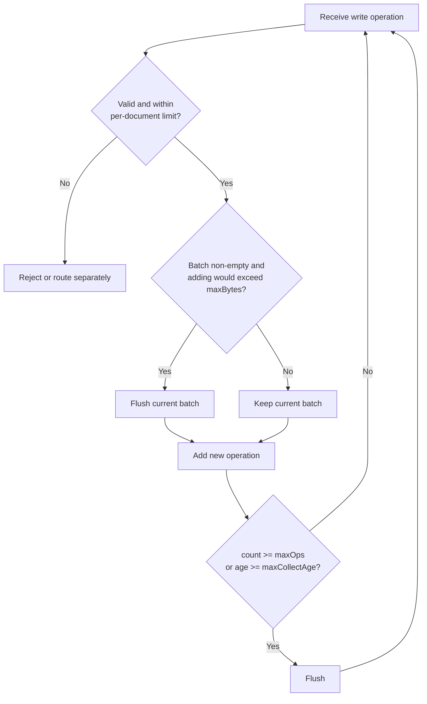
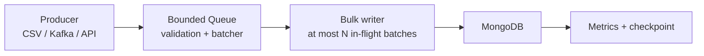

# Batching by Operation Count, Payload Size, and Collection Time

## 1. Why Does Bulk Writing Still Need Batching?

In **Spring Data MongoDB**, `MongoTemplate.bulkOps(...)` lets you group multiple insert, update, upsert, or delete operations using MongoDB's **bulk write** mechanism. While bulk writes reduce communication overhead compared to issuing operations one by one, an oversized batch still creates problems: spiking application heap usage, increasing wait latency, making failures harder to recover from, and putting pressure on MongoDB.

For example, an e-commerce system receives a price-update stream for **300,000 SKUs**. Each record includes store ID, SKU, new price, and update timestamp. If you accumulate all 300,000 changes into **one** list before calling `execute()`, the application can:

- hold huge numbers of `Query`/`Update` objects on the heap;
- wait until all data is collected before writing the first batch;
- produce massive driver requests where identifying what succeeded on failure is difficult;
- contend for MongoDB resources and inflate latency for concurrent requests;
- hit BSON or batch limits enforced by MongoDB or the driver.

Conversely, sending **one write per SKU** incurs excessive round trips and scheduling overhead. The task is choosing a batch size that balances **throughput, latency, memory, and reliability**.

Three core batching thresholds:

| Threshold | Starting Example to Measure | Purpose |
| --- | --- | --- |
| **Operation count** (`maxOps`) | 500 updates/upserts | Prevents the operation list from growing unboundedly |
| **Payload size** (`maxEstimatedBytes`) | 4 MiB estimated budget/batch | Keeps memory and expected payload within operational limits |
| **Collection window** (`maxCollectAge`) | 500 ms | Prevents the first record from waiting too long before flushing |

The values 500, 4 MiB, and 500 ms **are only starting examples, not universal optimal settings**. Tune them for document size, operation type, producer rate, network, MongoDB capacity, and application SLOs.

**Learning objective:** learn to design a batcher that flushes whenever *any one of the three thresholds* is reached, execute via Spring Data MongoDB, inspect bulk write results, and build tracking/retry mechanisms without breaking data consistency.

## 2. Bulk Write in Spring Data MongoDB

`MongoTemplate` provides `BulkOperations` with two modes:

- **`BulkMode.ORDERED`:** preserves execution order of operations within the batch; when a write error occurs, remaining ordered operations may be skipped.
- **`BulkMode.UNORDERED`:** MongoDB/driver may execute operations out of declared order and attempt remaining operations when one fails. Never infer result order or side-effect order from the input list.

Example of a small price-update batch:

```java
import org.springframework.data.mongodb.core.BulkOperations;
import org.springframework.data.mongodb.core.query.Criteria;
import org.springframework.data.mongodb.core.query.Query;
import org.springframework.data.mongodb.core.query.Update;

BulkOperations operations = mongoTemplate.bulkOps(
    BulkOperations.BulkMode.UNORDERED,
    SkuPrice.class
);

operations.upsert(
    Query.query(Criteria.where("id").is("SHOP-A:BOOK-101")),
    new Update()
        .set("priceMinor", 120_000L)
        .set("updatedAt", java.time.Instant.now())
        .setOnInsert("tenantId", "SHOP-A")
        .setOnInsert("sku", "BOOK-101")
);

operations.upsert(
    Query.query(Criteria.where("id").is("SHOP-A:BOOK-202")),
    new Update()
        .set("priceMinor", 180_000L)
        .set("updatedAt", java.time.Instant.now())
        .setOnInsert("tenantId", "SHOP-A")
        .setOnInsert("sku", "BOOK-202")
);

com.mongodb.bulk.BulkWriteResult result = operations.execute();
```

In this example, `bulkOps` creates a builder collecting operations; **`execute()` actually sends the batch to MongoDB**. `BulkWriteResult` reports inserted, matched, modified, deleted, and upserted counts upon acknowledged completion.

### Bulk Write Is **Not** a Transaction by Default

MongoDB guarantees atomicity of a write operation on **a single document**. However, a bulk of 500 updates does not mean **all 500 commit or roll back together**. Some operations may succeed while others fail. `ORDERED` vs. `UNORDERED` defines execution behavior upon errors—it **does not replace multi-document transactions**.

If business logic requires all updates across multiple documents to succeed together, evaluate MongoDB transactions on supported infrastructure, or design compensation/idempotency. Never use a giant bulk to simulate a transaction.

## 3. MongoDB Technical Limits vs. Operational Limits

Two distinct limit categories are often confused:

1. **MongoDB protocol/BSON limits:** a single document has a maximum BSON size of roughly **16 MiB**; commands, wire-protocol messages, and write batches also have limits advertised by the server/driver.
2. **Application-chosen limits:** operation count, estimated total bytes, collection age, and execution duration your system can tolerate.

In common MongoDB versions, typical values are `maxBsonObjectSize = 16 MiB`, `maxMessageSizeBytes ≈ 48 MiB`, and `maxWriteBatchSize = 100,000`. **Do not hardcode these numbers as guarantees across every version/deployment**: actual capabilities are advertised by the server during handshake/`hello`, and the driver enforces the corresponding protocol limits.

### The Driver Splits Batches Automatically, Yet Does Not Solve Application Buffering

The MongoDB Java Driver splits a large bulk into write batches fitting wire limits. Still, if the application holds 300,000 operations inside `BulkOperations`, **heap memory and collection latency are already spent before the driver writes to the network**. Smaller, controlled batches also make logging, latency measurement, retries, and error scoping much easier.

### Single Document Size Differs from Total Batch Size

You cannot “just shrink the batch” to write a single BSON document exceeding **16 MiB**. If a single record is too large, you must **redesign the data model** (split documents, use GridFS for files when appropriate, or trim payload); batching will not make an oversized document valid.

For **total batch size**, account for:

- BSON of every filter (`q`), update document (`u`), or inserted document;
- field names, BSON types, and attached metadata;
- operation envelopes, upsert flags, and command structure;
- wire-protocol overhead, session/transaction metadata, and driver policies.

**JSON length, `String.length()`, or Java character count does not equal true BSON byte size.** A UTF-8 string containing accented characters uses more bytes than visible characters; BSON also adds type tags, length headers, field names, and framing bytes.

Accordingly, set the application budget **well below** technical limits, calibrate against realistic payloads, and leave headroom for metadata. Never assume a “4 MiB batch measured from JSON” yields an exact 4 MiB BSON message.

## 4. Counting Ops, Bytes, and Time: Three Independent Axes

Suppose the batcher currently holds `N` operations, an estimated byte budget `B`, and elapsed time `T` since the first buffered record. The general rule:

\[
\operatorname{flush} \iff
(N \ge N_{\max})\;\lor\;
(B \ge B_{\max})\;\lor\;
(T \ge T_{\max})
\]

Beyond those three thresholds, the system also flushes on **end of input stream**, controlled shutdown, or checkpoint handoff. Never flush an empty batch.

| Scenario | Threshold Hit First | Action |
| --- | --- | --- |
| 500 small operations, fast producer | `maxOps` | Flush even before hitting byte or time thresholds |
| 80 large operations | `maxEstimatedBytes` | Flush before exceeding the byte budget |
| Only 12 changes in 500 ms | `maxCollectAge` | Flush early to bound waiting latency |
| Producer stops with no more records | End of source | Flush trailing remainder |
| Single operation exceeds application budget | Per-operation limit | Reject or route separately; avoid empty-flush loops |

### Byte Thresholds Must Be Checked **Before Adding a New Operation**

Suppose the current batch holds 3.9 MiB and the next operation is 0.3 MiB, against a 4 MiB budget. If you add first and check afterward, the batch already exceeds budget. Better:

```text
if batch is non-empty and currentBytes + newBytes > maxBytes:
    flush(batch)
add new operation to batch
if count >= maxOps or elapsed >= maxCollectAge:
    flush(batch)
```

Use overflow-safe arithmetic (`long` for bytes, or compare `newBytes > maxBytes - currentBytes` after validation), and verify single operations fit the budget **before** batching.

### Collection Time Differs from Execution Latency

**`maxCollectAge`** measures how long a batch waits from receiving its first record until flushing starts. It does not bound how long `execute()` waits on the server. When instrumenting, separate:

- `collectDuration`: time spent accumulating records;
- `executeDuration`: time spent running bulk and receiving results or errors;
- `endToEndLag`: delay from record arrival to confirmed persistence.

If a synchronous `for` loop checks the clock only when a new record arrives, **the batch will not auto-flush when the producer pauses**. For intermittent event streams, add a timer/scheduler or reactive time window to flush on deadline even without new records.



## 5. Price Ingestion Model: Entity and Identity Rules

To illustrate a bulk write pipeline, we use the `sku_prices` collection. Each document holds the current price of **one SKU in one store**:

```javascript
{
  _id: "SHOP-A:BOOK-101",
  tenant_id: "SHOP-A",
  sku: "BOOK-101",
  price_minor: NumberLong("120000"),
  updated_at: ISODate("2026-11-20T08:00:00Z")
}
```

In this demo, the application builds IDs from `tenantId + ":" + sku`. Real systems must **normalize IDs, validate formatting, and prevent delimiter collisions**. An alternative is a surrogate technical ID paired with a unique index on `(tenant_id, sku)`.

The `SkuPrice` entity using Java 17 and Spring Data MongoDB:

```java
package com.example.pricing;

import java.time.Instant;
import org.springframework.data.mongodb.core.mapping.Document;
import org.springframework.data.mongodb.core.mapping.Field;
import org.springframework.data.mongodb.core.mapping.FieldType;
import org.springframework.data.mongodb.core.mapping.MongoId;

@Document(collection = "sku_prices")
public class SkuPrice {
    @MongoId(FieldType.STRING)
    private String id;

    @Field("tenant_id")
    private String tenantId;

    private String sku;

    @Field("price_minor")
    private long priceMinor;

    @Field("updated_at")
    private Instant updatedAt;

    protected SkuPrice() {}

    public String getId() { return id; }
    public String getTenantId() { return tenantId; }
    public String getSku() { return sku; }
    public long getPriceMinor() { return priceMinor; }
    public Instant getUpdatedAt() { return updatedAt; }
}
```

An upstream price change represented by a `record`:

```java
package com.example.pricing;

import java.time.Instant;

public record PriceChange(
    String tenantId,
    String sku,
    long priceMinor,
    Instant observedAt
) {}
```

Each `PriceChange` generates an **ID-based upsert**. If the document exists, update `price_minor`/`updated_at`; if absent, insert it with `tenant_id`/`sku`. Prices are stored in **minor currency units** as `long` to avoid floating-point ambiguity.

**Lesson assumption:** no two events share the same `(tenantId, sku)` in one batch. With `BulkMode.UNORDERED`, the application order of upserts to the same document is not guaranteed. Even across batches/instances, an older price event can overwrite a newer one; coalesce by key or carry an `eventVersion`/sequence with a conditional guard against regression.

## 6. Estimating Approximate BSON Size of an Operation

`String.length()` or JSON length does not measure BSON accurately: field names, type tags, UTF-8 string lengths, integers, and dates are all encoded in BSON format. To estimate an upsert, build an `org.bson.Document` representing **query** and **update** and encode it with the MongoDB Java Driver:

```java
package com.example.pricing;

import java.util.Date;
import org.bson.BsonBinaryWriter;
import org.bson.Document;
import org.bson.codecs.DocumentCodec;
import org.bson.codecs.EncoderContext;
import org.bson.io.BasicOutputBuffer;

public final class BulkSizeEstimate {
    private BulkSizeEstimate() {}

    public static String idFor(PriceChange item) {
        return item.tenantId() + ":" + item.sku();
    }

    public static long estimateUpsertBytes(PriceChange item) {
        Document match = new Document("_id", idFor(item));
        Document change = new Document("$set",
            new Document("price_minor", item.priceMinor())
                .append("updated_at", Date.from(item.observedAt()))
        ).append("$setOnInsert",
            new Document("tenant_id", item.tenantId())
                .append("sku", item.sku())
        );

        Document operation = new Document("q", match)
            .append("u", change)
            .append("upsert", true);

        BasicOutputBuffer output = new BasicOutputBuffer();
        try (BsonBinaryWriter writer = new BsonBinaryWriter(output)) {
            new DocumentCodec().encode(
                writer, operation, EncoderContext.builder().build());
            return output.toByteArray().length + 128L;
        }
    }
}
```

This calculation measures BSON bytes for the actual types (`long`, `Date`, `String`) and adds **128 bytes of illustrative headroom**. Even so, it remains an **estimate**, not the exact MongoDB wire message size: command envelopes, session/transaction metadata, mapping/converters, and options like collation or `arrayFilters` add extra bytes. For other update patterns, extend the estimator or measure serialized BSON closer to the driver.

### Distinguishing Per-Operation and Per-Document Limits

Before adding a new operation to a batch, check `estimatedOperationBytes <= maxEstimatedBytes`. Yet an insert whose **target document** exceeds the 16 MiB BSON limit remains invalid even as the sole operation in a batch. For inserts, measure or bound the target document itself and redesign the schema if oversized.

## 7. A Service Batching on All Three Thresholds

`PriceBulkImportService` below consumes an `Iterable<PriceChange>` and buffers records on **a single synchronous thread**. It flushes on operation count, near-budget estimated bytes, collect age when new records arrive, or end of source.

Import summary:

```java
package com.example.pricing;

public record ImportSummary(
    long submittedOperations,
    long matchedDocuments,
    long modifiedDocuments,
    long insertedByUpsert,
    int flushedBatches
) {}
```

Implementation:

```java
package com.example.pricing;

import java.util.ArrayList;
import java.util.List;
import java.util.concurrent.TimeUnit;
import com.mongodb.bulk.BulkWriteResult;
import org.springframework.data.mongodb.core.BulkOperations;
import org.springframework.data.mongodb.core.MongoTemplate;
import org.springframework.data.mongodb.core.query.Criteria;
import org.springframework.data.mongodb.core.query.Query;
import org.springframework.data.mongodb.core.query.Update;
import org.springframework.stereotype.Service;

@Service
public class PriceBulkImportService {

    private static final int MAX_OPS = 500;
    private static final long MAX_ESTIMATED_BYTES =
        4L * 1024 * 1024;
    private static final long MAX_COLLECT_NANOS =
        TimeUnit.MILLISECONDS.toNanos(500);

    private final MongoTemplate template;

    public PriceBulkImportService(MongoTemplate template) {
        this.template = template;
    }

    public ImportSummary importChanges(Iterable<PriceChange> source) {
        if (source == null) {
            throw new IllegalArgumentException("Missing data source");
        }

        List<PriceChange> batch = new ArrayList<>();
        Counters counters = new Counters();
        long estimatedBytes = 0;
        long batchStartedAt = 0;

        for (PriceChange item : source) {
            validate(item);
            long opBytes =
                BulkSizeEstimate.estimateUpsertBytes(item);

            if (opBytes > MAX_ESTIMATED_BYTES) {
                throw new IllegalArgumentException(
                    "Single operation exceeds batch budget");
            }

            long now = System.nanoTime();
            boolean overflow = !batch.isEmpty()
                && opBytes > MAX_ESTIMATED_BYTES - estimatedBytes;
            boolean expired = !batch.isEmpty()
                && now - batchStartedAt >= MAX_COLLECT_NANOS;

            if (overflow || expired) {
                flush(batch, counters);
                estimatedBytes = 0;
            }

            if (batch.isEmpty()) {
                batchStartedAt = System.nanoTime();
            }
            batch.add(item);
            estimatedBytes += opBytes;

            if (batch.size() >= MAX_OPS
                    || estimatedBytes >= MAX_ESTIMATED_BYTES) {
                flush(batch, counters);
                estimatedBytes = 0;
            }
        }

        flush(batch, counters); // Do not drop trailing records at end of source.
        return counters.asSummary();
    }

    private void flush(
            List<PriceChange> batch, Counters counters) {
        if (batch.isEmpty()) {
            return;
        }

        BulkOperations bulk = template.bulkOps(
            BulkOperations.BulkMode.UNORDERED, SkuPrice.class);

        for (PriceChange item : batch) {
            Query key = Query.query(Criteria.where("id").is(
                BulkSizeEstimate.idFor(item)));

            Update update = new Update()
                .set("priceMinor", item.priceMinor())
                .set("updatedAt", item.observedAt())
                .setOnInsert("tenantId", item.tenantId())
                .setOnInsert("sku", item.sku());

            bulk.upsert(key, update);
        }

        long started = System.nanoTime();
        BulkWriteResult result = bulk.execute();
        long elapsedMillis = TimeUnit.NANOSECONDS.toMillis(
            System.nanoTime() - started);

        // In production emit metrics; do not log individual SKUs.
        System.out.println("bulk.ops=" + batch.size()
            + ", bulk.execute.ms=" + elapsedMillis);

        counters.submitted += batch.size();
        counters.matched += result.getMatchedCount();
        counters.modified += result.getModifiedCount();
        counters.upserts += result.getUpserts().size();
        counters.flushed++;

        batch.clear();
    }

    private static void validate(PriceChange item) {
        if (item == null
                || item.tenantId() == null
                || item.tenantId().isBlank()
                || item.tenantId().contains(":")
                || item.sku() == null || item.sku().isBlank()
                || item.sku().contains(":")
                || item.priceMinor() < 0
                || item.observedAt() == null) {
            throw new IllegalArgumentException(
                "Invalid PriceChange");
        }
    }

    private static final class Counters {
        long submitted;
        long matched;
        long modified;
        long upserts;
        int flushed;

        ImportSummary asSummary() {
            return new ImportSummary(
                submitted, matched, modified, upserts, flushed);
        }
    }
}
```

### Reading the Batching Rules in Code

1. **Validate:** reject invalid records before creating write operations.
2. **Estimate bytes:** check single operation size; if adding it would exceed the budget, flush the existing batch first.
3. **Collection age:** if `MAX_COLLECT_NANOS` has elapsed when the next record arrives, flush the old batch.
4. **Count:** flush immediately upon reaching `MAX_OPS`; do not wait for more records.
5. **Capacity:** flush when hitting `MAX_ESTIMATED_BYTES`.
6. **End of source:** flush the final batch below thresholds.
7. **Bounded buffer:** each flush builds a fresh `BulkOperations` and clears acknowledged `PriceChange` items.

**Important limitation of the example:** because this is a synchronous loop, when the producer stalls and the iterator blocks in `next()`, there is no separate timer to flush at the exact 500 ms mark. The age limit is checked only when the next record arrives or the source ends. If flushing during idle periods is required, add a scheduler/timer with safe coordination between buffer and writer worker.

On the flip side, while `bulk.execute()` blocks, the loop reads no more input: this provides **natural backpressure** in a synchronous pipeline. For multi-threaded or multi-instance ingestion, never share a mutable `BulkOperations` or batch list without proper synchronization.

### Understanding the Counters Accurately

`submittedOperations` counts upserts **submitted and confirmed across whole batches** along the normal path. `matchedDocuments` counts total matched updates; `modifiedDocuments` may be lower when an update changes no values; `insertedByUpsert` counts upserts that inserted new documents. Never assume all these counters equal one another or equal distinct document counts.

If `execute()` throws an exception, this example method **aborts without returning an `ImportSummary`**. That is intentional to avoid reporting false completion when a batch partially succeeded; production pipelines need checkpoint/reconciliation before retrying.

## 8. Distinguishing Collection Time from Batch Execution Latency

The three thresholds in the batcher are **rules deciding when to start sending**. They do not guarantee MongoDB finishes executing the batch within 500 ms. A 500-operation batch can run very fast in tests yet slow down when the collection has many indexes, disks are busy, or writers contend.

Suppose the operational SLO is **p95 batch execute time ≤ 800 ms**. That is an observed target to tune toward, **not the value of `maxCollectAge`**.

Hypothetical measurement table:

| Scenario | Operations/Batch | Estimated Bytes/Batch | p95 execute | Interpretation |
| --- | ---: | ---: | ---: | --- |
| A | 100 | 0.5 MiB | 90 ms | Very fast, though multi-batch overhead can be high |
| B | 500 | 2.4 MiB | 310 ms | Good balance in this example measurement |
| C | 2,000 | 9.7 MiB | 1,250 ms | Exceeds p95 target and is harder to retry |

**This is not a real MongoDB benchmark.** The table illustrates that optimal batch size cannot be deduced from a fixed byte limit alone.

### Adaptive Tuning of `maxOps`

An experimental tuning procedure could be:

1. Start with `maxOps = 500` and a 4 MiB byte budget.
2. Measure `executeDuration` as a histogram across many batches of the same workload.
3. If p95 exceeds the target, try lowering `maxOps` in controlled steps (e.g., down 20%, floored at 50) and re-measure. If queue depth climbs, diagnose root cause first: shrinking batch size can **worsen** throughput when fixed per-batch overhead dominates.
4. If p95 is well below target, MongoDB has spare headroom, and per-batch overhead is high, try raising `maxOps` in small steps (e.g., 10%) without crossing configured ceilings. When queue depth rises while p95 stays low, examine writer concurrency/in-flight limits and producer rate as well.
5. Keep `maxEstimatedBytes` and `maxCollectAge` independent; every adjustment must respect hard ceilings and data shapes.

Never change configuration after **a single batch** exhibits a latency spike. A MongoDB node may be stepping down, an index building, or a transient network blip occurring. For highly variable workloads, bucket metrics by operation type and BSON size range to avoid mis-tuning.

### Execution Time Also Depends on Concurrency Pressure

Sending 20 batches of `500` operations **in parallel** is not necessarily faster than 4 batches in parallel. Write contention, cache pressure, connection counts, write concern, and index updates can slow MongoDB down. Alongside operation and byte limits, set a **maximum in-flight batch count** so producers cannot flood the queue unboundedly.

## 9. When the Producer Outpaces the Consumer: Backpressure and Memory

A bulk write pipeline typically has three stages:



If the producer emits 50,000 changes/second while the writer confirms 20,000/second, **the 30,000/second surplus must go somewhere**. Appending into an unbounded in-memory queue will eventually exhaust RAM. You need one of these mechanisms:

- **Backpressure:** slow down the producer or pause message polling once in-flight batches hit a ceiling.
- **Bounded queue:** when full, block, spill to durable storage, or return an overload error per contract.
- **Checkpointed source reading:** commit Kafka offsets or file positions only after associated batches are written and verified per policy.
- **In-flight cap:** start with e.g. 2–4 concurrent batches and measure rather than assuming more is faster.
- **Key partitioning:** prevent two workers from concurrently processing order-dependent updates for the same SKU.

None of these options alone delivers end-to-end exactly-once semantics. Events may be re-read after a crash; database-level deduplication or version conditions remain essential to reliability.

### Queue Capacity Differs from Single-Batch Capacity

Suppose you configure `maxEstimatedBytes = 4 MiB` yet allow 1,000 batches in the queue. Buffered unwritten data can estimate up to **around 4 GiB**, before even counting Java objects and metadata. Therefore bound both simultaneously:

\[
\text{maxBufferedBytes} \approx
\text{maxBatchBytes} \times \text{maxBufferedBatches}
\]

This is only an order-of-magnitude estimate. Real Java heap usage can be significantly higher due to `List`, `Query`, `Update`, `String`, and object headers. Monitor heap, allocation rate, and pending byte counts rather than just item counts.

## 10. ORDERED vs. UNORDERED When Splitting into Multiple Batches

`BulkMode.ORDERED` fits when operations are **order-dependent** within one bulk or must stop at the first write error. `BulkMode.UNORDERED` can raise throughput and allow independent operations to continue upon error.

| Characteristic | `ORDERED` | `UNORDERED` |
| --- | --- | --- |
| Order within a single bulk | Follows declared order | Never assume order |
| On write error | Stops subsequent operations per ordered semantics | Can continue independent operations |
| Suitable cases | Order-related updates inside one bulk | Distinct IDs/SKUs where each operation is independent |
| Rolls back everything? | **No** | **No** |
| Guarantees order **across batches/instances**? | **No**, if parallelized without coordination | **No** |

For price feeds, `UNORDERED` matches intent only when operations are independent and **latest values are enforced via version or explicit business rules**. Switching from `UNORDERED` to `ORDERED` does not prevent races between two instances writing the same SKU.

### Do Not Group Dependent Operations into One Bulk Carelessly

For instance, wanting to increment stock and then deduct stock on **the same document**, or wanting operation 2 to run only if operation 1 succeeded. Putting two updates into one bulk does not create a business transaction. Design **one conditional atomic update** on the document for shared invariants; across multiple documents, evaluate transactions or sagas rather than relying on bulk order.

### Small Batches Can Still Produce “Newer First, Older Last”

Suppose two events for `SHOP-A:BOOK-101` carry versions 10 and 11. If batch A carrying version 10 stalls while batch B carrying version 11 finishes first, batch A finishing later can **regress the price**. The standard solution is storing `last_event_version` and conditionally updating by version (or partitioning by SKU with end-to-end ordering).

When using `upsert` with `last_event_version < incomingVersion`, handle the **existing document whose filter missed** carefully: upsert will try to insert a document with the same `_id` and raise a duplicate key error. Never pair `upsert(true)` with a version predicate without defining creation vs. conflict handling. For critical ingestion, separate creation rules, versioned updates, and handle duplicates/stale events explicitly as business outcomes.

## 11. Partial Failures: A Failed Bulk Does Not Mean Nothing Was Written

Possible errors:

| Error | Example | Typical Impact |
| --- | --- | --- |
| Duplicate key | Two jobs upserting an uncreated ID or colliding on unique key | One operation fails; others may have succeeded |
| Schema validation | Document violates MongoDB validator | One or more operations rejected |
| Wrong BSON type | `$inc` on a String field instead of Number | That operation fails |
| Network timeout | Connection drops after sending | Outcome of some operations may be **uncertain** |
| Write concern error | Configured acknowledgement level not met | Cannot simply infer nothing wrote |
| Oversized bulk | Document/command exceeds limit or misestimated payload | Rejected by driver/server or split internally by driver |
| Resource overload | Too many concurrent batches, high contention | Rising latency, frequent retries, queue buildup |

In the Java Driver, bulk exceptions can carry failing operation indices and partial results for processed operations. Spring Data may translate exceptions into `DataAccessException` subclasses or specialized bulk exceptions depending on version/API.

**Never write logic like this:**

```java
try {
    bulk.execute();
} catch (Exception ex) {
    // WRONG: assuming no operations succeeded and retrying the whole batch.
    retryAllWithoutCheckingAnything();
}
```

Succeeded operations could execute a second time. With `$set` using identical values and stable keys, final state may often remain valid; with `$inc`, `$push`, emitted events, or changing timestamps, retries can produce wrong results.

### Recommended Error-Handling Workflow

1. Record **batch ID**, source checkpoint/offset range, and total operation count.
2. When a bulk is confirmed successful, advance checkpoints durably.
3. When a bulk throws, separate **deterministic per-operation errors** from **uncertain outcomes** (network, timeout, write concern).
4. Emit logs/metrics **without exposing sensitive values**, yet retaining correlation via IDs or idempotency keys.
5. For permanent validation errors, isolate records to a dead-letter queue instead of retrying infinitely.
6. For transient errors, retry with limits, backoff, and jitter; run **reconciliation** or idempotency checks before resending.
7. Advance checkpoints only after job success criteria are met—never equate “request sent” with “durably persisted”.

**Specifically:** a successful `BulkWriteResult` does not mean a **transaction** occurred. And a mid-bulk error does not mean prior documents rolled back. That is why batches should be small enough to track cleanly yet large enough to be efficient.

## 12. Idempotency and Avoiding Duplicate Writes on Retry

For the price upserts in this lesson, a stable `_id` combined with `$set` generally allows **replaying the same event** without duplicating documents. Still, you need:

- update values sourced from the event itself (e.g., `observedAt`), not a fresh `Instant.now()` on every retry when replaying payloads;
- unique keys aligned with true business uniqueness;
- a guard blocking older events from overwriting newer ones;
- distinction between retrying the **same event** vs. a brand-new event carrying the same price;
- rules for side effects outside the database (messages, webhooks, emails).

### `$inc` and `$push` Are Usually Not Idempotent

```javascript
// Repeating this command keeps incrementing the quantity.
db.stock.updateOne(
  { _id: "BOOK-101" },
  { $inc: { reserved: NumberLong("2") } }
)
```

Even in batches of 100 operations, retrying an `$inc` command can double-increment a counter. Never re-enqueue an `$inc` batch without idempotency keys, state-transition conditions, transactions, or deduplication markers guaranteeing apply-once behavior per request.

### Result Types Do Not Identify the “Latest Event”

`BulkWriteResult.getMatchedCount()` and `getModifiedCount()` cannot distinguish a valid newer price update from an accidentally applied older price update. Store `eventVersion` and enforce version predicates, or maintain durable deduplication/coalescing rules. Never use “high modified count” as proof of valid business state.

## 13. Reactive Batching and Pipelines: Bounding by Count and Time

With `ReactiveMongoTemplate`, you can build a non-blocking bulk write stream. Reactor provides `bufferTimeout(maxSize, maxTime)`, which collects and emits buffers when reaching item count or timeout.

Illustrative example with **count/time thresholds only**, without byte limits yet:

```java
package com.example.pricing;

import java.time.Duration;
import com.mongodb.bulk.BulkWriteResult;
import org.springframework.data.mongodb.core.BulkOperations;
import org.springframework.data.mongodb.core.ReactiveBulkOperations;
import org.springframework.data.mongodb.core.ReactiveMongoTemplate;
import org.springframework.data.mongodb.core.query.Criteria;
import org.springframework.data.mongodb.core.query.Query;
import org.springframework.data.mongodb.core.query.Update;
import reactor.core.publisher.Flux;

public class ReactivePriceImport {

    private final ReactiveMongoTemplate template;

    public ReactivePriceImport(ReactiveMongoTemplate template) {
        this.template = template;
    }

    public Flux<BulkWriteResult> importStream(
            Flux<PriceChange> source) {
        return source
            .bufferTimeout(500, Duration.ofMillis(500))
            .filter(batch -> !batch.isEmpty())
            .concatMap(batch -> {
                ReactiveBulkOperations bulk = template.bulkOps(
                    BulkOperations.BulkMode.UNORDERED,
                    SkuPrice.class);

                for (PriceChange item : batch) {
                    Query key = Query.query(
                        Criteria.where("id").is(
                            BulkSizeEstimate.idFor(item)));

                    Update change = new Update()
                        .set("priceMinor", item.priceMinor())
                        .set("updatedAt", item.observedAt())
                        .setOnInsert("tenantId", item.tenantId())
                        .setOnInsert("sku", item.sku());

                    bulk.upsert(key, change);
                }
                return bulk.execute();
            });
    }
}
```

`concatMap` executes the bulks produced by each buffer sequentially, capping concurrent bulks on this branch and preserving emission order. **It does not guarantee operation order inside an `UNORDERED` bulk**, protect against other threads/instances, or replace per-SKU versioning.

**Three things to fix before production use:**

1. **Add a byte budget:** `bufferTimeout` has no idea how many bytes each `PriceChange` takes. Add a byte-aware batching stage or stateful timer-driven accumulator before calling `ReactiveBulkOperations`. Do not treat this snippet as a complete three-threshold implementation.
2. **Validate inputs:** check tenant, SKU, price, timestamp, duplicate IDs, and per-operation limits before adding to the bulk, just like the synchronous service.
3. **Bound flow and errors:** bound queues between producer and MongoDB; when `bulk.execute()` errors, the stream can terminate and needs a proper retry/reconciliation policy. Never use `onErrorContinue` to silently drop failed batches.

With continuous sources, `bufferTimeout` emits a non-empty buffer when its timer expires without waiting for the next record. Still, actual backpressure and buffering depend on operators, Reactor version, and source type; hot sources that ignore backpressure still require explicit overload handling.

### Do Not Accidentally Mix Synchronous APIs into Reactive Flows

Wrapping `MongoTemplate.bulkOps(...).execute()` in a `Flux` does not make it non-blocking. In truly reactive applications, prefer `ReactiveMongoTemplate`. If an integration forces calling a blocking API, isolate it on a blocking scheduler with bounded concurrency as a fallback—not as a replacement for reactive APIs.

## 14. Monitoring to Choose the Right Thresholds

No single batch size suits every system. Measure the following metrics **per batch** and aggregate by operation type:

| Metric | How to Use It |
| --- | --- |
| `bulk_batch_ops` | Distribution of actual operation counts per batch |
| `bulk_batch_estimated_bytes` | Spots batches frequently hitting the byte ceiling |
| `bulk_collect_duration_ms` | Buffering wait latency, especially at low traffic |
| `bulk_execute_duration_ms` | MongoDB write latency (p50/p95/p99) |
| `bulk_ops_per_second` | Confirmed throughput, not just submitted rate |
| `bulk_in_flight` | Concurrent batches currently executing |
| `bulk_queue_depth` / `bulk_buffered_bytes` | Queue saturation and memory growth risk |
| `bulk_write_errors` | Error counts grouped by cause |
| `bulk_retries` / `bulk_dead_letter` | Retry rate and quarantined record counts |
| `bulk_checkpoint_lag` | Lag from source ingestion to confirmed write and checkpoint |
| `mongo_write_concern_errors` | Risk of write confirmation falling short |

Tag metrics with **job ID, batch ID, and source range**, never using individual SKUs as high-cardinality metric labels. For detailed error logs, store bounded/redacted record IDs and correlation IDs according to security policy.

### Experimenting to Tune the Three Thresholds

A controlled experiment should fix the **same dataset**, operation size/type distribution, and concurrency level:

1. Start with 100, 500, and 1,000 ops/batch alongside byte and time budgets.
2. Test byte budgets of 1 MiB, 4 MiB, and 8 MiB on variably sized data without exceeding technical/heap limits.
3. Test `maxCollectAge` at 100 ms, 500 ms, and 2 s to observe latency impact on sparse streams.
4. Measure throughput, p95/p99 execute latency, bytes/queue depth, CPU/heap/GC, and end-to-end lag.
5. Increase in-flight batch counts carefully; watch contention and impact on online requests.
6. Test network faults, duplicate keys, and mongod restarts/failovers in test environments to evaluate retry blast radius.
7. Pick a configuration with **safety headroom**, not just peak ops/second in a single benchmark.

Never generalize from a collection with a handful of records that batch 500 always beats batch 100. Indexes, document sizes, write concern, shard keys, and storage speed all shape the outcome.

## 15. Integration Testing Against Real MongoDB

Batching bugs, upserts, and BSON conversions should be tested against real MongoDB in an isolated test environment such as Testcontainers. `@DataMongoTest` configures Spring Data components for data-layer tests; the test MongoDB infrastructure must be provisioned separately.

### Testing Operation Thresholds and Flushing the Remainder

The example below creates **1,001 SKUs**. With `MAX_OPS = 500`, it requires **at least three flushes** (with time/byte thresholds, there could be more). The test avoids asserting exactly three batches because slow CI machines could trigger the collection-age threshold early.

```java
package com.example.pricing;

import java.time.Instant;
import java.util.List;
import java.util.stream.IntStream;
import org.junit.jupiter.api.BeforeEach;
import org.junit.jupiter.api.Test;
import org.springframework.beans.factory.annotation.Autowired;
import org.springframework.boot.test.autoconfigure.data.mongo.DataMongoTest;
import org.springframework.data.mongodb.core.MongoTemplate;
import org.springframework.data.mongodb.core.query.Query;

import static org.assertj.core.api.Assertions.assertThat;
import static org.assertj.core.api.Assertions.assertThatThrownBy;

@DataMongoTest
class PriceBulkImportTest {

    @Autowired
    MongoTemplate template;

    PriceBulkImportService importer;

    @BeforeEach
    void setUp() {
        // Isolated test database only!
        template.dropCollection(SkuPrice.class);
        importer = new PriceBulkImportService(template);
    }

    @Test
    void splitsLargeInputAndFlushesRemainingRecords() {
        Instant observedAt =
            Instant.parse("2026-11-20T08:00:00Z");

        List<PriceChange> changes = IntStream.range(0, 1001)
            .mapToObj(i -> new PriceChange(
                "SHOP-A", "SKU-" + i, 1000L + i, observedAt))
            .toList();

        ImportSummary summary = importer.importChanges(changes);

        assertThat(summary.submittedOperations()).isEqualTo(1001);
        assertThat(summary.insertedByUpsert()).isEqualTo(1001);
        assertThat(summary.flushedBatches()).isGreaterThanOrEqualTo(3);
        assertThat(template.count(
            new Query(), SkuPrice.class)).isEqualTo(1001);

        SkuPrice last = template.findById(
            "SHOP-A:SKU-1000", SkuPrice.class);
        assertThat(last).isNotNull();
        assertThat(last.getPriceMinor()).isEqualTo(2000L);
    }

    @Test
    void replayOfSameValuesDoesNotCreateSecondDocument() {
        PriceChange event = new PriceChange(
            "SHOP-A", "BOOK-101", 120_000L,
            Instant.parse("2026-11-20T08:00:00Z"));

        importer.importChanges(List.of(event));
        ImportSummary replay = importer.importChanges(List.of(event));

        assertThat(replay.insertedByUpsert()).isZero();
        assertThat(template.count(
            new Query(), SkuPrice.class)).isEqualTo(1);
    }

    @Test
    void invalidPriceIsRejectedBeforeWrite() {
        PriceChange invalid = new PriceChange(
            "SHOP-A", "BOOK-101", -1L,
            Instant.parse("2026-11-20T08:00:00Z"));

        assertThatThrownBy(() ->
            importer.importChanges(List.of(invalid)))
            .isInstanceOf(IllegalArgumentException.class);

        assertThat(template.count(
            new Query(), SkuPrice.class)).isZero();
    }
}
```

**Warning:** `template.dropCollection(SkuPrice.class)` drops the entire `sku_prices` collection on the connected database. Use only when MongoDB is dedicated to tests; never execute against production or a shared database.

### Properly Testing Byte and Time Thresholds

Because the illustrative service hardcodes constants and calls `System.nanoTime()`, writing deterministic time-based tests is brittle. In production projects, extract the batcher into a configurable component:

```java
public record BatchLimits(
    int maxOps,
    long maxEstimatedBytes,
    java.time.Duration maxCollectAge
) {}
```

Then **inject a controllable clock/ticker** and a mock flush callback in unit tests. For example, set `maxOps = 3`, `maxEstimatedBytes = 300`, advance the clock deterministically, and assert batches emit at exact thresholds without waiting real 500 ms intervals. Test coverage should verify:

1. Reaching op count → flushes right at threshold.
2. Approaching byte limit → flushes old batch **before** adding the new operation.
3. Single operation exceeding budget → throws/rejects without infinite empty-batch flushing.
4. Batch age exceeding limit → flushes when ticker advances; for idle-capable scheduled sources, test flushing with no incoming records.
5. Source completion → flushes remainder exactly once.
6. `execute()` throwing mid-batch → checkpoint is not marked succeeded.
7. One invalid record does not lose track of other records, and retries do not replay non-idempotent side effects.
8. Multiple events for the same SKU within/across batches → enforce chosen version/ordering rules.

Concurrency and network fault testing should run in a dedicated integration environment. Unit testing a batcher alone cannot prove MongoDB atomicity or end-to-end exactly-once semantics.

## 16. Common Pitfalls

| Symptom | Possible Cause | Fix |
| --- | --- | --- |
| A bulk of hundreds of thousands of ops spikes RAM | Buffering the entire file into `BulkOperations` before `execute()` | Stream from source, batch by op count and bytes |
| Driver already splits batches yet app still OOMs | Driver splits on send; Java objects already accumulated | Bound buffering in the application layer before building bulk |
| Batches with long records fail size limits | Capping op count only without measuring bytes | Measure/estimate BSON payload and flush by bytes |
| Single document exceeds BSON limit | Confusing document limit with batch size | Redesign data model rather than shrinking ops/batch |
| Sparse streams wait too long to persist | Flushing only by count | Add `maxCollectAge` and idle-flush timer |
| `execute()` takes seconds despite `maxCollectAge = 500 ms` | Confusing collection window with MongoDB write latency | Instrument execute latency separately, reduce batch/in-flight, inspect MongoDB |
| One error leaves incomplete bulk results | Bulk is not a transaction; partial success occurs | Classify errors, checkpoint/reconcile, retry safely |
| Older price overwrites newer price | Events for the same SKU reordered across bulks/instances | Version/sequence guard, key partitioning, or coalescing |
| Retry double-counts inventory | Using `$inc` without idempotency | Record request markers, CAS conditions, transactions, or reconciliation |
| Replaying updates mutates `updatedAt` every time | Using `Instant.now()` instead of event timestamp | Keep payload deterministic on replay when business rules allow |
| Running more batches concurrently slows throughput | Too many in-flight batches, contention, saturated I/O | Cap concurrency, monitor queue depth and p95/p99 |
| Trailing operations lost on app shutdown | Remainder not flushed or checkpointed before writes finish | Flush at end, graceful shutdown, checkpoint after confirmation |
| `modified=0` reported despite matching | `$set` with identical existing value (valid no-op) | Track matched, modified, and upserted distinctly as needed |
| `@Version`/auditing behaves differently from `save` | Bulk API does not share all save lifecycle/optimistic locking semantics | Set explicit versions/timestamps and test your API/version |
| Batch lost when network drops after send | Uncertain execution outcome | Use event IDs, idempotency, reconciliation, and bounded retries |

A Spring Data note: **do not assume `BulkOperations` triggers all lifecycle callbacks, auditing, or optimistic locking the way `repository.save` does per entity**. Bulk operations rely heavily on explicit BSON updates. If business rules require specific versioning, timestamps, or validation, define and test them directly on the bulk write path—or pick another API.

### Upsert Does Not Enforce Event Ordering Automatically

Given two price events for the same SKU, `$set` on one ID can yield different states depending on execution order. Using `ORDERED` within a batch helps when ordering is required inside that batch, yet concurrent instances/batches can still interleave. Systems requiring “latest price always wins” need **explicit version rules** and conditional MongoDB writes, or a source stream durably ordered by key.

### Should You Wrap the Entire Bulk in a Transaction?

Avoid wrapping hundreds of thousands of updates into one massive transaction by default. MongoDB multi-document transactions require a compatible replica set/sharded cluster and impose resource/time limits; huge transactions raise contention and retry costs. When consistency is needed, find the **smallest business boundary** requiring atomicity; price-import batches typically tolerate eventual consistency with checkpoints/idempotency, whereas placing an order needs a small transaction or well-designed document model.

## 17. Production Batch-Writer Deployment Checklist

1. **Identify operation independence.** Can two updates touch the same document? If yes, are ordering/version guards in place?
2. **Choose the right API.** `BulkOperations.ORDERED`/`UNORDERED` per semantics; never treat bulk as a transaction.
3. **Bound single documents.** Never let records exceed BSON limits; validate pre-write.
4. **Calibrate byte estimation to real operations.** Do not treat JSON/string lengths as exact BSON sizes.
5. **Configure all three thresholds.** `maxOps`, `maxEstimatedBytes`, `maxCollectAge` — flush when any triggers.
6. **Flush remainders and on shutdown.** Never drop trailing records; handle process termination cleanly.
7. **Separate collection time from execute time.** Monitor p95/p99 rather than promising processing SLAs from a collect timer.
8. **Bound queues and in-flight work.** Prevent producers from filling memory unboundedly.
9. **Acknowledge and checkpoint at the right moment.** Advance source checkpoints only after write outcomes are verified per policy.
10. **Design retries and idempotency.** Persist keys/event IDs, handle partial failures, and reconcile unknown outcomes.
11. **Be careful with upserts and unique indexes.** Normalize IDs, handle insert races, and prevent version regression.
12. **Measure MongoDB load.** Track indexes, write concern, lock contention, replication, and impact on online traffic.
13. **Test thresholds deterministically.** Inject fake config/clocks for the batcher, and test writes against real MongoDB.
14. **Enforce authorization and security.** Validate tenant, collection, fields, and sources; never log raw sensitive pricing/customer data.

## 18. Practice Exercises

### Exercise 1. Which Threshold Triggers the Flush?

A batcher is configured with `maxOps = 500`, `maxEstimatedBytes = 4 MiB`, `maxCollectAge = 500 ms`. After 300 ms, it holds 500 operations totaling 1 MiB. **Question:** does it flush?

**Answer:** Yes. `maxOps` has been reached; it does not wait for the byte or time threshold.

### Exercise 2. Checking Capacity Before Adding

A batch currently holds 3.8 MiB, and the next record is 0.4 MiB against a 4 MiB budget. **Question:** what is the right action?

**Answer:** Flush the current batch first, then put the new record into the next batch. Never add first and let the batch exceed 4 MiB.

### Exercise 3. Time Elapsed With No New Records

A synchronous `for` loop reads the first record and then the iterator blocks waiting for the second record. After 500 ms, does the batch auto-flush?

**Answer:** No, if the code checks `System.nanoTime()` only when each record arrives. You need a separate timer/scheduler or a reactive time-based buffer operator to flush while idle.

### Exercise 4. Atomicity and Rollback

An `UNORDERED` bulk has 200 upserts; operation 80 triggers a duplicate key error. **Question:** are the other 199 operations guaranteed to roll back?

**Answer:** No. Other operations may have succeeded. Inspect errors and acknowledged results, handle partial success; bulk is not a transaction by default.

### Exercise 5. Does Batching Guarantee Latest Price Wins?

SKU `X` receives price updates at version 10 and then 11. Two batches run concurrently and the batch carrying version 10 finishes last. **Question:** are `ORDERED` or small batch sizes enough?

**Answer:** No. You need a version/sequence guard or end-to-end per-key ordering from source to MongoDB. `ORDERED` only controls command order within a single bulk, not across concurrent writers.

### Exercise 6. Timeouts and Retries

The client loses the response for a batch containing inventory `$inc` updates. **Question:** should it immediately retry the whole batch?

**Answer:** Not blindly; the batch may have partially or fully written. You need idempotency keys, reconciliation, and bounded retry policies so increments/decrements are never applied twice.

### Exercise 7. Choosing Batch Size

Hypothetical benchmarks show batch 100 has p95 90 ms, batch 500 has p95 310 ms, and batch 2,000 has p95 1,250 ms. The API targets p95 under 800 ms. **Question:** should you pick batch 2,000 just for fewer round trips?

**Answer:** No. Batch 2,000 breaches the measured p95 target and increases latency, memory, and retry blast radius. Weigh throughput, queue depth, bytes, and load conditions, testing configurations like 500 with headroom.

### Exercise 8. Reactive and Three-Threshold Limits

Is `Flux.bufferTimeout(500, Duration.ofMillis(500))` enough to bound batches by bytes?

**Answer:** Not yet. That operator groups by element count and time without knowing each operation's BSON size. Add a byte-based accumulator and separate document-size checks.

## 19. Conclusion

In **Spring Data MongoDB**, effective bulk-write batching is more than picking one fixed count for `BulkOperations.execute()`. Combine **operation count limits**, **estimated BSON byte budgets**, and **collection time windows**, while measuring **execution duration** and **end-to-end ingestion-to-acknowledgement lag** separately.

A solid batcher flushes before exceeding its byte budget, flushes on count or timeout, drains trailing items at end-of-stream, and avoids unbounded queues. Yet performance is only half the story: bulks can partially succeed, retries can duplicate side effects, and `UNORDERED` does not guarantee the newest event wins. For reliable operations, pair batching with **unique keys, idempotency, versioning/ordering, checkpoints, monitoring, and real MongoDB testing**. Tune batch sizes from measured metrics, and never confuse driver protocol ceilings with application operational limits.
