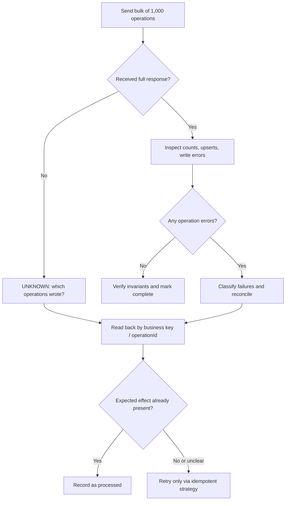
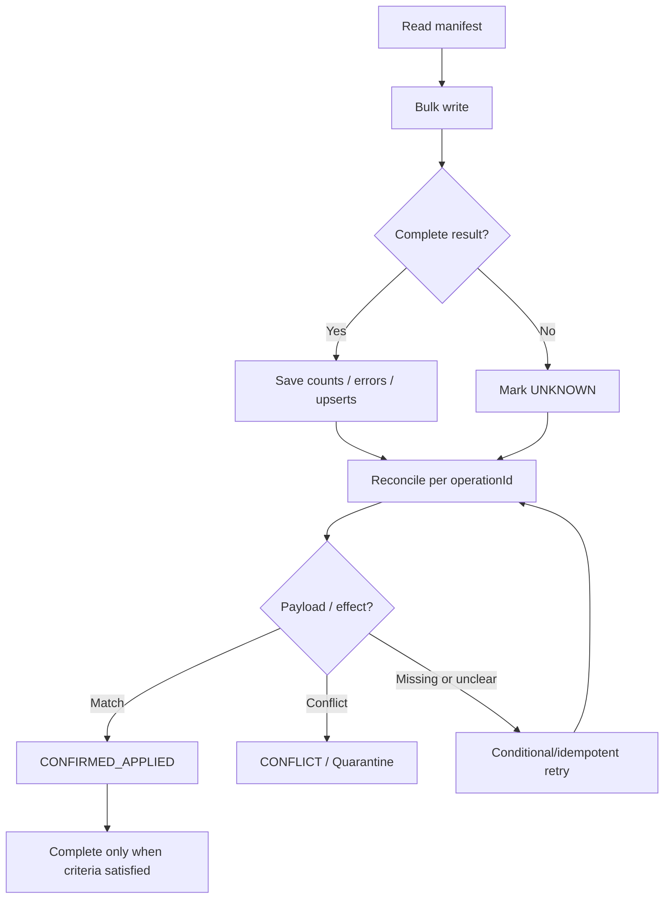

# Idempotency and Retrying When You Cannot Tell Which Operations Succeeded

## 1. Real-World Problem: Losing a Response Does Not Mean the Write Failed

An inventory ingestion system uses **Spring Data MongoDB** to receive 1,000 rows from a partner and update multiple documents in the `inventory` collection. To reduce round trips to MongoDB, the application uses **bulk write** instead of calling `save(...)` for each row.

Suppose the timeline unfolds as follows:

```text
T1  Application sends 1,000 write operations in one bulk.
T2  MongoDB executes some or all of the operations.
T3  Connection drops before the application receives the full response.
T4  Application only sees a timeout / network exception.
T5  Job decides to resend all 1,000 operations.
```

What happens if operation 27 is:

```javascript
{
  updateOne: {
    filter: { _id: "sku-27" },
    update: { $inc: { available: 5 } }
  }
}
```

If MongoDB **already added 5** on the first attempt while the response was lost, retrying will **add another 5**, leaving inventory off by 5 units. Conversely, if the application assumes everything succeeded and skips retrying, unexecuted rows are silently dropped.

This lesson belongs to the **Bulk Writes** chapter of the `SPRING_DATA_MONGODB` module. Services learn to connect, map documents, interact with MongoDB via `MongoTemplate` or repositories, build queries/updates, verify indexes, and manage transactions, reactive access, testing, and performance. The focus here is:

- Distinguishing **succeeded operations**, **failed operations**, and **operations with unknown outcomes**.
- Understanding `ORDERED`, `UNORDERED`, and the limits of `BulkWriteResult`.
- Designing **idempotency keys** and safely replayable updates.
- Knowing when to retry and when to **read back to reconcile**.
- Distinguishing MongoDB Driver retries from application/job retries.
- Testing duplicates, partial failures, disconnects, concurrency, and uncertain commit results.

**Most important rule:** *failing to receive an acknowledgement is not proof that MongoDB did not write*. An operation must not be resent merely because the client saw no result, unless resending is idempotent or the target has been reconciled by business identifier.

## 2. What Is Idempotency?

A transformation is **idempotent** if applying it multiple times to the same input leaves the final state identical to applying it once.

Starting with `available = 10`:

| Update | Applied Once | Reapplied with Same Input | Idempotent on State? |
| --- | --- | --- | --- |
| `$set: {available: 15}` | 15 | 15 | Yes, if preconditions and values are unchanged |
| `$inc: {available: 5}` | 15 | 20 | **No** |
| `$push: {events: "e-1"}` | Appends one element | Appends duplicate element | **No** |
| `$addToSet: {tags: "mongodb"}` | Has tag | Still one tag | Generally yes, under MongoDB element equality |
| `$unset: {obsolete: ""}` | Field removed | Still absent | Yes |
| `deleteOne({_id: id})` | Document deleted | Still absent | Final state is idempotent, though `deletedCount` may differ |
| `insertOne({_id: id, ...})` | Creates document | Duplicate key | Not idempotent in **command result**, though effectively-once business semantics can be built via duplicate checks |

Distinguish carefully:

- **State idempotency**: resending leaves the final value unchanged.
- **API-outcome idempotency**: the application can return the same business status on repeated requests, even if MongoDB returns a different `matchedCount` or error.
- **Business-effect exactly-once**: every inventory or payment event takes effect **at most once** and is never lost within the chosen contract. This is a strong requirement, **not an inherent property** of `bulkOps`.
- **At-least-once delivery**: clients may resend after timeouts; assume any event can arrive multiple times.
- **At-most-once application**: requires constraints/markers on identifiers so effects are never applied twice.

For instance, `$set` can repeat safely with the same payload, yet if a newer source record already updated the price after the first attempt, replaying an **older** `$set` will overwrite the newer price. Hence state idempotency of an update **does not automatically enforce business version ordering**.

## 3. Where Can Bulk Write Results Become Ambiguous?

A bulk holds many commands and is not automatically a transaction spanning all documents. Depending on bulk mode, operation types, deployment, and error type, a subset may already have been applied when the client receives an exception.



Statuses in an orchestration table should mean:

| Status | Evidence | Typical Action |
| --- | --- | --- |
| `CONFIRMED_APPLIED` | Marker or desired state plus matching fingerprint read back | Do not reapply effect |
| `CONFIRMED_NOT_APPLIED` | Sufficient conditions proving not yet applied and untouched by others | Retry per policy |
| `REJECTED` | Permanent business/validation error, invalid payload | Fix data; do not retry blindly |
| `CONFLICT` | Same `operationId` with different payload, or invalid version | Surface conflict; never swallow error |
| `UNKNOWN` | Timeout, lost response, error preventing per-item determination | Reconcile; avoid non-idempotent updates |

**Never assign `CONFIRMED_NOT_APPLIED` solely because `BulkWriteResult` failed to arrive.** The absence of a result does not prove MongoDB did nothing.

## 4. `ORDERED` and `UNORDERED` Are Not Atomicity Guarantees

Spring Data MongoDB provides `BulkOperations.BulkMode.ORDERED` and `BulkOperations.BulkMode.UNORDERED`.

### 4.1. ORDERED

In ordered mode, operations are evaluated in declared order and the bulk normally **stops at the first write error** reported by MongoDB. Operations preceding the error may already have succeeded. That **does not** automatically roll back operations before the error.

```text
Operations: A, B, C, D, E
A → succeeded
B → succeeded
C → duplicate key
D, E → skipped in a normal ordered sequence
```

Key point: if the client loses connectivity before learning where an error occurred, **it cannot determine from the client side which operation was applied last**. Only what the server reported and the client received counts as evidence at that moment.

### 4.2. UNORDERED

In unordered mode, MongoDB can execute operations **out of input order** and continue processing other operations after one fails:

```text
Operations: A, B, C, D, E
C → duplicate key
A, E, B, D → may still be attempted and written
```

This helps for independent writes like catalog imports, yet it is unsuitable if B must strictly observe A's effect.

| Criterion | ORDERED | UNORDERED |
| --- | --- | --- |
| Execution order | Follows logical bulk order | Must not rely on input order |
| When one operation fails | Usually stops at first error | Can continue other operations |
| Dependencies between operations | Easier to reason about, **not a transaction** | Must have no order dependencies |
| Outcome on disconnect | Still potentially ambiguous | Still potentially ambiguous |
| Used for | Sequences needing early stop and control | Independent writes that can be parallelized/grouped |

**Neither ORDERED nor UNORDERED means “all-or-nothing”.** If business logic requires all documents to commit or roll back together, evaluate multi-document transactions on a supported MongoDB deployment alongside duplicate-retry protection.

## 5. Models and Stable Identifiers

A product import system might receive:

```json
{
  "batchId": "supplier-A-2026-11-20",
  "items": [
    {
      "itemId": "line-0001",
      "sku": "KB-87",
      "name": "Mechanical Keyboard",
      "active": true,
      "sourceVersion": 8
    },
    {
      "itemId": "line-0002",
      "sku": "MS-24",
      "name": "Wireless Mouse",
      "active": true,
      "sourceVersion": 3
    }
  ]
}
```

**Do not generate a fresh random ID on every retry.** Maintain these identifiers:

| Identifier | Purpose |
| --- | --- |
| `batchId` | Identifies one batch delivery from the upstream system |
| `itemId` | Identifies one line/event within the batch |
| `operationId = batchId + ":" + itemId` | Identifies **one business effect that must execute effectively once** |
| `sku` | Business key of the target document |
| `sourceVersion` | Version/sequence from the source system, if available |
| `payloadHash` | Canonical payload fingerprint to detect same key with differing content |

You can use `_id = sku` for a products collection if SKU is global and immutable. When multiple tenants/suppliers can share SKUs, build a tenant-scoped key such as `tenantId + ":" + sku`, or use an appropriate unique compound index.

An **idempotency key** must remain stable across timeouts, worker restarts, and job retries. Generating a new UUID on each dispatch never prevents duplicate writes.

### 5.1. Payload Hash Must Be Canonical

Suppose the same `operationId` arrives with two different payloads:

```json
{ "operationId": "b1:line-1", "sku": "KB-87", "delta": 5 }
```

and:

```json
{ "operationId": "b1:line-1", "sku": "KB-87", "delta": 50 }
```

You must not ignore the second call merely because the key exists. That is a **data conflict**. Before marking “already processed”, compare canonicalized payloads or a reliable hash of all business-relevant fields.

Canonicalization rules must be fixed: insignificant JSON field ordering must match; whether `1.0` and `1.00` are equivalent must follow business schema/precision rules. Hashing also does not replace checking caller/source identity.

## 6. Easiest Case to Retry: Writing Desired State with `$set`

If the upstream system sends the **current desired state** of a product, updates can be structured so applying the same payload repeatedly yields the same state.

### 6.1. Product Document

```javascript
{
  _id: "KB-87",
  name: "Mechanical Keyboard",
  active: true,
  sourceVersion: 8,
  createdAt: ISODate("2026-11-20T01:00:00Z")
}
```

### 6.2. Idempotent Upsert with Fixed ID

In `mongosh`:

```javascript
db.products.updateOne(
  { _id: "KB-87" },
  {
    $set: {
      name: "Mechanical Keyboard",
      active: true,
      sourceVersion: 8
    },
    $setOnInsert: {
      createdAt: ISODate("2026-11-20T01:00:00Z")
    }
  },
  { upsert: true }
);
```

Calling this identically again produces the exact same final state. `$setOnInsert` applies only if MongoDB inserts a new document; it never alters `createdAt` on an existing document. The timestamp in the example is a **fixed value from the source event**; never use a fresh `Instant.now()` per retry if identical state is expected.

**Important caveat:** an idempotent update for the same payload can still **regress data** if version 9 arrives first and a job later retries version 8. Separate two concerns:

1. **Do not apply the same request twice**.
2. **Do not let an older request overwrite a newer version**.

If data carries a source version, enforce version control in a conditional query, update pipeline, or transaction, handling conflicts/duplicate keys properly. Never assume `$set` by `_id` solves out-of-order delivery.

### 6.3. `BulkOperations.upsert` Example

In a Spring Data MongoDB application, define the entity:

```java
import java.time.Instant;

import org.springframework.data.mongodb.core.mapping.Document;
import org.springframework.data.mongodb.core.mapping.FieldType;
import org.springframework.data.mongodb.core.mapping.MongoId;

@Document(collection = "products")
public record ProductDocument(
    @MongoId(FieldType.STRING) String id,
    String name,
    boolean active,
    long sourceVersion,
    Instant createdAt
) {}
```

A method executing a bulk of validated snapshots:

```java
import java.time.Instant;
import java.util.List;

import com.mongodb.bulk.BulkWriteResult;
import org.springframework.data.mongodb.core.BulkOperations;
import org.springframework.data.mongodb.core.MongoTemplate;
import org.springframework.data.mongodb.core.query.Criteria;
import org.springframework.data.mongodb.core.query.Query;
import org.springframework.data.mongodb.core.query.Update;

public record ProductSnapshot(
    String sku,
    String name,
    boolean active,
    long sourceVersion,
    Instant createdAt
) {}

public BulkWriteResult upsertSnapshots(
    MongoTemplate template,
    List<ProductSnapshot> snapshots
) {
    if (snapshots.isEmpty()) {
        throw new IllegalArgumentException(
            "Do not create an empty bulk"
        );
    }

    BulkOperations bulk = template.bulkOps(
        BulkOperations.BulkMode.UNORDERED,
        ProductDocument.class
    );

    for (ProductSnapshot item : snapshots) {
        Query filter = Query.query(
            Criteria.where("_id").is(item.sku())
        );

        Update changes = new Update()
            .set("name", item.name())
            .set("active", item.active())
            .set("sourceVersion", item.sourceVersion())
            .setOnInsert("createdAt", item.createdAt());

        bulk.upsert(filter, changes);
    }

    return bulk.execute();
}
```

In this snippet, `bulkOps(...).upsert(query, update).execute()` runs bulk upserts using `@Document` and `ProductDocument` entity mapping. If multiple operations target the same SKU in **one unordered bulk**, execution order is not guaranteed; coalesce/deduplicate or decide which wins **before** running the bulk.

This example demonstrates a technique for *already-ordered input snapshots*. It does **not yet** include a version guard against regression. In production, test out-of-order `sourceVersion` delivery.

## 7. Inserts with Stable Keys: Duplicate Key Is Not Automatically a Business Failure

One way to ingest immutable events or records is assigning a deterministic `_id`:

```javascript
db.imported_events.insertOne({
  _id: "supplier-A:line-0001",
  sku: "KB-87",
  quantityDelta: 5,
  payloadHash: "canonical-hash-1"
});
```

A retry may receive a **duplicate key error** (MongoDB error code 11000) because the first insert already created the record.

This can become “already received” business semantics **only when**:

1. `_id` corresponds to one meaningful operation.
2. Existing data is verified against `sku`, `quantityDelta`, `payloadHash`, or required business fields.
3. The persisted document represents the **completed effect**, or is coordinated with the effect inside an atomic/transactional boundary.

Never write code like:

```java
// Dangerous: every duplicate is treated as success.
try {
    repository.insert(event);
} catch (DuplicateKeyException ignored) {
    return;
}
```

If a client sends the same ID with a different payload, a duplicate error is a **conflict**. And if the event marker was inserted while the inventory effect lives in another document and **has not yet been updated**, the marker's existence alone does not prove the job finished.

## 8. Non-Idempotent `$inc` and `$push`: Handling via Same-Document Operation Markers

The harder case is **adjusting inventory quantities**:

```javascript
{ $inc: { available: 5 } }
```

To prevent applying the same `operationId` twice while still touching **a single document**, combine an **absent-marker filter** with **`$inc` and `$addToSet` in one atomic update**.

### 8.1. Single-Document Model

```javascript
{
  _id: "KB-87",
  available: NumberLong(10),
  appliedOperationIds: []
}
```

First update:

```javascript
db.inventory.updateOne(
  {
    _id: "KB-87",
    appliedOperationIds: { $ne: "b1:line-1" }
  },
  {
    $inc: { available: NumberLong(5) },
    $addToSet: { appliedOperationIds: "b1:line-1" }
  }
);
```

Result:

```javascript
{
  _id: "KB-87",
  available: NumberLong(15),
  appliedOperationIds: ["b1:line-1"]
}
```

Retrying the **same `operationId`** misses the `$ne` filter because the array already contains the marker. Since both `$inc` and `$addToSet` reside inside the **same single-document write operation**, MongoDB applies them atomically: there is no half-written state with an added quantity lacking its marker.

### 8.2. Why Is `$addToSet` Alone Insufficient?

Suppose the filter checks `_id` only:

```javascript
db.inventory.updateOne(
  { _id: "KB-87" },
  {
    $inc: { available: NumberLong(5) },
    $addToSet: { appliedOperationIds: "b1:line-1" }
  }
);
```

On retry, `$addToSet` avoids appending a duplicate marker, **yet `$inc` runs again**. Hence the marker-absence condition must live in the **filter** to block the whole update once applied.

### 8.3. Entity and Conditional Bulk Update

```java
import java.util.List;
import org.springframework.data.mongodb.core.mapping.Document;
import org.springframework.data.mongodb.core.mapping.FieldType;
import org.springframework.data.mongodb.core.mapping.MongoId;

@Document(collection = "inventory")
public record InventoryDocument(
    @MongoId(FieldType.STRING)
    String id,
    long available,
    List<String> appliedOperationIds
) {}
```

A DTO describing a stock delta event:

```java
public record StockDelta(
    String operationId,
    String sku,
    long delta
) {}
```

Executing independent updates in bulk:

```java
import java.util.List;

import com.mongodb.bulk.BulkWriteResult;
import org.springframework.data.mongodb.core.BulkOperations;
import org.springframework.data.mongodb.core.MongoTemplate;
import org.springframework.data.mongodb.core.query.Criteria;
import org.springframework.data.mongodb.core.query.Query;
import org.springframework.data.mongodb.core.query.Update;

public BulkWriteResult applyDeltas(
    MongoTemplate template,
    List<StockDelta> items
) {
    if (items.isEmpty()) {
        throw new IllegalArgumentException("Empty bulk");
    }

    BulkOperations bulk = template.bulkOps(
        BulkOperations.BulkMode.UNORDERED,
        InventoryDocument.class
    );

    for (StockDelta item : items) {
        if (item.operationId() == null
                || item.operationId().isBlank()
                || item.delta() == 0) {
            throw new IllegalArgumentException(
                "Invalid operation"
            );
        }

        Query filter = Query.query(
            Criteria.where("_id").is(item.sku())
                .and("appliedOperationIds")
                .ne(item.operationId())
        );

        Update update = new Update()
            .inc("available", item.delta())
            .addToSet(
                "appliedOperationIds",
                item.operationId()
            );

        bulk.updateOne(filter, update);
    }

    return bulk.execute();
}
```

**Effect:** once an operation has applied, retrying with the same ID does not increment again. Two distinct operations targeting the same SKU can still apply sequentially, even though unordered bulk does not guarantee which goes first. If business rules forbid negative inventory, add quantity bounds and appropriate business rules; the marker only solves deduplication—it **does not validate non-negative quantities**.

**Never conclude `matchedCount=0` means “already applied”.** There are at least three possibilities: the SKU document does not exist, the `operationId` already exists, or another business condition failed to match. Re-read the document/marker to classify. If the same `operationId` arrives with a different delta, a plain marker string cannot detect the conflict; add a ledger or `payloadHash` as well.

### 8.4. Cost of Unbounded Marker Storage

`appliedOperationIds` grows with every event. MongoDB imposes a standard 16 MiB BSON document limit, and long marker arrays inflate read/write cost.

Therefore, the inline marker pattern fits when key counts are small or retention is strictly bounded. For long histories:

- Create a separate **ledger collection** with a unique index on `operationId` or `(tenantId, operationId)`.
- Ensure ledger markers and target document effects update in the same transaction when strong consistency is required.
- Consider partitioning, snapshotting, or compaction based on an explicit policy **forbidding retries once keys expire from history**.
- Never prune markers merely because the array grew large if clients can still retry old operations.

**TTL is not eternal deduplication.** Once a key expires and is deleted, a late retry can reapply the effect. API contracts must explicitly bound the idempotency window.

## 9. Separate Ledger Collection: Valid Only If Marker and Effect Stay Consistent

Suppose each operation has a document:

```javascript
{
  _id: "b1:line-1",
  sku: "KB-87",
  delta: NumberLong(5),
  payloadHash: "canonical-hash-1",
  status: "COMPLETED"
}
```

A unique index on `_id` prevents two ledger documents with the same `operationId`. However, if you execute:

```text
1. insert ledger: status=COMPLETED
2. update inventory: $inc +5
```

and the process crashes after step 1, the ledger claims completion while inventory **has not been updated**. Reversing the steps:

```text
1. update inventory: $inc +5
2. insert ledger: status=COMPLETED
```

and crashing after step 1 lets a retry **add another 5** before hitting the ledger collision.

### 9.1. Multi-Document Transaction Solution

When both ledger and inventory must commit or roll back together, use a **MongoDB multi-document transaction** on a supported environment (properly configured replica set or sharded cluster):

```text
BEGIN TRANSACTION
    insert ledger with _id = operationId, payloadHash
    update inventory with delta
    record completed status within transaction
COMMIT
```

A concurrent insert of the same `operationId` collides on the unique key or is caught in the check flow, depending on concurrency and timing. On a clear commit failure, transaction effects roll back. If the **commit result is unknown**, never assume rollback: reconcile the ledger and state, and evaluate retrying commit/transaction per driver guidance and idempotency rules.

**Never treat transactions as the sole answer to exactly-once:** drivers/clients can retry, requests can re-arrive in a new session, and external systems outside MongoDB (email, payment gateways, brokers) do not participate in MongoDB transactions.

### 9.2. Spring Data `@Transactional`

Basic configuration:

```java
import org.springframework.context.annotation.Bean;
import org.springframework.context.annotation.Configuration;
import org.springframework.data.mongodb.MongoDatabaseFactory;
import org.springframework.data.mongodb.MongoTransactionManager;

@Configuration
class MongoTxConfig {

    @Bean
    MongoTransactionManager mongoTransactionManager(
        MongoDatabaseFactory factory
    ) {
        return new MongoTransactionManager(factory);
    }
}
```

A service can wrap a unit of work in a transaction:

```java
import org.springframework.stereotype.Service;
import org.springframework.transaction.annotation.Transactional;

@Service
public class InventoryOperationService {

    private final MongoTemplate template;

    public InventoryOperationService(MongoTemplate template) {
        this.template = template;
    }

    @Transactional(
        transactionManager = "mongoTransactionManager"
    )
    public void applyOperation(StockDelta item) {
        // 1. Insert ledger {_id: operationId, payloadHash}.
        // 2. Update inventory inside the same MongoDB transaction.
        // 3. Do not swallow exceptions and return success.
    }
}
```

This is a **transaction boundary skeleton**, not a full implementation, as it omits ledger schema, canonical hashing, and duplicate/commit ambiguity handling. It illustrates service-level transactions; do not assume repository or bulk methods are transactional by default.

Spring proxies, the transaction manager, the shared database factory, and session context must be wired properly. For reactive applications, use `ReactiveMongoTransactionManager` instead of the imperative manager.

## 10. MongoDB Driver Retryable Writes Differ from Business Retries

The MongoDB Java Driver supports **retryable writes** for eligible operations depending on deployment, session, `retryWrites` configuration, and command type.

Examples of **single-document** operations that may qualify as retryable:

- `insertOne`, `updateOne`, `replaceOne`, and `deleteOne` when requirements are met.
- A bulk composed solely of single-document operations may be handled via eligible retryable writes by the driver.
- Certain `findAndModify` operations depending on driver/server rules.

**`updateMany`** and **`deleteMany`** commands do not share the same statement-level retryable-write guarantees as single-document updates. In a bulk mixing eligible and ineligible operations, **do not assume the whole batch is automatically retried**.

### 10.1. Driver Retries Can Use Session Information

When retryable writes apply, the driver/server can use session and statement/transaction numbers to recognize resends within the retry mechanism's scope. This is fundamentally different from a job crashing and a new worker starting minutes or days later with a fresh request/bulk.

**Do not turn `retryWrites=true` into a system-wide exactly-once promise.** It does not replace durable application `operationId`/`payloadHash` tracking and does not cover every operation or every failure mode.

### 10.2. Three Layers of Retries

| Layer | Who Can Retry? | Key Consideration |
| --- | --- | --- |
| **MongoDB Driver** | Driver automatically retries eligible ops | Depends on op type, server, session, and configuration |
| **Spring/service** | Annotations/code retrying on exception | Can create a **new call**; requires idempotency |
| **Job queue / batch orchestrator** | Resubmitting a job or full batch after timeout | Usually outlives the old session; requires checkpoints |

One operation can be retried across multiple layers. Without deduplication design, a single event can mutate data multiple times even if each retry layer looks “reasonable” in isolation.

## 11. Reading `BulkWriteResult` Without Inferring Per-Row Status

When `BulkOperations.execute()` finishes and returns an acknowledged result, `BulkWriteResult` exposes counters such as:

```java
import com.mongodb.bulk.BulkWriteResult;

BulkWriteResult result = bulk.execute();

if (!result.wasAcknowledged()) {
    throw new IllegalStateException(
        "Bulk was not acknowledged"
    );
}
```

`BulkWriteResult.wasAcknowledged()` reports whether the driver received acknowledgement. With unacknowledged results, never infer underlying counts or per-operation status. Verify your MongoDB Java Driver version to use the exact supported APIs.

For acknowledged results, you can inspect:

```java
int inserted = result.getInsertedCount();
int matched = result.getMatchedCount();
int modified = result.getModifiedCount();
int deleted = result.getDeletedCount();
int upserted = result.getUpserts().size();

System.out.printf(
    "inserted=%d matched=%d modified=%d deleted=%d upserted=%d%n",
    inserted, matched, modified, deleted, upserted
);
```

These counters describe **aggregated totals**, not detailed per-operation success/failure statuses. For example:

- `matchedCount` can exceed `modifiedCount` when `$set` writes the same existing value.
- An update whose filter fails to match could mean the marker already existed or the document is missing—you cannot tell from the count alone.
- `getUpserts()` can contain indices and IDs of upserts that inserted new documents; it is not a full map of all succeeded `updateOne` calls.
- When an operation fails or the client loses the complete reply, **there may be no full `BulkWriteResult` to inspect**.

### 11.1. Acknowledgement and Write Concern

MongoDB write concern controls confirmation conditions, such as `w:1` or `w:"majority"` depending on durability requirements. Appropriate acknowledgement gives the application stronger evidence that writes were accepted/persisted per MongoDB semantics.

However:

- `w:"majority"` **does not prevent** losing a response before the client receives acknowledgement.
- `w:0`/unacknowledged writes are unsuitable when per-item decisions are required; several counts are unavailable.
- Write concern timeouts do not prove an operation rolled back.
- Configure appropriate read concern/read preference when **reconciling reads**, avoiding reading lagging secondaries and falsely concluding a write never happened.

Do not conflate **durability**, **atomicity**, **idempotency**, and **end-to-end exactly-once**; they are distinct properties.

## 12. Per-Operation Errors and `writeErrors` Details

When MongoDB returns a structured bulk error, the driver typically provides information such as:

- Per-operation errors, including the operation's **index** in the input list.
- Error codes, such as 11000 for duplicate key.
- Success counts reported by the server in the response.
- Any write concern error.

With the MongoDB Java Driver, exceptions like `MongoBulkWriteException` carry this info; through Spring Data MongoDB, exceptions may be translated into Spring exceptions such as `BulkOperationException` or other data-access exceptions depending on call path and version.

**Never catch a single exception class assuming every failure shares the same shape.** A sudden network drop may have no `writeErrors`; a validation or duplicate-key failure usually supplies operation indices when the server responded.

### 12.1. Error Index Reflects Input Position, Not Completion Order

Example operation indices:

```text
0 → update sku-01
1 → insert sku-02
2 → update sku-03
3 → insert sku-04
4 → update sku-05
```

If the server reports an error at index 3, we know the fourth operation in the **input list** failed. In `UNORDERED` mode, that **does not mean** only operations 0–2 ran, because other operations may execute out of order.

**Persist a mapping table** `index → operationId → sku → payloadHash` as soon as the batch is built. Never infer from completion order or guess SKUs from total `modifiedCount`.

### 12.2. Classifying Exceptions Before Deciding to Retry

| Error Type | Retry Immediately? |
| --- | --- |
| Duplicate key on `_id=operationId` | **Do not retry blindly**; read existing record and compare payload/hash |
| Validation/schema mismatch | Usually requires fixing data or migration |
| Stale `sourceVersion` | Do not regress; classify newer record as valid state or conflict |
| Network timeout / connection reset | **UNKNOWN**; reconcile markers/state first |
| Write conflict / transient transaction error | May retry under bounded strategy with idempotency |
| Unknown transaction commit result | Never assume rollback; inspect commit traces or retry commit per guidance |
| Permission/authentication failure | Fix config/permissions; continuous retries are futile |
| Server overload or throttling | Backoff, cap concurrency, consider smaller chunks |

Retry policies must rest on **error recoverability and operation idempotency**, never a simplistic “retry any exception 3 times” rule.

## 13. Reconciliation Workflow After an Ambiguous Error

A practical algorithm for bulks with many independent operations:

### Step 1 — Persist a Stable Manifest Before Sending

The manifest contains:

```json
{
  "batchId": "supplier-A-2026-11-20",
  "operations": [
    {
      "index": 0,
      "operationId": "supplier-A-2026-11-20:line-0001",
      "sku": "KB-87",
      "payloadHash": "hash-001"
    },
    {
      "index": 1,
      "operationId": "supplier-A-2026-11-20:line-0002",
      "sku": "MS-24",
      "payloadHash": "hash-002"
    }
  ]
}
```

This shows the structure; `hash-001` is a placeholder rather than a real digest. The manifest should be durably persisted per system design before any resend risk arises—not held solely in worker RAM.

### Step 2 — Send a Bounded Batch

Choose `ORDERED` or `UNORDERED` based on operation independence. Bound batch size by operation count, BSON size, and MongoDB/application load; never dump millions of operations into one command expecting easy recovery.

### Step 3 — Evaluate the Response

- On an acknowledged result, record counts/IDs/upserts and verify invariants.
- On indexed write errors, save the reported error info for each indicated operation.
- On network errors or incomplete results, mark operations lacking proof as **`UNKNOWN`** rather than automatically marking them “failed”.

### Step 4 — Read Back by `operationId` or Target Key

- For immutable inserts: look up fixed `_id` and compare `payloadHash`.
- For desired-state upserts: read `name`/`active`/`sourceVersion`; distinguish higher versions from the version to apply.
- For `$inc`: read `appliedOperationIds` markers or transaction ledgers—**never** infer effect from current stock counts under concurrent activity.
- When reading ledgers, verify status and fingerprint; **a marker written non-atomically with the effect** is insufficient proof of completion.

### Step 5 — Bucket Outcomes and Retry Controlledly

| Bucket | Action |
| --- | --- |
| Desired effect already present | Do not resend |
| Record has matching ID but different payload | Report conflict; requires intervention |
| Effect absent and operation is designed idempotently | Resend with same `operationId`/payload |
| Indeterminate due to concurrent mutations | Keep `UNKNOWN`, retry/reconcile under stricter contract |
| Malformed data or permission errors | Route to dead-letter/quarantine or fix source |

### Step 6 — Confirm Batch Completion Only When Business Criteria Are Met

Never mark a batch `COMPLETED` solely because `execute()` threw no exception. If a batch requires all operations to succeed, ensure every operation is verified by business rules. Some rows may legitimately resolve as `SKIPPED_AS_OLD_VERSION`; make that an explicit business status rather than mixing it with failures.



## 14. Checkpointing, Chunking, and Data Ordering

### 14.1. Splitting into Smaller Chunks for Recoverability

With 100,000 inventory rows, operating on bounded chunks (e.g., 500 operations/chunk) is much easier to manage than one giant batch. **500 is illustrative**, not optimal for every deployment.

Each chunk should track:

- Stable `batchId` and `chunkId`.
- List of `operationId` and `payloadHash` values.
- Status `PENDING`/`IN_PROGRESS`/`RECONCILING`/`COMPLETED`/`FAILED`.
- Retry timestamps, attempt counts, and error causes.
- A checkpoint reflecting **verified completion**, not just “handed to driver”.

**Wrong checkpoint:** saving “processed through row 500” immediately after calling `execute()` before checking response/effects. On crash, the job skips unwritten operations.

**Right checkpoint:** advance completion position only after verifying all operations within the checkpoint scope were applied, validly skipped, or handled per defined business policy.

### 14.2. UNORDERED and Multiple Operations on the Same Document

If a bulk contains:

```text
Operation A: $set name="A" on SKU-X
Operation B: $set name="B" on SKU-X
```

`UNORDERED` does not promise B will be the final value merely because it appears later in the input. Solve this by **picking the final desired record before building the bulk**, using `sourceVersion`, or routing per-key updates sequentially.

Even `ORDERED` only establishes order within a single bulk; when multiple workers submit separate bulks concurrently, concurrency and version checks are still required.

### 14.3. Non-Commutative Operations

`$inc` deltas of +5 and -2 on the same document commute on final sum **only if both apply once without extra business constraints**. If non-negative stock rules apply, execution order determines which operation is accepted.

`$set` from two distinct snapshots does not commute on final state. Order-preserving `$push` into an array does not commute either. Thus picking `UNORDERED` must account for per-operation semantics, not just throughput.

## 15. Write Concern, Atomicity, and Transactions

### 15.1. Single Document

A single `updateOne` on one document is atomic, including `$inc` paired with `$addToSet` marker in the same update. Yet a bulk of 100 `updateOne` operations across 100 documents **does not automatically become a 100-document transaction**.

### 15.2. Multiple Documents

When business invariants require ledger entries, inventory, and receipts to commit or roll back together, use a multi-document transaction on a supported MongoDB deployment. Consider:

- Transactions require a replica set or properly configured sharded cluster, not standard standalone MongoDB.
- Transactions add latency, resource/time limits, and potential write conflicts.
- Collections and indexes should be pre-provisioned per server capabilities to avoid unexpected DDL inside transactions.
- When commit outcome is unknown, reconcile rather than assuming rollback or commit.
- Transactions do not cover external HTTP calls or message brokers.

For very large import jobs, never hold one transaction open for hours spanning every chunk. Keep transaction scopes minimal around invariants, backed by durable external checkpoints.

### 15.3. Write Concern and Reconciliation Reads

If the system needs resilience against server failures, write concerns like `majority` can improve durability per MongoDB semantics. Even then, responses can be lost after server acknowledgement, so ambiguous outcomes remain possible.

When reconciling, watch **read preference**: reading from a lagging secondary can miss newly written records and falsely report “not yet applied”. Choose read concern and read preference matching your consistency requirements.

## 16. Reactive Bulk and Retries in Reactor

Spring Data MongoDB supports reactive bulk via `ReactiveMongoTemplate`. Fundamentally, a `Mono<BulkWriteResult>` can complete or error; if it errors due to a disconnect, still treat server-side effects as possibly applied.

Example using `ProductDocument` from Section 6:

```java
import java.util.List;

import com.mongodb.bulk.BulkWriteResult;
import org.springframework.data.mongodb.core.BulkOperations;
import org.springframework.data.mongodb.core.ReactiveMongoTemplate;
import org.springframework.data.mongodb.core.query.Criteria;
import org.springframework.data.mongodb.core.query.Query;
import org.springframework.data.mongodb.core.query.Update;
import reactor.core.publisher.Mono;

public Mono<BulkWriteResult> reactiveUpsertProducts(
    ReactiveMongoTemplate template,
    List<ProductSnapshot> snapshots
) {
    return Mono.defer(() -> {
        if (snapshots.isEmpty()) {
            return Mono.error(
                new IllegalArgumentException("Empty bulk")
            );
        }

        var bulk = template.bulkOps(
            BulkOperations.BulkMode.UNORDERED,
            ProductDocument.class
        );

        for (ProductSnapshot item : snapshots) {
            bulk.upsert(
                Query.query(
                    Criteria.where("_id").is(item.sku())
                ),
                new Update()
                    .set("name", item.name())
                    .set("active", item.active())
                    .set("sourceVersion", item.sourceVersion())
                    .setOnInsert("createdAt", item.createdAt())
            );
        }

        return bulk.execute();
    });
}
```

This example uses `Mono.defer` to build a fresh bulk on each subscription, avoiding accidentally reusing one mutable builder across subscriptions. However, `Mono.defer` **does not create idempotency**: if the caller applies `retry(...)` or re-subscribes, the operations are resent.

### 16.1. Do Not Treat `retryWhen` as a Complete Strategy

```java
// DANGEROUS if operations include $inc/$push without deduplication.
return reactiveBulk.execute()
    .retry(3);
```

If the error was a timeout after the server already incremented stock, direct retries can double-increment. Even for desired-state `$set` updates, guard against version regression, same-`operationId` conflicts, and unbounded retry/backoff loops.

In WebFlux, never call `block()` on the event loop to reconcile. Use reactive APIs to read markers/state and compose an evidence-based retry pipeline.

### 16.2. Reactive Transactions

When ledger and multi-document effects need a transaction, use `ReactiveMongoTransactionManager` or `TransactionalOperator` with reactive transaction context. Never wire the imperative manager assuming `Flux/Mono` automatically joins the transaction. Just as in imperative code, handle unknown commit results and business-level idempotency keys.

## 17. Testing: Re-Running the Same Bulk and Verifying State

Unit tests mocking `MongoTemplate` only verify code invokes `bulkOps`—not that update operators and retry deduplication work on real MongoDB.

### 17.1. Testing Same-Document Markers

Example using `@DataMongoTest` and a dedicated test MongoDB (such as Testcontainers). For clarity, the test includes a helper mirroring `applyDeltas` from Section 8. In real projects, inject and call your production service rather than duplicating helpers in tests.

```java
import static org.assertj.core.api.Assertions.assertThat;

import java.util.List;

import org.junit.jupiter.api.Test;
import org.springframework.beans.factory.annotation.Autowired;
import org.springframework.boot.test.autoconfigure.data.mongo.DataMongoTest;
import org.springframework.data.mongodb.core.BulkOperations;
import org.springframework.data.mongodb.core.MongoTemplate;
import org.springframework.data.mongodb.core.query.Criteria;
import org.springframework.data.mongodb.core.query.Query;
import org.springframework.data.mongodb.core.query.Update;

@DataMongoTest
class BulkIdempotencyIntegrationTest {

    @Autowired MongoTemplate template;

    @Test
    void repeatingSameDeltaDoesNotIncrementTwice() {
        String sku = "sku-bulk-idempotency-001";

        template.insert(new InventoryDocument(
            sku, 10L, List.of()
        ));

        StockDelta operation = new StockDelta(
            "batch-1:line-1",
            sku,
            5L
        );

        applyDeltas(template, List.of(operation));
        applyDeltas(template, List.of(operation));

        InventoryDocument actual = template.findById(
            sku, InventoryDocument.class
        );

        assertThat(actual).isNotNull();
        assertThat(actual.available()).isEqualTo(15L);
        assertThat(actual.appliedOperationIds())
            .containsExactly("batch-1:line-1");
    }

    private void applyDeltas(
        MongoTemplate mongo,
        List<StockDelta> deltas
    ) {
        BulkOperations bulk = mongo.bulkOps(
            BulkOperations.BulkMode.UNORDERED,
            InventoryDocument.class
        );

        for (StockDelta item : deltas) {
            Query filter = Query.query(
                Criteria.where("_id").is(item.sku())
                    .and("appliedOperationIds")
                    .ne(item.operationId())
            );

            Update update = new Update()
                .inc("available", item.delta())
                .addToSet(
                    "appliedOperationIds",
                    item.operationId()
                );

            bulk.updateOne(filter, update);
        }

        bulk.execute();
    }
}
```

This test illustrates the real bulk write path, though it **was not executed** during the authoring step STEP 4. Projects should isolate test databases/collections or generate unique IDs to prevent duplicate collisions on reruns. When integrating into a real app, invoke the production service to test full wiring and behavior.

An additional test should verify `matchedCount`/markers before and after retry. When two distinct `operationId`s target the same SKU, both must apply once per business rules.

### 17.2. Mandatory Test Cases

| Scenario | Expected Outcome |
| --- | --- |
| Send same `operationId`/delta twice | Quantity changes only once |
| Send two distinct `operationId`s | Both effects apply if valid |
| Same `operationId` with different `payloadHash` | `CONFLICT`; not treated as a valid retry |
| Read marker after timeout | If marker exists with matching payload, confirm processed |
| SKU does not exist | Never treat `matched=0` as already processed |
| Document has `appliedOperationIds: null` | Schema error or migration needed; do not silently force |
| Ordered bulk hits duplicate mid-batch | Earlier ops may have written; later ops may not run |
| Unordered bulk hits duplicate | Other ops may still succeed |
| Timeout right after bulk finishes | Reconcile before replaying |
| Two workers handle same `operationId` concurrently | At most one effect on the document |
| Ledger insert succeeds, inventory update fails | Transaction rolls back both |
| Uncertain transaction commit result | Read ledger/marker and handle per verified state |
| Older snapshot retried after newer snapshot | Does not regress version |
| Batch has multiple operations on same SKU | Never rely on unordered execution order |
| Driver returns partial write errors | Map error index to `operationId`; never treat counts as per-item success |
| Job restarts mid-chunk | Checkpoints neither skip nor double-apply |

### 17.3. Testing Network Faults and Uncertain Commits

To test realistically, use a controlled test MongoDB environment with fault-injection/failpoint tooling (where deployment and permissions permit). The goal is reproducing **server may have written while client received no reply**.

Verify these outcomes, not just exceptions:

1. Where is `operationId` after the fault?
2. Is the BSON state accurate?
3. Does resending the same payload trigger a second mutation?
4. If one operation fails, were others skipped?
5. Did checkpoints advance prematurely?
6. Does a restarted job read the manifest, reconcile, and resume cleanly?

**Never** drop connections or toggle failpoints in production just to test. Failpoint tests must run in isolated, controlled environments.

## 18. Performance and Correctness Diagnostics

### 18.1. Indexes Help Queries and Upserts, Yet Do Not Replace Idempotency

Reconciliation paths commonly query:

- `inventory._id` or `products._id`: backed by default `_id` index.
- `ledger._id = operationId`: `_id` unique index guards against duplicates.
- `batchId`, `status`, `createdAt`: may need indexes for jobs scanning incomplete records.
- `tenantId + externalOperationId`: may need a compound unique index if keys are not global.

Example indexes:

```javascript
db.bulk_ledger.createIndex(
  { tenantId: 1, externalOperationId: 1 },
  { unique: true, name: "uniq_tenant_operation" }
);

db.bulk_ledger.createIndex({
  status: 1,
  updatedAt: 1
});
```

**Unique constraints must exist before concurrent writes arrive**; if legacy duplicates already exist, index builds can fail. Furthermore, indexes do not eliminate lost-response scenarios.

### 18.2. Using `explain` Appropriately

To evaluate reconciliation lookup queries:

```javascript
db.bulk_ledger.find({
  status: "UNKNOWN"
}).sort({ updatedAt: 1 })
  .limit(100)
  .explain("executionStats");
```

Inspect `totalKeysExamined`, `totalDocsExamined`, and `IXSCAN`/`COLLSCAN`. Never use a read `explain` to conclude an entire bulk write will be fast: bulks incur network, write, index maintenance, write conflict, and journal/replication costs.

### 18.3. Key Operational Metrics

| Metric | What to Watch |
| --- | --- |
| Operations per chunk | Is chunk size recoverable without overloading? |
| `UNKNOWN` rate after timeouts | Are too many batches requiring reconciliation? |
| `CONFLICT` count (same `operationId`, different payload) | Is upstream reusing keys erroneously? |
| Retry count and backoff intervals | Are aggressive retries amplifying load? |
| Duplicate key counts | Valid retries or identity bugs? |
| `modifiedCount` / `matchedCount` / `upserts` | Aggregate signals, not substitutes for per-item verification |
| Ledger entries stuck in `PENDING`/`RECONCILING` | Are operations stalled? |
| Reconciliation latency p95/p99 | Are indexes and batch reads tuned? |
| Write conflicts / transaction aborts | Is there heavy contention on hot SKUs? |
| Replication lag / write concern timeouts | Impacting confirmation and reconciliation reads |
| Marker / ledger size | Risk of unbounded growth? |

When each retry generates heavy operational work, measure the entire pipeline **send → write → response → reconcile → checkpoint**, not merely `bulk.execute()` duration.

## 19. Common Pitfalls

**Pitfall 1: “Timeout means MongoDB did not write.”** Incorrect. The client can lose the response after the server finished.

**Pitfall 2: “ORDERED rolls back operations before the error.”** Incorrect outside transactions; ordered simply stops at the first reported write error.

**Pitfall 3: “UNORDERED can safely replay the entire batch.”** No. Other operations may have executed around the error, and order is not guaranteed.

**Pitfall 4: “`modifiedCount=10` means we know which 10 operationIds succeeded.”** Counts are aggregates; per-item mapping and reconciliation are required.

**Pitfall 5: “Catching `DuplicateKeyException` always means success.”** Only true if ID/payload match and the business effect completed within the same trusted boundary.

**Pitfall 6: “`$addToSet` marker paired with `$inc` prevents retries even with an ID-only filter.”** Wrong. You must filter on marker absence so `$inc` does not run a second time.

**Pitfall 7: “Writing ledger COMPLETED first and updating inventory next is safe.”** No. Crashing mid-way leaves a false marker; use transactions or recoverable state machines.

**Pitfall 8: “Driver `retryWrites` solves job-level idempotency.”** No. Worker restarts or retries outside the original session create new requests.

**Pitfall 9: “`$set` is always safe.”** Identical payloads are state-idempotent, yet retrying a stale snapshot can overwrite newer data.

**Pitfall 10: “`BulkOperations` supports lifecycle hooks and optimistic locking like `repository.save`.”** Bulk APIs must not be assumed to run full auditing/entity callbacks or `@Version` handling like single-entity `save`; verify semantics and manage versioning/invariants explicitly when needed.

**Pitfall 11: “A transaction gives exactly-once with payment gateways.”** MongoDB transactions cannot roll back external systems; use outboxes, idempotency, and compensation.

**Pitfall 12: “Expiring idempotency keys after 24 hours has no side effects.”** If a client retries later, deleted keys allow effects to run twice. Define and enforce retention windows explicitly.

## 20. Hands-On Walkthrough

1. Create `products` and `inventory` collections on test MongoDB; verify BSON string IDs.
2. Use `MongoTemplate.bulkOps(UNORDERED, ProductDocument.class)` to upsert three snapshots, rerun the same payload, and verify final values.
3. Send a snapshot with an older `sourceVersion` after a newer one; observe regression risk and add a version guard.
4. Create an inventory document `available=10, appliedOperationIds=[]`.
5. Run `$inc + $addToSet` **filtering for absent marker** with a fixed `operationId`, rerun it, and verify quantity increments only once.
6. Remove the marker check from the filter to observe retries incrementing twice.
7. Build an ordered bulk with a duplicate-key error mid-batch; inspect documents before and after.
8. Build an unordered bulk with a duplicate-key error; verify independent operations can still succeed.
9. Persist a manifest mapping `index → operationId` and correlate write errors against it.
10. Simulate a lost response in an isolated environment; read back markers/ledgers before retrying.
11. Have two workers process the same `operationId` concurrently; confirm at-most-once effect on the document.
12. Use a ledger + inventory transaction on a test replica set when multi-document atomicity is required.
13. Practice reactive bulk and observe how re-subscribing/retrying can re-dispatch operations.
14. Run `explain("executionStats")` on reconciliation queries and measure p95/p99 alongside `UNKNOWN` rates.

## 21. Production Deployment Checklist

| Question | Condition to Verify |
| --- | --- |
| Does every effect have a stable `operationId`? | Never generate new keys per retry |
| Are conflicting payloads on the same key detected? | Canonical fingerprint/hash or business field comparison |
| Does the bulk have order-dependent operations? | Use ORDERED or partition/serialize by key |
| Is every operation idempotent? | Classify `$set`, `$inc`, `$push`, insert, delete |
| Are marker and effect atomic? | Same document or proper transaction |
| Is there version-regression risk? | Guard via `sourceVersion` and conflict policy |
| How are duplicate keys handled? | Treat as success only after verifying matching payload and effect |
| What if commit/response is lost? | Explicit `UNKNOWN` status and reconciliation flow |
| Is `BulkWriteResult` enough per item? | No; use operation mapping and markers/ledgers |
| Do driver/service/job retries stack up? | Cap attempts, apply backoff, enforce idempotency |
| Are manifests/checkpoints persisted durably? | Never mark chunks complete merely on send |
| Are write concern / read preference aligned? | Never reconcile by reading lagging secondaries |
| Can markers/ledgers grow unboundedly? | Define retention contracts and data bounds |
| Can reactive APIs re-subscribe accidentally? | Each subscription can re-execute the bulk |
| Are partial-failure integration tests in place? | Ordered/unordered, duplicates, timeouts, concurrency |
| Are correctness and performance monitored? | `UNKNOWN` rate, conflicts, retries, aborted tx, p95/p99 |

## 22. Official Documentation for API and Semantics Reference

Retry, transaction, and bulk behavior depend on MongoDB Server, Java Driver, and Spring Data MongoDB versions. Before deploying, check against **your exact dependencies and deployment**, especially when using `retryWrites`, write concerns, sharded clusters, or transactions.

- [Spring Data MongoDB — BulkOperations Javadoc](https://docs.spring.io/spring-data/mongodb/reference/api/java/org/springframework/data/mongodb/core/BulkOperations.html)
- [Spring Data MongoDB — Bulk operations](https://docs.spring.io/spring-data/mongodb/reference/mongodb/template-crud-operations.html)
- [MongoDB Manual — Bulk write operations](https://www.mongodb.com/docs/manual/core/bulk-write-operations/)
- [MongoDB Manual — Retryable writes](https://www.mongodb.com/docs/manual/core/retryable-writes/)
- [MongoDB Manual — Single-document atomicity](https://www.mongodb.com/docs/manual/core/write-operations-atomicity/)
- [MongoDB Manual — Transactions](https://www.mongodb.com/docs/manual/core/transactions/)
- [MongoDB Manual — Write concern](https://www.mongodb.com/docs/manual/reference/write-concern/)
- [MongoDB Java Driver — Bulk writes](https://www.mongodb.com/docs/drivers/java/sync/current/crud/bulk/)

**Conclusion:** Bulk writes reduce MongoDB round trips yet **do not guarantee all operations succeed together**, and network faults can leave **unknown outcomes**. To retry safely, every effect needs a **stable `operationId`**, updates must be **idempotent or protected by atomic deduplication constraints**, and the application must **reconcile actual state** before reapplying. `ORDERED`/`UNORDERED` govern only bulk execution order and error handling, never replacing transactions; `BulkWriteResult` provides aggregate counts only. Combining manifests, markers/ledgers, version guards, write concern, checkpoints, monitoring, and fault testing enables Spring Data MongoDB to run **timeout-recoverable** bulk pipelines without sacrificing data correctness.
