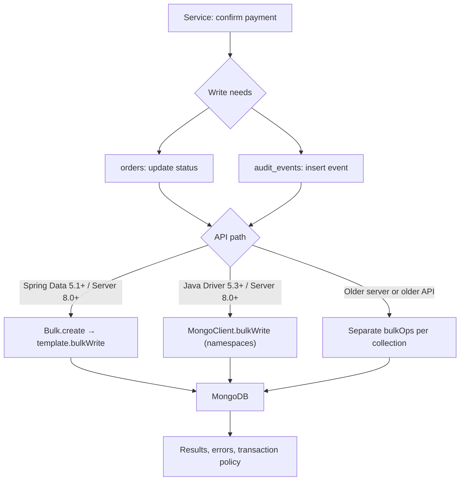

# Multi-Collection Bulk Writes Across Supported Server and API Versions

In **Spring Data MongoDB**, “bulk write” typically refers to grouping multiple `insert`, `update`, or `delete` commands into one execution to reduce MongoDB call overhead. However, there are **two distinct scopes**: bulk writing to a **single collection** and bulk writing across **multiple collections / namespaces**. Not every MongoDB Server, Java Driver, and Spring Data version supports both scopes equally.

This lesson belongs to the **Bulk Writes** chapter of the `SPRING_DATA_MONGODB` module. It focuses on version requirements, choosing between `MongoTemplate.bulkOps(...)` and `MongoTemplate.bulkWrite(Bulk, BulkWriteOptions)`, using the Java Driver's `MongoClient.bulkWrite(...)`, ordered/unordered semantics, write result limits, transactions, retries, and integration testing. Document mapping, repositories, indexes, reactive access, and performance diagnostics are tied directly to bulk write scenarios.

## 1. The Problem: Updating `orders` and Writing `audit_events`

Suppose an order system has two collections in the `shop` database:

```javascript
// shop.orders
{
  _id: ObjectId("674000000000000000000101"),
  tenant_id: "T1",
  status: "NEW",
  total_vnd: NumberLong("350000")
}

// shop.audit_events
{
  _id: ObjectId("674000000000000000000201"),
  tenant_id: "T1",
  order_id: ObjectId("674000000000000000000101"),
  kind: "ORDER_PAID",
  createdAt: ISODate("2026-11-20T02:00:00Z")
}
```

A business flow needs to:

1. Transition order status `NEW → PAID` in `shop.orders`, filtered by tenant.
2. Create an `ORDER_PAID` audit event in `shop.audit_events`.
3. Track succeeded operation counts, handle errors, and decide whether **atomicity across both collections** is required.

Sending two independent write commands incurs two database round trips. A multi-collection bulk can cut round trips, yet **putting both into a single call does not mean both changes automatically succeed or roll back together**.



A **namespace** is the full `database.collection` name, such as `shop.orders` or `shop.audit_events`. A `MongoClient` can target namespaces across a compatible deployment, whereas `MongoTemplate` is bound to a `MongoDatabaseFactory` and typically one configured database. Never confuse namespaces with Java entity types.

## 2. Version Matrix and Three API Paths

The major milestone is **MongoDB Server 8.0**, which adds a server-level `bulkWrite` command accepting operations across **multiple namespaces** in one request. Older servers support **single-collection** bulk writes but lack this multi-namespace command.

| Class / API | Bulk Scope | Requirements |
| --- | --- | --- |
| `MongoTemplate.bulkOps(BulkMode, Entity.class)` | **Single collection** per builder | Long-standing Spring Data MongoDB API; works on older servers supporting collection bulk |
| `MongoCollection.bulkWrite(List<WriteModel<...>>)` | **Single collection** | MongoDB Java Driver collection API; does not require server 8.0 |
| `MongoTemplate.bulkWrite(Bulk, BulkWriteOptions)` | Single or **multiple collections** via builder | **Spring Data MongoDB 5.1+** API; targeting **multiple collections** requires **MongoDB Server 8.0+** |
| `MongoClient.bulkWrite(List<ClientNamespacedWriteModel>)` | **Multiple collections**, potentially across **multiple databases in the same cluster** | Java Sync Driver **5.3+** and **MongoDB Server 8.0+** |
| `Mongo.bulkWrite(...)` in mongosh | **Multiple namespaces** | MongoDB Server 8.0+ and mongosh supporting this method |

**Do not check only the Spring Boot version.** Verify the actual Spring Data MongoDB dependency, the MongoDB Java Driver version on the classpath, and the **server version the client connects to**. An API can compile against a newer driver yet fail at runtime if the server does not support the command.

In Spring Data 5.1+, `bulkWrite(Bulk, ...)` can target one collection using compatibility paths on older servers; the **8.0+ requirement applies specifically to multi-collection bulk writes**. Projects not yet upgraded can continue using `bulkOps` per collection.

Example checking server version in mongosh:

```javascript
db.version();
db.adminCommand({ buildInfo: 1 }).version;
```

Check dependencies via your build tool (Gradle/Maven) and consult the **matching version's Javadoc**, rather than copying signatures from newer releases into an older codebase.

## 3. Collection-Level Bulk in Spring Data: `bulkOps(...)`

The traditional API starts with a `BulkOperations` builder **bound upfront to one entity type or collection name**:

```java
import org.springframework.data.mongodb.core.BulkOperations;
import org.springframework.data.mongodb.core.MongoTemplate;
import org.springframework.data.mongodb.core.query.Criteria;
import org.springframework.data.mongodb.core.query.Query;
import org.springframework.data.mongodb.core.query.Update;
import com.mongodb.bulk.BulkWriteResult;

// template is injected into the service.
BulkWriteResult result = template.bulkOps(
        BulkOperations.BulkMode.ORDERED,
        PurchaseOrder.class
    )
    .updateOne(
        Query.query(Criteria.where("tenantId").is("T1")
                            .and("status").is("NEW")),
        new Update().set("status", "PAID")
    )
    .execute();
```

`PurchaseOrder.class` selects the `orders` collection and mapping metadata. Every operation added to that builder targets **the same `orders` collection**. Passing an `AuditEvent` into that builder will not reroute it to `audit_events`.

To update `orders` and insert into `audit_events` with the classic API, you normally create **two separate bulk builders/calls**:

```java
template.bulkOps(BulkOperations.BulkMode.ORDERED, PurchaseOrder.class)
    .updateOne(orderFilter, new Update().set("status", "PAID"))
    .execute();

template.bulkOps(BulkOperations.BulkMode.ORDERED, AuditEvent.class)
    .insert(auditEvent)
    .execute();
```

`orderFilter` and `auditEvent` are pre-built business variables. Two separate `execute()` calls are not automatically merged into one multi-collection request, even when executed back-to-back inside the same service.

### Single-Collection `BulkOperations` Remains Useful

It remains the right API when importing 50,000 products into **one collection**, updating documents sharing one schema, or running against servers older than 8.0. New APIs do not mean rewriting all existing `bulkOps`; pick the tool matching your scope and compatibility needs.

## 4. Preparing Entities for Spring Data Multi-Collection Bulk

We define two separate domain types:

```java
import org.bson.types.ObjectId;
import org.springframework.data.annotation.Id;
import org.springframework.data.mongodb.core.mapping.Document;
import org.springframework.data.mongodb.core.mapping.Field;

@Document("orders")
public class PurchaseOrder {
    @Id
    private ObjectId id;

    @Field("tenant_id")
    private String tenantId;

    private String status;

    @Field("total_vnd")
    private long totalVnd;

    public PurchaseOrder() {}

    public PurchaseOrder(
            ObjectId id, String tenantId,
            String status, long totalVnd) {
        this.id = id;
        this.tenantId = tenantId;
        this.status = status;
        this.totalVnd = totalVnd;
    }

    public ObjectId getId() { return id; }
    public String getTenantId() { return tenantId; }
    public String getStatus() { return status; }
    public long getTotalVnd() { return totalVnd; }
}
```

```java
import java.time.Instant;
import org.bson.types.ObjectId;
import org.springframework.data.annotation.Id;
import org.springframework.data.mongodb.core.mapping.Document;
import org.springframework.data.mongodb.core.mapping.Field;

@Document("audit_events")
public class AuditEvent {
    @Id
    private ObjectId id;

    @Field("tenant_id")
    private String tenantId;

    @Field("order_id")
    private ObjectId orderId;

    private String kind;
    private Instant createdAt;

    public AuditEvent() {}

    public AuditEvent(
            ObjectId id, String tenantId,
            ObjectId orderId, String kind, Instant createdAt) {
        this.id = id;
        this.tenantId = tenantId;
        this.orderId = orderId;
        this.kind = kind;
        this.createdAt = createdAt;
    }

    public ObjectId getId() { return id; }
    public String getTenantId() { return tenantId; }
    public ObjectId getOrderId() { return orderId; }
    public String getKind() { return kind; }
    public Instant getCreatedAt() { return createdAt; }
}
```

These are two **independent collections**. `@Document` selects the collection per domain type; `@Id` maps to BSON `_id`; `@Field` maps `tenantId` to `tenant_id` and `orderId` to `order_id`.

Include both **tenant** and **ID** when modifying or deleting in multi-tenant applications. If an audit event carries a deterministic ID per business request, the `_id` unique index can help detect duplicate inserts; idempotency design is discussed below.

## 5. Spring Data MongoDB 5.1+: `Bulk.create` and `template.bulkWrite`

This newer API lets you describe multiple collections **inside a single `Bulk` object**:

```java
import java.time.Instant;
import org.bson.types.ObjectId;
import org.springframework.data.mongodb.core.MongoTemplate;
import org.springframework.data.mongodb.core.bulk.Bulk;
import org.springframework.data.mongodb.core.bulk.BulkWriteOptions;
import org.springframework.data.mongodb.core.bulk.BulkWriteResult;
import org.springframework.data.mongodb.core.query.Criteria;
import org.springframework.data.mongodb.core.query.Query;
import org.springframework.data.mongodb.core.query.Update;

public class PaymentBulkService {
    private final MongoTemplate template;

    public PaymentBulkService(MongoTemplate template) {
        this.template = template;
    }

    public BulkWriteResult markPaidAndAudit(
            ObjectId orderId, String tenantId, ObjectId eventId) {

        Query target = Query.query(
            Criteria.where("id").is(orderId)
                .and("tenantId").is(tenantId)
                .and("status").is("NEW")
        );

        AuditEvent event = new AuditEvent(
            eventId, tenantId, orderId,
            "ORDER_PAID", Instant.now()
        );

        Bulk bulk = Bulk.create(builder -> builder
            .inCollection(PurchaseOrder.class, spec -> spec
                .updateOne(target, new Update().set("status", "PAID")))
            .inCollection(AuditEvent.class, spec -> spec
                .insert(event))
        );

        return template.bulkWrite(
            bulk, BulkWriteOptions.ordered()
        );
    }
}
```

**Reading each component:**

- `Bulk.create(...)` builds an operation specification; it does not write to MongoDB yet.
- `inCollection(PurchaseOrder.class, ...)` scopes operations in that branch to `PurchaseOrder`'s collection (`orders`).
- `updateOne(target, ...)` updates **at most one order** matching `_id + tenant + status`, leaving the rest of the document intact.
- `inCollection(AuditEvent.class, ...)` switches to the `audit_events` collection namespace; `insert(event)` adds one audit document.
- `template.bulkWrite(bulk, BulkWriteOptions.ordered())` executes the operations in ordered mode and returns an aggregated result.

Version prerequisites: **Spring Data MongoDB 5.1+** for the `Bulk` API; **MongoDB Server 8.0+** when targeting two collections as shown here. Spring Data applies domain mapping according to each branch's entity type instead of requiring raw BSON everywhere.

### Spring Data's Return Type

`BulkWriteResult` in `org.springframework.data.mongodb.core.bulk` **differs** from `com.mongodb.bulk.BulkWriteResult` used by the collection-level driver:

```java
BulkWriteResult result = paymentBulkService.markPaidAndAudit(
    orderId, "T1", eventId
);

boolean acknowledged = result.acknowledged();
long inserted = result.insertCount();
long matched = result.matchedCount();
long modified = result.modifiedCount();
long deleted = result.deleteCount();
long upserted = result.upsertCount();
```

These are **aggregated counters**, not proof that every business precondition held. In the example, **`matched == 0` does not raise a write error**. If the order is no longer `NEW`, the update simply misses, yet the audit insert still executes. That is why “ordered” **does not** mean “only insert audit if the order update matched”.

For a workflow requiring “write audit only when status actually transitioned to PAID”, combine a **transaction with a `matchedCount` check** and abort when the invariant fails, or use another reliable business/outbox design.

## 6. Why Is a Bulk Not Automatically a Transaction?

In MongoDB, each write operation on **a single document** is atomic at the document level. A multi-operation bulk write—even **in a single request**—does not implicitly create an atomic transaction across both collections.

```text
Bulk ordered:
  1. UPDATE shop.orders (_id=A)           → may succeed
  2. INSERT shop.audit_events (_id=E)     → may fail with duplicate key
  => Previous UPDATE does not roll back automatically

Bulk unordered:
  Independent operations may run out of declared order;
  valid operations can execute even if another fails.
```

A single request only reduces wire dispatch overhead. It does not substitute for **multi-document transaction** guarantees such as coordinated commit, overwrite prevention, business preconditions, and recovery.

| Desired Property | Plain Bulk | Approach to Consider |
| --- | --- | --- |
| Fewer round trips | Possible | Bulk is a good fit |
| Same succeed/fail outcome across two collections | **Not by default** | Transaction if business logic truly demands atomicity |
| Update only while order is `NEW` | Possible via filter | `status = NEW` + result check |
| Audit exists only if update matched | **Not guaranteed automatically** | Transaction + matched check; or outbox/invariant design |
| Prevent retried requests from duplicating events | Not guaranteed automatically | Deterministic ID/event key and unique index |
| Undo earlier command if later command fails | Not by default | MongoDB-supported transaction |

Remember: **Ordered controls execution order and stopping on write errors; transactions control commit/rollback across a transactional boundary.** They are two separate features.

## 7. Ordered vs. Unordered: Differences in Errors and Dependencies

### Ordered

`BulkWriteOptions.ordered()` requests operations execute in declared logical order and stop upon a write error. Operations that **already succeeded before the error** can still persist if not inside a transaction.

Example: update order first, insert audit second; if the audit insert collides on `_id` and is rejected, the order may already be `PAID`.

### Unordered

`BulkWriteOptions.unordered()` lets the server/driver execute in any order for higher throughput and continue independent operations on write errors. **Never use unordered when one operation depends on another operation's outcome inside the same bulk.**

```java
BulkWriteResult result = template.bulkWrite(
    bulk, BulkWriteOptions.unordered()
);
```

Unordered typically fits independent updates across distinct keys or batch imports where each record's errors can be handled separately. Still, *unordered* never permits ignoring exceptions: collect errors and decide how each record is retried or reported.

**Transaction caveat:** if a write error occurs inside a MongoDB transaction, the transaction can abort; never rely on unordered to continue and commit failed changes. Always verify transaction semantics and exception types on your driver version.

## 8. Using Transactions with Spring Data When Two Collections Must Commit Together

In a service with a configured **`MongoTransactionManager`** and a transaction-capable MongoDB topology (replica set or compatible sharded cluster), you can execute a multi-collection bulk inside a `@Transactional` boundary:

```java
import org.springframework.stereotype.Service;
import org.springframework.transaction.annotation.Transactional;
import org.springframework.data.mongodb.core.bulk.BulkWriteResult;

@Service
public class PaymentApplicationService {
    private final PaymentBulkService bulk;

    public PaymentApplicationService(PaymentBulkService bulk) {
        this.bulk = bulk;
    }

    @Transactional
    public void confirm(
            ObjectId orderId, String tenantId, ObjectId eventId) {

        BulkWriteResult result =
            bulk.markPaidAndAudit(orderId, tenantId, eventId);

        // Example Bulk has 1 order updateOne + 1 audit insert.
        if (result.matchedCount() != 1 || result.insertCount() != 1) {
            throw new IllegalStateException(
                "Order is no longer in NEW status or audit was not created");
        }
    }
}
```

When `confirm(...)` is invoked through the Spring proxy so `@Transactional` activates and all MongoDB operations share the same transaction, throwing before commit causes all changes in the transaction to roll back. You must **verify the configuration**, not just add the annotation and assume a transaction is active.

Notably, `matchedCount` is the **total match count across updates** in the bulk; checking `== 1` works here only because this example contains **exactly one update**. For complex bulks with many updates, design per-item verification rather than inferring individual operation success from an aggregate number.

### Minimal Transaction Configuration

A synchronous application can declare a transaction manager:

```java
import org.springframework.context.annotation.Bean;
import org.springframework.context.annotation.Configuration;
import org.springframework.data.mongodb.MongoDatabaseFactory;
import org.springframework.data.mongodb.MongoTransactionManager;

@Configuration
class MongoTxConfiguration {
    @Bean
    MongoTransactionManager mongoTransactionManager(
            MongoDatabaseFactory factory) {
        return new MongoTransactionManager(factory);
    }
}
```

In projects with multiple transaction managers or database factories, select the right manager and context explicitly; never confuse RDBMS transactions with MongoDB. For distributed workflows involving systems outside MongoDB (payments, email, Kafka…), MongoDB transactions do not cover external side effects.

**Do not open long transactions merely to save network calls.** If operations are genuinely independent, a non-transactional multi-collection bulk is lighter. If events must strictly reflect order changes, enforce invariants via a transaction or a well-designed outbox pattern.

## 9. Java Driver 5.3+: Multi-Namespace `MongoClient.bulkWrite`

If an application needs to write directly across **multiple databases/collections in the same cluster** or prefers not to use Spring Data's `Bulk` abstraction, Java Sync Driver **5.3+** provides `MongoClient.bulkWrite(...)` accepting `ClientNamespacedWriteModel` items.

Example writing to `shop.orders` and `shop.audit_events` using **BSON Documents**:

```java
import java.time.Instant;
import java.util.Date;
import java.util.List;

import com.mongodb.MongoNamespace;
import com.mongodb.client.MongoClient;
import com.mongodb.client.model.Filters;
import com.mongodb.client.model.Updates;
import com.mongodb.client.model.bulk.ClientBulkWriteResult;
import com.mongodb.client.model.bulk.ClientNamespacedWriteModel;
import org.bson.Document;
import org.bson.types.ObjectId;

MongoNamespace orders = new MongoNamespace("shop", "orders");
MongoNamespace audit = new MongoNamespace("shop", "audit_events");

ObjectId orderId = new ObjectId("674000000000000000000101");
ObjectId eventId = new ObjectId();

List<ClientNamespacedWriteModel> writes = List.of(
    ClientNamespacedWriteModel.updateOne(
        orders,
        Filters.and(
            Filters.eq("_id", orderId),
            Filters.eq("tenant_id", "T1"),
            Filters.eq("status", "NEW")
        ),
        Updates.set("status", "PAID")
    ),
    ClientNamespacedWriteModel.insertOne(
        audit,
        new Document("_id", eventId)
            .append("tenant_id", "T1")
            .append("order_id", orderId)
            .append("kind", "ORDER_PAID")
            .append("createdAt", Date.from(Instant.now()))
    )
);

// mongoClient is a sync MongoClient injected/created where its lifecycle is managed.
ClientBulkWriteResult result = mongoClient.bulkWrite(writes);
```

Unlike `template.bulkWrite`, this **native driver** path uses **actual BSON field names**: `tenant_id`, `order_id`, `_id`. It **does not invoke Spring Data's `MappingMongoConverter`, `@Field`, auditing callbacks, or `@Version`**. When building BSON manually, ensure proper ID types, dates, validation, authorization, and idempotency yourself.

This snippet uses `MongoNamespace("shop", "orders")`; you may replace `"shop"` with a second database in the **same MongoDB deployment** if the user holds permissions and the server supports it. One `MongoClient.bulkWrite` is **not a distributed transaction across independent clusters**.

Driver APIs default to ordered mode and expose client bulk options. Never mix `ClientBulkWriteResult` with `com.mongodb.bulk.BulkWriteResult` or Spring Data's `BulkWriteResult`: they are distinct types at different API layers.

## 10. MongoDB 8.0: The `bulkWrite` Command and mongosh

At the server level, the new command accepts:

- `ops`: list of inserts/updates/deletes, each specifying a **namespace index**.
- `nsInfo`: list of namespaces matching those indices.
- Options such as `ordered`, write concern, comment, etc.

Low-level illustrative command:

```javascript
db.adminCommand({
  bulkWrite: 1,
  ops: [
    {
      update: 0,
      filter: {
        _id: ObjectId("674000000000000000000101"),
        tenant_id: "T1",
        status: "NEW"
      },
      updateMods: { $set: { status: "PAID" } },
      multi: false
    },
    {
      insert: 1,
      document: {
        _id: ObjectId("674000000000000000000201"),
        tenant_id: "T1",
        order_id: ObjectId("674000000000000000000101"),
        kind: "ORDER_PAID"
      }
    }
  ],
  nsInfo: [
    { ns: "shop.orders" },
    { ns: "shop.audit_events" }
  ],
  ordered: true
});
```

`ops[0].update = 0` references `nsInfo[0]`; `ops[1].insert = 1` references `nsInfo[1]`. In Java applications, **prefer the driver/Spring Data APIs** so the driver manages batch limits, BSON encoding, errors, and results rather than constructing raw `db.adminCommand` payloads manually.

In MongoDB 8.0+, mongosh also offers the `Mongo.bulkWrite(...)` helper, e.g.:

```javascript
db.getMongo().bulkWrite(
  [
    {
      namespace: "shop.orders",
      name: "updateOne",
      filter: {
        _id: ObjectId("674000000000000000000101"),
        tenant_id: "T1"
      },
      update: { $set: { status: "PAID" } }
    },
    {
      namespace: "shop.audit_events",
      name: "insertOne",
      document: {
        _id: ObjectId("674000000000000000000201"),
        tenant_id: "T1",
        kind: "ORDER_PAID"
      }
    }
  ],
  { ordered: true }
);
```

**Do not confuse `Mongo.bulkWrite(...)` with `db.collection.bulkWrite(...)`**: the `db.collection` method operates on a single collection even on server 8.0+. Inside an open mongosh transaction, MongoDB documentation requires using the session-bound API (`Session.bulkWrite(...)`) so operations join the right session.

## 11. Reactive `bulkWrite` in Spring Data

Starting in Spring Data MongoDB versions supporting multi-collection bulk, `ReactiveMongoTemplate` also provides `bulkWrite(Bulk, BulkWriteOptions)` returning a publisher:

```java
import org.springframework.data.mongodb.core.ReactiveMongoTemplate;
import org.springframework.data.mongodb.core.bulk.Bulk;
import org.springframework.data.mongodb.core.bulk.BulkWriteOptions;
import org.springframework.data.mongodb.core.bulk.BulkWriteResult;
import reactor.core.publisher.Mono;

Mono<BulkWriteResult> writeReactively(
        ReactiveMongoTemplate template,
        PurchaseOrder order,
        AuditEvent event) {

    Bulk bulk = Bulk.create(builder -> builder
        .inCollection(PurchaseOrder.class, spec -> spec.insert(order))
        .inCollection(AuditEvent.class, spec -> spec.insert(event))
    );

    return template.bulkWrite(bulk, BulkWriteOptions.ordered());
}
```

This snippet illustrates **two independent inserts**. It will throw a duplicate key error if an entity's `_id` already exists. As with the synchronous API, multi-collection usage here requires **server 8.0+** and a sufficiently new Spring Data version.

- `Mono<BulkWriteResult>` describes work; execution runs **when subscribed to**.
- Never call `block()` on a WebFlux event loop or fire-and-forget `subscribe()` where errors get lost.
- Reactive transactions require `ReactiveMongoTransactionManager` and Reactor Context propagation along the same publisher chain.
- If you must insert the audit only after the update matches, do not assume `Mono` automatically enforces business invariants; check counts and enforce invariants just like the synchronous path.

## 12. Batch Size Limits and Real Round Trips

The clearest benefit of multi-collection bulk is lower overhead **when multiple operations are sent together**. However, **one Java call does not always correspond to exactly one wire message** across all input sizes:

- MongoDB enforces `maxWriteBatchSize`, `maxBsonObjectSize`, and `maxMessageSizeBytes`.
- The driver is responsible for splitting inputs into compliant commands/batches when limits are exceeded; multiple commands can result from one API call.
- A single BSON document remains capped at **16 MiB**.
- Extremely large bulks consume heap building model lists, slow down error handling, and pressure connection pools.
- If target collections live on different shards, server and internal network cost also depend on routing and placement.

**Never promise that 100,000 operations always complete in a single round trip.** For very large workloads, bounding by byte size, operation count, and latency targets is far safer.

Performance comparisons must hold workload, write concern, indexes, topology, and contention constant. Bulk cuts dispatch overhead; it **does not make an unindexed filter update free**.

## 13. Per-Operation Errors and Batch Results

Common errors:

| Error | Example | Impact Without a Transaction |
| --- | --- | --- |
| Duplicate key `11000` | Inserting audit with duplicate `_id` | That insert fails; preceding operations may have succeeded |
| Schema validation | Insert missing required field | Invalid operation rejected |
| Cast / BSON mapping | Wrong ObjectId or Date type | May fail before sending or on server evaluation |
| Unauthorized namespace | User lacks write permission on `shop.audit_events` | Bulk fails; earlier operations may already have applied |
| Write concern / timeout | Missing replica confirmation or network drop | May be unclear whether some operations took effect |
| Unmatched filter | Order is no longer `NEW` | **Not necessarily a write error**; update count may be 0 |

Ordered stops at the first write error; unordered attempts to continue remaining executable operations. When errors happen, **never just inspect `exception.getMessage()` and retry the whole bulk**.

At the Java Driver client level, errors can be represented by `ClientBulkWriteException` with per-operation details; at the collection level, usually `MongoBulkWriteException`. Spring Data may wrap or translate exceptions into its `DataAccessException` hierarchy, so inspect **cause** and error indices according to your execution path.

```java
// Sketch of business-level handling without swallowing errors:
try {
    BulkWriteResult outcome =
        template.bulkWrite(bulk, BulkWriteOptions.ordered());

    if (!outcome.acknowledged()) {
        throw new IllegalStateException("Bulk was not acknowledged");
    }
} catch (org.springframework.dao.DataAccessException ex) {
    // Log batch ID / namespace / logical operation index;
    // determine which operations succeeded before retrying.
    throw ex;
}
```

Never log sensitive payloads, payment card details, or access tokens. For critical data, record a **batch/job ID** and per-business-key reconciliation status.

## 14. Safe Retries and Idempotency Design

A bulk can fail **after** some operations were applied by the server. Naively retrying the entire batch can:

- Insert duplicate records if new `_id` values are generated each time.
- Hit duplicate key errors if retries keep fixed IDs without handling existing records.
- Double-increment counters when using `$inc`.
- Write wrong audits even when the order no longer matches the filter.

Better strategy:

1. Give each business operation a stable **idempotency key** (e.g., `paymentId` or `eventId`) across retries.
2. Create appropriate **unique indexes**: `{tenant_id:1, event_key:1}` or unique `_id` on audit events.
3. Use `$set` and `$setOnInsert`/upsert for idempotent fields; avoid `$inc` without deduplication design.
4. Retry only operations proven safe; when state is uncertain, **reconcile via business keys**.
5. Handle both “already present” and “absent” cases instead of treating all duplicate keys as fatal.

Example unique index for audits:

```javascript
db.audit_events.createIndex(
  { tenant_id: 1, event_key: 1 },
  { unique: true, name: "audit_tenant_event_key" }
);
```

If `AuditEvent` adds `eventKey`, extend the model/mapping accordingly; the index snippet illustrates production design rather than a field already present on the sample entity. Never share the same event key across different business actions.

## 15. Indexes, Mapping, Lifecycle, and `@Version` in Bulk

Bulk reduces round-trip overhead, yet each operation's execution speed still hinges on **filters and indexes**. `_id`-filtered updates use the `_id` index; multi-order `tenant_id + status` updates may need a compound index:

```javascript
db.orders.createIndex(
  { tenant_id: 1, status: 1 },
  { name: "orders_by_tenant_status" }
);
```

Specifically for `BulkOperations` and bulk APIs:

- **Lifecycle callbacks/events are limited.** Never assume auditing, validation, or listeners execute like per-entity `repository.save(entity)`.
- **Optimistic locking is not fully automatic.** Classic `BulkOperations` Javadoc explicitly notes features requiring per-operation outcomes like `@Version` are **not supported** the way single-entity `save` works.
- When version-guarded updates are needed, place **`expectedVersion`** in the filter and design exact per-business-operation result verification.
- With native driver APIs, Spring Data's `@Field`, `@Version`, and `@CreatedDate` are ignored because operations use BSON `Document`.
- **Replacement** can drop fields absent from the replacement document; `Update.set(...)` modifies only specified fields. Match your write model to your intent.

Example optimistic-locking filter when updating an order via bulk:

```java
Query guarded = Query.query(
    Criteria.where("id").is(orderId)
        .and("tenantId").is("T1")
        .and("version").is(3L)
);

Update patch = new Update()
    .set("status", "PAID")
    .inc("version", 1L);

// Verify automatic version behavior on your exact API/version,
// and avoid incrementing version twice if the framework already handles it.
```

A bulk returning aggregate `matchedCount` does not pinpoint whether the third operation failed due to a stale version; if the application needs to distinguish them, plan for verbose per-op results, conditional reconciliation queries, or a more suitable API.

## 16. Choosing Alternatives on Servers Older Than 8.0

If the deployment cannot yet upgrade MongoDB Server to 8.0:

**Option A — Two collection-level bulks.** Run `bulkOps(...)` per collection. This is **not a single request**, yet it offers clean backward compatibility and keeps per-entity mapping.

```java
template.bulkOps(BulkOperations.BulkMode.ORDERED, PurchaseOrder.class)
    .updateOne(orderFilter, new Update().set("status", "PAID"))
    .execute();

template.bulkOps(BulkOperations.BulkMode.ORDERED, AuditEvent.class)
    .insert(auditEvent)
    .execute();
```

**Option B — Transaction when atomicity is required**, on a transaction-capable topology. Though still two separate bulk commands, they can join **one transaction** when MongoDB/Spring transaction management is properly wired and invoked within the right boundary. That achieves atomicity without being a single wire request.

**Option C — Data model adjustment.** If order and audit practically form one small aggregate, embedding events or state inside the same document may work when access patterns and size bounds allow. Never embed unbounded event histories into a single document.

**Option D — Outbox / eventual consistency.** When syncing with external systems or multiple clusters, an outbox paired with an idempotent worker often works better than trying to sustain a distributed transaction.

## 17. Integration Testing Against the Real Server and API

A passing test mocking `MongoTemplate` **does not prove** the server supports multi-namespace bulk, the driver binds fields accurately, or ordered/unordered behavior matches expectations. Run integration tests against **real MongoDB 8.0+** in an isolated test environment, such as Testcontainers with an appropriate 8.0.x image.

### Test 1 — Spring Data Multi-Collection Bulk Reads/Writes Accurately

```java
import static org.assertj.core.api.Assertions.assertThat;

import java.time.Instant;
import org.bson.types.ObjectId;
import org.junit.jupiter.api.Test;
import org.springframework.beans.factory.annotation.Autowired;
import org.springframework.boot.test.context.SpringBootTest;
import org.springframework.data.mongodb.core.MongoTemplate;
import org.springframework.data.mongodb.core.bulk.Bulk;
import org.springframework.data.mongodb.core.bulk.BulkWriteOptions;
import org.springframework.data.mongodb.core.bulk.BulkWriteResult;
import org.springframework.data.mongodb.core.query.Criteria;
import org.springframework.data.mongodb.core.query.Query;
import org.springframework.data.mongodb.core.query.Update;

@SpringBootTest
class MultiCollectionBulkIntegrationTest {
    @Autowired MongoTemplate template;

    @Test
    void writesOrderAndAuditAcrossCollections() {
        ObjectId orderId = new ObjectId();
        ObjectId eventId = new ObjectId();
        String tenant = "test-" + orderId.toHexString();

        template.insert(new PurchaseOrder(
            orderId, tenant, "NEW", 350_000L
        ));

        AuditEvent event = new AuditEvent(
            eventId, tenant, orderId,
            "ORDER_PAID", Instant.now()
        );

        Bulk bulk = Bulk.create(builder -> builder
            .inCollection(PurchaseOrder.class, spec -> spec
                .updateOne(
                    Query.query(Criteria.where("id").is(orderId)
                        .and("tenantId").is(tenant)
                        .and("status").is("NEW")),
                    new Update().set("status", "PAID")))
            .inCollection(AuditEvent.class, spec -> spec.insert(event))
        );

        BulkWriteResult result =
            template.bulkWrite(bulk, BulkWriteOptions.ordered());

        assertThat(result.acknowledged()).isTrue();
        assertThat(result.matchedCount()).isEqualTo(1);
        assertThat(result.insertCount()).isEqualTo(1);

        PurchaseOrder changed =
            template.findById(orderId, PurchaseOrder.class);
        AuditEvent recorded =
            template.findById(eventId, AuditEvent.class);

        assertThat(changed).isNotNull();
        assertThat(changed.getStatus()).isEqualTo("PAID");
        assertThat(recorded).isNotNull();
        assertThat(recorded.getOrderId()).isEqualTo(orderId);
    }
}
```

This test assumes the application configured repositories/template and **a test MongoDB 8.0+ deployment**. Never point tests at production databases. To prevent data pollution, use an isolated database per test suite, clean up by job/test IDs, or let Testcontainers tear down containers afterward.

### Test 2 — Ordered Does Not Automatically Roll Back

In a separate test on an isolated database:

1. Insert an order with `status=NEW`.
2. Pre-insert an audit event with `_id=E`.
3. Build an ordered bulk of `update order` followed by `insert audit(_id=E)` to trigger a duplicate key error.
4. Catch the bulk error and re-read the order document.
5. Verify you **cannot assume** the order reverted to `NEW` when bulk runs **without a transaction**; the update before the error may remain applied.

If you must guarantee the order stays `NEW`, write an equivalent test **inside a real transaction** with `MongoTransactionManager` and verify rollback. Never run such fault tests against a shared database.

### Test 3 — Version Compatibility Check

Run the same source code against a 7.x server (in a separate test environment) to observe multi-namespace bulk **getting rejected as unsupported**. Collection-level bulks still work on 7.x. Testing a version matrix avoids situations where CI uses MongoDB 8 while production is still on 7.x.

### Test 4 — Per-Operation Failures

Build multiple ordered and unordered operations on test documents; compare final state after a duplicate-key operation. Use driver command monitoring to observe actual batch/command counts instead of assuming one API call equals one wire request. Inspect error info, successful operation counts, and retry behavior on your exact Java Driver/Spring Data versions.

## 18. Implementation and Diagnostic Checklist

| Symptom | Likely Cause | What to Check |
| --- | --- | --- |
| `bulkWrite(Bulk,...)` missing from classpath | Spring Data MongoDB too old | Check version; API was introduced in 5.1 |
| `MongoClient.bulkWrite(...)` missing | Older MongoDB Java Driver | Verify Sync driver 5.3 or newer |
| API compiles yet fails with unsupported command | Server older than 8.0 or routed to unsupported node | Check server version / FCV / topology |
| `BulkOperations` writes to one collection only | Expected scope of the classic API | Use `Bulk.create` + `template.bulkWrite` or driver client-level API |
| Order updated, audit failed | Ordered does not roll back earlier commands | Transaction or compensation/outbox workflow |
| Audit inserted even though update `matched=0` | Unmatched filter is **not a write error** | Check invariant, abort transaction if needed |
| Fields lost after replace | Replacement overwrites whole document, unlike `$set` | Use update operators for partial updates |
| `@Field` ignored in native driver | Driver bypasses Spring mapping | Use exact BSON names and verify raw documents |
| Performance did not improve | Unindexed query, oversized batch, sharding, or high write concern | Indexes/`explain`, metrics, command monitoring |
| Duplicate key errors on retry | Missing idempotency/reconciliation | Stable event keys, unique indexes, conditional retries |
| Delete hits wrong tenant | Overly broad filter or trusting client input | Tenant from auth, indexes, and test isolation |
| Aggregate result hides which op failed | Summary counts lack per-op detail | Track logical operation index, log cause, use verbose results if needed |

## 19. Self-Check Questions

**1.** Starting with which MongoDB Server version is multi-namespace `bulkWrite` supported in a single request?  
**Answer:** **8.0**.

**2.** Can `MongoTemplate.bulkOps(BulkMode.ORDERED, PurchaseOrder.class)` switch to `audit_events` inside the same builder?  
**Answer:** no; the classic builder is bound to a single collection.

**3.** Which Spring Data MongoDB API supports `Bulk.create(...).inCollection(...)`?  
**Answer:** `MongoTemplate.bulkWrite(Bulk, BulkWriteOptions)`, introduced in **Spring Data MongoDB 5.1**; multi-collection targets require server **8.0+**.

**4.** What minimum Java Driver version is needed for multi-namespace `MongoClient.bulkWrite(...)`?  
**Answer:** Java Sync Driver **5.3** per release notes, alongside server **8.0+**.

**5.** If an ordered bulk hits a duplicate key on the second operation, does the first operation roll back automatically?  
**Answer:** no, **without a transaction**. Ordered merely stops commands after the error.

**6.** Does an unmatched `updateOne` with `status=NEW` automatically block a subsequent `insert audit`?  
**Answer:** no. `matched=0` is normally not a write error; enforce business rules/transactions explicitly.

**7.** Does a single Java call with a huge list always produce exactly one wire message?  
**Answer:** no; the driver can split it into multiple batches to stay within server and payload size limits.

**8.** Why can you not rely on Spring `@Version` and auditing callbacks running completely on native `MongoClient.bulkWrite`?  
**Answer:** the native API operates directly on driver BSON/models, bypassing Spring Data mapping and callback layers.

**9.** When running server 7.x and two collections must commit or roll back together, what should you choose?  
**Answer:** run separate per-collection bulk/write commands **inside a properly configured MongoDB transaction** on a supported topology; it is still not a single multi-namespace request.

**10.** Can `MongoClient.bulkWrite` write atomically across **two independent clusters**?  
**Answer:** no; it targets namespaces within the single deployment connected by `MongoClient`. Distributed systems require a different architecture.

## 20. Hands-On Exercise and References

**Hands-on exercise:** stand up an isolated test environment with MongoDB 8.0+ and Spring Data MongoDB 5.1+. Create two entities `PurchaseOrder` and `AuditEvent`; run the `Bulk.create` example and inspect raw BSON in both collections. Next, intentionally provoke a duplicate audit event, compare ordered vs. unordered, rerun inside a properly configured transaction, and add a test for `matched=0` on the update. Count commands using a driver `CommandListener`, vary batch sizes, verify update filter indexes, and compare against two classic `bulkOps` calls.

**Official documentation for version-specific API verification:**

- [MongoDB Server — Bulk Write Operations](https://www.mongodb.com/docs/v8.0/core/bulk-write-operations/)
- [MongoDB Server — bulkWrite Command (8.0)](https://www.mongodb.com/docs/v8.0/reference/command/bulkwrite/)
- [MongoDB Java Sync Driver — Bulk Write Operations](https://www.mongodb.com/docs/drivers/java/sync/current/crud/bulk/)
- [MongoDB Java Driver — 5.3 Release Notes](https://www.mongodb.com/docs/drivers/java/sync/current/reference/release-notes/)
- [Spring Data MongoDB — Saving, Updating, and Removing Documents](https://docs.spring.io/spring-data/mongodb/reference/mongodb/template-crud-operations.html)
- [Spring Data MongoDB — BulkOperations API](https://docs.spring.io/spring-data/mongodb/reference/api/java/org/springframework/data/mongodb/core/BulkOperations.html)

**Conclusion:** multi-collection bulk writes **depend simultaneously on server version and Java API version**. With MongoDB 8.0+ and Spring Data MongoDB 5.1+, `Bulk.create` paired with `template.bulkWrite(...)` expresses operations spanning multiple collections; Java Driver 5.3+ provides `MongoClient.bulkWrite(...)` across namespaces. On older stacks, `bulkOps(...)` remains useful on a **per-collection** basis. Regardless of API, **bulk is never automatically a transaction**: design ordered/unordered modes, business preconditions, idempotency, indexes, write result checks, and version-accurate integration tests so optimizing round trips never turns into data-consistency bugs.
