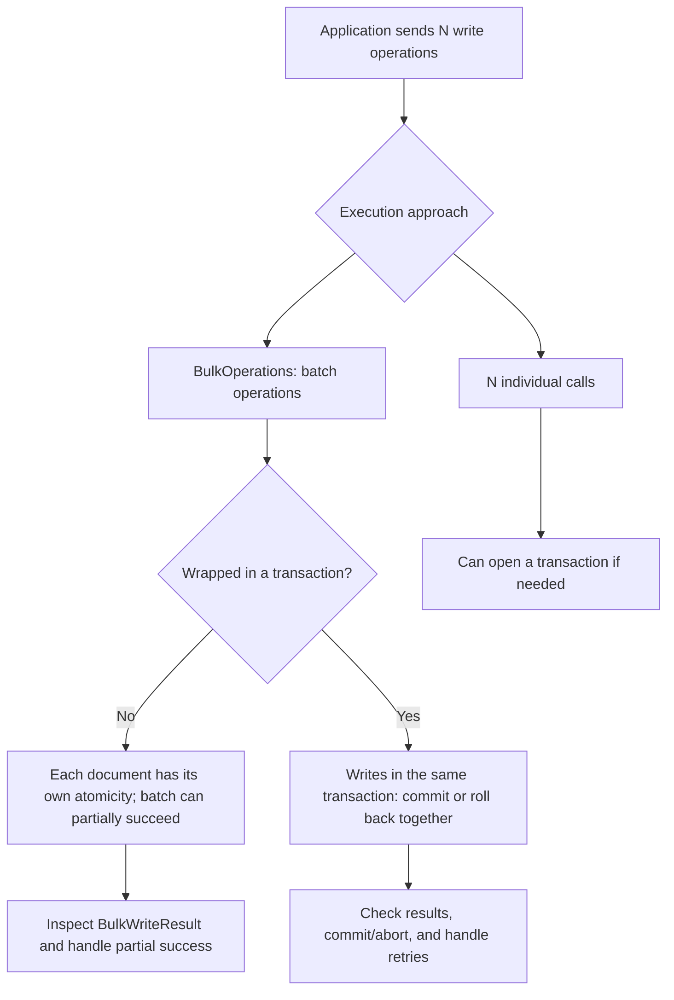

# Distinguishing Reduced Round Trips from Full-Batch Atomic Transactions

## 1. A Faster Write Batch Does Not Mean a Transaction

In **Spring Data MongoDB**, **bulk write** groups multiple write requests into one execution batch: inserting documents, updating documents, upserting, or deleting documents. It reduces overhead when an application must perform many independent writes. However, a bulk batch **does not automatically** provide *all-or-nothing* semantics: if the third operation fails, earlier succeeded operations can still remain persisted.

Suppose a system imports three products:

```javascript
[
  { _id: "product-A", tenantId: "shop-01", sku: "A", stock: 10 },
  { _id: "product-A", tenantId: "shop-01", sku: "DUPLICATE", stock: 5 },
  { _id: "product-C", tenantId: "shop-01", sku: "C", stock: 8 }
]
```

The first two documents share the same `_id`. Because MongoDB guarantees unique `_id` values, the second insert triggers a duplicate key error. The critical questions are not merely “is bulk fast?” but also:

- With an **ordered bulk**, does the already-inserted `product-A` roll back automatically?
- With an **unordered bulk**, can the insert for `product-C` still execute?
- If the business requirement is “import all three documents or none of them”, what must you do?
- If the bulk throws no error yet one update **matches zero** documents, how do you detect the batch failed its business goal?

Short answer: **bulk writes optimize dispatching and executing operations; multi-document transactions provide the commit/abort boundary for the entire group of operations placed inside the transaction**. The two concepts can work together, yet one does not replace the other.

This lesson belongs to the **Bulk Writes** chapter of the `SPRING_DATA_MONGODB` module. It focuses on `MongoTemplate.bulkOps`, `BulkOperations`, `ORDERED`/`UNORDERED` modes, results and exceptions, single-document atomicity, MongoDB transaction configuration, idempotency, reactive usage, testing, and performance diagnostics.

## 2. Three Layers of Guarantees Often Confused



| Concept | Scope of Guarantee | What It Does Not Guarantee |
| --- | --- | --- |
| **Batching / bulk write** | Groups operations to cut call overhead and enable batched execution | All documents succeeding or rolling back together |
| **Single-document atomicity** | A valid update command on one document is applied atomically | Atomicity across all documents in `updateMany` or a bulk |
| **Multi-document transaction** | Operations within the same transaction commit or abort as one unit | Request idempotency or rollback of external services outside MongoDB |
| **Write concern** | Write acknowledgement / durability level per MongoDB config | Turning an entire bulk into an all-or-nothing transaction |
| **Ordered bulk** | Executes operations in order and stops upon a write error in the batch per bulk semantics | Rolling back already-succeeded operations |
| **Unordered bulk** | No execution-order guarantee; continues remaining executable operations after individual errors | All operations succeeding, or applying in input order |

**Principle:** Never infer “one `bulk.execute()` call” equals “one transaction”. The driver may split a large bulk into multiple batches/commands to fit server and BSON size limits. Even when sent as a single command, a plain bulk is not a multi-document transaction.

## 3. ORDERED and UNORDERED When an Operation Fails

### 3.1. Ordered: Stops on Error, Does Not Undo Already-Written Data

Suppose a test collection is currently empty. In `mongosh`:

```javascript
db.bulk_demo_ordered.insertMany(
  [
    { _id: "A", value: 1 },
    { _id: "A", value: 2 }, // Duplicate _id -> duplicate key.
    { _id: "C", value: 3 }
  ],
  { ordered: true }
);
```

The command reports a duplicate key error on the second operation. In this illustrative run:

- Document `A` from the first operation was inserted.
- The second operation failed due to duplicate `_id`.
- The third operation was not executed because ordered bulk stops at an error.
- **Document `A` still exists** without a surrounding transaction.

```javascript
db.bulk_demo_ordered.find().sort({ _id: 1 });
// Observable: { _id: "A", value: 1 }
```

Do not use `ORDERED` mode as a rollback mechanism. It expresses only **execution ordering and stop-on-error**, not batch-wide atomicity.

### 3.2. Unordered: Can Continue Independent Operations

On another test collection with the same data:

```javascript
db.bulk_demo_unordered.insertMany(
  [
    { _id: "A", value: 1 },
    { _id: "A", value: 2 }, // Duplicate _id.
    { _id: "C", value: 3 }
  ],
  { ordered: false }
);
```

The command still reports a duplicate key error, yet MongoDB can proceed with the remaining operations. If no other errors occur, the test collection normally ends up with both `A` and `C`. **Never rely on execution order or write order of documents in an unordered bulk.**

| Scenario | Ordered, Outside Transaction | Unordered, Outside Transaction |
| --- | --- | --- |
| Mid-batch operation hits duplicate key | Stops at the error in operation order | Other independent operations may continue |
| Operations succeeded before the error | Persisted and not automatically rolled back | Persisted and not automatically rolled back |
| Can partial success occur? | Yes | Yes |
| Suitable when operations depend on order | Better fit, though still not batch-atomic | Unsuitable if logic depends on order |
| Guarantees all-or-nothing? | **No** | **No** |

When items depend on one another (e.g., creating an account and then updating from it), design ordering, preconditions, and transactions explicitly. Unordered is never a safe choice merely because throughput looks higher.

### 3.3. Bulks Can Fail Beyond Duplicate Keys

Other failures include schema validation, unique index violations, invalid data types for `$inc`, insufficient write permissions, timeouts, dropped connections, document size limits, or write conflicts. Certain errors prevent the driver/server from continuing the batch normally; **never write application logic assuming every unordered failure lets remaining operations run**.

When an exception occurs, inspect the error type and which operations were confirmed succeeded. On disconnects, the application also faces **uncertainty over how far the server progressed**; see the idempotency and retry sections.

## 4. Using `MongoTemplate.bulkOps` in Spring Data

### 4.1. Declaring the Sample Entity

```java
package example.bulk;

import org.springframework.data.mongodb.core.mapping.Document;
import org.springframework.data.mongodb.core.mapping.FieldType;
import org.springframework.data.mongodb.core.mapping.MongoId;

@Document(collection = "inventory_items")
public record InventoryItem(
    @MongoId(FieldType.STRING) String id,
    String tenantId,
    String sku,
    int stock,
    String state
) {}
```

`@MongoId(FieldType.STRING)` explicitly requests storing IDs as BSON Strings even if a value looks like an ObjectId string. In typed `MongoTemplate` queries, the `id` property maps to the BSON `_id` field.

Defining a stock reservation request payload:

```java
package example.bulk;

public record StockReservation(
    String itemId,
    int quantity
) {}
```

In a multi-tenant system, `tenantId` must come from a trusted security context. Clients may send `itemId` and `quantity`, never self-asserting tenant ownership.

### 4.2. `BulkOperations` and `BulkMode`

```java
import org.springframework.data.mongodb.core.BulkOperations;
import org.springframework.data.mongodb.core.BulkOperations.BulkMode;

BulkOperations bulk = mongoTemplate.bulkOps(
    BulkMode.ORDERED, InventoryItem.class
);
```

Then append operations sequentially to the builder:

```java
bulk.insert(new InventoryItem(
    "item-101", "shop-01", "SKU-A", 10, "ACTIVE"
));

bulk.updateOne(
    Query.query(
        Criteria.where("id").is("item-102")
            .and("tenantId").is("shop-01")
    ),
    new Update().inc("stock", 3)
);

bulk.upsert(
    Query.query(
        Criteria.where("id").is("item-103")
            .and("tenantId").is("shop-01")
    ),
    new Update()
        .setOnInsert("sku", "SKU-C")
        .setOnInsert("tenantId", "shop-01")
        .setOnInsert("state", "ACTIVE")
        .inc("stock", 1)
);

bulk.remove(
    Query.query(
        Criteria.where("id").is("item-legacy")
            .and("tenantId").is("shop-01")
    )
);

com.mongodb.bulk.BulkWriteResult result = bulk.execute();
```

This snippet **illustrates a mixed-operation batch** requiring `Query`, `Criteria`, and `Update` from `org.springframework.data.mongodb.core.query`. It is not a transaction: registering operations on `BulkOperations` does not mutate the database yet; commands are dispatched when `execute()` is called.

In real applications, avoid `upsert` without an explicit unique key to create business records: concurrent requests can both perceive the record as missing. Pair proper unique indexes with duplicate-key handling and controlled retries.

### 4.3. Bulk Is Not Automatically Faster for Every Write Pattern

Bulk pays off when many operations **can be batched**, cutting communication overhead and lifting throughput on suitable workloads. However, if a batch holds a single simple update, or if huge batches cause index/document contention, bulk may yield negligible latency gains. Always benchmark on real workloads rather than judging by Java method names.

## 5. Primary Example: Deducting Stock Across Multiple Products via Bulk

Suppose a user places an order with three distinct products. We want to deduct stock for each product that has sufficient inventory, **without** requiring all-or-nothing yet at this step.

### 5.1. Safety Condition on Each Document

For each product:

```javascript
db.inventory_items.updateOne(
  {
    _id: "item-101",
    tenantId: "shop-01",
    state: "ACTIVE",
    stock: { $gte: 2 }
  },
  { $inc: { stock: -2 } }
);
```

MongoDB evaluates the predicate and decrements stock in one atomic operation **for that document**. The `stock >= 2` predicate prevents negative stock, yet if one product runs short, it merely causes **that operation to match nothing**; updates for other products in the bulk can still succeed.

### 5.2. Service Executing a Bulk and Returning Summary Counts

```java
package example.bulk;

import java.util.HashSet;
import java.util.List;
import java.util.Set;
import com.mongodb.bulk.BulkWriteResult;
import org.springframework.data.mongodb.core.BulkOperations;
import org.springframework.data.mongodb.core.BulkOperations.BulkMode;
import org.springframework.data.mongodb.core.MongoTemplate;
import org.springframework.data.mongodb.core.query.Criteria;
import org.springframework.data.mongodb.core.query.Query;
import org.springframework.data.mongodb.core.query.Update;
import org.springframework.stereotype.Service;

@Service
public class BulkStockService {

    private final MongoTemplate template;

    public BulkStockService(MongoTemplate template) {
        this.template = template;
    }

    public record BulkSummary(
        int requested,
        long matched,
        long modified
    ) {}

    public BulkSummary reserveBestEffort(
            String authorizedTenantId,
            List<StockReservation> reservations) {

        validate(authorizedTenantId, reservations);

        BulkOperations bulk = buildBulk(
            authorizedTenantId, reservations
        );
        BulkWriteResult result = bulk.execute();

        if (!result.wasAcknowledged()) {
            throw new IllegalStateException(
                "Bulk write result was not acknowledged"
            );
        }

        return new BulkSummary(
            reservations.size(),
            result.getMatchedCount(),
            result.getModifiedCount()
        );
    }

    private BulkOperations buildBulk(
            String tenantId,
            List<StockReservation> reservations) {

        BulkOperations bulk = template.bulkOps(
            BulkMode.ORDERED,
            InventoryItem.class
        );

        for (StockReservation entry : reservations) {
            Query query = Query.query(
                Criteria.where("id").is(entry.itemId())
                    .and("tenantId").is(tenantId)
                    .and("state").is("ACTIVE")
                    .and("stock").gte(entry.quantity())
            );

            Update update = new Update()
                .inc("stock", -entry.quantity());

            bulk.updateOne(query, update);
        }

        return bulk;
    }

    private static void validate(
            String tenantId, List<StockReservation> reservations) {

        if (tenantId == null || tenantId.isBlank()) {
            throw new IllegalArgumentException("Invalid tenantId");
        }
        if (reservations == null || reservations.isEmpty()) {
            throw new IllegalArgumentException("Empty list");
        }
        if (reservations.size() > 100) {
            throw new IllegalArgumentException(
                "At most 100 products per batch"
            );
        }

        Set<String> ids = new HashSet<>();
        for (StockReservation entry : reservations) {
            if (entry == null
                    || entry.itemId() == null
                    || entry.itemId().isBlank()
                    || entry.quantity() <= 0) {
                throw new IllegalArgumentException(
                    "itemId and quantity must be valid"
                );
            }
            if (!ids.add(entry.itemId())) {
                throw new IllegalArgumentException(
                    "Illustrative batch does not allow duplicate itemId"
                );
            }
        }
    }
}
```

In this service, `buildBulk` and `validate` are private helpers. They ensure **each `itemId` appears at most once**, because bulk `matchedCount` counts **matched operations**, not necessarily distinct documents.

With this code:

- **Single document:** `$inc` and `stock >= quantity` are atomic together.
- **Multiple documents:** only a subset of products may end up deducted.
- **No error yet matched < requested:** at least one operation found no document satisfying its condition.
- **Exception mid-flight:** earlier documents may still have been modified.

Thus `reserveBestEffort` must be understood as **best effort**, not “reserved every requested item”. Before confirming an order to the user, the application must decide how to handle unreserved items. If business logic requires all lines to succeed together, see the transaction section.

## 6. `BulkWriteResult`: Acknowledgement Does Not Mean Full Business Success

In the synchronous API, `BulkOperations.execute()` typically returns `com.mongodb.bulk.BulkWriteResult`.

```java
BulkWriteResult result = bulk.execute();

if (result.wasAcknowledged()) {
    System.out.println("inserted=" + result.getInsertedCount());
    System.out.println("matched=" + result.getMatchedCount());
    System.out.println("modified=" + result.getModifiedCount());
    System.out.println("deleted=" + result.getDeletedCount());
    System.out.println("upserts=" + result.getUpserts().size());
}
```

| Metric | Meaning | Caveat |
| --- | --- | --- |
| `wasAcknowledged()` | Command was acknowledged per write concern | Does not say every intended operation matched |
| `getInsertedCount()` | Count of succeeded insert operations recorded | Says nothing about skipped updates |
| `getMatchedCount()` | Count of update operations that matched documents | Can be 0 with no error thrown |
| `getModifiedCount()` | Number of documents recorded as modified | Not necessarily equal to matched on no-op updates |
| `getDeletedCount()` | Number of documents deleted | Differs from remove operation count if one remove deletes many |
| `getUpserts()` | Details of upserts that inserted new documents | Upserts matching existing docs do not appear as new inserts |

Example batch with three `updateOne` commands on three distinct IDs:

```text
item-A: stock 10, deduct 2 -> match 1, remaining stock 8
item-B: stock  1, deduct 5 -> match 0, stock stays 1
item-C: stock  7, deduct 3 -> match 1, remaining stock 4

BulkWriteResult: matched=2, modified=2, not necessarily throwing an exception.
```

**Key takeaway:** an unmatched operation is a valid MongoDB update outcome, **not a write error**. Consequently, a transaction aborts automatically only when an error/rollback triggers; if the application requires all three products to have enough stock, it must **explicitly check `matchedCount` and abort** when fewer than expected match.

Aggregated results do not list which `itemId` had `matched=0`. For APIs needing exact per-line feedback, build a mechanism returning per-item outcomes or an appropriate two-phase workflow; never guess the missing item from a total count.

### 6.1. Write Concern and Unacknowledged Results

With unacknowledged write concerns, certain counters may be unavailable and accessor calls may be invalid. Never report completion based on unacknowledged metrics. Choose write concern, timeouts, and durability policies matching the criticality of your writes.

Even acknowledged execution does not turn a batch into a transaction. It speaks only to write confirmation and durability per configuration, not cross-document all-or-nothing atomicity.

## 7. Mid-Batch Errors: An Exception Does Not Mean Nothing Was Written

For bulks outside transactions, this can happen:

```text
Operation 0: insert A -> succeeded
Operation 1: insert B -> succeeded
Operation 2: insert C -> duplicate key
Operation 3: update D -> skipped (ORDERED)
```

When `execute()` throws an exception, the first two operations **already succeeded** unless a transaction rolls them back. If the service catches the exception, returns HTTP 500, and the client resends the whole batch, inserts A and B may fail with duplicate key errors next time; with `$inc`, blind retries risk double-adding or double-deducting counters.

Depending on driver/Spring Data version, common exceptions include bulk write exceptions, duplicate key exceptions, and Spring-translated data access exceptions. Inspect:

- Which operation failed, the error category, and its message/code;
- Whether `ORDERED` or `UNORDERED` was used;
- Which operations the server may have executed;
- Whether the batch was split into multiple driver batches/commands;
- Whether a transaction wrapped it and whether it committed/aborted;
- Whether the client received the server's final confirmation.

Never write:

```java
// ANTI-PATTERN: treating an exception as proof all writes rolled back.
try {
    bulk.execute();
} catch (RuntimeException ex) {
    // Do not conclude: "nothing changed in the database".
}
```

Without a transaction, handle partial success explicitly: assign operation identifiers, query to reconcile outcomes, perform idempotent retries, or run business compensation.

## 8. Single-Document Atomicity Still Applies Inside Bulk

A bulk may contain operations such as:

```javascript
db.inventory_items.bulkWrite(
  [
    {
      updateOne: {
        filter: {
          _id: "item-A",
          tenantId: "shop-01",
          stock: { $gte: 2 }
        },
        update: { $inc: { stock: -2 } }
      }
    },
    {
      updateOne: {
        filter: {
          _id: "item-B",
          tenantId: "shop-01",
          stock: { $gte: 3 }
        },
        update: { $inc: { stock: -3 } }
      }
    }
  ],
  { ordered: true }
);
```

Each `updateOne` above evaluates its filter and applies its update to the target document atomically. This prevents two concurrent requests from driving the **same document's** stock negative when both enforce the predicate. Between `item-A` and `item-B`, however, one succeeding does not force the other to succeed.

Even a single `updateMany` inside a bulk does not fuse all affected documents into one atomic unit: MongoDB enforces atomicity per document unless wrapped in a supported multi-document transaction.

**Single-document invariants** and **multi-document invariants** differ. If an order can be confirmed only when *every* line has enough stock, that global requirement needs a transaction or an explicit reservation/compensation workflow.

## 9. Multi-Document Transactions: The True All-or-Nothing Boundary

### 9.1. Environment Prerequisites

MongoDB supports multi-document transactions on supported topologies such as **replica sets** or **sharded clusters**, with compatible server/driver versions and configuration. Never assume a standalone development MongoDB instance supports multi-document transactions.

For Spring Data to participate in transactions, configure a transaction manager and ensure MongoDB operations use the **same transaction-bound session**. Adding `@Transactional` without a matching MongoDB transaction manager is not enough.

### 9.2. Configuring `MongoTransactionManager`

Example for a Spring Boot app using `MongoTemplate`:

```java
package example.bulk;

import org.springframework.context.annotation.Bean;
import org.springframework.context.annotation.Configuration;
import org.springframework.data.mongodb.MongoDatabaseFactory;
import org.springframework.data.mongodb.MongoTransactionManager;

@Configuration(proxyBeanMethods = false)
public class MongoTransactionConfiguration {

    @Bean("mongoTransactionManager")
    MongoTransactionManager mongoTransactionManager(
            MongoDatabaseFactory databaseFactory) {
        return new MongoTransactionManager(databaseFactory);
    }
}
```

If the application already declares a suitable transaction manager, avoid accidentally defining multiple managers and having `@Transactional` pick the wrong one. In systems mixing JDBC and MongoDB, **explicitly specify the MongoDB transaction manager** on the service or configure clear transaction boundaries.

### 9.3. Running Bulk Inside `@Transactional`

The example below is **an additional method on `BulkStockService` from Section 5**, reusing `buildBulk` and `validate`:

```java
import com.mongodb.bulk.BulkWriteResult;
import org.springframework.transaction.annotation.Transactional;

@Transactional("mongoTransactionManager")
public BulkSummary reserveAllOrNothing(
        String authorizedTenantId,
        List<StockReservation> reservations) {

    validate(authorizedTenantId, reservations);

    BulkWriteResult result = buildBulk(
        authorizedTenantId, reservations
    ).execute();

    if (!result.wasAcknowledged()) {
        throw new IllegalStateException(
            "Bulk was not acknowledged"
        );
    }

    if (result.getMatchedCount() != reservations.size()) {
        throw new IllegalStateException(
            "Insufficient stock or invalid item: " +
            "matched=" + result.getMatchedCount() +
            ", requested=" + reservations.size()
        );
    }

    return new BulkSummary(
        reservations.size(),
        result.getMatchedCount(),
        result.getModifiedCount()
    );
}
```

When the service method is called **through an active Spring transaction proxy**, Spring Data MongoDB attaches the transactional session to commands executed via `MongoTemplate`. If all operations match, the method finishes and the transaction commits. If any operation fails to match, the code **throws `IllegalStateException` before commit**; the Spring transaction manager aborts the transaction under runtime-exception rollback rules.

Suppose initial stock is:

```text
item-A: stock=10, deduct 2 -> matches
item-B: stock=1,  deduct 5 -> misses
item-C: stock=7,  deduct 3 -> matches
```

Inside the transaction, because total `matchedCount` is below 3 and the code throws, **the updates on `item-A` and `item-C` inside the same transaction also roll back**; no document ends up deducted after a successful abort. That is the essential difference from non-transactional `reserveBestEffort`.

### 9.4. Conditions Required for Truly All-or-Nothing Behavior

Do not overlook these points:

1. `@Transactional` must actually take effect: called from another bean through the Spring proxy; self-invoking `this.reserveAllOrNothing(...)` inside the same class bypasses standard proxy interception.
2. The transaction manager must be **`MongoTransactionManager`** bound to the active `MongoTemplate`, not an accidentally chosen JDBC manager.
3. All operations must share the same MongoDB session/transaction; a raw driver call using another client/session executes **outside** the transaction.
4. If code catches and swallows exceptions, the transaction may not be marked for rollback as intended. Never proceed to commit after a write error.
5. Check **business results** inside the transaction: `matchedCount < expected` does not throw automatically.
6. REST calls, emails, Kafka publishes, or file writes **do not roll back** with MongoDB transactions.
7. Commits can experience timeouts or unknown outcomes. Implement retries and business-state checks rather than assuming “timeout = uncommitted”.

**Transactions are a consistency tool, not a throughput optimization.** They carry overhead, resource limits, and operational requirements. Never hold long transactions open just to group hundreds of thousands of operations when business work can be partitioned into another workflow.

## 10. Combining ORDERED/UNORDERED with Transactions

A transaction can enclose valid bulk operations, yet the ordered/unordered choice still **never** replaces commit/abort policies.

| Scenario | Without Transaction | With Properly Configured Transaction |
| --- | --- | --- |
| Ordered bulk hits duplicate key | Earlier writes may persist; no rollback | Writes inside the transaction must abort for all-or-nothing |
| Unordered bulk hits an individual error | Other operations may still execute | Never rely on “continue after error” to commit a broken transaction |
| One operation has `matchedCount=0` without error | Other updates may persist | **Must detect explicitly and trigger rollback** if all must match |
| All operations valid | Documents written per result | Entire group of changes in the transaction commits atomically |
| Network error during commit | Hard to determine exact whole-batch state | Commit outcome may be unknown; reconcile/retry per rules |

Inside a transaction, if a write error happens, treat it as an **abort** and retry the whole transaction when appropriate; never treat ordered or unordered as business consistency enforcement.

### 10.1. Transactions Do Not Automatically Catch Bad Input Data

If an application requests updating three products yet mistakenly passes two operations for the **same** product ID, a transaction can commit both operations while violating “three distinct products”. That is why `validate` in Section 5 rejects duplicate `itemId`s.

Likewise, if an update filter is overly broad and matches unintended documents, a transaction will atomically commit **the wrong changes**. Transactions never substitute for validation, authorization, and query testing.

## 11. Idempotency: A Requirement Separate from Atomicity

`$inc` is an atomic addition/subtraction on a single document, not a safely repeatable operation:

```javascript
// Running twice deducts 4 in total.
db.inventory_items.updateOne(
  { _id: "item-A", stock: { $gte: 2 } },
  { $inc: { stock: -2 } }
);
```

If a client sends a request, the server executes it, and the reply is lost, the client may retry. Even if every retry runs inside its own transaction, two consecutive succeeded transactions still deduct stock **twice**.

Distinguish clearly:

- **Atomicity:** a transaction or single update applies completely within its committed boundary.
- **Idempotency:** resending the same business request causes no unintended duplicate effects.
- **Retryability:** client/driver can retry transient failures under permitted conditions.

### 11.1. Attaching `operationId` to Business Requests

A common approach assigns a stable `reservationId` or `requestId` per request. The system persists a processed-request record with a unique index on (`tenantId`, `requestId`); recording the idempotency entry and deducting stock should sit inside the **same transaction** when all-or-nothing is mandatory.

```javascript
db.reservation_requests.createIndex(
  { tenantId: 1, requestId: 1 },
  { unique: true, name: "uk_tenant_request" }
);
```

Illustrative flow:

1. Accept a `requestId` generated by the system or supplied safely by the client; authenticate caller/tenant.
2. Inside the transaction, insert the unique request record and run the stock-deduction bulk.
3. If the request was already processed, return the stored result per policy instead of deducting again.
4. When the transaction aborts, neither the request record nor the stock deduction commits.
5. On an unknown commit result, query the request state by ID to decide whether a retry is needed.

Not every duplicate key error means “valid retry”: if the same `requestId` arrives with a different payload, reject or investigate rather than accepting conflicting inputs.

### 11.2. Retryable Writes Do Not Replace Business Idempotency

The MongoDB driver supports retryable writes for certain operations when topology and configuration permit. This **does not automatically ensure every business bulk sequence or client HTTP retry runs only once**. Never wrap `bulk.execute()` in an infinite retry loop without knowing which operations executed.

For transactions, the driver/framework may need to retry commits or entire transactions based on error labels. Base retry strategies on driver documentation, transaction boundaries, and workflow idempotency—never one blanket rule for every exception.

## 12. Batch Limits and Performance Design

### 12.1. Bulk Does Not Mean One Network Round Trip

The MongoDB driver and server enforce limits on operation counts per batch and BSON sizes. A large batch can be split into **multiple batches/commands** to respect those limits. Therefore:

- `bulk.execute()` is an application API call, not a promise of a single network packet.
- Every document must still fit within MongoDB's BSON document size limit.
- An oversized bulk makes memory usage, response latency, and error recovery harder to control.
- Execution order and partial writes on error must be evaluated against mode and driver details.

### 12.2. Choosing Batch Size by Workload

In the learning example, the service caps batches at 100 lines for ease of inspection. That number is an **illustrative convention**, not a universal technical limit across applications.

In production, benchmark multiple batch sizes considering:

| Factor | How It Affects Behavior |
| --- | --- |
| Operations per batch | Larger batches cut dispatch overhead yet increase batch blast radius |
| Size of each document/update | Drives BSON size and network payload |
| Indexes and unique constraints | Increase write cost and potential duplicate keys/conflicts |
| Multiple updates on the same document | Increases contention on hot documents |
| Ordered vs. unordered | Affects throughput and order-dependency semantics |
| Transaction vs. non-transactional | Adds session management, commit, and transaction resource costs |
| Write concern | Impacts latency and confirmation/durability guarantees |
| Network and MongoDB topology | Latency, replication lag, and shard placement |
| Retries and error handling | Huge batches make per-line recovery and compensation harder |

Measure **throughput (operations/second)**, p50/p95/p99 latency, CPU, I/O, network, lock/contention, error counts, matched/modified counts, server metrics, and commit duration. Never measure only “Java method elapsed time” while ignoring unmatched or uncommitted operations.

### 12.3. Do Not Hold Long Transactions for Giant Imports

For imports of millions of records, “wrapping the whole import in one transaction” creates heavy load, risks hitting transaction time/resource limits, and complicates retries.

If business logic does not strictly require all-or-nothing across the entire import, split into independent chunks with explicit `importId`, checkpoints, and statuses. When newly imported data must become visible as one consistent dataset, consider a staging collection/dataset version and flip a publish marker at an explicit cutover point. Note that this is not automatically equivalent to a transaction; specify partial-visibility rules and cutover error handling explicitly.

## 13. Write Concern, Durability, and Visibility

Suppose a non-transactional bulk reports acknowledged. That **does not** mean readers on every node or read preference immediately see the same data. MongoDB write concern, read concern, and read preference each have distinct semantics.

With multi-document transactions, commit write concern and read concern affect durability and post-commit visibility. Choose settings matching consistency needs and topology rather than assuming every environment defaults to `majority`.

**Do not confuse four separate questions:**

1. Did the server receive/accept the commands?
2. Which commands in the bulk matched and modified documents?
3. Did the group of changes commit or abort as a transaction?
4. What state will another reader observe at a specific point/topology?

`BulkWriteResult` primarily answers questions 1 and 2, while the transaction manager and read/write concern settings govern the rest.

## 14. Bulk Writes and Spring Data Mapping Features

`MongoTemplate.bulkOps` uses entity mapping metadata for many paths and values via Spring Data mechanisms, yet the bulk path **behaves differently** from a `repository.save(entity)` or `MongoTemplate.save(entity)` loop.

Some versions/bulk paths do not provide the full lifecycle events, entity callbacks, auditing, or automatic optimistic locking of single-entity saves. Specifically, **never assume `@Version` automatically protects bulk updates**. When per-document version checks are needed, include version in the **filter**, increment version intentionally in the update, and verify matched counts.

```java
// Example of a version field managed MANUALLY on the bulk path:
bulk.updateOne(
    Query.query(
        Criteria.where("id").is(itemId)
            .and("tenantId").is(authorizedTenantId)
            .and("version").is(expectedVersion)
    ),
    new Update()
        .set("state", "RESERVED")
        .inc("version", 1L)
);
```

This snippet requires an entity/schema with a `version` field, omitted from `InventoryItem` in Section 4. When real entities use `@Version`, verify how your Spring Data version handles it on the specific API so version is never incremented twice. This requires **integration testing raw BSON and concurrent conflicts**, not just reading annotations.

### 14.1. Bulk Insert Differs from Saving an Entity with `@Id`

With `bulk.insert`, if the ID already exists under a unique index, the insert fails with a duplicate key error; it does not turn into an update merely because the object carries an ID. ID-based `save` and `insert` have distinct contracts.

With `bulk.upsert`, the operation can update an existing document or insert when unmatched; specify required creation fields, uniqueness indexes, and concurrent upsert handling explicitly.

### 14.2. Raw Driver Differs from Typed `MongoTemplate`

When calling `db.collection.bulkWrite(...)` from `mongosh` or the MongoDB driver directly, Spring Data `@Field` mapping annotations are not applied to manually constructed `Document`s. When mixing typed bulks and raw driver calls, keep BSON field names, ID types, currency/Decimal128 types, and converter rules consistent.

## 15. Reactive Bulk Writes and Transactions

Reactive Spring Data MongoDB provides `ReactiveBulkOperations`. Mode selection and operation registration mirror the synchronous API, while `execute()` returns a publisher:

```java
import com.mongodb.bulk.BulkWriteResult;
import org.springframework.data.mongodb.core.BulkOperations.BulkMode;
import org.springframework.data.mongodb.core.ReactiveBulkOperations;
import reactor.core.publisher.Mono;

ReactiveBulkOperations bulk = reactiveTemplate.bulkOps(
    BulkMode.ORDERED, InventoryItem.class
);

bulk.updateOne(
    Query.query(
        Criteria.where("id").is("item-A")
            .and("tenantId").is("shop-01")
            .and("stock").gte(2)
    ),
    new Update().inc("stock", -2)
);

Mono<BulkWriteResult> write = bulk.execute();
```

This assumes `reactiveTemplate` is injected and `Query`, `Criteria`, `Update` are imported. Subscribe to the publisher inside the application's reactive chain; never call `block()` in a WebFlux service to force synchronous execution.

### 15.1. Reactive Transactions Must Enclose Result Verification

In the reactive model, use `ReactiveMongoTransactionManager` and `TransactionalOperator` (or compatible reactive `@Transactional`). The **matched-count check** must sit **inside** the transaction:

```java
import com.mongodb.bulk.BulkWriteResult;
import org.springframework.data.mongodb.core.BulkOperations.BulkMode;
import org.springframework.data.mongodb.core.ReactiveBulkOperations;
import org.springframework.transaction.reactive.TransactionalOperator;
import reactor.core.publisher.Mono;

// reactiveTemplate and transactionalOperator are injected.
Mono<BulkWriteResult> workflow = Mono.defer(() -> {
    ReactiveBulkOperations ops = reactiveTemplate.bulkOps(
        BulkMode.ORDERED, InventoryItem.class
    );
    ops.updateOne(
        Query.query(
            Criteria.where("id").is("item-A")
                .and("tenantId").is("shop-01")
                .and("stock").gte(2)
        ),
        new Update().inc("stock", -2)
    );
    ops.updateOne(
        Query.query(
            Criteria.where("id").is("item-B")
                .and("tenantId").is("shop-01")
                .and("stock").gte(3)
        ),
        new Update().inc("stock", -3)
    );

    return ops.execute().flatMap(result -> {
        if (result.getMatchedCount() != 2) {
            return Mono.error(new IllegalStateException(
                "One of the two items has insufficient stock"
            ));
        }
        return Mono.just(result);
    });
});

Mono<BulkWriteResult> atomicWorkflow =
    workflow.as(transactionalOperator::transactional);
```

This illustrates only the **reactive transaction boundary**; it requires a `ReactiveMongoTransactionManager` bean wired to `ReactiveMongoDatabaseFactory` and a compatible replica set/sharded cluster. `transactionalOperator` must reference that manager.

Never use `onErrorResume(e -> Mono.empty())` **inside a transaction** to swallow write errors and let the pipeline complete cleanly. If the workflow must roll back, let the error reach the transaction boundary or mark rollback per framework rules.

Reactive or synchronous changes nothing about the fundamentals: non-transactional bulk still has partial success; transactions protect groups of changes without automatically creating idempotency.

## 16. Testing: A Failing Batch Must Be Observed Properly

A solid test suite separates **two requirement types**:

1. **Non-transactional best-effort bulk:** when a batch errors, earlier documents can still persist.
2. **Bulk inside a transaction:** if an operation misses or a write error aborts the workflow, all changes in the transaction must roll back.

Do not conflate both behaviors behind one vague “batch succeeded” assertion.

### 16.1. Testing That Ordered Bulk Does Not Roll Back Automatically

JUnit 5 example using Spring Boot's MongoDB test slice. `_id` has a default unique index, so no extra index setup is needed to provoke duplicate keys:

```java
package example.bulk;

import static org.junit.jupiter.api.Assertions.*;

import java.util.UUID;
import org.junit.jupiter.api.Test;
import org.springframework.beans.factory.annotation.Autowired;
import org.springframework.boot.test.autoconfigure.data.mongo.DataMongoTest;
import org.springframework.data.mongodb.core.BulkOperations;
import org.springframework.data.mongodb.core.BulkOperations.BulkMode;
import org.springframework.data.mongodb.core.MongoTemplate;

@DataMongoTest
class BulkPartialSuccessTest {

    @Autowired
    MongoTemplate template;

    @Test
    void orderedBulkDoesNotRollbackEarlierInsert() {
        String suffix = UUID.randomUUID().toString();
        String firstId = "a-" + suffix;
        String thirdId = "c-" + suffix;
        String tenant = "t-" + suffix;

        BulkOperations bulk = template.bulkOps(
            BulkMode.ORDERED, InventoryItem.class
        );

        bulk.insert(new InventoryItem(
            firstId, tenant, "SKU-A", 10, "ACTIVE"
        ));
        bulk.insert(new InventoryItem(
            firstId, tenant, "SKU-DUPLICATE", 2, "ACTIVE"
        ));
        bulk.insert(new InventoryItem(
            thirdId, tenant, "SKU-C", 8, "ACTIVE"
        ));

        assertThrows(RuntimeException.class, bulk::execute);

        assertNotNull(template.findById(
            firstId, InventoryItem.class
        ));
        assertNull(template.findById(
            thirdId, InventoryItem.class
        ));
    }
}
```

This test must run against a test MongoDB database **without an enclosing transaction** and with standard acknowledged write concern. It proves: an error on the second operation **does not automatically undo** the first insert, and ordered bulk skips the third operation.

In real tests, assert the exact exception class of your Spring Data/driver version and check the write error code; `RuntimeException` keeps this example independent of version-specific exception names.

### 16.2. Testing `matchedCount` Below Requested Without Exception

Add another method to the test class or create a dedicated test:

```java
@Test
void noMatchIsNotAutomaticallyAWriteError() {
    String suffix = UUID.randomUUID().toString();
    String tenant = "t-" + suffix;
    String itemA = "stock-a-" + suffix;
    String itemB = "stock-b-" + suffix;

    template.save(new InventoryItem(
        itemA, tenant, "A", 10, "ACTIVE"
    ));
    template.save(new InventoryItem(
        itemB, tenant, "B", 1, "ACTIVE"
    ));

    BulkOperations bulk = template.bulkOps(
        BulkMode.ORDERED, InventoryItem.class
    );
    bulk.updateOne(
        org.springframework.data.mongodb.core.query.Query.query(
            org.springframework.data.mongodb.core.query.Criteria
                .where("id").is(itemA)
                .and("tenantId").is(tenant)
                .and("stock").gte(2)
        ),
        new org.springframework.data.mongodb.core.query.Update()
            .inc("stock", -2)
    );
    bulk.updateOne(
        org.springframework.data.mongodb.core.query.Query.query(
            org.springframework.data.mongodb.core.query.Criteria
                .where("id").is(itemB)
                .and("tenantId").is(tenant)
                .and("stock").gte(5)
        ),
        new org.springframework.data.mongodb.core.query.Update()
            .inc("stock", -5)
    );

    var result = bulk.execute();
    assertEquals(1L, result.getMatchedCount());

    assertEquals(
        8,
        template.findById(itemA, InventoryItem.class).stock()
    );
    assertEquals(
        1,
        template.findById(itemB, InventoryItem.class).stock()
    );
}
```

Here **no write error occurs**, yet the order requiring both A and B cannot be confirmed. `matchedCount == 1` signals the batch failed its business requirement.

### 16.3. Testing Real Rollback Requires Transaction-Capable MongoDB

Transaction tests require a MongoDB **replica set** or sharded deployment supporting transactions—not merely `@DataMongoTest` on a standalone server.

Illustrative integration test with `@SpringBootTest` and the service from Sections 5/9:

```java
package example.bulk;

import static org.junit.jupiter.api.Assertions.*;

import java.util.List;
import java.util.UUID;
import org.junit.jupiter.api.Test;
import org.springframework.beans.factory.annotation.Autowired;
import org.springframework.boot.test.context.SpringBootTest;
import org.springframework.data.mongodb.core.MongoTemplate;

@SpringBootTest
class BulkTransactionTest {

    @Autowired
    MongoTemplate template;

    @Autowired
    BulkStockService service;

    @Test
    void transactionRollsBackWhenOneItemCannotMatch() {
        String suffix = UUID.randomUUID().toString();
        String tenant = "t-" + suffix;
        String itemA = "tx-a-" + suffix;
        String itemB = "tx-b-" + suffix;

        template.save(new InventoryItem(
            itemA, tenant, "A", 10, "ACTIVE"
        ));
        template.save(new InventoryItem(
            itemB, tenant, "B", 1, "ACTIVE"
        ));

        assertThrows(IllegalStateException.class, () ->
            service.reserveAllOrNothing(
                tenant,
                List.of(
                    new StockReservation(itemA, 2),
                    new StockReservation(itemB, 5)
                )
            )
        );

        // itemA matched in the batch, yet the whole transaction aborts.
        assertEquals(
            10,
            template.findById(itemA, InventoryItem.class).stock()
        );
        assertEquals(
            1,
            template.findById(itemB, InventoryItem.class).stock()
        );
    }
}
```

For the test to be meaningful:

- The context must import/scan `MongoTransactionConfiguration` providing the `mongoTransactionManager` bean.
- `BulkStockService.reserveAllOrNothing` must be invoked **through the Spring proxy**, as with the injected bean above.
- MongoDB must run a transaction-capable topology; Testcontainers MongoDB can be configured as a replica set depending on version.
- The test must not accidentally run inside an outer test transaction that obscures post-rollback inspection.
- Isolate test data and avoid concurrent interference.

These examples are for learning purposes, not claims that the current project executed them. As part of authoring this material, **Gradle and live tests were not executed**.

## 17. When to Choose Plain Bulk, Transactions, or Another Workflow?

| Real Requirement | Design Approach | Rationale |
| --- | --- | --- |
| Importing analytics data, skipping bad rows and summarizing | Chunked bulk, possibly `UNORDERED` | Accepts partial success, maximizes throughput, handles per-row errors |
| Writing many independent logs | Non-transactional bulk | Partially failed logs can retry/compensate; no all-or-nothing needed |
| Deducting stock across all lines of **one order** before confirming | Transaction + full `matchedCount` verification | Confirms only when conditions pass on every product |
| Transferring balance between two accounts in two documents | Transaction if cross-document consistency is required | Cannot permit debit without credit or vice versa |
| Updating one counter in one document | Atomic `$inc`, no multi-document transaction needed | Single-document `updateOne` already provides atomicity |
| Importing millions of records, publishing after validation | Chunking, staging/checkpointing, and deliberate publish cutover | One huge transaction may be too costly or infeasible |
| Writing to DB while emitting events externally | Outbox / reliable workflow | MongoDB transactions cannot roll back external messages |
| Client may retry identical requests | Idempotency key + unique index / stored request outcomes | Transactions do not stop two separate calls from both committing |

### Decision Process

1. Identify the **data invariant**: “each single document valid” or “all documents change together”?
2. If operations are independent, consider bulk and choose `ORDERED`/`UNORDERED` appropriately.
3. If all must succeed, use a transaction on a supported topology and **verify business outcomes before committing**.
4. Set batch size limits, timeouts, write concern, unique indexes, and validation.
5. Design idempotency before enabling retries.
6. Test partial success, zero-matches, duplicate keys, rollback, and post-timeout state.
7. Benchmark both throughput and transaction overhead on representative data and load.

## 18. Common Pitfalls and Diagnostics

| Symptom | Possible Cause | Fix |
| --- | --- | --- |
| Bulk errors yet some documents persist | No transaction; operations before error wrote | Design partial-success handling or wrap in a transaction when needed |
| `ORDERED` mistaken for all-or-nothing | Confusing “stop on error” with “rollback” | Separate batch ordering from transactions |
| `UNORDERED` updates out of expected order | No execution-order promise | Never use unordered for order-dependent operations |
| `execute()` succeeds yet business lacks items | Update had `matched=0`, not a write error | Assert `matchedCount` inside the transaction |
| Transaction does not roll back | Missing `MongoTransactionManager`, self-invocation, or swallowed exception | Verify proxy, manager, session, and propagation |
| Transaction reports unsupported | Standalone MongoDB or unsupported topology/version | Use a supported replica set or sharded cluster |
| Retry deducts stock twice | `$inc` is not idempotent | Request ID / unique index and idempotent workflow |
| Upsert creates duplicate records | Missing unique index on business key | Add uniqueness constraint and handle races |
| Fast bulk yet API loses data | Ignored matched/modified/errors | Log/collect metrics per batch and reconcile |
| Slow bulk update queries | Missing index or heavy batch contention | Run `explain` on filters, check profiler, benchmark |
| Transaction times out or stalls | Oversized batch or hot-document contention | Shrink chunks / redesign atomic scope |
| Auditing or versioning skips unlike `save` | Bulk takes a different mapping path | Test callbacks/versions and manage explicitly |
| Ambiguous commit result after timeout | Lost commit response or network drop | Query `requestId` and retry per transaction rules |
| Confusing write concern with rollback | Write acknowledgement ≠ multi-document atomicity | Use transactions when all-or-nothing is needed |

### Diagnostic Checklist for a Bulk Write

1. List the exact operations: `insert`, `updateOne`, `updateMany`, `upsert`, `remove`, and declared order.
2. Check `BulkMode.ORDERED` vs. `UNORDERED` and whether operations depend on one another.
3. Verify whether a transaction is genuinely active using the right MongoDB session and manager.
4. Read `inserted/matched/modified/deleted/upserted` counts rather than only checking for exceptions.
5. Inspect raw BSON, document IDs, unique indexes, and tenant/stock/version filters.
6. On errors, separate confirmed per-operation outcomes from network-induced unknown outcomes.
7. Review retries, `requestId`/idempotency, batch payload size, and index costs.
8. Measure performance and retest on staging/test data matching production before changing strategy.

## 19. Practice Exercises

### Exercise 1 — Ordered Bulk and Duplicate Key

Create an empty test collection, run `insertMany` with three documents having `_id` A, A, C and `ordered: true`. After the error, inspect remaining documents. Explain why A remaining does not violate single-document atomicity yet proves bulk is not all-or-nothing.

### Exercise 2 — Unordered Bulk and Partial Success

Run the same data on another test collection with `ordered: false`. Record the error and the documents actually inserted. Explain why you must not rely on operation order and why unordered cannot replace transactions.

### Exercise 3 — Unmatched Update

Create three products with stocks 10, 1, 8. Bulk-deduct 2, 5, and 3 respectively with `stock >= requested`. Predict `matchedCount` and `modifiedCount`, then inspect raw BSON. Is an exception thrown? Can an order requiring all three products be confirmed?

### Exercise 4 — Transaction Rollback

Place `reserveAllOrNothing` inside a Spring bean wired with `MongoTransactionManager` and test against a MongoDB replica set. Trigger one `matched=0` operation, throw before commit, and re-read stocks. Compare against non-transactional `reserveBestEffort`.

### Exercise 5 — Idempotency on Timeout

Design a `requestId` for stock reservations with a tenant/request unique index. Describe how to persist the request marker and deduct stock in the same transaction, return the previous outcome on client retry, and detect if the payload changed between attempts.

### Exercise 6 — Benchmarking and Chunking

On a large test dataset, compare throughput across: individual `updateOne` calls, ordered bulk, unordered bulk, and bulk inside a transaction. Vary batch sizes and measure latency/CPU/index contention. Explain when transactions are inappropriate if used solely to chase throughput.

### Self-Check Questions

- Does one `bulk.execute()` call always correspond to exactly one network round trip?
- Does `ORDERED` automatically roll back succeeded operations before an error?
- Does `UNORDERED` promise to execute operations in registration order?
- Why does `matchedCount < requested` not necessarily make bulk throw an exception?
- What does single-document atomicity mean when a bulk modifies many documents?
- What conditions are required for `@Transactional` to actually wrap `MongoTemplate.bulkOps`?
- If an update fails to match inside a transaction, what must the application do to avoid committing an incomplete batch?
- Why do transactions alone fail to stop a client from reapplying the same request after a timeout?
- How can bulk skip or differ from `save` regarding `@Version`, lifecycle callbacks, and auditing?
- When is splitting an import into chunks/staging better than one massive transaction?

## Key Takeaways

**Bulk writes and multi-document transactions solve two different problems.** Bulk writes in Spring Data MongoDB group operations and reduce overhead, yet **ORDERED only stops on error while UNORDERED can continue; both can partially succeed without a transaction**. Single-document updates still remain atomic individually. When business rules require **all-or-nothing across the batch**, use a MongoDB transaction on a supported topology/session, check both `BulkWriteResult` and **matched operation counts** before committing, and roll back explicitly if unmet. Pair with unique indexes, idempotency keys, controlled retries, and real integration tests to handle network faults, concurrency, partial success, and performance.

## References

- [Spring Data MongoDB Reference — Bulk Operations](https://docs.spring.io/spring-data/mongodb/reference/mongodb/template-crud-operations.html)
- [Spring Data MongoDB API — BulkOperations](https://docs.spring.io/spring-data/mongodb/docs/current/api/org/springframework/data/mongodb/core/BulkOperations.html)
- [Spring Data MongoDB Reference — MongoDB Transactions](https://docs.spring.io/spring-data/mongodb/reference/mongodb/client-session-transactions.html)
- [MongoDB Manual — Bulk Write Operations](https://www.mongodb.com/docs/manual/core/bulk-write-operations/)
- [MongoDB Manual — Transactions](https://www.mongodb.com/docs/manual/core/transactions/)
- [MongoDB Manual — Atomicity and Transactions](https://www.mongodb.com/docs/manual/core/write-operations-atomicity/)
