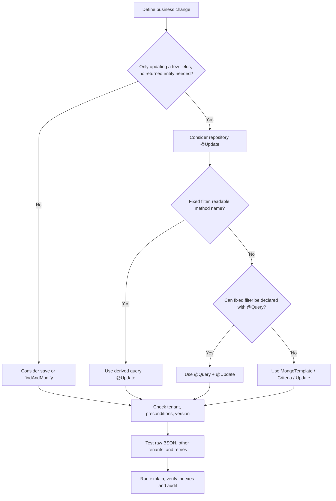

# Declaring @Update with Derived Queries

In **Spring Data MongoDB**, a repository does not only support `save(...)`, `findBy...`, or `deleteBy...`. When you need to modify a few fields without reading the entire document and saving it back, you can declare an **update method directly in the repository interface** using the `@Update` annotation. Notably, **the condition for finding documents can still be inferred from the method name** (*derived query*), while **the update content** is described using MongoDB operators such as `$set`, `$inc`, or an update pipeline.

For example, for a cart or inventory item with tenant, SKU, and a view counter, the application can define:

```java
@Update("{ '$inc': { 'viewCount': 1 } }")
long findAndIncrementViewsByTenantIdAndSku(
    String tenantId, String sku);
```

Spring Data parses the `ByTenantIdAndSku` part to determine **which documents are modified**; `@Update` describes **which changes are applied**. The method does not return the updated entity: `long` represents the number of updated documents under this API contract.

This lesson belongs to the **Repository Writes** chapter of the **SPRING_DATA_MONGODB** module. The content connects building queries via repositories with MongoDB update operators, `MongoTemplate`, optimistic locking, testing, and performance diagnostics. The focus is on **how to use `@Update` combined with derived queries**, rather than replacing every write operation with annotations.

After this lesson, you will be able to:

1. Explain the distinct roles of the **derived predicate** and the **update document**.
2. Correctly declare `org.springframework.data.mongodb.repository.Update` with `$inc`, `$set`, `$unset`, and several array operators.
3. Bind parameters into `@Update` via `?0`, `?1` without concatenating JSON from input.
4. Combine `@Update` with `@Query` when the method name cannot express the required condition grouping.
5. Understand single/multi-document update scope, return types, and differences from `save` and `MongoTemplate.updateFirst`.
6. Protect write operations with tenant, status, and version conditions; recognize auditing and lifecycle callback limitations.
7. Verify results using raw BSON, `mongosh`, integration tests, and `explain`.

## 1. Distinguishing the two parts: finding documents and modifying documents

A MongoDB update command always needs to answer two questions:

- **Filter**: which documents match and are allowed to be modified?
- **Update**: which fields will be changed, and with which operators?

Raw example:

```javascript
db.inventory_repository_updates_lab.updateMany(
  {
    tenantId: "T1",
    status: "ACTIVE",
    deleted: false
  },
  {
    $inc: { viewCount: 1 }
  }
);
```

In a repository, they are separated into:

```java
@Update("{ '$inc': { 'viewCount': 1 } }")
long findAndIncrementViewsByTenantIdAndStatusAndDeletedFalse(
    String tenantId, String status);
```

| Component | Definition source | Meaning |
| --- | --- | --- |
| `findAndIncrementViews` before `By` | Descriptive method name | Helps readers understand intent; does **not** mean an entity must be returned |
| `TenantIdAndStatusAndDeletedFalse` | Derived query parser | Builds conditions based on Java properties |
| `tenantId` and `status` | Method parameters | Comparison values in the filter |
| `@Update("{ '$inc': ... }")` | Update annotation | Increments `viewCount` by 1 on matching documents |
| `long` | Repository update method return type | Number of updated documents, not a list of entities |

**Note:** the method name prefix can carry descriptive words like `findAndIncrementViews`, but when paired with `@Update`, the actual goal is **update**, not `findOne` followed by `save`. Do not design an API relying on the word `find` to expect the method to return an object.

### 1.1. Quick comparison of three write approaches

| Write approach | Characteristics | When appropriate |
| --- | --- | --- |
| `repository.save(entity)` | Writes the entity through mapping; may be insert or save depending on ID/entity state | Creating new records, saving aggregates with lifecycle mapping |
| Repository method with `@Update` | Derived or declared filter, fixed or parameterized update document; not a read-entity-first flow | Updating fields or counters across multiple documents matching a condition |
| `MongoTemplate.updateFirst/updateMulti` | Query and Update built with Java API; provides detailed `UpdateResult` | Need dynamic query logic, modifying a single document, or detailed result inspection |

Do not think of `@Update` as a full entity replacement like `save`. If the annotation contains `$set: {status: "ACTIVE"}`, other fields of the document will **not be replaced** simply because the application did not send them.

## 2. Example entity: multi-tenant inventory management

To verify against MongoDB, use a simple entity with SKU and inventory information:

```java
import java.time.Instant;
import org.bson.types.ObjectId;
import org.springframework.data.annotation.Id;
import org.springframework.data.annotation.Version;
import org.springframework.data.mongodb.core.mapping.Document;

@Document(collection = "inventory_repository_updates_lab")
public class InventoryItem {
    @Id
    private ObjectId id;

    private String labRun;
    private String tenantId;
    private String sku;
    private String status;
    private boolean deleted;
    private long viewCount;
    private long stock;
    private long reserved;
    private Instant lastViewedAt;

    @Version
    private Long version;

    protected InventoryItem() {}

    public InventoryItem(
            String labRun, String tenantId, String sku,
            String status, long stock, long reserved) {
        this.labRun = labRun;
        this.tenantId = tenantId;
        this.sku = sku;
        this.status = status;
        this.stock = stock;
        this.reserved = reserved;
        this.deleted = false;
        this.viewCount = 0;
    }

    public ObjectId getId() { return id; }
    public String getLabRun() { return labRun; }
    public String getTenantId() { return tenantId; }
    public String getSku() { return sku; }
    public String getStatus() { return status; }
    public boolean isDeleted() { return deleted; }
    public long getViewCount() { return viewCount; }
    public long getStock() { return stock; }
    public long getReserved() { return reserved; }
    public Instant getLastViewedAt() { return lastViewedAt; }
    public Long getVersion() { return version; }
}
```

A typical BSON document:

```javascript
{
  _id: ObjectId("665f1f2a4b6c7d8e9f001234"),
  labRun: "demo-run",
  tenantId: "T1",
  sku: "BK-001",
  status: "ACTIVE",
  deleted: false,
  viewCount: NumberLong("0"),
  stock: NumberLong("20"),
  reserved: NumberLong("3"),
  version: NumberLong("0")
}
```

`@Id` maps the Java property `id` to BSON `_id`. `@Version` is metadata for optimistic locking in appropriate Spring Data write paths; **it does not mean every `@Update` method automatically knows the version a client has read**. The example also omits `_class` and BSON type differences that may arise depending on application converters or configuration.

The collection name has the `_lab` suffix to indicate demonstration data. In practice, only use a test database and a dedicated `labRun` marker to avoid mixing results across multiple runs.

## 3. Declaring `@Update` with derived queries

### 3.1. Importing the right annotation

In the repository interface, use:

```java
import org.springframework.data.mongodb.repository.Update;
```

This is the `@Update` **annotation**, not the fluent class:

```java
// Class used for MongoTemplate, not an annotation.
import org.springframework.data.mongodb.core.query.Update;
```

The two types share the same name but have different roles. If code uses both a repository and `MongoTemplate`, be careful to avoid importing the wrong one.

### 3.2. Incrementing a counter with `$inc`

```java
import org.bson.types.ObjectId;
import org.springframework.data.mongodb.repository.MongoRepository;
import org.springframework.data.mongodb.repository.Update;

public interface InventoryItemRepository
        extends MongoRepository<InventoryItem, ObjectId> {

    @Update("{ '$inc': { 'viewCount': 1 } }")
    long findAndIncrementViewsByTenantIdAndSkuAndDeletedFalse(
        String tenantId, String sku);
}
```

Example call:

```java
long affected = repository
    .findAndIncrementViewsByTenantIdAndSkuAndDeletedFalse(
        trustedTenantId, "BK-001"
    );
```

Conceptually equivalent derived condition:

```javascript
{
  tenantId: "T1",
  sku: "BK-001",
  deleted: false
}
```

Specified update part:

```javascript
{
  $inc: { viewCount: 1 }
}
```

`$inc` increments the value directly inside the document instead of reading `viewCount` in Java and writing back a number computed from potentially stale data. If multiple requests concurrently increment a counter on the **same document**, the `$inc` update on that document is atomic; however, the counter value does not automatically guarantee a business event is processed exactly once if the client retries the request.

### 3.3. Why can a single method modify multiple documents?

If a tenant has three documents with the same `sku` (for instance, the system allows multiple inventory batches), the filter `tenantId + sku + deleted = false` can match all three. A repository update method can update **multiple matching documents**.

**Do not infer that `findAnd...` updates only one document.** If you only want to modify a single record, add the unique `id` to the predicate or switch to `MongoTemplate.updateFirst` with a controlled filter. Do not rely on `First`/`Top` in the method name as a safety guardrail without verifying the exact behavior for your specific version and method.

For business operations that may modify multiple documents, name the method and define the API to clearly reflect intent—for example, `incrementViewsForActiveItems` in the service layer calling the corresponding repository method. A method existing in the repository does not automatically grant clients permission to execute an arbitrary bulk update.

### 3.4. Combining multiple derived keywords

Spring Data MongoDB supports common predicate keywords such as:

| Keyword in method name | Example condition meaning |
| --- | --- |
| `And` | Intersection of two conditions |
| `Or` | Union of condition branches; pay attention to grouping |
| `In` | Field value is within a collection of values |
| `LessThan` / `GreaterThan` | Comparison against a parameter value |
| `True` / `False` | Comparison against a boolean without requiring a parameter |
| `IsNull` / `IsNotNull` | Null check according to system semantics |

Example updating ACTIVE items with low stock:

```java
@Update("{ '$set': { 'status': 'LOW_STOCK' } }")
long findAndMarkLowStockByTenantIdAndStatusAndStockLessThanAndDeletedFalse(
    String tenantId, String status, long threshold);
```

A call `findAndMarkLowStockByTenantIdAndStatusAndStockLessThanAndDeletedFalse("T1", "ACTIVE", 5L)` targets T1 items with `status = ACTIVE`, `stock < 5`, and `deleted = false`. This is a **bulk transition**; it does not automatically recalculate when stock changes later. If logic needs to evaluate `stock - reserved`, using `StockLessThan` alone cannot express an arithmetic operation between two fields; you need a query with `$expr` or another appropriate mechanism.

## 4. Passing parameters into `@Update` content

Values used to **find documents** and values used to **update documents** serve two distinct purposes, even though they appear together in the same method parameter list. `@Update` supports update expressions with placeholders bound from Java parameters.

### 4.1. Transitioning status from an old value to a new value

```java
@Update("{ '$set': { 'status': ?3 } }")
long findAndChangeStatusByTenantIdAndSkuAndStatusAndDeletedFalse(
    String tenantId,
    String sku,
    String expectedStatus,
    String newStatus);
```

Parameter order in this example:

| Index | Java variable | Role |
| --- | --- | --- |
| `?0` | `tenantId` | Predicate `TenantId` |
| `?1` | `sku` | Predicate `Sku` |
| `?2` | `expectedStatus` | Predicate `Status` |
| `?3` | `newStatus` | Value in `@Update` |

Call:

```java
long updated = repository
    .findAndChangeStatusByTenantIdAndSkuAndStatusAndDeletedFalse(
        trustedTenantId,
        "BK-001",
        "DRAFT",
        "ACTIVE"
    );
```

Equivalent filter:

```javascript
{
  tenantId: "T1",
  sku: "BK-001",
  status: "DRAFT",
  deleted: false
}
```

Update part:

```javascript
{ $set: { status: "ACTIVE" } }
```

**Benefit:** only documents still in the `DRAFT` state at the time of the update can transition to `ACTIVE`. If another request has already changed the status beforehand, the filter no longer matches. This is a **conditional update** pattern that avoids a read-modify-save cycle on stale data.

**Limitation:** if multiple documents share the same tenant/SKU/status, all matching documents can be updated. If each SKU must be unique per tenant, enforce that constraint with the data model and an appropriate unique index; Java code does not automatically create a unique constraint just because the method accepts a single SKU.

### 4.2. Binding is not JSON string concatenation

Do not construct update JSON by directly concatenating input:

```java
// WRONG: do not build JSON queries/updates from untrusted text.
String updateJson =
    "{ '$set': { 'status': '" + requestedStatus + "' } }";
```

If the value contains single quotes, backslashes, or special JSON characters, the code easily produces invalid syntax. More dangerously, if an API lets clients supply the entire BSON update document, clients can choose operators or fields outside the contract.

With:

```java
@Update("{ '$set': { 'status': ?3 } }")
```

Spring Data treats `newStatus` as a **value** bound into the predefined update structure. Therefore, a string like `{"$ne":"ACTIVE"}` does not turn into a `$ne` operator. Even so, the application should still validate the new status according to business rules.

Example service validating status:

```java
import java.util.Set;

private static final Set<String> ALLOWED_STATUSES =
    Set.of("DRAFT", "ACTIVE", "LOW_STOCK", "ARCHIVED");

public long activateSku(
        String trustedTenantId,
        String sku,
        InventoryItemRepository repository) {

    if (sku == null || sku.isBlank() || sku.length() > 64) {
        throw new IllegalArgumentException("Invalid SKU");
    }

    String desired = "ACTIVE";
    if (!ALLOWED_STATUSES.contains(desired)) {
        throw new IllegalStateException("Unsupported status");
    }

    return repository
        .findAndChangeStatusByTenantIdAndSkuAndStatusAndDeletedFalse(
            trustedTenantId, sku, "DRAFT", desired
        );
}
```

`trustedTenantId` is a tenant authenticated or authorized by the server. In a real API, a `DRAFT -> ACTIVE` transition might also require additional constraints such as sufficient stock, approval, or valid data; the example only illustrates parameter binding and status preconditions.

### 4.3. Timestamps and other data types

You can bind `Instant`, `ObjectId`, numbers, and collections from appropriate Java parameters instead of converting them to JSON strings.

Example updating the view timestamp:

```java
import java.time.Instant;

@Update("{ '$set': { 'lastViewedAt': ?2 }, '$inc': { 'viewCount': 1 } }")
long findAndRecordViewByTenantIdAndIdAndDeletedFalse(
    String tenantId, ObjectId id, Instant viewedAt);
```

Here `?2` is the timestamp determined by the application. When time information must come from the server, the service generates `Instant.now()` or uses a consistent timestamp policy. Note that BSON Date has millisecond resolution and does not preserve nanoseconds from every Java `Instant`.

### 4.4. Do not use placeholders as field names or operators

A binding like `?2` represents a **value**, not an invitation for clients to arbitrarily choose:

```text
field   = "$where"
update  = "$unset"
payload = "{ ... raw JSON ... }"
```

If the product genuinely needs to let callers choose a field or update type, use a server-side **allowlist**, mapping valid choices to one of the predefined methods or `Update` objects. Never accept a `Map<String,Object>` or raw JSON update sent by the client and apply it directly to MongoDB.

## 5. `@Update` and `@Query`: when predicates should not be derived

Derived queries work well for simple filters. If you need parenthesized grouping, `$expr`, conditions on nested documents, or safety requirements hard to express via method names, you can declare the filter with `@Query` alongside `@Update`.

### 5.1. Example with `$expr` calculating net stock

A product needs to be flagged `LOW_STOCK` when:

```text
stock - reserved < 5
```

Equivalent MongoDB query:

```javascript
{
  tenantId: "T1",
  status: "ACTIVE",
  deleted: false,
  $expr: {
    $lt: [
      { $subtract: ["$stock", "$reserved"] },
      5
    ]
  }
}
```

Repository:

```java
import org.springframework.data.mongodb.repository.Query;
import org.springframework.data.mongodb.repository.Update;

// Both methods are declared inside InventoryItemRepository.
@Query("{ 'tenantId': ?0, 'status': 'ACTIVE', 'deleted': false, " +
       "  '$expr': { '$lt': [ { '$subtract': [ '$stock', '$reserved' ] }, ?1 ] } }")
@Update("{ '$set': { 'status': 'LOW_STOCK' } }")
long flagLowStock(String tenantId, long minimumAvailable);
```

When combining both annotations, **`@Query` defines the filter** and **`@Update` defines the modification**. The filter is no longer inferred from a `By...` clause. This is an alternative to the lesson's primary focus on derived queries, and it is crucial to know when **not to cram every bit of logic into the method name**.

`?0` is the bound tenant, and `?1` is the stock threshold. There is no raw string concatenation from input. The expressions reference `$stock` and `$reserved` as BSON field names; if you rename BSON fields via `@Field`, verify the actual expression and update/map it accordingly.

### 5.2. Misgrouped `And` and `Or` can modify the wrong tenant

A dangerous method:

```java
@Update("{ '$set': { 'status': 'ARCHIVED' } }")
long findAndArchiveByTenantIdAndStatusOrSku(
    String tenantId, String status, String sku);
```

According to derived query parsing, the filter is:

```text
(tenantId = T1 AND status = INACTIVE)
    OR
(sku = BK-001)
```

The `sku` branch can match documents belonging to **another tenant**. Safe fix:

```java
@Query("{ 'tenantId': ?0, '$or': [ " +
       "    { 'status': ?1 }, { 'sku': ?2 } ] }")
@Update("{ '$set': { 'status': 'ARCHIVED' } }")
long archiveWithinTenant(
    String tenantId, String status, String sku);
```

Equivalent:

```javascript
{
  tenantId: "T1",
  $or: [
    { status: "INACTIVE" },
    { sku: "BK-001" }
  ]
}
```

The tenant condition applies to **both branches**. With updates, condition-grouping mistakes are even more severe than with read queries because they mutate another tenant's data. Add `deleted = false` or required status conditions at the outer level per the business contract.

### 5.3. When to write a repository method vs. use `MongoTemplate`?

| Requirement | Preferred option |
| --- | --- |
| Incrementing a fixed counter for documents matching a short predicate | Derived `@Update` |
| Transitioning status with a few fixed conditions | Derived `@Update` with parameter binding |
| Complex filter with stable syntax | `@Query` + `@Update` |
| Filter/update varying across many runtime options | `MongoTemplate` with `Criteria`/`Update` |
| Modifying **only one** document by selection/sort rule and needing `UpdateResult` | `MongoTemplate.updateFirst` or `findAndModify` |
| Returning the document before/after modification | `findAndModify` with appropriate return options |
| Writing an entity and needing lifecycle entity callbacks/auditing | Consider `save`/appropriate write path; do not rely on update queries automatically running callbacks |

## 6. Update documents with `$set`, `$inc`, `$unset`, and array operators

`@Update` contains the **update document** corresponding to MongoDB. Typical operations include:

| Operator | Purpose | Example update JSON |
| --- | --- | --- |
| `$set` | Assigns one or more fields | `{ '$set': { 'status': 'ACTIVE' } }` |
| `$inc` | Increments/decrements a numeric value | `{ '$inc': { 'viewCount': 1 } }` |
| `$unset` | Removes a field from the document | `{ '$unset': { 'lastViewedAt': '' } }` |
| `$addToSet` | Adds a value to an array if no equal element exists | `{ '$addToSet': { 'tags': 'featured' } }` |
| `$pull` | Removes all array elements matching a value/condition | `{ '$pull': { 'tags': 'obsolete' } }` |
| `$currentDate` | Sets the current date/time on the MongoDB server | `{ '$currentDate': { 'lastTouchedAt': true } }` |

In repositories, define **the allowed changes** rather than letting clients supply arbitrary operator names.

### 6.1. Combining `$inc` and `$set` in a single command

```java
@Update("{ '$inc': { 'viewCount': 1 }, " +
        "  '$set': { 'lastViewedAt': ?2 } }")
long findAndTrackViewByTenantIdAndIdAndDeletedFalse(
    String tenantId, ObjectId id, Instant viewedAt);
```

On a matching document, both changes are applied in **one document update operation**. This is more consistent than issuing `$inc` and `$set` as two separate MongoDB requests and accepting a gap between them.

If the system needs time from the MongoDB server, consider `$currentDate` when the field and semantics fit:

```java
@Update("{ '$inc': { 'viewCount': 1 }, " +
        "  '$currentDate': { 'lastViewedAt': true } }")
long findAndTrackServerTimeByTenantIdAndIdAndDeletedFalse(
    String tenantId, ObjectId id);
```

`$currentDate` uses the server-side timestamp, whereas `Instant.now()` uses the JVM-side timestamp. Choose one consistent time source for the API contract; do not assume all machines have perfectly synchronized clocks.

### 6.2. Modifying arrays without rewriting the entire document

Suppose the entity adds `tags: List<String>`; you can declare:

```java
@Update("{ '$addToSet': { 'tags': ?2 } }")
long findAndAddTagByTenantIdAndIdAndDeletedFalse(
    String tenantId, ObjectId id, String tag);

@Update("{ '$pull': { 'tags': ?2 } }")
long findAndRemoveTagByTenantIdAndIdAndDeletedFalse(
    String tenantId, ObjectId id, String tag);
```

Each method modifies only the `tags` field of matching documents. `$pull` removes **all occurrences** of that tag; `$addToSet` prevents adding duplicate elements according to MongoDB comparison, but does not automatically clean up pre-existing duplicates. Before applying, add `tags` to the entity/mapping and inspect the actual BSON.

### 6.3. Do not `$unset` a required field without a migration

`$unset` removes the **field from the BSON document**, which differs from setting its value to `null`. If another service treats a field as required, removing it can break deserialization or business logic. For multi-version data, establish a migration and compatibility strategy before deleting stored fields.

## 7. Update pipelines in `@Update`

Not every update is `$set` with a constant. Sometimes the new value must be **computed from existing fields** in MongoDB. Supported versions of Spring Data MongoDB provide `@Update(pipeline = {...})` for aggregation-pipeline-style updates.

For example, the model adds an `available` field to record `stock - reserved`:

```java
// Place in InventoryItemRepository if the entity has an available field.
@Update(pipeline = {
    "{ '$set': { 'available': { '$subtract': [ '$stock', '$reserved' ] } } }"
})
long findAndRefreshAvailableByTenantIdAndStatusAndDeletedFalse(
    String tenantId, String status);
```

This is a single-stage update pipeline containing an **aggregation pipeline** `$set` operator. The expressions `'$stock'` and `'$reserved'` refer to field values in the current document. This differs from `@Update("{ '$set': { 'available': 10 } }")`, which assigns a constant.

Equivalent raw MongoDB command:

```javascript
db.inventory_repository_updates_lab.updateMany(
  { tenantId: "T1", status: "ACTIVE", deleted: false },
  [
    {
      $set: {
        available: { $subtract: ["$stock", "$reserved"] }
      }
    }
  ]
);
```

**Notes:**

- A pipeline update supports the subset of stages permitted by MongoDB in updates; not every aggregation stage is valid.
- `available` is **derived** data. If other write paths modifying `stock`/`reserved` do not recompute `available`, this field can become stale.
- `$stock`/`$reserved` in a raw pipeline must point to the exact BSON field names; verify carefully when the entity uses `@Field` renaming.
- A pipeline does not automatically guarantee optimistic locking based on the version a client read; concurrency requirements must be handled with filter/version design.
- Verify `@Update(pipeline=...)` support and syntax for your project's Spring Data MongoDB version.

Do not use a pipeline for a simple update like `$inc`; use the simplest form that satisfies the requirement.

## 8. Version, conditional updates, and concurrent workers

### 8.1. Why isn't `@Version` an automatic guardrail for every repository update?

With `save(entity)`, optimistic locking can use `@Version` on the loaded object to detect if the document changed. However, a **query-based** update method does not receive a full previously read entity. If the filter only has `tenantId + sku`, it **does not know** which version the client believes the document currently has.

Therefore, if business logic requires *"update only if the document is still at version 3"*, you must check the version **directly in the filter** and manage incrementing the version consistently:

```java
@Update("{ '$set': { 'status': ?4 }, " +
        "  '$inc': { 'version': 1 } }")
long findAndTransitionByTenantIdAndIdAndStatusAndVersionAndDeletedFalse(
    String tenantId,
    ObjectId id,
    String expectedStatus,
    Long expectedVersion,
    String nextStatus);
```

Example call:

```java
long updated = repository
    .findAndTransitionByTenantIdAndIdAndStatusAndVersionAndDeletedFalse(
        trustedTenantId, itemId, "DRAFT", 3L, "ACTIVE"
    );
```

Filter part:

```javascript
{
  tenantId: "T1",
  _id: ObjectId("665f1f2a4b6c7d8e9f001234"),
  status: "DRAFT",
  version: NumberLong("3"),
  deleted: false
}
```

Update part:

```javascript
{
  $set: { status: "ACTIVE" },
  $inc: { version: 1 }
}
```

When another request has already moved the version to 4, the `version = 3` filter no longer matches. The command is prevented from silently modifying the newer document version. The example explicitly shows `$inc` on `version` so the update contract is observable in BSON; the application must unify how version is incremented across **all write paths** to avoid double increments or omissions when using other APIs/configurations.

### 8.2. Distinguishing single-document and multi-document updates

The example above filters by the unique `_id`, so it can modify **at most one document**. If you remove `id` from the method name and keep general `status`/`tenantId`/`version` conditions, multiple documents could match and all get modified.

| Scenario | Result to analyze |
| --- | --- |
| Filter by exact `_id` and tenant | At most one document; suitable for CAS |
| Filter by status and tenant | Potentially many documents modified together |
| Status or version was already updated | No longer matches |
| Update assigns the same value already present | May match without changing business fields |
| Method returns `long = 0` | Insufficient information to distinguish all causes without a clear contract |

To distinguish **matched** vs. **modified** document counts in detail, `MongoTemplate` provides `UpdateResult`:

```java
import com.mongodb.client.result.UpdateResult;
import org.springframework.data.mongodb.core.query.Criteria;
import org.springframework.data.mongodb.core.query.Query;
import org.springframework.data.mongodb.core.query.Update;

Query filter = Query.query(
    Criteria.where("id").is(itemId)
        .and("tenantId").is(trustedTenantId)
        .and("status").is("DRAFT")
        .and("version").is(3L)
);

Update changes = new Update()
    .set("status", "ACTIVE")
    .inc("version", 1);

UpdateResult result = mongoTemplate.updateFirst(
    filter, changes, InventoryItem.class
);

long matchedCount = result.getMatchedCount();
long modifiedCount = result.getModifiedCount();
```

`UpdateResult` is useful when business logic truly needs to distinguish **no matching document** from **matched but BSON unchanged**, or needs an explicit update mode (`updateFirst` instead of multi-document update).

### 8.3. Do not treat bulk updates as multi-document transactions

A single repository update can modify multiple documents. MongoDB guarantees atomicity **per individual document**, but **does not automatically treat the entire list of matching documents as a single transaction**. If the requirement is "either all SKUs in the order are updated and audited, or none change", consider a transaction on a supported deployment or a compensation/reconciliation workflow.

Concurrent HTTP calls, message publishing, or writes to external systems are also not automatically rolled back with MongoDB simply because a repository update method succeeded.

## 9. Lifecycle callbacks, auditing, and direct updates

An `@Update` running as an update query is not like loading an entity into Java and calling `save`. You should not assume logic based on **entity callbacks, auditing fields, or setter validation** will run identically across every write path.

Rules commonly overlooked:

- `@LastModifiedDate`: not updated automatically by default when an update query only performs `$inc`.
- `@Version`: does not automatically enforce client-version matching when the filter lacks the expected version.
- Domain invariants: if a Java setter rejects an invalid state transition, a query update does not necessarily invoke that setter.
- Entity listeners/callbacks: direct write paths are not equivalent to the `save(entity)` lifecycle.
- Caches or held Java objects: updates in MongoDB **do not mutate already-loaded objects in application memory**.

When you need to record the modification time, you can include it in the **update itself**:

```java
@Update("{ '$set': { 'status': ?3 }, " +
        "  '$currentDate': { 'lastUpdatedAt': true } }")
long findAndChangeStatusWithTimestampByTenantIdAndSkuAndStatusAndDeletedFalse(
    String tenantId, String sku, String oldStatus, String newStatus);
```

Ensure the entity/schema actually defines `lastUpdatedAt` per the data contract. `$currentDate` is a way to generate a MongoDB-side timestamp; it does not equate to replacing all of Spring Data's auditing mechanisms.

**Testing principle:** for fields backed by callbacks/annotations, inspect **raw BSON after a repository update**; do not infer behavior just because the class has annotations.

## 10. `mongosh` hands-on lab: observing filter and update separately

To clearly see the meaning of derived query + `@Update`, let us execute the equivalent BSON filters and updates in MongoDB. The exercise uses the `spring_data_training` database and the `inventory_repository_updates_lab` collection. Each session creates its own `labRun` marker without modifying production data.

### 10.1. Creating data across multiple statuses and tenants

Open `mongosh` on a **test** MongoDB instance and run sequentially:

```javascript
use spring_data_training

const lab = db.getCollection("inventory_repository_updates_lab");
const runId = "repository-writes-001-" + new ObjectId().toHexString();
const t1 = runId + "-T1";
const t2 = runId + "-T2";

const inserted = lab.insertMany([
  {
    labRun: runId, tenantId: t1, label: "A",
    sku: "BK-01", status: "DRAFT", deleted: false,
    viewCount: NumberLong("0"), stock: NumberLong("10"),
    reserved: NumberLong("2"), version: NumberLong("0")
  },
  {
    labRun: runId, tenantId: t1, label: "B",
    sku: "BK-02", status: "ACTIVE", deleted: false,
    viewCount: NumberLong("5"), stock: NumberLong("4"),
    reserved: NumberLong("1"), version: NumberLong("0")
  },
  {
    labRun: runId, tenantId: t1, label: "C",
    sku: "BK-03", status: "ACTIVE", deleted: false,
    viewCount: NumberLong("2"), stock: NumberLong("1"),
    reserved: NumberLong("1"), version: NumberLong("1")
  },
  {
    labRun: runId, tenantId: t1, label: "D",
    sku: "BK-04", status: "ACTIVE", deleted: true,
    viewCount: NumberLong("10"), stock: NumberLong("0"),
    reserved: NumberLong("0"), version: NumberLong("0")
  },
  {
    labRun: runId, tenantId: t2, label: "E",
    sku: "BK-03", status: "ACTIVE", deleted: false,
    viewCount: NumberLong("4"), stock: NumberLong("1"),
    reserved: NumberLong("1"), version: NumberLong("0")
  },
  {
    labRun: runId, tenantId: t1, label: "F",
    sku: "BK-05", status: "DRAFT", deleted: false,
    viewCount: NumberLong("0"), stock: NumberLong("2"),
    reserved: NumberLong("1"), version: NumberLong("2")
  },
  {
    labRun: runId, tenantId: t1, label: "G",
    sku: "BK-06", status: "ACTIVE", deleted: false,
    viewCount: NumberLong("1"), stock: NumberLong("3"),
    reserved: NumberLong("2"), version: NumberLong("0")
  }
]);

printjson({
  runId: runId,
  tenant1: t1,
  tenant2: t2
});
print(lab.countDocuments({ labRun: runId })); // 7
```

The variables `runId`, `t1`, and `t2` exist only in this shell session. If you exit the shell, record their values or start a new lab session; do not pick a new marker and then delete old markers using an empty filter.

A small helper function to inspect results by label:

```javascript
function inspectLab() {
  return lab.find(
    { labRun: runId },
    {
      _id: 0, label: 1, tenantId: 1,
      sku: 1, status: 1, deleted: 1,
      viewCount: 1, stock: 1,
      reserved: 1, version: 1
    }
  ).sort({ label: 1 }).toArray();
}

printjson(inspectLab());
```

### 10.2. Equivalent of `@Update("$inc")` with a derived query

Method:

```java
@Update("{ '$inc': { 'viewCount': 1 } }")
long findAndIncrementViewsByTenantIdAndStatusAndDeletedFalse(
    String tenantId, String status);
```

Equivalent raw operation:

```javascript
const viewsResult = lab.updateMany(
  {
    labRun: runId,
    tenantId: t1,
    status: "ACTIVE",
    deleted: false
  },
  {
    $inc: { viewCount: NumberLong("1") }
  }
);

printjson({
  matched: viewsResult.matchedCount,
  modified: viewsResult.modifiedCount
});
// Expected: matched = 3, modified = 3.

printjson(inspectLab().map(d => ({
  label: d.label,
  viewCount: d.viewCount
})));
// B: 6; C: 3; G: 2.
// A/F are DRAFT, D is deleted, E belongs to tenant2 — unchanged.
```

The `labRun` field is an isolation condition **only present in the raw example**; the repository method in Section 3 does not include it, so when running the repository against real data, ensure appropriate tenant/ID and scope safeguards. To use the same lab data through a repository while keeping isolation, you can add `LabRun` to a test-only method name.

### 10.3. Conditional transition `DRAFT -> ACTIVE`

```javascript
const activate = lab.updateMany(
  {
    labRun: runId,
    tenantId: t1,
    sku: "BK-01",
    status: "DRAFT",
    deleted: false
  },
  {
    $set: { status: "ACTIVE" }
  }
);

printjson({
  matched: activate.matchedCount,
  modified: activate.modifiedCount
});
// Expected: 1, 1. Document A transitions from DRAFT to ACTIVE.

const repeatActivation = lab.updateMany(
  {
    labRun: runId,
    tenantId: t1,
    sku: "BK-01",
    status: "DRAFT",
    deleted: false
  },
  {
    $set: { status: "ACTIVE" }
  }
);

printjson({
  matched: repeatActivation.matchedCount,
  modified: repeatActivation.modifiedCount
});
// Expected: 0, 0. A is no longer in DRAFT status.
```

This is an example of a **precondition in the filter**: the update does not merely assign the `status` field, it also verifies the current status. It prevents a retry from accidentally repeating a completed state transition, provided no other thread transitioned it back to `DRAFT` in between.

### 10.4. Compare-and-set by version

Document F initially has version 2. Try transitioning it to ACTIVE while version is still 2:

```javascript
const changeWithVersion = lab.updateOne(
  {
    labRun: runId,
    tenantId: t1,
    sku: "BK-05",
    status: "DRAFT",
    version: NumberLong("2")
  },
  {
    $set: { status: "ACTIVE" },
    $inc: { version: NumberLong("1") }
  }
);

printjson(changeWithVersion);
// Expected: matchedCount = 1, modifiedCount = 1.

const staleVersion = lab.updateOne(
  {
    labRun: runId,
    tenantId: t1,
    sku: "BK-05",
    version: NumberLong("2")
  },
  { $set: { status: "ARCHIVED" } }
);

printjson(staleVersion);
// Expected: matchedCount = 0; F is now at version 3.
```

This is the **compare-and-set mechanism** achieved by placing the expected version in the filter. Without the version condition, a stale request could still overwrite a record already updated by another thread.

### 10.5. Expression computed from two fields in `@Query`

```javascript
const lowAvailable = lab.find(
  {
    labRun: runId,
    tenantId: t1,
    status: "ACTIVE",
    deleted: false,
    $expr: {
      $lt: [
        { $subtract: ["$stock", "$reserved"] },
        NumberLong("2")
      ]
    }
  },
  { _id: 0, label: 1, sku: 1 }
).toArray();

printjson(lowAvailable);
// Expected: C and G; rows may appear in any order without sort.
```

You can try `updateMany` with the same filter to set `status = LOW_STOCK` after confirming the result set. The purpose of this step is to illustrate an `$expr` filter defined by the developer in `@Query` and combined with `@Update`; it is **not** a derived predicate inferred solely from the method name.

### 10.6. Why must tenant be checked in every `Or` branch?

Perform a **read-only** check of an intentionally misgrouped query:

```javascript
const unsafeScope = lab.find(
  {
    labRun: runId,
    $or: [
      { tenantId: t1, status: "ACTIVE" },
      { sku: "BK-03" }
    ]
  },
  { _id: 0, label: 1, tenantId: 1 }
).toArray();

printjson(unsafeScope);
// Document E belonging to t2 may appear because of SKU BK-03.
```

If you turned this same filter into an update, you could mistakenly modify T2's document. Therefore, do not execute an update with a broken scope; fix the filter by placing `tenantId: t1` outside `$or`, or distribute the tenant condition into every branch.

### 10.7. Cleaning up only this session's documents

```javascript
const remaining = lab.countDocuments({ labRun: runId });
print("Session documents to clean up: " + remaining);

const cleanup = lab.deleteMany({ labRun: runId });
printjson({ deletedCount: cleanup.deletedCount });

print(lab.countDocuments({ labRun: runId })); // 0.
```

Do not replace `{ labRun: runId }` with `{}`. The exercise only owns the documents just created; never wipe the entire collection just to save a few characters.

## 11. Integration testing repository updates

Derived queries are built from **Java method names** when the framework initializes the repository. A unit test that merely inspects the `@Update` string will not catch:

- Method property names that do not match the entity.
- Misordered `?0`/`?3` placeholders.
- Updates executing with an unintended scope.
- Entity mapping converting a field to a different name or BSON type.
- `@Version`/auditing behaving differently from assumptions.

Therefore, you need **integration tests against a real MongoDB or Testcontainers** using the Spring Data Repository configured as in the application. A good test must prove not only that the target documents were modified, but also that **documents outside the allowed scope remained untouched**.

### 11.1. Test case matrix

| Test case | Test data | What to assert |
| --- | --- | --- |
| `$inc` on a single SKU | T1/SKU-A, T2/SKU-A, T1/SKU-B | Only the document matching tenant/SKU is incremented |
| Derived `StatusAndDeletedFalse` | One ACTIVE, one DRAFT, one deleted=true | Only the record matching both conditions is modified |
| Status transition | DRAFT -> ACTIVE | First call updates; repeating with expected DRAFT no longer matches |
| Update-only parameter | `newStatus` at end of parameter list | The `?3` value is actually written to BSON status |
| Two records matching filter | Two matching SKUs/batches | Confirms the method can modify multiple documents |
| Stale version | Expected version 2, DB has 3 | Document is not modified |
| Pipeline | `stock = 8`, `reserved = 3` | Derived field equals 5 when pipeline is declared |
| Field alias | Java property differs from BSON name | Query and update use the actual field name |
| No matching documents | Wrong tenant or ID | No data written; return count handled properly |
| Callback/auditing | Entity with `@LastModifiedDate` | Do not assume automatic updates; assert raw BSON against the write path contract |

### 11.2. JUnit 5 example with `@DataMongoTest`

The following example assumes the Spring Boot project connects to a **test-dedicated** MongoDB instance. The entity and repository were declared in Sections 2–4, with the methods added to the **same** `InventoryItemRepository` interface. Test slice imports may need adjustment depending on the actual Spring Boot version.

```java
import static org.junit.jupiter.api.Assertions.*;
import static com.mongodb.client.model.Filters.eq;

import java.util.List;
import java.util.UUID;
import org.bson.Document;
import org.bson.types.ObjectId;
import org.junit.jupiter.api.Test;
import org.springframework.beans.factory.annotation.Autowired;
import org.springframework.boot.test.autoconfigure.data.mongo.DataMongoTest;
import org.springframework.data.mongodb.core.MongoTemplate;
import org.springframework.data.mongodb.core.query.Criteria;
import org.springframework.data.mongodb.core.query.Query;

@DataMongoTest
class InventoryRepositoryUpdateTest {
    @Autowired
    InventoryItemRepository repository;

    @Autowired
    MongoTemplate template;

    private InventoryItem insert(
            String run, String tenant,
            String sku, String status) {
        return repository.insert(new InventoryItem(
            run, tenant, sku, status, 20L, 2L
        ));
    }

    private Document raw(InventoryItem item) {
        Document stored = template
            .getCollection("inventory_repository_updates_lab")
            .find(eq("_id", item.getId()))
            .first();
        assertNotNull(stored);
        return stored;
    }

    private void cleanup(String run) {
        template.remove(
            Query.query(Criteria.where("labRun").is(run)),
            InventoryItem.class
        );
    }

    @Test
    void incrementMustMatchTenantAndSku() {
        String run = UUID.randomUUID().toString();
        String t1 = run + "-T1";
        String t2 = run + "-T2";
        String sku = run + "-SKU";

        InventoryItem target =
            insert(run, t1, sku, "ACTIVE");
        InventoryItem crossTenant =
            insert(run, t2, sku, "ACTIVE");
        InventoryItem otherSku =
            insert(run, t1, run + "-OTHER", "ACTIVE");

        try {
            long affected = repository
                .findAndIncrementViewsByTenantIdAndSkuAndDeletedFalse(
                    t1, sku
                );
            assertEquals(1L, affected);

            assertEquals(1L,
                ((Number) raw(target).get("viewCount")).longValue());
            assertEquals(0L,
                ((Number) raw(crossTenant).get("viewCount")).longValue());
            assertEquals(0L,
                ((Number) raw(otherSku).get("viewCount")).longValue());
        } finally {
            cleanup(run);
        }
    }

    @Test
    void updateValueIsBoundAndTransitionHasPrecondition() {
        String run = UUID.randomUUID().toString();
        String tenant = run + "-T1";
        String otherTenant = run + "-T2";
        String sku = run + "-SKU";

        InventoryItem target =
            insert(run, tenant, sku, "DRAFT");
        InventoryItem crossTenant =
            insert(run, otherTenant, sku, "DRAFT");

        try {
            long first = repository
                .findAndChangeStatusByTenantIdAndSkuAndStatusAndDeletedFalse(
                    tenant, sku, "DRAFT", "ACTIVE"
                );
            assertEquals(1L, first);

            assertEquals("ACTIVE",
                raw(target).getString("status"));
            assertEquals("DRAFT",
                raw(crossTenant).getString("status"));

            long repeated = repository
                .findAndChangeStatusByTenantIdAndSkuAndStatusAndDeletedFalse(
                    tenant, sku, "DRAFT", "ACTIVE"
                );
            assertEquals(0L, repeated);
        } finally {
            cleanup(run);
        }
    }

    @Test
    void rejectsStaleVersionInDerivedPredicate() {
        String run = UUID.randomUUID().toString();
        String tenant = run + "-T1";
        InventoryItem target =
            insert(run, tenant, run + "-SKU", "DRAFT");

        try {
            Number initialVersion =
                (Number) raw(target).get("version");
            assertNotNull(initialVersion);
            long expected = initialVersion.longValue();

            long first = repository
                .findAndTransitionByTenantIdAndIdAndStatusAndVersionAndDeletedFalse(
                    tenant, target.getId(),
                    "DRAFT", expected, "ACTIVE"
                );
            assertEquals(1L, first);

            long stale = repository
                .findAndTransitionByTenantIdAndIdAndStatusAndVersionAndDeletedFalse(
                    tenant, target.getId(),
                    "ACTIVE", expected, "ARCHIVED"
                );
            assertEquals(0L, stale);

            assertEquals("ACTIVE",
                raw(target).getString("status"));
        } finally {
            cleanup(run);
        }
    }
}
```

In the version test, reading the **raw BSON** value avoids assuming the initial version must always be a fixed number across all Spring Data versions. The test verifies both the post-update status and that a stale request cannot write when the expected version is outdated.

**Important:** This is instructional documentation code; the tests **were not executed** when writing this lesson. A test MongoDB environment and compatible Spring Boot/Spring Data MongoDB versions are required. When integrating into real source code, all repository methods used in the tests must be added to the interface, and some imports or version configurations may need adjustment.

### 11.3. Adding tests for deleted and bulk updates

To verify that `DeletedFalse` takes effect, create an `InventoryItem` and mark `deleted = true` via a controlled update path. Call `findAndIncrementViews...AndDeletedFalse` with the matching tenant/SKU and confirm `viewCount` on the soft-deleted document remains unchanged.

For bulk updates, create two documents with the same tenant/status and one document in another tenant. Run `findAndIncrementViewsByTenantIdAndStatusAndDeletedFalse`, verifying both valid documents increment their count while the other tenant remains unchanged.

### 11.4. Why read raw BSON?

When calling `repository.findById(...)`, Spring Data performs mapping and may convert BSON types into Java types. A schema bug can be masked if conversion still reads back successfully. For timestamps, versions, or decimal fields, inspect the actual BSON:

```java
Document stored = template
    .getCollection("inventory_repository_updates_lab")
    .find(eq("_id", itemId))
    .first();

assertNotNull(stored);
assertEquals("ACTIVE", stored.getString("status"));
```

With a new field like `available` computed by a pipeline, verify both its BSON type and value and check that it matches the declared Java mapping.

## 12. Indexes, performance, and bulk update scope

A repository update method performs two jobs: **finding matching documents** and **modifying those documents**. If the query lacks a suitable index, MongoDB may have to scan many documents before applying the update.

### 12.1. Index for queries by tenant and SKU

Common filter pattern:

```javascript
{
  tenantId: "T1",
  sku: "BK-001",
  deleted: false
}
```

You can consider:

```javascript
db.inventory_repository_updates_lab.createIndex(
  { tenantId: 1, sku: 1 },
  { name: "idx_tenant_sku" }
);
```

When business rules **require each tenant to have at most one record per SKU**, consider a **unique compound index** after inspecting and migrating any duplicate data:

```javascript
// Only create a unique index if the data contract truly requires it
// and existing data has no duplicate tenantId/SKU pairs.
db.inventory_repository_updates_lab.createIndex(
  { tenantId: 1, sku: 1 },
  { unique: true, name: "uniq_tenant_sku" }
);
```

Do not create **both** indexes on the exact same set of fields in operational environments without evaluating redundancy and necessity. In a system with multiple inventory batches sharing the same SKU, this unique index would be inappropriate; instead, you need each batch's ID to update the exact document.

### 12.2. Index for status-based updates

If you frequently update all ACTIVE/non-soft-deleted items for a tenant:

```javascript
{
  tenantId: "T1",
  status: "ACTIVE",
  deleted: false
}
```

then a candidate index is:

```javascript
db.inventory_repository_updates_lab.createIndex(
  { tenantId: 1, status: 1, deleted: 1 },
  { name: "idx_tenant_status_deleted" }
);
```

This is not a mandatory configuration. Indexes carry storage overhead and increase update work whenever indexed fields change. Decide based on data distribution, read/write ratios, tenant sizes, matching document counts, and overall workload.

### 12.3. Using `explain` to inspect the document selection step

With a read query equivalent to the update predicate:

```javascript
db.inventory_repository_updates_lab.find({
  tenantId: "ACTUAL_TENANT",
  status: "ACTIVE",
  deleted: false
}).explain("executionStats");
```

Replace the tenant with a representative value that has data. Check:

| Field | Practical meaning |
| --- | --- |
| `winningPlan` | Is it `IXSCAN` or `COLLSCAN`? Is the expected index used? |
| `totalKeysExamined` | Number of index entries examined |
| `totalDocsExamined` | Number of documents the engine needed to read |
| `nReturned` | Number of documents matching the equivalent read query |
| `executionTimeMillis` | Timing metric for a single run; combine with real-world metrics |

Do not benchmark a multi-million-document system using seven lab documents. Moreover, a **read** plan does not reflect full **write** costs such as index updates, replication, lock contention, or journaling.

### 12.4. Bulk updates and operational limits

A repository method with a broad filter can update hundreds of thousands of documents. In that case, consider:

- Method invocation permissions: who is allowed to run bulk operations, and for which tenants?
- Scope: should status, date, batch ID, or other conditions be added?
- Dry-run: you can use `count`/`find` to estimate beforehand, but **count and update are two separate operations** and do not enforce an atomic limit.
- Load: updating many documents can impact latency, CPU, I/O, cache memory, and replication.
- Monitoring: track modified document counts, errors, duration, and interaction with other workloads.
- Recovery: if a job stops, is there a retry, checkpoint, or compensation strategy?

For a complex batch workflow, `MongoTemplate` or a dedicated job solution is usually easier to control for scope and progress than a standalone `@Update` method.

## 13. Scalability, reactive access, and separation of responsibilities

### 13.1. When should an update query live in the repository?

A method like:

```java
@Update("{ '$inc': { 'viewCount': 1 } }")
long findAndIncrementViewsByTenantIdAndIdAndDeletedFalse(
    String tenantId, ObjectId id);
```

has a small, easy-to-call, and easy-to-test contract: select a record by tenant/ID and increment the count. It fits nicely in the repository, while the **service** is responsible for determining the tenant, verifying permissions, rate limiting, and interpreting the result.

Conversely, if an API must accept ten optional filters, sorting, dynamic update parameters, and complex version control, an excessively long method name becomes hard to maintain. Use `MongoTemplate` and a strongly typed filter builder instead.

### 13.2. Reactive MongoDB does not change atomicity rules

In reactive applications using `ReactiveMongoRepository` or `ReactiveMongoTemplate`, the return type is an appropriate reactive publisher (such as `Mono`) instead of synchronous `long`. Annotation update support and specific return types must be verified against your Spring Data MongoDB version.

However, the business principles remain unchanged: filters must be tenant-scoped, never assume a multi-document update is a full transaction, never turn raw JSON input into operators, and inspect real BSON after writes. Reactive execution does not automatically solve lost updates or idempotency.

### 13.3. Update queries are not where entire business workflows belong

Separate responsibilities clearly:

| Component | Responsibility |
| --- | --- |
| Controller/API boundary | Validate input syntax, limit payload size |
| Authentication/authorization | Verify user and authorized tenant |
| Service/domain | Validate business transitions, decide idempotency, handle conflicts |
| Repository `@Update` | Define fixed filter/update, execute conditional update |
| MongoDB | Execute filter/update atomically per document |
| Audit/outbox | Record changes and emit events per consistency requirements |
| Monitoring | Track modified counts, latency, errors, and job scope |

A successful update method does not prove an email was sent or that data in another system was synchronized. If critical side effects must be guaranteed, use a dedicated audit/outbox/transaction workflow or retry mechanism.

## 14. Common pitfalls

| Symptom | Cause | Fix |
| --- | --- | --- |
| Code does not recognize `@Update` as an annotation | Wrongly imported `core.query.Update` | Use `org.springframework.data.mongodb.repository.Update` |
| Method does not run expected query | `By...` does not match properties or keywords are parsed differently | Write clear derived predicates, check context startup and test |
| Expecting modified entity back from `@Update` | Repository update method is not an entity fetch | Use appropriate return type; if entity is needed, consider `findAndModify` |
| Updated record count is larger than expected | Tenant/SKU filter is not unique or status is too broad | Add `id`/unique constraint, review bulk intent |
| A field gets assigned the wrong value | `?0`/`?1`/`?3` placeholder order mixed up | Map out parameter table and test raw BSON |
| Status update succeeds but another tenant's data changes | `Or` group missing tenant in one branch | Move tenant outside `$or`, test cross-tenant isolation |
| Update runs again even after status changed | Expected status omitted from filter | Add status precondition, design idempotency |
| Stale version still modifies document | Filter lacks expected version | Add `Version` to predicate or use a CAS query |
| `lastModifiedAt` field does not change | Query update does not run auditing like `save` | Explicitly write timestamp in update and test |
| Setter/validator does not run | Update executes directly on database without instantiating full entity | Validate at API/service layer, add schema validation if needed |
| `long = 0` result misread as "does not exist" | Cannot distinguish no-match, no-op, or business precondition failure | Define semantics and use `UpdateResult`/appropriate query |
| JSON-like string breaks query | Concatenated input into annotation or raw `Document.parse` | Bind value parameters, keep query structure server-side |
| Pipeline computes wrong value | Used Java field name instead of BSON, or mismatched types | Check `@Field`, raw BSON, and test |
| Counter incremented twice | Client retried business request, `$inc` ran twice | Design idempotency key or deduplication in service |
| Bulk update is slow | Filter lacks index, scope is too large | Inspect `explain`, optimize indexes, and batch |
| One write succeeds while related documents remain out of sync | No transaction/compensation across multiple records/collections | Design transaction or recovery workflow |
| Post-update data not visible on old entity | Already-loaded Java objects do not sync automatically after direct update | Re-read document or refresh cache by design |

### 14.1. Specifically: do not confuse **modified count** with **matched count**

With `MongoTemplate.updateFirst/updateMulti`, `UpdateResult` exposes both values:

```java
if (!result.wasAcknowledged()) {
    throw new IllegalStateException(
        "Write concern did not acknowledge update"
    );
}

long matched = result.getMatchedCount();
long modified = result.getModifiedCount();
```

With a repository `@Update` returning `long`, you do not get the full `UpdateResult` to inspect. A count contains no modified IDs, is not an entity, and is not an audit guarantee. If business logic requires distinguishing matched from modified, use an API that exposes both numbers alongside integration tests.

### 14.2. Do not treat method names as a security mechanism

`findAndUpdateByTenantId...` contains `TenantId` in its name, yet the application can still fail authorization if it passes a client-chosen `tenantId`. **Tenant values must come from a trusted server-side context** with proper permission checks. The method name only describes the query condition; it does not verify the origin of parameters.

## 15. Decision flow between derived `@Update` and alternatives



Self-check before promoting a method to production:

1. **What is the actual filter?** Write out the equivalent BSON from the method name.
2. **Update one or many?** Is there a unique ID or uniqueness constraint?
3. **What is the parameter order?** Do placeholders in `@Update` point to the right variables?
4. **Are the write operators right?** `$inc`, `$set`, `$unset`, pipeline, or array operations?
5. **Protection conditions?** Are tenant, status, soft delete, and expected version applied in all cases?
6. **Are callbacks/auditing required?** If so, are they explicitly handled on the write path?
7. **Is the method return value sufficient?** If you need an entity or matched count, should you use another API?
8. **Are there negative tests?** T2, stale version, mismatched status, special inputs, retries?
9. **Are indexes appropriate?** Will a bulk update scan too many documents?
10. **Is there a recovery strategy?** When updating multiple records or external side effects fail?

## 16. Practice exercises

**Exercise 1 — Separating filter and update.** Analyze:

```java
@Update("{ '$inc': { 'viewCount': 1 } }")
long findAndIncrementViewsByTenantIdAndStatusAndDeletedFalse(
    String tenantId, String status);
```

Write the equivalent BSON filter and update document. If a tenant has four ACTIVE documents and one `deleted=true` document, predict the modified scope.

**Exercise 2 — Correct import.** Write a `MongoRepository` interface with an `@Update` method and state the exact import path of the annotation. Compare it with the `Update` class used for `MongoTemplate`.

**Exercise 3 — Binding a new status.** Write a method that updates from `DRAFT` to a status passed via a Java parameter, filtering by tenant, SKU, expected status, and `deleted=false`. Use `?3` for the new status. Test that strings containing quotes or JSON-like characters do not become operators.

**Exercise 4 — Handling multiplicity.** Given a tenant with two batches sharing the same SKU, call the update method by `TenantIdAndSku` and observe both changing. Propose how to switch to filtering by `_id` when only one batch should be modified.

**Exercise 5 — `And`/`Or` and tenant.** How can a `findAndArchiveByTenantIdAndStatusOrSku` method modify the wrong tenant? Write a `@Query` with tenant outside `$or` and use `@Update` to update the status.

**Exercise 6 — Compare-and-set.** Create a version 3 document. Write a repository method filtering by `tenantId`, `id`, `status`, `version`, and `deleted = false`. In the update, set the new status and increment version. Retry with the old version and verify it does not match.

**Exercise 7 — `@Query` with `$expr`.** Find items where `stock - reserved < minimumAvailable` and set status to `LOW_STOCK`. Write the `@Query` filter and `@Update` document. Explain why `StockLessThan` cannot represent subtraction between two fields.

**Exercise 8 — Pipeline update.** Add an `available` field and write `@Update(pipeline = ...)` computing it from `stock - reserved`. Inspect raw BSON after the update and discuss the drawbacks of storing a derived field across multiple write paths.

**Exercise 9 — Version and auditing.** An entity has `@Version` and `@LastModifiedDate`. Run a repository update and read the BSON: inspect version, modification time, and compare with `save` behavior. Propose how to maintain consistency if the current method does not update required fields.

**Exercise 10 — Integration test.** Write a `@DataMongoTest` seeding three documents: T1/SKU-A, T2/SKU-A, T1/SKU-B. Run the view-increment method for T1/SKU-A, assert only one document incremented and the others remained unchanged.

**Exercise 11 — `$inc` retry.** A client records a view using `$inc`, but the HTTP request times out and is resent as a new request. Explain why the counter may increment twice and propose an idempotency mechanism if the system counts critical transactions.

**Exercise 12 — Observing performance.** Propose an index for queries on `tenantId`, `status`, `deleted`. Use `explain("executionStats")` to observe the filtering plan and explain why an index does not automatically turn a multi-document bulk update into a transaction.

**Exercise 13 — Choosing an API.** For each use case — creating a new entity, incrementing a counter, transitioning status with expected version, retrieving the updated document, dynamic filtering with ten conditions, and writing audit records across multiple collections — choose `save`, derived `@Update`, `@Query` + `@Update`, `MongoTemplate`, or a transaction/outbox workflow, with justification.

### Key takeaways

**`@Update` combined with derived queries** cleanly separates responsibilities: **the method name after `By` determines the filter**, while **`@Update` describes the MongoDB modification**. Use `?0`, `?1`,... to bind values, choose `$set`/`$inc`/array operators or pipelines as needed, and **do not expect an entity to be returned** like a read query.

A repository update method can affect **multiple documents** if the filter matches multiple records. Before writing, verify a trusted tenant, status, soft delete, expected version, and query scope. When you need detailed matched/modified counts, sorted single-document selection, entity lifecycle hooks, or dynamic filters, consider `MongoTemplate`/`findAndModify` or another appropriate write path. Use integration tests and raw BSON to prove both that **the right documents were modified** and that **unauthorized documents remained intact**.


