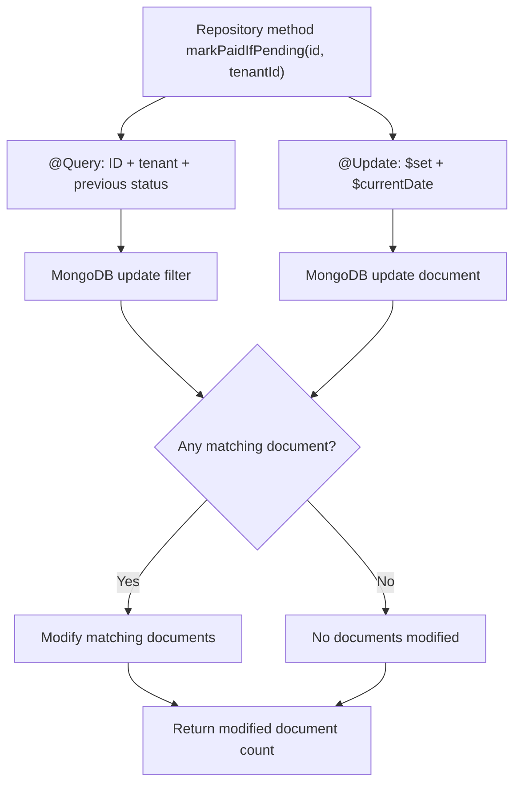
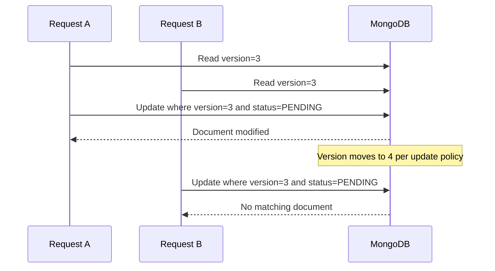

# Combining @Query with @Update for Custom Conditions

> **Chapter:** Repository Writes  
> **Module:** `SPRING_DATA_MONGODB` — connecting, mapping documents, and operating on MongoDB via repositories or `MongoTemplate`. This lesson guides you through writing **repository update methods** that use `@Query` to declare **custom filter conditions** and `@Update` to declare **update commands**. It also examines modified record counts, safety rules for multi-document updates, embedded arrays, concurrency control, indexes, transactions, reactive access, and testing.

## 1. Why combine both annotations?

With Spring Data MongoDB repositories, many read operations only need a method name:

```java
List<Order> findByStatus(String status);
```

However, conditional updates often require more than a simple assignment:

- Only process orders **belonging to the logged-in tenant**.
- Only change status when the order **is currently `PENDING`** and not soft-deleted.
- Record the processing timestamp or increment a counter using **MongoDB update operators**, instead of loading the document, mutating it, and calling `save`.
- Return the **number of modified documents** to decide whether to emit a business event.

Spring Data MongoDB supports combined repository methods:

```java
@Query("{ '_id': ?0, 'tenantId': ?1, 'status': 'PENDING', 'deleted': false }")
@Update("{ '$set': { 'status': 'PAID' }, '$currentDate': { 'paidAt': true } }")
long markPaidIfPending(String orderId, String tenantId);
```

In this method:

| Component | Role | Example data |
| --- | --- | --- |
| `@Query` | Defines the **filter**: which documents are allowed to be updated | `_id`, `tenantId`, `status=PENDING`, and `deleted=false` |
| `@Update` | Defines the **update document**: which fields change using which operators | `$set status=PAID` and `$currentDate paidAt` |
| `?0`, `?1` | Binds method parameters sequentially by 0-based index | `orderId`, `tenantId` |
| `long` | Number of documents modified per repository update semantics | Used to know whether an actual change succeeded |

The key point is that **the condition must live inside the write command itself**, not merely be checked in a preceding read. If the status changes between two requests, the `status=PENDING` filter prevents the late update from overwriting the new state.



**Distinction:** `@Query` is not "read first then update". It is the **selector** passed into the write operation. Nor is `@Update` equivalent to `MongoRepository.save(entity)`; operator-based updates do not require mapping the entire document into an entity prior to modification.

## 2. Domain model and BSON for the examples

Suppose a multi-tenant enterprise order management platform. Each order has a business ID, tenant, status, soft-delete flag, attempt counter, and payment timestamp.

```java
package demo.orders;

import java.time.Instant;
import org.springframework.data.annotation.Id;
import org.springframework.data.mongodb.core.mapping.Document;
import org.springframework.data.mongodb.core.mapping.Field;

@Document(collection = "orders")
public record Order(
    @Id String id,
    String tenantId,
    @Field("customer_code") String customerCode,
    String status,
    boolean deleted,
    long attempts,
    Instant paidAt
) {}
```

A MongoDB document might look like:

```json
{
  "_id": "ORD-001",
  "tenantId": "TENANT-A",
  "customer_code": "CUS-42",
  "status": "PENDING",
  "deleted": false,
  "attempts": 0
}
```

`paidAt` is absent because the order has not been paid yet. In Java, the `Order` record's `paidAt` component can map to `null` when the BSON field is missing.

**Three naming layers to distinguish:**

1. Java properties: `id`, `customerCode`.
2. BSON fields: `_id`, `customer_code` via `@Id` and `@Field`.
3. Repository method name: `markPaidIfPending`, which does not need to encode the full filter when `@Query` is declared.

Spring Data has mapping metadata for queries and updates, yet in the declared JSON examples we use **explicit target BSON names** for straightforward verification in `mongosh` and the Java Driver.

### 2.1. Repository with both annotations

Note the two annotations in the repository package:

```java
import org.springframework.data.mongodb.repository.Query;
import org.springframework.data.mongodb.repository.Update;
import org.springframework.data.mongodb.repository.MongoRepository;
```

Do not confuse `org.springframework.data.mongodb.repository.Update` (annotation) with **`org.springframework.data.mongodb.core.query.Update`** (`MongoTemplate` builder).

```java
package demo.orders;

import org.springframework.data.mongodb.repository.MongoRepository;
import org.springframework.data.mongodb.repository.Query;
import org.springframework.data.mongodb.repository.Update;

public interface OrderRepository extends MongoRepository<Order, String> {

    @Query("{ '_id': ?0, 'tenantId': ?1, " +
           "'status': 'PENDING', 'deleted': false }")
    @Update("{ '$set': { 'status': 'PAID' }, " +
            "'$currentDate': { 'paidAt': true } }")
    long markPaidIfPending(String orderId, String tenantId);

    @Query("{ 'tenantId': ?0, 'status': 'PENDING', 'deleted': false }")
    @Update("{ '$inc': { 'attempts': ?1 } }")
    long increaseAttemptsForPending(String tenantId, long increment);

    @Query("{ 'tenantId': ?0, 'customer_code': ?1, 'deleted': false }")
    @Update("{ '$set': { 'status': ?2 } }")
    long setStatusForCustomer(
        String tenantId, String customerCode, String status
    );
}
```

The three methods express three distinct intents:

- `markPaidIfPending`: updates **a specific ID** if it is still in the old state.
- `increaseAttemptsForPending`: applies `$inc` to **all matching orders** of the tenant.
- `setStatusForCustomer`: sets the status by tenant + customer code; **may modify multiple orders**.

**Do not copy the third method into production business logic without checking permissions and scope:** if a customer has multiple orders, the method will modify multiple documents. `@Update` on a repository does not default to `updateFirst`.

## 3. @Query is the selector, @Update is the update document

### 3.1. Two parts forming one MongoDB update

With the call:

```java
long changed =
    orderRepository.markPaidIfPending("ORD-001", "TENANT-A");
```

The equivalent MongoDB filter and modification semantics:

```javascript
db.orders.updateMany(
  {
    _id: "ORD-001",
    tenantId: "TENANT-A",
    status: "PENDING",
    deleted: false
  },
  {
    $set: { status: "PAID" },
    $currentDate: { paidAt: true }
  }
);
```

In repository update methods, Spring Data MongoDB targets **all documents matching the filter** (multi-document update); here the unique `_id` selector limits the practical scope to at most **one** document. Do not assume the Java call matches every wire protocol field of a specific driver version, but **filter scope semantics** must hold.

Once `ORD-001` has transitioned to `PAID`, calling the method again with the same ID/tenant will not match `status=PENDING` and will not modify it further.

### 3.2. What if there is only @Update?

Spring Data MongoDB also allows query derivation from the method name:

```java
@Update("{ '$inc': { 'attempts': 1 } }")
long findAndIncrementAttemptsByStatus(String status);
```

Without `@Query`, the parts around `By` in the method name are used to derive the filter under derived query rules. In this example, `Status` maps to the `status` property and the update increments `attempts`.

However, if business rules require tenant, soft delete, status preconditions, timestamps, or complex `$elemMatch` logic, the method name becomes hard to read and error-prone. In those cases, **declaring the filter explicitly with `@Query`** is much clearer.

### 3.3. With @Query, does the method name still have to start with findBy?

A method with a declared `@Query` can usually carry a name describing the **business action**, such as `markPaidIfPending` or `increaseAttemptsForPending`. The filter is taken from the JSON filter, independent of whether the parser could derive the whole method name.

This does **not** excuse vague naming or skipping tests. When a reader inspects only the interface, the method name should reflect effect and scope: `markPaidIfPending` is safer than `doUpdate`, and `increaseAttemptsForPending` makes it clear the update can affect multiple documents.

### 3.4. Do not split into two separate statements

Risky pattern:

```java
// ANTI-PATTERN: check then write separately, causing a time-of-check/time-of-use race.
boolean pending = orderRepository.existsById("ORD-001");
if (pending) {
    // If status or tenant changes after existsById,
    // a write by ID alone will no longer protect the original condition.
}
```

When the condition to enforce is `status=PENDING`, **place it directly inside the update filter** so MongoDB evaluates it at write time rather than relying on previously read data.

## 4. Parameter binding: how are ?0, ?1, ?2 resolved?

Both annotations reference the **same method parameter list** using **0-based** indices:

```java
@Query("{ 'tenantId': ?0, 'customer_code': ?1, 'deleted': false }")
@Update("{ '$set': { 'status': ?2 } }")
long setStatusForCustomer(
    String tenantId,      // ?0
    String customerCode,  // ?1
    String status         // ?2
);
```

In Java, the parameter comments are purely illustrative. Parameter `?2` can appear **only in `@Update`** without appearing in `@Query`; there is no requirement that every parameter appear in both annotations.

### 4.1. Do not place placeholders ambiguously inside string literals

```java
// Use placeholders as values; Spring Data/driver binds the proper type.
@Update("{ '$set': { 'status': ?2 } }")
```

Do not build query JSON by concatenating `tenantId`, `status`, or input strings into annotations (annotations must also be compile-time constants), and do not construct raw query strings from input at runtime without reliable parameter binding.

```java
// ANTI-PATTERN for building dynamic raw JSON in a service:
String unsafe = "{ 'tenantId': '" + userInput + "' }";
```

In repository annotations, placeholders let the framework handle escaping and type conversion of values; this **does not replace** extracting the tenant from an authenticated principal, checking authorization, and validating status values.

### 4.2. Date/time and specialized data types

If a method requires a timestamp threshold:

```java
@Query("{ 'tenantId': ?0, 'createdAt': { '$lt': ?1 }, 'deleted': false }")
@Update("{ '$set': { 'status': 'EXPIRED' } }")
long expireOlderThan(String tenantId, java.time.Instant cutoff);
```

`Instant` must map to a BSON Date matching the schema. When using `BigDecimal`/Decimal128, `UUID`, or custom converters, verify the actual BSON type to avoid type mismatches in queries. **Spring Data does not automatically convert every date-like or number-like String into the right BSON type** if legacy data was stored improperly.

### 4.3. Caution with client-supplied operator values

If passing an `increment` number to `$inc`:

```java
@Query("{ 'tenantId': ?0, 'status': 'PENDING' }")
@Update("{ '$inc': { 'attempts': ?1 } }")
long increaseAttemptsForPending(String tenantId, long increment);
```

The service should block negative, overly large, or out-of-bounds values (if only increments are allowed). Placeholders make input safe for query syntax, **not necessarily valid for business rules**.

## 5. Conditional update for a single document: state-based compare-and-set

### 5.1. Goal: single state transition

Suppose business logic wants to transition an order `PENDING → PAID` and disallow re-transitioning if the order is already `CANCELLED` or `PAID`. Use a filter containing all preconditions:

```java
@Query("{ '_id': ?0, 'tenantId': ?1, " +
       "'status': 'PENDING', 'deleted': false }")
@Update("{ '$set': { 'status': 'PAID' }, " +
        "'$currentDate': { 'paidAt': true } }")
long markPaidIfPending(String orderId, String tenantId);
```

With a unique ID, if the first attempt succeeds:

```text
Before: _id=ORD-001, tenantId=TENANT-A, status=PENDING
After:  _id=ORD-001, tenantId=TENANT-A, status=PAID, paidAt=BSON Date
Modified document count: 1
```

Second attempt:

```text
Filter requires status=PENDING, but document now has status=PAID.
Modified document count: 0
```

**A return value of 0 cannot distinguish the cause.** It may mean the ID does not exist, wrong tenant, soft-deleted, or status is no longer `PENDING`. For an API, do not automatically treat `changed=0` as `404 Not Found`.

### 5.2. How to separate 404 and 409 errors?

If the API contract requires distinguishing:

- `404`: ID does not exist or does not belong to the current tenant;
- `409`: order exists but cannot transition state;
- `200/204`: transition succeeded or already reached target state under idempotency rules;

then after the update returns 0, the service can re-read **within the exact tenant/permission scope** to classify the error. That extra read can still encounter races; define concurrency semantics and what information is safe to expose.

Do not query without tenant filtering to "check if the ID exists anywhere" in a multi-tenant application. Doing so can leak the existence of another customer's resource.

### 5.3. Atomicity: one document, not the whole workflow

MongoDB guarantees updates are **atomic at the single-document level**. The status filter and the `$set` mutation are evaluated together in a single update operation on that document.

However, transitioning status and sending an email or HTTP event are **two separate actions**. If the app emits an event and the update fails, or the update succeeds and emitting the event fails, the workflow becomes inconsistent. When reliable event delivery is required, consider a **transactional outbox**, event IDs/idempotency, and retry workflows rather than relying solely on the repository update return value.

## 6. Multi-document updates: when the filter is broad

Under repository update method semantics, an annotated update applies to **every matching document**. Never assume a command modifies only one document just because the method name contains `find` or because the return type is `long`.

```java
@Query("{ 'tenantId': ?0, 'status': 'PENDING', 'deleted': false }")
@Update("{ '$inc': { 'attempts': ?1 } }")
long increaseAttemptsForPending(String tenantId, long increment);
```

Suppose tenant A has three `PENDING` orders:

```javascript
{ _id: "A-1", tenantId: "TENANT-A", status: "PENDING", deleted: false, attempts: 1 }
{ _id: "A-2", tenantId: "TENANT-A", status: "PENDING", deleted: false, attempts: 2 }
{ _id: "A-3", tenantId: "TENANT-A", status: "PENDING", deleted: false, attempts: 0 }
```

Call:

```java
long changed =
    orderRepository.increaseAttemptsForPending("TENANT-A", 1L);
```

All three orders have `attempts` incremented by one if the filter matches and the command succeeds; the return count is typically **3**. If another order belongs to tenant B, it is **not** modified because of the `tenantId` condition.

### 6.1. Multiple documents do not make a transaction

A multi-document update command is not automatically atomic **across the entire set of documents**. MongoDB applies atomicity per document; for concurrent writes or mid-operation errors, understand partial success behavior per server/write concern. If business rules demand all-or-nothing commit or rollback, use a transaction on a supported topology with its corresponding overhead.

### 6.2. Guarding against accidentally updating the whole collection

For bulk update commands, include:

1. **Tenant ID, owner ID, or shard key** matching the permission scope.
2. Status conditions and soft-delete flags as required by business logic.
3. Parameter domain bounds: e.g., `increment > 0` and an allowed maximum.
4. Unique ID if you genuinely intend to modify **one** document.
5. Integration tests containing documents from other tenants and excluded records.
6. Logging/metrics of modified document counts without logging sensitive data.

Do not mistake `@Query("{}")` for a harmless "no filter": paired with `@Update`, an empty filter can update a huge portion or all of a collection.

## 7. Return value: modified count, not the new entity

Repository update methods typically support **`void` or a numeric type** (such as `long`/`int`) indicating the updated document count per the API and Spring Data MongoDB version in use.

```java
@Query("{ 'tenantId': ?0, 'status': 'PENDING' }")
@Update("{ '$set': { 'status': 'EXPIRED' } }")
long expirePending(String tenantId);

@Query("{ '_id': ?0, 'tenantId': ?1 }")
@Update("{ '$set': { 'deleted': true } }")
void softDeleteWithoutCount(String orderId, String tenantId);
```

Do not define an annotated update method and expect it to return the updated entity:

```java
// ANTI-PATTERN: do not expect an entity return like findAndModify.
@Query("{ '_id': ?0 }")
@Update("{ '$set': { 'status': 'PAID' } }")
Order updateAndReturnOrder(String id);
```

**If you need the document before or after modification**, use `MongoTemplate.findAndModify(…)` with `FindAndModifyOptions.returnNew(true)` or an equivalent API, rather than forcing a repository update method to return an entity.

### 7.1. Modified count differs from matchedCount

The Java Driver provides `UpdateResult`:

```java
result.wasAcknowledged();
result.getMatchedCount();
result.getModifiedCount();
result.getUpsertedId();
```

These are **separate pieces of information**:

- `matchedCount`: number of documents matching the filter.
- `modifiedCount`: number of documents actually changed.
- `upsertedId`: ID of the newly inserted document on upsert.
- `wasAcknowledged`: whether the operation was acknowledged under the write concern.

A repository update method returning a **number** usually provides only the **modified document count**; it does **not** hand you the full `UpdateResult`. If you need to distinguish "no matching document" from "matched but `$set` wrote the same value" as two distinct numbers, use `MongoTemplate.updateFirst`/`updateMulti` to receive `UpdateResult`.

**Verify the numeric return type and its semantics against your deployed Spring Data MongoDB version**; do not rely on an unacknowledged update to assert write results with certainty.

### 7.2. A no-op is not an error

```javascript
// Document already has status = PAID.
db.orders.updateOne(
  { _id: "ORD-001" },
  { $set: { status: "PAID" } }
);
```

This is a normal no-op: a document matched, yet its value did not change. When a method returns modified = 0, do not assume the resource does not exist.

If business logic needs **the number of matched documents** regardless of whether values changed, or needs insert/upsert counts, choose an explicit template or driver API. A repository update's return value is not a complete write report.

### 7.3. @Update is not @Delete or JPA's @Modifying

Do not blindly carry over Spring Data JPA `@Modifying` rules to MongoDB. MongoDB uses the `@Update` repository annotation for JSON/pipeline updates and `@Query` for filters; delete methods have their own APIs. Write concern mapping, result counts, and entity lifecycles differ from SQL/JPA.

## 8. Why not use save(entity) for every modification?

Repository `save(entity)` generally operates on the **entire entity** via Spring Data MongoDB's insert/save mechanism. If the application only wants to increment a counter, flip a flag, or conditionally transition a status, reading then saving can:

- Incur an extra data read round trip.
- Increase the risk of overwriting fields modified concurrently by another request if optimistic locking is absent.
- Materialize many unnecessary fields.
- Obscure server-side atomic mutations like `$inc`, `$set`, and `$addToSet`.

```java
// Read-modify-save approach requires concurrency consideration:
Order order = orderRepository.findById("ORD-001").orElseThrow();
// Build a new entity with attempts+1, then save.
```

Whereas:

```java
@Query("{ '_id': ?0, 'tenantId': ?1 }")
@Update("{ '$inc': { 'attempts': 1 } }")
long incrementAttempt(String orderId, String tenantId);
```

`$inc` increments on the server at the document level, ideal when you do not need to read all fields. **However, `$inc` is not idempotent** if a business request is retried; you need a retry policy or idempotency token if the increment should happen at most once per event.

Repository updates also come with **trade-offs**: they bypass the full `save` lifecycle, do not return the complete entity, and version/auditing rules require separate attention.

## 9. @Version, optimistic locking, and version preconditions

### 9.1. Do not assume @Update checks @Version like save

Suppose an entity:

```java
import org.springframework.data.annotation.Id;
import org.springframework.data.annotation.Version;
import org.springframework.data.mongodb.core.mapping.Document;

@Document(collection = "versioned_orders")
public record VersionedOrder(
    @Id String id,
    String tenantId,
    @Version Long version,
    String status
) {}
```

Repository `save` on a versioned entity has its own **optimistic locking** mechanism and can throw `OptimisticLockingFailureException` when the version no longer matches.

A `@Query` + `@Update` repository method should not be assumed to automatically carry all of those semantics. If you want to verify an old version, **include the expected version in the filter**:

```java
@Query("{ '_id': ?0, 'tenantId': ?1, 'version': ?2, 'status': 'PENDING' }")
@Update("{ '$set': { 'status': 'PAID' } }")
long markPaidAtVersion(
    String orderId, String tenantId, long expectedVersion
);
```

When another request has already modified the version or status, this filter will not match. However, you must also account for **how the version is incremented**.

### 9.2. Version rules and direct updates

For template update operations on versioned entities, Spring Data MongoDB supports **auto-incrementing `@Version` when the update definition does not mention the version field**, depending on the API and version. Still, **do not rely on that assumption without checking**:

- Does the query include the **expected version**?
- Does the update payload modify version manually?
- Does your Spring Data version auto-increment version for this type of repository update?
- Does re-reading the document show the version changed as expected?

If you need a clear cross-system compare-and-set rule, you can use `MongoTemplate` with a version-checked filter and an update incrementing version per an explicit contract. **Do not increment version twice** if the framework already handles it automatically; verify behavior on your target version.

### 9.3. Two competing requests



This is the goal of **conditional updates**. If the method only filters by `_id` without checking version/status, both requests can still write changes.

## 10. Common update operators in @Update

`@Update` declares an **update document** using MongoDB operator syntax. Commonly used operators:

| Operator | Meaning | Use case |
| --- | --- | --- |
| `$set` | Sets field values | Changing `status`, `deleted`, metadata |
| `$unset` | Removes fields from BSON | Dropping obsolete fields |
| `$inc` | Adds numeric values | Attempt counts, counters |
| `$currentDate` | Sets server-side current date/time | `paidAt`, `updatedAt` |
| `$addToSet` | Adds element if not already present | Tag lists |
| `$push` | Appends element to an array | Small, bounded logs |
| `$pull` | Removes array elements matching condition | Removing tags |
| `$setOnInsert` | Applies only when an **upsert inserts a new document** | Creation metadata; has no insert effect if upsert is not enabled |

Example adding a tag to a tenant-scoped document:

```java
@Query("{ '_id': ?0, 'tenantId': ?1, 'deleted': false }")
@Update("{ '$addToSet': { 'tags': ?2 } }")
long addTagIfMissing(String orderId, String tenantId, String tag);
```

When the tag is already present, `$addToSet` can be a **no-op** and modified count is 0 even though the document matched the filter. Conversely, `$push` can add duplicate elements and grow the array unboundedly over time.

### 10.1. $unset differs from $set:null

```java
// Completely removes the field from BSON:
@Update("{ '$unset': { 'paidAt': 1 } }")

// Keeps the field present but assigns BSON Null:
@Update("{ '$set': { 'paidAt': null } }")
```

These are two different representations; if you merely mean "unpaid", agree on a clear schema convention before writing `$exists`/`$type` filters.

### 10.2. @Update with aggregation pipelines

Some Spring Data MongoDB versions support the `pipeline` attribute on `@Update` to define updates using an **aggregation pipeline**, e.g. recomputing a field from its current value:

```java
@Query("{ '_id': ?0, 'tenantId': ?1 }")
@Update(pipeline = {
    "{ '$set': { 'attempts': { '$add': [ '$attempts', ?2 ] } } }"
})
long addAttemptsWithPipeline(
    String orderId, String tenantId, long increment
);
```

The example assumes `attempts` already exists and is a BSON number. If the field is missing or null, use `$ifNull` or an appropriate migration; pipelines do not automatically turn arbitrary legacy data into numbers.

**Do not haphazardly mix update operator documents and pipelines**. Pipelines use `$set` stages with aggregation expressions, whereas update documents use `$set` with assigned values. Pick syntax supported by your MongoDB/Spring Data versions and test against a real database.

## 11. Complex conditions: $and, $or, $in, and array $elemMatch

### 11.1. Matching multiple valid statuses

Suppose you only want to lock orders in `PENDING` or `REVIEW` status:

```java
@Query("{ 'tenantId': ?0, 'deleted': false, " +
       "'status': { '$in': ['PENDING', 'REVIEW'] } }")
@Update("{ '$set': { 'status': 'LOCKED' } }")
long lockPendingOrReview(String tenantId);
```

A `PAID` or `CANCELLED` document will not match. Because the filter **has no ID**, the method can update **multiple orders within the tenant**. That is intentional in this bulk example and must not be treated as a single-order operation.

### 11.2. Filtering embedded arrays on the same element

If an order contains `lines` and you want to flag orders that have a **line with SKU X and a minimum quantity**:

```java
@Query("{ 'tenantId': ?0, 'deleted': false, " +
       "'lines': { '$elemMatch': { 'sku': ?1, " +
       "'quantity': { '$gte': ?2 } } } }")
@Update("{ '$set': { 'requiresReview': true } }")
long flagOrdersContainingQualifiedLine(
    String tenantId, String sku, int minQuantity
);
```

`$elemMatch` requires `sku` and `quantity` **within the same element** of `lines`. Two separate dotted predicates can match across two different elements and cause false positives.

Note that `@Update` in this example only modifies the **root field `requiresReview`**, not elements inside `lines`. If the goal is to modify **all matching array elements**, you need positional operators `$`/`$[identifier]` and `arrayFilters`; `MongoTemplate` or the Java Driver usually expresses those options more cleanly and flexibly.

### 11.3. Querying by reference is not a join

If `customer` in `Order` is a `@DocumentReference` or `@DBRef`, the root BSON may contain only a reference/ID. Filtering by `'customer.name': ?0` **does not automatically join** to the `customers` collection. When filtering by fields in another document, consider schema design, two-step lookups, or `$lookup` aggregations—do not extend `@Query` assuming MongoDB will traverse related entities automatically.

## 12. What repository @Update **does not automatically handle**

### 12.1. Does not auto-upsert on no match

When `@Query` finds no matching document, a standard repository update method **does not automatically create a new document**. Do not add `$setOnInsert` to `@Update` assuming it turns the method into an upsert.

If you want **update or insert**, use `MongoTemplate.upsert(…)` to express the upsert flag explicitly:

```java
// Inside a service using MongoTemplate, not the @Update annotation:
org.springframework.data.mongodb.core.query.Query query =
    org.springframework.data.mongodb.core.query.Query.query(
        org.springframework.data.mongodb.core.query.Criteria
            .where("id").is("ORD-NEW-001")
    );

org.springframework.data.mongodb.core.query.Update update =
    new org.springframework.data.mongodb.core.query.Update()
        .set("status", "PENDING")
        .setOnInsert("attempts", 0L);

com.mongodb.client.result.UpdateResult result =
    mongoTemplate.upsert(query, update, Order.class);
```

The snippet intentionally uses **fully qualified class names** to distinguish `core.query.Update` (builder) from `repository.Update` (annotation). If the operation inserts a new document, `result.getUpsertedId()` will contain the BSON ID of the upserted document; do not infer an insert solely from `getModifiedCount()`.

### 12.2. Does not return the updated document

If you need to modify and return the modified entity, use `MongoTemplate.findAndModify`:

```java
import org.springframework.data.mongodb.core.FindAndModifyOptions;

Order updated = mongoTemplate.findAndModify(
    query,
    new org.springframework.data.mongodb.core.query.Update()
        .set("status", "PAID"),
    FindAndModifyOptions.options().returnNew(true),
    Order.class
);
```

Here `query` should be a selector matching business requirements (ID, tenant, old status...). `findAndModify` supports before/after options, upsert, and sort per the API; do not assume `returnNew(true)` forces an entity return when the filter matches nothing.

### 12.3. Lifecycle callbacks and auditing

Repository update methods do not go through the same entity **load–mutate–save cycle**. Persistence/lifecycle events and entity callbacks tied to `save` generally **do not run like `save(entity)`** for each document updated via operators.

If the system relies on `@LastModifiedDate`, `@CreatedBy`, validation callbacks, or save-time business events:

- Add updated fields **explicitly** to the update payload (e.g., `$currentDate updatedAt`, authenticated actor ID).
- Enforce business validation in the service and/or via MongoDB schema validation.
- Do not assume audit callbacks will automatically populate metadata on every update.
- Add integration tests verifying the exact data written.

**Note:** `$currentDate` uses the MongoDB server's clock. If the domain requires time from another clock or a request trace ID, decide the data source explicitly.

### 12.4. Does not automatically provide multi-document transactions

A repository update method can modify multiple documents but does not automatically provide atomicity across **the whole set**. If updates across multiple collections must form a single transaction, use a MongoDB transaction on a supported topology, configure `MongoTransactionManager`, and execute it in the service. Avoid long-running transactions for jobs updating millions of documents due to operational overhead.

## 13. When should you switch to MongoTemplate?

| Need | Repository `@Query` + `@Update` | `MongoTemplate`/driver |
| --- | --- | --- |
| Static JSON filter + simple operator update | **Suitable** | Also possible |
| Filter with fixed tenant/status | **Suitable** | Also possible |
| Many optional user-selected conditions | Quickly becomes unwieldy methods/JSON | **Use dynamic `Criteria`** |
| Explicit `updateFirst` instead of multi-update | Not suitable for first-only selection via typical API | **`updateFirst`** |
| Upsert needed | Not the default option | **`upsert`** |
| Need `matchedCount`, `modifiedCount`, `upsertedId` | Numeric return is insufficient | **`UpdateResult`** |
| Need document before/after update | Does not directly return entity | **`findAndModify`** |
| Dynamic array filters `$[id]` | Hard to express or limited by version | **`Update.filterArray`** |
| Mixed bulk write operations | Not convenient | **`BulkOperations`** |
| Fixed aggregation update pipeline | Can use `@Update(pipeline=...)` depending on version | Template/driver is more flexible |
| Multi-operation transaction | Wrap in service transaction if supported | Coordinate with transaction manager |

### 13.1. MongoTemplate.updateFirst example with UpdateResult

```java
import com.mongodb.client.result.UpdateResult;
import org.springframework.data.mongodb.core.query.Criteria;
import org.springframework.data.mongodb.core.query.Query;
// Use fully qualified name for Update builder to avoid annotation confusion.

Query filter = Query.query(
    Criteria.where("id").is("ORD-001")
        .and("tenantId").is("TENANT-A")
        .and("status").is("PENDING")
        .and("deleted").is(false)
);

UpdateResult result = mongoTemplate.updateFirst(
    filter,
    new org.springframework.data.mongodb.core.query.Update()
        .set("status", "PAID")
        .currentDate("paidAt"),
    Order.class
);

if (!result.wasAcknowledged()) {
    throw new IllegalStateException("Write not acknowledged");
}

long matched = result.getMatchedCount();
long modified = result.getModifiedCount();
```

This example explicitly updates **only the first document** matching the filter; because `id` is unique, the scope is effectively single-document in business terms. If `matched=1, modified=0`, it could be a no-op; if `matched=0`, the filter did not match. A repository numeric return usually cannot distinguish these two situations in this way.

## 14. Concurrent writes, write concern, and retries

### 14.1. Acknowledged does not mean majority durable

When calling a repository update, a numeric return value is only meaningful if the operation succeeded under the configured **write concern**. Both `w:1` and `majority` can be acknowledged while offering different replication and durability guarantees.

The repository numeric return **does not tell you** which write concern was configured. For sensitive updates (payments, inventory, balances), design appropriate write concern, idempotency, and exception handling.

### 14.2. Errors do not always return 0

Conditions such as duplicate key, validation error, write concern timeout, network interruption, or server selection failure can cause the method to **throw an exception** rather than return a numeric count.

When a connection drops after sending an update, the client may not know for sure whether the server applied the change. Do not use "an error means it wasn't updated, just resend" logic across all operators.

### 14.3. $set and $inc differ in idempotency

```java
@Update("{ '$set': { 'deleted': true } }")
// Setting the same value can be a no-op on subsequent calls.

@Update("{ '$inc': { 'attempts': 1 } }")
// Each successful execution can increment by 1 again.
```

With `$inc`, if a request is re-sent due to API-layer retries, the counter can increment multiple times. The driver has retryable writes for certain cases, but that does not replace **business-level idempotency** when the same event is submitted as a fresh request.

### 14.4. Do not treat @Query as automatic authorization

`@Query("{'tenantId':?0}")` is only secure if `tenantId` comes from a **trusted authentication context**, not an arbitrary client-spoofed value.

If the tenant ID is taken straight from a request body without authorization checks, the method can still modify another tenant's data. Always obtain the tenant from the security principal/context and check domain authorization in the service before calling the repository.

## 15. Indexes and update filter performance

`@Query` executes as a MongoDB selector; correct conditions are not enough if the filter has to scan a huge collection.

### 15.1. Updating by ID

For `markPaidIfPending`, filtering by `_id` and tenant:

```javascript
{ _id: "ORD-001", tenantId: "TENANT-A",
  status: "PENDING", deleted: false }
```

MongoDB already has a unique index on `_id`. Finding one document by `_id` is typically highly selective; you do not necessarily need a compound index just for this method.

### 15.2. Bulk updates by tenant and status

For `increaseAttemptsForPending`, filter:

```javascript
{ tenantId: "TENANT-A", status: "PENDING", deleted: false }
```

Candidate index:

```javascript
db.orders.createIndex({
  tenantId: 1,
  status: 1,
  deleted: 1
});
```

To evaluate the **document lookup** portion, you can inspect the query plan of the equivalent filter:

```javascript
db.orders.find({
  tenantId: "TENANT-A",
  status: "PENDING",
  deleted: false
}).explain("executionStats");
```

Examine `winningPlan`, `totalDocsExamined`, `totalKeysExamined`, and data distribution. **Explain on `find` does not measure the full write cost** of an update—such as updating index entries, journaling, replication, and lock contention; observe real write latency and throughput.

### 15.3. Multi-document updates can generate heavy load

A filter `status=PENDING` on a large tenant can modify hundreds of thousands of documents. If the update also modifies indexed fields or `$inc`s heavily contended fields, I/O and replication costs can be substantial.

For migrations/backfills, consider:

- Splitting into conditional chunks with checkpoints.
- Limiting concurrent jobs/workers.
- Monitoring write concern errors, replica lag, and connection pools.
- Preserving tenant filters and desired preconditions on retries.
- Recognizing that each chunk's `modifiedCount` is just a document count, not overall durability or global consistency.

## 16. Reactive repositories with @Query and @Update

Spring Data MongoDB supports reactive programming via `ReactiveMongoRepository` and `ReactiveMongoTemplate`. In versions supporting **reactive repository update methods**, the mental model for filters and updates does not change; only the return type and execution timing differ.

```java
import org.springframework.data.mongodb.repository.Query;
import org.springframework.data.mongodb.repository.Update;
import org.springframework.data.mongodb.repository.ReactiveMongoRepository;
import reactor.core.publisher.Mono;

public interface ReactiveOrderRepository
        extends ReactiveMongoRepository<Order, String> {

    @Query("{ '_id': ?0, 'tenantId': ?1, 'status': 'PENDING' }")
    @Update("{ '$set': { 'status': 'PAID' } }")
    Mono<Long> markPaidIfPending(String orderId, String tenantId);
}
```

In a service:

```java
Mono<Boolean> changed = reactiveOrderRepository
    .markPaidIfPending("ORD-001", "TENANT-A")
    .map(count -> count == 1L);
```

**Version note:** supported return types and reactive repository update details can vary across Spring Data generations. Check documentation for your exact dependencies and write real integration tests. If your version does not support annotated reactive updates with numeric publishers as above, switch to `ReactiveMongoTemplate.updateFirst(…)` or `updateMulti(…)` to obtain `Mono<UpdateResult>`.

Do not call `block()` on an event loop just to read the count. Do not blindly `retry(3)` with `$inc` without idempotency. Reactive does not magically provide transactions, make query indexes faster, or alter `$elemMatch` semantics.

## 17. Integration testing: proving the right filter and right scope

### 17.1. "The method ran without errors" is not enough

A good test must include **documents that should be modified** and **documents that must not be modified**. Seed at least these records:

| ID | tenant | status | deleted | attempts | Expected when markPaidIfPending("ORD-A", "TENANT-A") |
| --- | --- | --- | :---: | ---: | --- |
| `ORD-A` | TENANT-A | PENDING | false | 0 | Transitions to PAID, has paidAt. |
| `ORD-B` | TENANT-A | PENDING | true | 0 | Not modified. |
| `ORD-C` | TENANT-B | PENDING | false | 0 | Not modified (different tenant). |
| `ORD-D` | TENANT-A | CANCELLED | false | 0 | Not modified (wrong status). |
| `ORD-E` | TENANT-A | PENDING | false | 2 | Only modified when calling bulk increment for matching tenant. |

### 17.2. Test template against real MongoDB

Spring Boot 3.x example using `@DataMongoTest` and JUnit 5 (check annotation packages for other Boot versions). MongoDB must be provided by Testcontainers or a **test-dedicated** server/database; the slice test does not start a server by itself:

```java
package demo.orders;

import static org.assertj.core.api.Assertions.assertThat;

import java.util.List;
import org.bson.Document;
import org.junit.jupiter.api.BeforeEach;
import org.junit.jupiter.api.Test;
import org.springframework.beans.factory.annotation.Autowired;
import org.springframework.boot.test.autoconfigure.data.mongo.DataMongoTest;
import org.springframework.data.mongodb.core.MongoTemplate;

@DataMongoTest
class OrderRepositoryUpdateTest {

    @Autowired OrderRepository repository;
    @Autowired MongoTemplate mongoTemplate;

    @BeforeEach
    void seed() {
        // ONLY on an isolated TEST DATABASE collection.
        mongoTemplate.getCollection("orders").deleteMany(new Document());
        mongoTemplate.getCollection("orders").insertMany(List.of(
            order("ORD-A", "TENANT-A", "PENDING", false, 0),
            order("ORD-B", "TENANT-A", "PENDING", true, 0),
            order("ORD-C", "TENANT-B", "PENDING", false, 0),
            order("ORD-D", "TENANT-A", "CANCELLED", false, 0),
            order("ORD-E", "TENANT-A", "PENDING", false, 2)
        ));
    }

    private Document order(String id, String tenant, String status,
                           boolean deleted, int attempts) {
        return new Document("_id", id)
            .append("tenantId", tenant)
            .append("status", status)
            .append("deleted", deleted)
            .append("attempts", attempts);
    }

    @Test
    void paidOnlyWhenSameTenantAndPending() {
        long first = repository.markPaidIfPending("ORD-A", "TENANT-A");
        long second = repository.markPaidIfPending("ORD-A", "TENANT-A");
        long wrongTenant = repository.markPaidIfPending("ORD-C", "TENANT-A");

        assertThat(first).isEqualTo(1L);
        assertThat(second).isZero();
        assertThat(wrongTenant).isZero();

        Document updated = mongoTemplate.getCollection("orders")
            .find(new Document("_id", "ORD-A")).first();
        assertThat(updated).isNotNull();
        assertThat(updated.getString("status")).isEqualTo("PAID");
        assertThat(updated.getDate("paidAt")).isNotNull();
    }

    @Test
    void incrementMatchesAllPendingButNotDeleted() {
        long modified = repository.increaseAttemptsForPending(
            "TENANT-A", 1L
        );

        // ORD-A and ORD-E; ORD-B deleted=true, ORD-D CANCELLED.
        assertThat(modified).isEqualTo(2L);

        Document a = mongoTemplate.getCollection("orders")
            .find(new Document("_id", "ORD-A")).first();
        Document e = mongoTemplate.getCollection("orders")
            .find(new Document("_id", "ORD-E")).first();
        Document b = mongoTemplate.getCollection("orders")
            .find(new Document("_id", "ORD-B")).first();
        Document c = mongoTemplate.getCollection("orders")
            .find(new Document("_id", "ORD-C")).first();

        assertThat(((Number) a.get("attempts")).longValue()).isEqualTo(1L);
        assertThat(((Number) e.get("attempts")).longValue()).isEqualTo(3L);
        assertThat(((Number) b.get("attempts")).longValue()).isZero();
        assertThat(((Number) c.get("attempts")).longValue()).isZero();
    }
}
```

In the Java Driver, `$inc` with a `long` `?1` parameter may preserve or widen the field's BSON type depending on operand types and existing data. Hence, the test compares **numeric values** via `((Number) raw.get("attempts")).longValue()` instead of hard-casting to `Integer` or `Long`. If the app requires a specific BSON numeric type, add a dedicated assertion on raw BSON type. Assertions should not depend on default order when queries lack sorting.

### 17.3. Test case coverage checklist

| Test | Expected verification |
| --- | --- |
| Valid ID, valid tenant, status=PENDING | Modified; target field receives new value. |
| Second invocation | Old status filter no longer matches, modified count = 0. |
| Valid ID, wrong tenant | Not modified; other tenant's data not leaked. |
| Soft-deleted document | Not modified when filter includes `deleted=false`. |
| Multi-record bulk update | Exact modified count; other tenants untouched. |
| `$set` with identical value | Recognizes no-op via modified count. |
| `$inc` with negative/0 increment | Service validation and execution match policy. |
| Field alias `customer_code` | Selector uses the actual BSON field name. |
| `$elemMatch` on array | Conditions apply to the same element, no false positives. |
| Version/stale update | Version-filtered command does not overwrite newer data. |
| Exception/timeout | Do not treat errors as count=0; log/alert properly. |
| Reactive | Returns count via publisher without blocking. |

### 17.4. Diagnosing queries sent to MongoDB

In test environments, enable appropriate logging or command monitoring to inspect the actual **selector** and **update document** (without logging sensitive data). Beyond Java results, read raw `Document`s after writes to confirm field aliases, BSON types, and state.

For bulk selectors, use `find(...).explain("executionStats")` to evaluate indexes before scaling dataset size. Never run an unbounded bulk update in production just to "benchmark performance".

## 18. Common pitfalls

| Symptom | Likely cause | Resolution |
| --- | --- | --- |
| Method modifies multiple orders instead of one | `@Update` applies to all matching documents; filter lacks a unique ID. | Add unique ID or use `MongoTemplate.updateFirst` as needed. |
| Method returns 0 even though order exists | Old status, tenant, or deleted flag mismatched, or update was a no-op. | Check filter and actual data; use `UpdateResult` to distinguish matched vs. modified. |
| `@Query` uses wrong field name | Java property has `@Field("customer_code")` but BSON query used another name. | Check raw BSON and entity mapping. |
| `findBy...` method name mistaken for SELECT | Has `@Update`, so it executes an update and does not return documents. | Use clear action names and test write effects. |
| Method looks like `updateFirst` but modifies many documents | Repository update methods do not auto-limit to one document. | Filter by unique ID or switch to template. |
| `updatedAt`/audit metadata missing after write | Repository update bypasses save lifecycle callbacks. | Set audit fields in update payload, test against real DB. |
| Upsert does not insert new document | `@Update` does not auto-enable upsert. | Use `MongoTemplate.upsert` with condition/unique index. |
| Declaring method to return new `Order` fails | Repository update is not `findAndModify`. | Use numeric/void return or template `findAndModify`. |
| Race when two requests update concurrently | Filter only checks ID, missing expected status/version. | Put compare-and-set in `@Query`. |
| `$inc` increments twice on retry | Update is not idempotent when business request is resent. | Use idempotency key, version, or event ledger. |
| `@Query` with `lines.sku` and `lines.quantity` filters wrongly | Two conditions can match two different elements. | Use `$elemMatch`. |
| Slow MongoDB update | Broad filter, missing index, large bulk scope, or write contention. | Inspect `find` explain and write metrics, chunk if needed. |
| `@Update` annotation fails to compile | Wrongly imported `core.query.Update` builder. | Import `repository.Update` for the annotation. |
| Transaction returns count but commit fails | Operation count does not prove the transaction committed. | Check commit/exceptions and transaction retry policy. |

**Debugging workflow:** (1) read method name and both annotations; (2) separate `@Query` filter from `@Update` payload; (3) check `?0`/`?1`/… ordering; (4) verify BSON fields, tenant, and status; (5) read count and identify no-ops; (6) inspect raw document; (7) check exceptions/write concern; (8) inspect indexes/query plans if slow.

## 19. Hands-on exercise: protecting order status updates

**Context:** a multi-tenant order system needs to mark orders paid, increment retry attempts, lock old orders, and set a review flag based on specific line items.

1. Create an `Order` entity with `id`, `tenantId`, `customerCode`, `status`, `deleted`, `attempts`, and `paidAt`. Map `customerCode` to `customer_code`.
2. Create `OrderRepository` with `@Query` + `@Update` for `markPaidIfPending`. The filter must include `_id`, tenant, `PENDING` status, and `deleted=false`.
3. Seed valid orders along with wrong-tenant, wrong-status, and deleted orders. Verify **only qualifying orders are modified**.
4. Call `markPaidIfPending` twice. Explain why the first call returns 1 and the second returns 0.
5. Write `increaseAttemptsForPending`, passing increment via `?1`. Test updating multiple documents without altering other tenants.
6. Try `$set` with the current value and compare with `$inc`; explain modified count and idempotency.
7. Write an array filter on `lines` using `$elemMatch`, updating a root flag. Demonstrate how two dotted paths can produce false positives.
8. Need to upsert a nonexistent ID: do **not** try turning the repository method into an upsert; write a service using `MongoTemplate.upsert` and inspect `upsertedId`.
9. Need to return the post-update document: use `MongoTemplate.findAndModify` with `returnNew(true)` and compare with the repository's numeric return.
10. Add `@Version` to the entity and write a filter with the old version. Test two requests using the same expected version; verify actual version increment behavior.
11. Create an index for the bulk query `tenantId + status + deleted` and run `explain` to inspect the query plan.
12. Try the reactive version and design retry/idempotency; do not block the event loop with `block()`.
13. Write integration tests with distinct datasets and verify raw BSON after modification.

### Self-check questions

- Which part of a MongoDB update command does `@Query` determine?
- Which part does `@Update` determine? Does it fetch the document and call `save`?
- Why do both annotations share the same `?0`, `?1` placeholder indices?
- When the filter has no unique ID, how many documents can a repository update modify?
- Why is a method returning `long` not equivalent to receiving the full `UpdateResult`?
- Does a modified count of 0 prove an ID does not exist?
- Why must the tenant condition come from an authenticated context?
- When should you choose `MongoTemplate.updateFirst`, `upsert`, or `findAndModify`?
- Do repository updates automatically trigger auditing callbacks like `save`?
- How do the expected version filter and `@Version` incrementing relate?
- Why is `$inc` prone to drift when a business request is retried?
- When updating multiple documents, does MongoDB automatically create a transaction across the entire set?
- Why is `$elemMatch` necessary if an order has multiple embedded lines?

## 20. Key takeaways and references

- **`@Query` is the selector**, determining which documents are updated; **`@Update` is the payload**, determining the operators and modified values.
- Both annotations share **the same method parameters** via `?0`, `?1`… placeholders; bind values rather than concatenating raw JSON.
- Repository update methods typically update **all matching documents**; if you only want one, filter by unique ID or use `MongoTemplate.updateFirst`.
- **Numeric return** fits when you only need modified counts; when you need separate matched/modified/upsertedId values, use `MongoTemplate` with `UpdateResult`.
- **Do not assume upsert, entity readback, lifecycle callbacks, or transactions** merely because `@Update` is used.
- **Filters with tenant, status, and expected version** prevent accidental updates, though they do not replace service-layer authorization checks.
- `$set` with the same value can no-op; `$inc` is not idempotent across retried business requests. Design retries and idempotency accordingly.
- For embedded arrays, use `$elemMatch` to enforce conditions on the same element. To modify array elements, design separate positional updates/`arrayFilters`.
- Use **integration tests with distinct data**, verifying BSON, counts, errors, and query plans before shipping update methods to production.

Official documentation to consult for your application's version:

- [Spring Data MongoDB — Repository Query Methods](https://docs.spring.io/spring-data/mongodb/reference/mongodb/repositories/query-methods.html)
- [Spring Data MongoDB — Repository @Update annotation API](https://docs.spring.io/spring-data/mongodb/reference/api/java/org/springframework/data/mongodb/repository/Update.html)
- [Spring Data MongoDB — Repository @Query annotation API](https://docs.spring.io/spring-data/mongodb/reference/api/java/org/springframework/data/mongodb/repository/Query.html)
- [Spring Data MongoDB — Template CRUD Operations](https://docs.spring.io/spring-data/mongodb/reference/mongodb/template-crud-operations.html)
- [MongoDB — updateMany](https://www.mongodb.com/docs/manual/reference/method/db.collection.updateMany/)
- [MongoDB — Update Operators](https://www.mongodb.com/docs/manual/reference/operator/update/)
- [MongoDB — Atomicity and Transactions](https://www.mongodb.com/docs/manual/core/write-operations-atomicity/)
- [MongoDB — Write Concern](https://www.mongodb.com/docs/manual/reference/write-concern/)
