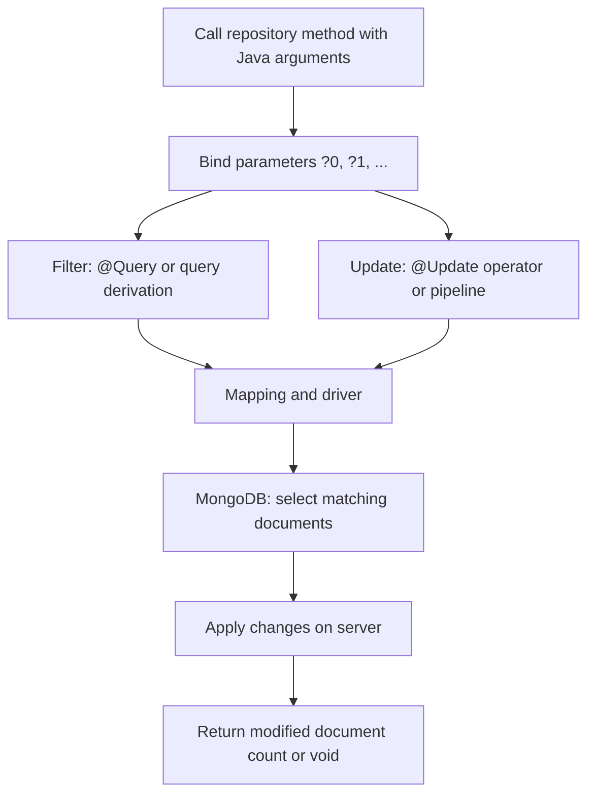

# Binding Parameters in Update Operators and Update Pipelines

## 1. Problem statement and objectives

An application uses Spring Data MongoDB to manage orders. The business layer does not want to load the entire document, modify a couple of properties in Java, and call `save(...)` just to update status, processing retry count, or price. Such a pattern can incur extra reads, overwrite fields modified concurrently on another thread, and scatter state-transition rules across services.

Spring Data MongoDB supports **repository update methods** via the `@Update` annotation. Developers can put **document selection criteria** in `@Query` (or a derived query) and **modification expressions** in `@Update`. Method parameters are bound into the filter and update, creating a targeted write operation without sending the entire entity back to MongoDB.

Example:

```java
@Query("{ 'tenantId': ?0, '_id': ?1, 'status': ?2 }")
@Update("{ '$set': { 'status': 'SHIPPED', 'updatedAt': ?3 } }")
long markShipped(
    String tenantId, String orderId,
    String expectedStatus, Instant now
);
```

In this example, `?0` through `?3` are **0-based positional parameters**. The filter requires the exact tenant, ID, and previous status; the update only modifies status and timestamp. Parameter values are bound via Spring Data, **not manual JSON string concatenation**.

This lesson belongs to the **Repository Writes** chapter of the **SPRING_DATA_MONGODB** module. The module covers connecting, mapping documents, and operating on MongoDB via `MongoTemplate` or repositories; designing queries, aggregations, indexes, transactions, reactive access, testing, and data performance diagnostics. Here, the focus is on **parameter binding in update operators and update pipelines**, along with differences in semantics, versions, and data safety.

After this lesson, you will be able to:

1. Write repository `@Query` + `@Update` methods with positional parameters `?0`, `?1` and proper BSON types.
2. Distinguish **update operator documents** from **aggregation update pipelines**.
3. Use `@Update(pipeline = {...})` to compute values from current fields using `$add`, `$ifNull`, `$cond`, or equivalent expressions.
4. Recognize situations requiring `$literal`, SpEL limitations, and how to prevent query injection.
5. Understand constraints around modified document counts, return types, callbacks, auditing, and versioning.
6. Choose between repository updates and `MongoTemplate` when more operation options are needed, verify indexes, and write integration tests covering both branches.

## 2. Running data model

### 2.1. Sample BSON documents

Suppose the `orders` collection contains:

```javascript
db.orders.insertMany([
  {
    _id: "ord-101",
    tenantId: "tenant-a",
    status: "PAID",
    retryCount: 0,
    totalAmountVnd: NumberLong("150000"),
    customer: { display_name: "An" },
    note: "Paid",
    createdAt: ISODate("2026-11-19T08:00:00Z"),
    updatedAt: ISODate("2026-11-19T08:00:00Z"),
    version: NumberLong("0")
  },
  {
    _id: "ord-102",
    tenantId: "tenant-a",
    status: "PAID",
    retryCount: 2,
    totalAmountVnd: NumberLong("200000"),
    customer: { display_name: "Ân" },
    note: "Awaiting confirmation",
    createdAt: ISODate("2026-11-19T09:00:00Z"),
    updatedAt: ISODate("2026-11-19T09:00:00Z"),
    version: NumberLong("3")
  },
  {
    _id: "ord-103",
    tenantId: "tenant-a",
    status: "CANCELLED",
    retryCount: 0,
    totalAmountVnd: NumberLong("50000"),
    customer: { display_name: "Bình" },
    createdAt: ISODate("2026-11-19T10:00:00Z"),
    updatedAt: ISODate("2026-11-19T10:00:00Z"),
    version: NumberLong("1")
  },
  {
    _id: "ord-201",
    tenantId: "tenant-b",
    status: "PAID",
    retryCount: 0,
    totalAmountVnd: NumberLong("300000"),
    customer: { display_name: "An" },
    createdAt: ISODate("2026-11-19T11:00:00Z"),
    updatedAt: ISODate("2026-11-19T11:00:00Z"),
    version: NumberLong("0")
  }
]);
```

These values are solely for a **practice database**. Do not run this script against production or a collection with duplicate IDs.

### 2.2. Java domain model

```java
import java.time.Instant;
import org.springframework.data.annotation.Version;
import org.springframework.data.mongodb.core.mapping.Document;
import org.springframework.data.mongodb.core.mapping.Field;
import org.springframework.data.mongodb.core.mapping.FieldType;
import org.springframework.data.mongodb.core.mapping.MongoId;

@Document(collection = "orders")
public record OrderDocument(
    @MongoId(FieldType.STRING) String id,
    String tenantId,
    String status,
    int retryCount,
    long totalAmountVnd,
    CustomerSnapshot customer,
    String note,
    Instant createdAt,
    Instant updatedAt,
    @Version Long version
) {}

record CustomerSnapshot(
    @Field("display_name") String displayName
) {}
```

`@MongoId(FieldType.STRING)` ensures BSON String is used for `_id`, while `@Version` expresses optimistic locking intent. In Java, `customer.displayName` corresponds to the BSON path `customer.display_name`.

**Distinction:** The Java model is used to explain query mapping. Not every repository update instantiates entities, runs constructors, validators, or callbacks like the `save(entity)` path.

## 3. Two parts of a repository write

A repository write method answers two independent questions:

1. **Which documents to select?** — the JSON filter defined by `@Query`, derived method name, or custom query.
2. **What to change on the selected documents?** — the `@Update` content.



In Spring Data MongoDB generations that support `@Update` on repositories, these methods are designed to **perform an update**, not to fetch a new entity into memory. Having a `find...` prefix in the method name should not mislead you into thinking it always executes a `find` followed by `save`.

### 3.1. @Query as filter

```java
@Query("{ 'tenantId': ?0, '_id': ?1 }")
```

With arguments `("tenant-a", "ord-101")`, the expected filter corresponds to:

```javascript
{ tenantId: "tenant-a", _id: "ord-101" }
```

### 3.2. @Update as mutation

```java
@Update("{ '$set': { 'note': ?2 } }")
```

With the third argument `"Verified"`, the expected update is:

```javascript
{ $set: { note: "Verified" } }
```

Both `@Query` and `@Update` reference **a single method parameter list**; there are not two separate numbering systems.

## 4. Binding positional parameters: ?0, ?1, ?2

### 4.1. A complete example

```java
import java.time.Instant;
import org.springframework.data.mongodb.repository.Query;
import org.springframework.data.mongodb.repository.Update;
import org.springframework.data.repository.Repository;

public interface OrderWriteRepository
    extends Repository<OrderDocument, String> {

    @Query("{ 'tenantId': ?0, '_id': ?1, 'status': ?2 }")
    @Update("{ '$set': { 'status': ?3, 'updatedAt': ?4 } }")
    long changeStatus(
        String tenantId,        // ?0
        String orderId,         // ?1
        String expectedStatus,  // ?2
        String newStatus,       // ?3
        Instant now             // ?4
    );
}
```

Here `@Update` is the annotation in package **`org.springframework.data.mongodb.repository`**. Do not confuse this annotation with class **`org.springframework.data.mongodb.core.query.Update`** used when building commands with `MongoTemplate`.

If the service calls:

```java
long modified = orderWriteRepository.changeStatus(
    authenticatedTenantId,
    "ord-101",
    "PAID",
    "READY_TO_SHIP",
    Instant.now()
);
```

the filter checks ID, tenant, and old status; the update only sets the new status and timestamp. `authenticatedTenantId` must come from a **trusted authentication/authorization context**, never passed directly from a client-chosen `tenantId`.

### 4.2. Why not wrap placeholders in quotes manually?

Typed parameters are bound as BSON values. Preferred syntax:

```java
@Query("{ 'tenantId': ?0 }")
@Update("{ '$set': { 'note': ?1 } }")
```

Do not write concatenated strings like:

```java
// NOT a valid binding strategy.
// String json = "{ '$set': { 'note': '" + untrustedNote + "' } }";
```

String concatenation can break escaping, corrupt JSON, or open the door to query/update injection. Placeholders insert values strictly into **value positions**, preventing user data from turning into operator names or arbitrary JSON fragments.

### 4.3. Argument ordering is part of the contract

A common mistake:

```java
// Query is searching ID using newStatus value, a subtle bug.
@Query("{ 'tenantId': ?0, '_id': ?3 }")
@Update("{ '$set': { 'status': ?1 } }")
long broken(String tenantId, String newStatus, String id, String other);
```

The snippet above illustrates **misindexed parameter mapping** and should never be used. Methods with multiple `String` arguments make swapping parameters easy; reduce the risk with clear variable names, use-case-specific service wrappers, and integration tests verifying the right ID/status.

### 4.4. Data types and BSON

Parameters such as `Instant`, enums, `ObjectId`, `UUID`, or value objects may undergo conversion/mapping when placed into queries/updates. Check:

| Java argument | Expected BSON | Common pitfall |
| --- | --- | --- |
| `String` ID with `@MongoId(FieldType.STRING)` | BSON String `_id` | Legacy data stored as ObjectId |
| `Instant` | BSON Date | Older documents stored timestamp as String |
| `long` | Corresponding BSON numeric type | Collection mixes Int32/Int64/Double |
| `enum` | Usually String name | Custom converter alters representation |
| `UUID` | Depends on UUID representation | Subtype 3/4 mismatch |
| `null` | BSON Null or API-specific binding behavior | Confusing null with missing/no-op update |

Hence, unit testing method signatures alone is insufficient. Verify **actual BSON and outcomes** against the Spring Data, driver, and server versions in use.

## 5. Update operator documents: $set, $inc, $unset, $setOnInsert

### 5.1. Using $set to update fields

```java
@Query("{ 'tenantId': ?0, '_id': ?1 }")
@Update("{ '$set': { 'note': ?2 } }")
long replaceNote(String tenantId, String orderId, String note);
```

The `$set` operator modifies the `note` field of matching documents. It does not replace the entire entity. For an existing record, other fields such as `createdAt` and `totalAmountVnd` remain intact unless modified by another operation.

**Note:** `$set: { note: null }` **writes BSON Null**; it does not mean "skip unsent field"; `$unset` is the operation that **removes the field**.

### 5.2. Using $inc to compute relative to current value

```java
@Query("{ 'tenantId': ?0, '_id': ?1, 'status': 'PAID' }")
@Update("{ '$inc': { 'retryCount': ?2 } }")
long addRetryCount(String tenantId, String orderId, int delta);
```

If `retryCount = 2` and `delta = 1`, the new value is 3. The server performs the addition on the current value, avoiding the anti-pattern of reading 2 in Java and writing 3 with `$set` after another thread already incremented it.

However, **`$inc` is not idempotent**: a retried request can increment it again. If you need "each logical event counted at most once", design a dedicated idempotency key or expected state precondition.

### 5.3. Using $unset conditionally

```java
@Query("{ 'tenantId': ?0, '_id': ?1, 'status': 'NEW' }")
@Update("{ '$unset': { 'note': '' } }")
long clearDraftNote(String tenantId, String orderId);
```

The value given to `$unset` is merely a syntax placeholder, not a business empty string. The `note` field will **no longer exist** in BSON once the update runs; this differs from `note: null`.

### 5.4. $setOnInsert and upserts

`$setOnInsert` only sets fields when an **upsert** creates a new document. In an ordinary repository update method, do not assume `@Update` enables upsert automatically:

```javascript
// mongosh syntax illustrating a genuine upsert.
db.orders.updateOne(
  { tenantId: "tenant-a", externalKey: "ext-1" },
  {
    $set: { lastSeenAt: new Date() },
    $setOnInsert: { status: "NEW", createdAt: new Date() }
  },
  { upsert: true }
);
```

If business logic requires an upsert, use `MongoOperations.upsert(Query, Update, EntityClass)` or an equivalent API supported by your version, backed by a unique index on the business key. Do not add `$setOnInsert` to an `@Update` expecting it to turn into an upsert.

## 6. Derived queries and @Query: choosing how to select documents

Repository update methods can use **query derivation** where the method and version support it, or combine with `@Query` to specify the filter explicitly.

Example with an explicit, easy-to-verify filter:

```java
@Query("{ 'tenantId': ?0, 'status': ?1 }")
@Update("{ '$set': { 'note': ?2 } }")
long setNoteForStatus(
    String tenantId, String status, String note
);
```

With this method, **multiple documents** within the tenant can match the filter. The name `setNoteForStatus` does not imply "only one document". In Spring Data MongoDB versions supporting repository `@Update`, test the **multi-document update** scope rather than assuming `updateFirst` from the method name or return type.

An illustrative derived query in supported versions:

```java
@Update("{ '$inc': { 'retryCount': ?2 } }")
long findAndIncrementRetryCountByTenantIdAndId(
    String tenantId, String id, int delta
);
```

The method name expresses predicates on `tenantId` and `id`; `?2` is the update parameter. Method-name parsing support for repository writes and generation-specific limits must be verified with a **repository initialization test**. If the method name gets hard to read or the predicate is complex, use an explicit `@Query`.

**Do not expose an overly broad repository just to add an update:** Extend `Repository<OrderDocument,String>` and declare only the commands permitted by business logic. That avoids exposing `deleteAll()`, `saveAll()`, or updates without tenant filters.

## 7. Return types of repository updates

An annotated update method typically supports:

- `void` when the caller does not need the affected record count.
- Supported numeric types like `long`/`Long` representing the **number of documents actually modified**.

Example:

```java
@Query("{ 'tenantId': ?0, '_id': ?1 }")
@Update("{ '$set': { 'note': ?2 } }")
long updateNoteCount(String tenantId, String id, String note);
```

**Do not declare** `OrderDocument` or `Optional<OrderDocument>` as the return type expecting the framework to return the post-update entity:

```java
// NOT a guaranteed entity-return contract for @Update.
// OrderDocument updateAndReturn(String tenantId, String id, String note);
```

### 7.1. What does Long/long count?

Suppose:

```javascript
{ _id: "ord-101", tenantId: "tenant-a", note: "A" }
```

If you run `$set` to write `"A"` again, the document matches the filter but undergoes **no actual change**. A numeric return value must not be interpreted as "number of matched documents" if the contract returns modified documents; verify the behavior of your deployed version.

| Concept | Meaning |
| --- | --- |
| Matched count | Number of documents matching the filter |
| Modified count | Number of documents whose data actually changed |
| Number of array elements | Cannot be inferred from modified count |
| New entity | Not returned automatically by repository `@Update` |

If business logic needs to **distinguish matched from modified**, or needs the post-update document returned, consider `MongoOperations.updateFirst(...)` returning `UpdateResult` or `findAndModify(...)` inside a command adapter.

### 7.2. Why do update methods usually skip save lifecycle hooks?

Repository `@Update` is a **direct update operation**; it does not construct a complete new entity and run the `save(entity)` pipeline. Therefore, do not assume:

- Bean Validation runs across all entity fields.
- `BeforeSaveCallback`/`AfterSaveCallback` fire as they do on save.
- Auditing automatically populates `updatedAt`.
- Entity domain events are published like on save.
- Entity constructors supply default values for missing fields.

Explicitly assign the fields that need changing in the update and enforce validation at the appropriate business layer or via MongoDB schema validation.

## 8. When standard update operators are not enough

### 8.1. Goal: computing from the document itself

Suppose you need to:

- Increase `totalAmountVnd` based on its **current value**.
- Treat missing/null old values as 0 under an approved rule.
- Also write `updatedAt`.

Classic update operators support `$inc`; however, when formulas get more complex—such as "take the current max", "compute across multiple fields", or "branch on status"—an **aggregation update pipeline** can be suitable.

MongoDB supports updates via **aggregation pipelines** starting in server version **4.2**. This feature differs from the read-only `aggregate(...)` command, even though it shares many aggregation expressions.

### 8.2. Comparing the two update forms

Classic update document:

```javascript
db.orders.updateOne(
  { _id: "ord-101", tenantId: "tenant-a" },
  { $inc: { retryCount: 1 } }
);
```

Aggregation update pipeline:

```javascript
db.orders.updateOne(
  { _id: "ord-101", tenantId: "tenant-a" },
  [
    {
      $set: {
        retryCount: {
          $add: [
            { $ifNull: ["$retryCount", 0] },
            1
          ]
        }
      }
    }
  ]
);
```

Both statements increment `retryCount` by 1 in the sample data, yet they **represent two different mechanisms**:

| Classic update document | Aggregation update pipeline |
| --- | --- |
| JSON object containing update operators like `$inc`, `$set` | Array of stages such as `$set`, `$unset` |
| `$inc` handles incrementing directly | Must use `$add` expression inside a stage |
| `$set: {x: 1}` assigns literal value 1 | Pipeline `$set: {x: {$add: [...]}}` evaluates an expression |
| Simpler for straightforward partial updates | Flexible for computing from existing fields |
| Not aggregation stages | Only stages permitted in update pipelines are allowed |

## 9. Binding parameters in @Update(pipeline = {...})

### 9.1. Repository pipeline example

In Spring Data MongoDB generations supporting the `pipeline` attribute on `@Update`, **each element of the `pipeline` array must be a complete JSON stage**, not fragments automatically concatenated together. The example below assumes `java.time.Instant`, `org.springframework.data.mongodb.repository.Query`, and `org.springframework.data.mongodb.repository.Update` are imported in a repository interface:

```java
@Query("{ 'tenantId': ?0, '_id': ?1, 'status': 'PAID' }")
@Update(pipeline = {
    "{ '$set': { 'totalAmountVnd': { '$add': [ { '$ifNull': [ '$totalAmountVnd', 0 ] }, ?2 ] }, 'updatedAt': ?3 } }"
})
long addAmountByPipeline(
    String tenantId, String orderId,
    long amountDelta, Instant now
);
```

When called with `amountDelta = 25000L`, `?2` binds to a **numeric value**, while `"$totalAmountVnd"` inside the pipeline is an **expression referencing a field of the current document**.

**Component breakdown:**

- `@Query`: selects the document matching tenant/ID/status.
- `@Update(pipeline = {...})`: declares an array of update stages.
- `$ifNull: ["$totalAmountVnd", 0]`: substitutes 0 when the field is null or missing.
- `$add: [..., ?2]`: computes the new value as current field plus delta.
- `updatedAt: ?3`: assigns the caller-supplied timestamp.

If total amount must never go negative or be adjusted once locked, add validation and business preconditions; server-side computation alone does not guarantee all invariants.

### 9.2. Two stages in a pipeline

An update pipeline can contain multiple permitted stages. `mongosh` example:

```javascript
db.orders.updateOne(
  { _id: "ord-101", tenantId: "tenant-a" },
  [
    {
      $set: {
        retryCount: {
          $add: [{ $ifNull: ["$retryCount", 0] }, 1]
        }
      }
    },
    {
      $set: { retryFlag: { $gte: ["$retryCount", 3] } }
    }
  ]
);
```

In the second stage, the expression reads `retryCount` **after the previous stage updated it**, allowing the flag to be derived from the new value. This differs from a classic update document, which cannot be structured as sequential dependent stages.

Correspondingly in a repository, each element of `pipeline` must be a JSON stage:

```java
@Query("{ 'tenantId': ?0, '_id': ?1 }")
@Update(pipeline = {
    "{ '$set': { 'retryCount': { '$add': [ { '$ifNull': [ '$retryCount', 0 ] }, ?2 ] } } }",
    "{ '$set': { 'retryFlag': { '$gte': [ '$retryCount', ?3 ] } } }"
})
long increaseAndFlag(
    String tenantId, String orderId,
    int delta, int threshold
);
```

### 9.3. Stages permitted in update pipelines

MongoDB update pipelines do not permit arbitrary aggregation stages. Common stages supported in update pipelines include:

- `$set` (alias `$addFields`).
- `$unset` (alias `$project` in applicable cases).
- `$replaceRoot` and `$replaceWith`.

Stages such as `$group`, `$lookup`, `$out`, and `$merge` are not freely usable update stages in update pipelines. Update operators like `$inc` and `$push` are also **not** pipeline stages: to increment a number in a pipeline, use `$set` with `$add`.

## 10. $set in classic updates vs. $set in pipelines

The name `$set` appears in two places that are easy to confuse:

```javascript
// Classic update: sets the entire subdocument value.
db.orders.updateOne(
  { _id: "ord-101" },
  { $set: { "stats": { current: 5 } } }
);

// Pipeline update: right-hand side is an aggregation expression.
db.orders.updateOne(
  { _id: "ord-101" },
  [
    { $set: {
        "stats.current": {
          $add: [ { $ifNull: ["$stats.current", 0] }, 1 ]
        }
    } }
  ]
);
```

Classic `$set` assigns the literal structure sent in the update. Pipeline `$set` can **evaluate expressions** against the document being updated. If you copy `{ $add: [...] }` from a pipeline into a classic `$set`, the server will not evaluate it as an expression; you risk storing an unintended object or hitting schema errors.

### 10.1. When to use a pipeline?

| Use case | Usually sufficient |
| --- | --- |
| Assigning a fixed status | Classic `$set` |
| Incrementing a counter | Classic `$inc` |
| Removing a field | Classic `$unset` |
| Adding parameter to field A | `$inc` if it is just simple addition |
| Computing a field from multiple existing fields | Pipeline with `$add`, `$multiply`, `$cond` |
| Conditional assignment inside the document | Pipeline with `$cond` |
| Normalizing missing/null and computing simultaneously | Pipeline with `$ifNull`, per clear business rules |

Do not push every trivial update into a pipeline. Classic operators are usually shorter and easier to review.

## 11. Binding strings starting with $: when $literal is needed

In an **aggregation expression**, a String beginning with `$` can be interpreted as a **field reference** or variable rather than a string value to store.

Suppose a user enters a note:

```text
$discount
```

When placing it into a pipeline expression, ensure MongoDB treats it as a literal string rather than attempting to read a field named `discount`.

### 11.1. How to use $literal

In `mongosh`:

```javascript
db.orders.updateOne(
  { _id: "ord-101", tenantId: "tenant-a" },
  [
    { $set: {
        note: { $literal: "$discount" }
    } }
  ]
);
```

In a repository pipeline, you can bind a parameter inside `$literal`:

```java
@Query("{ 'tenantId': ?0, '_id': ?1 }")
@Update(pipeline = {
    "{ '$set': { 'note': { '$literal': ?2 } } }"
})
long writeLiteralNote(
    String tenantId, String orderId, String note
);
```

Here `?2` is still bound as a value parameter, not hand-concatenated JSON. `$literal` protects **aggregation expression semantics**: the input data is treated strictly as a value even when it starts with `$`.

### 11.2. Do not use $literal to fix injection from string concatenation

If a developer builds a JSON string by concatenating untrusted input, `$literal` does not automatically solve escaping or operator injection issues. First use **parameter binding**, restrict allowed fields/operations, and never accept an arbitrary pipeline from a client.

### 11.3. Null values in pipelines

```java
@Update(pipeline = {
    "{ '$set': { 'note': { '$ifNull': [ ?2, 'No note provided' ] } } }"
})
```

This expression picks a fallback when the parameter is null; that is an **explicit application rule**, not a Spring Data default. Do not silently convert every null into a string or business status if missing data carries a different meaning. For optional inputs, you may need to distinguish "not sent" from "explicitly set to null".

## 12. SpEL in repository updates: use only with good reason

Spring Data supports **SpEL** in certain JSON query/update strings using syntax like `?#{...}`. The expression is evaluated by Spring Data **on the application side** before constructing the query—it is not a MongoDB operator executed by the server.

Example showing how to reference method parameters:

```java
@Query("{ 'tenantId': ?#{[0]}, '_id': ?#{[1]} }")
@Update("{ '$set': { 'note': ?#{[2]} } }")
long updateUsingSpel(
    String tenantId, String orderId, String note
);
```

In this case, positional binding `?0`/`?1`/`?2` is sufficient and **more readable**. Use SpEL only when you genuinely need a client-side expression, and verify API/extension support in your project's version.

### 12.1. Do not use SpEL to let clients choose operator names

Do not allow clients to pass `"$set"`, `"$unset"`, or a JSON snippet for the application to splice into an annotation:

```text
Design hazard:
  client chooses operator + field path + raw JSON update
  → repository accidentally becomes an arbitrary document-mutation API.
```

If the API lets callers pick an update type, use a **business allowlist**:

- `markShipped(orderId)`: status `READY_TO_SHIP → SHIPPED`.
- `replaceNote(orderId, note)`: modifies only the `note` field.
- `incrementRetryCount(orderId)`: increments counter only under valid status.

SpEL adds flexibility but also makes queries harder to review and can introduce security vulnerabilities if untrusted input is evaluated. Never evaluate user-supplied expression strings as code.

### 12.2. Do not confuse SpEL with aggregation expressions

| Syntax | Who evaluates it? | Example |
| --- | --- | --- |
| `?0` | Spring Data binding | Method argument value |
| `?#{[0]}` | Application-side SpEL | Selecting/transforming argument value |
| `"$totalAmountVnd"` | MongoDB inside aggregation expression | Reference to current field |
| `"$$NOW"` | MongoDB inside aggregation expression | System time variable in supported contexts |
| `$add` | MongoDB inside aggregation expression | Numeric computation |
| `$literal` | MongoDB inside aggregation expression | Returns literal without interpreting inner expressions |

These are two **different evaluation phases**. Using SpEL to compute against the **current field value of a server-side document** misunderstands the model: repository SpEL expressions do not have the current MongoDB document to read.

## 13. Mapping @Field, IDs, and nested paths

### 13.1. Java fields and BSON

The model has:

```java
record CustomerSnapshot(
    @Field("display_name") String displayName
) {}
```

Therefore:

| Java property path | BSON field path |
| --- | --- |
| `id` | `_id` |
| `customer.displayName` | `customer.display_name` |
| `totalAmountVnd` | `totalAmountVnd` |
| `updatedAt` | `updatedAt` |

In `@Query`, some Spring Data mapping mechanisms can translate field names from entity metadata. However, when embedding **update/pipeline JSON strings**, verify the **final BSON**; do not assume every aggregation expression like `"$customer.displayName"` maps identically to `Criteria.where("customer.displayName")`.

To explicitly illustrate physical fields:

```java
@Query("{ 'tenantId': ?0, '_id': ?1 }")
@Update("{ '$set': { 'customer.display_name': ?2 } }")
long updateCustomerDisplayName(
    String tenantId, String orderId, String displayName
);
```

Here the update specifies the **BSON path** defined by the sample schema. When a project uses complex field mapping annotations or custom converters, run integration tests to verify the actual path.

### 13.2. Replacing a nested field vs. replacing the entire subdocument

Classic update:

```javascript
{ $set: { "customer.display_name": "New Name" } }
```

differs from:

```javascript
{ $set: { customer: { display_name: "New Name" } } }
```

The second form replaces the entire `customer` subdocument, potentially wiping out other fields in the customer snapshot. When binding a complex object into `?2`, be clear whether you intend to **replace the whole object** or update only a single nested field.

### 13.3. Document arrays and positional updates

If the domain has `items` containing SKUs, you cannot safely target "a single line" solely by a SKU method parameter if the same SKU can repeat in the array. Array updates may require `$[line]` and `arrayFilters`.

Annotated `@Update` works nicely for concise operator updates, whereas when you need array filters, multiple options, optimistic versioning, and detailed write results, `MongoTemplate`/`MongoOperations` usually yields an easier-to-control contract. Do not assume repository update syntax exposes every driver option.

## 14. Version and API limitations

Usability of the examples depends on several layers:

| Layer | What to verify |
| --- | --- |
| MongoDB server | Does it support update aggregation pipelines? Server 4.2+ milestone |
| MongoDB Java driver | Can it send updates as BSON documents or lists of stages? |
| Spring Data MongoDB | `@Update` annotation, `value`/`pipeline` attributes, repository write semantics |
| Spring Data Commons | Query method infrastructure, parameter binding, and SpEL |
| Spring Boot | Actual dependency versions, repository scanning, and converters |
| Domain schema | BSON types, aliases, unique/indexes, validation |

### 14.1. Verification checklist

1. Identify the exact MongoDB server, Spring Boot, Spring Data MongoDB, and driver versions in use.
2. Inspect the signature of **`org.springframework.data.mongodb.repository.Update`** in your actual dependencies: does `pipeline()` exist, and how does it accept `String[]`?
3. Write a repository initialization test containing `@Query + @Update`.
4. Test both operator updates and pipeline updates against your project's MongoDB server.
5. Inspect before/after BSON, return types, and modified document counts.
6. Test null, `$`-prefixed strings, BSON type errors, and mismatched statuses.

Do not take examples from a newer version as a guarantee that an older framework project will compile. If the repository API does not support a desired expression, **switch to `MongoTemplate`** rather than crafting fragile string tricks.

## 15. Return count, multi-document updates, and business scope

### 15.1. A broad query can modify many documents

```java
@Query("{ 'tenantId': ?0, 'status': 'PAID' }")
@Update("{ '$set': { 'note': ?1 } }")
long updateAllPaidNotes(String tenantId, String note);
```

The method does not pass `orderId`, so **multiple documents** can match. In Spring Data MongoDB generations where annotated repository updates act as multi-document updates, treat the operation as **bulk-like in scope**, not "find one object and update it".

Risks:

- Modifying thousands of orders in one request due to an overly broad filter.
- Affecting the wrong tenant if the tenant parameter is client-supplied.
- Paying index maintenance and replication costs.
- Misreading a return value of `1` as "updated one field" instead of "updated one document".

If business logic intends to modify **one** order, the filter should include tenant + ID and appropriate expected status/version. APIs should only expose commands with clear business meaning.

### 15.2. Which missing query condition is dangerous?

```java
// Hazardous when used in multi-tenant data:
@Query("{ 'status': 'PAID' }")
@Update("{ '$set': { 'note': ?0 } }")
long updatePaidAcrossTenants(String note);
```

This example is an **anti-pattern**. In a multi-tenant architecture, every command outside approved cross-tenant admin tasks must enforce tenant scoping and authorization.

### 15.3. Atomicity

MongoDB guarantees atomicity for changes **within a single document**. A repository update affecting multiple documents **does not automatically become a shared transaction**. When writing multiple documents and an operation fails mid-way, you need a retry policy, reconciliation, or a transaction if invariants require it.

## 16. Concurrency, expected state, and @Version

### 16.1. Conditional filter state transitions

Example transitioning `PAID → READY_TO_SHIP`:

```java
@Query("{ 'tenantId': ?0, '_id': ?1, 'status': 'PAID' }")
@Update("{ '$set': { 'status': 'READY_TO_SHIP', 'updatedAt': ?2 } }")
long prepareForShipping(
    String tenantId, String orderId, Instant now
);
```

MongoDB evaluates the match and updates in one operation, so two competing requests both check `status: 'PAID'` at execution time. The first successful operation changes the status; the second will no longer match the old status precondition.

### 16.2. @Version is not magic

`@Version` provides optimistic locking for supported persistence paths. However, an annotated repository update does not mean:

- It already loaded the entity and knows the request's expected version.
- It automatically rejects writes if the user read an older version.
- Every update mechanism triggers save callbacks/validations.

When version verification is required, put the **expected version** in the filter and inspect the modified document count:

```java
@Query("{ 'tenantId': ?0, '_id': ?1, 'version': ?2, 'status': 'PAID' }")
@Update("{ '$set': { 'status': 'READY_TO_SHIP', 'updatedAt': ?3 }, '$inc': { 'version': 1 } }")
long prepareWithExpectedVersion(
    String tenantId, String orderId,
    long expectedVersion, Instant now
);
```

This illustration **explicitly** increments version; check whether your project's framework version auto-increments `@Version` on update operations to avoid unintended interactions between two mechanisms. For concurrency designs, test two concurrent operations rather than relying solely on single-threaded unit tests.

### 16.3. Retries are not idempotent by default

`$set` with the same value is generally idempotent for the assigned field; `$inc` and pipeline `$add` are not if the request is executed again. If an upsert/update request triggers side effects like emails or messages, implement proper idempotency/outbox patterns and check driver retryable writes/transactions in the real architecture.

## 17. When repository updates fall short: MongoOperations and MongoTemplate

In real applications, these situations usually warrant `MongoOperations` or `MongoTemplate`:

- Needing `UpdateResult` to distinguish matched/modified/upserted ID.
- Needing `arrayFilters`, collation, hints, write options, or dynamically built queries.
- Wanting `findAndModify` to return the post-update document.
- Needing dynamically assembled multi-stage pipelines without huge JSON annotations.
- Wanting explicit control over sessions/transactions, retries, and concurrency.

### 17.1. Classic update with Query and Update

```java
import java.time.Instant;
import com.mongodb.client.result.UpdateResult;
import org.springframework.data.mongodb.core.MongoOperations;
import org.springframework.data.mongodb.core.query.Criteria;
import org.springframework.data.mongodb.core.query.Query;
import org.springframework.data.mongodb.core.query.Update;

public final class OrderCommandGateway {
    private final MongoOperations mongo;

    public OrderCommandGateway(MongoOperations mongo) {
        this.mongo = mongo;
    }

    public UpdateResult markPrepared(
        String tenantId, String orderId, Instant now
    ) {
        Query query = Query.query(
            Criteria.where("tenantId").is(tenantId)
                .and("id").is(orderId)
                .and("status").is("PAID")
        );

        Update update = new Update()
            .set("status", "READY_TO_SHIP")
            .set("updatedAt", now);

        return mongo.updateFirst(query, update, OrderDocument.class);
    }
}
```

Here `Update` is the **class** in `core.query`, not the `repository.Update` annotation. `OrderDocument.class` enables Java property/ID mapping. The `tenantId` must be authenticated by the service before calling the gateway.

### 17.2. Pipeline updates with AggregationUpdate

Modern Spring Data MongoDB generations can support `AggregationUpdate` to build pipelines via a Java API. Conceptual example:

```java
import org.springframework.data.mongodb.core.aggregation.AggregationUpdate;

AggregationUpdate update = AggregationUpdate.update()
    .set("retryCount")
    .toValue(
        org.springframework.data.mongodb.core.aggregation
            .ArithmeticOperators.Add.valueOf("retryCount").add(1)
    );
```

This example highlights **how to express an update pipeline using the API**, though method chains and null-field handling depend on version; verify actual signatures. An alternative is controlled `BasicUpdate`/driver pipelines backed by tested BSON.

**Note:** If `retryCount` can be null or missing, a simple `Add.valueOf(...)` expression does not replicate the `$ifNull` behavior from the repository example. You must add appropriate null-handling expressions.

## 18. Reactive repository writes and transactional boundaries

In reactive Spring Data MongoDB, developers can write reactive repositories and templates, yet **annotated repository update support and reactive return types** must be verified by version. Never assume you can just change `long` to `Mono<Long>` across every library generation.

For complex updates, use `ReactiveMongoOperations` accordingly:

```java
import reactor.core.publisher.Mono;
import com.mongodb.client.result.UpdateResult;
import org.springframework.data.mongodb.core.ReactiveMongoOperations;
import org.springframework.data.mongodb.core.query.Criteria;
import org.springframework.data.mongodb.core.query.Query;
import org.springframework.data.mongodb.core.query.Update;

public final class ReactiveOrderCommandGateway {
    private final ReactiveMongoOperations mongo;

    public ReactiveOrderCommandGateway(ReactiveMongoOperations mongo) {
        this.mongo = mongo;
    }

    public Mono<UpdateResult> markPrepared(
        String tenantId, String orderId
    ) {
        Query query = Query.query(
            Criteria.where("tenantId").is(tenantId)
                .and("id").is(orderId)
                .and("status").is("PAID")
        );
        Update update = new Update()
            .set("status", "READY_TO_SHIP");

        return mongo.updateFirst(query, update, OrderDocument.class);
    }
}
```

In a reactive stack, `Mono<UpdateResult>` represents the asynchronous result. Do not call `block()` arbitrarily in non-blocking pipelines; transaction managers and sessions must also be reactive-compatible.

### 18.1. Transactions do not fix broken filters

If a repository update lacks a tenant filter or a pipeline modifies the wrong field, wrapping it in `@Transactional` **does not fix that mistake**. Transactions serve cross-document/cross-collection invariants, whereas a single-document state transition is normally guarded by conditional filters and atomic updates.

## 19. Indexes, query shapes, and performance diagnostics

### 19.1. Indexing for document selection

An update method filtering by `tenantId + _id` typically leverages the default `_id` index to locate the document and then checks the tenant. No extra compound index is required solely for this method.

For an approved bulk command filtering by `tenantId + status`:

```javascript
db.orders.createIndex(
  { tenantId: 1, status: 1 },
  { name: "ix_orders_tenant_status" }
);
```

This index is a **candidate**; evaluate workload and index maintenance costs. Whenever an update modifies an indexed field, MongoDB must maintain the corresponding index keys.

### 19.2. Using explain to inspect the filter

```javascript
db.orders.find({
  tenantId: "tenant-a",
  status: "PAID"
}).explain("executionStats");
```

This investigates the corresponding document selection plan, **not a full benchmark of update/pipeline write cost**. Observe `winningPlan`, `IXSCAN`/`COLLSCAN`, `totalKeysExamined`, `totalDocsExamined`, and `nReturned`.

### 19.3. Pipelines are not automatically faster

An update pipeline avoids a `read-modify-save` round trip between application and server, yet complex expressions still consume CPU, index maintenance, and replication bandwidth. Benchmarks should compare:

| Approach | Key cost considerations |
| --- | --- |
| Repository classic `$inc` | Single update, simple increment |
| Repository pipeline `$set + $add` | Single update, expression evaluation |
| `find → save` in Java | Extra read, overwrite risk, entity mapping |
| `MongoTemplate` update with options | Flexible, additional code/testing responsibility |

Never extrapolate optimization conclusions for millions of documents from a four-document test. Measure with representative data and query shapes, multiple tenants, common statuses, and realistic concurrency.

## 20. Testing bindings: verify both BSON and results

### 20.1. Mandatory test matrix

| Scenario | Expectation |
| --- | --- |
| Bind valid tenant/ID | Only the matching document is modified |
| Wrong tenant | Records of other tenants remain untouched |
| Wrong expected status | Status does not transition |
| `$set` with quote-containing String | Binding does not break JSON |
| `$set` with null value | Verify BSON Null and business policy |
| `$inc` with delta > 0 | Increments properly without overwriting other fields |
| Calling `$inc` again | Increments again; test idempotency if needed |
| Pipeline `$add` | Computes from existing field value |
| Pipeline with null/missing field | `$ifNull` behaves per rules |
| Pipeline binding `$`-prefixed String | Uses `$literal` to preserve value |
| Two-stage pipeline | Second stage reads value produced by first stage |
| `@Field` alias | Correct BSON field updated, no bogus alias field created |
| Repository return `long` | Interpreted as modified docs per version |
| Concurrency with version | Does not overwrite when expected version is stale |
| Multi-document update | Restricted to tenant/filter scope |
| Callbacks/auditing | Do not assume they execute like `save` |

### 20.2. Integration test for operator updates

The JUnit 5 skeleton below assumes test MongoDB configuration and injected repository/`MongoOperations`. It illustrates the goal, **not a standalone copy-paste runnable class**:

```java
import static org.junit.jupiter.api.Assertions.*;
import java.time.Instant;
import org.junit.jupiter.api.Test;
import org.springframework.data.mongodb.core.MongoOperations;
import org.springframework.data.mongodb.core.query.Criteria;
import org.springframework.data.mongodb.core.query.Query;

class OrderWriteRepositoryIntegrationTest {
    OrderWriteRepository repository;  // Injected from test context.
    MongoOperations mongo;            // Injected from test context.

    @Test
    void updateMustNotTouchOtherTenant() {
        Instant when = Instant.parse("2026-11-20T08:00:00Z");
        long modified = repository.changeStatus(
            "tenant-b", "ord-101", "PAID", "READY_TO_SHIP", when
        );
        assertEquals(0, modified);

        var query = Query.query(
            Criteria.where("tenantId").is("tenant-a")
                .and("id").is("ord-101")
        );
        var saved = mongo.findOne(query, OrderDocument.class);
        assertNotNull(saved);
        assertEquals("PAID", saved.status());
    }
}
```

Tests must re-seed fixtures and clean up between runs; if `ord-101` was altered by another test, assertions become unreliable. Verify unchanged fields, timestamps, versions, and actual BSON types.

### 20.3. Integration test for update pipelines

```java
@Test
void pipelineAddsToCurrentAmount() {
    Instant when = Instant.parse("2026-11-20T09:00:00Z");
    long modified = repository.addAmountByPipeline(
        "tenant-a", "ord-101", 25000L, when
    );
    assertEquals(1, modified);

    OrderDocument current = mongo.findOne(
        Query.query(
            Criteria.where("tenantId").is("tenant-a")
                .and("id").is("ord-101")
        ),
        OrderDocument.class
    );
    assertNotNull(current);
    assertEquals(175000L, current.totalAmountVnd());
}
```

`addAmountByPipeline` here assumes it is declared as in the **complete version** in Section 9.1; when integrating into a real test class, supply imports, test fixtures, repository beans, and a dedicated test database. If the field starts from a value other than 150000, adjust the expected result to match the fixture.

### 20.4. Inspecting physical BSON documents

```javascript
db.orders.findOne(
  { _id: "ord-101", tenantId: "tenant-a" },
  {
    status: 1,
    totalAmountVnd: 1,
    updatedAt: 1,
    customer: 1,
    version: 1
  }
);
```

Do not assert only Java entities. Read raw BSON to verify:

- `_id` remains a String.
- `totalAmountVnd` retains the proper numeric type.
- `updatedAt` is stored as BSON Date.
- Pipelines did not create wrong fields due to `@Field` mapping.
- `status` and `version` match the intended conditions and updates.

## 21. Common pitfalls

| Symptom | Possible cause | Resolution |
| --- | --- | --- |
| Query modifies no documents | Swapped `?0`/`?1`, wrong ID, tenant, or expected status | Check binding and BSON filter |
| JSON in `@Update` fails to parse | Missing braces/quotes, incomplete pipeline stage | Add repository startup test, use complete JSON stages |
| Date/time saved as String | Bound wrong type or custom converter | Check BSON Date and type mapping |
| Pipeline computes wrong field | Used Java property name instead of BSON path in expression | Verify `@Field` and resulting BSON |
| String `"$discount"` interpreted as field | Missing `$literal` in aggregation expression | Wrap value in `$literal` |
| `$inc` fails inside pipeline | Confused update operator with aggregation stage | Use `$set + $add` |
| Added `$group` to update pipeline | Stage unsupported in update pipelines | Stick to supported update stages |
| Method returns `long=0` though record exists | No-op or expected state mismatch | Distinguish matched/modified via `MongoTemplate` |
| Annotated update skips auditing callbacks | Direct update bypasses entity save lifecycle | Set `updatedAt`/audit explicitly per policy |
| Version still overwritten | Missing expected version check, or misread auto version handling | Add version predicate, test concurrency |
| Modified multiple tenants | Filter lacks tenant or uses untrusted client tenant | Enforce authorization and tenant scoping |
| Duplicate effect after retry | `$inc`/pipeline `$add` not idempotent | Use idempotency keys and retry policies |
| `@Update(pipeline=...)` fails to compile | Spring Data version lacks the API | Check dependencies, use `MongoTemplate` |
| Expecting repository to return updated entity | Treated annotated update as `findAndModify` | Use `findAndModify` or conditional re-read |
| Complex SpEL expression fails | Wrong context or unsafe JSON construction | Prefer positional binding; test SpEL |
| Slow operation | Unindexed filter, heavy pipeline, many updated docs | Check filter/explain and measure writes |

## 22. Worked exercises

### Exercise 1 — Correct parameter numbering

**Prompt:** Write a repository method accepting `tenantId`, `id`, and `note`, changing only the note of that exact order.

**Solution:**

```java
@Query("{ 'tenantId': ?0, '_id': ?1 }")
@Update("{ '$set': { 'note': ?2 } }")
long updateNote(
    String tenantId, String id, String note
);
```

`?0` is tenant, `?1` is ID, `?2` is note. Do not place `?2` inside quotes as a manually concatenated JSON string.

### Exercise 2 — Updating modified date without altering creation date

**Prompt:** Update `updatedAt` and `status` only when the order is `PAID`.

**Solution:**

```java
@Query("{ 'tenantId': ?0, '_id': ?1, 'status': 'PAID' }")
@Update("{ '$set': { 'status': 'READY_TO_SHIP', 'updatedAt': ?2 } }")
long prepare(String tenantId, String id, Instant now);
```

Do not overwrite `createdAt`. If the status already changed or tenant mismatches, the update must not modify the document.

### Exercise 3 — $inc or pipeline?

**Prompt:** Increment `retryCount` by an integer supplied by the application service. Which should you use?

**Solution:** If merely adding a number to a valid numeric field, classic `$inc` is simpler:

```java
@Query("{ 'tenantId': ?0, '_id': ?1 }")
@Update("{ '$inc': { 'retryCount': ?2 } }")
long increment(String tenantId, String id, int delta);
```

When formulas across multiple fields and null-handling rules are needed, consider a pipeline. Both addition approaches can double-increment if request retries are uncontrolled.

### Exercise 4 — Binding in pipeline $add

**Prompt:** Increase total amount by `delta` using current value plus parameter, treating null/missing as 0 per business rules.

**Solution:**

```java
@Query("{ 'tenantId': ?0, '_id': ?1 }")
@Update(pipeline = {
    "{ '$set': { 'totalAmountVnd': { '$add': [ { '$ifNull': [ '$totalAmountVnd', 0 ] }, ?2 ] } } }"
})
long addTotal(String tenantId, String id, long delta);
```

`"$totalAmountVnd"` is a MongoDB field reference, and `?2` is the parameter bound from Java. Validate that delta is valid and verify BSON numeric types.

### Exercise 5 — Strings starting with $

**Prompt:** A user submits note `"$discount"`; when writing `note` via a pipeline, how do you ensure it is stored literally?

**Solution:**

```java
@Query("{ 'tenantId': ?0, '_id': ?1 }")
@Update(pipeline = {
    "{ '$set': { 'note': { '$literal': ?2 } } }"
})
long writeNote(String tenantId, String id, String note);
```

`$literal` prevents MongoDB from treating `"$discount"` as a field reference in the aggregation expression.

### Exercise 6 — Spotting multi-document risk

**Prompt:** A method filters only by `tenantId + status` and uses `$set`. A tenant has 5,000 `PAID` orders. Can you assume the method modifies only one order?

**Solution:** No. The filter can match 5,000 documents. Annotated repository updates apply across the matching query scope and can modify multiple documents. If business rules allow editing only one order, include ID and expected status/version in the filter; review authorization and load.

### Exercise 7 — Why didn't the entity callback run?

**Prompt:** The domain uses a callback setting `updatedAt` on `save(entity)`. After `@Update`, `updatedAt` did not change. Why?

**Solution:** Repository annotated updates are direct updates and do not go through the entity save lifecycle. Set `updatedAt` explicitly in `$set` or the pipeline, and test your project's actual auditing behavior.

### Exercise 8 — Expected version

**Prompt:** Update only when `version` still matches the value the user read. Another request has already incremented the version. Write the approach.

**Solution:** Put `version: ?2` into `@Query`; update target fields and increment version per a verified contract:

```java
@Query("{ 'tenantId': ?0, '_id': ?1, 'version': ?2 }")
@Update("{ '$set': { 'note': ?3 }, '$inc': { 'version': 1 } }")
long updateIfVersionMatches(
    String tenantId, String id,
    long expectedVersion, String note
);
```

A modified count of 0 can mean version conflict, not found, or wrong tenant. Never expose records across tenants; check framework auto-versioning behavior before combining manual increments with `@Version`.

### Exercise 9 — When to leave @Update for MongoTemplate?

**Prompt:** A service needs both `matchedCount` and `modifiedCount`, `arrayFilters`, collation support, and occasionally the post-update document.

**Solution:** Prefer a command adapter using `MongoOperations.updateFirst(...)`, `Update.filterArray(...)`, or `findAndModify(...)` per use case. Repository `@Update` with a numeric count does not expose all those options and detailed results by default.

### Exercise 10 — Writing integration tests instead of mocks only

**Prompt:** A unit test verifies the service called `addAmountByPipeline(...)`. Is that enough to trust the total amount increases properly?

**Solution:** Not yet. Seed test MongoDB with 150000, call with delta 25000, read the document to verify 175000, BSON numeric type, and untouched fields. Also test wrong tenant, mismatched status, null/missing fields, concurrency, and literal strings starting with `$`.

## 23. Handover checklist

| Review question | Completion evidence |
| --- | --- |
| Does the filter identify the exact documents? | `@Query`/derived query integration-tested |
| Are parameters numbered properly? | `?0`, `?1`, ... and argument tests |
| Is input ever concatenated into JSON updates? | No; parameter binding used |
| Does the repository update target one or many documents? | Contract and scope tests |
| Are tenant and authorization enforced? | Tenant from security context, not arbitrary client input |
| Classic operator vs. pipeline appropriate for use case? | `$inc` vs. `$set + $add` distinguished |
| Are pipeline stages valid? | Only supported update stages used |
| Are `$`-prefixed strings preserved? | Tested with `$literal` |
| Is there a valid null/missing policy? | Tested with `$ifNull` and BSON |
| Are `@Field` aliases mapped properly? | Document and BSON command inspected |
| Are ID/Date/numeric BSON types right? | Integration tests on real database |
| Are modified and matched distinguished? | Return count or `UpdateResult` from `MongoTemplate` |
| Are retries and idempotency handled? | Repeated `$inc`/`$add` tested |
| Is expected status/version checked? | Conditional update and concurrency tests |
| Are auditing/callback limits understood? | Not relying on default save lifecycle |
| What if `arrayFilters`/hints/collation are needed? | `MongoTemplate` considered |
| Does MongoDB version support pipeline updates? | Server 4.2+ and actual dependencies |
| Are indexes aligned with filters? | `getIndexes()`, `explain("executionStats")` |
| Was multi-document update impact measured? | Write throughput and latency metrics |
| Were reactive/transactions tested if used? | Compatible stack and manager |

### Key takeaways

1. **`@Query` selects documents**, **`@Update` defines mutations**. Placeholders `?0`, `?1`... reference **the same method parameter list**, bound by data type instead of manual JSON concatenation.
2. **Classic updates** use operators like `$set`, `$inc`, `$unset`. **Update pipelines** are **arrays of aggregation stages** allowing calculations from current fields.
3. In pipelines, `$add` and `$ifNull` handle calculations; literal strings starting with `$` can be wrapped in `$literal`.
4. Repository updates typically **do not return new entities**, do not trigger the same entity lifecycle as `save`, and can affect **multiple documents** if filters are broad.
5. Business filters must include **tenant, ID, and expected state/version** as required. Control retries for non-idempotent additions.
6. When you need full `UpdateResult`, `arrayFilters`, collation, hints, dynamic pipelines, or post-update entities, choose **`MongoOperations`/`MongoTemplate`** and test thoroughly.
7. **Version support, BSON mapping, integration tests, and index planning** matter just as much as annotation syntax. This article covers only the Markdown authoring step; academic QA and refactoring belong to the next step.
