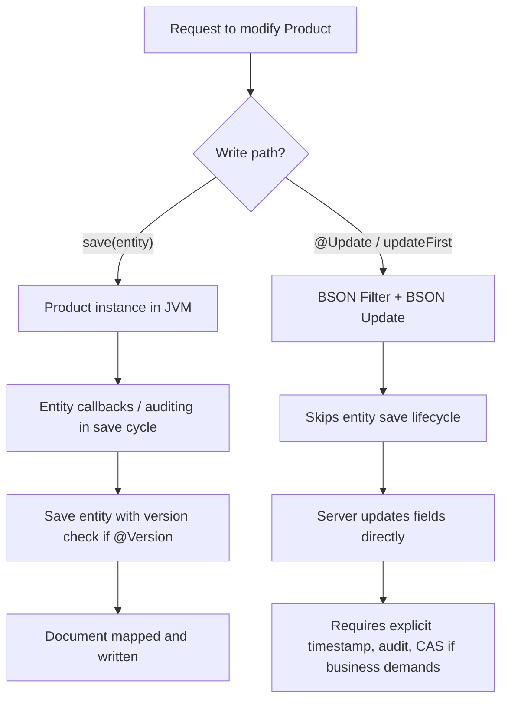

# Callback, Auditing, and Version Limits When Using Direct Write Queries

## 1. Why does this topic matter?

In **Spring Data MongoDB**, not every data write command passes through the same entity lifecycle. On a `Product` in a **Mini Commerce** application, you can update the product name in two ways that look very similar in visible outcome:

```java
// Approach A: load the entity and save it back.
Product product = productRepository.findById(productId)
    .orElseThrow();
product.setName("Mini Keyboard V2");
productRepository.save(product);

// Approach B: update directly via a query.
productRepository.findAndSetNameBySku(
    "KBD-001", "Mini Keyboard V2");
```

However, approaches A and B are **not equivalent in callbacks, auditing, optimistic locking, field scope, or concurrency behavior**. Approach A puts the entity through a save mapping/lifecycle, which can trigger `BeforeConvertCallback`, `BeforeSaveCallback`, auditing, and `@Version` checks. Approach B is a direct MongoDB update command: it **does not load the full entity to run callbacks** and cannot automatically rely on the same version-validation mechanism used when saving entities.

This lesson belongs to the **Repository Writes** chapter of SPRING_DATA_MONGODB. The focus is distinguishing:

- `MongoRepository.save/insert/delete(entity)` following the entity lifecycle.
- Repository methods using `@Update` and `@Query` for **direct** writes.
- Repository `delete…By`/`remove…By` methods with different return types.
- `MongoTemplate.updateFirst`, `updateMulti`, `findAndModify`, and the raw MongoDB driver.
- Limitations around **entity callbacks, auditing, and @Version**, and how to add explicit business controls.

The running model is **Product–Customer–Order**: the catalog service updates names/prices, the inventory service deducts stock, the order service transitions statuses, and an external workflow computes product quality scores. From there we connect queries, indexes, transactions, reactive access, testing, and data observability.

### Learning objectives

After this lesson, you will be able to:

1. Explain why `@Update` does not trigger `BeforeSaveCallback` or entity auditing like `save`.
2. Write repository updates whose filters are derived from method names or declared with `@Query`.
3. Avoid the false assumption that `@Version` automatically protects every direct update against **lost updates**.
4. Design **compare-and-set (CAS)** by `_id` + `version` and interpret results when a query matches nothing.
5. Update `updatedAt`, actor identity, and audit trails appropriately for each write command type.
6. Choose properly between entity/version deletion and direct deletion by ID/condition.
7. Test callbacks, auditing, and versioning against **real MongoDB**, inspect BSON, and detect discrepancies across write paths.
8. Know when to choose `save`, `@Update`, `MongoTemplate`, transactions, or an outbox mechanism.

**Prerequisites:** Java 17+, Spring Boot, `spring-boot-starter-data-mongodb`, `@Document`/`@Id`, `MongoRepository`, `MongoTemplate`, `Query`/`Criteria`, BSON, `@Version`, and basic transactions. Main examples use synchronous MongoDB; reactive variants appear near the end of the lesson. Some API details vary by Spring Data version; check your Spring Boot BOM and run integration tests on your target project version.

## 2. Two write paths: saving entities vs. direct updates



| Write path | Input entity present? | Save lifecycle callbacks | Auto auditing via save | Version control |
| --- | --- | --- | --- | --- |
| `repository.save(entity)` | Yes | Yes when callbacks are registered | Yes if auditing is enabled | `@Version` checked on save, with proper write concern |
| `repository.insert(entity)` | Yes | Insert/save lifecycle runs | Yes if auditing is enabled | Initializes version per field type/lifecycle |
| `@Update` repository method | Does not require loading entity | **Does not** emit save/persistence lifecycle events | **Does not** run entity auditing callbacks | Does not automatically check **expected version** from DTO |
| `MongoTemplate.updateFirst/updateMulti` | No entity object needed | Bypasses `save(entity)` flow | Does not run save auditing callbacks | Some APIs may **auto-increment version**, yet queries need CAS for version matching |
| `MongoTemplate.findAndModify` | Filter + Update | Not save lifecycle | Set audit fields explicitly | Requires version in filter for compare-and-set |
| Raw driver `updateOne/updateMany` | BSON | No Spring callbacks | No Spring auditing | Must manage conditions and `version` manually |
| `repository.delete(entity)` | Yes | Entity delete behavior, not identical to save callbacks | Not an entity timestamp update | Can check `@Version` on entity deletion |
| `repository.deleteById(id)` | ID | Not save lifecycle | Does not write audit trail automatically | **Not** equivalent to version-checked entity deletion |

This is a mental-model table and **does not** replace version-specific API contracts. `@Version` has two separate aspects: **incrementing the version number** and **matching the expected version in the filter**. A write path that only increments version cannot prevent stale writes if the client does not supply the expected version.

## 3. Mini Commerce: entity with callbacks, auditing, and version

To make the differences concrete, we use `Product` with name, SKU, price, stock, version, creation/modification timestamps, and an external score.

```java
package com.example.minicommerce.domain;

import java.math.BigDecimal;
import java.time.Instant;

import org.springframework.data.annotation.CreatedDate;
import org.springframework.data.annotation.Id;
import org.springframework.data.annotation.LastModifiedDate;
import org.springframework.data.annotation.ReadOnlyProperty;
import org.springframework.data.annotation.Version;
import org.springframework.data.mongodb.core.mapping.Document;
import org.springframework.data.mongodb.core.mapping.Field;
import org.springframework.data.mongodb.core.mapping.FieldType;

@Document(collection = "products")
public class Product {

    @Id
    private String id;

    private String sku;
    private String name;
    private String category;
    private boolean active;
    private int stock;

    @Field(name = "unit_price", targetType = FieldType.DECIMAL128)
    private BigDecimal price;

    @Version
    private Long version;

    @CreatedDate
    private Instant createdAt;

    @LastModifiedDate
    private Instant updatedAt;

    @ReadOnlyProperty
    @Field("external_score")
    private BigDecimal externalScore;

    public Product() {}

    public Product(String id, String sku, String name,
                   String category, boolean active, int stock,
                   BigDecimal price) {
        this.id = id;
        this.sku = sku;
        this.name = name;
        this.category = category;
        this.active = active;
        this.stock = stock;
        this.price = price;
    }

    public String getId() { return id; }
    public void setId(String id) { this.id = id; }
    public String getSku() { return sku; }
    public void setSku(String sku) { this.sku = sku; }
    public String getName() { return name; }
    public void setName(String name) { this.name = name; }
    public String getCategory() { return category; }
    public void setCategory(String category) {
        this.category = category;
    }
    public boolean isActive() { return active; }
    public void setActive(boolean active) { this.active = active; }
    public int getStock() { return stock; }
    public void setStock(int stock) { this.stock = stock; }
    public BigDecimal getPrice() { return price; }
    public void setPrice(BigDecimal price) { this.price = price; }
    public Long getVersion() { return version; }
    public Instant getCreatedAt() { return createdAt; }
    public Instant getUpdatedAt() { return updatedAt; }
    public BigDecimal getExternalScore() { return externalScore; }
}
```

Explanation:

- `@Id` maps `id` to BSON `_id`.
- `@Field(name = "unit_price", targetType = DECIMAL128)` maps `BigDecimal` price to the right BSON key and type.
- `@Version Long` supports optimistic locking for **write paths with a version-checking contract**.
- `@CreatedDate` and `@LastModifiedDate` are handled by Spring Data auditing when the entity passes through supported lifecycles.
- `@ReadOnlyProperty` can be read from BSON yet is excluded from mapping on writes; it **does not protect** the field from disappearing if the whole document is replaced.

Example BSON after insert via mapping (abbreviated):

```json
{
  "_id": "prod-001",
  "sku": "KBD-001",
  "name": "Mini Keyboard",
  "category": "phu-kien",
  "active": true,
  "stock": 20,
  "unit_price": { "$numberDecimal": "129900.00" },
  "version": 0,
  "createdAt": { "$date": "2026-11-20T02:00:00Z" },
  "updatedAt": { "$date": "2026-11-20T02:00:00Z" }
}
```

Timestamps and version numbers here are **examples**; `@Version Long` typically initializes at 0, while auditing requires enabling configuration to populate. Never assume these fields appear automatically if auditing is disabled or writes use the raw driver.

## 4. Enabling auditing: annotations alone are not enough

For Spring Data MongoDB to populate `@CreatedDate`/`@LastModifiedDate` on supported write paths, auditing usually must be enabled:

```java
package com.example.minicommerce.config;

import org.springframework.context.annotation.Configuration;
import org.springframework.data.mongodb.config.EnableMongoAuditing;

@Configuration
@EnableMongoAuditing
public class MongoAuditConfig {
}
```

If also recording the actor with `@CreatedBy`/`@LastModifiedBy`, provide an appropriate `AuditorAware<T>` (or `ReactiveAuditorAware<T>` in reactive apps) along with rules identifying users and system jobs. Date auditing and auditor identity are two separate capabilities.

**Do not misunderstand:** `@EnableMongoAuditing` registers auditing infrastructure; it does not turn every `$set`, `$inc`, `@Update`, bulk write, or raw driver call into an **entity save**.

### 4.1. Creating an entity via repository

```java
Product product = new Product(
    "prod-001",
    "KBD-001",
    "Mini Keyboard",
    "phu-kien",
    true,
    20,
    new BigDecimal("129900.00")
);

Product created = productRepository.insert(product);

System.out.println(created.getVersion());
System.out.println(created.getCreatedAt());
System.out.println(created.getUpdatedAt());
```

This snippet assumes `ProductRepository` is injected; `insert` creates a new document and does not silently overwrite an existing document with the same ID. When auditing is active, timestamps are populated at the corresponding lifecycle checkpoints.

### 4.2. How can a callback alter data?

A `BeforeConvertCallback<Product>` can normalize the name before converting the entity to BSON:

```java
package com.example.minicommerce.config;

import org.springframework.context.annotation.Bean;
import org.springframework.context.annotation.Configuration;
import org.springframework.data.mongodb.core.mapping.event.BeforeConvertCallback;

import com.example.minicommerce.domain.Product;

@Configuration
public class ProductCallbackConfig {
    @Bean
    BeforeConvertCallback<Product> normalizeName() {
        return (product, collection) -> {
            if (product.getName() != null) {
                product.setName(product.getName().trim());
            }
            return product;
        };
    }
}
```

With `productRepository.save(product)`, this callback can trim `name` before writing. But with repository method `@Update("{ '$set' : { 'name' : ?1 } }")`, `?1` **is never loaded into a `Product` and passed through `BeforeConvertCallback`**. If the service assumes every name is trimmed by the callback, data saved via direct commands can contain leading/trailing whitespace.

**Solution:** normalize and validate at the boundary/service or via an appropriate database-level mechanism, applied uniformly across **all write paths**. Callbacks remain useful, yet should never be the sole guardian of invariants that must hold regardless of write path.

## 5. Save goes through entity lifecycle, but carries replacement risks

`MongoRepository.save(entity)` fits when the application owns the full aggregate and wants to persist the current entity state:

```java
Product product = productRepository.findById("prod-001")
    .orElseThrow();
product.setName("Mini Keyboard V2");

Product saved = productRepository.save(product);
```

The save path can trigger:

- `BeforeConvertCallback` and corresponding mapping/write callbacks.
- Auditing such as `@LastModifiedDate` if enabled.
- Expected version check and `@Version` increment under the `save` contract.
- Entity-to-BSON mapping, including field aliases, converters, and persisted/excluded properties.

However, `save` on an existing document usually performs a **document replacement built from the entity**, not merely patching the property you just set. If the entity was partially loaded via a projection, or the document has fields outside the class (`external_score`, `warehouse`), replacement can **drop** them. `@ReadOnlyProperty` does not preserve old fields across full replacement.

Thus: **save gives stronger lifecycle hooks but a broader write footprint**. Conversely, **direct updates keep a narrower field footprint but skip many lifecycle hooks**. Choose based on data ownership and invariants.

## 6. @Update in MongoRepository: filters derived from methods

Spring Data MongoDB lets you declare direct write operations with `org.springframework.data.mongodb.repository.Update`:

```java
package com.example.minicommerce.repository;

import org.springframework.data.mongodb.repository.MongoRepository;
import org.springframework.data.mongodb.repository.Query;
import org.springframework.data.mongodb.repository.Update;

import com.example.minicommerce.domain.Product;

public interface ProductRepository
        extends MongoRepository<Product, String> {

    @Update("{ '$set' : { 'name' : ?1 } }")
    long findAndSetNameBySku(String sku, String newName);

    @Update("{ '$inc' : { 'stock' : ?1 } }")
    long findAndIncrementStockBySku(String sku, int delta);

    @Query("{ 'sku' : ?0, 'active' : true }")
    @Update("{ '$set' : { 'name' : ?1 } }")
    long updateNameOfActiveProduct(String sku, String newName);
}
```

The **query selecting documents** is derived from `findAndSetNameBySku` or declared explicitly with `@Query`. The **write action** is the JSON update in `@Update`. `?0`/`?1` are positional parameter placeholders, **not manual string concatenation**.

The `find` prefix on the method name is a filter-parsing convention; it **does not mean** the method fetches `Product` and passes it through `save`. For instance, `findAndSetNameBySku` is an **update command** and does not return `Product`.

### 6.1. Update scope: all documents matching the filter

Per Spring Data MongoDB documentation, repository update methods **apply to all matching documents**, without using `Pageable` or `First`/`Top` to limit modified counts. Example:

```java
@Update("{ '$set' : { 'active' : false } }")
long findAndDeactivateByCategory(String category);
```

If there are 10,000 products in the category, the command can modify a huge number of documents. Using a `"find..."` method name does not implicitly limit to one record. If you only want to edit **one** product, filter by a unique key such as `_id` or a uniquely indexed SKU, or use a single-record API (`MongoTemplate.updateFirst`).

### 6.2. Return value

Repository update methods typically allow `void` or numeric types like `long` to describe the updated document count per the module contract. The numeric value is **not a reloaded entity** and does not supply both `matchedCount` and `modifiedCount` like `UpdateResult`.

```java
long count = productRepository.findAndSetNameBySku(
    "KBD-001", "Mini Keyboard V2");
```

Never infer from `count` that callbacks ran, audit timestamps changed, or a client's expected version was verified. If business logic needs to distinguish **no matching document** from **matched but value unchanged**, use `MongoTemplate.updateFirst` returning `UpdateResult` or re-read data.

### 6.3. @Update differs from plain @Query

`@Query` primarily declares the **filter/query**. It does not turn a method into an update simply because the method name starts with `update...`. When using a name outside derived filter syntax like `updateNameOfActiveProduct`, pair an appropriate `@Query` with `@Update`.

For complex array queries, you can use BSON `$elemMatch` in `@Query` alongside an update; just distinguish conditions selecting the **document** from conditions selecting **array elements**.

## 7. @Update does not trigger save callbacks

This is the core limitation: **repository update methods do not emit persistence/mapping lifecycle events** under Spring Data MongoDB's contract.

### 7.1. Commonly misunderstood hooks

| Hook/feature | On `save(Product)` | On repository `@Update` |
| --- | --- | --- |
| `BeforeConvertCallback<Product>` | Can be invoked | Does not pass entity through convert-save cycle |
| `BeforeSaveCallback<Product>` | Can be invoked | Not emitted as on save |
| `AfterSaveCallback<Product>` | Can be invoked | Not emitted as on save |
| `BeforeSaveEvent`/`AfterSaveEvent` | Published if lifecycle events enabled | Not emitted by repository update |
| `@CreatedDate`/`@LastModifiedDate` | Auditing can populate on save | No automatic entity audit callback |
| `@CreatedBy`/`@LastModifiedBy` | Relies on auditor context/callback | Does not query auditor and write BSON automatically |
| Callback-bound Bean Validation | Runs if configured | Does not run automatically |
| Aggregate/save domain events | Depends on repository infrastructure and call path | Do not treat `@Update` as saving an aggregate emitting events |

**Note:** a registered callback is not guaranteed to run identically across all write paths if using the raw driver, bulk ops, reactive vs. imperative APIs, or custom configurations. Relying on callbacks requires checking the actual lifecycle contract.

### 7.2. Consequence for name-trimming logic

Suppose `BeforeConvertCallback` normalizes:

```java
product.setName(product.getName().trim());
```

The following call can persist **the untrimmed value with spaces**:

```java
productRepository.findAndSetNameBySku(
    "KBD-001", "  New Keyboard  ");
```

To guarantee names never retain leading/trailing spaces, the service must call `trim`/validation **before** `@Update`:

```java
public void renameProduct(String sku, String rawName) {
    if (rawName == null || rawName.isBlank()) {
        throw new IllegalArgumentException("Name required");
    }

    String normalized = rawName.trim();
    if (normalized.length() > 120) {
        throw new IllegalArgumentException("Name too long");
    }

    productRepository.findAndSetNameBySku(sku, normalized);
}
```

In a real system, also check permissions, tenant, unique SKU, and the update result. This example solely illustrates moving invariants out of callbacks.

### 7.3. Avoid assuming events mean BSON updates have committed

Even on the `save` path, some events may fire **before** the MongoDB write or outside transaction commit boundaries. If business logic must send emails, charge payments, or publish integration events, never trigger irreversible side effects just because `BeforeSaveEvent` fired.

For **post-commit events and reliable delivery**, consider a transactional outbox, change streams, or proper coordination paired with idempotent consumers. `@Update` cannot simply be "patched" with an entity-only callback.

## 8. Auditing: updatedAt does not change automatically on direct updates

Suppose `Product` currently contains:

```javascript
{
  _id: "prod-001",
  sku: "KBD-001",
  name: "Mini Keyboard",
  updatedAt: ISODate("2026-11-20T02:00:00Z")
}
```

Run:

```java
productRepository.findAndSetNameBySku(
    "KBD-001", "Mini Keyboard V2");
```

Filter/update logic:

```javascript
db.products.updateMany(
  { sku: "KBD-001" },
  { $set: { name: "Mini Keyboard V2" } }
);
```

The `updatedAt` field **does not change automatically** just because the entity has `@LastModifiedDate`. Data can end up with "updated name, stale timestamp".

### 8.1. Solution: explicitly update timestamp inside @Update

```java
@Update(
  "{ '$set' : { 'name' : ?1 }, " +
  "  '$currentDate' : { 'updatedAt' : true } }"
)
long findAndRenameWithTimestampBySku(
    String sku, String newName);
```

MongoDB logic:

```javascript
db.products.updateMany(
  { sku: "KBD-001" },
  {
    $set: { name: "Mini Keyboard V2" },
    $currentDate: { updatedAt: true }
  }
);
```

`$currentDate` uses time set by the MongoDB server, not the JVM clock. Using `true` writes a corresponding BSON Date. When an application-side timestamp is needed, you can bind a normalized `Instant` per your mapping, while keeping a consistent clock source across writers.

### 8.2. Auditing modifier identity

Suppose there is a `lastModifiedBy` field managed by `@LastModifiedBy` on save. Direct updates do not invoke `AuditorAware` to populate that field. The service must resolve the authenticated actor and pass it into the update statement:

```java
@Query("{ 'sku' : ?0 }")
@Update(
  "{ '$set' : { 'name' : ?1, 'lastModifiedBy' : ?2 }, " +
  "  '$currentDate' : { 'updatedAt' : true } }"
)
long updateNameWithActor(
    String sku, String newName, String actorId);
```

**Never accept an arbitrary `actorId` from a request body** and trust it as the modifier. The actor must come from the security context, an authenticated service account, or an equivalent trusted mechanism. Batch migrations can attach an actor like `system-catalog-import` and an operation ID.

### 8.3. Audit timestamps are not a full audit trail

`updatedAt` and `lastModifiedBy` capture only **the latest update**, and do not answer:

- What was the previous price?
- Which fields changed?
- Which request, source, and reason triggered it?
- Were there prior failed attempts?

If legal or financial audit trails are required, build an append-only change log, outbox, or dedicated observability pipeline with clear access control and retention. Do not rely solely on `@LastModifiedDate` for ordering/payment systems.

## 9. @Version: incrementing version is not the same as checking version

In Spring Data MongoDB, `@Version` supports **optimistic locking** when saving entities via version-checked write paths such as `save(entity)`:

```java
Product first = productRepository.findById("prod-001")
    .orElseThrow();
Product stale = productRepository.findById("prod-001")
    .orElseThrow();

first.setName("Renamed by A");
productRepository.save(first);

stale.setName("Renamed by B");
productRepository.save(stale);
// When stale's version is outdated:
// OptimisticLockingFailureException (with acknowledged writes).
```

The `save` mechanism compares the entity's in-memory version against the document's version. If another writer modified the document and changed its version, the stale save fails rather than silently overwriting.

### 9.1. Direct updates may auto-increment version without enforcing CAS

Documentation for `MongoTemplate.updateFirst/updateMulti/findAndModify` notes that `@Version` **can be auto-incremented by the framework if absent from the `Update`**. That helps `save(entity)` calls holding an older version detect that the document changed.

Yet:

```java
mongoTemplate.updateFirst(
    Query.query(Criteria.where("id").is("prod-001")),
    new Update().set("name", "New Name"),
    Product.class);
```

carries **no expected version** from a request/client in its filter. Even if the version auto-increments, two direct updates that do not check the state the client previously read can both succeed and produce **last write wins** on the same field.

**With repository `@Update`, never guess version-increment or optimistic-lock behavior solely from the `@Version` annotation.** Inspect your running implementation/version and integration-test raw BSON. For reliable CAS, put the version condition in the filter and handle a 0 result.

### 9.2. Compare-and-set by id and expectedVersion

A repository update method can use `@Query` to verify the expected version and `@Update` to increment version **within the write command itself**:

```java
@Query("{ '_id' : ?0, 'version' : ?1 }")
@Update(
  "{ '$set' : { 'name' : ?2 }, " +
  "  '$inc' : { 'version' : 1 }, " +
  "  '$currentDate' : { 'updatedAt' : true } }"
)
long compareAndSetName(
    String productId, long expectedVersion, String newName);
```

Equivalent BSON (assuming current version is 7):

```javascript
db.products.updateMany(
  { _id: "prod-001", version: NumberLong(7) },
  {
    $set: { name: "Mini Keyboard V2" },
    $inc: { version: 1 },
    $currentDate: { updatedAt: true }
  }
);
```

Because `_id` is unique, even though repository updates apply "all matching", this filter can match at most **one** document. If version is no longer 7, the command **does not** modify the document. `$inc` on `version` here is the **application's explicit protocol**; do not blindly mix it with other auto-increment mechanisms once you write version directly in the update.

### 9.3. Classifying CAS outcomes

```java
public void renameSafely(
        String productId, long expectedVersion, String rawName) {

    if (rawName == null || rawName.isBlank()) {
        throw new IllegalArgumentException("Name required");
    }

    long updated = productRepository.compareAndSetName(
        productId,
        expectedVersion,
        rawName.trim());

    if (updated == 0) {
        // Product may be missing, deleted, or version changed.
        // Re-read if API error classification is required.
        throw new IllegalStateException(
            "Product not found or concurrent update");
    }
}
```

In this example, every match increments `version`, so a document is genuinely modified on a successful CAS even if the new name matches the old name. Still, verify the numeric return type behavior on your Spring Data version. When workflows need separate **matchedCount** and **modifiedCount**, use `MongoTemplate.updateFirst(...)` and `UpdateResult`.

**Do not collapse "not found" and "version conflict" into 404 when the API requires distinct responses.** You can re-read by ID to distinguish them, bearing in mind data can still change between the two operations; design HTTP 404/409/412 semantics consistently.

### 9.4. Using MongoTemplate to inspect UpdateResult

```java
import com.mongodb.client.result.UpdateResult;
import org.springframework.data.mongodb.core.query.Criteria;
import org.springframework.data.mongodb.core.query.Query;
import org.springframework.data.mongodb.core.query.Update;

Query filter = Query.query(
    Criteria.where("id").is("prod-001")
        .and("version").is(7L));

Update changes = new Update()
    .set("name", "Mini Keyboard V2")
    .inc("version", 1L)
    .currentDate("updatedAt");

UpdateResult result =
    mongoTemplate.updateFirst(filter, changes, Product.class);

if (result.getMatchedCount() == 0) {
    throw new IllegalStateException(
        "Not found or version conflict");
}
```

Here `Update` **explicitly references** `version`, avoiding a separate version auto-increment step in the service. To verify how much version actually incremented, inspect raw BSON in integration tests.

### 9.5. Optimistic locking requires write acknowledgment

Spring Data MongoDB notes that optimistic locking requires an **acknowledged write concern** to detect conflicts. With `WriteConcern.UNACKNOWLEDGED`, failure signals may not surface as expected.

If the application protects orders, inventory, payments, or audits, never disable acknowledgment for throughput while assuming version checks still work.

## 10. Two concurrent editors: lost updates in direct write queries

Suppose a product has:

```text
name    = "Mini Keyboard"
version = 7
```

Two admin screens load version 7 simultaneously:

```text
Admin A reads version=7
Admin B reads version=7

Admin A: @Update by sku only -> name="Name A"  (succeeds)
Admin B: @Update by sku only -> name="Name B"  (succeeds)

Final value may be "Name B"; A's update is overwritten.
```

Replace with version-based CAS:

```text
Admin A: filter {_id, version: 7}; $set name A, $inc version -> 8
Admin B: filter {_id, version: 7}; no match -> report conflict
```

This is the difference between **single-document update atomicity** and **optimistic concurrency based on the version the user read**. MongoDB guarantees each update is atomic on one document, yet lost updates still occur if request filters lack conflict preconditions.

### 10.1. Inventory: conditional $inc is better than read-modify-save

For stock quantities, you do not necessarily need version checks for every deduction. An atomic update with a sufficient-stock filter is the direct expression:

```java
@Query(
  "{ 'sku' : ?0, 'active' : true, " +
  "  'stock' : { '$gte' : ?1 } }"
)
@Update(
  "{ '$inc' : { 'stock' : ?2 }, " +
  "  '$currentDate' : { 'updatedAt' : true } }"
)
long decreaseStockIfEnough(
    String sku, int requiredQuantity, int negativeDelta);
```

Service validation:

```java
public boolean reserve(String sku, int quantity) {
    if (quantity <= 0) {
        throw new IllegalArgumentException(
            "Quantity must be positive");
    }
    return productRepository.decreaseStockIfEnough(
        sku, quantity, -quantity) == 1;
}
```

BSON logic:

```javascript
db.products.updateMany(
  {
    sku: "KBD-001",
    active: true,
    stock: { $gte: 2 }
  },
  {
    $inc: { stock: -2 },
    $currentDate: { updatedAt: true }
  }
);
```

**Prerequisite:** `sku` must have a unique index if business logic requires one unique `Product`; otherwise, a repository update can deduct stock across **multiple** documents sharing the SKU. In practice, filter by `_id` or a protected unique business key.

**`$inc` is not idempotent.** If a client retries the same reservation after a timeout, stock can be deducted twice. For order flows, use an order/reservation ID, unique constraints, checkpoints, or appropriate transactions/outboxes; `@Version` or callbacks do not solve duplicate retries on their own.

### 10.2. Concurrent updates are not multi-document transactions

Placing an `Order` with two line items requires deducting stock from two `Product`s and writing the order. Each `stock >= quantity` update is atomic on its individual `Product`. If both stock deductions and saving the `Order` must be **all-or-nothing**, use a MongoDB transaction on a supported topology with Spring transaction management. Transactions do not replace CAS or idempotency; they solve different categories of risk.

## 11. Repository deletion paths also differ

Spring Data MongoDB supports multiple forms of deletion:

```java
// Inherited from MongoRepository / CrudRepository:
productRepository.delete(entity);
productRepository.deleteById(productId);

// Derived delete:
long deleteProductByCategory(String category);

// Or retrieve matching entities and delete them:
List<Product> deleteByCategory(String category);
```

The last two are **two signature examples** that must be declared explicitly in the repository, rather than called without declaring them:

```java
long deleteProductByCategory(String category);

List<Product> deleteByCategory(String category);
```

Per MongoDB-specific repository documentation:

- Derived delete returning a **numeric count** directly deletes matching documents and returns the deleted count.
- Derived delete returning **`List<Product>`** retrieves matching entities and deletes them, allowing those entities to be returned to the caller.
- Because these two paths have different internal execution, do not ascribe identical callback/auditing/version guarantees solely from the `delete…By` prefix.

### 11.1. delete(entity) vs. deleteById(id) with @Version

For a versioned entity, `delete(entity)` can check the passed instance's version. If the document's version changed, Spring Data can throw `OptimisticLockingFailureException` when writes are acknowledged.

Conversely, `deleteById(id)` typically deletes by ID **bypassing optimistic locking against any previously held entity version**. This is a critical distinction:

```java
Product stale = productRepository.findById("prod-001")
    .orElseThrow();

// Someone else writes, incrementing version.

productRepository.delete(stale); // Can fail due to stale version.
productRepository.deleteById(stale.getId()); // Deletes by ID, ignoring stale.version.
```

Never use `deleteById` just to "dodge conflicts" in workflows that must ensure the user is deleting the exact version they reviewed. If CAS on deletion is required, filter by `_id + version` (e.g., `MongoTemplate.remove(Query, Product.class)`) and check `DeleteResult.getDeletedCount()`.

### 11.2. Direct deletion and auditing

Hard-deleting a document does not automatically store an audit record of "who deleted it, when, and why" inside MongoDB. If traceability is required, consider:

- **Soft delete** with `deletedAt`, `deletedBy`, `status`, and queries excluding deleted documents.
- An audit log/outbox record in the same transaction when consistency requires it.
- Proper retention, recovery, and access-control rules.

Note that soft-deleting via direct update also **does not run `@LastModifiedDate` or callbacks**: timestamps and actors must be set explicitly in the update.

## 12. Projections and @ReadOnlyProperty: why direct updates are often helpful

Suppose a Product list view only fetches:

```java
Query q = Query.query(Criteria.where("active").is(true));
q.fields().include("sku").include("name");

List<Product> summary = mongoTemplate.find(q, Product.class);
```

Projected `Product`s may lack `stock`, `price`, `version`, or other fields. Calling `save(summary.get(0))` risks wiping out fields omitted from the partial read or causing version issues.

If you only want to change the product name, a **direct update by ID/SKU** preserves untargeted fields:

```javascript
db.products.updateOne(
  { _id: "prod-001" },
  {
    $set: { name: "New Keyboard" },
    $currentDate: { updatedAt: true }
  }
);
```

Similarly, if `Product` stores `external_score` managed by another service and Java marks it `@ReadOnlyProperty`, a `$set("name")` command **leaves `external_score` untouched**. In contrast, a full-replacement `save` can cause fields excluded from write mapping to vanish.

**Trade-off:** direct updates keep field scope narrow but require explicit auditing/CAS/validation; `save` provides richer lifecycle hooks but writes more broadly. That is why field ownership across services should be clear when selecting an update path.

## 13. Updating embedded objects and arrays skips entity callbacks

Mini Commerce's `Order` has a `shippingAddressSnapshot` and a `lines` array. Suppose you only modify one field in the address:

```java
@Query("{ '_id' : ?0 }")
@Update(
  "{ '$set' : { 'shippingAddressSnapshot.city' : ?1 }, " +
  "  '$currentDate' : { 'updatedAt' : true } }"
)
long updateShippingCity(String orderId, String city);
```

BSON:

```javascript
db.orders.updateMany(
  { _id: "order-001" },
  {
    $set: { "shippingAddressSnapshot.city": "Da Nang" },
    $currentDate: { updatedAt: true }
  }
);
```

This command changes only `city`, keeping `recipient`, `street`, and `country` intact if present. However, it does not load `Order` to run a `BeforeSaveCallback<Order>` validating the address, nor does it add an audit trail. If city changes are only allowed before the order moves to `SHIPPED`, put that status condition in the **filter** rather than checking in a separate prior read.

### 13.1. Array updates: avoid cross-element condition matching

Suppose an `Order` has multiple `OrderLine`s. To update one exact line item, identify each line by `lineId` and use `arrayFilters`:

```java
Update change = new Update()
    .set("lines.$[line].quantity", 3)
    .filterArray("line.lineId", "line-001")
    .currentDate("updatedAt");

UpdateResult result = mongoTemplate.updateFirst(
    Query.query(Criteria.where("id").is("order-001")),
    change,
    Order.class);
```

`Order.class` here must define nested `lines` and `lineId` accordingly. Array filter criteria have specific mapping behavior; verify raw BSON when using custom aliases. Relying solely on SKU when SKUs are not unique within an Order can accidentally modify multiple lines.

When updating quantity, invariants such as `totalAmount`/`lineTotal`/stock must also be handled in a **consistent business workflow**. Direct updates skipping callbacks never excuse skipping validation.

## 14. Validation, business invariants, and transactions

### 14.1. Bean Validation is not a database constraint

An entity can declare:

```java
@NotBlank
private String name;
```

Validation annotations are valuable when validation is invoked, yet **do not automatically protect raw MongoDB updates**. A repository `@Update` will not instantiate the entity to validate the whole object.

Protect data in layers:

1. Validate DTOs/requests and business rules in the service.
2. Enforce safety preconditions **inside the update filter** (sufficient stock, matching version, valid tenant).
3. Use MongoDB JSON Schema validation and unique indexes when invariants can be enforced at the database layer.
4. Use transactions when invariants span **multiple documents**.
5. Write integration tests for **every write path**: repository `save`, `@Update`, template, raw driver, bulk, and migrations.

### 14.2. Transactions do not make callbacks run

`@Transactional` on a service can group multiple MongoDB commands when `MongoTransactionManager` and a compatible topology are present, yet **does not** turn a repository `@Update` into a `save(entity)`.

```java
import org.springframework.transaction.annotation.Transactional;

@Transactional
public void placeOrder(PlaceOrderCommand command) {
    // 1. Conditionally deduct Product.stock with idempotency.
    // 2. Create Order and OrderLine snapshots.
    // 3. Write outbox event if architecture requires post-commit delivery.
    // 4. If any step fails, roll back the transaction.
}
```

This is a **conceptual skeleton**, not complete code: `PlaceOrderCommand` and inner steps must be implemented separately. Enabling transactions does not automatically roll back side effects in external payment or email services outside MongoDB.

### 14.3. General checklist for direct writes

Whenever a direct write mutates critical business state, verify:

- **Who** is allowed to write? Are `tenantId` filters and authorization checks present?
- **Which target** is written? Is `_id`/SKU/Order ID uniquely identified?
- **Which preconditions** must hold on the server? Stock, status, version?
- **Which fields** may change? Could it accidentally reset fields owned by another service?
- **When** and **by whom**? Timestamp/actor in BSON or audit log?
- **Can retries** duplicate effects? `$inc`/`$push` especially require idempotency.
- **How is the outcome** verified? Count, `UpdateResult`, readback, or outbox?

## 15. Reactive repositories: different return types, same limitations

With `spring-boot-starter-data-mongodb-reactive`, a repository can declare:

```java
import org.springframework.data.mongodb.repository.Query;
import org.springframework.data.mongodb.repository.ReactiveMongoRepository;
import org.springframework.data.mongodb.repository.Update;

import reactor.core.publisher.Mono;

public interface ReactiveProductRepository
        extends ReactiveMongoRepository<Product, String> {

    @Query("{ '_id' : ?0, 'version' : ?1 }")
    @Update(
      "{ '$set' : { 'name' : ?2 }, " +
      "  '$inc' : { 'version' : 1 }, " +
      "  '$currentDate' : { 'updatedAt' : true } }"
    )
    Mono<Long> compareAndSetName(
        String id, long version, String newName);
}
```

In reactive code, operations execute upon subscription. `Mono<Long>` emits the update result per the repository contract. Never call `block()` in a WebFlux request pipeline just to obtain the count; compose with `map`, `flatMap`, or `switchIfEmpty`.

**Direct updates still bypass entity save callbacks**. If auditing modifier identity, pass the authenticated actor from the reactive security context or handle it in the service; do not expect `ReactiveAuditorAware` to execute automatically on a BSON update that does not load an entity.

### 15.1. ReactiveMongoTemplate and CAS

```java
Mono<UpdateResult> updated =
    reactiveMongoTemplate.updateFirst(
        Query.query(Criteria.where("id").is(productId)
            .and("version").is(expectedVersion)),
        new Update()
            .set("name", newName)
            .inc("version", 1L)
            .currentDate("updatedAt"),
        Product.class);
```

This applies the exact same filter/update logic as `MongoTemplate`, returning `Mono<UpdateResult>`. Reactive I/O does not make CAS valid if you omit the `version` filter, nor does it solve duplicate retries when business operations lack idempotency.

## 16. Testing: do not just mock the repository

Unit tests mocking repositories verify the service passed the expected arguments, yet **cannot prove** what BSON `@Update` generated, whether callbacks ran, whether `updatedAt` updated, or whether `version` changed.

Write integration tests running against **real MongoDB or Testcontainers**:

| What to verify | How to measure |
| --- | --- |
| Repository `save` triggers callbacks | Count `BeforeSaveCallback<Product>` invocations in test |
| Repository `@Update` does not trigger save callbacks | Compare counter before/after update |
| `@LastModifiedDate` on `save` | Read raw BSON `updatedAt` |
| `@Update` with only `$set name` does not auto-set `updatedAt` | Read raw BSON confirming old timestamp |
| `@Update` with `$currentDate` sets timestamp | Verify BSON Date value changed |
| `@Version` on `save` | Load two copies at same version; stale save throws exception |
| CAS `_id + version` | First call matches and bumps version; second with old version does not match |
| Entity/version delete paths | Re-read and verify conflicts / deleted counts |
| Unknown fields in document | Compare `save` vs. partial update, inspect BSON |
| Price alias `unit_price` | Query and update use exact BSON field name/type |
| Conditional stock update | Never goes negative and does not match when stock is short |
| Tenant and access control | Tenant A commands never alter tenant B data |

### 16.1. A minimal callback test probe

Example test configuration for a callback probe:

```java
package com.example.minicommerce;

import java.util.concurrent.atomic.AtomicInteger;

import org.springframework.boot.test.context.TestConfiguration;
import org.springframework.context.annotation.Bean;
import org.springframework.data.mongodb.core.mapping.event.BeforeSaveCallback;

import com.example.minicommerce.domain.Product;

@TestConfiguration
class ProductCallbackProbeConfig {

    @Bean
    AtomicInteger productSaveCallbackCount() {
        return new AtomicInteger();
    }

    @Bean
    BeforeSaveCallback<Product> countProductSave(
            AtomicInteger productSaveCallbackCount) {
        return (entity, document, collection) -> {
            productSaveCallbackCount.incrementAndGet();
            return entity;
        };
    }
}
```

This is a **test configuration** and must never be shipped as a counting callback in production. In large test suites, parallel saves can occur; use isolated databases/contexts or reset the counter right before the scenario under test.

### 16.2. Integration test directly comparing save and @Update

```java
package com.example.minicommerce;

import static org.junit.jupiter.api.Assertions.*;

import java.math.BigDecimal;
import java.time.Instant;
import java.util.concurrent.atomic.AtomicInteger;

import org.bson.Document;
import org.junit.jupiter.api.Test;
import org.springframework.beans.factory.annotation.Autowired;
import org.springframework.boot.test.context.SpringBootTest;
import org.springframework.context.annotation.Import;
import org.springframework.data.mongodb.core.MongoTemplate;

import com.example.minicommerce.domain.Product;
import com.example.minicommerce.repository.ProductRepository;

@SpringBootTest
@Import(ProductCallbackProbeConfig.class)
class RepositoryDirectWriteLifecycleTest {

    @Autowired ProductRepository repository;
    @Autowired MongoTemplate template;
    @Autowired AtomicInteger productSaveCallbackCount;

    @Test
    void saveRunsCallbackButDirectUpdateDoesNot() {
        String id = "repo-write-test-001";
        String sku = "REPO-WRITE-TEST-001";
        var raw = template.getCollection("products");
        raw.deleteOne(new Document("_id", id));

        try {
            Product initial = new Product(
                id, sku, "Initial Name", "test",
                true, 5, new BigDecimal("100000.00"));

            productSaveCallbackCount.set(0);
            repository.insert(initial);
            int afterInsert = productSaveCallbackCount.get();
            assertTrue(afterInsert >= 1);

            Product loaded = repository.findById(id).orElseThrow();
            loaded.setName("Name After Save");
            repository.save(loaded);
            int afterSave = productSaveCallbackCount.get();
            assertTrue(afterSave > afterInsert);

            long modified = repository.findAndSetNameBySku(
                sku, "  Direct Name  ");
            assertEquals(1L, modified);

            assertEquals(afterSave,
                productSaveCallbackCount.get());

            Document after =
                raw.find(new Document("_id", id)).first();
            assertNotNull(after);
            assertEquals(
                "  Direct Name  ", after.getString("name"));
        } finally {
            raw.deleteOne(new Document("_id", id));
        }
    }
}
```

This test requires `Product`, `ProductRepository`, and `ProductCallbackProbeConfig` from earlier snippets plus a dedicated test MongoDB configuration; place classes in matching packages for Spring scanning. It clearly proves `save` invokes the callback while `@Update` does not. The whitespace-padded name is stored verbatim by the direct update because `BeforeConvertCallback` normalization never ran.

### 16.3. Testing auditing and CAS with raw BSON

To avoid depending on system clock timing when testing timestamps, seed an explicit BSON Date:

```java
var raw = template.getCollection("products");
String id = "repo-write-cas-001";
Instant oldTime = Instant.parse("2020-01-01T00:00:00Z");

raw.insertOne(new Document("_id", id)
    .append("sku", "CAS-001")
    .append("name", "Old Name")
    .append("version", 7L)
    .append("updatedAt", java.util.Date.from(oldTime)));

try {
    // Update without $currentDate -> timestamp stays unchanged.
    repository.findAndSetNameBySku("CAS-001", "Temp Name");

    Document beforeCas =
        raw.find(new Document("_id", id)).first();
    assertNotNull(beforeCas);
    assertEquals(java.util.Date.from(oldTime),
        beforeCas.getDate("updatedAt"));

    // Re-read version because some update paths may auto-increment.
    long expected = beforeCas.get("version", Number.class)
        .longValue();

    long first = repository.compareAndSetName(
        id, expected, "New Name");
    long stale = repository.compareAndSetName(
        id, expected, "Overwriting Name");

    assertEquals(1L, first);
    assertEquals(0L, stale);

    Document after = raw.find(
        new Document("_id", id)).first();
    assertNotNull(after);
    assertEquals("New Name", after.getString("name"));
    assertEquals(expected + 1,
        after.get("version", Number.class).longValue());
    assertTrue(after.getDate("updatedAt").after(
        java.util.Date.from(oldTime)));
} finally {
    raw.deleteOne(new Document("_id", id));
}
```

This is a **test body snippet** meant to live inside a `@Test` method of a class with injected `template` and `repository`. In a real project, add initial cleanup, control the test database, and never run concurrently on the same ID. It intentionally **re-reads version before CAS** so it does not rely on guessing whether a direct update path auto-incremented version in your Spring Data version.

### 16.4. Testing optimistic locking for save

```java
Product a = repository.findById(id).orElseThrow();
Product b = repository.findById(id).orElseThrow();

a.setName("A");
repository.save(a);

b.setName("B");
assertThrows(
    org.springframework.dao.OptimisticLockingFailureException.class,
    () -> repository.save(b));
```

This snippet requires a seeded versioned entity with ID `id` and acknowledged write concern; place it in a separate test with proper seed/cleanup. It verifies a different mechanism from `@Update` CAS: here the stale version lives in a **JVM-held entity object**.

**No build/tests were executed during this STEP 4 authoring phase**: code snippets are instructional content and must be run and verified in the subsequent testing/QA step.

## 17. Indexes and observing write outcomes

For updates filtering by `_id`, MongoDB provides the default `_id` index; adding `version` to the filter does not require creating a compound index, since `_id` already narrows to at most one document:

```javascript
db.products.find({
  _id: "prod-001",
  version: NumberLong(7)
}).explain("executionStats");
```

For updates by SKU:

```javascript
db.products.createIndex(
  { sku: 1 },
  { unique: true }
);
```

If filtering by tenant and SKU, the uniqueness constraint may need to be `{ tenantId: 1, sku: 1 }` per multi-tenant design; never create a globally unique `sku` index if tenants are allowed to reuse SKUs.

When observing outcomes:

- `matchedCount == 0`: may mean missing document, wrong tenant, insufficient stock, or version conflict.
- `modifiedCount == 0`: document may have matched while the update wrote the same existing value; do not assume an error.
- Repository updates returning numbers do not expose all information in `UpdateResult`.
- `@Update` applies to all matching documents; verify unique filters and actual affected counts.
- `explain` on `find` helps inspect index/filter shape, though it is not automatically the exact update plan; use command monitoring or the profiler to observe real write commands.

Never log full sensitive BSON of `Customer` or `Order` just to verify callbacks. Log operation ID, business ID, timestamp, trusted actor, matched/modified counts, version, and error category according to security policies.

## 18. Common pitfalls table

| Symptom | Common cause | Resolution |
| --- | --- | --- |
| `@Update` writes untrimmed name | Callback only runs on `save` | Normalize in service before updating |
| `updatedAt` does not change | `@LastModifiedDate` does not run on direct updates | Use `$currentDate`/set timestamp explicitly |
| `lastModifiedBy` stays blank | Direct updates do not query `AuditorAware` | Pass authenticated actor and set field |
| Two admins overwrite each other's names | Update by SKU lacked expected version | Use CAS by `_id + version` |
| Version increments yet lost updates persist | Incremented version without checking old version | Add expected version to filter |
| Stale `save` throws no conflict | Version unmapped, unacknowledged write concern, or external writer ignores protocol | Check schema, write concern, and integration tests |
| `@Update` accidentally modifies multiple products | SKU/category filter not unique; update affects all matches | Filter by `_id`/unique key, test modified counts |
| `Pageable` does not limit update | Repository update does not limit by page/top | Use unique filters or dedicated APIs |
| `@Query` with `update` method name writes nothing | Missing `@Update` | Explicitly declare the update action |
| Delete by ID skips version check | `deleteById` differs from `delete(entity)` | Use entity delete or CAS delete when needed |
| Soft delete omits actor/time | Direct update has no audit callback | Explicitly set `deletedBy`/`deletedAt` and audit log |
| Saving a projection drops fields | Saved a partially loaded entity | Use read DTOs + ID-based partial updates |
| `@ReadOnlyProperty` vanishes after `save` | Full replacement omits read-only field | Use partial updates or adjust field ownership |
| Callbacks exist, yet raw driver writes bad data | Raw driver bypasses Spring entity callbacks | Add DB schema validation and service invariants |
| `MongoTemplate` update version differs from expectations | Confusion between auto-increment and explicit `$inc` | Check API version and raw BSON; keep one version owner |
| Retrying `$inc` deducts stock twice | Command is not idempotent | Use reservation ID/ledger and safe retries |
| Transaction does not activate auditing | Transactions do not alter update lifecycle | Explicitly set audit fields/records |
| Reactive flow blocks event loop | Calling `block()` in WebFlux | Compose `Mono`/`Flux` non-blockingly |

## 19. Practice exercises

**Exercise 1 — Callbacks vs. direct updates.** Register a `BeforeConvertCallback<Product>` that trims names and a `BeforeSaveCallback<Product>` counting invocations. Insert a `Product`, update via `save`, then via `@Update`; compare callback counts and raw BSON.

**Exercise 2 — Auditing.** Enable `@EnableMongoAuditing` and create a `Product` with `createdAt` and `updatedAt`. Use `save`, then `@Update` with only `$set name`, confirming the timestamp did not change automatically. Add `$currentDate` and test again.

**Exercise 3 — Optimistic locking.** Load two `Product` copies at the same version, save A, then attempt to save B. Catch `OptimisticLockingFailureException` under acknowledged writes. Explain why a direct update by SKU is not equivalent.

**Exercise 4 — Repository CAS.** Write `@Query` on `_id + version` and `@Update` with `$set name`, `$inc version`, and `$currentDate updatedAt`. Call twice with the same expected version and verify the second call matches nothing.

**Exercise 5 — Deletion and versions.** On an isolated fixture, try `delete(entity)` with a stale version vs. `deleteById(id)`. Observe the difference and design a delete API requiring the user to confirm the exact version.

**Exercise 6 — Conditional stock.** Seed initial stock 5 and two concurrent requests buying 3 each. Use `@Query` with `stock >= quantity` and `@Update` `$inc(stock, -quantity)`. Verify only one succeeds; then retry the same request to observe the need for idempotency.

**Exercise 7 — Projections and external fields.** Add raw BSON `external_score`, read `Product` via projection, and `save` on a separate fixture. Compare with `$set name` to observe which fields get replaced vs. preserved.

**Exercise 8 — Batch/transaction/reactive.** Write an Order workflow deducting stock across multiple `Product`s and saving the `Order`, identifying which parts need a transaction vs. an audit trail/outbox, then convert a CAS update to `ReactiveMongoRepository`.

### Self-check questions

1. How do `save(entity)` and `@Update` differ in callbacks and write scope?
2. Why doesn't `@EnableMongoAuditing` automatically update `updatedAt` across every direct update?
3. What are `BeforeConvertCallback` and `BeforeSaveCallback` for, and why cannot they serve as the sole validation layer?
4. Why doesn't auto-incrementing `@Version` guarantee CAS?
5. How do you express an expected version precondition with `@Query` and `@Update`?
6. Why can an update return count 0 for both "not found" and "version conflict"?
7. Can repository update methods be limited using `Pageable` or `Top1`?
8. How does `delete(entity)` differ from `deleteById(id)` with respect to optimistic locking?
9. Why does a direct update preserve `external_score` while saving a projection drops it?
10. When are MongoDB transactions/outboxes needed, and why don't they trigger save callbacks automatically?

**Expected takeaway:** learners stop treating every repository write as a `save(entity)`. When using `@Update`/`@Query`, learners proactively design **validation, timestamps, actors, version CAS, unique filters, idempotency, and raw BSON tests**; when using `save`, they leverage callbacks, auditing, and optimistic locking while controlling replacement risks. Together these principles keep Product–Customer–Order modules reliable under concurrent users and services.

## References

- [Spring Data MongoDB — MongoDB-specific Data Manipulation Methods](https://docs.spring.io/spring-data/mongodb/reference/mongodb/repositories/modifying-methods.html): repository `@Update`, query binding, update scope, and lifecycle event limits.
- [Spring Data MongoDB — Saving, Updating and Removing Documents](https://docs.spring.io/spring-data/mongodb/reference/mongodb/template-crud-operations.html): `save`, `updateFirst`, `updateMulti`, `findAndModify`, `@Version`, entity deletion, and optimistic locking.
- [Spring Data MongoDB — Lifecycle Events and Entity Callbacks](https://docs.spring.io/spring-data/mongodb/reference/mongodb/lifecycle-events.html): `BeforeConvertCallback`, `BeforeSaveCallback`, and lifecycle checkpoints.
- [Spring Data MongoDB — Auditing](https://docs.spring.io/spring-data/mongodb/reference/mongodb/auditing.html): `@CreatedDate`, `@LastModifiedDate`, auditor, and reactive auditing.
- [Spring Data MongoDB — Repository Query Methods](https://docs.spring.io/spring-data/mongodb/reference/mongodb/repositories/query-methods.html): defining methods, filters, results, and delete queries.
- [Spring Data MongoDB — MongoOperations API](https://docs.spring.io/spring-data/mongodb/docs/current/api/org/springframework/data/mongodb/core/MongoOperations.html): `UpdateResult`, version handling, and update/delete contracts.
- [MongoDB Manual — Update Documents](https://www.mongodb.com/docs/manual/tutorial/update-documents/): `$set`, `$inc`, and per-field updates.
- [MongoDB Manual — Atomicity and Transactions](https://www.mongodb.com/docs/manual/core/write-operations-atomicity/): atomic update preconditions, concurrency conflicts, and multi-document transactions.
