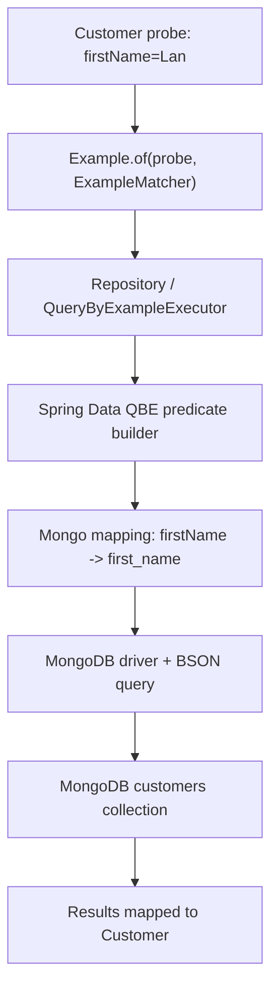
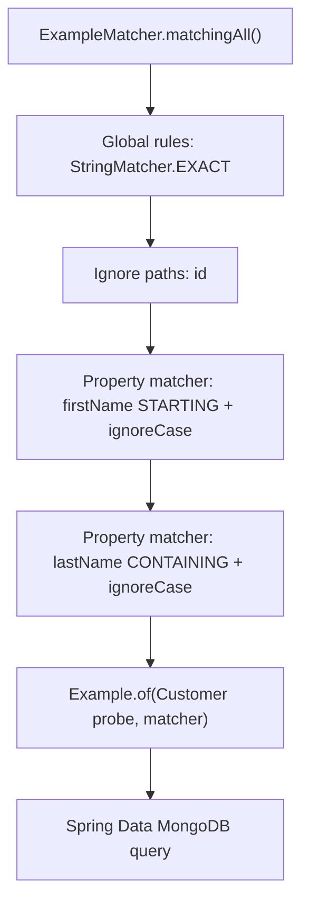
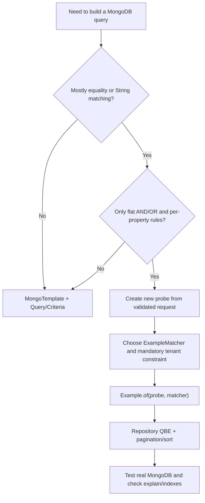

# Creating Probes, Example, and ExampleMatcher in Spring Data MongoDB

## 1. What Is Query by Example and What Problem Does It Solve?

In **Spring Data MongoDB**, in addition to derived queries from method names, `MongoTemplate` with `Query`/`Criteria`, and aggregation, we also have **Query by Example (QBE)**. The idea of QBE is: create a **probe** (*sample object*) of the same type as the entity, set the properties you want to filter on, and then let Spring Data build the query based on those values.

A customer management page might allow searching by name, email, city, or active status. If there are only a few equality and simple string conditions, you do not necessarily have to write a new repository method for every combination:

```text
User selects:
  firstName = "Lan"
  active = true

                 ↓
Customer Probe:
  firstName = "Lan"
  active = true
  other properties = null

                 ↓
Example.of(probe, matcher)

                 ↓
customerRepository.findAll(example)

                 ↓
Documents matching conditions according to ExampleMatcher
```

To understand QBE accurately, it is necessary to distinguish three concepts:

| Component | Role | Example |
|---|---|---|
| **Probe** | Object containing sample values used for filtering | `Customer` with `firstName = "Lan"` |
| **`Example<T>`** | Wraps the probe and matching rules, carrying entity type information | `Example.of(probe, matcher)` |
| **`ExampleMatcher`** | Specifies which properties participate, how strings are matched, case sensitivity, null handling, and AND/OR combination | `matchingAll().withStringMatcher(CONTAINING)` |

QBE is especially well suited for **filtering by properties of a domain object**, when conditions are mainly equality or string operations that can be expressed with a matcher. It **does not replace** the entire MongoDB Query DSL: range conditions `$gt`/`$lt`, nested AND/OR groups, complex `$elemMatch`, aggregation, and queries with specialized operators are usually better suited to `Criteria` or `@Query`.

### 1.1. Learning Objectives

After this lesson in the **Query by Example** chapter, you should be able to:

1. Create a probe using an entity class and know which properties actually produce query conditions.
2. Instantiate `Example.of(probe)` and `Example.of(probe, matcher)`.
3. Use `ExampleMatcher.matchingAll()`, `matchingAny()`, `withIgnorePaths(...)`, `withIncludeNullValues()`, `withStringMatcher(...)`, `withIgnoreCase(...)`, and `withMatcher(...)`.
4. Understand the differences between **exact**, **containing**, **starting**, **ending**, and **regex** matching.
5. Execute QBE via `MongoRepository`/`QueryByExampleExecutor` and know when to switch to `MongoTemplate`/`Criteria`.
6. Properly test BSON mapping, type restrictions, tenant authorization, pagination, and index costs.

## 2. The Customer Model Used in This Lesson

### 2.1. Entity Mapped to MongoDB

Spring Boot example using Spring Data MongoDB with Java 17 or later:

```java
import org.springframework.data.annotation.Id;
import org.springframework.data.mongodb.core.mapping.Document;
import org.springframework.data.mongodb.core.mapping.Field;

@Document(collection = "customers")
public class Customer {
    @Id
    private String id;

    @Field("tenant_id")
    private String tenantId;

    @Field("first_name")
    private String firstName;

    @Field("last_name")
    private String lastName;

    private String email;
    private String city;
    private Boolean active;
    private Integer age;

    public Customer() {}

    public String getId() { return id; }
    public void setId(String id) { this.id = id; }

    public String getTenantId() { return tenantId; }
    public void setTenantId(String tenantId) { this.tenantId = tenantId; }

    public String getFirstName() { return firstName; }
    public void setFirstName(String firstName) { this.firstName = firstName; }

    public String getLastName() { return lastName; }
    public void setLastName(String lastName) { this.lastName = lastName; }

    public String getEmail() { return email; }
    public void setEmail(String email) { this.email = email; }

    public String getCity() { return city; }
    public void setCity(String city) { this.city = city; }

    public Boolean getActive() { return active; }
    public void setActive(Boolean active) { this.active = active; }

    public Integer getAge() { return age; }
    public void setAge(Integer age) { this.age = age; }
}
```

In this entity:

- `@Document(collection = "customers")` specifies the default collection.
- `@Id` maps `id` to BSON `_id`.
- `@Field("first_name")`, `@Field("last_name")`, `@Field("tenant_id")` map Java property names to stored field names.
- `active` uses **`Boolean`** instead of `boolean` and `age` uses **`Integer`** instead of `int` so the probe can distinguish **no filter selected** (null) from **filtering for false/0**.

This is an entity for teaching QBE, not a complete production customer model. In a real application, validation, email uniqueness, personal data policies, and tenant isolation must be designed separately.

### 2.2. Sample Dataset

We will use the following five customers, created **via a Spring Data repository** in tests so Spring Data can write type metadata such as `_class` according to the default configuration:

| ID | tenantId | firstName | lastName | email | city | active | age |
|---|---|---|---|---|---|---|---:|
| C-101 | T-A | Lan | Nguyen | lan.nguyen@example.test | Hà Nội | true | 25 |
| C-102 | T-A | Lanh | Tran | lanh.tran@example.test | TP.HCM | true | 26 |
| C-103 | T-A | Minh Lan | Nguyen | minhlan@example.test | TP.HCM | false | 30 |
| C-104 | T-A | LAN | Le | lan.le@example.test | Đà Nẵng | true | 31 |
| C-201 | T-B | Lan | Nguyen | lan.other@example.test | Hà Nội | true | 36 |

The dataset is designed intentionally:

- `Lan`, `Lanh`, and `Minh Lan` distinguish equality, prefix, and substring matching.
- `LAN` tests ignore-case mode.
- `active = false` tests the difference between null and false.
- `C-201` belongs to another tenant but has `firstName = "Lan"`; this is a mandatory test case to avoid treating QBE as an authorization mechanism.
- BSON field names such as `first_name` differ from the Java property name `firstName`.

Do not run raw insert commands without `_class` and assume they will produce the same results as repository QBE in **typed matching** mode. The section on types and `_class` in section 10 explains this point.

## 3. Creating the Simplest Probe and Example

### 3.1. Creating a Probe

Suppose you only want to find exact `firstName = "Lan"`:

```java
import org.springframework.data.domain.Example;

Customer probe = new Customer();
probe.setFirstName("Lan");

Example<Customer> example = Example.of(probe);
```

`probe` is not a document "to be saved" but an object holding values as filter criteria. It still uses the `Customer` entity class so Spring Data knows the mapping and types. In the default case, reference properties with null values typically **do not participate** in matching; `firstName`, which has a value, will participate.

Because a matcher's defaults may differ from specific needs and to make tests easier to understand, the example can **explicitly declare** exact matching:

```java
import org.springframework.data.domain.Example;
import org.springframework.data.domain.ExampleMatcher;

ExampleMatcher matcher = ExampleMatcher.matchingAll()
    .withStringMatcher(ExampleMatcher.StringMatcher.EXACT)
    .withIgnorePaths("id");

Example<Customer> exactExample = Example.of(probe, matcher);
```

This example means "all included properties must match", and currently only `firstName` is set in the probe. `withIgnorePaths("id")` ensures the ID field does not become a filter even if someone accidentally sets an ID on the probe.

### 3.2. QBE via MongoRepository

Repository:

```java
import org.springframework.data.mongodb.repository.MongoRepository;

public interface CustomerRepository
        extends MongoRepository<Customer, String> {
}
```

In Spring Data MongoDB versions that support QBE, the repository provides `QueryByExampleExecutor` operations such as `findAll(example)`, `findOne(example)`, `count(example)`, and `exists(example)`:

```java
import java.util.List;

List<Customer> matches = customerRepository.findAll(exactExample);

long count = customerRepository.count(exactExample);
boolean exists = customerRepository.exists(exactExample);
```

With the sample dataset and appropriate typed metadata, an exact search for `Lan` may return `C-101` and `C-201`. **There is no tenant filter yet**, so mixing two tenants in the results is the expected query behavior, though **unsuitable** for an API that must enforce tenant isolation.

### 3.3. Processing Flow from Probe to BSON Query



In the simple case, the condition is logically equivalent to:

```javascript
db.customers.find({ first_name: "Lan" });
```

**Do not treat the illustrative BSON above as a 100% exact copy of the actual QBE command.** With typed matching, Spring Data MongoDB may add a type restriction condition on `_class` or type metadata. The final query shape also depends on the matcher, mapping context, and library version.

### 3.4. Create a New Probe for Each Request

`Example.of(...)` holds a reference to the probe; do not share a single mutable `Customer` across multiple requests and overwrite properties sequentially. Wrong pattern:

```java
// Do not place a mutable shared probe like this in a singleton service:
private final Customer sharedProbe = new Customer();
```

Concurrent requests can overwrite each other's filter values. You should create a probe **per search request**, set the exact fields for that request, and then create the corresponding `Example`. `ExampleMatcher` is designed as a reusable/derivable matcher configuration, whereas the probe is request-specific search data that must be isolated.

## 4. ExampleMatcher: matchingAll and matchingAny

### 4.1. matchingAll: All Conditions Must Be True

`ExampleMatcher.matchingAll()` expresses **AND** logic among the properties included in the query.

```java
Customer probe = new Customer();
probe.setFirstName("Lan");
probe.setActive(true);

ExampleMatcher all = ExampleMatcher.matchingAll()
    .withStringMatcher(ExampleMatcher.StringMatcher.EXACT)
    .withIgnorePaths("id");

Example<Customer> example = Example.of(probe, all);
List<Customer> result = customerRepository.findAll(example);
```

The expectation is `firstName` equals `Lan` **and** `active` is true, so in the illustrative dataset this yields `C-101` and `C-201`. `C-104` does not match because `LAN` differs from `Lan` in case-sensitive mode.

### 4.2. matchingAny: Only One Condition Needs to Be True

`ExampleMatcher.matchingAny()` expresses **OR** among the properties included in matching:

```java
Customer probe = new Customer();
probe.setFirstName("Lan");
probe.setActive(true);

ExampleMatcher any = ExampleMatcher.matchingAny()
    .withStringMatcher(ExampleMatcher.StringMatcher.EXACT);

Example<Customer> example = Example.of(probe, any);
List<Customer> result = customerRepository.findAll(example);
```

With OR logic, the results include customers with `firstName = Lan` **or** `active = true`, which includes `C-101`, `C-102`, `C-104`, and `C-201`. `C-103` has `active = false` and `firstName = "Minh Lan"`, so it does not match the exact condition.

### 4.3. Comparison Table

| Matcher | Example Conditions | Semantics |
|---|---|---|
| `matchingAll()` | `firstName = "Lan"`, `active = true` | `firstName = Lan AND active = true` |
| `matchingAny()` | `firstName = "Lan"`, `active = true` | `firstName = Lan OR active = true` |
| `matching()` | Standard matcher factory | Defaults to all-matching in current Spring Data Commons |

**Do not use `matchingAny()` to combine a mandatory tenant condition with optional user filters.** For example, `tenantId = T-A OR firstName = Lan` would allow customer `C-201` from `T-B` to appear because the name matches. When a security condition must hold across all branches, use `matchingAll()` for appropriate fields or build `Criteria` with a mandatory AND wrapping the OR group.

## 5. Controlling Participating Fields: null and withIgnorePaths

### 5.1. QBE Normally Ignores null Reference Properties

In the example:

```java
Customer probe = new Customer();
probe.setCity("Hà Nội");
// firstName, lastName, active, age... remain null.

Example<Customer> example = Example.of(probe);
```

`city = "Hà Nội"` participates in the query, while unassigned reference fields with `null` by default do not produce conditions. This is why probes are useful for forms with optional filters.

**Null in a probe has two easily confused meanings:**

1. "The user did not select this filter" — matches the default ignore-null behavior.
2. "The user wants to find documents with BSON null" — **cannot** be expressed by the same ignore-null behavior; requires a dedicated matcher/configuration or `Criteria`.

If you must distinguish accurately between **missing field** and **existing field with null value**, use MongoDB `$exists` and `$type`/appropriate `Criteria`; QBE is not the ideal tool for expressing every BSON state.

### 5.2. withIgnorePaths Excludes Fields Regardless of Value

Suppose the probe comes from another object and contains an `id` value, but you want to search by name and not filter by ID:

```java
Customer probe = new Customer();
probe.setId("C-101");
probe.setLastName("Nguyen");
probe.setActive(true);

ExampleMatcher matcher = ExampleMatcher.matchingAll()
    .withIgnorePaths("id")
    .withStringMatcher(ExampleMatcher.StringMatcher.EXACT);

Example<Customer> example = Example.of(probe, matcher);
```

The QBE condition focuses on `lastName = Nguyen` and `active = true`, even though `id` is non-null. With the sample data, the logical results are `C-101` and `C-201`; `C-103` is excluded as inactive.

Example ignoring multiple fields:

```java
ExampleMatcher matcher = ExampleMatcher.matchingAll()
    .withIgnorePaths("id", "age", "email");
```

When a property is ignored, its value is no longer a query condition even if set on the probe. Review the list of ignored fields carefully to avoid dropping a mandatory business condition.

### 5.3. Primitives Always Have Default Values

If an entity declares:

```java
private boolean active; // false even without calling setActive(...)
private int age;        // 0 even without calling setAge(...)
```

then a newly created probe cannot use null to express "no filter selected". Depending on how QBE handles types, default primitive fields such as `false` or `0` may be included in conditions and produce unintended results.

Options:

- In the lesson's sample entity, use `Boolean active` and `Integer age` to allow an absent state.
- Or explicitly call `withIgnorePaths("active", "age")` if those filters are not supposed to participate.
- Or replace QBE with a request DTO and `Criteria` when distinguishing multiple states or executing range conditions.

Conversely, **`false` and `0` must be preserved** if the user actually chose them. Do not write:

```java
if (Boolean.TRUE.equals(request.active())) {
    probe.setActive(true);
}
// Wrong if the user wants to filter active=false.
```

Instead write:

```java
if (request.active() != null) {
    probe.setActive(request.active());
}
```

### 5.4. withIncludeNullValues and Null Limitations in MongoDB

`ExampleMatcher.withIncludeNullValues()` instructs QBE to include null values in matching conditions instead of ignoring them:

```java
Customer probe = new Customer();
probe.setFirstName("Lan");

ExampleMatcher matcher = ExampleMatcher.matchingAll()
    .withIncludeNullValues();

Example<Customer> example = Example.of(probe, matcher);
```

**Do not use this pattern to search for `firstName = Lan` on an entity with many null fields:** the matcher may include **every other null property** in the criteria, making results overly narrow or dependent on missing/null data. If the goal is "email is missing" or "email is BSON null", use `Criteria.where("email").is(null)` or `exists(...)` with well-defined semantics.

In MongoDB, an equality condition against `null` can match both fields holding BSON null **and non-existent fields**. When a field has multiple data states, you must write integration tests checking `null`, missing, empty string, and empty array explicitly; do not treat them as identical.

## 6. StringMatcher: EXACT, STARTING, ENDING, CONTAINING, REGEX

### 6.1. Keywords for String Matching

`ExampleMatcher.StringMatcher` specifies how String properties are matched:

| Value | Intent | Logically Equivalent MongoDB Representation | With probe `firstName = "Lan"` |
|---|---|---|---|
| `EXACT` | Equals the entire string | Equality or fully anchored regex depending on mapper mechanism | `C-101`, `C-201` |
| `STARTING` | Starts with the string | Regex like `^Lan` | `C-101`, `C-102`, `C-201` |
| `ENDING` | Ends with the string | Regex like `Lan$` | `C-101`, `C-103`, `C-201` |
| `CONTAINING` | Contains the string anywhere | Regex containing literal `Lan` | `C-101`, `C-102`, `C-103`, `C-201` |
| `REGEX` | Treats probe value as a regex pattern | `$regex` query using the pattern | Depends on pattern |
| `DEFAULT` | Default store/framework matching behavior | Check library version and store type | Avoid when an explicit search contract is needed |

The result sets above assume **case-sensitive**, valid typed metadata, and no tenant filter added yet. `C-104` with `firstName = "LAN"` only appears when case-insensitive matching is enabled.

The regex patterns in the table are meant to convey intent; Spring Data may use `Pattern` and escape characters in its own way. Do not assume illustrative JSON is a byte-for-byte representation of the actual query command.

### 6.2. Global StringMatcher Applied to Multiple String Properties

Example finding customers whose `firstName` and `lastName` **both contain** the entered text fragments:

```java
Customer probe = new Customer();
probe.setFirstName("Lan");
probe.setLastName("Ng");

ExampleMatcher matcher = ExampleMatcher.matchingAll()
    .withStringMatcher(
        ExampleMatcher.StringMatcher.CONTAINING)
    .withIgnorePaths("id");

Example<Customer> example = Example.of(probe, matcher);
```

The global `CONTAINING` applies to matched String properties (except properties with their own matcher). For the sample data in case-sensitive mode, `C-101`, `C-103`, and `C-201` match a first name containing `Lan` and a last name containing `Ng`.

**Be careful with identifier fields:** If the probe also contains `tenantId = "T-A"`, a global `CONTAINING` may turn the tenant condition into a substring match instead of equality. For tenant conditions or important codes, set `EXACT` as the global matcher and only use `CONTAINING` on allowed text-search properties.

### 6.3. Global ExampleMatcher.ignoreCase

`withIgnoreCase()` requests case-insensitive matching for eligible String properties:

```java
Customer probe = new Customer();
probe.setFirstName("lan");

ExampleMatcher matcher = ExampleMatcher.matchingAll()
    .withStringMatcher(
        ExampleMatcher.StringMatcher.CONTAINING)
    .withIgnoreCase();

Example<Customer> example = Example.of(probe, matcher);
```

With `lan` and CONTAINING + ignore case, all of `C-101`, `C-102`, `C-103`, `C-104`, and `C-201` match by first name. However, this is **not** accent-insensitive or full-text search: `IgnoreCase` does not automatically strip Vietnamese diacritics, perform Unicode normalization, or correct typos.

`IgnoreCase` relies on the corresponding MongoDB matcher/regex case-insensitive mechanism. It does not guarantee the query can use a B-tree index with case-insensitive collation efficiently; run `explain` on realistic workloads.

### 6.4. StringMatcher.REGEX and Trust Boundaries

`REGEX` allows treating the probe value as a regular expression. Example:

```java
Customer probe = new Customer();
probe.setFirstName("^Lan(h)?$");

ExampleMatcher matcher = ExampleMatcher.matchingAll()
    .withStringMatcher(
        ExampleMatcher.StringMatcher.REGEX);

Example<Customer> example = Example.of(probe, matcher);
```

Under regex syntax, `^Lan(h)?$` matches `Lan` and `Lanh`. Do not pass input from free-text search forms directly into `REGEX`; `.`, `*`, `[`, repetition groups, and metacharacters can change meaning or produce broad, slow queries.

For **strings meant to be matched literally**, use `CONTAINING`/`STARTING`/`ENDING` or `Criteria` with `Pattern.quote(...)` when building regex manually. When a product truly allows regex, enforce length limits, execution permissions, complexity limits, result limits, and query timeouts; explicitly test edge cases.

### 6.5. Choosing a Matcher by UX Use Case

| UX Feature | Typical Suitable Matcher | Notes |
|---|---|---|
| Exact customer code lookup | `EXACT` | Never use `CONTAINING` for identifiers |
| Name autocomplete by prefix | `STARTING` | Check indexes and case sensitivity |
| Search name containing text | `CONTAINING` | Substring regex can be resource-intensive |
| Search domain/email suffix | `ENDING` | Usually hard to optimize with standard B-tree indexes |
| Controlled admin regex query | `REGEX` | Never use directly for untrusted free-text input |
| Case-insensitive exact match | `EXACT` + `ignoreCase` | Consider canonical fields/collation for heavy equality workloads |

## 7. Per-Property Matchers: withMatcher and withIgnoreCase("...")

### 7.1. Why Isn't a Global Matcher Enough?

Real systems often want:

- `tenantId`: **exact** and case-sensitive according to code format.
- `firstName`: **starts with**, case-insensitive.
- `lastName`: **contains**, case-insensitive.
- `active`: **exact boolean**.

With different requirements on the same probe, you must use per-property matchers:

```java
import org.springframework.data.domain.Example;
import org.springframework.data.domain.ExampleMatcher;

Customer probe = new Customer();
probe.setTenantId("T-A");
probe.setFirstName("lan");
probe.setActive(true);

ExampleMatcher matcher = ExampleMatcher.matchingAll()
    .withStringMatcher(
        ExampleMatcher.StringMatcher.EXACT)
    .withMatcher("firstName",
        ExampleMatcher.GenericPropertyMatchers
            .startsWith().ignoreCase())
    .withIgnorePaths("id");

Example<Customer> example = Example.of(probe, matcher);
```

The expectation is:

```text
tenantId = T-A
  AND firstName startsWith("lan"), ignoreCase
  AND active = true
```

On the sample data, results include `C-101`, `C-102`, and `C-104`. `C-103` starts with `Minh` and has `active=false`; `C-201` belongs to tenant `T-B` and is excluded.

### 7.2. Customizing Multiple Properties Independently

```java
Customer probe = new Customer();
probe.setTenantId("T-A");
probe.setFirstName("la");
probe.setLastName("ng");

ExampleMatcher matcher = ExampleMatcher.matchingAll()
    .withStringMatcher(
        ExampleMatcher.StringMatcher.EXACT)
    .withMatcher("firstName",
        ExampleMatcher.GenericPropertyMatchers
            .startsWith().ignoreCase())
    .withMatcher("lastName",
        ExampleMatcher.GenericPropertyMatchers
            .contains().ignoreCase())
    .withIgnorePaths("id");

Example<Customer> example = Example.of(probe, matcher);
```

Here `firstName` uses prefix matching and `lastName` uses substring matching. Other String properties, if populated, still follow the global EXACT setting. This is a better strategy than setting `CONTAINING + ignoreCase` for **all String properties** when the entity has a tenant ID, email, or identifiers.

### 7.3. withIgnoreCase Only for Necessary Properties

When String properties share the same match style but only one field needs case-insensitivity:

```java
ExampleMatcher matcher = ExampleMatcher.matchingAll()
    .withStringMatcher(
        ExampleMatcher.StringMatcher.EXACT)
    .withIgnoreCase("firstName")
    .withIgnorePaths("id");
```

`withIgnoreCase("firstName")` targets only the listed property. If multiple properties need it, pass multiple names:

```java
ExampleMatcher matcher = ExampleMatcher.matchingAll()
    .withIgnoreCase("firstName", "lastName");
```

The paths passed to `withIgnorePaths`, `withMatcher`, and `withIgnoreCase` are **Java domain property paths**, not BSON field names. In the example, use `"firstName"`, **not** `"first_name"`. `@Field` handles conversion to the stored name during query execution.

### 7.4. PropertyValueTransformer

`ExampleMatcher` also lets you transform a property's value before building the predicate. For example, normalizing only the email on the probe:

```java
import java.util.Locale;
import org.springframework.data.domain.ExampleMatcher;

ExampleMatcher matcher = ExampleMatcher.matchingAll()
    .withTransformer(
        "email",
        source -> source.map(value ->
            (Object) value.toString().trim()
                .toLowerCase(Locale.ROOT)));
```

`PropertyValueTransformer` operates on the probe's value; it **does not bulk-modify stored documents**. If the database stores emails in mixed case and the transformer only lowercases input and then uses exact comparison, results may still not match. You must enforce consistent normalization on write, or use a genuinely suitable case-insensitive strategy.

In typical systems, you should normalize necessary inputs **before creating the probe** so validation, logging, and conversion share the same interpretation. Transformers are useful when you want to encapsulate a specialized, tested matching rule.

### 7.5. Configuration Diagram from Global to Per-Property



Do not design a matcher more complex than business requirements demand. If a filter needs many kinds of MongoDB operators, `ExampleMatcher`'s expressiveness quickly hits its limit and `Criteria` becomes clearer.

## 8. QBE with Repositories: findAll, findOne, exists, count, and Pagination

### 8.1. Familiar APIs

Spring Data Commons defines `QueryByExampleExecutor<T>`. MongoDB repositories implement the corresponding QBE capabilities, so a standard `MongoRepository<Customer, String>` can call:

```java
Customer probe = new Customer();
probe.setEmail("lan.nguyen@example.test");

Example<Customer> example = Example.of(
    probe,
    ExampleMatcher.matchingAll()
        .withStringMatcher(
            ExampleMatcher.StringMatcher.EXACT)
);

var one = customerRepository.findOne(example);
var all = customerRepository.findAll(example);
var count = customerRepository.count(example);
var exists = customerRepository.exists(example);
```

| API | Return Value | When to Use |
|---|---|---|
| `findOne(example)` | `Optional<Customer>` | Expecting **at most one** result |
| `findAll(example)` | `List<Customer>` or corresponding collection type | Small sets with an appropriate bound |
| `findAll(example, sort)` | Sorted list | When deterministic ordering is needed |
| `findAll(example, pageable)` | `Page<Customer>` | When page content and total count are needed |
| `count(example)` | `long` | Counting matching documents |
| `exists(example)` | `boolean` | Checking for at least one result |

**`findOne` does not guarantee uniqueness by itself.** If the probe matches multiple documents, the API may throw an unexpected result-size exception rather than picking a random item. If emails must be unique per tenant, design an appropriate data/index constraint; checking uniqueness by calling `exists` followed by a separate `insert` still has a race condition.

### 8.2. Sorting by Java Property

```java
import org.springframework.data.domain.Sort;

Sort sort = Sort.by(
    Sort.Order.asc("firstName"),
    Sort.Order.asc("id")
);

List<Customer> ordered = customerRepository.findAll(
    example, sort);
```

`firstName` is the entity property; Spring Data mapping translates it to BSON `first_name`. Adding `id` keeps ordering stable when multiple customers share the same first name. Without sorting, **there is no guarantee of result order** even if an example table lists IDs in ascending order.

### 8.3. Paginating Results

```java
import org.springframework.data.domain.Page;
import org.springframework.data.domain.PageRequest;
import org.springframework.data.domain.Pageable;
import org.springframework.data.domain.Sort;

Pageable pageable = PageRequest.of(
    0, 20,
    Sort.by(
        Sort.Order.asc("firstName"),
        Sort.Order.asc("id"))
);

Page<Customer> page = customerRepository.findAll(
    example, pageable);

System.out.println(page.getContent().size());
System.out.println(page.getTotalElements());
```

`PageRequest.of(...)` uses a **0-based** page index. `Page` typically requires total information and may trigger a count query, which is expensive with regex or large datasets. If the UI only needs to know whether a next page exists, consider `Slice` or an appropriate query API, depending on the Spring Data version in use.

In public APIs, users **must not choose arbitrary page sizes**. Cap `size`, offset, and sort fields against an approved allowlist; avoid passing client-supplied property paths directly into `Sort.by(...)`.

### 8.4. QBE with Repositories Rather Than Default MongoTemplate

QBE is commonly used directly on repositories via `QueryByExampleExecutor`. `MongoTemplate` is suitable when you want to write `Query`/`Criteria`, target a different collection, use custom projections, perform updates, or combine complex operators.

Some Spring Data MongoDB versions support converting an `Example` into criteria via `Criteria.alike(example)` or a corresponding mechanism. However, **once you need nested AND/OR, ranges, tenant policies, and index tuning**, it is usually clearer to build the query explicitly with `Criteria` rather than using QBE and bolting on ad-hoc conditions.

Do not assume an `Example` can be passed directly into every overload of `MongoTemplate.find(...)`; template methods and QBE executors have different signatures/contracts.

### 8.5. Reactive QBE

Reactive Spring Data MongoDB applications can use the corresponding `ReactiveQueryByExampleExecutor` APIs when the reactive repository and framework version support them:

```java
import org.springframework.data.mongodb.repository.ReactiveMongoRepository;

public interface ReactiveCustomerRepository
        extends ReactiveMongoRepository<Customer, String> {
}
```

Service example:

```java
Customer probe = new Customer();
probe.setFirstName("Lan");

Example<Customer> example = Example.of(probe);

reactor.core.publisher.Flux<Customer> result =
    reactiveCustomerRepository.findAll(example);
```

Here `reactiveCustomerRepository` is injected and reactive MongoDB infrastructure is configured. Constructing `Example`/`ExampleMatcher` follows the same concepts, but reactive return types must be subscribed/composed properly; do not call `block()` inside a reactive request pipeline just to convert results into a synchronous list.

Depending on the Spring Data version, you can declare `ReactiveQueryByExampleExecutor<Customer>` directly or extend the appropriate repository. When implementing, verify the actual interface in your project's dependencies.

## 9. Building Probes Safely from Search Forms

### 9.1. Request DTOs Are Not Entities

Do not bind the entire request JSON directly into `Customer` and pass the whole object into `Example.of(...)`. The entity may contain ID, tenant, internal state, or fields that users must not control. Instead, define a request DTO containing only public filters:

```java
public record CustomerSearchRequest(
    String firstNamePrefix,
    String lastNameContains,
    Boolean active,
    Integer age
) {}
```

The following values have distinct meanings:

```text
firstNamePrefix = null    → do not filter by first name
firstNamePrefix = ""      → treat as empty input or return an error, per API contract
active = null             → do not filter by active status
active = false            → filter for customers with active=false
age = null                → do not filter by age
age = 0                   → filter for age equal to 0 if business rules allow
```

The rule "blank strings are ignored" is an **API design decision**. Some products should return HTTP 400 for blank values to avoid overly broad queries; do not rely on incidental `StringMatcher` behavior with empty strings.

### 9.2. Mapping from Request to a New Probe

```java
import java.util.List;
import org.springframework.data.domain.Example;
import org.springframework.data.domain.ExampleMatcher;
import org.springframework.data.domain.Sort;
import org.springframework.stereotype.Service;

@Service
public class CustomerSearchService {
    private final CustomerRepository repository;

    public CustomerSearchService(CustomerRepository repository) {
        this.repository = repository;
    }

    public List<Customer> search(
            CustomerSearchRequest input,
            String trustedTenantId) {

        if (input == null || trustedTenantId == null
                || trustedTenantId.isBlank()) {
            throw new IllegalArgumentException("Missing search context");
        }
        validate(input);

        Customer probe = new Customer();
        probe.setTenantId(trustedTenantId);
        if (hasText(input.firstNamePrefix())) {
            probe.setFirstName(input.firstNamePrefix().trim());
        }
        if (hasText(input.lastNameContains())) {
            probe.setLastName(input.lastNameContains().trim());
        }
        if (input.active() != null) {
            probe.setActive(input.active());
        }
        if (input.age() != null) {
            probe.setAge(input.age());
        }

        ExampleMatcher matcher = ExampleMatcher.matchingAll()
            .withStringMatcher(ExampleMatcher.StringMatcher.EXACT)
            .withMatcher("firstName",
                ExampleMatcher.GenericPropertyMatchers
                    .startsWith().ignoreCase())
            .withMatcher("lastName",
                ExampleMatcher.GenericPropertyMatchers
                    .contains().ignoreCase())
            .withIgnorePaths("id");

        Example<Customer> example = Example.of(probe, matcher);

        return repository.findAll(
            example,
            Sort.by(
                Sort.Order.asc("firstName"),
                Sort.Order.asc("id"))
        );
    }

    private static boolean hasText(String value) {
        return value != null && !value.isBlank();
    }

    private static void validate(CustomerSearchRequest input) {
        if (input.firstNamePrefix() != null
                && input.firstNamePrefix().length() > 80) {
            throw new IllegalArgumentException("First name too long");
        }
        if (input.lastNameContains() != null
                && input.lastNameContains().length() > 80) {
            throw new IllegalArgumentException("Last name too long");
        }
        if (input.age() != null
                && (input.age() < 0 || input.age() > 150)) {
            throw new IllegalArgumentException("Age out of range");
        }
    }
}
```

This example is for illustration, so the method returns a `List` without `Pageable`/limit. For public endpoints on large collections, you must add pagination and rate limits before deployment; do not treat an unbounded `List` as an appropriate default.

### 9.3. Why Must tenantId Come from the Server?

`trustedTenantId` must come from a security context or an authenticated/authorized source, **not from a client-supplied query parameter**. `ExampleMatcher.matchingAll()` combines `tenantId = trustedTenantId` with the remaining filters using AND.

Conversely, if you use `matchingAny()` with the same probe:

```text
(tenantId = T-A) OR (firstName starts with "lan")
```

then customer `C-201` from `T-B` may be returned. **A matcher choice directly affects data authorization**, not just search syntax.

To enforce tenant policies so they are hard to overlook, consider a repository/service query factory using mandatory `Criteria`:

```java
import java.util.regex.Pattern;
import org.springframework.data.mongodb.core.query.Criteria;
import org.springframework.data.mongodb.core.query.Query;

Criteria tenant = Criteria.where("tenantId")
    .is(trustedTenantId);

Criteria name = Criteria.where("firstName")
    .regex(Pattern.compile(
        "^" + Pattern.quote("lan"),
        Pattern.CASE_INSENSITIVE));

Query query = Query.query(
    new Criteria().andOperator(tenant, name));

List<Customer> result =
    mongoTemplate.find(query, Customer.class);
```

In the snippet above, `mongoTemplate` is a bean injected into a service. `Criteria` makes clear that the tenant filter is a mandatory condition outside any future OR groups. With pure QBE, security policy enforcement must be thoroughly tested and clients must never control the global matcher.

### 9.4. If Users Can Choose Search Fields

QBE only matches properties set on the probe, but that does not automatically turn it into a "search any field" API. Do not use reflection or `BeanUtils` to copy a `Map<String,Object>` from a request into an entity by arbitrary field name:

```java
// Anti-pattern:
// request.fields().forEach((key, value) ->
//     BeanUtils.setProperty(probe, key, value));
```

Use an **allowlist mapping public fields to explicit setters**. Example:

| Public Key | Allowed Java Property | Matcher |
|---|---|---|
| `firstName` | `firstName` | STARTING, ignoreCase |
| `lastName` | `lastName` | CONTAINING, ignoreCase |
| `active` | `active` | EXACT |
| `age` | `age` | EXACT |
| `tenantId` | **Not client-selectable** | Mandatory equality from server |
| `id` | Not exposed as a free-form filter in this example | Ignore or separate ID lookup API |

Beyond the allowlist, validate types, lengths, maximum number of conditions, and pagination/sort policies. If users need to choose operators like `>`, `<=`, multiple `OR` branches, or nested paths, consider building `Criteria` from a server-controlled business filter language instead of forcing QBE into an unsuitable problem.

## 10. Typed Matching, _class, and Legacy Documents

### 10.1. How Does MongoDB Store Type Metadata?

Spring Data MongoDB commonly stores a Java entity's type hint in the BSON `_class` field by default, for example:

```javascript
{
  _id: "C-101",
  tenant_id: "T-A",
  first_name: "Lan",
  last_name: "Nguyen",
  active: true,
  _class: "com.example.crm.Customer"
}
```

The type name here is **illustrative**; actual Java packages and type aliases depend on the application. `_class` may differ or be absent when a system uses type aliases, a custom `MongoTypeMapper`, raw driver writes, or data migrated from another system.

QBE in Spring Data MongoDB can use **typed matching** to restrict documents to those compatible with the probe's type. Therefore, an `Example<Customer>` will not necessarily return documents that share the same fields but carry another class's `_class` or lack a type hint, depending on matcher, version, and configuration.

### 10.2. Why Can Raw Inserts Produce Different Results?

Suppose a document is inserted directly via `mongosh`:

```javascript
db.customers.insertOne({
  _id: "C-RAW",
  tenant_id: "T-A",
  first_name: "Lan",
  active: true
  // Missing _class
});
```

A QBE query with type restriction may not return `C-RAW`, even though its field values appear to match. This is **different** from a field-name error or a `StringMatcher` error. You need to inspect the generated query, stored type hints, subtypes, and custom mappings.

Some versions of Spring Data MongoDB provide `UntypedExampleMatcher` to create a matcher that does not apply type restrictions on `_class`. Usage idea:

```java
// Illustrative when the Spring Data MongoDB version supports
// UntypedExampleMatcher and its corresponding import.
ExampleMatcher matcher = UntypedExampleMatcher.matching()
    .withStringMatcher(ExampleMatcher.StringMatcher.EXACT);

Example<Customer> example = Example.of(probe, matcher);
```

Do not switch to an untyped matcher reflexively when a query returns empty: removing the type constraint can cause the query to return documents belonging to other subtypes/schemas that cannot be read as `Customer` or must not be exposed by the API. Before changing it, check the documentation and API of the **Spring Data MongoDB version** you are running, along with your system's schema/tenant contract.

### 10.3. Distinguishing Class Matching from Tenant Filtering

`_class` describes Java type mapping metadata; **it is not an authorization condition**. Two customers from different tenants still share the same `_class`. Conversely, the same tenant may contain multiple classes/subtypes.

Do not treat "typed QBE only matches the Customer class" as proof that an API only reads the right tenant. Tenant/role conditions must be enforced independently and tested with data having different `tenant_id` values.

### 10.4. Class Refactoring and Legacy Schemas

When renaming Java packages/classes or switching to type aliases, older documents with a different `_class` may need conversion/migration or an appropriate matcher. Do not bulk-modify data just to "fix QBE" without knowing whether the application still relies on `_class` for polymorphic mapping.

Basic check in `mongosh`:

```javascript
db.customers.aggregate([
  {
    $group: {
      _id: { $type: "$_class" },
      count: { $sum: 1 }
    }
  }
]);
```

The output shows the distribution of BSON types of `_class` (e.g., String and missing), without revealing the specific class values. If you need to inspect the type hint values, you can group by `"$_class"` in an authorized environment. Never expose internal class names or sensitive user data in public logs.

## 11. When Should You Not Use Query by Example?

QBE focuses on **building equality/String matching from a sample object**, not every feature of the MongoDB query language.

| Requirement | Is Pure QBE Suitable? | Mechanism to Consider |
|---|---|---|
| Equality on simple properties | Yes | `Example.of(probe)` |
| String prefix, substring, or suffix | Yes | `ExampleMatcher.StringMatcher` |
| Per-property ignore case | Yes | `withIgnoreCase(...)`/`withMatcher(...)` |
| Flat AND or OR between properties | Yes | `matchingAll()` or `matchingAny()` |
| Date range `[from, until)` | Not naturally expressible | `Criteria.gte(...).lt(...)` |
| `age >= 18` or `total > 10000` | Not QBE equality | `Criteria.gte/gt` |
| `A AND (B OR C)` | Hard/cannot be expressed accurately with flat matchingAll/Any | `Criteria.andOperator/orOperator` |
| Exact missing/null field checks | Limited | `Criteria.is(null)`, `exists(...)`, `type(...)` |
| Multiple conditions on the same array element | Not suitable | `Criteria.elemMatch(...)` |
| Array contains all/in with explicit semantics | Not suitable as a free-form query | `Criteria.in/all` |
| Text search, aggregation, geo, vector search | No | `MongoTemplate`/aggregation or dedicated API |
| Querying across collections or database routing | Not decided by matcher | Template/factory and routing design |
| Multi-tenant with complex OR conditions | Do not use arbitrary matcher | Query factory with mandatory tenant AND |

### 11.1. QBE Is Not a "Query Guessing" Engine

If a probe has `age = 25`, it expresses **equals 25**, not "greater than 25" or "around 25". If a probe has `firstName = "Lan"`, results depend on the chosen matcher; QBE does not infer user intent such as weighted approximate search, accent-insensitive search, or fuzzy matching.

### 11.2. Nested Objects and Collections Require Testing Known Limits

Nested property paths can be handled by Spring Data according to domain metadata in certain cases, but **you should not treat QBE as a direct replacement for `$elemMatch`, `$all`, dynamic map keys, or nested operator groups**. For embedded arrays such as `addresses[]`, a probe containing an object can have different semantics from "there exists an element matching both city and country conditions".

When a query depends on multiple conditions on the **same array element**, write `Criteria.where("addresses").elemMatch(...)` and test with a document where the conditions match across two different elements.

### 11.3. When to Switch Entirely to Criteria

Suppose the UI needs:

> Only tenant T-A customers; age between 18 and 30; and (firstName starts with Lan or city = Hà Nội).

This is a logical structure that should be expressed explicitly:

```java
import java.util.regex.Pattern;
import org.springframework.data.mongodb.core.query.Criteria;
import org.springframework.data.mongodb.core.query.Query;

Query query = Query.query(
    new Criteria().andOperator(
        Criteria.where("tenantId").is("T-A"),
        Criteria.where("age").gte(18).lte(30),
        new Criteria().orOperator(
            Criteria.where("firstName").regex(
                Pattern.compile(
                    "^" + Pattern.quote("Lan"),
                    Pattern.CASE_INSENSITIVE)),
            Criteria.where("city").is("Hà Nội")
        )
    )
);

List<Customer> result =
    mongoTemplate.find(query, Customer.class);
```

This is sample code inside a service with an injected `mongoTemplate`. The actual tenant value must come from a trusted security context. `Criteria` clarifies each condition group, allowing you to inspect the BSON query, choose indexes, and manage timeouts/pagination per API.

**Tool selection rule:** Use QBE when the business question reads like "find documents whose properties resemble a sample object under a few string rules." Use `Criteria` when the question requires **operators, condition grouping, access scoping, or performance constraints** that QBE cannot express clearly.

## 12. Indexes, Regex, and ExampleMatcher Performance

### 12.1. QBE Does Not Create Indexes or Guarantee Fast Queries

`ExampleMatcher` defines **matching semantics**; it does not automatically create indexes and has no hidden mechanism to make a substring query run faster than an equivalent `$regex` in MongoDB.

| Matcher Type | Logically Equivalent Query | Typical Index Usability |
|---|---|---|
| `EXACT` on String, case-sensitive | Equality | Often benefits if an appropriate index exists |
| `STARTING` on String, case-sensitive | Anchored prefix regex | Can use index range scans effectively |
| `CONTAINING` | Unanchored substring regex | Often hard to leverage index range scans |
| `ENDING` | Suffix regex | Often hard to leverage index range scans |
| `EXACT` + ignoreCase | Case-insensitive match, often involving regex | Does not benefit from collation indexes by default |
| `CONTAINING` + ignoreCase | Substring regex with `i` | May require broad scans |
| Complex `REGEX` | Caller-defined regex | Cost depends on prefix, flags, and pattern |

For example, when most queries filter by `tenantId` and search by `firstName` prefix, a candidate index to test is:

```javascript
db.customers.createIndex(
  { tenant_id: 1, first_name: 1, _id: 1 },
  { name: "ix_customer_tenant_first_name" }
);
```

For equality queries by email within a tenant:

```javascript
db.customers.createIndex(
  { tenant_id: 1, email: 1 },
  {
    unique: true,
    name: "ux_customer_tenant_email"
  }
);
```

The unique index in this example applies according to **BSON equality and the index's collation**. If business rules require case-insensitive unique emails, you must define a canonical email or appropriate collation and migrate data, rather than relying on `ExampleMatcher.withIgnoreCase()` to enforce uniqueness.

### 12.2. Reading explain to Verify the Design

Equivalent queries can be tested in `mongosh`:

```javascript
// Equality by tenant and firstName.
db.customers.find({
  tenant_id: "T-A",
  first_name: "Lan"
}).explain("executionStats");

// Case-sensitive prefix.
db.customers.find({
  tenant_id: "T-A",
  first_name: /^Lan/
}).explain("executionStats");

// Case-insensitive substring.
db.customers.find({
  tenant_id: "T-A",
  first_name: /lan/i
}).explain("executionStats");
```

With a dataset of only five customers, MongoDB may choose `COLLSCAN` because the collection is tiny. Test on data whose scale, cardinality, and distribution resemble production rather than drawing conclusions from a single explain output.

Notes:

- `IXSCAN` shows an index was used, but does not prove the index scan is selective enough.
- `totalKeysExamined` and `totalDocsExamined` relative to `nReturned` show how much data the query had to inspect.
- Index field names use **BSON fields** `first_name`, `tenant_id`, whereas `ExampleMatcher.withMatcher("firstName", ...)` uses **Java properties**.
- With typed QBE, the actual query may include a type condition on `_class`; factor this in when designing indexes and reading execution plans.

### 12.3. Case-Insensitive Regex Is Not Equivalent to Collation

MongoDB supports **collation** for locale-aware equality/sorting and case/diacritic sensitivity levels. However, `$regex` is not collation-aware in the same way standard equality/sort operations are; having a collation-based case-insensitive index does not mean a QBE ignore-case regex will use that index effectively.

For workloads dominated by case-insensitive email or code lookups, consider:

1. Storing a normalized `emailLookup` according to defined rules and indexing it.
2. Using equality with appropriate collation/index.
3. Keeping the original `email` for display if user formatting must be preserved.

Do not lowercase Vietnamese names and assume you have solved accent-insensitive search or Unicode canonicalization; those requirements need explicit rules and real language tests.

### 12.4. Resource Limits for QBE

When using QBE for a public search page:

- Limit string lengths, the number of filtered properties, and page result counts.
- Do not accept arbitrary `REGEX` if the UI only needs literal text.
- Use a stable sort with an appropriate property + `id` when paginating.
- Check common queries with `explain`, especially `CONTAINING + ignoreCase`.
- Monitor P95/P99 latency, query counts, documents examined, and count costs.
- Enforce tenant authorization independently of matcher shape.

Many QBE performance issues actually stem from **schema, MongoDB indexes, and operator types**. Increasing connection pools or timeouts does not turn a substring regex into an index-supported prefix query.

## 13. Integration Testing Example and ExampleMatcher

### 13.1. Why Do Tests Need Real MongoDB?

Mocking `CustomerRepository.findAll(example)` only checks that the service called the repository; it does not verify:

- Whether `ExampleMatcher` generates the intended AND/OR conditions.
- That property `firstName` maps to BSON `first_name`.
- Whether null fields are ignored or included.
- Whether `_class` type hints affect results.
- How `CONTAINING`, `STARTING`, ignoreCase, and regex execute on MongoDB.
- Whether a query for tenant `T-A` accidentally returns customer `T-B`.

You should have integration tests against an isolated MongoDB instance (e.g., Testcontainers or a dedicated test MongoDB) and seed via the **Spring Data repository** so mapping/type metadata stays consistent with the tested query path.

### 13.2. JUnit 5 + AssertJ: Seeding Data via Repository

The test below uses the `Customer` entity from section 2 and `CustomerRepository` from section 3. The test database configuration must be isolated; `deleteAll()` will delete all customers in the **test database**:

```java
import java.util.List;

import org.junit.jupiter.api.BeforeEach;
import org.junit.jupiter.api.Test;
import org.springframework.beans.factory.annotation.Autowired;
import org.springframework.boot.test.autoconfigure.data.mongo.DataMongoTest;
import org.springframework.data.domain.Example;
import org.springframework.data.domain.ExampleMatcher;
import org.springframework.data.domain.PageRequest;
import org.springframework.data.domain.Sort;

import static org.assertj.core.api.Assertions.assertThat;

@DataMongoTest
class CustomerQueryByExampleTest {
    @Autowired
    CustomerRepository repository;

    @BeforeEach
    void seed() {
        repository.deleteAll(); // ONLY use an isolated test database.
        repository.saveAll(List.of(
            customer("C-101", "T-A", "Lan", "Nguyen",
                "lan.nguyen@example.test", "Hà Nội", true, 25),
            customer("C-102", "T-A", "Lanh", "Tran",
                "lanh.tran@example.test", "TP.HCM", true, 26),
            customer("C-103", "T-A", "Minh Lan", "Nguyen",
                "minhlan@example.test", "TP.HCM", false, 30),
            customer("C-104", "T-A", "LAN", "Le",
                "lan.le@example.test", "Đà Nẵng", true, 31),
            customer("C-201", "T-B", "Lan", "Nguyen",
                "lan.other@example.test", "Hà Nội", true, 36)
        ));
    }

    private static Customer customer(
            String id, String tenant, String first, String last,
            String email, String city, boolean active, int age) {
        Customer c = new Customer();
        c.setId(id);
        c.setTenantId(tenant);
        c.setFirstName(first);
        c.setLastName(last);
        c.setEmail(email);
        c.setCity(city);
        c.setActive(active);
        c.setAge(age);
        return c;
    }

    @Test
    void exactNameMatchesOnlyExactCase() {
        Customer probe = new Customer();
        probe.setFirstName("Lan");

        ExampleMatcher matcher = ExampleMatcher.matchingAll()
            .withStringMatcher(
                ExampleMatcher.StringMatcher.EXACT);

        List<Customer> matched =
            repository.findAll(Example.of(probe, matcher));

        assertThat(matched)
            .extracting(Customer::getId)
            .containsExactlyInAnyOrder("C-101", "C-201");
    }

    @Test
    void ignoreCaseAndPrefixCanBeScopedPerProperty() {
        Customer probe = new Customer();
        probe.setTenantId("T-A");
        probe.setFirstName("lan");

        ExampleMatcher matcher = ExampleMatcher.matchingAll()
            .withStringMatcher(
                ExampleMatcher.StringMatcher.EXACT)
            .withMatcher("firstName",
                ExampleMatcher.GenericPropertyMatchers
                    .startsWith().ignoreCase());

        List<Customer> matched =
            repository.findAll(Example.of(probe, matcher));

        assertThat(matched)
            .extracting(Customer::getId)
            .containsExactlyInAnyOrder("C-101", "C-102", "C-104");
    }

    @Test
    void falseIsARealFilterValue() {
        Customer probe = new Customer();
        probe.setTenantId("T-A");
        probe.setActive(false);

        List<Customer> matched =
            repository.findAll(Example.of(probe));

        assertThat(matched)
            .extracting(Customer::getId)
            .containsExactly("C-103");
    }

    @Test
    void matchingAnyIsOrNotAnd() {
        Customer probe = new Customer();
        probe.setFirstName("Lan");
        probe.setActive(true);

        ExampleMatcher matcher = ExampleMatcher.matchingAny()
            .withStringMatcher(
                ExampleMatcher.StringMatcher.EXACT);

        List<Customer> matched =
            repository.findAll(Example.of(probe, matcher));

        assertThat(matched)
            .extracting(Customer::getId)
            .containsExactlyInAnyOrder(
                "C-101", "C-102", "C-104", "C-201");
    }

    @Test
    void exampleCanBePagedAndSorted() {
        Customer probe = new Customer();
        probe.setTenantId("T-A");
        probe.setFirstName("lan");

        ExampleMatcher matcher = ExampleMatcher.matchingAll()
            .withMatcher("firstName",
                ExampleMatcher.GenericPropertyMatchers
                    .startsWith().ignoreCase());

        var page = repository.findAll(
            Example.of(probe, matcher),
            PageRequest.of(0, 2,
                Sort.by(
                    Sort.Order.asc("firstName"),
                    Sort.Order.asc("id"))));

        assertThat(page.getContent()).hasSize(2);
        assertThat(page.getTotalElements()).isEqualTo(3);
    }
}
```

These tests verify QBE execution in a Spring Data MongoDB environment and do not assert list order when a method does not pass `Sort`. Across different framework versions, the `@DataMongoTest` package/Testcontainers configuration may vary; check your project's dependencies.

### 13.3. Edge Cases to Add

| Test Case | Purpose |
|---|---|
| Probe with no non-null properties | Enforce policy against overly broad queries |
| `firstName = ""` or whitespace | Avoid accidentally creating a "match everything" query on empty input |
| `active = false` and `age = 0` | Do not ignore meaningful default values |
| `withIgnorePaths("id")` when ID is set | Prove ID does not participate in the filter |
| `CONTAINING(".*")` | Check literal text vs. regex behavior in the active version |
| `REGEX("^Lan(h)?$")` | Verify intentional regex patterns |
| `withIncludeNullValues()` | Confirm null, missing, and non-null fields match schema expectations |
| `matchingAny()` with tenant and name | Demonstrate why OR is not tenant security |
| Document missing or modified `_class` | Test typed/untyped matching against legacy data |
| `@Field("first_name")` | Confirm Java properties map correctly |
| Page/sort with duplicate names | Ensure stable ordering and accurate page totals |
| Large dataset, CONTAINING ignoreCase matcher | Measure query planner and count cost |

### 13.4. Inspecting Raw BSON and Types

When a repository returns unexpected results, you can use `MongoTemplate.getCollection("customers")` to read the BSON document:

```java
import org.bson.Document;

Document raw = mongoTemplate
    .getCollection("customers")
    .find(new Document("_id", "C-101"))
    .first();

System.out.println(raw == null
    ? "(not found)"
    : raw.toJson());
```

In the raw driver, the field is named `first_name`, not `firstName`. If `_class` is present, note how the type is stored. In tests, inspect actual BSON fields rather than looking only at Java objects. Never log full personal information in production.

## 14. Diagnosing Incorrect Query by Example Results

### 14.1. Common Error Table

| Symptom | Possible Cause | How to Check |
|---|---|---|
| Probe only sets name but returns no results | Primitive field defaults, typed `_class`, overly strict matcher | Check all non-null properties, type hints, and BSON query |
| Results contain customers from other tenants | Forgot `tenantId` or used `matchingAny()` | Set tenant from trusted context and use mandatory AND |
| `firstName = "lan"` does not find `Lan` | Case-sensitive matcher | `withIgnoreCase("firstName")` or property matcher |
| `STARTING` returns too few results | User actually wants substring matching | Switch intentionally to `CONTAINING` and measure performance |
| `CONTAINING` returns too much | Short input, regex, omitted tenant, or matchingAny | Validate input and analyze predicates |
| `REGEX("A.B")` matches `A0B` | `.` is a regex wildcard | Use a literal matcher or escape properly |
| `withIncludeNullValues()` yields empty results | Unrelated null properties were added to the query | Revert to ignoring nulls or use `Criteria` for specific null checks |
| `active = false` is not filtered | Request mapper only sets when true | Use `Boolean` and check `!= null` |
| Non-null `id` narrows query too much | Probe copied from a real entity, ID enters filter | `withIgnorePaths("id")` or create a fresh probe |
| `withMatcher("first_name",...)` has no effect | Used BSON field instead of Java property | Use `"firstName"` per domain model |
| `findOne(example)` reports multiple results | Multiple documents match a non-unique probe | Use `findAll` or design a suitable unique index |
| Document visible in mongosh but QBE misses it | Raw document lacks `_class`, wrong schema or type | Check typed/untyped, custom converters, and legacy data |
| Query too slow despite pagination | `CONTAINING`/ignoreCase causes broad scan; expensive count | `explain`, indexes, search strategy, Page vs. Slice |
| Raw driver query gives different results | QBE uses Spring mapping/type metadata, raw driver does not | Compare APIs, field names, and type metadata |
| Disallowed property selected from input | Copied raw map into probe or matcher | Use public key allowlist and explicit setters |

### 14.2. Layer-by-Layer Investigation Workflow

1. **Input and probe:** verify input normalization; check which properties are non-null, including `false`, `0`, and default values.
2. **ExampleMatcher:** check `matchingAll`/`matchingAny`, global `StringMatcher`, ignore-case, ignored paths, and property matchers.
3. **Entity mapping:** check `@Document`, `@Field`, `@Id`, nested types, and custom conversions.
4. **Type restriction:** check document `_class`, typed/untyped matching, and whether data was written via Spring or raw driver.
5. **Actual query:** enable MongoDB command monitoring or logging in a test environment to inspect the BSON query without logging sensitive data.
6. **Indexes and results:** run the equivalent query in `mongosh` with `explain("executionStats")`.
7. **Regression tests:** reproduce the failing input with fixed fixtures covering different cases, missing/null, two tenants, and `@Field`-mapped fields.

**Never fix a QBE bug by removing the tenant filter, loosening the global matcher to CONTAINING, or disabling type restrictions without understanding the consequences.** Those changes can make a query return rows while violating the contract or leaking data.

### 14.3. Distinguishing Three String States

```text
firstName = null   → ignored by default
firstName = ""     → empty string is present; behavior depends on matcher
firstName = "Lan"  → adds condition according to matcher
```

With `CONTAINING` or `STARTING`, an empty string can produce a pattern matching huge numbers of values. Do not allow overly broad queries implicitly just because a string is non-null. Before building the probe, agree on a policy: trim, ignore blank, or reject the request; enforce a minimum length if autocomplete requires it.

## 15. Hands-on Lab: Building a Customer Search Screen with QBE

### 15.1. Context

A Spring Data MongoDB application provides a screen to search customers within the logged-in tenant's scope. The UI allows:

- First name starting with a string, case-insensitive.
- Last name containing a string, case-insensitive.
- Active status equal to true or false.
- Age equal to a specific value.
- Sorting by first name, paginated at up to 20 customers per page.

The tenant condition is **mandatory**, not an optional field, and cannot be turned into OR by user selection.

### 15.2. Steps

1. Create the `customers` collection and `Customer` entity from section 2; verify `@Field("tenant_id")`, `@Field("first_name")`, and `@Field("last_name")`.
2. Create `CustomerRepository extends MongoRepository<Customer, String>`. Seed five customers via the repository in an isolated test database.
3. Create a probe with only `firstName = Lan` and `Example.of(probe)`. Compare with an explicitly declared EXACT matcher.
4. Add `active = true`. Compare `matchingAll()` and `matchingAny()`, and explain the result sets.
5. Set `firstName = "lan"`; test `EXACT`, `STARTING`, `CONTAINING`, and `withIgnoreCase("firstName")`.
6. Set `tenantId = T-A` from the security context. Test `matchingAny()` to demonstrate why OR cannot protect tenants; then switch back to `matchingAll()`.
7. Add `withMatcher("firstName", startsWith().ignoreCase())` and `withMatcher("lastName", contains().ignoreCase())`; keep global EXACT for tenant codes.
8. Use `Boolean active` in the request. Verify `active = false` and `active = null` are not conflated.
9. Test `withIgnorePaths("id")` when the probe accidentally contains an ID.
10. Test `withIncludeNullValues()` in a test case to understand why it is unsuitable when you only want to filter on one specific null field.
11. Add `PageRequest` with a max page size of 20 and sort by `firstName` then `id`.
12. Create a test index `{ tenant_id: 1, first_name: 1, _id: 1 }`; compare EXACT, case-sensitive prefix, and CONTAINING ignore-case using `explain("executionStats")`.
13. Insert a raw document without `_class` in a separate test database. Compare typed QBE with raw BSON; consider untyped matching only when you understand the schema and type safety.
14. Write integration tests for `@Field`, ignore-case, matchingAll/Any, null/false, type restrictions, and tenant isolation.
15. Add a new requirement: `age >= 18` and `(firstName startsWith Lan OR city = Hà Nội)`. Explain why you need to switch to `Criteria`.

### 15.3. Completion Criteria

Learners meet the objectives when they can:

- Accurately identify **probe**, **`Example<T>`**, and **`ExampleMatcher`**.
- Explain `matchingAll`, `matchingAny`, and their impact on tenant authorization.
- Use StringMatcher, ignoreCase, and property-specific matching aligned with product semantics.
- Avoid accidentally filtering on primitive defaults, IDs, or sensitive properties.
- Distinguish null/missing and type restrictions in MongoDB.
- Call `findAll`, `findOne`, `count`, `exists`, sort, and page.
- Spot the effects of `_class`, `@Field`, and raw-driver document writes.
- Choose `Criteria` when ranges, nested AND/OR, array semantics, or aggregation are needed.
- Test against real MongoDB rather than relying solely on mocks.

## 16. Cheat Sheet and Selection Guidelines

| API / Concept | Key Takeaway |
|---|---|
| Probe | Object of the domain type holding the values to filter on |
| `Example.of(probe)` | Creates an Example with the default matcher |
| `Example.of(probe, matcher)` | Creates an Example with the specified rules |
| `matchingAll()` | AND across matched properties |
| `matchingAny()` | OR across properties; **do not use indiscriminately with tenant** |
| Null reference | Ignored by default in the probe |
| Primitive `false` / `0` | Cannot represent "no filter selected" via null |
| `withIgnorePaths(...)` | Excludes properties from the query even if populated |
| `withIncludeNullValues()` | Includes nulls in matching; watch out for BSON null/missing |
| `StringMatcher.EXACT` | String equality |
| `StringMatcher.STARTING` | Prefix matching |
| `StringMatcher.ENDING` | Suffix matching |
| `StringMatcher.CONTAINING` | Substring matching |
| `StringMatcher.REGEX` | Intentional regex, requires a trust boundary |
| `withIgnoreCase()` | Broadly ignores case per matcher |
| `withIgnoreCase("firstName")` | Ignores case only for the specified property |
| `withMatcher("firstName", ...)` | Per-property matcher using the **Java** property name |
| `withTransformer(...)` | Transforms probe value, does not modify MongoDB data |
| `MongoRepository.findAll(example)` | Executes QBE via repository |
| `Pageable` / `Sort` | Limits and sorts using Java property names |
| `_class` | Type hint that can affect typed QBE |
| `Criteria` | Better suited for ranges, nested logic, arrays, and specific null/missing checks |

### Decision Rules



**Conclusion:** Query by Example helps **turn a sample object into search criteria**, reducing the number of repository methods for simple optional filters. However, constructing the probe, configuring the matcher, protecting data scope, and limiting resources remain the application's responsibility. Do not treat QBE as an arbitrary query language, an authorization mechanism, or an automatic MongoDB performance solution.

**Version-specific references:** [Spring Data MongoDB — Query by Example](https://docs.spring.io/spring-data/mongodb/reference/mongodb/repositories/query-by-example.html), [Spring Data Commons — Query by Example](https://docs.spring.io/spring-data/commons/reference/query-by-example.html), [Spring Data Commons — ExampleMatcher Javadoc](https://docs.spring.io/spring-data/commons/docs/current/api/org/springframework/data/domain/ExampleMatcher.html), [MongoDB — Query Documents](https://www.mongodb.com/docs/manual/tutorial/query-documents/), [MongoDB — Explain](https://www.mongodb.com/docs/manual/reference/command/explain/). When implementing, verify the exact APIs, packages, type matching, regex behavior, and auto-configuration of the Spring Data MongoDB/Java Driver versions in use.
