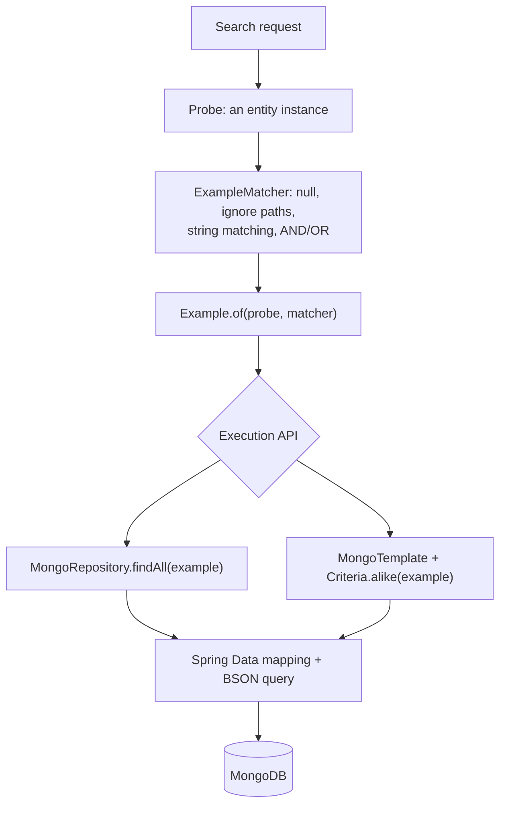

# Handling Nulls, Primitives, and Ignored Properties

In **Spring Data MongoDB**, **Query by Example (QBE)** lets you find documents by creating a Java object as a **probe** (search template) and wrapping it in an `Example<T>`. Spring Data reads the probe's properties, uses `ExampleMatcher` to decide **which properties participate in the query** and how they are matched, and builds the MongoDB filter.

The most common pitfall in QBE is not the `Example.of(probe)` syntax, but **absent values**:

- A **reference** property with Java value `null` usually **does not participate in the query by default**.
- A **primitive** property such as `boolean`, `int`, or `long` **always has a value** (`false`, `0`, ...), so it **still participates in the query**, even when the user has not selected that filter.
- A property listed in `withIgnorePaths(...)` will **not participate in QBE** even if it has a non-null value.
- When `withIncludeNullValues()` is enabled, reference properties that are currently null can become **null-matching conditions**, which have specific semantics in MongoDB and are especially surprising for nested objects.

This lesson belongs to the **Query by Example** chapter of the **SPRING_DATA_MONGODB** module. The focus is on using `Example` and `ExampleMatcher` properly with BSON data, avoiding hidden filters from primitives, distinguishing **ignoring null** from **matching null**, controlling ignored property lists, and writing integration tests that genuinely prove the behavior.

## 1. How Does QBE Use Probe, Matcher, and Example?

A typical business question:

> Find profiles belonging to tenant T1 whose display name contains "an", regardless of login count, active flag, or notes.

With QBE, the service can:

1. Create an entity as a **probe**, setting `tenantId = "T1"` and `displayName = "an"`.
2. Create an `ExampleMatcher`: display name matched with *contains*, case-insensitive, and ignore properties that are not filter criteria.
3. Wrap them in `Example.of(probe, matcher)`.
4. Call `repository.findAll(example)` or build `Criteria.alike(example)` with `MongoTemplate`.



QBE is **not** BSON schema validation, not an entity-saving tool, and does not automatically add a "only return data the user is authorized to view" condition. It is a **technique for building query filters** from Java property values.

### Three API Components

| Component | Role |
| --- | --- |
| `Probe` | Java object holding sample values, e.g., a new `UserProfile` |
| `ExampleMatcher` | Controls AND/OR, null handling, ignored properties, string matching |
| `Example<T>` | Combines probe and matcher into a QBE specification usable by repositories/templates |

`Example.of(probe)` uses the default matcher; `Example.of(probe, matcher)` allows specific customization. Do not assume "a new probe with only one field set" means "the query only contains one field": primitives on the entity still carry default values.

## 2. Sample Entity: Mixing Reference Types and Primitives

Suppose the `profiles` collection stores user profiles:

```javascript
{
  _id: ObjectId("674000000000000000000701"),
  tenant_id: "T1",
  display_name: "Lan",
  active: true,
  login_count: NumberInt(5),
  verified: false,
  optional_note: "Test customer",
  created_at: ISODate("2026-11-20T02:00:00Z")
}
```

Java entity:

```java
import java.time.Instant;
import org.bson.types.ObjectId;
import org.springframework.data.annotation.Id;
import org.springframework.data.mongodb.core.mapping.Document;
import org.springframework.data.mongodb.core.mapping.Field;

@Document(collection = "profiles")
public class UserProfile {
    @Id
    private ObjectId id;

    @Field("tenant_id")
    private String tenantId;

    @Field("display_name")
    private String displayName;

    private boolean active;  // primitive, default false

    @Field("login_count")
    private int loginCount;  // primitive, default 0

    private Boolean verified; // wrapper, default null

    @Field("optional_note")
    private String optionalNote;

    @Field("created_at")
    private Instant createdAt;

    public UserProfile() {}

    public ObjectId getId() { return id; }
    public String getTenantId() { return tenantId; }
    public String getDisplayName() { return displayName; }
    public boolean isActive() { return active; }
    public int getLoginCount() { return loginCount; }
    public Boolean getVerified() { return verified; }
    public String getOptionalNote() { return optionalNote; }
    public Instant getCreatedAt() { return createdAt; }

    public void setTenantId(String value) { tenantId = value; }
    public void setDisplayName(String value) { displayName = value; }
    public void setActive(boolean value) { active = value; }
    public void setLoginCount(int value) { loginCount = value; }
    public void setVerified(Boolean value) { verified = value; }
    public void setOptionalNote(String value) { optionalNote = value; }
}
```

Values of a `new UserProfile()`, **before the service assigns any filters**:

| Property | Java Type | Default Value | Default QBE Behavior |
| --- | --- | --- | --- |
| `id` | `ObjectId` | `null` | Ignored |
| `tenantId` | `String` | `null` | Ignored |
| `displayName` | `String` | `null` | Ignored |
| `active` | `boolean` | `false` | **Included** as `false` |
| `loginCount` | `int` | `0` | **Included** as `0` |
| `verified` | `Boolean` | `null` | Ignored |
| `optionalNote` | `String` | `null` | Ignored |
| `createdAt` | `Instant` | `null` | Ignored |

This is a critical distinction: **`false` and `0` are real values**, not synonyms for "the user did not filter". Switching optional search criteria to wrapper types `Boolean` and `Integer` resolves this ambiguity.

## 3. Default QBE Ignores Nulls but Does Not Ignore Primitives

Repository:

```java
import org.bson.types.ObjectId;
import org.springframework.data.mongodb.repository.MongoRepository;

public interface UserProfileRepository
        extends MongoRepository<UserProfile, ObjectId> {
}
```

`MongoRepository` supports `QueryByExampleExecutor`, so you can call `findAll(Example)`, `count(Example)`, `exists(Example)`, and other variants depending on your Spring Data version.

Create a new probe and set only the tenant:

```java
import org.springframework.data.domain.Example;

UserProfile probe = new UserProfile();
probe.setTenantId("T1");

Example<UserProfile> example = Example.of(probe);
var profiles = userProfileRepository.findAll(example);
```

Someone reading the code might think the question is "return all profiles of T1." **In reality, QBE also adds the two default primitive values** to the filter:

```javascript
// Mental model of probe predicates (excluding _class type restriction):
{
  tenant_id: "T1",
  active: false,
  login_count: 0
}
```

Because `active` is `boolean`, it has no `null` state for Spring Data to infer "ignore". `loginCount` cannot be null either when using `int`. If most profiles have logged in or have `active=true`, a seemingly broad query may return very few or zero results.

### Risk on a Search Page

Suppose the UI has three choices: "All / Active / Inactive". If the DTO only contains:

```java
boolean active;
```

then both **"All"** and **"Inactive"** can map to `false`. When passed directly into a primitive on the probe, QBE **cannot tell the user selected "All"**. This is an input data-modeling problem, not a random MongoDB bug.

## 4. Approach 1: withIgnorePaths for Primitives Not Being Filtered

When the existing entity still uses primitives because it makes domain sense, the matcher can **explicitly ignore the unused properties**.

```java
import org.springframework.data.domain.Example;
import org.springframework.data.domain.ExampleMatcher;

UserProfile probe = new UserProfile();
probe.setTenantId("T1");

ExampleMatcher matcher = ExampleMatcher.matchingAll()
    .withIgnorePaths("active", "loginCount");

Example<UserProfile> example = Example.of(probe, matcher);

var profiles = userProfileRepository.findAll(example);
```

The effective filter now means:

```javascript
{
  tenant_id: "T1"
  // No longer includes active:false and login_count:0 because the matcher ignores them.
}
```

`withIgnorePaths(...)` makes Spring Data drop those specific properties **regardless of what values they hold**.

```java
UserProfile probe = new UserProfile();
probe.setTenantId("T1");
probe.setActive(true);
probe.setLoginCount(999);

ExampleMatcher ignore = ExampleMatcher.matching()
    .withIgnorePaths("active", "loginCount");

Example<UserProfile> example = Example.of(probe, ignore);
// active=true and loginCount=999 are also excluded from the filter.
```

This is a **condition exclusion** mechanism, not a mutation of stored values. QBE is a read operation; it does not modify `active` or `login_count` in MongoDB.

### Ignored Names Are Java Property Names

Because the entity has `@Field("login_count")`, the right ignore path is:

```java
.withIgnorePaths("loginCount")
```

not:

```java
// Do not use the BSON name when the Java property is loginCount:
// .withIgnorePaths("login_count")
```

For nested properties, the path uses Java notation such as `"address.city"` (depending on the model), not an arbitrary BSON field string. Tests should verify that ignoring actually takes effect, especially after property renames.

## 5. Approach 2: Use Wrappers for Optional Criteria

If an API must distinguish **three states: "no filter / false / true"**, the natural choice is `Boolean` instead of `boolean`.

Likewise, `Integer` instead of `int` distinguishes **"do not filter by login count"** from **"filter loginCount = 0"**.

```java
// A search DTO independent of the persisted entity:
public record ProfileSearchRequest(
    String displayName,
    Boolean active,
    Integer loginCount,
    Boolean verified
) {}
```

Meaningful values:

| HTTP/DTO Input | Value in DTO | Meaning |
| --- | --- | --- |
| `active` omitted | `null` | Do not filter on active |
| `active=false` | `Boolean.FALSE` | Find documents with active=false |
| `active=true` | `Boolean.TRUE` | Find documents with active=true |
| `loginCount` omitted | `null` | Do not filter on loginCount |
| `loginCount=0` | `Integer.valueOf(0)` | Match exact number 0 |
| `verified=false` | `Boolean.FALSE` | Match exact false |

**Watch out:** the `UserProfile` entity in this lesson still has primitive `boolean active` and `int loginCount`, so **merely switching the DTO to wrappers is not enough** if you then copy values into that same entity probe: you must pair it with `withIgnorePaths` for unselected properties, or design a probe type with appropriate wrappers.

### Safe Solution When the Entity Can Be Changed

In an application where fields genuinely may be absent or unset:

```java
@Document("profiles")
public class NullableSearchProfile {
    @Id
    private ObjectId id;

    private String tenantId;

    private Boolean active;
    private Integer loginCount;

    public NullableSearchProfile() {}
    // Appropriate getters/setters or constructor binding.
}
```

The snippet above is an **alternative design example**, not a class used concurrently with `UserProfile` on the same sample repository. With wrappers, a blank new probe has `active == null` and `loginCount == null`, so the default matcher ignores them. When the user chooses `false` or `0`, QBE still uses those exact values.

However, **changing a persisted entity** from primitives to wrappers affects domain code, validation, and legacy data assumptions. Many systems are better served by a search DTO with wrappers that dynamically builds a `Query` via `MongoTemplate` without **forcing changes to the entity**.

## 6. Configuring the Matcher for Only the Properties Allowed to Filter

A real request may include optional `displayName` and optional `active`. On an entity with primitives, configure the matcher intentionally rather than forgetting default values.

```java
UserProfile probe = new UserProfile();
probe.setTenantId(authenticatedTenant);
probe.setDisplayName(request.displayName());

ExampleMatcher matcher = ExampleMatcher.matchingAll()
    .withIgnorePaths(
        "id", "createdAt", "optionalNote",
        "verified", "active", "loginCount"
    )
    .withMatcher(
        "displayName",
        match -> match.contains().ignoreCase()
    );

var result = userProfileRepository.findAll(
    Example.of(probe, matcher)
);
```

In this example, the query **intentionally omits filtering on active/loginCount**, even if the request supplied values. If the UI allows filtering on `active`, construct the matcher conditionally:

```java
ExampleMatcher matcher = ExampleMatcher.matchingAll()
    .withIgnorePaths("id", "createdAt", "optionalNote",
                     "verified", "loginCount");

if (request.active() == null) {
    matcher = matcher.withIgnorePaths("active");
} else {
    probe.setActive(request.active());
}
```

**Safe usage:** always create a **fresh matcher per filter shape** or build from immutable baseline matchers. Never share a single matcher mutated back and forth across requests without understanding `ExampleMatcher`'s immutability semantics.

### Never Accidentally Ignore Tenant

If `tenantId` is an authorization boundary, the following code is dangerous:

```java
// Wrong for multi-tenant data protection:
ExampleMatcher matcher = ExampleMatcher.matchingAny()
    .withIgnorePaths("tenantId");
```

Even if the probe has `tenantId = "T1"`, the matcher above **drops the tenant condition**. Every search path must enforce authorization in the service and the query; QBE **does not automatically enforce tenant isolation**.

## 7. Default Null: "Ignore Condition" Does Not Mean "Match Null"

Suppose `optionalNote == null` on the probe:

```java
UserProfile probe = new UserProfile();
probe.setTenantId("T1");
// optionalNote not set → null

Example<UserProfile> example = Example.of(
    probe,
    ExampleMatcher.matchingAll()
        .withIgnorePaths("active", "loginCount")
);

var result = userProfileRepository.findAll(example);
```

With the default matcher, `optionalNote` **does not participate in the query**. Therefore profiles with notes, profiles storing BSON Null, and profiles missing the `optional_note` field can all be returned if they satisfy the other criteria.

This is a fundamental difference:

- **Java probe property null + default matcher** → **no condition placed** on that field.
- **Java probe property null + include-null matcher** → places a **null-related condition** on that field.
- **Querying MongoDB to check missing vs. BSON Null** → requires exact `$exists` and `$type` semantics.

Do not "leave a probe property null" expecting to express "profiles with `optional_note = null`" without selecting the appropriate `NullHandler` policy.

## 8. withIncludeNullValues: Turning Null into a Query Condition

When business logic genuinely wants to find documents with null values, you can enable:

```java
import org.springframework.data.domain.Example;
import org.springframework.data.domain.ExampleMatcher;

UserProfile probe = new UserProfile();
probe.setTenantId("T1");
probe.setOptionalNote(null);

ExampleMatcher matcher = ExampleMatcher.matchingAll()
    .withIncludeNullValues()
    .withIgnorePaths(
        "id", "displayName", "active", "loginCount",
        "verified", "createdAt"
    );

Example<UserProfile> example = Example.of(probe, matcher);

var result = userProfileRepository.findAll(example);
```

Because include-null applies at the **matcher level**, you must **ignore all other null reference properties** that you **do not want** turned into conditions. If you forget, QBE may add null conditions for `displayName`, `verified`, `createdAt`, `id`, etc., yielding unexpectedly narrow results in a hard-to-spot way.

You can express the same intent with:

```java
ExampleMatcher matcher = ExampleMatcher.matchingAll()
    .withNullHandler(ExampleMatcher.NullHandler.INCLUDE)
    .withIgnorePaths(
        "id", "displayName", "active", "loginCount",
        "verified", "createdAt"
    );
```

`withIncludeNullValues()` is a more readable shorthand for `NullHandler.INCLUDE`. Do not try to treat it as a per-property setting for `optionalNote`: `ExampleMatcher`'s precedence has **null handling at the matcher level**, while ignore paths are **per property**.

### Risk When Extending the Entity

Suppose later the entity gains `private String externalReference;` and that field is usually null. An existing `withIncludeNullValues()` matcher **may start generating a new null condition** for that property if it has not been ignored. That is why an "include all nulls" QBE query needs regression tests whenever the schema/entity changes.

## 9. BSON Null and Missing Fields Are Not the Same

MongoDB distinguishes:

```javascript
// A: field present, value is BSON Null
{ _id: "A", optional_note: null }

// B: optional_note field absent
{ _id: "B" }

// C: field present, empty string
{ _id: "C", optional_note: "" }

// D: field present, has data
{ _id: "D", optional_note: "Reviewed" }
```

For scalar fields, MongoDB follows these rules:

| BSON Query | Matches | Meaning |
| --- | --- | --- |
| `{ optional_note: null }` | A, B | Null **or** missing field |
| `{ optional_note: { $type: 10 } }` | A | **Only** fields of type BSON Null |
| `{ optional_note: { $exists: false } }` | B | **Only** missing fields |
| `{ optional_note: { $exists: true } }` | A, C, D | Field exists, including Null |
| `{ optional_note: { $ne: null } }` | C, D | Has a non-null value |

A simple include-null QBE on a scalar property can produce a MongoDB null-comparison filter, so it is **not a reliable tool for distinguishing BSON Null from missing**. When business requirements demand specifically "field is Null" or "field is missing", use `MongoTemplate` with explicit `Criteria` instead of inferring from Java object nulls.

Example:

```java
import org.springframework.data.mongodb.core.query.Criteria;
import org.springframework.data.mongodb.core.query.Query;

// Null or missing:
Query nullOrMissing = Query.query(
    Criteria.where("optionalNote").isNull()
);

// Only BSON Null:
Query explicitBsonNull = Query.query(
    Criteria.where("optionalNote").isNullValue()
);

// Only missing field:
Query missing = Query.query(
    Criteria.where("optionalNote").exists(false)
);

// Field exists, including BSON Null:
Query present = Query.query(
    Criteria.where("optionalNote").exists(true)
);
```

`isNull()`, `isNullValue()`, and `exists(...)` express **three distinct questions** directly; `Criteria` maps the Java property `optionalNote` to BSON `optional_note` when queried with `UserProfile.class`.

**Note:** MongoDB has additional element-matching semantics when a path traverses an array. These examples intentionally use a scalar field to avoid mixing in array semantics.

## 10. Nested Properties: Include Null Has Important Limitations

Consider a document with an embedded object:

```javascript
{
  _id: ObjectId("674000000000000000000702"),
  tenant_id: "T1",
  address: {
    city: "Hà Nội",
    postal_code: null
  }
}
```

The Java model might declare:

```java
record Address(String city, String postalCode) {}

@Document("profiles")
class ProfileWithAddress {
    @Id
    private ObjectId id;

    @Field("tenant_id")
    private String tenantId;

    private Address address;
}
```

If you only want "`address.city == Hà Nội`" without caring about `postalCode`, the default matcher that ignores null reference properties fits better. However, when using `withIncludeNullValues()`, **Spring Data MongoDB has a specific caveat:** when handling embedded documents, it may choose **embedded document matching** instead of per-property *dot notation*, making the condition **sensitive to the entire subdocument's values and field order**.

Compare the two MongoDB filter forms:

```javascript
// Dot notation: queries a single path independently.
db.profiles.find({ "address.city": "Hà Nội" });

// Embedded document equality: queries the entire object structurally.
db.profiles.find({
  address: {
    city: "Hà Nội",
    postal_code: null
  }
});
```

A query matching the **whole embedded document** may fail to match when the actual object has extra fields or a different field order. Do not turn on global include-null expecting QBE to always emit small, independent dot-path conditions.

**Recommendation:** When you need to distinguish null/missing on a nested field, use `Criteria.where("address.postalCode").isNullValue()` or `exists(false)` accordingly, check your BSON schema, and test against documents with and without extra fields. When combining multiple complex nested clauses, `MongoTemplate` is usually clearer than QBE.

## 11. withIgnorePaths Is Query-Time Exclusion, Not Data Mutation

Three easily confused concepts:

| Mechanism | Layer Affected | Effect |
| --- | --- | --- |
| `withIgnorePaths("active")` | **QBE query matcher only** | Excludes property `active` from predicates |
| `@Transient` on a property | **Entity mapping** | Property is not mapped as a regular persisted field |
| `Update.unset("active")` | **MongoDB write** | Removes the BSON field from the document |

`withIgnorePaths` **does not alter data and does not alter annotations**. A property can be persisted normally while being ignored in a particular QBE query.

Ignore examples:

```java
ExampleMatcher matcher = ExampleMatcher.matchingAll()
    .withIgnorePaths("id", "createdAt")
    .withIgnorePaths("active", "loginCount");
```

A single call also suffices:

```java
ExampleMatcher matcher = ExampleMatcher.matchingAll()
    .withIgnorePaths("id", "createdAt", "active", "loginCount");
```

When adjusting a matcher conditionally, reassign the value returned by `withIgnorePaths`. Do not assume `ExampleMatcher` mutates in-place like a typical mutable bean.

### Should id Always Be Ignored?

- A new probe has `id == null`: the default matcher already ignores ID.
- A probe built from an existing entity has `id != null`: ID can **enter the filter**, narrowing results to a single document.
- When building a broad search form, **create a new probe** rather than taking an entity just read from MongoDB and tweaking a few fields.
- If the requirement is never to filter by ID, call `withIgnorePaths("id")` explicitly to prevent behavioral surprises later.

Similarly, `@Version`, `createdAt`, or other auditing fields, if populated, can silently become filters. Maintain an explicit list of criteria users are allowed to pick rather than accepting every populated property on an entity.

## 12. matchingAll, matchingAny, and Tenant Boundaries

By default, `ExampleMatcher.matching()` or `matchingAll()` requires **all selected predicates** to match (AND):

```java
ExampleMatcher matcher = ExampleMatcher.matchingAll()
    .withIgnorePaths("active", "loginCount");

// Probe: tenantId="T1", verified=true.
// Meaning: tenant_id="T1" AND verified=true.
```

`matchingAny()` uses **at least one matching predicate** logic (OR):

```java
ExampleMatcher any = ExampleMatcher.matchingAny()
    .withIgnorePaths("active", "loginCount");

// Probe has tenantId="T1", verified=true.
// Can return data from tenant T1 OR verified=true from another tenant.
```

**This is a severe bug in multi-tenant systems:** if you use `matchingAny` on a probe containing both tenant and search fields, tenant can become **one branch of the OR** instead of a mandatory constraint. Never rely on setting `probe.tenantId` as sufficient protection when switching the matcher to `matchingAny()`.

The fix is to always enforce tenant in a **mandatory AND security query layer**, for example using `MongoTemplate` to combine `Criteria.where("tenantId").is(authorizedTenant)` with user filters, or using `matchingAll` and only permitting filter combinations that cannot cross tenant boundaries.

**A convenience matcher is not an authorization layer.** The service must still obtain the tenant from a trusted principal/session and enforce access rules for the queried collection.

## 13. StringMatcher Does Not Replace Null and Primitive Rules

`ExampleMatcher` supports string matching modes such as exact, startsWith, endsWith, containing, and ignoreCase:

```java
UserProfile probe = new UserProfile();
probe.setTenantId("T1");
probe.setDisplayName("an");

ExampleMatcher matcher = ExampleMatcher.matchingAll()
    .withIgnorePaths("id", "active", "loginCount", "createdAt")
    .withMatcher(
        "displayName",
        match -> match.contains().ignoreCase()
    );

var result = userProfileRepository.findAll(
    Example.of(probe, matcher)
);
```

In MongoDB, contains/ignoreCase string matching can be translated into regex-equivalent conditions depending on configuration. Regexes do not necessarily use B-tree indexes effectively, especially mid-string contains or case-insensitive forms. For autocomplete or large text search, design appropriate indexes, normalize data, or use a suitable search engine.

**Configuring a string matcher does not automatically suppress primitives:** `active=false` and `loginCount=0` still participate unless ignored. Do not assume `withMatcher("displayName", ...)` makes other properties disappear.

### Empty String Is Not Null

A probe with `displayName=""` has a **non-null value**, so it can generate a predicate. With a containing matcher, an empty string can match very broadly, producing useless queries and high load.

Normalize the request first:

```java
String name = request.displayName();
if (name != null) {
    name = name.trim();
    if (name.isEmpty()) {
        name = null; // Business meaning: do not filter by name.
    }
}
probe.setDisplayName(name);
```

Converting blank → null is only appropriate if the UI defines blank as "no filter". If blank is a valid business value, use a different model instead of erasing its meaning.

## 14. MongoTemplate: Using Criteria.alike(example)

You do not have to use a repository to run QBE. With `MongoTemplate`:

```java
import java.util.List;
import org.springframework.data.domain.Example;
import org.springframework.data.domain.ExampleMatcher;
import org.springframework.data.mongodb.core.MongoTemplate;
import org.springframework.data.mongodb.core.query.Criteria;
import org.springframework.data.mongodb.core.query.Query;

UserProfile probe = new UserProfile();
probe.setTenantId("T1");
probe.setDisplayName("an");

ExampleMatcher matcher = ExampleMatcher.matchingAll()
    .withIgnorePaths("id", "active", "loginCount")
    .withMatcher("displayName", m -> m.contains().ignoreCase());

Example<UserProfile> example = Example.of(probe, matcher);

Query query = new Query(new Criteria().alike(example));

List<UserProfile> result =
    mongoTemplate.find(query, UserProfile.class);
```

When you also need `Sort`, `limit`, projection, or hints, configure them on `Query`:

```java
import org.springframework.data.domain.Sort;

query.with(
    Sort.by(Sort.Order.asc("displayName"),
            Sort.Order.asc("id"))
);
query.limit(50);

List<UserProfile> page =
    mongoTemplate.find(query, UserProfile.class);
```

**Do not call `findAll(example)` on very large datasets without bounds or selective filters.** Depending on the Spring Data version, repositories also provide paginated overloads `findAll(example, pageable)` or fluent APIs; choose appropriately and measure actual query counts.

## 15. Typed Example, _class, and Raw Data Without Type Hints

Spring Data MongoDB **uses typed QBE by default**: queries can include a domain-type constraint to avoid returning documents of incompatible entity types, based on type metadata such as `_class` (when type hints are enabled).

This matters greatly when integration tests insert **raw BSON** via the native driver **without `_class`**:

```javascript
db.profiles.insertOne({
  tenant_id: "T1",
  display_name: "Lan",
  active: false,
  login_count: 0
  // Missing _class
});
```

A typed QBE query may fail to return that document even though every business field matches, because the type constraint does not match. If you need to query across multiple document types in the same collection or on data with type hints disabled, Spring Data MongoDB provides `UntypedExampleMatcher`:

```java
import org.springframework.data.domain.Example;
import org.springframework.data.mongodb.core.query.UntypedExampleMatcher;

UserProfile probe = new UserProfile();
probe.setTenantId("T1");

var matcher = UntypedExampleMatcher.matchingAll()
    .withIgnorePaths("id", "active", "loginCount");

Example<UserProfile> example = Example.of(probe, matcher);
var result = userProfileRepository.findAll(example);
```

**Do not use untyped just to "fix an empty query" without understanding the data.** It removes the type restriction and can widen the matched set. When a collection holds multiple domain types, protect further with a discriminator field/condition, or keep collections consistent. If using `@TypeAlias`, configure the mapping context sufficiently so aliases resolve properly.

In the integration tests later, we **insert entities using `MongoTemplate`** so Spring Data-managed type hints are written consistently; only the null-vs-missing test uses a raw update, while **preserving the `_class`** of the inserted document.

## 16. Service Example: Safely Turning a Request into QBE

A practical pattern is using a DTO to know which fields **the user provided** and choosing ignore paths intentionally:

```java
public record ProfileSearchRequest(
    String displayName,
    Boolean active,
    Integer loginCount,
    Boolean verified
) {}
```

Service example using `UserProfile` (where the entity still has primitives):

```java
import java.util.List;
import org.springframework.data.domain.Example;
import org.springframework.data.domain.ExampleMatcher;

public class ProfileSearchService {
    private final UserProfileRepository repository;

    public ProfileSearchService(UserProfileRepository repository) {
        this.repository = repository;
    }

    public List<UserProfile> search(
            String authorizedTenant,
            ProfileSearchRequest request) {

        if (authorizedTenant == null || authorizedTenant.isBlank()) {
            throw new IllegalArgumentException("Missing authenticated tenant");
        }

        UserProfile probe = new UserProfile();
        probe.setTenantId(authorizedTenant);

        String name = request.displayName();
        if (name != null && !name.isBlank()) {
            probe.setDisplayName(name.trim());
        }

        ExampleMatcher matcher = ExampleMatcher.matchingAll()
            .withIgnorePaths("id", "createdAt", "optionalNote")
            .withMatcher("displayName",
                match -> match.contains().ignoreCase());

        if (request.active() == null) {
            matcher = matcher.withIgnorePaths("active");
        } else {
            probe.setActive(request.active());
        }

        if (request.loginCount() == null) {
            matcher = matcher.withIgnorePaths("loginCount");
        } else {
            probe.setLoginCount(request.loginCount());
        }

        if (request.verified() != null) {
            probe.setVerified(request.verified());
        }

        return repository.findAll(Example.of(probe, matcher));
    }
}
```

This code illustrates how to **avoid default primitive filters** and enforce tenant with AND. For production, add **pagination/limits**, `loginCount` validation, rate limiting where needed, and a clear policy for substring queries. You can add `Pageable` to the service or use `MongoTemplate` to apply explicit limits.

**Advantage of a separate DTO:** HTTP input can carry three states (omitted, false/0, true/other number), while the persisted entity keeps domain primitives. This avoids changing the database schema solely to accommodate search forms.

### Advanced Problem: Finding Specifically "verified Is BSON Null"

With `Boolean verified`, a nullable DTO can express **"no filter"** and **"filter false/true"**, but cannot express **"filter where verified is BSON Null"** as a fourth state.

If the UI needs all four choices, use a query enum:

```java
public enum VerifiedFilter {
    ANY, TRUE, FALSE, EXPLICIT_NULL, MISSING
}
```

For `TRUE/FALSE` you can use QBE; for `EXPLICIT_NULL` and `MISSING`, switch to `Criteria.isNullValue()` / `Criteria.exists(false)` in an explicit query. Do not overload a single Java `null` in a QBE nullable wrapper to mean four different things.

## 17. Performance: Inspect BSON Queries Instead of Only the Java Probe

QBE may look simple, yet the server still executes a filter on a real collection:

- Forgetting to ignore primitives adds `active:false`, `login_count:0`, affecting both the **result set** and **index choice**.
- Enabling `withIncludeNullValues` can add unwanted null conditions or require complex embedded-object matching.
- Using `matchingAny()` can broaden results via OR and cause **tenant leakage** without an enclosing AND guard.
- Using `contains().ignoreCase()` can prevent string queries from using B-tree indexes as efficiently as equality or an anchored prefix.
- When typed QBE inserts a type hint, the query plan can differ from a raw BSON find without `_class`.

An index serving common tenant and status queries:

```javascript
db.profiles.createIndex(
  { tenant_id: 1, active: 1, login_count: 1 },
  { name: "profiles_tenant_state_count" }
);
```

This index helps if the workload actually filters `tenant_id + active + login_count`; **do not create it merely because the entity has those properties**. If most queries only search by tenant and display name, evaluate another index design and consider search indexes when substring/case-insensitive search is needed.

Measuring an equivalent query:

```javascript
db.profiles.find({
  tenant_id: "T1",
  active: false,
  login_count: 0
}).explain("executionStats");
```

Inspect `winningPlan`, `totalKeysExamined`, `totalDocsExamined`, `nReturned`, and latency under representative data. Review logs/command monitoring for the **actual generated QBE query** because a missing `withIgnorePaths` entry changes the entire filter.

Never run explain on a different hand-written filter and claim QBE uses that same index; verify the exact collection, field mappings, and type restrictions.

## 18. Integration Test: Proving Primitive 0/false Participate in QBE

Mocking `UserProfileRepository` cannot verify how Spring Data translates `ExampleMatcher` into a BSON filter. Test against real MongoDB in an isolated environment (e.g., Testcontainers) to verify:

1. Primitive `false` and `0` narrow the default query.
2. `withIgnorePaths("active","loginCount")` brings those records back.
3. `withIncludeNullValues()` affects null properties as intended.
4. BSON Null and missing fields can be distinguished with `Criteria`.
5. `_class` type hints are not accidentally omitted when building test fixtures.

Example using JUnit 5, AssertJ, and a Spring Boot test slice:

```java
import static org.assertj.core.api.Assertions.assertThat;
import static com.mongodb.client.model.Filters.eq;
import static com.mongodb.client.model.Updates.set;

import java.util.UUID;
import org.bson.types.ObjectId;
import org.junit.jupiter.api.Test;
import org.springframework.beans.factory.annotation.Autowired;
import org.springframework.boot.test.autoconfigure.data.mongo.DataMongoTest;
import org.springframework.data.domain.Example;
import org.springframework.data.domain.ExampleMatcher;
import org.springframework.data.mongodb.core.MongoTemplate;
import org.springframework.data.mongodb.core.query.Criteria;
import org.springframework.data.mongodb.core.query.Query;

@DataMongoTest
class UserProfileQbeTest {
    @Autowired MongoTemplate template;
    @Autowired UserProfileRepository repository;

    @Test
    void primitiveDefaultsAreIncludedUnlessIgnored() {
        String tenant = "test-" + UUID.randomUUID();

        template.insert(profile(tenant, "P1", false, 0, null));
        template.insert(profile(tenant, "P2", true, 5, "vip"));
        template.insert(profile(tenant, "P3", false, 2, null));
        template.insert(profile("other-" + tenant, "P4", false, 0, null));

        UserProfile probe = new UserProfile();
        probe.setTenantId(tenant);

        assertThat(repository.findAll(Example.of(probe)))
            .extracting(UserProfile::getDisplayName)
            .containsExactly("P1");

        ExampleMatcher ignoringPrimitive = ExampleMatcher.matchingAll()
            .withIgnorePaths("active", "loginCount");

        assertThat(repository.findAll(
            Example.of(probe, ignoringPrimitive)))
            .extracting(UserProfile::getDisplayName)
            .containsExactlyInAnyOrder("P1", "P2", "P3");
    }

    @Test
    void includeNullDoesNotMeanOnlyExplicitBsonNull() {
        String tenant = "test-" + UUID.randomUUID();

        UserProfile missing = template.insert(
            profile(tenant, "Missing", false, 0, null));
        UserProfile explicit = template.insert(
            profile(tenant, "Explicit", false, 0, null));
        template.insert(
            profile(tenant, "Filled", false, 0, "Has note"));

        // Write explicit BSON Null while preserving _class created by template.insert.
        template.getCollection("profiles").updateOne(
            eq("_id", explicit.getId()),
            set("optional_note", null)
        );

        UserProfile probe = new UserProfile();
        probe.setTenantId(tenant);

        ExampleMatcher includeNoteNull = ExampleMatcher.matchingAll()
            .withIncludeNullValues()
            .withIgnorePaths(
                "id", "displayName", "active", "loginCount",
                "verified", "createdAt"
            );

        assertThat(repository.findAll(
            Example.of(probe, includeNoteNull)))
            .extracting(UserProfile::getDisplayName)
            .containsExactlyInAnyOrder("Missing", "Explicit");

        Query onlyNull = Query.query(
            Criteria.where("tenantId").is(tenant)
                .and("optionalNote").isNullValue()
        );

        assertThat(template.find(onlyNull, UserProfile.class))
            .extracting(UserProfile::getDisplayName)
            .containsExactly("Explicit");

        // 'missing' is retained to inspect its ID if raw BSON testing is needed.
        assertThat(missing.getId()).isInstanceOf(ObjectId.class);
    }

    private static UserProfile profile(
            String tenant, String name, boolean active,
            int loginCount, String note) {

        UserProfile profile = new UserProfile();
        profile.setTenantId(tenant);
        profile.setDisplayName(name);
        profile.setActive(active);
        profile.setLoginCount(loginCount);
        profile.setOptionalNote(note);
        return profile;
    }
}
```

The test **assumes** a Spring Boot/Spring Data version with the matching test slice package, scanned entities, and a dedicated test MongoDB connected. When changing type-hint policies or null-converter settings, adjust test fixtures to match the real mapping; never run these setup/update operations against production.

### Why Not Just Insert a Raw Document?

With **typed QBE**, a raw BSON document lacking `_class` may be excluded before `tenant_id`, `active`, or `login_count` conditions are even evaluated. Therefore we use `template.insert(entity)` to preserve consistent type hints, and only use a **raw update** when simulating explicit `optional_note: null`.

### Additional Cases to Test

- Probe with `active=true` and `loginCount=0`: confirm each populated property participates as expected.
- Probe containing `verified=false` (wrapper): `false` **must** participate, not be treated like null.
- Probe containing `verified=null`: ignored by default, whereas include-null generates a condition per matcher policy.
- `withIgnorePaths("tenantId")`: defensive test demonstrating why partition conditions must never be ignored.
- `matchingAny()` with tenant+status: result set can expand, requiring an outer AND or disallowing `matchingAny`.
- Nested property with null and extra fields: measure the difference between dot notation and embedded document equality.
- Raw document without `_class`: compare typed vs. `UntypedExampleMatcher` when diagnosing empty results.
- Substring conditions with varying whitespace/case; compare latency/indexes and `Pageable` limits.

## 19. Common Mistakes and How to Fix Them

| Mistake | Why It Is Wrong | Fix |
| --- | --- | --- |
| Assuming setting only tenant on a probe queries only by tenant | Primitives default to `false`, `0` | Ignore unselected primitives or use wrappers |
| Using `boolean` in a request to represent "All" | `boolean` cannot be null | Use `Boolean` or an enum with an ANY state |
| Setting `optionalNote=null` expecting to match nulls | Null is ignored by default | `withIncludeNullValues()` or `Criteria` |
| Enabling include-null for the whole entity without ignoring other properties | Every null nullable field can enter the query | Specify `withIgnorePaths` explicitly; test on schema changes |
| Assuming include-null finds only BSON Null | Equality with null can also match missing fields | Use `Criteria.isNullValue()` to distinguish |
| Using `withIgnorePaths("login_count")` | Matcher reads Java property names | Use `"loginCount"` |
| Arbitrarily ignoring ID/tenant on a probe used for authorization | Can broaden query beyond authorized scope | Always enforce tenant via server-side AND, never trust probe |
| Using `matchingAny` for tenant and optional filters | OR leaks data from other tenants | Constrain tenant separately or use `matchingAll` only |
| Reusing a loaded entity as a search probe | ID/version/createdAt can accidentally filter | Create a fresh probe and allowlist properties |
| Confusing `@Transient` with `withIgnorePaths` | One is entity mapping, the other is query-specific | Choose the right layer |
| Believing `StringMatcher.CONTAINING` always uses indexes well | Regex can scan lots of data | Check `explain`, choose appropriate search/index |
| Testing with raw documents lacking `_class` and thinking QBE is broken | Typed QBE can apply a type restriction | Use template insert or controlled untyped matching |
| Leaving results unbounded | Broad queries can load the entire collection | Validate filters and apply `Pageable`/limits |

## 20. Hands-on Exercises and Self-Assessment Questions

**Exercise:** Create a separate `profiles` collection in a test MongoDB with the `UserProfile` entity above. Perform each step in order:

1. Call `repository.findAll(Example.of(probe))` with only tenant set on the probe; observe `active=false` and `loginCount=0` appearing in the conditions.
2. Add `withIgnorePaths("active","loginCount")` and compare the returned profile count.
3. Change form inputs to `Boolean` and `Integer`, ensuring "ANY" differs from `false/0`.
4. Enable `withIncludeNullValues()`, ignore unrelated null references, then check null vs. missing fields using raw BSON.
5. Write `Criteria.isNullValue()`, `isNull()`, and `exists(false)`, comparing their differences.
6. Test `matchingAll` and `matchingAny` on two properties, demonstrating why tenant must be enforced via AND.
7. Test `withMatcher("displayName", m -> m.contains().ignoreCase())` on a larger dataset; inspect `explain("executionStats")` before and after adding an index.
8. Add a new field to the entity to test whether include-null/ignore-path matchers still behave as intended.
9. Compare repository QBE with `MongoTemplate` using `Criteria.alike(example)`.
10. Test a raw document lacking `_class` and `UntypedExampleMatcher` to understand type-hint effects.

**Question 1.** `new UserProfile()` has `boolean active=false`. Does default QBE ignore `active`?  
**Answer:** No. Primitives always have a value; to ignore it, use `withIgnorePaths("active")` or change the search model.

**Question 2.** Does `Boolean verified=null` participate in default QBE?  
**Answer:** No. It is a nullable reference type; null values are ignored by default.

**Question 3.** Is `Boolean verified=false` ignored as "false looks empty"?  
**Answer:** No. `Boolean.FALSE` is a real value and participates in the condition.

**Question 4.** Does `withIgnorePaths("active")` delete the `active` field in MongoDB?  
**Answer:** No. It only excludes the property from the QBE predicate for that query.

**Question 5.** With `@Field("login_count")`, what string does `withIgnorePaths` take?  
**Answer:** The Java property name `"loginCount"`.

**Question 6.** Can `withIncludeNullValues()` be used to guarantee matching **only BSON Null** and not missing fields?  
**Answer:** Do not assume so. For scalar fields, equality with null in MongoDB can also match missing fields; use `Criteria.isNullValue()` when exactness is required.

**Question 7.** Why can enabling include-null for nested objects behave differently from querying each field separately?  
**Answer:** Spring Data MongoDB may use embedded document matching, which is sensitive to all field values and field ordering.

**Question 8.** Why is `matchingAny()` dangerous when a probe has tenant and status?  
**Answer:** Conditions become ORed, returning documents from other tenants whenever the status matches.

**Question 9.** Why might QBE fail to find a raw document even when field names and values are right?  
**Answer:** Typed QBE may apply a `_class` type-hint restriction; raw documents without type hints will not match. Check collection/mapping or use untyped intentionally.

**Question 10.** When should you leave QBE and use `MongoTemplate`?  
**Answer:** When you need to distinguish explicit null from missing, perform range comparisons, build complex AND/OR groups, enforce strict tenant scoping, or express MongoDB conditions QBE cannot clearly represent.

## 21. References and Summary

Official documentation to verify APIs and version-specific behavior:

- [Spring Data MongoDB — MongoDB-specific Query Methods, Query by Example](https://docs.spring.io/spring-data/mongodb/reference/mongodb/repositories/query-methods.html).
- [Spring Data Commons — Query by Example](https://docs.spring.io/spring-data/commons/reference/query-by-example.html).
- [Spring Data MongoDB — Querying Documents, QBE and UntypedExampleMatcher](https://docs.spring.io/spring-data/mongodb/reference/mongodb/template-query-operations.html).
- [Spring Data MongoDB — Criteria API: isNull, isNullValue, exists](https://docs.spring.io/spring-data/mongodb/reference/api/java/org/springframework/data/mongodb/core/query/Criteria.html).

**Conclusion:** In QBE, **Java null defaults to "no condition"**, whereas **primitive `false`/`0` is a real condition**. `withIgnorePaths(...)` excludes unneeded properties, while `withIncludeNullValues()` turns nulls into part of the query and requires explicit management of remaining properties. In MongoDB, **BSON Null differs from a missing field**, typed QBE may attach `_class`, and include-null on nested objects can alter matching behavior. Build probes from search DTOs with clear three-state semantics, keep tenant under an AND condition, apply indexes/limits, and verify with integration tests against real BSON data.
