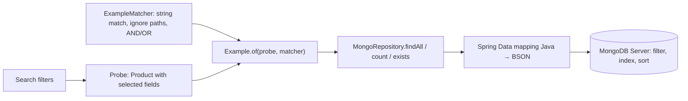

# String Matching and Per-Property Customization

When building a product search screen, users might enter a partial name, require an exact SKU match, search brands by prefix, and ignore case on certain fields. **Spring Data MongoDB Query by Example (QBE)** lets you express these conditions with a **probe object** and an **`ExampleMatcher`**, instead of writing a separate repository method for every filter combination.

The key point of this lesson is not merely calling `repository.findAll(example)`. We need to understand **which probe properties enter the query**, how `EXACT` differs from `CONTAINING`, how to override **individual property paths** using `withMatcher`, and why applying `matchingAny()` or `ignoreCase()` carelessly can yield wrong results or expensive queries.

This lesson belongs to the **Query by Example** chapter of the `SPRING_DATA_MONGODB` module. Spring Data MongoDB uses repositories or `MongoTemplate` to connect, map documents, and query MongoDB; when queries exceed QBE's capabilities, we can use `Query`/`Criteria`, aggregations, indexes, and performance diagnostics. The examples below use Java 17+ with Spring Data MongoDB; exact behavior should be verified with integration tests for your deployed version.

After this lesson, you will be able to:

- Create `Example<T>` from a probe and `ExampleMatcher`, then use `MongoRepository` to find, count, check existence, and paginate.
- Distinguish `EXACT`, `STARTING`, `ENDING`, `CONTAINING`, `REGEX`, and how Spring Data maps them to MongoDB conditions.
- Combine **global defaults** with per-property matchers for `name`, `sku`, `brand`, or nested properties.
- Use `withIgnorePaths`, `withIgnoreCase`, and `withTransformer` intentionally.
- Avoid passing primitive defaults, empty strings, nulls, or authorization conditions into QBE incorrectly.
- Recognize QBE's limitations, the impact of regex/collation on indexes, and when to switch to `MongoTemplate`.

## 1. QBE Has Three Parts: Probe, Matcher, and Executor



| Component | Role | Example |
| --- | --- | --- |
| **Probe** | Entity holding the values to search for | `tenantId = "T-A"`, `name = "note"`, other fields null |
| **`ExampleMatcher`** | Specifies how to compare and which properties to ignore | `name` uses `contains().ignoreCase()` |
| **`Example<T>`** | Combines probe and matcher | `Example.of(probe, matcher)` |
| **Repository executor** | Runs `findAll`, `findOne`, `count`, `exists`, or pagination | `repository.findAll(example)` |
| **MongoDB query** | Evaluates the filter on the server | Equality/regex conditions generated from example |

Do not think of QBE as Java `equals()` comparing two objects after loading data. QBE generates **query conditions** from probe properties. MongoDB Server still decides matching documents, which index to use, which collation applies, and how many records are returned.

### 1.1. When Is QBE Appropriate?

QBE is especially useful for **search forms with multiple optional inputs** and relatively simple comparisons: equality, string contains, starts-with/ends-with, or OR/AND across properties.

For example, a user selects category BOOK, enters a name containing `"note"`, and a brand starting with `"Sa"`. A QBE design can be shorter and easier to maintain than a derived method name chaining many conditions. However, QBE is not a general-purpose query builder: requirements like **price ranges**, `$in` lists, complex `$elemMatch`, nested parenthesized AND/OR groups, text search, or aggregations usually fit `MongoTemplate`/`Criteria` better.

## 2. Entity and Illustrative Data

Suppose each product in the `catalogProducts` collection has a tenant, SKU, name, brand, category, active status, stock quantity, and creation timestamp:

```javascript
{
  _id: "P-101",
  tenantId: "T-A",
  sku: "BK-001",
  name: "Sakura Notebook",
  brand: "Sakura",
  category: "BOOK",
  active: true,
  stock: 12,
  createdAt: ISODate("2026-11-01T00:00:00Z"),
  _class: "catalog-product"
}
```

The Java entity is written as a JavaBean to make it easy to construct a probe with just a few fields:

```java
import java.time.Instant;
import org.springframework.data.annotation.TypeAlias;
import org.springframework.data.mongodb.core.mapping.Document;
import org.springframework.data.mongodb.core.mapping.MongoId;

@Document(collection = "catalogProducts")
@TypeAlias("catalog-product")
public class CatalogProduct {

    @MongoId
    private String id;

    private String tenantId;
    private String sku;
    private String name;
    private String brand;
    private String category;
    private Boolean active;
    private Integer stock;
    private Instant createdAt;

    public CatalogProduct() {}

    public String getId() { return id; }
    public void setId(String id) { this.id = id; }
    public String getTenantId() { return tenantId; }
    public void setTenantId(String tenantId) { this.tenantId = tenantId; }
    public String getSku() { return sku; }
    public void setSku(String sku) { this.sku = sku; }
    public String getName() { return name; }
    public void setName(String name) { this.name = name; }
    public String getBrand() { return brand; }
    public void setBrand(String brand) { this.brand = brand; }
    public String getCategory() { return category; }
    public void setCategory(String category) { this.category = category; }
    public Boolean getActive() { return active; }
    public void setActive(Boolean active) { this.active = active; }
    public Integer getStock() { return stock; }
    public void setStock(Integer stock) { this.stock = stock; }
    public Instant getCreatedAt() { return createdAt; }
    public void setCreatedAt(Instant createdAt) { this.createdAt = createdAt; }
}
```

The wrapper types `Boolean` and `Integer` here are an **intentional choice**: a fresh probe will have `active == null` and `stock == null`, and **will not filter by those two fields** under the default matcher. If primitive `boolean`/`int` were used, the probe would always carry defaults `false`/`0`, potentially generating unintended conditions.

Repository:

```java
import org.springframework.data.mongodb.repository.MongoRepository;

public interface CatalogProductRepository
        extends MongoRepository<CatalogProduct, String> {
    // No need to declare findAll(Example) to use basic QBE.
}
```

`MongoRepository` provides Query by Example execution via Spring Data repository interfaces. `@MongoId String id` is chosen so the demo data keeps `_id` as a BSON String; if an application stores ObjectIds, declarations and mappings must be consistent.

### 2.1. Test Data

```javascript
// Run only on a development/test database that can be reset.
db.catalogProducts.insertMany([
  { _id: "P-101", tenantId: "T-A", sku: "BK-001",
    name: "Sakura Notebook", brand: "Sakura", category: "BOOK",
    active: true, stock: 12,
    createdAt: ISODate("2026-11-01T00:00:00Z"),
    _class: "catalog-product" },
  { _id: "P-102", tenantId: "T-A", sku: "BK-002",
    name: "Basic Notebook", brand: "Zen", category: "BOOK",
    active: true, stock: 0,
    createdAt: ISODate("2026-11-02T00:00:00Z"),
    _class: "catalog-product" },
  { _id: "P-103", tenantId: "T-A", sku: "PN-001",
    name: "Blue Pen", brand: "Sakura", category: "PEN",
    active: false, stock: 25,
    createdAt: ISODate("2026-11-03T00:00:00Z"),
    _class: "catalog-product" },
  { _id: "P-104", tenantId: "T-B", sku: "BK-001",
    name: "Notebook for another tenant", brand: "Sakura",
    category: "BOOK", active: true, stock: 8,
    createdAt: ISODate("2026-11-04T00:00:00Z"),
    _class: "catalog-product" }
]);
```

SKUs can repeat **across tenants** but should not duplicate within the same tenant when business rules forbid it. Suggested unique index:

```javascript
db.catalogProducts.createIndex(
  { tenantId: 1, sku: 1 },
  { unique: true }
);
```

In practice, check for duplicate data before creating the index. **Do not run `insertMany` repeatedly with the same `_id` values on an existing collection**; for reproducible tests, use an isolated MongoDB test instance/collection.

The demo documents carry `_class: "catalog-product"` matching `@TypeAlias("catalog-product")` because **typed QBE** can add a type metadata condition to the query. If you use `mongosh` to insert a document **without `_class`**, a typed example may fail to find it even when every other field matches. In real applications, seed data via Spring Data mapping or configure typed/untyped consistently; section 10 explains the difference.

## 3. Creating the First `Example`: Exact Comparison

Suppose we need SKU `"BK-001"` for tenant `"T-A"`:

```java
import java.util.List;
import org.springframework.data.domain.Example;
import org.springframework.data.domain.ExampleMatcher;

CatalogProduct probe = new CatalogProduct();
probe.setTenantId("T-A");
probe.setSku("BK-001");

ExampleMatcher matcher = ExampleMatcher.matchingAll();
Example<CatalogProduct> example = Example.of(probe, matcher);

List<CatalogProduct> results = repository.findAll(example);
// With test data: P-101 (excludes P-104 from tenant T-B).
```

Here, `repository` is `CatalogProductRepository` injected into a service or test. `ExampleMatcher.matchingAll()` requires **all properties included in the query** to match together (AND logic). Null properties on the probe are ignored by default, so `name`, `brand`, `stock`, etc. do not become criteria.

The query intent is roughly:

```javascript
db.catalogProducts.find({
  tenantId: "T-A",
  sku: "BK-001"
});
```

This is an **illustration of the business filter**, not a byte-for-byte dump of the query Spring Data sends. MongoDB QBE may add a data-type condition (`_class`) in typed matching mode; this is discussed further in a later section.

### 3.1. `matching()` and `matchingAll()`

`ExampleMatcher.matching()` is the default **match-all** option; `matchingAll()` expresses AND more explicitly when the problem requires it. `matchingAny()` is used for OR between properties and **does not replace authorization mechanisms**.

In a multi-tenant example, use `matchingAll()` to keep `tenantId` as a mandatory condition. An OR matcher combining `tenantId` with `name` creates a logic vulnerability if used carelessly.

### 3.2. `null` Properties Are Ignored by Default

When creating a new JavaBean:

```java
CatalogProduct probe = new CatalogProduct();
probe.setTenantId("T-A");
// All other fields remain null.

Example<CatalogProduct> example = Example.of(probe);
```

Under the default matcher, only properties with appropriate non-null values enter the query. `null` does not mean "find documents with a null field" but rather **do not filter on that field**. If you need to distinguish BSON null from an absent field, construct an explicit `Criteria` query instead of relying on null probe values.

## 4. String Matching Modes: EXACT, STARTING, ENDING, CONTAINING, REGEX

`ExampleMatcher.StringMatcher` determines how a `String` value in the probe is compared against data in MongoDB. Main modes:

| Mode | Meaning | Probe `name = "note"` Should Match |
| --- | --- | --- |
| `EXACT` | Entire string equals the probe value | `"note"` |
| `STARTING` | Field value starts with the probe | `"notebook"`, `"note pad"` |
| `ENDING` | Field value ends with the probe | `"my note"` |
| `CONTAINING` | Probe string appears anywhere inside | `"Notebook"` if ignoreCase is enabled |
| `REGEX` | Uses probe as a regular expression | Results depend on pattern and flags |
| `DEFAULT` | Uses configured default | Usually exact match if unchanged |

**Case sensitivity note:** the examples in the table largely assume case-sensitive comparison. `"Notebook"` should not be assumed to match `"notebook"` unless `ignoreCase` is enabled or collation/normalization is aligned.

### 4.1. Setting a Global String-Matching Default

```java
import org.springframework.data.domain.ExampleMatcher.StringMatcher;

ExampleMatcher matcher = ExampleMatcher.matchingAll()
        .withStringMatcher(StringMatcher.CONTAINING)
        .withIgnoreCase();

CatalogProduct probe = new CatalogProduct();
probe.setTenantId("T-A");
probe.setName("note");

Example<CatalogProduct> example = Example.of(probe, matcher);
```

**Warning:** `withStringMatcher(CONTAINING)` and `withIgnoreCase()` apply as defaults to **all string properties considered in the example**, which can include `tenantId` or `sku`. If tenant `"T-A"` requires an **exact match**, do not apply such a permissive default across all String properties. The next section fixes this using per-field matchers.

### 4.2. String Matching Modes May Involve MongoDB Regex

Conceptually, `STARTING` usually corresponds to a start-anchored expression like `^note`; `ENDING` is end-anchored like `note$`; `CONTAINING` matches the substring anywhere inside. Spring Data can generate appropriate regex conditions and apply case-insensitive options.

Do not assume every matching mode always emits the exact same **BSON query literal** across all versions. When performance or special characters matter, inspect the actual Java Driver command and run against a test MongoDB instance.

### 4.3. REGEX Mode Must Be Controlled

`REGEX` is meant for cases where business logic genuinely needs a pattern like `"^BK-[0-9]{3}$"`, not as a default search mode for public inputs. A user-supplied pattern can alter query semantics, spike CPU usage, or cause denial of service if overly complex.

For UIs that simply want "name contains keyword", prefer `contains()`, limit keyword length, define how special characters are handled, and measure on real data. If advanced regex is needed, consider building `Criteria.regex(...)` with explicit validation and permissions.

## 5. `withMatcher`: Per-Property Configuration

This is the most important technique in this topic. Suppose the requirements are:

- `tenantId` must be an **exact match**, case-sensitive.
- `sku` must be an **exact match**, case-sensitive.
- `name` should **contain** a string, **case-insensitive**.
- `brand` should **start with** a string, **case-insensitive**.
- Other fields must not generate unintended conditions.

```java
import org.springframework.data.domain.Example;
import org.springframework.data.domain.ExampleMatcher;
import org.springframework.data.domain.ExampleMatcher.StringMatcher;

CatalogProduct probe = new CatalogProduct();
probe.setTenantId("T-A");
probe.setSku("BK-001");
probe.setName("note");
probe.setBrand("sa");

ExampleMatcher matcher = ExampleMatcher.matchingAll()
        // Default all other Strings to exact, case-sensitive matching.
        .withStringMatcher(StringMatcher.EXACT)
        .withMatcher("name", rule -> rule.contains().ignoreCase())
        .withMatcher("brand", rule -> rule.startsWith().ignoreCase())
        .withMatcher("sku", rule -> rule.exact())
        .withIgnorePaths("id", "createdAt", "stock");

Example<CatalogProduct> example = Example.of(probe, matcher);
List<CatalogProduct> products = repository.findAll(example);
// Sample data: P-101.
```

Here `withMatcher("name", ...)` changes rules only for the **`name` property**. `brand` can have its own rules, while `tenantId` and `sku` keep the exact-match default. Names passed to `withMatcher` are **mapped Java property paths**, not arbitrary SQL or JSON strings.

Logically, this means:

```text
tenantId == "T-A"
AND sku == "BK-001"
AND lower(name) contains "note"     // Illustrates intent, not MongoDB query syntax.
AND lower(brand) starts with "sa"
```

**Do not assume Spring Data invokes a `lower(...)` function on the server.** In MongoDB, case-insensitive string matching is usually expressed using regex and appropriate flags. The notation above merely helps explain the comparison intent.

### 5.1. Per-Property Matchers Override the Global Default

If you set a global default of `CONTAINING` while SKU must be exact, you can override it:

```java
ExampleMatcher matcher = ExampleMatcher.matchingAll()
        .withStringMatcher(StringMatcher.CONTAINING)
        .withMatcher("sku", rule -> rule.exact())
        .withMatcher("tenantId", rule -> rule.exact());
```

However, when a new String property is added to the entity, **it may also inherit the CONTAINING default** if set on the probe. Therefore, in multi-tenant or sensitive applications, it is usually safer to **default to EXACT and only loosen allowed search fields**, as shown in the main example.

### 5.2. Ignoring Properties with `withIgnorePaths`

```java
ExampleMatcher matcher = ExampleMatcher.matchingAll()
        .withIgnorePaths("id", "createdAt", "stock")
        .withMatcher("name", rule -> rule.contains().ignoreCase());
```

`withIgnorePaths` excludes properties from the query even if the probe holds values for them. It is useful for IDs, timestamps, or defaults created by object constructors. **Ignoring does not modify the source data**: the probe object still holds those values, the matcher just excludes them from predicates.

If you need to check inventory `stock >= 10`, ignoring `stock` and using QBE **cannot express a greater-than comparison**. For numeric range queries, switch to `Criteria.where("stock").gte(10)`.

## 6. Customizing Case Sensitivity Per Property

Suppose SKUs are case-sensitive per internal rules, whereas users may type names in any letter case. A safe default is usually **case-sensitive**, enabling `ignoreCase()` only for fields users search flexibly.

```java
ExampleMatcher matcher = ExampleMatcher.matchingAll()
        .withMatcher("name", rule -> rule.contains().ignoreCase())
        .withMatcher("brand", rule -> rule.startsWith().ignoreCase())
        .withMatcher("sku", rule -> rule.exact());
```

With `name = "NOTE"` and `tenantId = "T-A"`, the sample data's `"Sakura Notebook"` and `"Basic Notebook"` both match if the `name` rule is `contains().ignoreCase()`. `"Notebook for another tenant"` is excluded only if **tenant has an exact AND condition applied**.

### 6.1. Case-Insensitive Differs from Vietnamese Accent Stripping

`ignoreCase()` handles **uppercase/lowercase** differences; it does not automatically normalize Vietnamese diacritics, perform Unicode normalization, or apply complex linguistic rules. For example, a system treating `"ca phe"` as equivalent to `"cà phê"` must implement dedicated search/normalization logic.

MongoDB supports collation for locale-aware comparisons across many query types, but **a regex with `i` does not automatically use a collation index the way regular equality does**. If requirements call for multilingual, accent-insensitive, typo-tolerant, or ranked full-text search, consider a dedicated search mechanism rather than forcing QBE into a full-text search engine.

### 6.2. Case-Sensitive Default and Overrides

```java
import org.springframework.data.domain.ExampleMatcher.StringMatcher;

ExampleMatcher matcher = ExampleMatcher.matchingAll()
        .withStringMatcher(StringMatcher.EXACT)
        .withMatcher("name", rule -> rule.endsWith().ignoreCase());
```

Here `tenantId` and `sku` retain the exact default; `name` uses a case-insensitive suffix match. If `withIgnoreCase()` was previously enabled **globally**, a field matcher does not automatically revert to case-sensitive just by calling `exact()`; settings follow precedence rules and properties inherit defaults unless overridden. The easiest way to stay in control is **not enabling global ignoreCase when key fields must stay exact**.

## 7. Cleaning Probe Values with `withTransformer`

`ExampleMatcher` also supports **property value transformers**, used to prepare probe values before building predicates. A familiar scenario: the UI sends `"  note  "` while the user intends to search `"note"`.

```java
import org.springframework.data.domain.ExampleMatcher;

ExampleMatcher matcher = ExampleMatcher.matchingAll()
        .withMatcher("name", rule -> rule.contains().ignoreCase())
        .withTransformer(
                "name",
                input -> input.map(value -> ((String) value).trim()));
```

`withTransformer` receives an `Optional<Object>` holding the configured property's value and returns the transformed optional. In this example, `"  note  "` is trimmed to `"note"` before the matcher runs. **Only cast to `String` when you are sure the property is a String**.

### 7.1. Should Input Normalization Happen in the Service or the Matcher?

Usually, the service should still normalize and validate inputs before creating the probe:

```java
String cleaned = rawName == null ? null : rawName.trim();

if (cleaned != null && cleaned.length() > 80) {
    throw new IllegalArgumentException("Keyword too long");
}
if (cleaned != null && cleaned.isBlank()) {
    cleaned = null; // Convention: blank input means do not filter by name.
}

CatalogProduct probe = new CatalogProduct();
probe.setTenantId(authorizedTenantId);
probe.setName(cleaned);
```

`withTransformer` is handy for reusing a per-property rule, but **it does not replace validation**, authorization, or deciding what empty input means. If a transformer merely turns whitespace into an empty string, a `contains()` matcher can generate a broad filter matching nearly every document.

### 7.2. Stored Data Remains Unchanged

A transformer acts on the **value used to build the query**, not on MongoDB update commands or persisted entities. If business rules require SKUs to always be stored uppercase, normalization belongs in the **write path** or domain validation; normalizing only at query time does not guarantee consistent stored data.

## 8. `matchingAll`, `matchingAny`, and Tenant Data Leakage Risk

`matchingAll()` requires predicates derived from the probe to be satisfied simultaneously. `matchingAny()` requires **at least one** predicate to match.

Probe example:

```java
CatalogProduct probe = new CatalogProduct();
probe.setTenantId("T-A");
probe.setName("blue");

ExampleMatcher matcher = ExampleMatcher.matchingAny()
        .withMatcher("name", rule -> rule.contains().ignoreCase());

Example<CatalogProduct> example = Example.of(probe, matcher);
```

The meaning can be roughly:

```text
tenantId == "T-A"  OR  name contains "blue"
```

This is **unsuitable** for a screen that must always restrict `tenantId = "T-A"`. A product from another tenant whose name contains `"blue"` can match. Conversely, every T-A product can be returned even if its name has nothing to do with `"blue"`.

**Never use `matchingAny()` to combine a mandatory security condition with optional filters.** For `tenant AND (name OR brand)`, use `MongoTemplate`:

```java
import java.util.List;
import java.util.regex.Pattern;
import org.springframework.data.mongodb.core.MongoTemplate;
import org.springframework.data.mongodb.core.query.Criteria;
import org.springframework.data.mongodb.core.query.Query;

// authorizedTenantId comes from security context; rawKeyword is validated.
String keyword = rawKeyword.trim();
if (keyword.isEmpty() || keyword.length() > 80) {
    throw new IllegalArgumentException("Invalid keyword");
}
Pattern safePattern = Pattern.compile(
        Pattern.quote(keyword),
        Pattern.CASE_INSENSITIVE | Pattern.UNICODE_CASE);

Criteria filter = new Criteria().andOperator(
        Criteria.where("tenantId").is(authorizedTenantId),
        new Criteria().orOperator(
                Criteria.where("name").regex(safePattern),
                Criteria.where("brand").regex(safePattern)
        )
);

List<CatalogProduct> matches = mongoTemplate.find(
        Query.query(filter).limit(20),
        CatalogProduct.class
);
```

This snippet sits inside a service method where `mongoTemplate`, `authorizedTenantId`, and `rawKeyword` are already declared. `Pattern.quote(keyword)` treats the text as a **literal string**, preventing user input from acting as regex operators. The query still needs indexes and result limits, especially for unanchored regexes.

### 8.1. `matchingAny` Cannot Express Parenthesized Groups

Basic QBE cannot express arbitrary structures like:

```text
tenant = T-A
AND status = ACTIVE
AND (name contains "note" OR brand startsWith "sa")
AND priceVnd BETWEEN 50000 AND 150000
```

`matchingAny` only switches how **the predicates derived from the probe** are joined; it cannot place an OR group inside an outer AND alongside numeric ranges. That is a clear boundary for switching to `Criteria` or aggregation.

## 9. Nulls, Empty Strings, Primitives, and Fields You Do Not Want to Filter

QBE depends heavily on **values present on the probe**:

| Value in Probe | Typical Behavior | What to Watch Out For |
| --- | --- | --- |
| `name = null` | Does not filter by name by default | Does not mean find `name: null` |
| `name = ""` | A **non-null** String, may enter the query | `contains("")` can match very broadly |
| `active = Boolean.FALSE` | Filters `active = false` | `false` differs from omitting the filter |
| `active = null` | Ignores active | Fits three-state filters: all/true/false |
| `stock = Integer.valueOf(0)` | Filters stock equal to 0 | Not `stock >= 0` |
| `id = "P-101"` | May filter by ID | Easily narrows results to a single document by mistake |
| `createdAt` populated | May filter by exact equality | Usually wrong for date-range filters |

### 9.1. Primitives Always Have Values

Another entity using primitives:

```java
@Document("sampleProducts")
class PrimitiveProduct {
    @MongoId String id;
    int stock;       // Default 0.
    boolean active;  // Default false.
    String name;
}
```

When creating `new PrimitiveProduct()` and setting only `name`, QBE still sees `stock = 0` and `active = false`. Because primitives cannot be null, they can be added to criteria even when the form did not ask for them.

Solution: use nullable wrappers for the probe; or configure:

```java
ExampleMatcher matcher = ExampleMatcher.matchingAll()
        .withIgnorePaths("id", "stock", "active");
```

**Do not ignore `active` if the form truly wants to filter on active**. The right choice depends on input semantics, not blindly ignoring every primitive.

### 9.2. `withIncludeNullValues()` Should Not Be a Search Form Default

```java
ExampleMatcher matcher = ExampleMatcher.matchingAll()
        .withIncludeNullValues();
```

This mode asks QBE to evaluate null probe properties as well. On an entity with many optional fields, it can generate unwanted null conditions, narrow results, or complicate logic with **embedded documents**. Spring Data MongoDB has specific handling when including nulls for embedded documents, related to structural document matching.

MongoDB also distinguishes **a field holding BSON null** from **a field completely absent** when using appropriate operators; an equality filter with null can match both. If the UI asks "find only documents missing `description`", write an explicit query:

```java
Query query = Query.query(
        Criteria.where("description").exists(false));
```

For "field exists with value null", you can use `Criteria.where("description").is(null).exists(true)`. These criteria are clearer than enabling global include-null and then having to ignore every unrelated property.

### 9.3. Never Mechanically Reuse a Loaded MongoDB Entity as a Probe

If you fetch a full `CatalogProduct` via `findById` and turn it into an `Example`, all non-null fields like `id`, `active`, `stock`, and `createdAt` can become predicates. The query may accidentally find only that exact record again.

Instead, **build a fresh probe containing only fields selected from validated inputs**, never using a full entity or an object pre-populated with defaults as a query builder. Use `withIgnorePaths` as an extra safeguard for properties that must never enter search forms.

## 10. Typed and Untyped QBE in Spring Data MongoDB

MongoDB can store multiple document types in the same collection. Spring Data often stores type metadata in `_class`, such as `"catalog-product"` when the entity has `@TypeAlias("catalog-product")`.

**Typed QBE** (the default) does not just compare probe fields; Spring Data can also restrict documents to the **probe's entity type and compatible types**. Consequently, if you seed directly via `mongosh` without `_class`, a typed query may find nothing even if `tenantId` and `sku` match.

### 10.1. Using `UntypedExampleMatcher` When Intentionally Skipping `_class` Filtering

```java
import org.springframework.data.domain.Example;
import org.springframework.data.domain.ExampleMatcher;
import org.springframework.data.mongodb.core.query.UntypedExampleMatcher;

CatalogProduct probe = new CatalogProduct();
probe.setTenantId("T-A");
probe.setName("note");

ExampleMatcher matcher = UntypedExampleMatcher.matchingAll()
        .withMatcher("name", rule -> rule.contains().ignoreCase());

Example<CatalogProduct> example = Example.of(probe, matcher);
List<CatalogProduct> matches = repository.findAll(example);
```

`UntypedExampleMatcher` drops the default type restriction added by QBE, allowing lookups of documents lacking type metadata or in collections holding multiple object types, **as long as fields and mapping match**.

However, untyped is not a cure-all for "fixing queries that return nothing":

- It can return documents of **other entity types** in the collection if field names happen to overlap.
- The converter will try to map results into the target type and may encounter incompatible values.
- Dropping type restrictions **does not replace tenant, status, or access-control filters**.
- Use it when the schema/collection genuinely supports multiple types or type hints were deliberately disabled.

### 10.2. `@TypeAlias` Must Be Known to the Mapping Context

When storing data with `@TypeAlias`, Spring Data's mapping context needs to know which alias corresponds to which class. In specialized configurations (for instance, reading before entity types are scanned/initialized), you may need to pre-register initial entity sets. **Never add or remove `_class` on production data** just to make a test pass; verify the converter, entity scanning, and typed/untyped strategy.

## 11. Matchers for Nested Properties

`withMatcher` is not limited to top-level fields. For embedded documents, you can specify a **property path** like `manufacturer.name` or `address.city`, provided Spring Data recognizes the path on the entity.

Suppose an additional model:

```java
import org.springframework.data.mongodb.core.mapping.Document;
import org.springframework.data.mongodb.core.mapping.MongoId;

record Manufacturer(
        String name,
        String countryCode
) {}

@Document(collection = "suppliedProducts")
public record SuppliedProduct(
        @MongoId String id,
        String tenantId,
        Manufacturer manufacturer
) {}
```

Creating a probe with a nested property:

```java
import org.springframework.data.domain.Example;
import org.springframework.data.domain.ExampleMatcher;

SuppliedProduct probe = new SuppliedProduct(
        null,
        "T-A",
        new Manufacturer("saku", null));

ExampleMatcher matcher = ExampleMatcher.matchingAll()
        .withMatcher(
                "manufacturer.name",
                rule -> rule.startsWith().ignoreCase());

Example<SuppliedProduct> example = Example.of(probe, matcher);
```

Logically, QBE checks `tenantId == "T-A"` **and** `manufacturer.name` starts with `"saku"` case-insensitively. `manufacturer.countryCode == null` is ignored by default, as is `id == null`.

### 11.1. Java Property Paths Differ from BSON Field Names

If a model has:

```java
import org.springframework.data.mongodb.core.mapping.Field;

@Field("display_name")
private String displayName;
```

the matcher normally declares `withMatcher("displayName", ...)` using the **domain property**, letting the Spring Data mapper translate it to BSON `display_name`. Never concatenate arbitrary field names from client requests without validating them against an allowlist of searchable properties.

### 11.2. Embedded Objects Are Not Always Simple

QBE can work with nested property paths, but matching **arrays, maps, complex nested objects, and nulls inside embedded documents** has limits. In particular, when `withIncludeNullValues()` is enabled, Spring Data MongoDB may use **full-value embedded document matching**, which depends on exact property order in BSON and differs from per-path dot-notation comparisons.

If the requirement is "the `tags` array has at least one element matching complex criteria", "any element in `lines` has SKU A and quantity over 3", or needs `$elemMatch`, use `Query`/`Criteria`. Do not build deeply nested probe objects hoping QBE expresses every MongoDB operator accurately.

## 12. Running Examples via Repositories and `MongoTemplate`

### 12.1. Finding All, Sorting, and Paginating

Example finding products in tenant T-A whose names contain a keyword:

```java
import org.springframework.data.domain.Example;
import org.springframework.data.domain.ExampleMatcher;
import org.springframework.data.domain.Page;
import org.springframework.data.domain.PageRequest;
import org.springframework.data.domain.Sort;
import java.util.List;

CatalogProduct probe = new CatalogProduct();
probe.setTenantId("T-A");
probe.setName("note");

ExampleMatcher matcher = ExampleMatcher.matchingAll()
        .withMatcher("name", rule -> rule.contains().ignoreCase());
Example<CatalogProduct> example = Example.of(probe, matcher);

Sort sort = Sort.by(
        Sort.Order.asc("sku"),
        Sort.Order.asc("id"));

List<CatalogProduct> rows = repository.findAll(example, sort);
Page<CatalogProduct> page = repository.findAll(
        example, PageRequest.of(0, 20, sort));
```

`repository.findAll(example, sort)` is fine for small or business-bounded results. For large collections, use `PageRequest` or an appropriate pagination API rather than returning an unbounded `List` from a public endpoint. `Page` may count documents to compute total metadata; `Sort`/`Pageable` do not alter the predicates generated from the probe.

### 12.2. Counting and Checking Existence

```java
long total = repository.count(example);
boolean found = repository.exists(example);
```

`count(example)` counts documents matching the QBE criteria; `exists(example)` returns only a boolean. Never call `findAll(example).size()` just to count, as that loads far too many documents. `exists` does not replace unique indexes or authorization policies: two requests can both observe non-existence and then both insert.

### 12.3. `findOne(example)` Does Not Mean "Pick Any Record"

```java
import java.util.Optional;

Optional<CatalogProduct> one = repository.findOne(example);
```

`findOne` is appropriate when business rules expect **at most one** matching document, such as `tenantId + sku` backed by a unique index. If multiple documents match, Spring Data may throw `IncorrectResultSizeDataAccessException`; never use `findOne` as a substitute for `findFirst` when the user just wants any single result.

### 12.4. Using QBE in `MongoTemplate`

Spring Data MongoDB also supports building `Criteria` from an `Example`:

```java
import java.util.List;
import org.springframework.data.domain.Example;
import org.springframework.data.mongodb.core.MongoTemplate;
import org.springframework.data.mongodb.core.query.Criteria;
import org.springframework.data.mongodb.core.query.Query;

// example was created using probe and matcher above.
Query query = Query.query(new Criteria().alike(example))
        .limit(20);

List<CatalogProduct> matches = mongoTemplate.find(
        query, CatalogProduct.class);
```

`Criteria.alike(example)` lets you use QBE at the template layer when you need a different query context. Do not assume you can freely combine arbitrary complex filters without checking the generated BSON, especially with OR groups, typed restrictions, or nested documents. When a query already involves several ranges, aggregations, or geospatial filters, writing explicit `Criteria` is usually easier to maintain.

## 13. Performance: Regex, Indexes, and Returned Document Count

Delegating `findAll(Example)` to MongoDB Server does not make the query automatically fast. Speed depends on the **actual filter**, indexes, data distribution, matching document count, regex patterns, and returned payload bytes.

### 13.1. `DEFAULT` and `EXACT` Mean the Same Logically, Not Necessarily in BSON

In Spring Data MongoDB, default string comparison and `EXACT` mode can map differently:

| Mode | Typical Query Shape | Consequence to Evaluate |
| --- | --- | --- |
| `DEFAULT` case-sensitive | `{sku: "BK-001"}` | Equality suited for key-based indexes |
| `EXACT` case-sensitive | `{sku: {$regex: /^BK-001$/}}` | Start/end-anchored regex; logically equivalent, though query plans can differ |
| `STARTING` case-sensitive | `{name: {$regex: /^Note/}}` | Start-anchored regex; can leverage prefix index bounds under some conditions |
| `ENDING` | `{name: {$regex: /book$/}}` | Usually hard for B-tree indexes to bound prefixes |
| `CONTAINING` | `{name: {$regex: /.*note.*/i}}` | Prone to scanning many index keys/documents |
| `REGEX` | Caller-supplied pattern | Requires checking pattern, safety, and execution plan |

This table describes **illustrative query shapes per Spring Data documentation**, without guaranteeing exact JSON/regex strings across every version/converter. MongoDB can optimize certain fixed-prefix regexes; however, **never assume substring or case-insensitive regexes will use indexes efficiently**.

**Recommendation for business keys:** for `tenantId` and `sku` requiring exact equality, keep case-sensitive `StringMatcher.DEFAULT` where appropriate instead of applying anchored-regex `EXACT` merely for the word "exact". In this lesson, `withMatcher("sku", rule -> rule.exact())` illustrates overriding a matcher; for real workloads, compare query plans and consider keeping the default matcher for better equality index usage.

### 13.2. Designing Indexes Around Real Queries

```javascript
// Exact SKU lookup within a tenant.
db.catalogProducts.createIndex(
  { tenantId: 1, sku: 1 },
  { unique: true }
);

// If frequently filtering tenant + category and sorting by SKU:
db.catalogProducts.createIndex(
  { tenantId: 1, category: 1, sku: 1 }
);
```

Do not create every index shown in examples if your workload does not need it; every index consumes storage and slows writes. For `name` searched via case-insensitive substring, a standard B-tree index generally will not match the efficiency of case-sensitive equality/prefix lookups. If text search is a core feature, evaluate a **normalized search field** strategy, MongoDB Search, or a dedicated search engine depending on your environment.

### 13.3. Using `explain` to Analyze

```javascript
db.catalogProducts.find({
  tenantId: "T-A",
  sku: "BK-001"
}).explain("executionStats");

db.catalogProducts.find({
  tenantId: "T-A",
  name: { $regex: ".*note.*", $options: "i" }
}).limit(20).explain("executionStats");
```

Inspect `IXSCAN`/`COLLSCAN`, `totalDocsExamined`, `totalKeysExamined`, returned document count, and execution time. Results on four demo documents do not reflect a multi-million-row collection; measure on representative data and inspect the actual commands generated by Spring Data.

In MongoDB, case-insensitive regexes have limitations with collation-aware indexes. Simply adding a collation index to "speed up all ignoreCase queries" may not deliver the expected effect if the actual query uses `$regex` with the `i` option.

### 13.4. Failing Fast and Bounding Requests

A search for `contains("a")` can match nearly the entire collection. Besides indexing, endpoints need:

- **Length and validity limits** on inputs; reject or ignore empty strings per the API contract.
- Mandatory **tenant/permission** filters in query criteria; never rely on post-fetch filtering.
- **Limits/Pageable** and capped page sizes; avoid deep offsets on large datasets.
- Monitoring for **query latency**, result counts, and returned bytes; protect APIs with quotas/rate limits where appropriate.
- Never log personal data or full sensitive keywords in query logs without controls.

**QBE is a filter-building tool, not an automatic performance manager.** A "developer-friendly" matcher can still send a very expensive regex to MongoDB Server.

## 14. Integration Testing Against Real MongoDB

With QBE, unit tests mocking the repository can confirm `findAll(example)` was called, but **cannot verify** that the matcher builds the right BSON filter, `_class` matches, case-insensitivity behaves as expected, or queries avoid broad scans. Test against a **dedicated MongoDB test instance**, such as Testcontainers and `@DataMongoTest` in Spring Boot 3.x.

### 14.1. Preparing Fixtures via Spring Data Mapping

Using `CatalogProduct` and the repository from section 2:

```java
import static org.assertj.core.api.Assertions.assertThat;

import java.time.Instant;
import java.util.List;
import org.junit.jupiter.api.BeforeEach;
import org.junit.jupiter.api.Test;
import org.springframework.beans.factory.annotation.Autowired;
import org.springframework.boot.test.autoconfigure.data.mongo.DataMongoTest;
import org.springframework.data.domain.Example;
import org.springframework.data.domain.ExampleMatcher;
import org.springframework.data.domain.Sort;
import org.springframework.data.mongodb.core.MongoTemplate;
import org.springframework.data.mongodb.core.query.Query;

@DataMongoTest
class CatalogQbeIntegrationTest {

    @Autowired CatalogProductRepository repository;
    @Autowired MongoTemplate template;

    @BeforeEach
    void setUp() {
        // Execute only against an isolated test MongoDB.
        template.remove(new Query(), CatalogProduct.class);

        template.insertAll(List.of(
                item("P-101", "T-A", "BK-001",
                        "Sakura Notebook", "Sakura", "BOOK", true, 12),
                item("P-102", "T-A", "BK-002",
                        "Basic Notebook", "Zen", "BOOK", true, 0),
                item("P-103", "T-A", "PN-001",
                        "Blue Pen", "Sakura", "PEN", false, 25),
                item("P-104", "T-B", "BK-001",
                        "Notebook for another tenant",
                        "Sakura", "BOOK", true, 8)
        ));
    }

    private CatalogProduct item(
            String id, String tenantId, String sku,
            String name, String brand, String category,
            boolean active, int stock
    ) {
        CatalogProduct p = new CatalogProduct();
        p.setId(id);
        p.setTenantId(tenantId);
        p.setSku(sku);
        p.setName(name);
        p.setBrand(brand);
        p.setCategory(category);
        p.setActive(active);
        p.setStock(stock);
        p.setCreatedAt(Instant.parse("2026-11-01T00:00:00Z"));
        return p;
    }

    @Test
    void containsIgnoreCaseMatchesOnlyAuthorizedTenant() {
        CatalogProduct probe = new CatalogProduct();
        probe.setTenantId("T-A");
        probe.setName("NOTE");

        ExampleMatcher matcher = ExampleMatcher.matchingAll()
                .withMatcher(
                        "name",
                        rule -> rule.contains().ignoreCase());

        List<CatalogProduct> found = repository.findAll(
                Example.of(probe, matcher),
                Sort.by(Sort.Order.asc("sku")));

        assertThat(found).extracting(CatalogProduct::getId)
                .containsExactly("P-101", "P-102");
    }

    @Test
    void differentPropertiesCanUseDifferentStringRules() {
        CatalogProduct probe = new CatalogProduct();
        probe.setTenantId("T-A");
        probe.setSku("BK-001");
        probe.setName("note");
        probe.setBrand("sa");

        ExampleMatcher matcher = ExampleMatcher.matchingAll()
                .withMatcher("name",
                        rule -> rule.contains().ignoreCase())
                .withMatcher("brand",
                        rule -> rule.startsWith().ignoreCase());

        List<CatalogProduct> found =
                repository.findAll(Example.of(probe, matcher));
        assertThat(found).extracting(CatalogProduct::getId)
                .containsExactly("P-101");
    }

    @Test
    void nullableBooleanIsOnlyIncludedWhenSupplied() {
        CatalogProduct probe = new CatalogProduct();
        probe.setTenantId("T-A");
        probe.setCategory("PEN");

        // active == null: status is not filtered, still finds P-103.
        assertThat(repository.count(Example.of(probe))).isEqualTo(1);

        probe.setActive(true);
        // P-103 has active=false, so it no longer matches.
        assertThat(repository.count(Example.of(probe))).isZero();
    }

    @Test
    void matchingAnyDoesNotEnforceTenantBoundary() {
        CatalogProduct probe = new CatalogProduct();
        probe.setTenantId("T-A");
        probe.setName("another tenant");

        ExampleMatcher unsafe = ExampleMatcher.matchingAny()
                .withMatcher("name",
                        rule -> rule.contains().ignoreCase());

        List<CatalogProduct> matches =
                repository.findAll(Example.of(probe, unsafe));

        // INTENTIONALLY demonstrates the risk; DO NOT use this matcher in endpoints.
        assertThat(matches).extracting(CatalogProduct::getId)
                .contains("P-104");
    }
}
```

The test uses `template.insertAll` so Spring Data writes appropriate mapping metadata (if type hints are enabled), avoiding the missing-`_class` issue from `mongosh` seeding. If production intentionally disables type hints, add `UntypedExampleMatcher` tests against matching schema data.

**Note:** `@DataMongoTest` does not mean a MongoDB Server exists automatically on every machine. Configure a dedicated test URI/database; never run `template.remove(new Query(), ...)` or insert fixtures against shared or production databases.

### 14.2. Edge Cases to Add

| Test | Expected Behavior |
| --- | --- |
| `name = "note"` with `contains().ignoreCase()` | Returns both `Sakura Notebook` and `Basic Notebook` |
| `sku = "BK-001"` with default case-sensitive exact | Matches exact SKU; does not treat `"bk-001"` as equivalent |
| `brand = "sa"` with `startsWith().ignoreCase()` | Matches `Sakura` |
| `name = null` | Omits name condition by default |
| `name = ""` | Not silently treated as null; service handles empty-string policy |
| `active = Boolean.FALSE` | Explicit false-status predicate |
| Primitive `stock` defaulting to 0 | Check whether QBE adds an unintended condition |
| `matchingAny` including tenant | Test detects documents from another tenant matching |
| `matchingAll` including tenant and name | Never queries across tenants |
| Document missing `_class`, typed QBE | Observe it may not match; test untyped if schema permits |
| `@Field` renaming BSON field | `withMatcher` using property path still maps properly |
| `withIncludeNullValues` on embedded object | Verify nulls and concrete BSON structure |
| Regex containing special characters | Verify literal vs. pattern intent and query bounds |
| Empty or overly long filter | Validation blocks unintended full-collection queries |
| Large dataset with contains/regex | Observe index usage, documents scanned, and real latency |

## 15. When to Leave QBE for `Criteria`, Derived Queries, or Dedicated Search?

QBE expresses **queries based on a sample object**, and should not be forced onto every problem:

| Requirement | Appropriate Choice | Reason |
| --- | --- | --- |
| Exact SKU lookup, stable query | `findByTenantIdAndSku` or QBE | Few fields, clear equality |
| Name contains substring and brand starts with prefix | **QBE + per-property `ExampleMatcher`** | Concise and reusable |
| Search across 8 optional inputs, AND-only and String/equality matches | Well-validated QBE | Intuitive probe, avoids explosion of method names |
| `tenant AND (name OR brand)` | **`MongoTemplate` + `Criteria`** | Needs proper AND/OR grouping instead of misusing `matchingAny` |
| `priceVnd >= min AND priceVnd <= max` | `Criteria.gte/lte` | QBE cannot express numeric range operators |
| Text search with relevance, typo tolerance, stemming | Dedicated search per deployment | QBE regex is not full-text ranking |
| `tags` array with complex `$elemMatch` | `Query`/`Criteria` | Requires MongoDB array operators |
| Sum stock per category, count distinct SKUs | `Aggregation`/template | Requires `$group`, `$sum`, or pipelines |
| Update documents, increment version | `MongoTemplate.updateFirst`/`save` per use case | QBE is a **read-criteria mechanism**, not a write command |

### 15.1. Example Switching from QBE to `Criteria` for a Numeric Range

If the system adds a condition "ACTIVE products with stock between 5 and 20 units":

```java
import org.springframework.data.mongodb.core.MongoTemplate;
import org.springframework.data.mongodb.core.query.Criteria;
import org.springframework.data.mongodb.core.query.Query;

Criteria filter = Criteria.where("tenantId").is(authorizedTenantId)
        .and("active").is(true)
        .and("stock").gte(5).lte(20);

Query query = Query.query(filter).limit(20);
List<CatalogProduct> result =
        mongoTemplate.find(query, CatalogProduct.class);
```

This is an example inside a service with `mongoTemplate` and an authenticated `authorizedTenantId`. The `stock` field is defined on `CatalogProduct` from section 2; the range includes both endpoints 5 and 20. If business rules require price or date ranges, use `Criteria.gte/lte/lt/gt` with appropriate types similarly.

Range conditions are evaluated server-side by MongoDB and can leverage indexes for common filters. Never "simulate" price ranges in QBE with two String fields or method hacks that distort business semantics.

## 16. Common Errors and Troubleshooting

| Symptom | Possible Cause | Resolution |
| --- | --- | --- |
| `findAll(example)` returns empty despite matching documents | Typed QBE filters `_class`, different BSON ID/type, or field mismatch | Check raw BSON, `@TypeAlias`, matcher, and typed/untyped choice |
| Only one unexpected document returned | Probe contains `id` or multiple non-null properties | Construct a dedicated probe; use `withIgnorePaths` |
| Searching `"note"` misses `"Notebook"` | Default matcher is case-sensitive or uses EXACT | Use `contains().ignoreCase()` specifically on the searched field |
| Exact SKU lookup is slow | Using `EXACT` regex or ignoreCase, suboptimal index | Consider case-sensitive `DEFAULT` equality with a unique index |
| Name search is case-insensitive, but tenant also became case-insensitive | Global `withIgnoreCase()` enabled | Enable `ignoreCase()` only on name/brand; keep business keys exact |
| `matchingAny()` returns cross-tenant data | Tenant was placed inside the OR group | Use `matchingAll` or `tenant AND (...)` via `Criteria` |
| Probe omitted stock yet filters `stock = 0` | Primitive `int` always defaults to 0 | Use `Integer` wrapper or appropriate ignore paths |
| Did not select active yet query filters `false` | Primitive `boolean` defaults to false | Use three-state `Boolean` wrapper |
| Whitespace-only input returns many results | `trim` turns into empty string, then `contains("")` | Normalize input and omit condition/skip search |
| Cannot match unaccented Vietnamese characters | `ignoreCase` does not strip accents | Design a normalized field/collation/dedicated search |
| `withIncludeNullValues` produces strange results | Multiple null fields entered query or special embedded-document matching | Leave nulls ignored by default; use `Criteria` for explicit null/exists |
| `findOne(example)` throws too-many-results error | Non-unique filter | Use `findAll`/pagination or enforce a business unique index |
| Complex array/nested queries misbehave | QBE cannot express `$elemMatch`/OR groups properly | Use `Criteria`/aggregation |
| Name regex is too slow | Unanchored `CONTAINING` over too many documents | Filter/index by tenant, limit results, evaluate Search or normalized data |
| Matcher configured for `@Field` property has no effect | Used BSON name instead of Java property path | Configure `withMatcher("displayName", ...)` per mapping |
| Unclear what query is actually sent | Looking only at Java method names/values | Inspect command monitoring/profiler and test BSON |

### 16.1. `ExampleMatcher` Is Immutable

Most `with...` methods on `ExampleMatcher` **return a new matcher**. The following does not modify the original matcher:

```java
ExampleMatcher matcher = ExampleMatcher.matchingAll();

matcher.withMatcher("name",
        rule -> rule.contains().ignoreCase()); // Return value discarded!

Example<CatalogProduct> example =
        Example.of(probe, matcher); // Still the old matcher.
```

The right way is **reassignment** or a fluent chain:

```java
matcher = matcher.withMatcher(
        "name", rule -> rule.contains().ignoreCase());

Example<CatalogProduct> example = Example.of(probe, matcher);
```

This mistake leads learners to think `withMatcher` is broken when the code actually **discarded the return value**.

### 16.2. Multiple Configurations for the Same Property

Do not rely on calling `withMatcher("name", ...)` multiple times consecutively assuming they "stack" with AND. Each property gets one final configuration built from supported settings; to avoid confusion over override order, express all options in **one clear lambda**:

```java
ExampleMatcher matcher = ExampleMatcher.matchingAll()
        .withMatcher(
                "name",
                rule -> rule.contains().ignoreCase());
```

If you need "name both starts with A and ends with Z", that is no longer a single standard `StringMatcher` option; use a controlled regex or `Criteria` with two explicit predicates.

### 16.3. Inspecting Queries and BSON Data

First inspect an actual document:

```javascript
db.catalogProducts.findOne({ _id: "P-101" });

db.catalogProducts.aggregate([
  { $match: { _id: "P-101" } },
  {
    $project: {
      _id: 1,
      idType: { $type: "$_id" },
      classValue: "$_class",
      nameType: { $type: "$name" },
      stockType: { $type: "$stock" }
    }
  }
]);
```

Check `_class` for typed QBE, `String`/`ObjectId` for ID, Boolean/Number types, physical field names, and actual case-sensitive values. Never write full sensitive payloads to application logs; inspect structure and query metrics in a test/authorized environment.

## 17. Case Study Exercise: Searching Books and Stationery

A website has the following filters:

- Tenant comes from the authenticated session and is **always mandatory**.
- SKU, if provided, must be an **exact match**, case-sensitive.
- Name, if provided, must **contain** the keyword, case-insensitive.
- Brand, if provided, must **start with** the prefix, case-insensitive.
- Category, if provided, must be an **exact match**.
- `active` has 3 choices: all, true, and false.
- Each request returns at most **20 documents**, sorted ascending by SKU.

Implement this using `ExampleMatcher`, placing only user-selected fields on the probe, and explain why `matchingAny()` must not be used.

### 17.1. Sample Service

Strongly typed input:

```java
public record CatalogSearchRequest(
        String sku,
        String name,
        String brand,
        String category,
        Boolean active
) {}
```

Service:

```java
import java.util.List;
import org.springframework.data.domain.Example;
import org.springframework.data.domain.ExampleMatcher;
import org.springframework.data.domain.PageRequest;
import org.springframework.data.domain.Sort;
import org.springframework.stereotype.Service;

@Service
public class CatalogSearchService {
    private final CatalogProductRepository repository;

    public CatalogSearchService(CatalogProductRepository repository) {
        this.repository = repository;
    }

    public List<CatalogProduct> search(
            String authorizedTenantId,
            CatalogSearchRequest input
    ) {
        if (authorizedTenantId == null
                || authorizedTenantId.isBlank()
                || input == null) {
            throw new IllegalArgumentException(
                    "Missing tenant or search filters");
        }

        CatalogProduct probe = new CatalogProduct();
        probe.setTenantId(authorizedTenantId);
        probe.setSku(clean(input.sku()));
        probe.setName(clean(input.name()));
        probe.setBrand(clean(input.brand()));
        probe.setCategory(clean(input.category()));
        probe.setActive(input.active());

        ExampleMatcher matcher = ExampleMatcher.matchingAll()
                .withMatcher("name",
                        rule -> rule.contains().ignoreCase())
                .withMatcher("brand",
                        rule -> rule.startsWith().ignoreCase())
                // For SKU/tenant/category: keep default case-sensitive
                // StringMatcher.DEFAULT matching.
                .withIgnorePaths("id", "stock", "createdAt");

        Example<CatalogProduct> example = Example.of(
                probe, matcher);
        PageRequest page = PageRequest.of(
                0, 20,
                Sort.by(Sort.Order.asc("sku"),
                        Sort.Order.asc("id")));

        return repository.findAll(example, page).getContent();
    }

    private static String clean(String input) {
        if (input == null) {
            return null;
        }
        String text = input.trim();
        if (text.length() > 80) {
            throw new IllegalArgumentException(
                    "Filter value too long");
        }
        return text.isEmpty() ? null : text;
    }
}
```

**Explanation:** `matchingAll()` ensures every document matches the tenant **and** the user-entered fields. `sku` and `category` retain default equality. `name` uses case-insensitive substring, `brand` uses case-insensitive prefix; `active == null` skips filtering, while `true`/`false` enter the query.

`PageRequest.of(0, 20, ...)` caps page size, though users may need subsequent pages: the API can accept a validated page number or adopt keyset pagination. Never return a full `List` from `findAll(example)` on a public form that could match millions of documents.

This is a search example, **not a complete authorization architecture**. In complex multi-tenant systems, ensure tenant/role enforcement applies across every access path—including custom templates, aggregations, other repository methods, and exports—not just inside this service.

### 17.2. What If the User Wants "name OR brand"?

New requirement:

```text
tenantId = T-A
AND (name contains "note" OR brand contains "note")
AND active = true
```

Do not change `ExampleMatcher.matchingAll()` to `matchingAny()`, because then tenant and active would also become ORed. Build `Criteria` with `andOperator`/`orOperator` groups or another query API that expresses **the exact boolean grouping**.

### 17.3. Review Questions

1. Is global `withIgnoreCase()` suitable if SKU must be case-sensitive? **No**, because it can affect SKU and tenant as well.
2. Is using `EXACT` on SKU completely identical to the default equality query? **Same string-matching semantics, but not necessarily the same BSON/performance**; case-sensitive `DEFAULT` typically emits equality.
3. If the probe has `stock = 0` from a primitive default, can it be filtered? **Potentially yes**; use a wrapper or ignore path.
4. If the only filter is `name = ""`, does QBE automatically treat it as "no filter"? **No**; the service must normalize it.
5. If data was inserted directly without `_class`, can typed QBE miss it? **Yes**, inspect mapping/metadata and consider untyped if appropriate.
6. Should regex input containing `".*"` from a client be treated as ordinary literal text? **No**, decide between literal vs. pattern and validate carefully.
7. Does QBE automatically update entity versions or emit audit events when searching? **No**, QBE expresses read criteria only.

## 18. Implementation Checklist and References

1. **Does the probe truly contain only selected fields?** Check nulls, primitives, IDs, timestamps, and constructor defaults.
2. **Are mandatory conditions inside AND?** For tenant/permission boundaries, never rely on `matchingAny`.
3. **How does each String field match?** Explicitly decide between `DEFAULT`, `EXACT`, `STARTING`, `ENDING`, `CONTAINING`, or `REGEX`.
4. **Is case sensitivity per field?** Prefer intentional `ignoreCase` on name/brand while keeping business keys exact.
5. **Are you using Java property paths?** `withMatcher("displayName", ...)` differs from BSON field `display_name`.
6. **Is input sanitized?** Trim, limit length, handle empty strings, and guard untrusted regexes.
7. **Should nulls filter or be ignored?** Do not turn on `withIncludeNullValues()` for all fields out of habit.
8. **Are there nested/array fields or complex logic groups?** If yes, check QBE limits and switch to `Criteria`.
9. **Does typed/untyped match the schema?** Check `_class`, `@TypeAlias`, ID types, and legacy data.
10. **Are results bounded?** Use `PageRequest`/limits and deterministic sorting; never pull the entire collection.
11. **Do indexes fit the actual filters?** Equality/prefix behave differently from case-insensitive contains; run `explain`.
12. **Have you tested on real MongoDB?** Cover uppercase, suffixes, nulls, primitives, tenant AND, typed/untyped, and special characters.
13. **Is the matcher reassigned after `with...`?** `ExampleMatcher` is immutable; do not discard return values.
14. **Does QBE still model the problem accurately?** For ranges, `$elemMatch`, nested AND/OR, or aggregations, use the right query API.

**Rule of thumb:** `ExampleMatcher` lets you set **common defaults** and customize **per property** with `withMatcher`, such as case-insensitive substring on `name` and prefix on `brand`. Keep **tenant and business keys under exact AND conditions**, exclude unintended probe fields, understand `DEFAULT` vs. `EXACT` in BSON queries, and measure regex performance on real MongoDB. When logic exceeds QBE's expressive power, **switch to `MongoTemplate`/`Criteria`** rather than sacrificing correctness.

### Official References

- [Spring Data MongoDB — MongoDB-specific Query Methods, Query by Example](https://docs.spring.io/spring-data/mongodb/reference/mongodb/repositories/query-methods.html): probe, `ExampleMatcher`, matching strategies, and property-level rules.
- [Spring Data MongoDB — Querying Documents, Query by Example](https://docs.spring.io/spring-data/mongodb/reference/mongodb/template-query-operations.html): `Criteria.alike`, typed/untyped QBE, and `StringMatcher`-to-regex mapping table.
- [Spring Data MongoDB — `UntypedExampleMatcher` API](https://docs.spring.io/spring-data/mongodb/docs/current/api/org/springframework/data/mongodb/core/query/UntypedExampleMatcher.html): disabling type restrictions when the schema permits.
- [Spring Data MongoDB — `MongoRepository` API](https://docs.spring.io/spring-data/mongodb/docs/current/api/org/springframework/data/mongodb/repository/MongoRepository.html): `findAll(Example)`, sorting, and repository execution.
- [Spring Data Commons — `ExampleMatcher` API](https://docs.spring.io/spring-data/commons/docs/current/api/org/springframework/data/domain/ExampleMatcher.html): global/property-specific configuration, null handling, transformers, and immutability.
