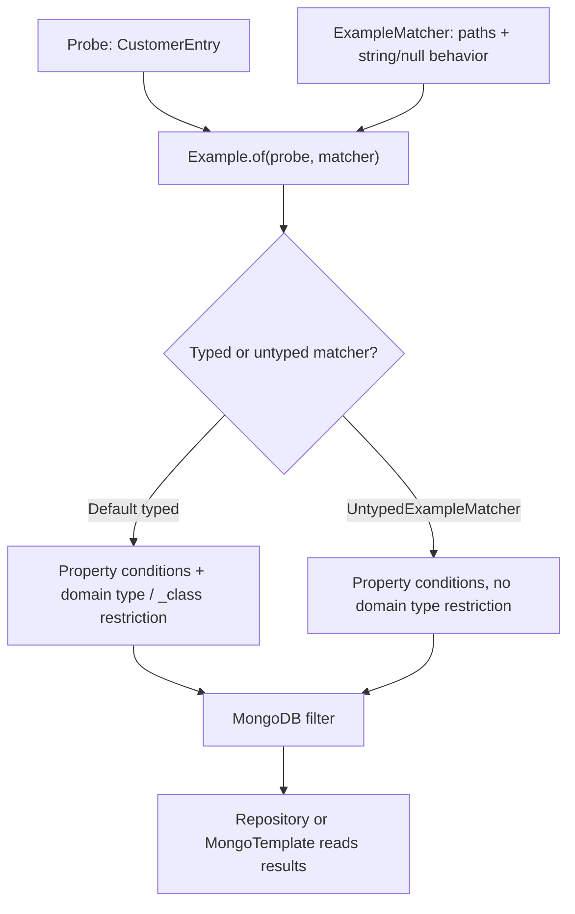

# Checking the Impact of Domain Types and _class on Queries

## 1. Scenario: Same Search Criteria, Different Results

In **Spring Data MongoDB**, *Query by Example* (**QBE**) creates a query from a sample object called a **probe**. A developer sets a few properties on the probe, constructs an `Example`, and calls a repository or `MongoTemplate` to find matching documents. This is concise when a search screen involves equality checks, string matching, and optional fields.

However, Spring Data MongoDB QBE has an important characteristic: **by default, Example is typed**. Besides the probe's fields, the framework also uses the **domain type** to restrict query results. Under the default mapping configuration, this restriction involves the **`_class`** field written by Spring Data MongoDB into documents.

Suppose the `directory_entries` collection contains three documents with the same `tenantId` and `nickname`:

```javascript
// Document written by Spring Data from CustomerEntry:
{
  _id: "customer-101",
  tenantId: "tenant-42",
  nickname: "An",
  verified: true,
  score: NumberInt("10"),
  _class: "customer"
}

// Document written by Spring Data from VendorEntry:
{
  _id: "vendor-201",
  tenantId: "tenant-42",
  nickname: "An",
  verified: true,
  score: NumberInt("30"),
  _class: "vendor"
}

// Legacy document imported by driver or script, without _class:
{
  _id: "legacy-301",
  tenantId: "tenant-42",
  nickname: "An",
  verified: true,
  score: NumberInt("20")
}
```

A plain MongoDB query on `tenantId` and `nickname` can find all three documents. Yet **typed QBE with a `CustomerEntry` probe** targets only documents compatible with the probe's domain type; in an example using `@TypeAlias`, it may match only the document carrying the `customer` type hint. The other two documents do not fail the name/tenant criteria at all: they **fail the type restriction** added by QBE.

This lesson belongs to the **Query by Example** chapter of the **SPRING_DATA_MONGODB** module, where Spring Data is used to connect, map documents, and work with MongoDB via `MongoTemplate`/repositories, while testing, designing queries, and diagnosing data performance. We will examine the effects of **probe type**, **`_class`**, **`@TypeAlias`**, **`UntypedExampleMatcher`**, legacy data, and Java types on QBE results.

## 2. Four Components of Query by Example

QBE has four concepts to keep distinct:

| Component | Role | Example |
| --- | --- | --- |
| **Probe** | Sample object holding properties used as conditions | `CustomerEntry` with `tenantId`, `nickname` |
| **ExampleMatcher** | Controls property matching, nulls, strings, ignore paths, AND/OR | `matchingAll().withIgnorePaths("verified")` |
| **Example** | Combines probe and matcher into a query specification | `Example.of(probe, matcher)` |
| **Executor / Query** | Uses Example to query MongoDB | `repository.findAll(example)` or `Criteria.byExample(example)` |

Processing flow:



Minimal example:

```java
import org.springframework.data.domain.Example;
import org.springframework.data.domain.ExampleMatcher;

CustomerEntry probe = new CustomerEntry();
probe.setTenantId("tenant-42");
probe.setNickname("An");

ExampleMatcher matcher = ExampleMatcher.matchingAll()
    .withIgnorePaths("verified");

Example<CustomerEntry> example = Example.of(probe, matcher);
```

Here, `tenantId` and `nickname` are used as criteria. `score` is an unassigned `Integer` wrapper, so it is ignored by default. `verified` is a primitive `boolean` defaulting to `false`; if not ignored, it **is included in QBE**, even though the developer never intentionally selected it.

By default `ExampleMatcher` requires all evaluated properties to match together; rules for nulls, strings, type restrictions, and matchers can be customized. Note that **typed/untyped is not the same as matchingAll/matchingAny**: they are two independent configuration axes.

## 3. Why Does Spring Data MongoDB Store _class?

### 3.1. Type Hint of MappingMongoConverter

A MongoDB collection can hold multiple document shapes. `MappingMongoConverter` needs information to reconstruct the right Java type, especially in polymorphic hierarchies or fields declared with a supertype/interface.

With default type mapping, Spring Data can write the **fully qualified Java class name** into `_class`:

```javascript
{
  _id: "customer-101",
  tenantId: "tenant-42",
  nickname: "An",
  _class: "example.directory.CustomerEntry"
}
```

`_class` is a **type discriminator/type hint** of Spring Data MongoDB's mapping layer, **not** a mandatory field automatically generated by MongoDB server for every document. A `mongosh` script, direct driver call, or external system can easily write documents without `_class`.

Some applications also customize the type-hint field name or disable writing type hints altogether. Thus, never assume `_class` always appears with the exact same values in every collection.

### 3.2. @TypeAlias Replaces Long Java Names with an Alias

`@TypeAlias` lets you use a short string to represent a class:

```java
import org.springframework.data.annotation.TypeAlias;

@TypeAlias("customer")
public class CustomerEntry {
    // ...
}
```

With compatible mapping and configuration, documents written from this class can contain:

```javascript
{ _class: "customer" }
```

Changing `@TypeAlias` **does not automatically migrate** existing documents whose `_class` still holds the old class name or old alias. You need a compatibility/migration strategy, because typed QBE queries and object reading can be affected.

One technical note: resolving an alias requires the **MappingContext to know the corresponding class**, via entity scanning/metadata initialization or configuring an initial entity set. If an alias only exists in historical data while the application context does not know that Java type, reading may fail to restore the right subtype.

### 3.3. Never Treat _class as an Authorization Mechanism

`_class: "customer"` represents domain-type metadata; it does not replace `tenantId`, user roles, or access policies. A typed QBE can exclude vendors, yet still return customers from another tenant if the service omits the proper tenant filter.

Never accept a client-supplied `_class` as a credential to access data. Tenant isolation and authorization must be determined server-side.

## 4. Default Typed Example Changes the BSON Query

According to the Spring Data MongoDB documentation, **`Example.of(probe)` is strictly typed by default**. This causes a type condition to be included in the **mapped query**. With the default type key, an illustrative form is:

```javascript
{
  tenantId: "tenant-42",
  nickname: "An",
  _class: { $in: ["customer"] }
}
```

This is an **illustrative BSON filter** for an entity with `@TypeAlias("customer")`, not a guarantee that the framework always emits that exact string. The allowed type set can depend on the **probe type, subtypes assignable to the probe, mapping metadata, aliases, and type mapper configuration**.

For a class without `@TypeAlias`, the corresponding example might use a fully qualified name such as:

```javascript
{ _class: { $in: ["example.directory.CustomerEntry"] } }
```

This explains a very common real-world surprise: running in mongosh

```javascript
db.directory_entries.find({
  tenantId: "tenant-42",
  nickname: "An"
});
```

shows three records, yet calling `repository.findAll(Example.of(probe))` returns fewer. The two queries are **not equivalent**, because typed QBE adds a type condition.

### 4.1. "Typed" Does Not Necessarily Mean Matching Only One Exact _class Value

A probe of a parent type may need to include compatible subtypes. The documentation describes restricting to **types assignable to the probe's type**. Therefore, do not hand-write `{_class: "com.example.Base"}` assuming it equals every typed QBE with inheritance.

If a system stores multiple subtypes in one collection, test specifically against your hierarchy, `@TypeAlias`, and entity metadata on your Spring Data version. Avoid guessing solely from Java class names.

## 5. Preparing Two Domain Types in the Same Collection

We use two classes **with no inheritance relationship** to clearly illustrate type restriction. Both share the same field names while representing two distinct business domains.

### 5.1. CustomerEntry

```java
package example.directory;

import org.springframework.data.annotation.TypeAlias;
import org.springframework.data.mongodb.core.mapping.Document;
import org.springframework.data.mongodb.core.mapping.FieldType;
import org.springframework.data.mongodb.core.mapping.MongoId;

@Document(collection = "directory_entries")
@TypeAlias("customer")
public class CustomerEntry {

    @MongoId(FieldType.STRING)
    private String id;

    private String tenantId;
    private String nickname;
    private Integer score;
    private boolean verified;

    public CustomerEntry() {}

    public CustomerEntry(
            String id, String tenantId, String nickname,
            Integer score, boolean verified) {
        this.id = id;
        this.tenantId = tenantId;
        this.nickname = nickname;
        this.score = score;
        this.verified = verified;
    }

    public String getId() { return id; }
    public String getTenantId() { return tenantId; }
    public String getNickname() { return nickname; }
    public Integer getScore() { return score; }
    public boolean isVerified() { return verified; }

    public void setId(String id) { this.id = id; }
    public void setTenantId(String tenantId) {
        this.tenantId = tenantId;
    }
    public void setNickname(String nickname) {
        this.nickname = nickname;
    }
    public void setScore(Integer score) { this.score = score; }
    public void setVerified(boolean verified) {
        this.verified = verified;
    }
}
```

We use `@MongoId(FieldType.STRING)` to keep `_id` as a BSON String consistently. `score` is `Integer` so it can remain null when not filtering by score; `verified` is intentionally a primitive to illustrate how default values can slip into QBE.

### 5.2. VendorEntry

```java
package example.directory;

import org.springframework.data.annotation.TypeAlias;
import org.springframework.data.mongodb.core.mapping.Document;
import org.springframework.data.mongodb.core.mapping.FieldType;
import org.springframework.data.mongodb.core.mapping.MongoId;

@Document(collection = "directory_entries")
@TypeAlias("vendor")
public class VendorEntry {

    @MongoId(FieldType.STRING)
    private String id;

    private String tenantId;
    private String nickname;
    private Integer score;
    private boolean verified;

    public VendorEntry() {}

    public VendorEntry(
            String id, String tenantId, String nickname,
            Integer score, boolean verified) {
        this.id = id;
        this.tenantId = tenantId;
        this.nickname = nickname;
        this.score = score;
        this.verified = verified;
    }

    public String getId() { return id; }
    public String getTenantId() { return tenantId; }
    public String getNickname() { return nickname; }
    public Integer getScore() { return score; }
    public boolean isVerified() { return verified; }
}
```

Both classes share a collection, yet `_class` differs when written by `MappingMongoConverter` with `@TypeAlias` support. This design illustrates QBE behavior and is **not a default recommendation** that unrelated domains should share collections.

### 5.3. CustomerEntry Repository

```java
package example.directory;

import org.springframework.data.mongodb.repository.MongoRepository;

public interface CustomerEntryRepository
        extends MongoRepository<CustomerEntry, String> {
}
```

`MongoRepository` exposes common QBE operations such as `findAll(Example<S>)` via Spring Data infrastructure. This repository's result type is designed to return `CustomerEntry`, **not a polymorphic Java list of every document type in the collection**.

## 6. Writing Typed and Legacy Data for Comparison

### 6.1. Two Documents Written via Spring Data

```java
import org.springframework.data.mongodb.core.MongoTemplate;

template.save(new CustomerEntry(
    "customer-101",
    "tenant-42",
    "An",
    10,
    true
));

template.save(new VendorEntry(
    "vendor-201",
    "tenant-42",
    "An",
    30,
    true
));
```

Under default converter settings and valid aliases, MongoDB stores two distinct type hints. Inspect directly:

```javascript
db.directory_entries.find(
  { tenantId: "tenant-42" },
  { _id: 1, tenantId: 1, nickname: 1, verified: 1, _class: 1 }
);
```

### 6.2. A Document Without _class

Suppose legacy data was imported via the MongoDB driver directly:

```javascript
db.directory_entries.insertOne({
  _id: "legacy-301",
  tenantId: "tenant-42",
  nickname: "An",
  verified: true,
  score: NumberInt("20")
});
```

This document **has no `_class`**. That does not mean it does not exist, nor that the `nickname` field is wrong. It simply lacks the type metadata that default typed QBE uses.

### 6.3. Predicting the Three Result Sets

Suppose the probe only filters `tenantId="tenant-42"` and `nickname="An"`, while `verified` is ignored:

| Query | Customer `_class: customer` | Vendor `_class: vendor` | Legacy without `_class` |
| --- | --- | --- | --- |
| MongoDB find by tenant/nickname only | Yes | Yes | Yes |
| Default typed QBE with `CustomerEntry` | Yes | No, different domain type | No, missing required type hint |
| QBE using `UntypedExampleMatcher` | Yes | Yes in terms of field conditions | Yes in terms of field conditions |

The third row refers to **which documents the query selects**, **not** a guarantee that mixed-type results can all be safely cast into `CustomerEntry`. Section 8 shows how to inspect results using raw `Document`.

## 7. Typed Example in a Repository

### 7.1. Creating the Probe and Matcher

```java
import java.util.List;
import org.springframework.data.domain.Example;
import org.springframework.data.domain.ExampleMatcher;

CustomerEntry probe = new CustomerEntry();
probe.setTenantId("tenant-42");
probe.setNickname("An");

ExampleMatcher matcher = ExampleMatcher.matchingAll()
    .withIgnorePaths("verified");

Example<CustomerEntry> typedExample =
    Example.of(probe, matcher);

List<CustomerEntry> results =
    customerRepository.findAll(typedExample);
```

With section 6's fixtures, `results` is expected to contain **customer-101**. `null` fields (`id`, `score`) are omitted from the default filter. `verified` is explicitly ignored.

`ExampleMatcher.matchingAll()` is still a standard typed matcher; it is not equivalent to `UntypedExampleMatcher.matching()` even though both contain the word `matching`.

### 7.2. Why Does the Typed Result Miss the Legacy Document?

When the mapped query includes a type condition corresponding to `CustomerEntry`, a document missing `_class` fails that condition. There is no reason for the database to guess that an old document lacking a type hint is a customer.

When migrating from a system writing MongoDB directly to Spring Data QBE, check **field names, BSON types, and `_class` metadata**, rather than merely reading one sample record through an entity mapper.

### 7.3. When Is Typed QBE Appropriate?

Typed QBE is useful when a collection is designed to hold multiple domain types and you want only documents matching the **probe type** and compatible subtypes under current metadata.

It fits poorly when:

- Legacy data has no `_class`;
- One collection holds data written by multiple apps using different type hints;
- The converter disabled type hints while code still uses typed QBE;
- You need to search across multiple document types sharing core schema fields;
- A refactor renamed classes/aliases so old and new data carry different type hints.

In those cases, choose an explicit data/query strategy instead of adding `withIgnorePaths("_class")` and hoping the type restriction disappears.

## 8. UntypedExampleMatcher: Intentionally Removing Type Restrictions

### 8.1. Correct Syntax

Spring Data MongoDB provides:

```java
import org.springframework.data.domain.Example;
import org.springframework.data.domain.ExampleMatcher;
import org.springframework.data.mongodb.core.query.UntypedExampleMatcher;

CustomerEntry probe = new CustomerEntry();
probe.setTenantId("tenant-42");
probe.setNickname("An");

ExampleMatcher matcher = UntypedExampleMatcher.matching()
    .withIgnorePaths("verified");

Example<CustomerEntry> untypedExample =
    Example.of(probe, matcher);
```

`UntypedExampleMatcher.matching()` tells QBE **not to add a domain-type restriction condition**. Field conditions derived from the probe still apply. This is the mechanism Spring Data MongoDB provides for collections using multiple document types or lacking type hints. It does **not** turn off all mapping, fix aliases, or coerce legacy data into the right Java type.

### 8.2. Using MongoTemplate to Inspect BSON Documents

```java
import java.util.List;
import org.bson.Document;
import org.springframework.data.mongodb.core.query.Criteria;
import org.springframework.data.mongodb.core.query.Query;

Query query = new Query(
    new Criteria().alike(untypedExample)
);

List<Document> documents = template.find(
    query,
    Document.class,
    "directory_entries"
);
```

With section 6's data, the query without type restriction can return all three documents, since `tenantId` and `nickname` match in all three. Here we intentionally use **`Document.class`** to inspect raw BSON data and avoid assuming a vendor document can safely map to `CustomerEntry`.

Key distinction:

```java
// Typed: can restrict results to documents of the same domain type.
Example<CustomerEntry> typed =
    Example.of(probe, ExampleMatcher.matchingAll()
        .withIgnorePaths("verified"));

// Untyped: adds no domain-type restriction.
Example<CustomerEntry> untyped =
    Example.of(probe, UntypedExampleMatcher.matching()
        .withIgnorePaths("verified"));
```

| Aspect | Typed Example | Untyped Example |
| --- | --- | --- |
| Uses probe properties as filters | Yes | Yes |
| Adds domain-type restriction | Yes by default | No |
| May exclude documents missing `_class` | Yes | Not due to missing `_class` |
| Automatically reads exact subtypes | Depends on converter/metadata | Still depends on converter/metadata |
| Automatically adds tenant/authorization conditions | No | No |
| Fits multi-type collections | When restricting to one type | When intentionally querying across types |

### 8.3. Warning: Untyped Results May Not Share the Same Java Type

If you pass an untyped Example to a repository declared to return `CustomerEntry`, the MongoDB filter can select vendors or legacy documents as well. Meanwhile, the reading layer still has to decide which Java type to instantiate from BSON. With incompatible hierarchies, missing discriminators, or subtype-specific fields, conversion may behave unexpectedly or fail.

Therefore, **do not remove type restrictions just to increase result counts and treat every returned document as a valid CustomerEntry**. When searching across domains, use a clearly defined shared read model, a query returning `Document` for post-read classification, or a custom repository with tested conversion.

## 9. Domain Types Also Affect Which Properties Are Matched

`_class` is not the only factor. The **Java class shape of the probe** also determines which predicates are built.

### 9.1. Null Properties Are Ignored by Default

```java
CustomerEntry probe = new CustomerEntry();
probe.setTenantId("tenant-42");
probe.setNickname("An");
// probe.getScore() == null -> score is not filtered by default.
```

Without explicitly requesting null inclusion, probe properties with `null` values normally **do not participate** in QBE. A property declared on the class without a set value is not equivalent to MongoDB `field: null`.

This helps dynamic searches, but if business rules must distinguish **missing**, **BSON null**, and concrete values, QBE may not be explicit enough; consider `Criteria`, `$exists`, or JSON queries.

### 9.2. Primitives Always Have Default Values

In `CustomerEntry`:

```java
private boolean verified;
```

Upon `new CustomerEntry()`, `verified` defaults to `false` rather than `null`. If you write:

```java
Example<CustomerEntry> naive = Example.of(probe);
```

then QBE can add `verified: false`. Since all three documents in section 6 have `verified: true`, this query finds zero matching records, **even when `_class` is completely right**.

To make `verified` an optional filter, two common approaches are:

```java
// Approach 1: ignore the field on the existing probe.
ExampleMatcher matcher = ExampleMatcher.matchingAll()
    .withIgnorePaths("verified");

// Approach 2: model with Boolean instead of boolean
// to allow null = no filter, if appropriate for the domain.
private Boolean verified;
```

The `private Boolean verified;` snippet is an **entity-definition change option**, not a valid statement to paste inside a method. In QBE, primitives such as `int`, `long`, and `boolean` can silently enter filters unless ignored; this is a common source of empty results.

### 9.3. matchingAll and matchingAny Do Not Solve Type Restrictions

`matchingAll()` requires probe predicates to hold simultaneously. `matchingAny()` applies OR logic across property predicates; it **does not mean "match any entity type"**.

```java
ExampleMatcher anyFields = ExampleMatcher.matchingAny()
    .withIgnorePaths("verified");

Example<CustomerEntry> exampleAny =
    Example.of(probe, anyFields);
```

If the probe contains `tenantId` and `nickname`, `matchingAny` can allow documents matching *nickname* from **another tenant** into the result set. Never use `matchingAny` to broaden a search when tenant must be strictly protected.

For mandatory fields that must be ANDed with optional search criteria, build explicit `Criteria` placing the tenant constraint at the outermost level; always source the tenant from server-side identity.

## 10. Domain Types, @Field, and BSON Paths

Two Java classes having properties with similar meanings does not mean they point to the same BSON field name.

Example:

```java
import org.springframework.data.mongodb.core.mapping.Field;

public class CustomerSearchProbe {
    @Field("nick_name")
    String nickname;
}
```

If a data source wrote `nickname` while the new probe maps to `nick_name`, the query may not match, **even with `UntypedExampleMatcher`**. Untyped only removes the type restriction; it does not reconcile differing schemas across data sources.

When using QBE with a probe whose class differs from the target entity, check:

1. Java property names on the probe;
2. `@Field` or custom naming strategies;
3. Actual BSON field names;
4. BSON types and custom converters;
5. Expected result type and how it is mapped back.

Spring Data documentation allows using a probe class different from the result type in an untyped example when fields map compatibly. In real applications, however, prefer explicit query/DTO contracts instead of assuming two schemas with similar names will always stay compatible.

### 10.1. _id and @MongoId Can Narrow QBE More Than Expected

If a probe is created from an entity that already has an `id`, QBE may use ID as a predicate as well. Because `_id` is unique, a search expected to return many records returns at most one document.

```java
CustomerEntry probe = customerRepository
    .findById("customer-101")
    .orElseThrow();

// This probe contains id, tenantId, nickname, score, and verified.
// Not equivalent to a fresh probe setting only tenantId and nickname.
```

When reusing a persisted entity as a probe, explicitly ignore fields outside the search contract:

```java
ExampleMatcher matcher = ExampleMatcher.matchingAll()
    .withIgnorePaths("id", "score", "verified");
```

To avoid leaking or misfiltering business fields, it is usually better to create a **fresh probe from validated search inputs** rather than reusing a database-loaded entity with many populated fields.

## 11. Legacy Data Lacking _class and Type-Mapping Changes

### 11.1. Why Does mongosh Find It While Typed QBE Returns Empty?

Consider a legacy document:

```javascript
{
  _id: "legacy-301",
  tenantId: "tenant-42",
  nickname: "An",
  verified: true
}
```

A raw query by tenant/nickname does not require `_class`, so it finds the document. A typed Example can add a type condition and exclude documents lacking the type hint. This is a **query contract difference**, not necessarily a connection or index error.

To check the proportion of documents missing type hints:

```javascript
db.directory_entries.countDocuments({
  _class: { $exists: false }
});

db.directory_entries.aggregate([
  {
    $group: {
      _id: { $ifNull: ["$_class", "<missing-or-null>"] },
      count: { $sum: 1 }
    }
  },
  { $sort: { count: -1 } }
]);
```

This aggregation is for **inventory auditing**, not a substitute for determining each document's true domain type. If a document has no `_class`, do not blindly assume it must be a customer.

### 11.2. Handling Options

| Option | Suitable When | Risk to Control |
| --- | --- | --- |
| Keep typed QBE and backfill type hints | Every document's true type can be determined reliably | Misclassifying types in migration breaks mapping |
| Use untyped example | Need cross-type search or `_class` is unused | May select incompatible domains |
| Use `Criteria` on business fields | Query does not need Java type discriminator | Must manage filters, mappings, and authorization manually |
| Add a stable business discriminator like `kind` | Multiple document types share a collection | Must validate/migrate thoroughly and index appropriately |
| Split collections by domain | Domains have clearly different lifecycles and schemas | Migration effort and query updates |
| Use a custom converter/type mapper | Clear architectural reason to change type hints | Affects all polymorphic reads and writes |

The right choice depends on actual data and compatibility needs. **Never run bulk migrations based solely on a few overlapping field names.**

### 11.3. Renaming Java Packages or @TypeAlias

If historical data uses:

```javascript
{ _class: "old.package.CustomerEntry" }
```

while the new application writes:

```javascript
{ _class: "customer" }
```

changing aliases or class paths can break typed QBE. Build a tested transition plan, handle legacy alias mappings if needed, and measure record counts for each `_class` value before cutover.

Never overwrite all `_class` values with a single value just "so QBE finds them" if the collection actually contains different domain types.

### 11.4. Disabling Type Hints Does Not Turn Typed QBE Into Untyped

Applications can customize `MappingMongoConverter` with `MongoTypeMapper` to alter how type hints are written. That is a **mapping-level configuration** decision. When applied, test how typed QBE behaves under that exact configuration: a typed Example is still designed to apply type restrictions, while documents lacking the corresponding metadata may be excluded.

In collections without type hints, `UntypedExampleMatcher` or explicit `Criteria` is usually more predictable. However, if the system relies on polymorphic deserialization, disabling type hints can prevent restoring the right subtype.

## 12. Domain Type Inheritance and Assignability

In a hierarchy:

```java
abstract class DirectoryEntry {
    String tenantId;
    String nickname;
}

class Customer extends DirectoryEntry {
    Integer loyaltyPoints;
}

class Vendor extends DirectoryEntry {
    String registrationCode;
}
```

A probe of type `DirectoryEntry` and a probe of type `Customer` can produce **different type-restriction scopes**. Typed queries are defined in terms of types assignable to the probe type; known subtype metadata, aliases, and the type mapper determine which type-hint values are included.

This snippet only illustrates hierarchy; it is not a complete entity/repository setup. To use it in Spring Data MongoDB, choose specific `@Document` settings, ID mappings, and polymorphic storage strategies.

Tests should answer:

- Does a parent-class probe match all required subtypes?
- Does a subclass probe exclude parent-class or sibling documents?
- Is a newly added subtype recognized by the MappingContext?
- Are legacy documents with fully qualified names and new documents with aliases both read properly?
- When refactoring hierarchies, which documents require migration?

Do not treat `_class` as a schema-version field to rewrite arbitrarily. If schema versioning is needed, maintain a dedicated schema version field and migration workflow.

## 13. Nulls in Nested Objects and Exact-Matching Surprises

Spring Data MongoDB notes a caveat for QBE: when **include null values** is configured in an Example, query generation for embedded objects can switch from **dot notation** to **embedded document** matching. That can require exact property and field-order matching inside the embedded document, producing unexpected results.

Example document:

```javascript
{
  _id: "customer-101",
  address: {
    city: "Da Nang",
    street: "Tran Phu"
  }
}
```

Querying only `address.city`:

```javascript
{ "address.city": "Da Nang" }
```

is not the same as matching the whole object:

```javascript
{
  address: {
    city: "Da Nang",
    street: null
  }
}
```

The second query has embedded-document equality semantics and may not match because the stored document has a non-null `street`. When using `withIncludeNullValues()` in a matcher, **test the embedded schema and the generated BSON query**, rather than judging only by how many Java fields are null.

If nested search requirements are complex, require range/OR conditions, or must distinguish missing/null reliably, `Criteria` and explicit MongoDB queries are often better than QBE.

## 14. QBE Does Not Replace Criteria for Every Query

### 14.1. What QBE Does Well

- Optional fields determined by presence/absence of property values.
- Equality comparisons for numbers, enums, and suitable types.
- Exact, prefix, suffix, contains, or regex string matching per supported matcher.
- Toggling ignored fields and case-sensitivity rules.
- Querying from the same domain model as refactors evolve its structure.

### 14.2. Where QBE Is Awkward

- Numeric or date ranges like `price >= 100 AND price < 200`;
- Nested logic such as `tenant = X AND (status = A OR score > 10)`;
- `$in` value sets, aggregations, or complex array `$elemMatch` operations;
- Fine-grained control over BSON null/missing and mixed type discriminators;
- Cross-domain searches needing per-subtype result classification.

Example query with mandatory tenant and minimum score:

```java
import org.springframework.data.mongodb.core.query.Criteria;
import org.springframework.data.mongodb.core.query.Query;

Query query = Query.query(
    Criteria.where("tenantId").is(authorizedTenantId)
        .and("nickname").is("An")
        .and("score").gte(10)
);
```

`Criteria` in this example does not add QBE's type restriction. If you need only customers, add an **intentionally defined discriminator condition**, or use an appropriate collection. Never implicitly mix Java type-hint conventions with domain rules when multiple systems write to the data.

### 14.3. Using QBE Inside Criteria When Needed

Spring Data lets you embed an Example as part of `Criteria`:

```java
Example<CustomerEntry> untyped = Example.of(
    probe,
    UntypedExampleMatcher.matching()
        .withIgnorePaths("verified")
);

Query query = Query.query(
    new Criteria().andOperator(
        Criteria.where("tenantId").is(authorizedTenantId),
        Criteria.byExample(untyped)
    )
);
```

This is a useful pattern to keep the **tenant filter at a mandatory AND level** while using QBE for permitted search criteria. When the probe also sets `tenantId`, the tenant condition is logically duplicated; in real applications you can populate only optional fields on the probe and keep tenant solely in the outer condition.

If the matcher switches to `matchingAny()`, the outer tenant condition still applies across every OR branch. **Verify the actual BSON query**, especially with complex matchers.

## 15. Indexes and Performance: _class Is Also a Predicate

### 15.1. Indexes Must Reflect Actual Query Shapes

If typed QBE frequently queries `tenantId`, `nickname`, and type hint:

```javascript
db.directory_entries.find({
  tenantId: "tenant-42",
  nickname: "An",
  _class: "customer"
});
```

a candidate index:

```javascript
db.directory_entries.createIndex(
  { tenantId: 1, nickname: 1, _class: 1 },
  { name: "by_tenant_nickname_type" }
);
```

However, typed QBE may emit `_class` using `$in`, and the query shape also depends on the matcher. The index above is only a **candidate to benchmark**, not guaranteed optimal. If untyped queries are common, the filter lacks the type condition, so the best index may differ.

### 15.2. String Matching Can Significantly Change Performance

`ExampleMatcher` supports options such as starts/ends/contains and ignoreCase. Some configurations use **regex** in MongoDB:

```java
import static org.springframework.data.domain.ExampleMatcher
    .GenericPropertyMatchers.startsWith;

ExampleMatcher matcher = ExampleMatcher.matchingAll()
    .withMatcher("nickname", startsWith().ignoreCase())
    .withIgnorePaths("verified");
```

Regexes are not guaranteed to use indexes like equality queries; adding `_class` to the filter will not make a regex query fast on its own. At scale, inspect the actual BSON query, selectivity, indexes, collation, and `explain("executionStats")` output.

If inputs come from users, restrict string lengths and desired pattern types; avoid unbounded arbitrary regex when business needs only prefix/exact search.

### 15.3. Inspecting explain and Raw BSON

```javascript
db.directory_entries.find({
  tenantId: "tenant-42",
  nickname: "An",
  _class: { $in: ["customer"] }
}).explain("executionStats");
```

Check `winningPlan`, `totalKeysExamined`, and `totalDocsExamined`. `getIndexes()` confirms which indexes actually exist. If a query is slow, never remove the type restriction just to drop a predicate without understanding the security and correctness impact.

Checking data types in the collection:

```javascript
db.directory_entries.aggregate([
  {
    $group: {
      _id: { $type: "$_class" },
      count: { $sum: 1 }
    }
  },
  { $sort: { count: -1 } }
]);
```

This helps identify documents with `_class` as string, null, or missing. Classifying type hints properly also requires inspecting **values** and converter versions.

## 16. Integration Testing: Typed vs. Untyped vs. Raw Queries

Do not write only a `findAll` test with same-type data. To test the impact of type hints, you need **at least two document types sharing the same fields** and one document **without `_class`**.

### 16.1. Test Setup

Example using JUnit 5, Spring Boot MongoDB test slice, and a configured test MongoDB:

```java
package example.directory;

import static com.mongodb.client.model.Filters.eq;
import static org.junit.jupiter.api.Assertions.*;

import java.util.List;
import java.util.UUID;
import org.bson.Document;
import org.junit.jupiter.api.BeforeEach;
import org.junit.jupiter.api.Test;
import org.springframework.beans.factory.annotation.Autowired;
import org.springframework.boot.test.autoconfigure.data.mongo.DataMongoTest;
import org.springframework.data.domain.Example;
import org.springframework.data.domain.ExampleMatcher;
import org.springframework.data.mongodb.core.MongoTemplate;
import org.springframework.data.mongodb.core.query.Criteria;
import org.springframework.data.mongodb.core.query.Query;
import org.springframework.data.mongodb.core.query.UntypedExampleMatcher;

@DataMongoTest
class QueryByExampleTypeHintTest {

    @Autowired
    MongoTemplate template;

    @Autowired
    CustomerEntryRepository repository;

    private String tenantId;
    private String customerId;
    private String vendorId;
    private String legacyId;

    @BeforeEach
    void createFixtures() {
        String suffix = UUID.randomUUID().toString();
        tenantId = "tenant-" + suffix;
        customerId = "customer-" + suffix;
        vendorId = "vendor-" + suffix;
        legacyId = "legacy-" + suffix;

        template.save(new CustomerEntry(
            customerId, tenantId, "An", 10, true
        ));
        template.save(new VendorEntry(
            vendorId, tenantId, "An", 30, true
        ));

        template.getCollection("directory_entries").insertOne(
            new Document("_id", legacyId)
                .append("tenantId", tenantId)
                .append("nickname", "An")
                .append("score", 20)
                .append("verified", true)
        );
    }

    private CustomerEntry probe() {
        CustomerEntry probe = new CustomerEntry();
        probe.setTenantId(tenantId);
        probe.setNickname("An");
        return probe;
    }

    private ExampleMatcher typedMatcher() {
        return ExampleMatcher.matchingAll()
            .withIgnorePaths("verified");
    }

    // Add the following @Test methods inside this class.
}
```

In real code, place the `@Test` methods from the subsections below **inside** `QueryByExampleTypeHintTest`. Fixtures generate per-test tenants and IDs so they do not depend on data in other environments.

**Environment:** `@DataMongoTest` configures the Spring MongoDB context but does not guarantee a server starts automatically in every version/setup. Use Testcontainers MongoDB or a configured test MongoDB; import paths may need adjustment depending on your Spring Boot major version.

### 16.2. Verifying Actual Written Type Hints

```java
@Test
void springMappingWritesAliasesButRawLegacyHasNoTypeHint() {
    Document customer = template.getCollection("directory_entries")
        .find(eq("_id", customerId))
        .first();
    Document vendor = template.getCollection("directory_entries")
        .find(eq("_id", vendorId))
        .first();
    Document legacy = template.getCollection("directory_entries")
        .find(eq("_id", legacyId))
        .first();

    assertNotNull(customer);
    assertNotNull(vendor);
    assertNotNull(legacy);
    assertEquals("customer", customer.getString("_class"));
    assertEquals("vendor", vendor.getString("_class"));
    assertFalse(legacy.containsKey("_class"));
}
```

This test also confirms `@TypeAlias` is active in the application's mapping context. If a project intentionally uses a different type mapper or disables type hints, update assertions to match the **real configuration contract** instead of forcing data to fit the example.

### 16.3. Typed QBE Selects Results Matching the Probe Type

```java
@Test
void typedExampleRestrictsResultsByDomainType() {
    Example<CustomerEntry> example =
        Example.of(probe(), typedMatcher());

    List<CustomerEntry> found = repository.findAll(example);

    assertEquals(1, found.size());
    assertEquals(customerId, found.get(0).getId());
}
```

With the current fixtures, all three documents match `tenantId` and `nickname`, but only customer carries a valid type hint for the `CustomerEntry` probe. The test intentionally avoids relying on `findAll` ordering since only one document is expected.

### 16.4. Untyped QBE Allows All Three Documents in the Result Set

```java
@Test
void untypedExampleSkipsDomainTypeRestriction() {
    Example<CustomerEntry> example = Example.of(
        probe(),
        UntypedExampleMatcher.matching()
            .withIgnorePaths("verified")
    );

    Query query = new Query(new Criteria().alike(example));
    List<Document> documents = template.find(
        query, Document.class, "directory_entries"
    );

    List<String> ids = documents.stream()
        .map(doc -> doc.getString("_id"))
        .sorted()
        .toList();

    assertEquals(
        List.of(customerId, legacyId, vendorId)
            .stream().sorted().toList(),
        ids
    );
}
```

`Document.class` lets the test focus on **which documents the query selects** rather than assuming the converter can turn vendor and legacy documents into the same Java entity. In production code, if cross-domain search is needed, define a clear result type and handle differing document types safely.

### 16.5. Primitive Probes Can Yield Empty Results

```java
@Test
void primitiveDefaultValueUnexpectedlyFiltersProbe() {
    // verified defaults to false, while customer fixture has verified=true.
    Example<CustomerEntry> naive = Example.of(probe());

    assertTrue(repository.findAll(naive).isEmpty());

    // Ignore this primitive to query only by tenantId/nickname.
    Example<CustomerEntry> corrected =
        Example.of(probe(), typedMatcher());

    assertEquals(1, repository.findAll(corrected).size());
}
```

This test matters because it shows **two distinct causes of missing results**: type restrictions and unintended probe properties. When debugging, check both.

### 16.6. Comparing Against a Raw Query

```java
@Test
void rawQueryByFieldsDoesNotImposeProbeClass() {
    long count = template.getCollection("directory_entries")
        .countDocuments(
            new Document("tenantId", tenantId)
                .append("nickname", "An")
        );

    assertEquals(3L, count);
}
```

Comparing the tests:

| Query Method | Document Count with Fixtures |
| --- | ---: |
| Typed QBE `CustomerEntry`, ignoring `verified` | 1 |
| Untyped QBE, raw `Document` results | 3 |
| Raw driver query by tenant/nickname | 3 |
| Naive typed QBE not ignoring primitive boolean | 0 |

Only with **fixtures sharing identical field values but differing `_class`** do these tests prove the impact of domain type.

## 17. Observing the Actual Sent BSON Query

Sometimes the `Query` object string shown in a debugger does not fully reflect the **mapped** query before the driver sends it. Spring Data can translate `id` to `_id`, apply `@Field`, and append QBE type restrictions.

Therefore, use a multi-layer inspection workflow:

1. **Inspect raw documents** with the MongoDB driver or mongosh: does `_class` exist and what is its value?
2. **Verify probe and matcher**: which fields are non-null, which primitives have defaults, which ignore paths are active?
3. **Observe the actual MongoDB command** via controlled command monitoring/logging to see the final post-mapping filter.
4. **Run the equivalent query in mongosh** with all conditions, without omitting `_class` when comparing.
5. **Test typed vs. untyped results** on documents with identical fields but differing type hints.
6. **Run explain** on filters with and without `_class` if performance matters.

Comparison in mongosh:

```javascript
// Customer data only (assuming alias = customer):
db.directory_entries.find({
  tenantId: "tenant-42",
  nickname: "An",
  _class: { $in: ["customer"] }
});

// Documents matching fields without type restriction:
db.directory_entries.find({
  tenantId: "tenant-42",
  nickname: "An"
});
```

Getting different document counts from the two queries is **expected** on the sample data. It does not prove Spring Data is broken. To confirm what query the application sends, inspect actual filters or run integration tests on the matching configuration.

**Log protection:** command monitoring can expose usernames, tenant IDs, emails, or sensitive values. Never log full queries/parameters in production without strict access controls, redaction, and retention policies.

## 18. Common Errors and Troubleshooting

| Symptom | Possible Cause | Resolution |
| --- | --- | --- |
| QBE returns fewer documents than mongosh | Typed Example adds `_class` condition | Inspect mapped query and type hints |
| Legacy documents are not found | Missing `_class` under typed QBE | Verify true type, migrate, or intentionally use untyped/Criteria |
| Package rename breaks QBE on old data | `_class` still holds old Java class name | Handle compatibility in type mapper/alias/migration |
| Using `@TypeAlias` yet data still stores class name | Alias metadata not registered or legacy data unmigrated | Check MappingContext, raw BSON, and write paths |
| QBE returns empty despite matching type | Primitive boolean/int defaulted and entered probe | Ignore path or switch to nullable wrapper |
| Query is too broad, crosses tenants | `matchingAny()` ORed mandatory fields | Keep tenant filter in `Criteria` at AND level |
| Untyped returns wrong-domain documents | Removed type restriction while multiple types share field names | Use business discriminator/separate collections and explicit conversion |
| Converter fails to map subtype | Invalid alias/type metadata or unknown class | Check `@TypeAlias`, MappingContext, and legacy data |
| Cannot match `nickname` field | `@Field`, naming strategy, or BSON type mismatch | Compare Java/BSON names, mapping, and raw document |
| `withIncludeNullValues()` breaks nested queries | Embedded document equality differs from dot notation | Inspect BSON query; consider `Criteria` |
| Slow QBE regex | Matcher uses contains/ignoreCase with index-unfriendly regex | Run explain, bound search, evaluate different indexes |
| Index does not serve typed query as expected | Query shape includes `_class` plus property predicates | Optimize for actual BSON filter |
| Assuming removing `_class` fixes data | Type hints are only part of schema/mapping | Verify business logic and conversion before migrating |

### Quick Investigation Checklist

1. Note the exact probe class, repository class, and collection being queried.
2. Inspect `_class` on sample documents: alias, fully qualified class name, null, or missing?
3. Check whether `ExampleMatcher` is **`UntypedExampleMatcher`** or merely `matchingAll/matchingAny`.
4. Inspect non-null properties, primitive defaults, IDs, nested fields, and `@Field`.
5. Reproduce the mapped query with all conditions in mongosh.
6. Verify `@TypeAlias` compatibility and subtype metadata if inheritance is used.
7. Test typed/untyped and raw queries against isolated data.
8. Review authorization/tenant isolation, then evaluate indexes and performance.

## 19. Hands-on Exercises

### Exercise 1 — Three Document Shapes

Create a collection containing one `CustomerEntry`, one `VendorEntry`, and one legacy document without `_class`, all sharing `tenantId/nickname`. Run typed QBE and untyped QBE. Predict document counts, inspect raw BSON, and explain why the results differ.

### Exercise 2 — Impact of Primitives

Add `boolean verified` to the entity. Save all fixtures with `verified=true`, create a probe with the no-args constructor and set only `nickname`. Try `Example.of(probe)` and then `withIgnorePaths("verified")`. Distinguish primitive-field errors from `_class` errors.

### Exercise 3 — Aliases and Migration

Write some documents with fully qualified class names as type hints and others with a new alias. Design a safe migration plan so typed QBE finds the intended data. Propose tests proving customer and vendor types never mix after migration.

### Exercise 4 — Disabled Type Hints

In a test environment with a custom type mapper intentionally omitting `_class`, test typed Example, untyped Example, and `Criteria`. Compare raw BSON and explain why disabling type hints carelessly breaks polymorphic entities.

### Exercise 5 — matchingAny and Tenant Isolation

Create customers named An in two tenants, plus a customer named Binh in the first tenant. Test `matchingAll` and `matchingAny` with a probe containing `tenantId` and `nickname`. Prove why an OR between two properties cannot enforce a mandatory tenant condition, and rewrite the query safely with `Criteria`.

### Exercise 6 — Performance

Benchmark on test data with many documents having different `_class` values: typed exact QBE, untyped exact QBE, and untyped QBE with prefix regex. Use `explain("executionStats")` to evaluate a `tenantId/nickname/_class` index and verify the query shape instead of guessing from Java code.

### Self-Check Questions

- Is `Example.of(probe)` typed or untyped by default in Spring Data MongoDB?
- Is the `_class` field created by MongoDB server or written by Spring Data's mapping mechanism?
- Why can a raw `find({tenantId, nickname})` return more documents than typed QBE?
- How does `@TypeAlias` affect type hints and historical data?
- When should `UntypedExampleMatcher.matching()` be used?
- Can you drop type restrictions and still assume every returned result is the same Java entity?
- Why can `boolean verified` defaulting to false make QBE return empty?
- Is `matchingAny()` the same as untyped matching?
- Why isn't `withIgnorePaths("_class")` a substitute for `UntypedExampleMatcher`?
- When should you switch to `Criteria` instead of using QBE?
- If an entity class's package is renamed, what must you check in stored data?

## Key Takeaways

**Query by Example in Spring Data MongoDB is typed by default.** Alongside probe properties, mapped queries can carry a **domain-type restriction** based on type hints such as `_class`; documents with identical fields but a different alias or missing `_class` may be excluded. Use **`UntypedExampleMatcher.matching()`** when intentionally removing type restrictions, while strictly controlling result mapping, schema differences, and tenant authorization. Do not overlook other probe factors like null properties, primitive defaults, `@Field`, `@TypeAlias`, and inheritance hierarchies. Inspect **raw BSON**, actual queries, and integration tests with typed/untyped/legacy data before concluding whether a QBE query is right or wrong.

## References

- [Spring Data MongoDB Reference — Query by Example in the Template API](https://docs.spring.io/spring-data/mongodb/reference/mongodb/template-query-operations.html#_query_by_example)
- [Spring Data MongoDB Reference — Query by Example with Repositories](https://docs.spring.io/spring-data/mongodb/reference/mongodb/repositories/query-methods.html)
- [Spring Data MongoDB Reference — Type Mapping and TypeAlias](https://docs.spring.io/spring-data/mongodb/reference/mongodb/converters-type-mapping.html)
- [Spring Data MongoDB API — UntypedExampleMatcher](https://docs.spring.io/spring-data/mongodb/docs/current/api/org/springframework/data/mongodb/core/query/UntypedExampleMatcher.html)
- [Spring Data MongoDB API — Criteria.byExample](https://docs.spring.io/spring-data/mongodb/docs/current/api/org/springframework/data/mongodb/core/query/Criteria.html)
- [MongoDB Manual — Query Documents](https://www.mongodb.com/docs/manual/tutorial/query-documents/)
