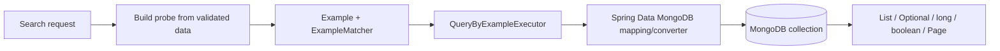

# Finding, Counting, and Checking Existence via QueryByExampleExecutor

In an application using **Spring Data MongoDB**, search screens often let users fill in some criteria and leave the rest blank. For example: find customers belonging to the current tenant, with last name Nguyen and status ACTIVE; or simply check whether any customer matches without loading the entire list. Writing a separate repository method for every field combination makes the API bloated and hard to maintain.

**Query by Example (QBE)** builds conditions from a sample object called a **probe** and matching rules in `ExampleMatcher`. The `QueryByExampleExecutor` interface directly provides **`findAll(Example)`, `findOne(Example)`, `count(Example)`, `exists(Example)`**, and **`findBy(Example, queryFunction)`**. You reuse the same `Example` to fetch data, count matching records, or ask "does any match exist?" without rewriting predicates.

This lesson belongs to the **Query by Example** chapter of the `SPRING_DATA_MONGODB` module, where you learn to connect, map documents, and operate on MongoDB via `MongoTemplate` or repositories, while designing queries, aggregations, indexes, transactions, reactive access, testing, and performance diagnostics. The focus is on `QueryByExampleExecutor` behavior in MongoDB, distinguishing each method's return semantics, and knowing when to switch to `Criteria`/`MongoTemplate`.

> **Rule of thumb:** QBE is well suited for **equality conditions on known properties and simple rule-based string matching**. It does not replace every MongoDB query. In particular, **never use `matchingAny()` across both tenantId and user-entered fields**: OR can expand results beyond the permitted tenant.

## 1. Learning Objectives

After this lesson, you will be able to:

1. Explain the four components: **probe, Example, ExampleMatcher, and QueryByExampleExecutor**.
2. Create `Example<Customer>` from populated fields and understand why `null` fields are ignored by default.
3. Use `MongoRepository` to call `findAll`, `findOne`, `count`, and `exists` with the same criteria.
4. Distinguish `Optional.empty()`, an empty list, `count=0`, and `exists=false`.
5. Understand when `findOne` throws `IncorrectResultSizeDataAccessException` instead of returning a random result.
6. Configure `matchingAll()`/`matchingAny()`, `withIgnorePaths`, `withIgnoreCase`, and `StringMatcher`.
7. Avoid pitfalls with primitive defaults, `null`, embedded objects, `_class` type restrictions, and regex matchers.
8. Use `findAll(example, Sort/Pageable)` and Fluent `findBy(example, q -> …)` to sort, limit, project, or paginate.
9. Combine QBE with `MongoTemplate` via `Criteria.alike(Example)` when fixed extra conditions are needed.
10. Write integration tests, inspect actual BSON queries, evaluate indexes/`explain`, and protect queries by tenant.

## 2. How Does QBE Work?

QBE has four building blocks:

| Component | Role | Example |
| --- | --- | --- |
| **Probe** | Domain object carrying the values to search for | `Customer(null, "tenant-a", …, "ACTIVE", …)` |
| **ExampleMatcher** | Rules for combining and comparing properties | `matchingAll()`, `withMatcher("lastName", …)` |
| **Example<T>** | Immutable probe + matcher pair at the `Example` object level | `Example.of(probe, matcher)` |
| **QueryByExampleExecutor<T>** | Executes the query and returns results in the requested shape | `findAll`, `findOne`, `count`, `exists`, `findBy` |

Conceptual flow:



`Example` describes conditions; **it does not store results**, does not query on its own, and does not update the database. Only when you call a repository method or build a corresponding `Query` for the template does MongoDB execute it.

```java
Example<Customer> example = Example.of(probe); // Does not query yet

List<Customer> found = repository.findAll(example); // Executes query
long total = repository.count(example);            // Separate query
boolean any = repository.exists(example);          // Separate query
```

These three independent calls do not automatically share a snapshot. If documents are inserted, deleted, or modified between calls, `found.size()`, `total`, and `any` can reflect different points in time.

## 3. Data Model Used Throughout

To focus on QBE criteria, the entity uses simple properties and **prefers wrappers over primitives** for values that may be omitted in a probe.

```java
package dev.learning.customers;

import java.time.Instant;
import org.springframework.data.annotation.Id;
import org.springframework.data.mongodb.core.mapping.Document;
import org.springframework.data.mongodb.core.mapping.Field;

@Document("qbe_customers")
public record Customer(
        @Id String id,
        @Field("tenant_id") String tenantId,
        String firstName,
        String lastName,
        String email,
        String status,
        Integer loyaltyPoints,
        Boolean verified,
        @Field("created_at") Instant createdAt) {
}
```

Java and BSON names:

| Java Property | BSON Field | Type |
| --- | --- | --- |
| `id` | `_id` | String, per ID mapping rules |
| `tenantId` | `tenant_id` | String |
| `firstName` | `firstName` | String |
| `lastName` | `lastName` | String |
| `email` | `email` | String |
| `status` | `status` | String |
| `loyaltyPoints` | `loyaltyPoints` | BSON numeric |
| `verified` | `verified` | BSON boolean |
| `createdAt` | `created_at` | BSON Date |

`@Field` demonstrates that QBE relies on **mapping metadata**, not merely comparing JSON key names. In this example, IDs use the `CUS-` prefix so they do not resemble 24-character hex strings that `@Id String` could convert to ObjectId.

### 3.1. Test Dataset

Suppose we have these customers:

| ID | tenantId | firstName | lastName | status | loyaltyPoints | verified |
| --- | --- | --- | --- | --- | ---: | --- |
| `CUS-A1` | tenant-a | Alice | Nguyen | ACTIVE | 120 | true |
| `CUS-A2` | tenant-a | Bob | Nguyen | ACTIVE | 0 | false |
| `CUS-A3` | tenant-a | Alice | Tran | INACTIVE | 10 | true |
| `CUS-B1` | tenant-b | Alice | Nguyen | ACTIVE | 50 | true |

Documents are created via `MongoRepository.insert` or `MongoTemplate.insert` in a **dedicated test database**, so `_class` type metadata stays consistent with Spring Data. Never call `deleteAll()` on a production database to seed sample data.

Sample emails:

```text
CUS-A1 -> alice.nguyen@example.test
CUS-A2 -> bob.nguyen@example.test
CUS-A3 -> alice.tran@example.test
CUS-B1 -> alice.nguyen.b@example.test
```

We will test three questions with the same probe:

- **Find:** which customers belong to tenant-a, have last name Nguyen, and have status ACTIVE?
- **Count:** how many customers match the criteria?
- **Exists:** does at least one customer match the criteria?

## 4. Declaring the Repository: MongoRepository Already Supports QBE

```java
package dev.learning.customers;

import org.springframework.data.mongodb.repository.MongoRepository;

public interface CustomerRepository
        extends MongoRepository<Customer, String> {
}
```

`MongoRepository<Customer, String>` inherits Query by Example capabilities, including `QueryByExampleExecutor<Customer>`; you **do not need to redeclare** `findAll(Example)`, `count(Example)`, or `exists(Example)`.

If you use a custom repository abstraction that does not extend `MongoRepository`, you can extend `QueryByExampleExecutor<Customer>` to expose the QBE methods.

### 4.1. Key Methods

| Method | Return Type | When to Use |
| --- | --- | --- |
| `findAll(example)` | `List<Customer>` on `MongoRepository` | Fetch all matching documents |
| `findOne(example)` | `Optional<Customer>` | Expect **at most one** document |
| `findAll(example, sort)` | `List<Customer>` | Fetch a list in deterministic order |
| `findAll(example, pageable)` | `Page<Customer>` | Paginate with total metadata |
| `count(example)` | `long` | Count all matching documents |
| `exists(example)` | `boolean` | Check for at least one match |
| `findBy(example, queryFunction)` | Determined by terminal method | Fluent sort, limit, projection, page, slice, scroll, stream… |

**Do not confuse** `findOne` with "get the first record". `findOne` is an API expecting result **uniqueness**; `findBy(example, q -> q.sortBy(sort).first())` is better when you want the **first record** among potentially many matches.

## 5. Creating a Probe with Fields to Search

For a Java record with many components, create a helper so you do not repeat irrelevant `null` arguments:

```java
package dev.learning.customers;

public final class CustomerProbes {
    private CustomerProbes() {}

    public static Customer byTenantLastNameAndStatus(
            String tenantId,
            String lastName,
            String status) {

        return new Customer(
                null,        // id: ignored
                tenantId,    // tenantId: included in query
                null,        // firstName: ignored
                lastName,    // lastName: included in query
                null,        // email: ignored
                status,      // status: included in query
                null,        // loyaltyPoints: ignored
                null,        // verified: ignored
                null         // createdAt: ignored
        );
    }
}
```

Call:

```java
import org.springframework.data.domain.Example;

Customer probe = CustomerProbes.byTenantLastNameAndStatus(
        "tenant-a", "Nguyen", "ACTIVE");

Example<Customer> example = Example.of(probe);
```

**Default:** `null` properties in the probe are **ignored**, while populated properties enter the query using the default `matchingAll()` matcher. With the sample data, expected matches are `CUS-A1` and `CUS-A2`.

A logically equivalent BSON query, omitting type-hint conditions for readability:

```javascript
db.qbe_customers.find({
  tenant_id: "tenant-a",
  lastName: "Nguyen",
  status: "ACTIVE"
});
```

In practice, a **typed Example** typically adds a type condition on `_class`; we analyze this later. The BSON here illustrates only the probe predicates, **not a command captured from the driver**.

### 5.1. A Probe Is Not a Sample Document to Save

`probe` holds many `null` values because it represents **query criteria**, not a valid persisted record. Never call `repository.save(probe)` or pass a probe as an update command: that could create documents missing required fields or overwrite data.

Keep probe helpers in the read/search service layer and never pass them into write persistence flows.

## 6. findAll: Finding All Matching Documents

```java
import java.util.List;
import org.springframework.data.domain.Example;

Customer probe = CustomerProbes.byTenantLastNameAndStatus(
        "tenant-a", "Nguyen", "ACTIVE");

Example<Customer> example = Example.of(probe);

List<Customer> results = repository.findAll(example);
```

With the sample data:

```text
results contains CUS-A1 and CUS-A2.
CUS-A3 does not match lastName/status.
CUS-B1 does not match tenantId.
```

If no documents match, `findAll` returns an **empty list**, never `null`. Queries **without `Sort`** make no ordering guarantees. Never write tests relying on the first element's position when calling `findAll(example)` unsorted.

### 6.1. Why Not Use findAll for Unbounded Lists?

`findAll(example)` can load huge numbers of entities if the probe is loosely constrained or all properties are `null`. In GET APIs, prefer pagination or bounded limits:

```java
import org.springframework.data.domain.Page;
import org.springframework.data.domain.PageRequest;
import org.springframework.data.domain.Sort;

Page<Customer> page = repository.findAll(
        example,
        PageRequest.of(
            0,
            20,
            Sort.by(
                Sort.Order.asc("lastName"),
                Sort.Order.asc("id")
            )
        )
);
```

`id` serves as a tie-breaker for deterministic ordering when multiple customers share a last name. `Page<T>` includes total metadata and may trigger an extra count query; for large feeds, consider `Slice` or keyset/scrolling depending on requirements.

## 7. findOne: Use Only When At Most One Result Is Expected

Example searching by tenant and normalized email:

```java
Customer probe = new Customer(
    null, "tenant-a", null, null,
    "alice.nguyen@example.test",
    null, null, null, null);

Example<Customer> example = Example.of(probe);

java.util.Optional<Customer> candidate =
        repository.findOne(example);
```

Three outcomes:

| Matching Documents | `findOne(example)` |
| ---: | --- |
| 0 | `Optional.empty()` |
| 1 | `Optional.of(customer)` |
| 2 or more | Throws `IncorrectResultSizeDataAccessException` |

Check example:

```java
Customer customer = repository.findOne(example)
    .orElseThrow(() ->
        new IllegalStateException("Customer not found"));
```

**Never treat `findOne` as "pick any matching document".** If email is supposed to be unique per tenant, create a **compound unique index** (e.g., `tenant_id + normalized_email`) to enforce the invariant. QBE only builds queries; it does **not** enforce uniqueness.

### 7.1. Fetching the First Result Among Multiple Matches

```java
import java.util.Optional;
import org.springframework.data.domain.Sort;

Optional<Customer> first = repository.findBy(
    example,
    q -> q.sortBy(
            Sort.by(
                Sort.Order.asc("lastName"),
                Sort.Order.asc("id")
            )
         ).first()
);
```

`first()` retrieves the first match under the chosen sort **without requiring the entire matching set to contain at most one element**. Its semantics differ from `one()` or `findOne(example)`.

## 8. count: Counting All Matching Results

```java
Example<Customer> example = Example.of(
    CustomerProbes.byTenantLastNameAndStatus(
        "tenant-a", "Nguyen", "ACTIVE"));

long total = repository.count(example);
```

On the sample data, this returns `total == 2`.

`count` runs a count query using the same QBE conditions, rather than `repository.findAll(example).size()`. Use `count` when an API only needs the count, but never assume count is always cheap: if predicates have low selectivity or lack indexes, MongoDB may scan lots of data.

### 8.1. Count and Page Size Are Different Quantities

Suppose 50,000 customers match and page size is 20:

- `repository.count(example)`: total matching documents, **50,000** at query time.
- `page.getContent().size()`: number of items **on the page** (at most 20).
- `page.getTotalElements()`: `Page`'s total-elements metadata from the paginated query, which may trigger a count query.

Do not call `findAll(example).size()` in place of `count(example)` on large collections. Avoid calling both `count` and `findAll(pageable)` separately just for the total if `Page` already gives the needed total.

## 9. exists: Checking Presence

```java
Example<Customer> example = Example.of(
    CustomerProbes.byTenantLastNameAndStatus(
        "tenant-a", "Nguyen", "ACTIVE"));

boolean hasMatchingCustomer = repository.exists(example);
```

On the sample data, this returns `true`. With a probe searching `lastName="Le"` in tenant-a where no document matches, `exists` returns `false`.

`exists` fits when the question is simply "does **at least one** document match?". There is no need to materialize the full list or count every match just to answer that question.

### 9.1. Choosing the Right Method by Use Case

| Use Case | Recommended Method | Reason |
| --- | --- | --- |
| Display paginated list | `findAll(example, pageable)` | Limits records per page |
| Fetch small sorted list | `findAll(example, sort)` | Clear results and deterministic order |
| Lookup by unique key | `findOne(example)` | Fails fast if multiple matches exist |
| Fetch latest among multiple matches | `findBy(example, q -> q.sortBy(…).first())` | Single ordered match without enforcing uniqueness |
| Show total match count | `count(example)` | Avoids loading full entities |
| Check if at least one matches | `exists(example)` | Only a boolean is needed |

**Do not turn `exists` into an unsafe check-then-write**. Example:

```java
if (!repository.exists(example)) {
    repository.insert(newCustomer);
}
```

Two requests can both see `false` and then both insert. When email/tenant uniqueness is required, use a **unique index** and handle duplicate keys; a QBE existence check does not replace database constraints.

## 10. ExampleMatcher: Defaults and Combination Rules

`Example.of(probe)` uses the default matcher, equivalent to writing explicitly:

```java
import org.springframework.data.domain.Example;
import org.springframework.data.domain.ExampleMatcher;

ExampleMatcher matcher = ExampleMatcher.matchingAll();

Example<Customer> example = Example.of(probe, matcher);
```

Common options:

| Option | Meaning |
| --- | --- |
| `matchingAll()` | Included properties must **all be true** (AND) |
| `matchingAny()` | Only **one** included property needs to be true (OR) |
| `withIgnorePaths("id", …)` | Excludes one or more properties from the query |
| `withIgnoreCase()` | Case-insensitive string comparison per datastore support |
| `withIgnoreCase("firstName")` | Case-insensitive only on specified property |
| `withStringMatcher(CONTAINING)` | Default matcher for string values |
| `withMatcher("firstName", …)` | Customizes a single property |
| `withIncludeNullValues()` | Includes `null` properties in conditions; use with caution |

`ExampleMatcher` holds matching configuration; it **does not query directly**. Every `with…` call returns a configured matcher; assign the return value to a variable or chain methods properly.

### 10.1. matchingAll Is AND, matchingAny Is OR

Probe:

```java
Customer probe = CustomerProbes.byTenantLastNameAndStatus(
        "tenant-a", "Nguyen", "ACTIVE");
```

With `matchingAll()`, meaning:

```text
tenantId == "tenant-a"
AND lastName == "Nguyen"
AND status == "ACTIVE"
```

With `matchingAny()`:

```text
tenantId == "tenant-a"
OR lastName == "Nguyen"
OR status == "ACTIVE"
```

`matchingAny()` can return **tenant-b customers** merely because they are ACTIVE or named Nguyen. This is **unsafe** when `tenantId` is an authorization boundary.

Do not use `matchingAny` expecting to express `tenantId == currentTenant AND (lastName == x OR status == y)`. QBE does not support arbitrary parenthesized groups with nested OR/AND. Use `MongoTemplate`/`Criteria` or a dynamically built query to keep the tenant condition outside the OR.

## 11. String Matching: EXACT, STARTING, ENDING, CONTAINING, REGEX

Spring Data MongoDB supports several string matching modes in QBE. In the table below, `v` is the probe string.

| `StringMatcher` | Typical Meaning | Typical MongoDB Representation |
| --- | --- | --- |
| `DEFAULT`, case-sensitive | Exact string equality | BSON equality |
| `DEFAULT`, ignore-case | Case-insensitive | `$regex` with `i` |
| `EXACT` | Start/end-anchored regex | `/^v$/` |
| `STARTING` | Starts with v | `/^v/` |
| `ENDING` | Ends with v | `/v$/` |
| `CONTAINING` | Contains v | `/.*v.*/` |
| `REGEX` | Uses regex pattern | Pattern from probe value |

Spring Data MongoDB may escape or transform values when building regexes depending on `StringMatcher`; the table is a **logical description**, not a character-for-character guarantee across all versions.

### 11.1. Applying Contains Only on Display Name

```java
import org.springframework.data.domain.Example;
import org.springframework.data.domain.ExampleMatcher;

Customer probe = new Customer(
    null, "tenant-a", "ali", null,
    null, null, null, null, null);

ExampleMatcher matcher = ExampleMatcher.matchingAll()
    .withMatcher("firstName",
        m -> m.contains().ignoreCase());

Example<Customer> example = Example.of(probe, matcher);

List<Customer> found = repository.findAll(example);
```

`firstName` can match `Alice`, while `tenantId` uses **default** string matching without accidentally inheriting `contains/ignoreCase`. This matters because a global matcher:

```java
ExampleMatcher risky = ExampleMatcher.matchingAll()
    .withIgnoreCase()
    .withStringMatcher(ExampleMatcher.StringMatcher.CONTAINING);
```

applies contains/ignore-case logic to **every included string property**, potentially including `tenantId`, `status`, and `email`. For authorization fields, **always use strict server-generated equality** rather than loose request-driven matchers.

### 11.2. Per-Property Matchers Take Precedence Over Global Defaults

```java
ExampleMatcher matcher = ExampleMatcher.matchingAll()
    .withStringMatcher(ExampleMatcher.StringMatcher.EXACT)
    .withMatcher("firstName",
        m -> m.startsWith().ignoreCase())
    .withIgnorePaths("createdAt");
```

The condition on `firstName` uses STARTING + ignore-case, while other strings follow the configured default. When sharing matchers across APIs, include protected properties in code reviews.

### 11.3. Regex, Untrusted Input, and Indexes

Case-insensitive, contains, ends-with, or regex matchers can generate queries that struggle to use B-tree indexes efficiently. `CONTAINING` with `.*substring.*` generally cannot leverage prefix indexes as well as equality or an anchored prefix.

Never let clients submit arbitrary regex via `StringMatcher.REGEX` without bounding length, allowed characters, and pattern complexity. Regexes can spike CPU usage and cause slow queries. For large full-text search, consider text indexes or a dedicated search engine instead of treating QBE as a full-text search engine.

## 12. Nulls, Primitives, and Default Values

### 12.1. Null Is Not a Condition by Default

```java
Customer probe = new Customer(
    null, "tenant-a", null, null, null,
    "ACTIVE", null, null, null);

Example<Customer> example = Example.of(probe);
```

In default mode, QBE filters only `tenantId="tenant-a"` and `status="ACTIVE"`. Null properties are **ignored**, not treated as "find documents whose field is BSON null".

If every property in the probe is null, the query can become very broad aside from the default type restriction. For public endpoints, enforce a server-side tenant filter, input validation, and page size limits.

### 12.2. Primitive int/boolean Always Have Values

```java
public record PrimitiveCustomer(
    String status,
    int loyaltyPoints,
    boolean verified) {}
```

The probe `new PrimitiveCustomer("ACTIVE", 0, false)` has three initialized values. QBE cannot tell whether `0` and `false` are Java defaults or intentional user input. **Primitives are included in conditions** unless `ExampleMatcher` excludes them with `withIgnorePaths`.

For optional filters, prefer `Integer`/`Boolean` in entities and request DTOs. For instance, `verified=null` means do not filter; `verified=false` means match false; `loyaltyPoints=0` means match 0.

### 12.3. withIncludeNullValues Has Special Consequences

```java
ExampleMatcher matcher =
    ExampleMatcher.matchingAll().withIncludeNullValues();
```

When this flag is enabled, null values also enter the query. In Spring Data MongoDB, when **including nulls**, matching embedded objects may use **embedded-document equality** instead of dot-notation queries, requiring **exact full structure and field ordering** of the embedded document.

Never enable `withIncludeNullValues()` globally just to check one null field. Distinguish the three MongoDB states clearly:

| Case | Common BSON Query |
| --- | --- |
| Field is null **or missing** | `{ field: null }` |
| Field **does not exist** | `{ field: { $exists: false } }` |
| Field exists and is **non-null** | `{ field: { $ne: null } }` |

When you need to distinguish BSON null from missing more accurately, use `$type` and explicit criteria via `MongoTemplate`, and test on raw data. QBE is not built to express every null/missing variant.

## 13. Embedded Objects and QBE Expression Limits

QBE can map properties of embedded objects, for example:

```java
public record Address(String city, String postalCode) {}
public record CustomerWithAddress(
    String id, String status, Address address) {}
```

A probe with `address.city="Hue"` can build a condition along the mapping path, but that does not mean QBE supports arbitrary logical combinations:

- Cannot naturally express `status=ACTIVE AND (address.city=Hue OR address.city=Da Nang)` with a standard probe.
- Does not replace `$elemMatch` when multiple conditions must hold on the **same array element**.
- Does not replace `$group`/`$lookup` aggregations, geo, ranges, or full-text queries.
- When include-null is enabled, nested document matching can be stricter than dot notation.

Specifically, the **"no support for nested/grouped property constraints"** limitation in Spring Data QBE documentation refers to **complex boolean-grouped expressions**, not forbidding all nested property paths. When requirements outgrow probe/matcher capabilities, write transparent `Criteria`.

## 14. Typed Example: _class Conditions Can Produce Unexpected Results

By default:

```java
Example<Customer> typed = Example.of(
    CustomerProbes.byTenantLastNameAndStatus(
        "tenant-a", "Nguyen", "ACTIVE"));
```

is a **typed example**. Spring Data MongoDB can add a **type restriction** condition based on type metadata stored in `_class`. Under typical type-mapper settings, the query can resemble:

```javascript
{
  _class: { $in: ["dev.learning.customers.Customer"] },
  tenant_id: "tenant-a",
  lastName: "Nguyen",
  status: "ACTIVE"
}
```

This is **illustrative**, not a fixed raw command: type aliases, inheritance, `MappingMongoConverter` configuration, and disabling `_class` can change the query.

### 14.1. Pitfall with Imported Data Lacking _class

```javascript
db.qbe_customers.insertOne({
  _id: "CUS-LEGACY",
  tenant_id: "tenant-a",
  lastName: "Nguyen",
  status: "ACTIVE"
});
```

This document has all the right business fields yet lacks `_class`. A typed Example may **fail to match** because of the type restriction.

### 14.2. UntypedExampleMatcher

```java
import org.springframework.data.mongodb.core.query.UntypedExampleMatcher;

Customer probe = CustomerProbes.byTenantLastNameAndStatus(
    "tenant-a", "Nguyen", "ACTIVE");

Example<Customer> untyped = Example.of(
    probe, UntypedExampleMatcher.matching());

List<Customer> found = repository.findAll(untyped);
```

`UntypedExampleMatcher` removes the default type restriction, suitable when a collection stores no type hints or contains multiple entity types with overlapping fields. However, it can pull in documents of other types without guaranteeing Spring Data maps them safely. Test against actual schemas, and never **treat `_class` as an authorization mechanism**.

## 15. findAll with Sort and Pageable

```java
import org.springframework.data.domain.Sort;

List<Customer> sorted = repository.findAll(
    example,
    Sort.by(
        Sort.Order.asc("lastName"),
        Sort.Order.asc("firstName"),
        Sort.Order.asc("id")
    ));
```

Specify `Sort` whenever deterministic ordering is needed. `id` acts as a tie-breaker when multiple customers share names.

Pagination:

```java
import org.springframework.data.domain.Page;
import org.springframework.data.domain.PageRequest;
import org.springframework.data.domain.Sort;

Page<Customer> page = repository.findAll(
    example,
    PageRequest.of(0, 20,
        Sort.by(Sort.Order.asc("lastName"),
                Sort.Order.asc("id")))
);
```

`Page<Customer>` exposes `getContent()`, `getTotalElements()`, and `hasNext()`. To compute the total, the framework often runs a count query, and data may change between the content query and the count query.

If the UI only needs "Load more", `Slice` or `Window`/keyset via the Fluent API may fit better, depending on your Spring Data version. Deep offset pagination still incurs skip cost, which QBE alone does not eliminate.

## 16. findBy: Fluent API for Example

`QueryByExampleExecutor.findBy(example, queryFunction)` accepts a lambda configuring the query and then runs a terminal operation. Intermediate methods include `sortBy`, `limit`, `as`, and `project`; terminal methods include `all`, `first`, `one`, `page`, `slice`, `scroll`, `stream`, `count`, and `exists` on supported versions.

### 16.1. Limiting Lists and Sorting

```java
List<Customer> five = repository.findBy(
    example,
    q -> q.sortBy(Sort.by("id"))
          .limit(5)
          .all()
);
```

`sortBy`/`limit` do not return data on their own; `all()` is the terminal method. Always add a deterministic sort when using `limit` if repeatable results are required.

### 16.2. first vs. one

```java
java.util.Optional<Customer> first = repository.findBy(
    example,
    q -> q.sortBy(Sort.by("id")).first()
);

java.util.Optional<Customer> unique = repository.findBy(
    uniqueEmailExample,
    q -> q.one()
);
```

- `first()` returns the first item or empty even when multiple matches exist.
- `one()` expects at most one match, throwing `IncorrectResultSizeDataAccessException` if more exist.
- `firstValue()`/`oneValue()` are nullable variants that do not return `Optional`.

### 16.3. Projections for Lists

```java
package dev.learning.customers;

public interface CustomerCard {
    String getId();
    String getFirstName();
    String getLastName();
    String getStatus();
}
```

```java
Page<CustomerCard> cards = repository.findBy(
    example,
    q -> q.as(CustomerCard.class)
          .page(PageRequest.of(
              0, 20, Sort.by("lastName", "id")))
);
```

`as(CustomerCard.class)` sets the result type; `project(...)` restricts returned properties. Closed interface projections can reduce fetched fields; **open projections using SpEL** do not carry the same optimization guarantees. Never treat projection as authorization; queries must still enforce tenant scoping.

### 16.4. Streams Must Be Closed

```java
try (java.util.stream.Stream<Customer> stream =
        repository.findBy(example,
            q -> q.sortBy(Sort.by("id")).stream())) {
    stream.forEach(this::processCustomer);
}
```

`processCustomer` is an application-defined method. Query streams can hold driver resources and must be closed with `try-with-resources`. Never call `toList()` across millions of documents when processing incrementally.

### 16.5. Count and Exists via the Fluent API

```java
long total = repository.findBy(
    example, q -> q.count());

boolean present = repository.findBy(
    example, q -> q.exists());
```

Prefer `repository.count(example)`/`repository.exists(example)` when you do not need a fluent query. The lambda must execute intermediate and terminal methods **inside queryFunction**; never store `FetchableFluentQuery` to invoke outside the callback.

## 17. MongoTemplate with Criteria.alike(Example)

QBE can also be used with `MongoTemplate`:

```java
import org.springframework.data.domain.Example;
import org.springframework.data.mongodb.core.query.Criteria;
import org.springframework.data.mongodb.core.query.Query;

Example<Customer> example = Example.of(
    CustomerProbes.byTenantLastNameAndStatus(
        "tenant-a", "Nguyen", "ACTIVE"));

Query query = Query.query(new Criteria().alike(example));

List<Customer> result = mongoTemplate.find(
    query, Customer.class);
```

`Criteria.alike(example)` embeds a QBE predicate inside a regular query; it still obeys typed/untyped rules, matchers, mappings, and conversions.

### 17.1. Keeping the Tenant Filter Outside matchingAny

This is an essential pattern when users want OR between name and status, yet **tenant must always hold**:

```java
String authorizedTenant = securityContext.currentTenantId();

Customer searchProbe = new Customer(
    null, null, "Ali", null, null,
    "ACTIVE", null, null, null
);

ExampleMatcher anyMatcher = ExampleMatcher.matchingAny()
    .withMatcher("firstName", m -> m.startsWith().ignoreCase());

Example<Customer> searchExample =
    Example.of(searchProbe, anyMatcher);

Criteria authorizedSearch = new Criteria().andOperator(
    Criteria.where("tenantId").is(authorizedTenant),
    new Criteria().alike(searchExample)
);

Query query = Query.query(authorizedSearch);

List<Customer> matches =
    mongoTemplate.find(query, Customer.class);
```

`securityContext.currentTenantId()` is an illustrative application-provided API. Logical intent:

```text
tenantId == serverAuthorizedTenant
AND (firstName STARTS_WITH "Ali" OR status == "ACTIVE")
```

**Never** let clients alter `authorizedTenant`; source it from the principal/authorization context. Write integration tests to verify that the `AND/OR` grouping and `tenant_id` field alias map correctly.

### 17.2. When Ranges Are Needed: Use Criteria

```java
Query query = Query.query(
    new Criteria().andOperator(
        Criteria.where("tenantId").is(authorizedTenant),
        Criteria.where("status").is("ACTIVE"),
        Criteria.where("loyaltyPoints").gte(100).lte(500)
    )
);
```

QBE defaults to **equality** for non-string values. A probe with `loyaltyPoints=100` cannot mean "from 100 to 500". Never force QBE into range comparisons, aggregations, `$elemMatch`, or complex grouped conditions.

## 18. Designing a Safe Search Endpoint

An anti-pattern:

```java
// NEVER pass a raw client-submitted entity as the probe on a public API:
public List<Customer> unsafeSearch(Customer requestBody) {
    return repository.findAll(Example.of(requestBody));
}
```

Risks: clients can supply another `tenantId`, search forbidden fields, trigger huge scans with all-null probes, or send CPU-heavy regex patterns.

### 18.1. Request DTO Containing Only Permitted Filters

```java
public record CustomerSearchRequest(
    String firstNamePrefix,
    String lastName,
    String status,
    Integer page,
    Integer size) {}
```

The service builds the probe from the validated DTO:

```java
Customer probe = new Customer(
    null,
    authenticatedTenantId,  // server-determined
    request.firstNamePrefix(),
    request.lastName(),
    null,                   // Email search disallowed in this API
    request.status(),
    null, null, null
);

ExampleMatcher matcher = ExampleMatcher.matchingAll()
    .withMatcher("firstName",
        m -> m.startsWith().ignoreCase());

Example<Customer> example = Example.of(probe, matcher);
```

Here `tenantId` uses default equality, while `firstName` uses prefix + ignore-case. For strict security, consider a **fixed `Criteria` tenant filter** outside QBE and use QBE strictly for user-editable filters.

Validate prefix length, maximum page size, status allowlist, and default page before executing queries. Never turn QBE into an API letting clients choose arbitrary property names, regexes, or projection types.

### 18.2. exists Does Not Guarantee Uniqueness on Insert

```java
if (!repository.exists(example)) {
    repository.insert(newCustomer);
}
```

Two requests can both observe `false` and then both insert. If email/tenant is a unique business key, enforce a **compound unique index** on the actual BSON fields and catch duplicate-key errors. `exists` is a read operation; it does not lock or reserve a value.

## 19. Performance and Indexing

QBE simplifies Java code, yet MongoDB still follows the same index and query-plan rules as any query.

### 19.1. Indexes for Equality Filters

Workload:

```text
tenant_id == tenant-a
AND status == ACTIVE
AND lastName == Nguyen
```

Candidate index:

```javascript
db.qbe_customers.createIndex(
  { tenant_id: 1, status: 1, lastName: 1, _id: 1 },
  { name: "tenant_status_lastname_id" }
);
```

This is an experimental index based on equality filters and ID sorting, not a universal formula. If typed QBE adds `_class`, verify whether the execution plan is affected by the type restriction.

### 19.2. Regex Alters Index Usability

```javascript
{ firstName: { $regex: "^Ali" } }
```

differs in index optimizability from:

```javascript
{ firstName: { $regex: ".*ali.*", $options: "i" } }
```

Case-insensitive or contains regexes generally do not use B-tree indexes like equality. A collation index does not automatically speed up every `i` regex. For large full-text search applications, pick a suitable search solution instead of treating QBE as a search engine.

### 19.3. Using explain and Command Monitoring

```javascript
db.qbe_customers.find({
  tenant_id: "tenant-a",
  status: "ACTIVE",
  lastName: "Nguyen"
}).sort({ lastName: 1, _id: 1 })
  .explain("executionStats");
```

Check `winningPlan`, `totalKeysExamined`, `totalDocsExamined`, `nReturned`, and whether a `SORT` stage appears. This illustrative query may omit `_class` type restrictions or matcher-generated regexes. To analyze actual QBE queries, use a **MongoDB Java Driver `CommandListener`** or profiler in a test environment while redacting sensitive data.

`count` is not necessarily cheap when predicates have low selectivity. `exists` is usually the right choice for existence checks, though speed still depends on indexes and filters. Never benchmark on a handful of seeded documents and extrapolate to production.

## 20. Integration Tests for findAll, count, exists, and findOne

Use a **dedicated test database** and Spring Boot test starter connected to MongoDB via URI/Testcontainers per project setup.

### 20.1. Fixtures and Core Assertions

```java
package dev.learning.customers;

import static org.assertj.core.api.Assertions.assertThat;
import static org.assertj.core.api.Assertions.assertThatThrownBy;

import java.time.Instant;
import java.util.List;
import java.util.UUID;

import org.junit.jupiter.api.Test;
import org.springframework.beans.factory.annotation.Autowired;
import org.springframework.boot.test.context.SpringBootTest;
import org.springframework.dao.IncorrectResultSizeDataAccessException;
import org.springframework.data.domain.Example;
import org.springframework.data.domain.ExampleMatcher;
import org.springframework.data.domain.Sort;

@SpringBootTest
class CustomerQbeIntegrationTest {

    @Autowired CustomerRepository repository;

    private Customer customer(String id, String tenant,
            String first, String last, String email,
            String status, int points, boolean verified) {
        return new Customer(id, tenant, first, last, email,
            status, points, verified,
            Instant.parse("2026-11-20T08:00:00Z"));
    }

    private String[] seed() {
        String unique = UUID.randomUUID().toString();
        String a = "tenant-a-" + unique;
        String b = "tenant-b-" + unique;

        repository.insert(List.of(
            customer("CUS-A1-" + unique, a, "Alice", "Nguyen",
                "alice-" + unique + "@example.test", "ACTIVE", 120, true),
            customer("CUS-A2-" + unique, a, "Bob", "Nguyen",
                "bob-" + unique + "@example.test", "ACTIVE", 0, false),
            customer("CUS-A3-" + unique, a, "Alice", "Tran",
                "tran-" + unique + "@example.test", "INACTIVE", 10, true),
            customer("CUS-B1-" + unique, b, "Alice", "Nguyen",
                "elsewhere-" + unique + "@example.test", "ACTIVE", 50, true)
        ));
        return new String[] {a, b, unique};
    }

    @Test
    void findCountAndExistsMatchSameExample() {
        String[] f = seed();
        String tenant = f[0];
        String unique = f[2];

        Example<Customer> ex = Example.of(
            CustomerProbes.byTenantLastNameAndStatus(
                tenant, "Nguyen", "ACTIVE"));

        List<Customer> rows =
            repository.findAll(ex, Sort.by("id"));

        assertThat(rows).extracting(Customer::id)
            .containsExactly(
                "CUS-A1-" + unique, "CUS-A2-" + unique);

        assertThat(repository.count(ex)).isEqualTo(2L);
        assertThat(repository.exists(ex)).isTrue();

        Example<Customer> absent = Example.of(
            CustomerProbes.byTenantLastNameAndStatus(
                tenant, "Le", "ACTIVE"));

        assertThat(repository.findAll(absent)).isEmpty();
        assertThat(repository.count(absent)).isZero();
        assertThat(repository.exists(absent)).isFalse();
    }

    @Test
    void findOneRejectsMultipleMatches() {
        String tenant = seed()[0];
        Example<Customer> ex = Example.of(
            CustomerProbes.byTenantLastNameAndStatus(
                tenant, "Nguyen", "ACTIVE"));

        assertThatThrownBy(() -> repository.findOne(ex))
            .isInstanceOf(IncorrectResultSizeDataAccessException.class);
    }

    @Test
    void matchingAnyCanLeakAcrossTenants() {
        String[] f = seed();
        String externalId = "CUS-B1-" + f[2];

        Customer probe =
            CustomerProbes.byTenantLastNameAndStatus(
                f[0], "Nguyen", "ACTIVE");

        Example<Customer> unsafe = Example.of(
            probe, ExampleMatcher.matchingAny());

        assertThat(repository.findAll(unsafe))
            .extracting(Customer::id)
            .contains(externalId);
    }
}
```

The last test **deliberately demonstrates the OR security flaw**; run only on a test database. Tests use unique tenants/IDs and avoid `deleteAll` so out-of-scope data is never accidentally wiped.

### 20.2. findOne for Unique Email

Add this method to the same test class:

```java
@Test
void findOneReturnsUniqueEmail() {
    String[] f = seed();
    String email = "alice-" + f[2] + "@example.test";

    Example<Customer> ex = Example.of(
        new Customer(null, f[0], null, null,
            email, null, null, null, null));

    var match = repository.findOne(ex);

    assertThat(match).isPresent();
    assertThat(match.orElseThrow().id())
        .isEqualTo("CUS-A1-" + f[2]);
}
```

In production, if business rules treat email as unique per tenant, a unique index is still required. Testing a single match does not prove the invariant holds under concurrency.

### 20.3. Additional Tests to Write

| Test | Must Prove |
| --- | --- |
| `verified=null` | Property is ignored; returns both true and false |
| `verified=false` | Properly filters boolean false |
| `loyaltyPoints=0` | Matches exact number 0 without ignoring |
| Primitive `int=0`/`boolean=false` | Always participates in probe unless ignored |
| `withIncludeNullValues` | Differences across BSON null, missing, and embedded objects |
| Typed vs. untyped | Behavior when documents lack `_class` |
| Sorting/Pageable | Deterministic order and accurate metadata |
| Ignore-case regex | Case matching works and cost is measured |
| Cross-tenant access | Blocks tenant-b data on actual endpoints |
| Empty probe | Never creates an unbounded endpoint by accident |

**Limitation:** these examples illustrate the API and testing strategy; Gradle/test suites were not run during authoring of this guide. Practitioners must configure a dedicated test MongoDB.

## 21. Reactive QBE

`ReactiveMongoRepository` supports QBE via reactive interfaces, returning `Flux`/`Mono`:

```java
package dev.learning.customers;

import org.springframework.data.mongodb.repository.ReactiveMongoRepository;

public interface ReactiveCustomerRepository
        extends ReactiveMongoRepository<Customer, String> {
}
```

```java
reactor.core.publisher.Flux<Customer> rows =
    reactiveRepository.findAll(example);

reactor.core.publisher.Mono<Long> total =
    reactiveRepository.count(example);

reactor.core.publisher.Mono<Boolean> present =
    reactiveRepository.exists(example);
```

`Mono<Boolean>` emits boolean `false` when nothing matches; never assume `Mono.empty()` means false. Each publisher represents an independent query, not a shared snapshot or multi-document transaction.

Never call `block()` on an event loop; apply the exact same validation, tenant authorization, and matcher restrictions as in the imperative API.

## 22. When to Use QBE vs. Criteria?

| Requirement | QBE? | Alternative When Exceeding Limits |
| --- | --- | --- |
| Equality on multiple optional fields | Yes | Derived methods or `Criteria` |
| String starts/ends/contains | Yes, per datastore | Controlled regex/search API |
| Find all / count / exists | Yes: `findAll`/`count`/`exists` | `MongoTemplate` for specialized queries |
| Find at most one record | Yes: `findOne` | Unique index still mandatory if required by business |
| Sort, page, projection | Yes: `findAll`/`findBy` | Fluent template |
| Range `>`, `<`, BETWEEN | Not directly | `Criteria.gte/lte` |
| Complex parenthesized AND/OR groups | Not directly | `Criteria.andOperator/orOperator` |
| Same array element | Does not replace `$elemMatch` | `Criteria.elemMatch` |
| Aggregation/`$group`/`$lookup` | No | `Aggregation` |
| Complex text/geo search | Not the target | Dedicated operators/search |
| Pre-insert duplicate check | Insufficient | Unique index + duplicate-key handling |
| Document updates | No | `updateFirst`/`findAndModify`/`save` |
| Multi-tenant authorization | Not guaranteed automatically | Server-side tenant filter outside OR |

You can combine `Criteria.alike(example)` with other `Criteria` when the QBE portion is simple while the overall query is more complex.

## 23. Mistakes and Diagnostics

| Symptom | Cause | Fix |
| --- | --- | --- |
| findAll returns too much data | Empty probe or overly broad matcher | Validate inputs and enforce pagination |
| findAll is empty yet data exists | Typed `_class`, wrong case, wrong BSON type/alias | Inspect raw documents and actual command |
| findOne throws exception | Multiple matches | Unique filter or `first()` if first match is desired |
| count differs from fetched list | Data changed between queries or differing conditions | Align Example and timing |
| exists unexpectedly returns false | Wrong tenant, type hint, or matcher | Inspect predicates sent to MongoDB |
| Default int 0/boolean false filters unexpectedly | Primitives always enter the query | Nullable wrappers or ignorePaths |
| matchingAny returns tenant-b | Tenant is inside OR | Separate security filter as AND |
| Slow regex | Contains/ignore-case struggles with indexes | Anchor prefix, index, measure `explain` |
| Include-null causes weird results | Embedded objects compared by exact document | Use appropriate Criteria |
| QBE cannot query points ≥100 | QBE defaults to exact match on non-strings | Use `Criteria.gte` |
| QBE cannot constrain array elements | Lacks proper `$elemMatch` | Structured `Criteria` query |
| Checking exists before insert still produces duplicates | Race condition | Unique index, catch duplicate key |

Debugging checklist: (1) what values are on the probe, (2) AND or OR matcher, (3) is `_class` present, (4) do BSON field aliases/types match, (5) does the method require uniqueness or first, (6) is the tenant filter isolated, (7) does `explain` show index usage?

## 24. Practice Exercises

**Exercise 1.** Build an Example for `tenant-a`, `Nguyen`, `ACTIVE`. Call `findAll`, `count`, and `exists`. Expected answers on the sample data: two customers, `2L`, and `true`.

**Exercise 2.** Call `findOne` with the same Example. Why does it throw? Answer: QBE matches multiple documents; `findOne` never picks one at random.

**Exercise 3.** Build a probe for a unique email; handle `Optional.empty()`; explain why a database unique index is still needed.

**Exercise 4.** Compare `Boolean verified=null`, `Boolean.FALSE`, and primitive `boolean=false` in a probe.

**Exercise 5.** Apply `startsWith().ignoreCase()` only to `firstName`, while keeping `tenantId` strictly exact.

**Exercise 6.** Write `matchingAny()` with `tenantId` and `status`, showing tenant-b leaking in. Rewrite safely with `Criteria.andOperator(tenantCriteria, alike(example))`.

**Exercise 7.** Insert a legacy document missing `_class`; compare typed vs. `UntypedExampleMatcher` and state the risks.

**Exercise 8.** Use `findBy(example, q -> q.as(CustomerCard.class).page(...))` to return a list without exposing email.

**Exercise 9.** Write a range query for 100 to 500 points using `Criteria.gte(100).lte(500)`; explain why a probe with points=100 cannot express a range.

**Exercise 10.** Measure indexes for equality vs. `CONTAINING` ignore-case using `explain`; compare `keysExamined/docsExamined`.

**Exercise 11.** Two requests both observe `exists=false` and insert; design a unique compound index and handle duplicate-key errors.

## 25. Checklist and Official Sources

Before shipping QBE in an application:

- [ ] Use QBE for property equality or simple string matching.
- [ ] Build probes from validated request DTOs; never bind raw client entities.
- [ ] Understand null is ignored by default while primitive 0/false still participate.
- [ ] Choose `matchingAll` vs. `matchingAny` accurately; keep tenant in a mandatory AND.
- [ ] Use `findAll` for lists, `findOne` for at most one match, `count` for counts, `exists` for booleans.
- [ ] Use pagination/limits/sorting to prevent unbounded loads.
- [ ] Distinguish `first()` and `one()` in the Fluent API.
- [ ] Avoid applying ignore-case/regex globally to tenant, email, or unintended fields.
- [ ] Verify `_class` type restrictions and only use untyped with clear justification.
- [ ] Avoid global `withIncludeNullValues` for special null queries.
- [ ] Use `Criteria` when ranges, nested OR/AND, `$elemMatch`, or aggregations are needed.
- [ ] Enforce uniqueness with unique indexes, not exists-before-insert alone.
- [ ] Integration test multi-match, no-match, false/0, tenant-b, and legacy data.
- [ ] Verify actual commands, query plans, and `count/exists` performance on representative workloads.

### Official Documentation

1. [Spring Data MongoDB — MongoDB-specific Query Methods, QBE](https://docs.spring.io/spring-data/mongodb/reference/mongodb/repositories/query-methods.html): QBE and repositories.
2. [Spring Data Commons — Query by Example](https://docs.spring.io/spring-data/mongodb/reference/data-commons/query-by-example.html): probe, ExampleMatcher, QueryByExampleExecutor, Fluent API.
3. [Spring Data MongoDB — Template Query Operations](https://docs.spring.io/spring-data/mongodb/reference/mongodb/template-query-operations.html): `Criteria.alike(Example)`, typed/untyped, string matchers.
4. [Spring Data MongoDB — MongoRepository API](https://docs.spring.io/spring-data/mongodb/docs/current/api/org/springframework/data/mongodb/repository/MongoRepository.html): `findAll(Example)` overloads.
5. [Spring Data Commons — QueryByExampleExecutor API](https://docs.spring.io/spring-data/commons/docs/current/api/org/springframework/data/repository/query/QueryByExampleExecutor.html): `findOne`/`findAll`/`count`/`exists`/`findBy`.
6. [Spring Data MongoDB — UntypedExampleMatcher API](https://docs.spring.io/spring-data/mongodb/reference/api/java/org/springframework/data/mongodb/core/query/UntypedExampleMatcher.html): removing type restrictions.
7. [Spring Data Commons — FluentQuery API](https://docs.spring.io/spring-data/commons/docs/current/api/org/springframework/data/repository/query/FluentQuery.html): `sortBy`, `limit`, `as`, and `project`.
8. [MongoDB Manual — Null or Missing Fields](https://www.mongodb.com/docs/manual/tutorial/query-for-null-fields/): null and missing.
9. [MongoDB Manual — Explain Results](https://www.mongodb.com/docs/manual/reference/explain-results/): index plans and execution stats.
10. [MongoDB Manual — Unique Indexes](https://www.mongodb.com/docs/manual/core/index-unique/): uniqueness under concurrency.
11. [MongoDB Manual — Case-Insensitive Indexes](https://www.mongodb.com/docs/manual/core/index-case-insensitive/): collation and regex.

**Conclusion:** `QueryByExampleExecutor` lets you **reuse one Example to find, count, and check existence**: `findAll` returns a list, `findOne` expects at most one match, `count` returns a count, and `exists` returns a boolean. `ExampleMatcher` governs which properties are evaluated and how they compare; typed Examples may add `_class` restrictions. In multi-tenant applications, always keep authorization filters independent; when ranges or grouped predicates are needed, use `MongoTemplate` and `Criteria`. Test against real MongoDB and inspect execution plans before going to production.
