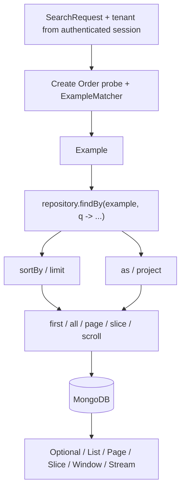
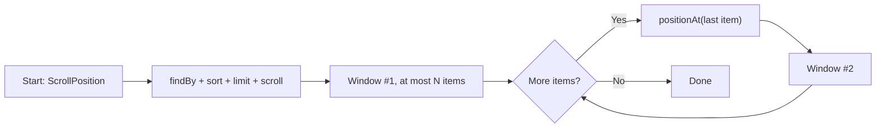

# Fluent Queries, Projections, Pagination, and Version-Dependent Scrolling

> **Chapter:** Query by Example  
> **Module:** `SPRING_DATA_MONGODB` — using Spring Data MongoDB to connect, map documents, and operate on MongoDB via repositories or `MongoTemplate`. This lesson explores **Fluent Query by Example (QBE)**: combining `Example` with sorting, limits, projections, `Page`/`Slice`, and `Window`/scrolling. Beyond syntax, it explains **differences across Spring Data versions**, keyset pitfalls, count costs, indexes, reactive access, and how to test against real MongoDB.

## 1. The Problem: Flexible Search Without Fetching Whole Documents

An order administration page allows filtering by tenant, status, and customer-code prefix. Using the same filter, the UI might ask for:

1. **The 10 newest orders** for a dashboard view.
2. **Page 2 of total pages** for table pagination.
3. **Load 10 more orders** without needing the total record count.
4. **Read only ID, customer code, and creation timestamp**, without transferring every document field.
5. **Iterate across multiple windows** to export data, avoiding ever-larger offset queries.

`Query by Example` creates filters from a **probe** (sample object) and an `ExampleMatcher`. `FetchableFluentQuery` adds ways to execute that same filter with different result-shaping options:



**Core principle:** The Fluent API **does not change the fundamental nature of QBE filters**. It shapes sorting, result type, returned fields, and retrieval mode. If a business rule exceeds QBE's capabilities, `as(…)` or `scroll(…)` will not turn it into a richer MongoDB query predicate.

## 2. Data Model Used Throughout

Choose a class with wrapper types so you can construct a probe where unselected fields hold `null`:

```java
package demo.orders;

import java.time.Instant;
import org.springframework.data.annotation.Id;
import org.springframework.data.mongodb.core.mapping.Document;
import org.springframework.data.mongodb.core.mapping.Field;

@Document(collection = "orders")
public class Order {
    @Id
    private String id;
    private String tenantId;

    @Field("customer_code")
    private String customerCode;

    private String status;
    private Boolean deleted;
    private Instant createdAt;
    private Long totalCents;

    public Order() {}

    public Order(String id, String tenantId, String customerCode,
                 String status, Boolean deleted,
                 Instant createdAt, Long totalCents) {
        this.id = id;
        this.tenantId = tenantId;
        this.customerCode = customerCode;
        this.status = status;
        this.deleted = deleted;
        this.createdAt = createdAt;
        this.totalCents = totalCents;
    }

    public String getId() { return id; }
    public String getTenantId() { return tenantId; }
    public String getCustomerCode() { return customerCode; }
    public String getStatus() { return status; }
    public Boolean getDeleted() { return deleted; }
    public Instant getCreatedAt() { return createdAt; }
    public Long getTotalCents() { return totalCents; }

    public void setTenantId(String tenantId) { this.tenantId = tenantId; }
    public void setCustomerCode(String customerCode) {
        this.customerCode = customerCode;
    }
    public void setStatus(String status) { this.status = status; }
    public void setDeleted(Boolean deleted) { this.deleted = deleted; }
}
```

Illustrative document in Extended JSON:

```json
{
  "_id": "ORD-A3",
  "_class": "demo.orders.Order",
  "tenantId": "TENANT-A",
  "customer_code": "CUS-003",
  "status": "PAID",
  "deleted": false,
  "createdAt": { "$date": "2026-11-20T03:00:00Z" },
  "totalCents": 150000
}
```

`_class` in the example reflects **typical default type-mapping configuration**; it may not be written if the app uses a custom type mapper. This type discriminator matters for MongoDB QBE and is explained in section 4.

**Why does `deleted` use `Boolean` instead of `boolean`?** In QBE, primitive properties such as `boolean` and `int` always carry default values (`false`/`0`), so they can **enter the filter even when the user never selected them**. Using wrappers for optional criteria lets the probe distinguish "do not filter" (`null`) from "filter deleted=false".

Repository:

```java
package demo.orders;

import org.springframework.data.mongodb.repository.MongoRepository;

// MongoRepository inherits Query by Example capabilities.
public interface OrderRepository extends MongoRepository<Order, String> {}
```

In the following examples, `orderRepository` is an injected bean and commands are assumed to run against a test MongoDB or an application with a configured connection.

## 3. Building Example and ExampleMatcher for the Right Purpose

### 3.1. Probe Only Contains Fields to Filter

```java
import org.springframework.data.domain.Example;
import org.springframework.data.domain.ExampleMatcher;

Order probe = new Order();
probe.setTenantId("TENANT-A");
probe.setStatus("PAID");
probe.setDeleted(false);

ExampleMatcher matcher = ExampleMatcher.matchingAll()
    .withIgnoreNullValues()
    .withIgnorePaths("id", "createdAt", "totalCents");

Example<Order> example = Example.of(probe, matcher);
```

`matchingAll()` combines selected properties with **AND**. `withIgnoreNullValues()` ignores null properties; this is also standard default QBE behavior, though writing it explicitly makes the intent clear to readers. `withIgnorePaths(...)` excludes non-searchable properties even if someone later sets them on the probe by mistake.

Filter meaning:

```javascript
db.orders.find({
  tenantId: "TENANT-A",
  status: "PAID",
  deleted: false
});
```

In practice, **typed QBE** can add a type-discriminator condition to the query, so the JSON above illustrates **business predicates only**, not a guarantee that the raw query has no extra fields.

### 3.2. Prefix String Matching

If the search box receives `CUS`, add a per-property matcher for `customerCode`:

```java
import static org.springframework.data.domain.ExampleMatcher.GenericPropertyMatchers.startsWith;

Order probe = new Order();
probe.setTenantId("TENANT-A");
probe.setStatus("PAID");
probe.setDeleted(false);
probe.setCustomerCode("CUS");

ExampleMatcher matcher = ExampleMatcher.matchingAll()
    .withIgnoreNullValues()
    .withMatcher("customerCode", startsWith().ignoreCase());

Example<Order> example = Example.of(probe, matcher);
```

`customerCode` is the **Java property name**; MongoDB stores field `customer_code` via `@Field`. `startsWith().ignoreCase()` may map to a start-anchored regex with the `i` option. Case-insensitive matching via regex **can use indexes poorly**, especially on large datasets; never assume QBE prefix search is automatically fast.

### 3.3. What Makes matchingAny More Dangerous Than matchingAll?

`ExampleMatcher.matchingAny()` specifies **OR** combination across participating properties. In a multi-tenant system:

```java
// DO NOT use for tenant security filters if OR could bypass tenant scoping.
ExampleMatcher unsafe = ExampleMatcher.matchingAny();
```

If `tenantId=TENANT-A` and `status=PAID` are ORed together, results can include `PAID` orders from other tenants. **Security must never depend on which matcher a client picks.** Fix the tenant constraint at a safe service/repository query layer and test with multi-tenant fixtures.

QBE suits an **AND of optional properties**. When business rules require `(A OR B) AND tenant` or complex nested groupings, switch to `MongoTemplate`/`Criteria` or `@Query` with explicit boolean structure.

## 4. MongoDB-Specific QBE: Strict Typing, Nulls, and Embedded Documents

### 4.1. Typed Examples Can Restrict _class

Spring Data MongoDB treats an `Example<Order>` as **strictly typed** by default. Mapping can insert a type discriminator into the filter to accept only documents matching/compatible with the probe's type. Under default configuration using `_class`, the extra condition logically looks like:

```javascript
{
  tenantId: "TENANT-A",
  status: "PAID",
  _class: { $in: ["demo.orders.Order"] }
}
```

This is an **illustrative shape**; actual type keys/values depend on the type mapper, hierarchy, and `@TypeAlias`. For data seeded with the raw Java Driver **lacking `_class`**, a typed QBE query may return nothing even when every business field matches.

Spring Data MongoDB offers `UntypedExampleMatcher` to skip type restrictions when genuinely needed:

```java
import org.springframework.data.mongodb.core.query.UntypedExampleMatcher;

Example<Order> untyped = Example.of(
    probe,
    UntypedExampleMatcher.matching()
);
```

**Do not enable untyped just "to make results show up".** If multiple domain types share a collection, dropping type restrictions can read documents of a different schema. Verify the collection, authorization, and mapping rules first; also ensure matchers/metadata match the expected data types.

### 4.2. QBE Nulls Differ from Query Nulls

By default, `null` values in a probe are **ignored**, not turned into `{ field: null }`. If you need to filter explicit nulls or distinguish absent fields, use `Criteria.exists`, `Criteria.isNullValue`, or direct JSON queries.

For nested objects, enabling null inclusion in QBE can also trigger **structural embedded-document comparison** instead of standard dotted paths. That can affect both field order and field values in documents. Test against real BSON; do not use `withIncludeNullValues()` as a general substitute for null/missing queries.

### 4.3. QBE Cannot Express Every Operator

`ExampleMatcher` supports string pattern matching and simple properties, but is not a complete MongoDB DSL:

- Date ranges `createdAt >= from AND < to`: use `Criteria.gte/lt`.
- Two conditions that must match the same array element: use `$elemMatch`.
- Groups `(A OR B) AND C`: use `andOperator/orOperator`.
- Aggregations `$lookup`, `$group`, `$project`: use the Aggregation API.
- Full-text, geospatial, and specialized numeric range comparisons: use dedicated APIs.

Fluent QBE helps **control how results are retrieved** once the filter fits QBE; it does not add new boolean grammar or aggregation capabilities to QBE.

## 5. Fluent Query API: Structure and Lifecycle

### 5.1. Signature of findBy

`QueryByExampleExecutor` in Spring Data Commons provides:

```java
<S extends T, R> R findBy(
    Example<S> example,
    Function<FluentQuery.FetchableFluentQuery<S>, R> queryFunction
);
```

In an actual repository, you do not need to redeclare this method:

```java
List<Order> orders = orderRepository.findBy(
    example,
    q -> q.sortBy(Sort.by("createdAt").descending())
          .limit(10)
          .all()
);
```

`q` represents a fluent query bound to `example`. Intermediate methods configure the query; the **terminal method** determines execution behavior and return type.

### 5.2. Table of Intermediate and Terminal Methods

| Group | Method | Meaning |
| --- | --- | --- |
| Intermediate | `sortBy(Sort)` | Sorts; repeated calls can append sort rules. |
| Intermediate | `limit(int)` | Limits result count; check interactions with `Pageable`. |
| Intermediate | `as(Class<R>)` | Changes **result type** to a desired projection/DTO/interface. |
| Intermediate | `project(...)` | Selects only specified properties/property paths to read. |
| Terminal | `first()` / `firstValue()` | First record; Optional or nullable value. |
| Terminal | `one()` / `oneValue()` | Requires at most one record; multiple results throw an exception. |
| Terminal | `all()` | Returns `List<T>`, unsuitable for unbounded/huge datasets. |
| Terminal | `page(Pageable)` | Returns `Page<T>` with total and page-count metadata. |
| Terminal | `slice(Pageable)` | Returns `Slice<T>` without total count; **version-dependent**. |
| Terminal | `scroll(ScrollPosition)` | Returns `Window<T>` to read onward by offset/keyset; **version-dependent**. |
| Terminal | `stream()` | Returns `Stream<T>`; must be closed to release the cursor. |
| Terminal | `count()` / `exists()` | Counts or checks existence matching the example. |

Not every Spring Data Commons version or store module exposes or implements all of these methods. **This table reflects modern APIs and must be checked against your actual dependencies.**

### 5.3. FluentQuery Is Immutable

Intermediate methods return **a new fluent query**, rather than mutating the existing instance:

```java
// CORRECT: continue chaining on the returned query.
List<Order> top = orderRepository.findBy(
    example,
    q -> q.sortBy(Sort.by("createdAt").descending())
          .limit(10)
          .all()
);
```

Pattern to avoid:

```java
// ANTI-PATTERN: discards the object returned by limit.
List<Order> potentiallyUnbounded = orderRepository.findBy(
    example,
    q -> {
        q.limit(10);
        return q.all(); // May not apply the intended limit.
    }
);
```

**Also never return `q` itself outside the lambda** for later use: Spring Data requires the query function to **end with a query execution result** inside the `findBy` call scope. If you want to reuse sort/projection choices, write a helper accepting `Example` and a terminal lambda rather than storing a `FluentQuery` instance.

## 6. Choosing first, one, all, limit, count, and exists

### 6.1. Fetching the Newest Record

```java
import java.util.Optional;
import org.springframework.data.domain.Sort;

Sort newestFirst = Sort.by(Sort.Direction.DESC, "createdAt")
    .and(Sort.by(Sort.Direction.DESC, "id"));

Optional<Order> latest = orderRepository.findBy(
    example,
    q -> q.sortBy(newestFirst).first()
);
```

`first()` returns the first element if present, or `Optional.empty()` if none. **Add ID as a tie-breaker** since multiple orders can share the same timestamp. Using `first()` without a sort offers no deterministic business order.

### 6.2. one() Is Not first()

```java
Optional<Order> unique = orderRepository.findBy(
    example,
    q -> q.one()
);
```

`one()` is right when business rules expect **at most one** result. If two documents match, Spring Data throws `IncorrectResultSizeDataAccessException` instead of silently picking one. `firstValue()`/`oneValue()` differ only in returning a nullable value; never use them to bypass uniqueness checks.

### 6.3. Limit and Lists

```java
List<Order> latest10 = orderRepository.findBy(
    example,
    q -> q.sortBy(newestFirst).limit(10).all()
);
```

`limit(10)` caps the query results; `all()` still materializes **the returned results** into a `List`. Never use unbounded `all()` across millions of documents when incremental processing is needed.

### 6.4. Counting and Checking Data Existence

```java
long matching = orderRepository.findBy(example, q -> q.count());
boolean found = orderRepository.findBy(example, q -> q.exists());

// Direct QBE methods with the same goal:
long matchingViaExecutor = orderRepository.count(example);
boolean existsViaExecutor = orderRepository.exists(example);
```

`count` returns the number of records matching the filter without materializing all entities. `exists` checks only whether at least one matching record exists. In large systems, never replace `count` with `findAll(example).size()`, which pulls every matching document into the JVM.

## 7. Projections: Fetching the Right Data Type and Fields

### 7.1. Why Avoid Returning Full Entities for Lists?

An `Order` document can contain far more data than a UI table needs (shipping details, update history, line-item arrays, etc.). A table API may display only ID, customer code, status, and creation date. Returning the whole entity:

- Increases BSON transferred over the network.
- Increases JVM objects allocated during mapping.
- Increases the risk of accidentally exposing fields that should stay private to the API.
- Adds GC and response serialization overhead.

The Fluent API has two complementary mechanisms:

1. **`as(ResultType.class)`:** requests mapping results into an interface/DTO projection.
2. **`project("fieldA", ...)`:** restricts which properties/property paths are fetched.

### 7.2. Interface Projection

```java
package demo.orders;

import java.time.Instant;

public interface OrderSummary {
    String getId();
    String getCustomerCode();
    String getStatus();
    Instant getCreatedAt();
}
```

`OrderSummary.java` is an example of **a separate interface**, not another `public` type declared inside `Order.java`.

Fetching a projected list:

```java
List<OrderSummary> summaries = orderRepository.findBy(
    example,
    q -> q.as(OrderSummary.class)
          .sortBy(newestFirst)
          .limit(20)
          .all()
);
```

Use `getCustomerCode()` on the interface even though the BSON field is `customer_code`. Mapping metadata abstracts Java property names from stored field names. However, **projections are only safe when the application controls which fields are exposed**; never turn an interface containing sensitive data into a public DTO merely because the framework supports it.

### 7.3. Restricting Queried Properties

```java
List<OrderSummary> compact = orderRepository.findBy(
    example,
    q -> q.as(OrderSummary.class)
          .project("id", "customerCode", "status", "createdAt")
          .sortBy(newestFirst)
          .limit(20)
          .all()
);
```

`project(…)` takes **domain property/path names**; verify mapping to target BSON fields when `@Field` or custom mapping is present. Do not blindly write `"customer_code"` when the API expects Java property `customerCode`.

**Note:** In MongoDB, `_id` is usually returned unless excluded. With keyset scrolling, **explicitly keep ID and all sort keys** in the projection rather than relying on default projection quirks.

### 7.4. Never Save a Partially Projected Entity

```java
// Conceptual ANTI-PATTERN:
// Order truncated = ... loaded with only id/status;
// orderRepository.save(truncated);
```

An entity loaded with missing fields is not a complete aggregate. Saving it back can overwrite or drop unloaded fields depending on the write and mapping paths. Return read-only projections or separate DTOs; when updating a single field, use a conditional update with an appropriate `UpdateResult`.

### 7.5. Projections Do Not Perform Aggregation

`as(OrderSummary.class)` reshapes the **result type**; `project("customerCode")` selects fields. Spring Data does not automatically perform `$group`, `$lookup`, per-customer totals, or full-text ranking. For computed data, use aggregation pipelines/`@Aggregation` and map results to DTOs.

## 8. Page: Pagination with Total Counts

### 8.1. PageRequest and FluentQuery.page

```java
import org.springframework.data.domain.Page;
import org.springframework.data.domain.PageRequest;
import org.springframework.data.domain.Sort;

Sort order = Sort.by(Sort.Direction.DESC, "createdAt")
    .and(Sort.by(Sort.Direction.DESC, "id"));

PageRequest request = PageRequest.of(0, 20, order);

Page<OrderSummary> page = orderRepository.findBy(
    example,
    q -> q.as(OrderSummary.class).page(request)
);
```

`PageRequest.of(0,20,...)` requests **page 0** (the first page), with up to 20 items. `Page` exposes:

| Member | Meaning |
| --- | --- |
| `getContent()` | The `OrderSummary` items on the current page. |
| `getNumber()` | Zero-based page index. |
| `getSize()` | Requested page size. |
| `getNumberOfElements()` | Actual number of items on this page. |
| `getTotalElements()` | Total items matching the example. |
| `getTotalPages()` | Total pages given size and total. |
| `hasNext()` | Whether a next page exists per current metadata. |

If there are 43 matches and size=20, the page count is:

\[
\operatorname{totalPages} = \left\lceil \frac{43}{20}\right\rceil = 3
\]

Pages have indices `0`, `1`, and `2` with maximum item counts of 20, 20, and 3 respectively.

### 8.2. The Count Query Can Cost More Than the Content Query

`Page` needs the total count matching the example. When the total cannot be inferred from the content (e.g., the first page is full with 20 records), the framework may need a **count** operation in addition to fetching the 20 items.

In MongoDB:

```javascript
// Page content (illustrative; QBE may also add type restrictions).
db.orders.find({
  tenantId: "TENANT-A",
  status: "PAID",
  deleted: false
}).sort({
  createdAt: -1, _id: -1
}).skip(0).limit(20);

// Count entire matching set.
db.orders.countDocuments({
  tenantId: "TENANT-A",
  status: "PAID",
  deleted: false
});
```

**Never claim Page always runs exactly two commands.** Spring Data optimizes out count queries when results are short, and driver/store versions can differ in count commands. Still, if the UI does not need totals, `Page` can incur unnecessary cost.

### 8.3. Sort Inside Pageable Overrides Earlier sortBy

`FluentQuery.FetchableFluentQuery.page(Pageable)` documentation states that **the sort on a sorted `Pageable` overrides any previously declared sort order**. Likewise, page size overrides a `limit(int)` declared prior to `page`.

```java
Page<Order> actual = orderRepository.findBy(
    example,
    q -> q.sortBy(Sort.by("createdAt").descending())
          .limit(5)
          .page(PageRequest.of(0, 20, Sort.by("id").ascending()))
);

// Do not expect results to stay sorted by createdAt or capped at 5 items.
// PageRequest requested size=20 and sort by id.
```

**Maintainable convention:** with `page(pageable)` or `slice(pageable)`, configure all sorting and sizing in `PageRequest` itself, avoiding duplicate configuration.

## 9. Slice: Loading More Without Total Counts

`Slice<T>` differs from `Page<T>` by **not** providing `totalElements` or `totalPages`. It returns content, page metadata, and `hasNext`.

In Spring Data Commons versions providing `FetchableFluentQuery.slice(Pageable)` with store-module support, you can write:

```java
import org.springframework.data.domain.Slice;

Slice<OrderSummary> slice = orderRepository.findBy(
    example,
    q -> q.as(OrderSummary.class).slice(
        PageRequest.of(0, 20, newestFirst)
    )
);

List<OrderSummary> items = slice.getContent();
boolean more = slice.hasNext();
```

A `Slice` implementation may read **pageSize + 1** documents to detect whether a subsequent page exists rather than counting the whole set. Exact request/lookahead details depend on version, so inspect commands or run integration tests against real MongoDB.

| UI Requirement | `Page` | `Slice` |
| --- | --- | --- |
| Display current content | Yes | Yes |
| **Next / Load More** button | Yes | Yes |
| "Page 1 of 143" | **Yes** | **No** |
| Needs total computation | May run count | Typically avoids total work |
| Jump to arbitrary page number | Fits offset | Possible, but no total |
| Deep paging thousands of pages | `skip` grows larger | `skip` can still grow large |

Switching from Page to Slice **only avoids total counting**; it does not eliminate `skip` overhead at deep pages. When reading many pages sequentially, evaluate `Window` and keyset pagination.

**Version note:** `slice(Pageable)` on Fluent Query is part of modern Spring Data Commons APIs (Javadoc marks it since 3.5). On older versions or unsupported modules, use `findAll(example, Pageable)`/repository `Slice` methods or write template queries; never copy a method assuming every dependency compiles it.

## 10. Scrolling: Continuing Forward via Window and ScrollPosition

`Window<T>` represents **a window of results** within a sorted, bounded query sequence. Unlike `Page`, `Window` does not necessarily know the overall total. To read the next window, pass a `ScrollPosition` representing **the position of the last item in the window just received**.



### 10.1. Starting with Offset Scrolling

Example reading from the beginning without totals:

```java
import org.springframework.data.domain.ScrollPosition;
import org.springframework.data.domain.Window;

Window<Order> firstWindow = orderRepository.findBy(
    example,
    q -> q.sortBy(newestFirst)
          .limit(10)
          .scroll(ScrollPosition.offset())
);

List<Order> firstItems = firstWindow.getContent();
```

`ScrollPosition.offset()` denotes the **starting point before the first item**. Do not confuse it with `ScrollPosition.offset(0L)`: scrolling uses an **exclusive** position (fetching items after the passed position), so `offset(0L)` means **already at index 0** and can skip the very first item.

### 10.2. Iterating Consecutive Windows

```java
ScrollPosition position = ScrollPosition.offset();

while (true) {
    Window<Order> window = orderRepository.findBy(
        example,
        q -> q.sortBy(newestFirst)
              .limit(10)
              .scroll(position)
    );

    for (Order order : window) {
        processOrder(order);
    }

    if (window.isEmpty() || window.isLast()) {
        break;
    }

    position = window.positionAt(window.size() - 1);
}
```

`processOrder(order)` is a business handler defined by the service. Checking `isEmpty()` avoids calling `positionAt(-1)` on an empty window. `isLast()` avoids an extra request when the implementation knows this is the final window.

**Offset scrolling still incurs large-offset cost**: the server may still have to walk past many results before returning deep windows. It bounds data transferred per call, but does not turn `offset=100,000` into an O(1) lookup.

## 11. Keyset Scrolling: Optimizing Forward Iteration on Large Sets

Keyset scrolling saves **sort-key values** from the last item and builds conditions to read items following them in the chosen sort order.

### 11.1. Deterministic and Non-Null Sort

Example:

```java
Sort keysetSort = Sort.by(Sort.Direction.DESC, "createdAt")
    .and(Sort.by(Sort.Direction.DESC, "id"));
```

Assume `createdAt` is a **non-null** BSON Date never mutated after creation, and `_id` is unique with a consistent BSON type. When two orders share `createdAt`, ID breaks ties deterministically.

A descending keyset filter is logically equivalent to:

```javascript
// Example with the same tenant/status/deleted conditions as QBE.
db.orders.find({
  tenantId: "TENANT-A",
  status: "PAID",
  deleted: false,
  $or: [
    { createdAt: { $lt: ISODate("2026-11-20T03:00:00Z") } },
    {
      createdAt: ISODate("2026-11-20T03:00:00Z"),
      _id: { $lt: "ORD-A3" }
    }
  ]
}).sort({ createdAt: -1, _id: -1 }).limit(20);
```

This is a **logical illustration**, not a promise that Spring Data emits identical query strings field-for-field. The framework evaluates sort and keyset positions via store mappings.

### 11.2. Fluent QBE with Keyset

With Spring Data Commons/MongoDB supporting `FetchableFluentQuery.scroll`:

```java
ScrollPosition position = ScrollPosition.keyset();

while (true) {
    Window<OrderSummary> window = orderRepository.findBy(
        example,
        q -> q.as(OrderSummary.class)
              .project("id", "customerCode", "status", "createdAt")
              .sortBy(keysetSort)
              .limit(20)
              .scroll(position)
    );

    for (OrderSummary order : window) {
        writeReportRow(order);
    }

    if (window.isEmpty() || window.isLast()) {
        break;
    }

    position = window.positionAt(window.size() - 1);
}
```

Here, `OrderSummary` declares `getId()` and `getCreatedAt()`, and `project(…)` **retains both sort keys**. This is not just for display: keyset scrolling needs those key values to construct the next scroll position.

### 11.3. Why Must Projections Keep Sort Keys?

Risky pattern:

```java
// ANTI-PATTERN: missing createdAt in the result type.
public interface TooSmallOrderView {
    String getId();
    String getStatus();
}
```

If you sort by `createdAt` while projecting only `id` and `status`, the implementation may **fail to extract the keyset** from the last item and throw an error or fail to advance. For every DTO/interface used in keyset scrolling, include **all sort fields and ID** (plus any extra keys the system needs).

Keyset scrolling also requires sort properties to be **non-null**; missing fields, mixed BSON types, or inconsistent conversions can corrupt the continuation condition. That is a data invariant, not merely declaring the Java type `Instant`.

### 11.4. What Happens When Documents Are Added or Deleted While Scrolling?

Keyset scrolling is less sensitive than offset scrolling to inserts at the **head** of the list, because the cursor resumes past already-read keys. However, it **does not automatically provide an immutable snapshot**:

- Unread documents that are deleted will not appear.
- Documents whose `createdAt` is updated can shift position relative to the cursor.
- Changing filters or sorts across requests causes duplicates or skips.
- Using a non-unique key without a tie-breaker can drop records sharing timestamps.

For exports needing strict consistency, design a snapshot/cutoff, transaction, or immutable source per requirements; `Window` and `ScrollPosition` do not solve consistency on their own.

### 11.5. Offset, Keyset, Page, Slice: Choosing by Requirement

| Criterion | Page | Slice | Offset Window | Keyset Window |
| --- | --- | --- | --- | --- |
| Total metadata | Yes | No | No | No |
| Sequential batch reading | Yes | Yes | Yes | Yes |
| Jump to arbitrary page | Good | Possible | Possible | Hard |
| Deep offsets | Cost grows | Cost grows | Cost grows | Can avoid large skips |
| Requires non-null sort keys | Not strictly technical (needs stable sort) | Similar to Page | Needs stable sort | **Needs suitable non-null sort keys** |
| Projection must retain sort keys | Optional | Optional | Not required in the same sense | **Required to extract next cursor** |
| Best fit | Numbered tables | "Load more" | Simple window iteration | Large feeds/exports, forward traversal |

**Page/Slice/Window all bound the subset returned per request, not the MongoDB cursor batch size**. Driver batch size is a separate setting at the result-transport layer.

## 12. Spring Data Version Differences: Avoid Coding from Memory

`FluentQuery` lives in Spring Data Commons, while actual execution is implemented by **Spring Data MongoDB**. Check **both** conditions: whether the Commons API version defines the method, and whether that version's MongoDB repository supports it.

| Feature | Reference API Milestone | What to Verify in Your Application |
| --- | --- | --- |
| `findBy(example, q -> ...)` / Fluent QBE | Since Spring Data Commons **2.6** | MongoDB repository version and projection/sort support. |
| `as(Class)`, `sortBy`, `project(String...)`, `page`, `stream` | Core Fluent QBE features from earlier modern lines | Verify overloads, projection support, and stream lifecycle. |
| `FluentQuery.limit(int)` | Javadoc marks **since 3.1** | Do not call on older Commons; check if `page` overrides limit. |
| `Window`, `ScrollPosition`, `scroll` | Javadoc marks **since 3.1** | Not every store/version supports scrolling; may throw `UnsupportedOperationException`. |
| `FetchableFluentQuery.slice(Pageable)` | Commons Javadoc marks **since 3.5** | On older versions, use `Page`/`findAll(example, Pageable)` or template queries. |
| `project(TypedPropertyPath...)` | Modern Javadoc marks **since 4.1** | Use `project("propertyName")` if older versions lack typed-path overloads. |
| Reactive Fluent QBE | `ReactiveQueryByExampleExecutor.findBy` since **2.6** | Return types and reactive terminals differ from imperative; never assume `Mono<Page>` works on every repository. |

**These are Spring Data Commons API milestones, not Spring Boot version numbers.** Spring Boot manages a compatible Spring Data release train, so one "Boot 3.x" app does not necessarily have all the exact same APIs as another Boot 3.x app.

### 12.1. Library Upgrade Checklist

1. Identify exact Spring Boot, Spring Data Commons, and Spring Data MongoDB versions in use.
2. Read the `FluentQuery.FetchableFluentQuery` Javadoc for that **exact version** to check `slice`, `scroll`, and `limit`.
3. Verify the MongoDB repository implementation supports the desired terminal method.
4. Compile and run integration tests against matching MongoDB, rather than trusting IDE autocomplete alone.
5. Verify projections retain every keyset sort field; if not, update the DTO.
6. Measure real requests: total counts, sort/indexes, BSON mapping, and duplicate/null data.
7. For apps on older versions, prefer version-appropriate template/cursor solutions rather than copying newer docs verbatim.

## 13. Reactive Fluent QBE: Same Filter, Different Publisher

`ReactiveMongoRepository` exposes reactive QBE APIs in supported versions:

```java
package demo.orders;

import org.springframework.data.mongodb.repository.ReactiveMongoRepository;

public interface ReactiveOrderRepository
        extends ReactiveMongoRepository<Order, String> {}
```

### 13.1. Fetching a Projected List as a Flux

```java
import reactor.core.publisher.Flux;
import reactor.core.publisher.Mono;

Flux<OrderSummary> summaries = reactiveOrderRepository.findBy(
    example,
    q -> q.as(OrderSummary.class)
          .sortBy(newestFirst)
          .limit(20)
          .all()
);

Mono<Long> total = reactiveOrderRepository.count(example);
Mono<Boolean> hasAny = reactiveOrderRepository.exists(example);
```

In the reactive API, `all()` returns a publisher (`Flux`), not a `List`; `one()`/`first()` return `Mono`. Creating a `Flux` only defines a pipeline; the database query runs upon proper subscription.

### 13.2. Never Assume Mono<Page<T>> Is Supported

Spring Data MongoDB explicitly notes that **reactive repository query methods do not support `Page` return types such as `Mono<Page<T>>`** the way imperative repositories do. If an API needs both content and total, combine two I/O operations:

```java
Flux<OrderSummary> limited = reactiveOrderRepository.findBy(
    example,
    q -> q.as(OrderSummary.class)
          .sortBy(newestFirst)
          .limit(20)
          .all()
);

Mono<List<OrderSummary>> items = limited.collectList();

Mono<Long> count = reactiveOrderRepository.count(example);

Mono<SearchResponse> response = Mono.zip(items, count)
    .map(tuple -> new SearchResponse(tuple.getT1(), tuple.getT2()));
```

DTO example (a separate file or validly declared nested type):

```java
record SearchResponse(List<OrderSummary> items, long total) {}
```

The two publishers `items` and `count` represent **two separate operations**; `Mono.zip` does not create a shared transactional snapshot. For large counts, never call `collectList()` on the whole collection; here `limit(20)` caps the collected list at 20 items.

### 13.3. Reactive Scroll/Slice by Version

Modern `ReactiveFluentQuery` includes terminals like `slice(Pageable)` or `scroll(ScrollPosition)` in Javadoc, though they may default to throwing `UnsupportedOperationException` if a store implementation lacks support. Never copy imperative logic directly into reactive code or call `block()` on an event loop. When needed, use `ReactiveMongoTemplate` with version-tested queries/scrolling.

Reactive backpressure coordinates downstream demand in the pipeline; **it does not mean one `request(1)` maps 1-to-1 to a single MongoDB `getMore` command**. Batch buffering, prefetching, and concurrency can still occur.

## 14. When You Need MongoTemplate Instead of Fluent QBE

### 14.1. Using Criteria.alike for Example at the Template Layer

Spring Data MongoDB lets you use QBE with templates:

```java
import java.util.List;
import org.springframework.data.mongodb.core.query.Criteria;
import org.springframework.data.mongodb.core.query.Query;

Query query = new Query(
    new Criteria().alike(example)
);

List<Order> matches = mongoTemplate.find(query, Order.class);
```

This reuses `Example` while adding `Query` options such as sorting, projections, limits, or metadata:

```java
Query query = new Query(new Criteria().alike(example))
    .with(newestFirst)
    .limit(20);

query.fields()
    .include("id")
    .include("customerCode")
    .include("status")
    .include("createdAt");

List<Order> rows = mongoTemplate.find(query, Order.class);
```

**Caution:** returning `Order` after selecting only a subset of fields leaves the entity **incomplete**. In practice, use dedicated DTOs/projections via the template fluent query API instead of saving partially loaded entities.

### 14.2. Complex Filters Must Use Criteria with Proper Semantics

Business example: `tenantId = TENANT-A`, not soft-deleted, status `PAID` **or `REVIEW`**, and `createdAt` within a date range:

```java
import java.time.Instant;

Instant from = Instant.parse("2026-11-01T00:00:00Z");
Instant until = Instant.parse("2026-12-01T00:00:00Z");

Query advanced = Query.query(
    Criteria.where("tenantId").is("TENANT-A")
        .and("deleted").is(false)
        .and("status").in("PAID", "REVIEW")
        .and("createdAt").gte(from).lt(until)
);

List<Order> matches = mongoTemplate.find(advanced, Order.class);
```

Date ranges and `$in` are easily expressed with `Criteria`; trying to cram all this logic into a QBE probe is error-prone. If an array of order lines requires multiple conditions on the **same element**, use `Criteria.elemMatch` on that array path.

### 14.3. MongoTemplate Scrolling and Projections

Modern Spring Data MongoDB versions offer FluentTemplate APIs and `Query.with(ScrollPosition)` for scrolling. However, exact signatures and `as(…)`/`scroll(…)`/`stream(…)` capabilities vary by version. When `repository.findBy(example,...scroll)` is unavailable or unsupported, a template query with explicit `Criteria` and sort/keyset is a controllable alternative — **after checking Javadoc and running integration tests**, rather than guessing overloads.

## 15. Indexes, Performance, and Data Bounds

### 15.1. Indexes for Tenant, Status, and createdAt Ordering

Suppose an API frequently queries `tenantId=TENANT-A`, `status=PAID`, `deleted=false`, sorted descending by `createdAt` and ID. Candidate index:

```javascript
db.orders.createIndex({
  tenantId: 1,
  status: 1,
  deleted: 1,
  createdAt: -1,
  _id: -1
});
```

This index puts the three equality conditions before the sort keys, **if the actual query matches**. With typed QBE, `_class` may also appear in the filter: inspect the real execution plan instead of assuming a sample index is always optimal.

To benchmark an equivalent query:

```javascript
db.orders.find({
  tenantId: "TENANT-A",
  status: "PAID",
  deleted: false
}).sort({
  createdAt: -1,
  _id: -1
}).limit(20).explain("executionStats");
```

Inspect `winningPlan`, `totalKeysExamined`, `totalDocsExamined`, `nReturned`, and any sort stage. Never run a single `explain` on a few dozen rows and conclude production indexing is solid.

### 15.2. containsIgnoreCase and Regex Can Be Very Expensive

Matcher:

```java
ExampleMatcher matcher = ExampleMatcher.matchingAll()
    .withMatcher(
        "customerCode",
        ExampleMatcher.GenericPropertyMatchers.contains().ignoreCase()
    );
```

can produce a substring-matching regex, forcing MongoDB to scan many index entries or documents. Even with an index on `customer_code`, case-insensitive regexes do not automatically use indexes as efficiently as equality on normalized keys. For heavy lookups, consider normalized search keys, suitable indexes, or a dedicated search engine.

### 15.3. Projections Reduce Payload but Cannot Fix Bad Filters

Projections make results lighter, yet the query may still examine many documents for matching, sorting, or counting. A `Page` with a tiny projection can still be slow if count scans a huge set or sorting lacks an index. Optimize **filter + index + query shape** first, then measure network and heap to evaluate projections.

### 15.4. Offset vs. Keyset

`PageRequest.of(5000,20)` has an offset of 100,000: even though only 20 records are returned, MongoDB generally still walks past many results to reach deep pages. Keyset with the right index can avoid large skips during forward traversal, though it requires non-null sort keys and returning those keys in projections.

**Keyset is not always faster in every scenario**: query shape, data distribution, indexes, sharding, and cursor token size all require measurement. A UI that must jump directly to page 200 may still fit Page/offset better.

## 16. Tenant Isolation, Access Control, and Pagination Consistency

### 16.1. Tenant ID Must Originate from an Authenticated Context

```java
public Example<Order> buildExample(
    String authenticatedTenantId,
    String optionalStatus
) {
    if (authenticatedTenantId == null
        || authenticatedTenantId.isBlank()) {
        throw new IllegalArgumentException("Tenant required");
    }

    Order probe = new Order();
    probe.setTenantId(authenticatedTenantId);
    probe.setDeleted(false);
    probe.setStatus(optionalStatus);

    return Example.of(
        probe,
        ExampleMatcher.matchingAll().withIgnoreNullValues()
    );
}
```

`authenticatedTenantId` must come from a verified identity, never from an untrusted client-sent string. **If `probe.tenantId == null`** and the matcher ignores nulls, the application risks querying **across all tenants**. `matchingAny()` is even riskier if OR weakens the tenant boundary.

### 16.2. Cursors Must Be Bound to Filter and Sort

When an API returns a `nextCursor` to clients:

- Never accept a returned cursor arbitrarily without validation.
- Bind the token to tenant, filter, sort, page size, and cursor format version.
- Sign or encrypt tokens per application policy and enforce expiration windows.
- Never persist `ScrollPosition.toString()` assuming it is a stable wire format across versions.

If a client switches `status` from PAID to PENDING while reusing a cursor from the old filter, ordering and keysets no longer align. Start a fresh scroll whenever filter or sort changes.

### 16.3. No Automatic Snapshots

`Page`, `Slice`, and `Window` do not open transactions to freeze a snapshot across requests. Total counts can reflect data at a different moment from page content, and cursors can shift when documents change mid-scroll.

Admin dashboards can usually tolerate "near-real-time" consistency. Audit-grade exports need an explicit snapshot/cutoff or immutable data source alongside retry/idempotency strategies; do not rely solely on pagination APIs.

## 17. Integration Testing: Verifying Both Data and Version-Dependent Behavior

A test asserting only that `findBy(example, q -> q.all())` returns a non-empty list is insufficient: it misses accidental `deleted=false` filters from primitives, omitted tenant filters, wrong counts, or keysets missing sort fields.

### 17.1. Meaningful Test Dataset

Seed **via Spring Data mapping** so typed examples see the same type-discriminator structure as the real app. Example:

| ID | Tenant | Status | deleted | createdAt | Expected for tenant A + PAID + deleted=false |
| --- | --- | --- | :---: | --- | --- |
| `ORD-A1` | TENANT-A | PAID | false | 01:00Z | Yes |
| `ORD-A2` | TENANT-A | PAID | false | 02:00Z | Yes |
| `ORD-A3` | TENANT-A | PAID | false | 03:00Z | Yes |
| `ORD-A4` | TENANT-A | PENDING | false | 04:00Z | No |
| `ORD-A5` | TENANT-A | PAID | true | 05:00Z | No |
| `ORD-B1` | TENANT-B | PAID | false | 06:00Z | No |

If you seed via raw Java Driver without writing `_class`, typed QBE may **skip those documents**. Intentionally test both typed and untyped if your project has legacy data.

### 17.2. Spring Boot Test Example with Standalone MongoDB

```java
package demo.orders;

import static org.assertj.core.api.Assertions.assertThat;
import java.time.Instant;
import java.util.List;
import org.junit.jupiter.api.BeforeEach;
import org.junit.jupiter.api.Test;
import org.springframework.beans.factory.annotation.Autowired;
import org.springframework.boot.test.autoconfigure.data.mongo.DataMongoTest;
import org.springframework.data.domain.Example;
import org.springframework.data.domain.ExampleMatcher;
import org.springframework.data.domain.Page;
import org.springframework.data.domain.PageRequest;
import org.springframework.data.domain.ScrollPosition;
import org.springframework.data.domain.Sort;
import org.springframework.data.domain.Window;

@DataMongoTest
class OrderFluentExampleTest {
    @Autowired OrderRepository repository;

    private final Sort newest = Sort
        .by(Sort.Direction.DESC, "createdAt")
        .and(Sort.by(Sort.Direction.DESC, "id"));

    @BeforeEach
    void seed() {
        repository.deleteAll(); // ONLY on an isolated TEST database.
        repository.saveAll(List.of(
            order("ORD-A1", "TENANT-A", "PAID", false, "01:00:00"),
            order("ORD-A2", "TENANT-A", "PAID", false, "02:00:00"),
            order("ORD-A3", "TENANT-A", "PAID", false, "03:00:00"),
            order("ORD-A4", "TENANT-A", "PENDING", false, "04:00:00"),
            order("ORD-A5", "TENANT-A", "PAID", true, "05:00:00"),
            order("ORD-B1", "TENANT-B", "PAID", false, "06:00:00")
        ));
    }

    private Order order(String id, String tenant, String status,
                        boolean deleted, String clock) {
        return new Order(
            id, tenant, "CUS-" + id, status, deleted,
            Instant.parse("2026-11-20T" + clock + "Z"),
            1000L
        );
    }

    private Example<Order> example() {
        Order probe = new Order();
        probe.setTenantId("TENANT-A");
        probe.setStatus("PAID");
        probe.setDeleted(false);
        return Example.of(
            probe,
            ExampleMatcher.matchingAll().withIgnoreNullValues()
        );
    }

    @Test
    void pageHasCorrectTotalAndStableSort() {
        Page<OrderSummary> page = repository.findBy(
            example(),
            q -> q.as(OrderSummary.class)
                  .page(PageRequest.of(0, 2, newest))
        );

        assertThat(page.getTotalElements()).isEqualTo(3L);
        assertThat(page.getTotalPages()).isEqualTo(2);
        assertThat(page.getContent())
            .extracting(OrderSummary::getId)
            .containsExactly("ORD-A3", "ORD-A2");
    }

    @Test
    void keysetWindowMovesToNextWindow() {
        Window<OrderSummary> first = repository.findBy(
            example(),
            q -> q.as(OrderSummary.class)
                  .project("id", "customerCode", "status", "createdAt")
                  .sortBy(newest)
                  .limit(2)
                  .scroll(ScrollPosition.keyset())
        );

        assertThat(first.getContent())
            .extracting(OrderSummary::getId)
            .containsExactly("ORD-A3", "ORD-A2");

        Window<OrderSummary> second = repository.findBy(
            example(),
            q -> q.as(OrderSummary.class)
                  .project("id", "customerCode", "status", "createdAt")
                  .sortBy(newest)
                  .limit(2)
                  .scroll(first.positionAt(first.size() - 1))
        );

        assertThat(second.getContent())
            .extracting(OrderSummary::getId)
            .containsExactly("ORD-A1");
    }
}
```

**Execution prerequisites:** `@DataMongoTest` and the imports above match certain Spring Boot 3.x releases; newer Boot releases may use different slice packages and annotations. Tests need a dedicated MongoDB (e.g., Testcontainers); **having `@DataMongoTest` does not spin up a server automatically**. `repository.deleteAll()` is permitted only on an isolated test database.

If your version does not yet include `scroll` or MongoDB QBE lacks support for that terminal, **do not treat test failures as data bugs**; group tests by capability/version and use supported template/offset mechanisms.

### 17.3. Additional Cases to Cover

| Test | What to Assert |
| --- | --- |
| `Boolean deleted` left blank | When null with ignoreNull, does not filter `deleted=false`. |
| `matchingAll` | Never returns documents from another tenant. |
| `matchingAny` in isolated test | Demonstrates the risk of OR broadening search scope. |
| `startsWith().ignoreCase()` | Matches expected prefixes and inspect regex/index usage. |
| Typed QBE vs. raw BSON missing `_class` | Real difference exists; do not misdiagnose as a Page bug. |
| `as(OrderSummary.class)` | Getter returns the mapped value from `@Field("customer_code")`. |
| `project` | Query loads only desired fields without omitting keyset sort keys. |
| `page` | Accurate total, totalPages, size, and ordering. |
| `slice` if supported | Has `hasNext`, omits total. |
| Offset scrolling | `offset()` does not skip the first item. |
| Keyset scrolling | No duplicates or skipped items on static data, even with duplicate timestamps. |
| Null sort field | Rejected or handled explicitly before keyset scrolling. |
| Data modified between windows | Document the consistency guarantees the API accepts. |
| Reactive QBE | Filter and projection match the imperative variant. |

### 17.4. Measuring Real Queries and Indexes

In a controlled test environment, enable MongoDB Java Driver command monitoring/metrics to inspect queries and counts per terminal method. Never log sensitive data. Compare against `mongosh` and `explain("executionStats")`. Check:

- Did `Page` run a count query or optimize it away?
- Did `Slice`/`Window` fetch one extra record to detect more items?
- Do large offsets cause rising scan durations?
- Does keyset use an index containing the sort keys?
- Are `_class` type discriminators and BSON field aliases what you expected?

## 18. Common Mistakes and How to Fix Them

| Symptom | Cause | Resolution |
| --- | --- | --- |
| QBE returns fewer items than expected despite valid data | Typed Example adds `_class` restriction, or extra probe fields are set. | Inspect raw BSON and matcher; use untyped intentionally if needed. |
| QBE accidentally filters `deleted=false` | Probe uses primitive `boolean` defaulting to false. | Use `Boolean` wrapper or `withIgnorePaths("deleted")`. |
| Query returns another tenant's records | Used `matchingAny` or `tenantId` in probe was null. | Require tenant from principal, `matchingAll`, or Criteria AND. |
| `first()` returns different records across runs | Unstable sort or tied timestamps. | Sort by timestamp plus ID. |
| `one()` throws an exception | More than one document matches the Example. | Use `first()` if business wants one, or tighten filter/unique index. |
| `limit(10)` seems ignored | Discarded returned fluent query or `page(Pageable)` overrode limit. | Chain directly and put size/sort solely in Pageable when paging. |
| `Page` is slow despite returning only 20 items | Count/skip/sort/index costs. | Measure content and count separately; use Slice/Window if total is unnecessary. |
| `slice(…)` fails to compile | Older Spring Data Commons or MongoDB module version. | Check Javadoc and use a supported API. |
| `scroll(…)` throws UnsupportedOperationException | Store/implementation does not support the terminal. | Use template/derived scrolling or upgrade with tests. |
| Offset(0) skips the first item | ScrollPosition is an exclusive position. | Start with `ScrollPosition.offset()`. |
| Keyset skips or duplicates items | Nullable, non-unique, mutable, or projection-dropped sort keys. | Stable sort, retain keys, non-null, matching index. |
| Projection loses fields on save | Loaded partial entity and saved it back. | Use read-only interfaces/DTOs and separate updates. |
| String regex search is slow | `containsIgnoreCase` emits index-unfriendly regex. | Normalize search keys or adopt a suitable search solution. |
| Reactive `Mono<Page>` cannot be used | Reactive MongoDB repositories do not support `Page` like imperative ones. | Zip bounded Flux and count, or check version-supported APIs. |
| Client cursor reused on a different filter | Keyset token not bound to tenant/filter/sort. | Sign/validate tokens and reset when criteria change. |

**Debugging sequence:** (1) check probe and wrapper fields; (2) inspect `ExampleMatcher`; (3) verify tenant and type discriminator; (4) check projection/sort; (5) distinguish Page, Slice, Window; (6) verify API against your version; (7) test raw BSON and explain; (8) address concurrency/consistency if data changes mid-read.

## 19. Hands-on Lab: Order Search API with Two Pagination Modes

**Context:** Build an order search API for a dashboard and an export feature. Users can filter by status and customer-code prefix; **tenant must come from the authenticated session**.

1. Create the `Order` entity, repository, and `OrderSummary` projection per this lesson. Pay attention to `@Field("customer_code")`, ID, and `createdAt`.
2. Build `Example<Order>` using `matchingAll()` and `withIgnoreNullValues()`; avoid primitive properties causing bogus filters.
3. Add `startsWith().ignoreCase()` for `customerCode`. Test prefix searches and analyze index usage.
4. Use `findBy(example, q -> q.sortBy(...).limit(10).all())` to fetch the 10 newest orders without reading the entire collection.
5. Use `as(OrderSummary.class)` and `project(…)`; verify returned fields and BSON alias mapping.
6. Use `page(PageRequest.of(0,20,sort))` for screens showing total pages; inspect `getTotalElements` and count query behavior.
7. Use `slice(PageRequest.of(...))` if supported by your version for a "Load more" screen. If unsupported, note the version and implement a fallback.
8. Iterate `Window` using `ScrollPosition.offset()` then `positionAt(last)`; verify no skipped first element and no duplicates.
9. Test keyset scrolling with `createdAt DESC, id DESC`, keeping sort fields in the projection. Seed multiple documents with identical timestamps and verify none are dropped.
10. Insert one document with `createdAt=null` to test data-validation policies before enabling keyset scrolling.
11. Create a candidate index `{tenantId:1,status:1,deleted:1,createdAt:-1,_id:-1}`; measure via `explain` on a larger dataset than the seed set.
12. Write a reactive variant returning `Flux<OrderSummary>` and `Mono<Long>` count; explain why `Mono.zip` does not create a snapshot.
13. Design a `nextCursor` token bound to tenant/filter/sort so clients cannot tamper with tokens to read other tenants' data.
14. Record the exact Commons/MongoDB/Boot versions running and which `limit`/`slice`/`scroll` APIs are available on those versions.

### Self-Assessment Questions

- What do `Example` and `ExampleMatcher` control? What does `FluentQuery` add?
- Why is `Boolean` better for optional filters than primitive `boolean`?
- How does `as(OrderSummary.class)` differ from `project("id",...)`?
- If `Pageable` already carries a sort, does a `sortBy` called before `page` remain the final sort?
- When does `Page` trigger a count, and why does `Slice` avoid total-count cost?
- How does `ScrollPosition.offset()` differ from `offset(0L)`?
- Which sort keys must keyset projections include? Why cannot sort keys be null?
- Why might typed QBE miss a document seeded via the raw Java Driver?
- Why can `matchingAny` cause authorization bugs in multi-tenant applications?
- Why can `containsIgnoreCase` hurt query performance even when an index exists?
- How does reactive QBE differ from imperative QBE in return types and execution?
- How should you pick a fallback API if `slice` or `scroll` is missing in your current version?

## 20. Takeaways and Resources

- **`findBy(example, q -> ...)`** pairs a QBE filter with execution configuration; you must call a terminal method inside the lambda.
- **`sortBy`, `limit`, `as`, and `project`** control ordering, limits, and shape of retrieved data; they do not extend QBE's boolean expressiveness.
- **`Page`** gives total/totalPages at potential count cost; **`Slice`** fits load-more flows; **`Window`** fits offset or keyset scrolling.
- **Offset scrolling uses an exclusive position**: start with `ScrollPosition.offset()`, not `offset(0L)`.
- **Keyset scrolling** requires deterministic sorts, non-null sort keys, projections retaining all keys, and matching indexes; it does not guarantee snapshots.
- **API milestones depend on Spring Data Commons and the store module**: `limit`/`scroll` from Commons 3.1, `slice` from 3.5, typed property-path projections from 4.1; verify your actual dependencies.
- **Typed MongoDB QBE enforces a type discriminator**: documents lacking `_class` metadata may not match; use `UntypedExampleMatcher` only intentionally.
- **Primitive fields can silently join the Example**, whereas wrapper nulls are ignored by default. Tenant and access controls must be mandatory.
- **Reactive QBE returns publishers**, and does not automatically turn `Page` into `Mono<Page>`; avoid blocking, unbounded queries, and unsafe retries.
- **Projections cannot rescue missing indexes or expensive regexes**; measure filters, counts, sorts, and heap usage on realistic workloads.

Official documentation for version verification:

- [Spring Data MongoDB — Query by Example / Fluent API](https://docs.spring.io/spring-data/mongodb/reference/data-commons/query-by-example.html)
- [Spring Data MongoDB — MongoDB-specific Query Methods](https://docs.spring.io/spring-data/mongodb/reference/mongodb/repositories/query-methods.html)
- [Spring Data MongoDB — Querying Documents / Typed and Untyped QBE](https://docs.spring.io/spring-data/mongodb/reference/mongodb/template-query-operations.html)
- [Spring Data Commons — FluentQuery API](https://docs.spring.io/spring-data/commons/docs/current/api/org/springframework/data/repository/query/FluentQuery.html)
- [Spring Data Commons — FetchableFluentQuery API](https://docs.spring.io/spring-data/commons/docs/current/api/org/springframework/data/repository/query/FluentQuery.FetchableFluentQuery.html)
- [Spring Data Commons — ReactiveFluentQuery API](https://docs.spring.io/spring-data/commons/docs/current/api/org/springframework/data/repository/query/FluentQuery.ReactiveFluentQuery.html)
- [Spring Data Commons — Scrolling](https://docs.spring.io/spring-data/commons/reference/repositories/scrolling.html)
- [Spring Data Commons — Window API](https://docs.spring.io/spring-data/commons/docs/current/api/org/springframework/data/domain/Window.html)
