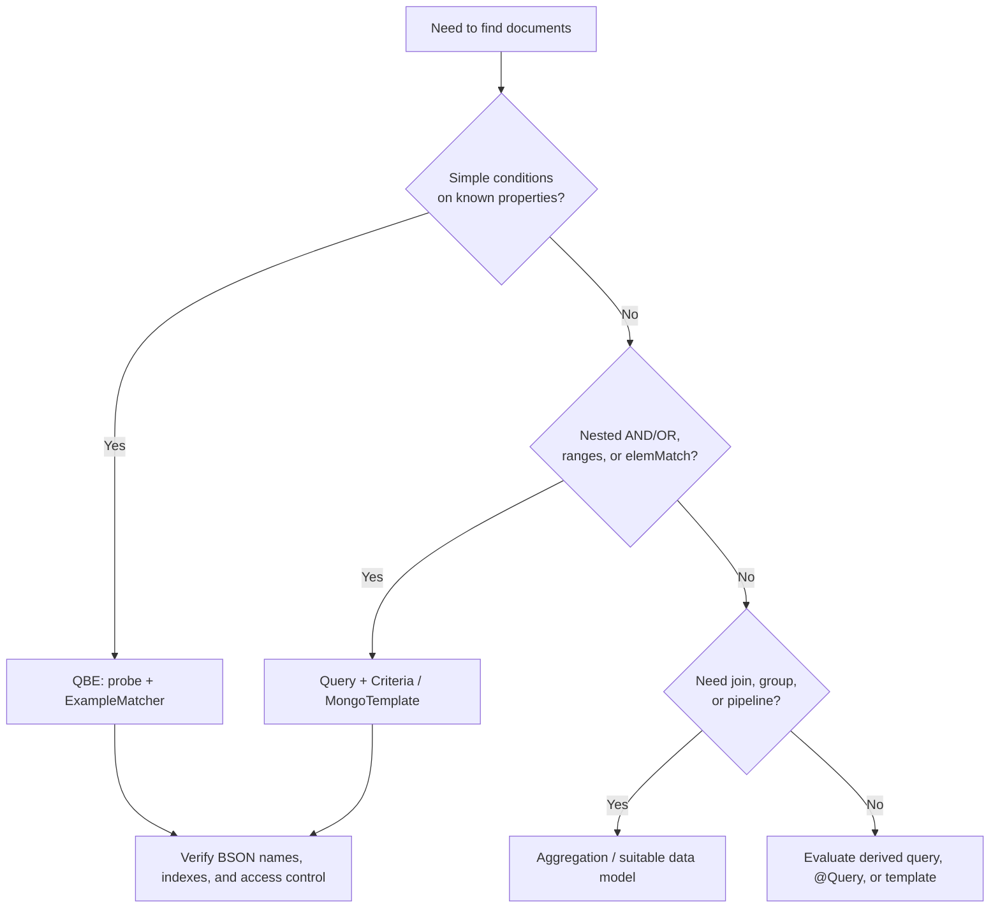

# Limitations with Condition Grouping, Arrays, and Embedded Documents

## 1. What Can Query by Example Do and Where Does It Stop?

**Query by Example (QBE)** in Spring Data MongoDB lets you construct a query from a **probe** (an entity instance with a few properties populated) and an **`ExampleMatcher`** (matching rules). Instead of writing repository method names for every filter, the application builds a sample object and calls `findAll(Example.of(probe, matcher))`.

For instance, an order screen needs documents with `status = "PAID"` belonging to `tenantId = "SHOP-A"`. QBE expresses this conveniently when conditions are **independent equality predicates with a relatively flat structure**. However, once the question becomes "orders for SHOP-A **and** (paid **or** total greater than 500,000)" or "has **the same line item** matching both SKU and minimum quantity", QBE is no longer suitable for expressing the full logic accurately.

Three core limitations covered in this lesson:

1. **Condition grouping:** QBE offers `matchingAll()` (global AND) and `matchingAny()` (global OR) but cannot express arbitrary boolean parentheses such as `A AND (B OR C)`.
2. **Arrays/collections/maps:** QBE does not fully support array element matching, `$elemMatch`, `$all`, `$size`, or map queries; never treat a probe with a `List` as a general array query.
3. **Embedded documents:** simple nested properties may work with compatible mapping, yet QBE does not replace `$elemMatch` for **arrays of embedded documents**, nor does it generate `$lookup` to query referenced collections.

Within **SPRING_DATA_MONGODB**, we will use both repositories and `MongoTemplate`, examine Java ↔ BSON property names, switch to `Query`/`Criteria` when grouping is needed, test against real MongoDB, and evaluate indexes.

### Quick Decision Flowchart



| Scenario | Is QBE Suitable? | Suggestion |
| --- | --- | --- |
| `tenantId = SHOP-A`, `status = PAID` | Yes | `matchingAll()` |
| `customerName` contains `"An"`, case-insensitive | Yes, with String matcher | `withStringMatcher(CONTAINING)`, `withIgnoreCase(...)` |
| `status = PAID OR status = CREATED` | Awkward for multiple values on the same field | `Criteria.where("status").in(...)` |
| `tenantId = SHOP-A AND (status = PAID OR totalMinor >= 500000)` | No | `andOperator(...)` + `orOperator(...)` |
| `lines` has an element `sku = BOOK-101` and `quantity >= 2` | No | `elemMatch(...)` |
| Embedded address with `city = "Hà Nội"` | Nested properties may work in supported cases; verify BSON | `Criteria.where("shippingAddress.city")` when explicitness is preferred |
| Reference to customer in another collection to filter by name | Does not auto-join | `$lookup` or different query/data model |

## 2. Running Example Data: Orders, Line-Item Arrays, and Embedded Addresses

Suppose a Spring Boot application has `spring-boot-starter-data-mongodb` and demo database `qbe_limits_demo`. The `orders` collection stores orders across multiple shops:

```javascript
use qbe_limits_demo

db.orders.insertMany([
  {
    _id: "ORD-001",
    tenant_id: "SHOP-A",
    status: "PAID",
    customer_name: "An",
    total_minor: NumberLong("350000"),
    created_at: ISODate("2026-11-01T08:00:00Z"),
    shipping_address: { city: "Hà Nội", district: "Ba Đình" },
    tags: ["gift", "online"],
    lines: [
      { sku: "BOOK-101", quantity: 1 },
      { sku: "PEN-201", quantity: 3 }
    ],
    attributes: { channel: "web" }
  },
  {
    _id: "ORD-002",
    tenant_id: "SHOP-A",
    status: "CREATED",
    customer_name: "Bình",
    total_minor: NumberLong("650000"),
    created_at: ISODate("2026-11-02T08:00:00Z"),
    shipping_address: { city: "Hồ Chí Minh", district: "Quận 1" },
    tags: ["priority"],
    lines: [{ sku: "BOOK-101", quantity: 3 }],
    attributes: { channel: "mobile" }
  },
  {
    _id: "ORD-003",
    tenant_id: "SHOP-B",
    status: "PAID",
    customer_name: "Chi",
    total_minor: NumberLong("900000"),
    created_at: ISODate("2026-11-03T08:00:00Z"),
    shipping_address: { city: "Hà Nội", district: "Đống Đa" },
    tags: ["priority"],
    lines: [{ sku: "BOOK-101", quantity: 5 }],
    attributes: { channel: "web" }
  },
  {
    _id: "ORD-004",
    tenant_id: "SHOP-A",
    status: "PAID",
    customer_name: "An Bình",
    total_minor: NumberLong("700000"),
    created_at: ISODate("2026-11-04T08:00:00Z"),
    shipping_address: { city: "Hà Nội", district: "Cầu Giấy" },
    tags: ["priority"],
    lines: [{ sku: "BOOK-101", quantity: 2 }],
    attributes: { channel: "web" }
  }
])
```

Run `insertMany` only on an **empty demo database**. Re-running with these `_id` values hits duplicate key errors. Illustrative local connection config:

```properties
spring.data.mongodb.uri=mongodb://localhost:27017/qbe_limits_demo
```

In these examples, IDs like `ORD-001` are **BSON Strings**. The entity uses `@MongoId(FieldType.STRING)` to keep identifier types consistent rather than inferring BSON ObjectId from strings.

### `OrderDocument` Entity

```java
package com.example.orders;

import java.time.Instant;
import java.util.List;
import java.util.Map;
import org.springframework.data.mongodb.core.mapping.Document;
import org.springframework.data.mongodb.core.mapping.Field;
import org.springframework.data.mongodb.core.mapping.FieldType;
import org.springframework.data.mongodb.core.mapping.MongoId;

@Document(collection = "orders")
public class OrderDocument {

    @MongoId(FieldType.STRING)
    private String id;

    @Field("tenant_id")
    private String tenantId;

    private String status;

    @Field("customer_name")
    private String customerName;

    @Field("total_minor")
    private Long totalMinor;

    @Field("created_at")
    private Instant createdAt;

    @Field("shipping_address")
    private ShippingAddress shippingAddress;

    private List<String> tags;
    private List<OrderLine> lines;
    private Map<String, String> attributes;

    public OrderDocument() {}

    public String getId() { return id; }
    public void setId(String id) { this.id = id; }

    public String getTenantId() { return tenantId; }
    public void setTenantId(String tenantId) { this.tenantId = tenantId; }

    public String getStatus() { return status; }
    public void setStatus(String status) { this.status = status; }

    public String getCustomerName() { return customerName; }
    public void setCustomerName(String customerName) {
        this.customerName = customerName;
    }

    public Long getTotalMinor() { return totalMinor; }
    public void setTotalMinor(Long totalMinor) {
        this.totalMinor = totalMinor;
    }

    public Instant getCreatedAt() { return createdAt; }
    public void setCreatedAt(Instant createdAt) {
        this.createdAt = createdAt;
    }

    public ShippingAddress getShippingAddress() {
        return shippingAddress;
    }
    public void setShippingAddress(ShippingAddress address) {
        this.shippingAddress = address;
    }

    public List<String> getTags() { return tags; }
    public void setTags(List<String> tags) { this.tags = tags; }

    public List<OrderLine> getLines() { return lines; }
    public void setLines(List<OrderLine> lines) { this.lines = lines; }

    public Map<String, String> getAttributes() { return attributes; }
    public void setAttributes(Map<String, String> attributes) {
        this.attributes = attributes;
    }

    public static class ShippingAddress {
        private String city;
        private String district;

        public ShippingAddress() {}
        public ShippingAddress(String city, String district) {
            this.city = city;
            this.district = district;
        }

        public String getCity() { return city; }
        public void setCity(String city) { this.city = city; }
        public String getDistrict() { return district; }
        public void setDistrict(String district) {
            this.district = district;
        }
    }

    public static class OrderLine {
        private String sku;
        private Integer quantity;

        public OrderLine() {}
        public OrderLine(String sku, Integer quantity) {
            this.sku = sku;
            this.quantity = quantity;
        }

        public String getSku() { return sku; }
        public void setSku(String sku) { this.sku = sku; }
        public Integer getQuantity() { return quantity; }
        public void setQuantity(Integer quantity) {
            this.quantity = quantity;
        }
    }
}
```

The entity uses wrapper types `Long`/`Integer` instead of primitives for optional properties. **This is a crucial decision for QBE**: primitive defaults like `0` or `false` can be treated as active filter values even when the user entered no filter. Collections and nested objects are also left `null` when the probe should not constrain them.

### Repository

```java
package com.example.orders;

import org.springframework.data.mongodb.repository.MongoRepository;

public interface OrderRepository
        extends MongoRepository<OrderDocument, String> {
}
```

`MongoRepository` supports QBE operations via the standard repository API. This lesson uses `findAll(Example)` to retrieve documents matching a probe; when MongoDB queries go beyond QBE, use `MongoTemplate`.

## 3. Basic QBE: Probe and `ExampleMatcher`

First requirement: find `PAID` orders for `SHOP-A`. We instantiate a probe setting only two properties:

```java
import org.springframework.data.domain.Example;
import org.springframework.data.domain.ExampleMatcher;

OrderDocument probe = new OrderDocument();
probe.setTenantId("SHOP-A");
probe.setStatus("PAID");

ExampleMatcher matcher = ExampleMatcher.matchingAll();
Example<OrderDocument> example = Example.of(probe, matcher);

Iterable<OrderDocument> orders = orderRepository.findAll(example);
```

Logically, the query corresponds to:

```javascript
db.orders.find({
  tenant_id: "SHOP-A",
  status: "PAID"
})
```

With the sample dataset, the matching IDs are `ORD-001` and `ORD-004`. **Do not assume any ordering** on results when no sort is specified. To assert result lists, compare sets of IDs rather than element positions.

### Defaults You Must Know

| Rule | Practical Meaning |
| --- | --- |
| Probe property `null` | Ignored by default, creates no condition |
| Primitive property | Always holds a Java default; can silently enter the filter |
| `matchingAll()` | Joins probe predicates with **AND** |
| `matchingAny()` | Joins probe predicates with **OR** |
| Default string matching | Typically exact, case-sensitive match unless configured |
| `withIgnorePaths(...)` | Excludes listed properties, even if set on the probe |
| `withIgnoreCase(...)` | Configures case-insensitive matching for selected String properties |
| `withStringMatcher(CONTAINING)` | Selects substring matching for Strings, **not full-text search** |

The following snippet ignores ID and creation timestamp while searching customer names containing `"an"` case-insensitively:

```java
OrderDocument nameProbe = new OrderDocument();
nameProbe.setTenantId("SHOP-A");
nameProbe.setCustomerName("an");

ExampleMatcher nameMatcher = ExampleMatcher.matchingAll()
    .withIgnorePaths("id", "createdAt", "lines", "tags", "attributes")
    .withIgnoreCase("customerName")
    .withStringMatcher(
        ExampleMatcher.StringMatcher.CONTAINING);

Example<OrderDocument> byName =
    Example.of(nameProbe, nameMatcher);

Iterable<OrderDocument> result = orderRepository.findAll(byName);
```

**Note:** `withStringMatcher(CONTAINING)` applies to all matched String properties, not just `customerName`; it can make `tenantId` match by substring instead of **exact equality**. Because `tenantId` is an authorization boundary, avoid relying on a global matcher like this. Later sections use explicit `Criteria` tenant filters or per-property matchers.

## 4. The Biggest Difference: `matchingAll` vs. `matchingAny`

QBE can switch how all properties are combined from AND to OR:

```java
OrderDocument probe = new OrderDocument();
probe.setTenantId("SHOP-A");
probe.setStatus("PAID");

Example<OrderDocument> all = Example.of(
    probe, ExampleMatcher.matchingAll());

Example<OrderDocument> any = Example.of(
    probe, ExampleMatcher.matchingAny());
```

Their logical meanings differ:

```text
matchingAll:
    tenantId == "SHOP-A" AND status == "PAID"

matchingAny:
    tenantId == "SHOP-A" OR status == "PAID"
```

With the sample data:

| Matcher | Matching IDs | Reason |
| --- | --- | --- |
| `matchingAll` | `ORD-001`, `ORD-004` | Both belong to SHOP-A and are paid |
| `matchingAny` | `ORD-001`, `ORD-002`, `ORD-003`, `ORD-004` | SHOP-B/ORD-003 also has `status = PAID` |

**Security warning:** if a multi-tenant API puts an authenticated `tenantId` on the probe and switches to `matchingAny()` to "loosen search criteria", the tenant condition becomes **one OR branch**, allowing documents from other tenants to be read whenever they match another property.

Even with `matchingAll()`, QBE **does not authenticate access permissions**. Tenant ID must originate from an authenticated context, and the actual query must be properly scoped. Never let users supply arbitrary probes or fields unchecked.

## 5. Condition-Grouping Limit: `A AND (B OR C)`

A common requirement is:

> Find only orders for SHOP-A where **status = PAID or totalMinor is at least 500,000**.

Desired expression:

\[
\text{tenant} = A \;\land\;
\bigl(\text{status} = PAID \;\lor\; \text{totalMinor} \ge 500000\bigr)
\]

`matchingAll()` only creates AND across probe properties; it cannot nest an OR branch inside. `matchingAny()` creates OR across all evaluated properties and pulls `tenantId` into the OR group, failing to preserve the **mandatory tenant** constraint.

You cannot fix this by reordering setters on the probe, because QBE has no arbitrary parenthesized logic tree. Use `Query` and `Criteria`:

```java
import java.util.List;
import org.springframework.data.mongodb.core.query.Criteria;
import org.springframework.data.mongodb.core.query.Query;

Criteria tenant = Criteria.where("tenantId").is("SHOP-A");

Criteria businessOptions = new Criteria().orOperator(
    Criteria.where("status").is("PAID"),
    Criteria.where("totalMinor").gte(500_000L)
);

Query query = Query.query(
    new Criteria().andOperator(tenant, businessOptions)
);

List<OrderDocument> found =
    mongoTemplate.find(query, OrderDocument.class);
```

MongoDB receives the equivalent filter:

```javascript
db.orders.find({
  $and: [
    { tenant_id: "SHOP-A" },
    {
      $or: [
        { status: "PAID" },
        { total_minor: { $gte: NumberLong("500000") } }
      ]
    }
  ]
})
```

With the demo data, `ORD-001`, `ORD-002`, and `ORD-004` match; `ORD-003` is excluded because it belongs to `SHOP-B`, even though it is paid and high-value.

### What About Two Independent OR Groups?

Suppose the rule is more complex:

> SHOP-A and [(`PAID` with total at least 600,000) or (`CREATED` and customer name starts with `"B"`)].

Then express the exact logic tree:

```java
Criteria paidHighValue = new Criteria().andOperator(
    Criteria.where("status").is("PAID"),
    Criteria.where("totalMinor").gte(600_000L)
);

Criteria createdForCustomerB = new Criteria().andOperator(
    Criteria.where("status").is("CREATED"),
    Criteria.where("customerName").regex("^B")
);

Criteria scoped = new Criteria().andOperator(
    Criteria.where("tenantId").is("SHOP-A"),
    new Criteria().orOperator(
        paidHighValue, createdForCustomerB)
);

List<OrderDocument> matching =
    mongoTemplate.find(Query.query(scoped), OrderDocument.class);
```

With the demo data, results are `ORD-002` and `ORD-004`. Using `regex("^B")` only illustrates prefix matching and does not replace full-text search. If prefixes come from users, bound inputs and escape regex characters when literal matching is intended.

### When You Only Need Multiple Values for the Same Field

For `status = PAID OR status = CREATED`, you do not necessarily need `orOperator`:

```java
Query query = Query.query(
    Criteria.where("tenantId").is("SHOP-A")
        .and("status").in("PAID", "CREATED")
);
```

`$in` expresses a value set on **one field**, which is cleaner and easier to manage than building numerous OR branches. QBE does not directly support "field matches one of several values" by stuffing a `List` into a String property on a probe.

### QBE Does Not Support Range Comparisons

A probe setting `totalMinor = 500000L` expresses matching that **exact numeric value**, not "greater than or equal to". QBE has no equivalents for `gte`, `lt`, or `between` on numeric or timestamp fields:

```java
Query inRange = Query.query(
    Criteria.where("tenantId").is("SHOP-A")
        .and("totalMinor").gte(500_000L).lt(800_000L)
);
```

For `createdAt`, date ranges should use `Instant` with clear inclusive/exclusive bounds such as `gte(start).lt(endExclusive)`. `ExampleMatcher` cannot convert a date on a probe into a range query.

## 6. Arrays of Scalar Values: QBE Is Not `$all`, `$size`, or `$in`

`OrderDocument` has `List<String> tags`. Many beginners assume:

```java
OrderDocument probe = new OrderDocument();
probe.setTags(List.of("priority"));
Example<OrderDocument> example = Example.of(probe);
```

will always be equivalent to `{ tags: "priority" }` or `{ tags: { $in: ["priority"] } }`. **Never rely on that assumption.** QBE has limitations for collection/map matching; there is no universal contract for expressing full array operators merely by putting a List in a probe.

Use `Criteria` whenever the question genuinely concerns array elements.

### Finding an Array Containing One Value

```java
Query priorityForTenant = Query.query(
    Criteria.where("tenantId").is("SHOP-A")
        .and("tags").is("priority")
);
```

In `mongosh`:

```javascript
db.orders.find({
  tenant_id: "SHOP-A",
  tags: "priority"
})
```

MongoDB matches documents where the `tags` array contains the String element `"priority"`. With the demo data, `ORD-002` and `ORD-004` match.

### Array Must Contain All Tags

```java
Query allTags = Query.query(
    Criteria.where("tenantId").is("SHOP-A")
        .and("tags").all("gift", "online")
);
```

Equivalent to:

```javascript
db.orders.find({
  tenant_id: "SHOP-A",
  tags: { $all: ["gift", "online"] }
})
```

`ORD-001` matches because it contains both tags. `$all` does not require the elements to appear in that order inside the array.

### Element Count Condition

```java
Query twoTags = Query.query(
    Criteria.where("tenantId").is("SHOP-A")
        .and("tags").size(2)
);
```

With the demo data, `ORD-001` has two tags. `$size`, `$all`, and `$elemMatch` each have distinct semantics; none can be expressed by switching `matchingAll()` to `matchingAny()`.

## 7. Arrays of Embedded Documents: Why Must You Use `$elemMatch`?

The easiest pitfall involves documents containing multiple object elements in the `lines` array:

```javascript
{
  _id: "ORD-001",
  lines: [
    { sku: "BOOK-101", quantity: 1 },
    { sku: "PEN-201", quantity: 3 }
  ]
}
```

Requirement: "Within **one line item**, `sku` must be `BOOK-101` **and** `quantity >= 2`."

### Wrong Intent: Two Independent Dot-Path Conditions

```javascript
db.orders.find({
  "lines.sku": "BOOK-101",
  "lines.quantity": { $gte: 2 }
})
```

On `ORD-001`, that expression still matches:

- `lines.sku = BOOK-101` matches the **first element**;
- `lines.quantity >= 2` matches the **second element** (`PEN-201` has quantity 3).

Because the conditions are not forced onto the same element, this query answers the wrong business question.

### Right Intent: `$elemMatch`

```java
Criteria lineCondition = Criteria.where("sku").is("BOOK-101")
    .and("quantity").gte(2);

Query query = Query.query(
    Criteria.where("tenantId").is("SHOP-A")
        .and("lines").elemMatch(lineCondition)
);

List<OrderDocument> matching =
    mongoTemplate.find(query, OrderDocument.class);
```

MongoDB equivalent:

```javascript
db.orders.find({
  tenant_id: "SHOP-A",
  lines: {
    $elemMatch: {
      sku: "BOOK-101",
      quantity: { $gte: 2 }
    }
  }
})
```

With the sample data, `ORD-002` and `ORD-004` match; `ORD-001` is excluded because `BOOK-101` only has quantity 1. `ORD-003` also has a qualifying line item, but belongs to `SHOP-B` and is excluded.

**Core takeaway:** `$elemMatch` constrains conditions to **the same array element**. Placing an `OrderLine` inside a QBE probe does not magically turn into `$elemMatch`, and `matchingAll()` does not change this rule.

### Conditions Across Different Elements

If business rules ask for "at least one BOOK-101 line and at least one PEN-201 line", that is a different problem from "one line matching both conditions". You can use:

```javascript
db.orders.find({
  tenant_id: "SHOP-A",
  "lines.sku": { $all: ["BOOK-101", "PEN-201"] }
})
```

This query fits when checking **which SKU values appear anywhere in the array**. `ORD-001` matches even though the two SKUs sit on different elements. When multiple conditions apply to a single line, use `$elemMatch`; when checking presence of multiple values across elements, use the corresponding array query operator.

## 8. Embedded Documents: Nested Properties Differ from Object Arrays

In `OrderDocument`, `shippingAddress` is **one embedded object**, not a `List` and not a document in another collection:

```javascript
shipping_address: {
  city: "Hà Nội",
  district: "Ba Đình"
}
```

To ask "orders from SHOP-A shipping to Hà Nội", write a path-based query:

```java
Query inHanoi = Query.query(
    Criteria.where("tenantId").is("SHOP-A")
        .and("shippingAddress.city").is("Hà Nội")
);

List<OrderDocument> found =
    mongoTemplate.find(inHanoi, OrderDocument.class);
```

With entity mapping metadata, `shippingAddress.city` maps to `shipping_address.city`. In `mongosh`:

```javascript
db.orders.find({
  tenant_id: "SHOP-A",
  "shipping_address.city": "Hà Nội"
})
```

Demo results are `ORD-001` and `ORD-004`. Dot-notation targets the child field `city` directly, **without requiring the address document to have all fields in an exact order**.

### What About QBE with a Nested Object?

We can try constructing a probe with a nested object:

```java
OrderDocument probe = new OrderDocument();
probe.setTenantId("SHOP-A");
probe.setShippingAddress(
    new OrderDocument.ShippingAddress("Hà Nội", null));

Example<OrderDocument> example = Example.of(
    probe,
    ExampleMatcher.matchingAll()
        .withIgnorePaths("shippingAddress.district")
);

Iterable<OrderDocument> results =
    orderRepository.findAll(example);
```

**Do not assume every QBE/MongoDB configuration produces the exact dot-path query you expect from a nested object.** How nested properties map, how `null`/empty objects behave, and how optimizable the query is depend on mapping metadata and framework version. Test the actual BSON/command generated; when you need an explicit query on `shipping_address.city` or to combine with logical groups, `Criteria.where("shippingAddress.city")` is far easier to control.

Another issue is **whole embedded-document equality**:

```javascript
// Matches the entire BSON subdocument, not equivalent to dot-path city.
db.orders.find({
  shipping_address: {
    city: "Hà Nội",
    district: "Ba Đình"
  }
})
```

Comparing an entire BSON subdocument can be sensitive to **structure and field order**. Therefore, if you only care about `city`, query by **child field path** rather than constructing an object and assuming "partial object matching".

### Arrays of Embedded Documents Differ from a Single Embedded Document

| Structure | Question | Tool |
| --- | --- | --- |
| `shipping_address: { city, district }` | Does address have city = Hà Nội? | Dot path `shipping_address.city` |
| `lines: [{ sku, quantity }, ...]` | Does **one element** have SKU X, quantity ≥ 2? | `$elemMatch` |
| `tags: ["gift", "online"]` | Has tag `gift`? | Array equality or `$in` |
| `attributes: { channel: "web" }` | Does map have key channel = web? | Dot path `attributes.channel` when schema/key is valid |
| `customer_id` referencing another collection | Is customer name = An? | Multi-step query or `$lookup` |

## 9. Maps and Dynamic Field Names: Why QBE Is Not a JSON Query Builder

The `attributes` property has type `Map<String, String>` and is stored in BSON as:

```javascript
attributes: { channel: "web" }
```

To find SHOP-A orders with `attributes.channel = "web"`, you can write:

```java
Query webOrders = Query.query(
    Criteria.where("tenantId").is("SHOP-A")
        .and("attributes.channel").is("web")
);
```

This directly queries a **known schema path**. Never write:

```java
OrderDocument probe = new OrderDocument();
probe.setAttributes(Map.of("channel", "web"));
// Never assume QBE emits the exact dot-path query.
```

QBE does not generally support map-matching patterns. Moreover, letting clients send arbitrary map keys and concatenating into `Criteria.where("attributes." + userKey)` risks failures from special characters, invalid paths, or querying unintended internal attributes. Always use an allowlist of permitted keys, such as only `channel` and `source`.

If business rules require searching arbitrary keys in a dynamic map, evaluate **document schema, indexes, selectivity, and query risks** before exposing the API. A map holding hundreds of arbitrary attributes is rarely suitable as an application's primary search axis.

### `null` vs. Missing Fields in Embedded Objects

These three documents are not equivalent:

```javascript
{ shipping_address: { city: null } }
{ shipping_address: { district: "Ba Đình" } }
{ shipping_address: null }
```

By default, QBE **ignores probe properties with null values**. Thus, `new ShippingAddress(null, "Ba Đình")` does not mean "`city` must be null". Enabling `withIncludeNullValues()` also requires checking MongoDB semantics: `field: null` equality can match both fields storing `null` and non-existent fields.

If business logic must distinguish **missing field**, **present-but-null field**, and **populated value**, design explicit MongoDB queries using `$exists`, `$type`, or corresponding criteria groups, and test against real BSON data. Never use a single null probe to represent all three meanings.

## 10. String Matching: Use Per-Property Matchers

In section 3, calling global `withStringMatcher(CONTAINING)` could accidentally turn the `tenantId` filter into a contains search. That is a dangerous bug when tenant is a data isolation boundary.

A stricter approach is specifying matchers **per property**:

```java
OrderDocument probe = new OrderDocument();
probe.setTenantId("SHOP-A");
probe.setCustomerName("an");

ExampleMatcher matcher = ExampleMatcher.matchingAll()
    .withMatcher(
        "tenantId",
        ExampleMatcher.GenericPropertyMatchers.exact()
    )
    .withMatcher(
        "customerName",
        ExampleMatcher.GenericPropertyMatchers.contains().ignoreCase()
    );

Example<OrderDocument> example = Example.of(probe, matcher);

Iterable<OrderDocument> found =
    orderRepository.findAll(example);
```

With the sample data, `"An"` and `"An Bình"` contain `"an"` case-insensitively; the documents authorized under `tenantId` are `ORD-001` and `ORD-004`.

Even an exact matcher on tenant does not replace authorization, however. The snippet above is **only valid when `"SHOP-A"` comes from a trusted context**. If the caller supplies `tenantId` without an authorization check, QBE can still query a tenant the caller is forbidden to access.

### Why Can `CONTAINING` String Searches Be Slow?

In MongoDB, contains/ignore-case string matching may be implemented via regex or a matching framework mechanism. Never assume a regular B-tree index on `customer_name` will accelerate every "contains arbitrary substring" query. Unanchored regexes without fixed prefixes combined with case-insensitivity rarely use standard indexes well.

When searching product/customer names by natural keywords, consider full-text search or an appropriate search solution rather than running QBE contains across millions of documents. When looking up by ID or enum, exact matching is clearer and usually far faster.

## 11. Service Design: Use QBE When Simple, Criteria When Complex

A real-world API should **accept strongly typed filters** rather than taking an entire `OrderDocument` entity from the request and letting every property participate in QBE. Entities contain fields that must not be user-searchable, such as `tenantId`, technical IDs, or internal properties.

We separate two query paths:

- **QBE path:** exact `status` and substring customer name, with tenant always applied via AND.
- **Criteria path:** when minimum order total, city, line-item conditions, or OR groups are present, build an explicit MongoDB query.

### Input Filter

```java
package com.example.orders;

public record OrderSearchRequest(
    String status,
    String customerNameFragment,
    Long minTotalMinor,
    String shippingCity,
    String sku,
    Integer minQuantity,
    int limit
) {}
```

### QBE Path for Simple Criteria

```java
package com.example.orders;

import java.util.List;
import java.util.stream.StreamSupport;
import org.springframework.data.domain.Example;
import org.springframework.data.domain.ExampleMatcher;
import org.springframework.stereotype.Service;

@Service
public class SimpleOrderSearch {

    private final OrderRepository orders;

    public SimpleOrderSearch(OrderRepository orders) {
        this.orders = orders;
    }

    public List<OrderDocument> findSimple(
            String authorizedTenantId,
            String status,
            String customerNameFragment) {

        if (authorizedTenantId == null
                || authorizedTenantId.isBlank()) {
            throw new IllegalArgumentException("Invalid tenant");
        }

        OrderDocument probe = new OrderDocument();
        probe.setTenantId(authorizedTenantId);

        if (status != null && !status.isBlank()) {
            if (!List.of("PAID", "CREATED", "CANCELLED")
                    .contains(status)) {
                throw new IllegalArgumentException(
                    "Unsupported status");
            }
            probe.setStatus(status);
        }

        if (customerNameFragment != null
                && !customerNameFragment.isBlank()) {
            probe.setCustomerName(customerNameFragment);
        }

        ExampleMatcher matcher = ExampleMatcher.matchingAll()
            .withMatcher(
                "tenantId",
                ExampleMatcher.GenericPropertyMatchers.exact())
            .withMatcher(
                "status",
                ExampleMatcher.GenericPropertyMatchers.exact())
            .withMatcher(
                "customerName",
                ExampleMatcher.GenericPropertyMatchers
                    .contains().ignoreCase());

        Iterable<OrderDocument> result = orders.findAll(
            Example.of(probe, matcher));

        return StreamSupport.stream(result.spliterator(), false)
            .toList();
    }
}
```

This service may fit **small, controlled datasets**, yet it does not apply `Pageable` or a result cap. On large datasets, never call `findAll(example)` followed by `stream().limit(20)`, because the query may already load huge numbers of documents before Java truncates them. Use `findAll(example, Pageable)` or a MongoDB-side `limit` when paging is required.

Example:

```java
import org.springframework.data.domain.Page;
import org.springframework.data.domain.PageRequest;
import org.springframework.data.domain.Sort;

Page<OrderDocument> page = orderRepository.findAll(
    example,
    PageRequest.of(
        0, 20,
        Sort.by(
            Sort.Order.desc("createdAt"),
            Sort.Order.desc("id")
        )
    )
);
```

Here `example` is an already constructed `Example<OrderDocument>`. `Page` may run an extra count operation to provide total results; if totals are unnecessary, evaluate a suitable API/return type in your Spring Data version. Using ID as a secondary sort key resolves ties when documents share `createdAt`, though it **does not create a snapshot** across pages when new data arrives.

### Criteria Path for Complex Filters

```java
package com.example.orders;

import java.util.ArrayList;
import java.util.List;
import org.springframework.data.domain.Sort;
import org.springframework.data.mongodb.core.MongoTemplate;
import org.springframework.data.mongodb.core.query.Criteria;
import org.springframework.data.mongodb.core.query.Query;
import org.springframework.stereotype.Service;

@Service
public class AdvancedOrderSearch {

    private final MongoTemplate template;

    public AdvancedOrderSearch(MongoTemplate template) {
        this.template = template;
    }

    public List<OrderDocument> find(
            String authorizedTenantId,
            OrderSearchRequest filter) {
        if (authorizedTenantId == null
                || authorizedTenantId.isBlank()
                || filter == null
                || filter.limit() < 1 || filter.limit() > 100) {
            throw new IllegalArgumentException("Invalid filter");
        }

        if (filter.minTotalMinor() != null
                && filter.minTotalMinor() < 0) {
            throw new IllegalArgumentException("Negative total amount");
        }
        if (filter.minQuantity() != null
                && (filter.minQuantity() < 1
                    || filter.sku() == null
                    || filter.sku().isBlank())) {
            throw new IllegalArgumentException(
                "Invalid line-item condition");
        }

        List<Criteria> conditions = new ArrayList<>();
        conditions.add(
            Criteria.where("tenantId").is(authorizedTenantId));

        if (filter.status() != null
                && !filter.status().isBlank()) {
            if (!List.of("PAID", "CREATED", "CANCELLED")
                    .contains(filter.status())) {
                throw new IllegalArgumentException(
                    "Unsupported status");
            }
            conditions.add(
                Criteria.where("status").is(filter.status()));
        }

        if (filter.customerNameFragment() != null
                && !filter.customerNameFragment().isBlank()) {
            String literal = java.util.regex.Pattern.quote(
                filter.customerNameFragment());
            conditions.add(Criteria.where("customerName")
                .regex(literal, "i"));
        }

        if (filter.minTotalMinor() != null) {
            conditions.add(
                Criteria.where("totalMinor")
                    .gte(filter.minTotalMinor()));
        }

        if (filter.shippingCity() != null
                && !filter.shippingCity().isBlank()) {
            conditions.add(
                Criteria.where("shippingAddress.city")
                    .is(filter.shippingCity()));
        }

        if (filter.sku() != null && !filter.sku().isBlank()) {
            Criteria line = Criteria.where("sku")
                .is(filter.sku());
            if (filter.minQuantity() != null) {
                line.and("quantity").gte(filter.minQuantity());
            }
            conditions.add(
                Criteria.where("lines").elemMatch(line));
        }

        Criteria combined = new Criteria().andOperator(
            conditions.toArray(new Criteria[0]));

        Query query = Query.query(combined);
        query.with(Sort.by(
            Sort.Order.desc("createdAt"),
            Sort.Order.desc("id")
        ));
        query.limit(filter.limit());

        return template.find(query, OrderDocument.class);
    }
}
```

Notable points:

1. `tenantId` always stays outside optional conditions, never turning into an OR branch.
2. `status` is validated against an allowlist rather than letting clients construct operators.
3. `totalMinor` supports `gte` comparisons that QBE cannot express.
4. `shippingAddress.city` is a nested property path mapped to BSON.
5. `lines` uses `elemMatch` to enforce conditions on the same element.
6. Regex uses `Pattern.quote` to treat input as a **literal string**, preventing user special characters from turning into regex operators.
7. Sort and limit are pushed down to MongoDB rather than loading everything into Java first.

This sample service does not yet enforce per-string length limits, rate limits, or a full-text search strategy. Add those constraints according to real load and data policies. For complex `$or` groups, use the same `Criteria` builder with explicit `orOperator` groups instead of trying to force it into QBE.

## 12. Repository Queries and Indexes: QBE Does Not Optimize MongoDB Automatically

Switching from `findByStatus(...)` to `findAll(Example)` does not automatically create indexes or speed up queries. MongoDB still has to locate documents matching the filter; cost depends on **BSON fields**, selectivity, document count, sorting, and payload size.

### Candidate Index for Tenant/Status Search

An API often filters by `tenant_id` and `status`, ordered newest first. Candidate index:

```javascript
db.orders.createIndex(
  {
    tenant_id: 1,
    status: 1,
    created_at: -1,
    _id: -1
  },
  { name: "orders_tenant_status_created_id" }
)
```

In the repository, predicates can use probe fields `tenantId`/`status`; when creating indexes in `mongosh`, you must use **BSON field names** `tenant_id`, `created_at`, and `_id`. Creating an index on the Java name `createdAt` will not help documents stored with `created_at` as expected.

### Index for Embedded Fields

If querying by shipping city is a key access pattern:

```javascript
db.orders.createIndex(
  { tenant_id: 1, "shipping_address.city": 1 },
  { name: "orders_tenant_city" }
)
```

If frequently searching SKUs inside the `lines` array:

```javascript
db.orders.createIndex(
  { tenant_id: 1, "lines.sku": 1 },
  { name: "orders_tenant_lines_sku" }
)
```

An index on `lines.sku` is a **multikey index** because `lines` is an array. When queries also specify `quantity >= 2` inside `$elemMatch`, evaluate a compound multikey index against MongoDB's index-bounds rules. Do not create excessive single-field indexes just because QBE or Criteria can filter on them: indexes consume memory, storage, and add write overhead.

### `explain("executionStats")` for Equivalent Queries

```javascript
db.orders.find({
  tenant_id: "SHOP-A",
  status: "PAID"
})
.sort({ created_at: -1, _id: -1 })
.limit(20)
.explain("executionStats")
```

| Metric | Question to Answer |
| --- | --- |
| `winningPlan` | Which plan did the query planner pick? |
| `IXSCAN`/`COLLSCAN` | Did it use an index or scan the collection? |
| `totalKeysExamined` | How many index keys were scanned? |
| `totalDocsExamined` | How many documents had to be read? |
| `nReturned` | How many documents were returned after filter/limit? |
| `SORT` | Was a separate in-memory sort step required? |
| `executionTimeMillis` | How long did this execution take? |

If QBE uses `CONTAINING`/ignore-case matchers, inspect the real BSON query and evaluate indexes across representative keywords. Never take `explain` of an **exact equality** query and extrapolate its cost to a **contains regex** query. Capture actual commands via command monitoring/logging in a test environment when verifying QBE filter generation.

Even a great index on `tenant_id/status` will not save an API that loads millions of matches via `findAll(example)`. Always keep filters selective, enforce `Pageable`/limits, and track p95/p99 latency in production.

## 13. Integration Testing: Prove Semantics Rather Than Assuming

Because QBE depends on **mapping metadata and Spring Data version behavior**, its limitations should be tested against **real MongoDB**, not just mocked repositories. Below is a `@DataMongoTest` example with directly inserted BSON fixtures.

**Warning:** `deleteMany(new Document())` deletes every document in the connected collection. Run only on an **isolated test database**, never on production or shared databases.

```java
package com.example.orders;

import java.time.Instant;
import java.util.Date;
import java.util.List;
import org.bson.Document;
import org.junit.jupiter.api.BeforeEach;
import org.junit.jupiter.api.Test;
import org.springframework.beans.factory.annotation.Autowired;
import org.springframework.boot.test.autoconfigure.data.mongo.DataMongoTest;
import org.springframework.data.domain.Example;
import org.springframework.data.domain.ExampleMatcher;
import org.springframework.data.mongodb.core.MongoTemplate;
import org.springframework.data.mongodb.core.query.Criteria;
import org.springframework.data.mongodb.core.query.Query;

import static org.assertj.core.api.Assertions.assertThat;

@DataMongoTest
class OrderQueryByExampleTest {

    @Autowired
    OrderRepository orders;

    @Autowired
    MongoTemplate template;

    @BeforeEach
    void seedIsolatedTestDatabase() {
        // Never run on a database with real data.
        template.getCollection("orders")
            .deleteMany(new Document());

        Date at = Date.from(
            Instant.parse("2026-11-01T08:00:00Z"));

        template.getCollection("orders").insertMany(List.of(
            new Document("_id", "ORD-001")
                .append("tenant_id", "SHOP-A")
                .append("status", "PAID")
                .append("customer_name", "An")
                .append("total_minor", 350_000L)
                .append("created_at", at)
                .append("shipping_address",
                    new Document("city", "Hà Nội")
                        .append("district", "Ba Đình"))
                .append("tags", List.of("gift", "online"))
                .append("lines", List.of(
                    new Document("sku", "BOOK-101")
                        .append("quantity", 1),
                    new Document("sku", "PEN-201")
                        .append("quantity", 3)))
                .append("attributes",
                    new Document("channel", "web")),

            new Document("_id", "ORD-002")
                .append("tenant_id", "SHOP-A")
                .append("status", "CREATED")
                .append("customer_name", "Bình")
                .append("total_minor", 650_000L)
                .append("created_at", at)
                .append("shipping_address",
                    new Document("city", "Hồ Chí Minh"))
                .append("tags", List.of("priority"))
                .append("lines", List.of(
                    new Document("sku", "BOOK-101")
                        .append("quantity", 3))),

            new Document("_id", "ORD-003")
                .append("tenant_id", "SHOP-B")
                .append("status", "PAID")
                .append("customer_name", "Chi")
                .append("total_minor", 900_000L)
                .append("created_at", at)
                .append("shipping_address",
                    new Document("city", "Hà Nội"))
                .append("tags", List.of("priority"))
                .append("lines", List.of(
                    new Document("sku", "BOOK-101")
                        .append("quantity", 5))),

            new Document("_id", "ORD-004")
                .append("tenant_id", "SHOP-A")
                .append("status", "PAID")
                .append("customer_name", "An Bình")
                .append("total_minor", 700_000L)
                .append("created_at", at)
                .append("shipping_address",
                    new Document("city", "Hà Nội"))
                .append("tags", List.of("priority"))
                .append("lines", List.of(
                    new Document("sku", "BOOK-101")
                        .append("quantity", 2)))
        ));
    }

    @Test
    void matchingAllRequiresBothTenantAndStatus() {
        OrderDocument probe = new OrderDocument();
        probe.setTenantId("SHOP-A");
        probe.setStatus("PAID");

        Example<OrderDocument> example =
            Example.of(probe, ExampleMatcher.matchingAll());

        assertThat(orders.findAll(example))
            .extracting(OrderDocument::getId)
            .containsExactlyInAnyOrder("ORD-001", "ORD-004");
    }

    @Test
    void matchingAnyCanIncludeAnotherTenant() {
        OrderDocument probe = new OrderDocument();
        probe.setTenantId("SHOP-A");
        probe.setStatus("PAID");

        Example<OrderDocument> example =
            Example.of(probe, ExampleMatcher.matchingAny());

        // Illustrates why matchingAny must never enforce tenant boundaries.
        assertThat(orders.findAll(example))
            .extracting(OrderDocument::getId)
            .contains("ORD-003");
    }

    @Test
    void elemMatchRequiresConditionsOnSameArrayElement() {
        Query query = Query.query(
            Criteria.where("tenantId").is("SHOP-A")
                .and("lines").elemMatch(
                    Criteria.where("sku").is("BOOK-101")
                        .and("quantity").gte(2))
        );

        assertThat(template.find(query, OrderDocument.class))
            .extracting(OrderDocument::getId)
            .containsExactlyInAnyOrder("ORD-002", "ORD-004");
    }

    @Test
    void nestedDotPathUsesMappedBsonName() {
        Query query = Query.query(
            Criteria.where("tenantId").is("SHOP-A")
                .and("shippingAddress.city").is("Hà Nội")
        );

        assertThat(template.find(query, OrderDocument.class))
            .extracting(OrderDocument::getId)
            .containsExactlyInAnyOrder("ORD-001", "ORD-004");
    }
}
```

The test above **proves the query logic for those stated conditions**, without claiming every nested QBE probe produces the exact dot-path you expect. To verify the nested probe from section 8 precisely, add a dedicated test for it and inspect the generated MongoDB command on your **actual project version**. If behavior falls short, switch to `Criteria`.

Additional tests to include during implementation:

- Null properties and primitive defaults: confirm the probe uses only intended fields.
- `withIncludeNullValues()`: distinguish missing vs. null fields via fixtures.
- Nested probe with multiple fields: verify whether it queries `shipping_address.city` or performs full-object equality.
- Array with two elements matching separate conditions: prove `elemMatch` prevents false positives.
- Maps with missing keys, dots, or unexpected path interpretations.
- Queries with contains/ignore-case matchers and indexes on large datasets.
- All multi-tenant filters must exclude documents from other tenants.

## 14. Reactive QBE Preserves the Same Limitations

When using `ReactiveMongoRepository`, QBE queries can return a `Flux<OrderDocument>` stream:

```java
package com.example.orders;

import org.springframework.data.mongodb.repository.ReactiveMongoRepository;

public interface ReactiveOrderRepository
        extends ReactiveMongoRepository<OrderDocument, String> {
}
```

```java
import org.springframework.data.domain.Example;
import reactor.core.publisher.Flux;

OrderDocument probe = new OrderDocument();
probe.setTenantId("SHOP-A");
probe.setStatus("PAID");

Flux<OrderDocument> orders =
    reactiveOrderRepository.findAll(Example.of(probe));
```

The publisher executes on subscription; using `Flux` does not turn QBE into `$elemMatch` expressions or nested AND/OR groups. For complex MongoDB conditions in reactive apps, use `ReactiveMongoTemplate.find(Query, Class)` with appropriate `Criteria`.

Never write `findAll(example).collectList()` on an unbounded result set just because reactive APIs compose streams. Apply limits or pagination at **MongoDB**, while keeping tenant filters and authorization rules intact. Reactive execution does not fix an OR matcher that leaks across tenants either.

## 15. Common Errors and Troubleshooting

| Symptom | Common Cause | Resolution |
| --- | --- | --- |
| QBE misses documents that `mongosh` finds | Wrong property name, `@Field`/BSON mapping, `_id` type, or String matcher | Check entity, real BSON, case sensitivity, and generated query |
| Probe returns fewer results than expected | Primitive `0`/`false` silently became a condition, or non-null nested object | Use nullable wrappers; build probe with only filtered fields |
| Null filtering does not behave as expected | Probe nulls are ignored by default | Use explicit queries when distinguishing null vs. missing |
| QBE with `matchingAny()` returns SHOP-B orders | Tenant condition was ORed alongside status | Never use global OR on scoped filters; use `tenant AND (A OR B)` via Criteria |
| Cannot express `(A AND B) OR (C AND D)` | QBE does not support arbitrary boolean parentheses | Use `andOperator`/`orOperator` |
| Setting `totalMinor = 500000` fails to match higher prices | QBE performs exact numeric matching, not `gte` | Use `Criteria.gte(...)` |
| Probe `tags = ["priority"]` behaves unexpectedly | QBE lacks a collection-matching contract like `$in`/`$all` | Write `Criteria.where("tags").is(...)` or `all(...)` |
| Array query matches order with SKU on one line and quantity on another | Independent dot-path conditions matched separate elements | Use `$elemMatch` |
| Nested probe does not equal desired dot path | Nested mapping and object equality differ from child-field queries | Inspect actual commands or use `Criteria.where("shippingAddress.city")` |
| String contains search is very slow | Matcher generates index-unfriendly patterns/regex | Use exact/prefix when appropriate, evaluate search/indexes |
| API returns the entire collection | No properties evaluated or missing limit/page | Always enforce scoping, validate filters, and paginate |
| Map fields are not queried properly | QBE lacks general map-matching support | Use controlled dot paths and validate keys/fields |
| Read customers from another tenant | Assumed projection/QBE handles authorization | Enforce scope from authenticated context; test multi-tenant |
| `findOne(example)` fails with too-many-results | Conditions not unique enough; multiple documents match | Use `findAll`/Page or increase selectivity; never assume uniqueness |
| Query is accurate yet slow at scale | Missing indexes, broad matcher, unsupported sort, or huge payload | Check `explain` and metrics on representative data |

### What to Inspect When Debugging?

Do not merely print the probe with `toString()` and assume MongoDB receives those exact conditions. Spring Data still processes `ExampleMatcher`, entity metadata, and converters. When investigating:

1. Verify actual MongoDB URI, database, and collection.
2. Check BSON names (`tenant_id`, `shipping_address.city`, `lines`) and types (`String`, BSON Date, Long).
3. Inspect `matchingAll`/`matchingAny`, String matchers, and ignore paths.
4. Observe MongoDB commands in a **test environment**, never enabling logs that leak sensitive data.
5. Write an equivalent query in `mongosh` to verify logic.
6. Run `explain("executionStats")` with real filters/sorts to inspect indexes, examined documents, and latency.

## 16. Practice Exercises and Answers

### Exercise 1. AND and OR in QBE

A probe has `tenantId = SHOP-A` and `status = PAID`. **Question:** how do `matchingAll()` and `matchingAny()` differ?

**Answer:** `matchingAll()` requires both fields to match, equivalent to `tenant = A AND status = PAID`. `matchingAny()` allows either field to match, equivalent to `tenant = A OR status = PAID`, which can return orders from other tenants.

### Exercise 2. Condition Grouping

Requirement: `tenant = SHOP-A AND (status = PAID OR totalMinor >= 500000)`. **Question:** can a single probe with `matchingAny()` handle this?

**Answer:** No. QBE cannot build arbitrary parenthesized trees. Use `new Criteria().andOperator(Criteria.where("tenantId").is("SHOP-A"), new Criteria().orOperator(...))`.

### Exercise 3. Single Value or Value Range?

A probe sets `totalMinor = 500000L`. **Question:** is that equivalent to `total_minor: { $gte: 500000 }`?

**Answer:** No. QBE matches the exact numeric value placed on the probe; for thresholds, use `Criteria.where("totalMinor").gte(500_000L)`.

### Exercise 4. Two Conditions on the Same Line Item

A document has `lines = [{sku:"A",quantity:1},{sku:"B",quantity:9}]`. **Question:** can a query with `"lines.sku" = "A"` and `"lines.quantity" >= 5` match it?

**Answer:** Yes, because the two conditions can match two different elements. To express "same line A with quantity ≥ 5", you must use `$elemMatch`.

### Exercise 5. Maps and Arrays

To find orders whose `tags` contain both `gift` and `online`, is `probe.setTags(List.of("gift","online"))` sufficient?

**Answer:** Never rely on QBE to generate `$all`. Use `Criteria.where("tags").all("gift", "online")` combined with the tenant condition.

### Exercise 6. Embedded Documents

A document contains `shipping_address: { city: "Hà Nội", district: "Ba Đình" }`. **Question:** to filter by city without checking district, what should you use?

**Answer:** Use the child field path `Criteria.where("shippingAddress.city").is("Hà Nội")` when querying through the entity, corresponding to BSON `"shipping_address.city"`. Do not treat whole-object equality as equivalent.

### Exercise 7. Primitive Probes

An entity has `private int quantity;`, and a newly created probe leaves quantity unset. **Question:** why can QBE add an unwanted condition?

**Answer:** Primitives default to `0` rather than null, so it may be treated as a property to match. Use nullable `Integer` for optional filters or `withIgnorePaths("quantity")`.

### Exercise 8. Choosing the Solution

An API filters by `tenantId`, an OR group over two statuses, a `createdAt` range, `lines.elemMatch`, and pagination. **Question:** should you use QBE or `MongoTemplate`?

**Answer:** `MongoTemplate` with `Query`/`Criteria` fits much better because it expresses AND/OR groups, ranges, `elemMatch`, sorting, and limits clearly. QBE is only suitable for simple known property matches.

## 17. Checklist for Designing Safe QBE Queries

Before using `Example` in a Spring Data MongoDB API:

1. **Identify the business question.** If it consists solely of simple property matches, consider QBE. If it requires nested OR/ranges/arrays, use Criteria.
2. **Initialize probes intentionally.** Never bind client-submitted entities directly; populate only permitted filter fields and keep absent request fields `null`.
3. **Avoid primitive defaults** in probes used for optional filters, or specify `withIgnorePaths` explicitly.
4. **Control `matchingAll`/`matchingAny`.** Tenant/permission scoping must never become an OR branch.
5. **Configure per-property matchers.** Avoid global contains/ignore-case on IDs, tenants, or enums when business rules require exact matches.
6. **Express array semantics accurately.** Contains one value, contains all, element count, and "same element" are four distinct requirements.
7. **Distinguish embedded objects from references.** QBE does not auto-join collections; nested field mapping must be verified.
8. **Validate dynamic map field names.** Use an allowlist; never convert client-supplied paths directly into unchecked Criteria.
9. **Verify actual BSON.** Check `@Field`, `_id` names, null/missing, and data types; re-test when upgrading Spring Data.
10. **Bound results and monitor performance.** Apply proper sort/page/limit, workload-aligned indexes, and `explain` analysis.
11. **Test across multiple tenants** and multi-element array documents to catch false positives.
12. **Keep logic readable.** An explicit complex query in Criteria is far better than cramming it into a probe with endless workarounds.

## 18. Conclusion

**Query by Example** is a concise tool in Spring Data MongoDB when an application simply needs to match a set of entity properties. `matchingAll()` and `matchingAny()` are helpful yet provide only **top-level AND/OR**, unable to replace grouped logic like `tenant AND (A OR B)`. Specifically, QBE **cannot fully express array/map queries**, does not produce `$elemMatch` for conditions that must hold on **the same element**, and does not auto-join other collections.

For **embedded documents**, distinguish dot-path child matching from whole BSON object equality, and test QBE behavior on your current version before relying on it. When filters involve ranges, nested boolean groups, arrays, or multi-tenant access controls, **`Query` + `Criteria`** is usually easier to express and test accurately. Whether using QBE or Criteria, correctness and performance must always be verified with **real BSON data, indexes, and MongoDB integration tests**.
