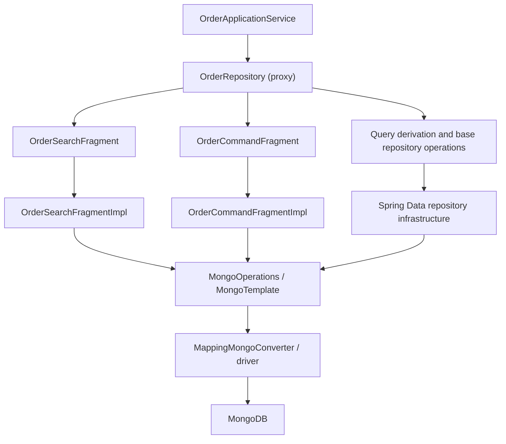

# Designing a Repository Fragment and Implementation Class

## 1. The Problem to Solve

In Spring Data MongoDB, `MongoRepository<OrderDocument, String>` can provide many CRUD operations, while query derivation allows you to write methods such as `findByTenantIdAndStatus(...)`. This is sufficient for many basic cases. However, a real-world application also needs to:

- Search for orders using **multiple optional criteria** without creating dozens of method names.
- Return results as a `Slice` with safe sorting and limits.
- Transition state using **a single atomic conditional update**, without needing to load the entity and then call `save`.
- Use `MongoTemplate` to build a `Query`, `Update`, or MongoDB-based aggregation.
- Place specialized data access logic in one location, while still calling it through a **unified repository interface**.

One solution supported by Spring Data is a **repository fragment**. You extract custom behavior into a separate interface, write an implementation class for that interface, and **compose** the fragment into the main repository.

This lesson belongs to the **Extended Repositories** chapter of the **SPRING_DATA_MONGODB** module. The scope of the module covers connecting, document mapping, and operating on MongoDB via `MongoTemplate` or repositories; designing queries, aggregations, indexes, transactions, reactive access, testing, and data performance diagnostics. Therefore, beyond fragment syntax, this lesson focuses on code structure, responsibility boundaries, transactions, consistency, and testability.

After this lesson, you will be able to:

1. Explain how a repository is **composed from fragments**.
2. Design `OrderSearchFragment` and `OrderSearchFragmentImpl` following conventions.
3. Separate conditional write commands into their own fragment without exposing full CRUD.
4. Control bean discovery, implementation postfix, name collisions, and method conflicts.
5. Distinguish the modern fragment model from the traditional `OrderRepositoryImpl` style.
6. Choose between a fragment, default method, service, or custom base repository according to your goal.
7. Write integration tests proving that the fragment is **truly composed**, maps BSON correctly, queries the right tenant, and updates without overwriting.

> This lesson illustrates imperative Spring Data MongoDB APIs in modern versions. Implementation discovery mechanisms, precedence order, and some overloads may vary depending on the Spring Data Commons/MongoDB version; verify against your project's actual dependencies.

## 2. What Is a Repository Fragment?

A **fragment** is a part of a repository contract that has its own implementation. The final repository extends one or more fragment interfaces, and Spring Data builds a repository proxy by composing the corresponding implementations with the CRUD/query infrastructure.

Minimal example:

```java
public interface OrderSearchFragment {
    // MongoDB read behavior that needs to be written manually.
}

class OrderSearchFragmentImpl implements OrderSearchFragment {
    // Uses MongoOperations/MongoTemplate.
}

public interface OrderRepository
        extends Repository<OrderDocument, String>,
                OrderSearchFragment {
    // Access custom behavior through the same repository proxy.
}
```

The three components play different roles:

| Component | Role | Who provides the implementation? |
| --- | --- | --- |
| `Repository<T, ID>` or `MongoRepository<T, ID>` | Marker/base contract and Spring Data capabilities | Spring Data infrastructure |
| `OrderSearchFragment` | Custom behavior contract | Application development team |
| `OrderSearchFragmentImpl` | Code executing that behavior | Application development team |
| `OrderRepository` | Final API injected into the service | Spring Data composition/proxy |

Spring Data **does not require you to manually write a class implementing the entire `OrderRepository`**. Instead, it finds the appropriate fragment implementations and attaches them to the repository proxy.

### 2.1. Call Flow Diagram



The diagram illustrates the composition concept rather than a mandatory internal call sequence across all versions. The key takeaway: **the service uses a single repository interface**, while complex parts are separated into implementations with clear responsibilities.

### 2.2. How Is a Fragment Different from an Ordinary Utility Interface?

Java allows any interface to extend any other interface. However, merely extending an interface does not guarantee that Spring Data knows where to invoke the logic. A repository fragment requires an **implementation discovered or registered appropriately by Spring Data**. Without an implementation, repository bootstrapping may fail or the framework may misinterpret the method as a derived query.

Not every bean implementing an interface automatically becomes a fragment for every repository. Spring Data's naming conventions, scan locations, and registration mechanisms must still be satisfied.

## 3. Choosing Boundaries for a Fragment

A good fragment represents **a meaningful group of persistence operations**, not merely a dumping ground for all code that does not fit inside the repository interface.

| Planned fragment | Responsibility | Should not take on |
| --- | --- | --- |
| `OrderSearchFragment` | Dynamic search, sort, projection/scroll | HTTP request parsing, controller-level authorization |
| `OrderCommandFragment` | Conditional update / atomic state transition | Sending emails or calling shipping systems |
| `OrderReportFragment` | Data reporting aggregations | Aggregating business rules across multiple systems |
| `OrderRepository` | Exposing the required API, composing fragments | Re-implementing all of MongoRepository |

A fragment should have:

1. **A capability-based name**, such as Search, Command, or Report.
2. **Clear inputs**, including tenant, filters, and appropriate limits.
3. **Semantically accurate results**: lists, Slice, update results, or DTOs.
4. **A stateless implementation** so it can be safely used as a Spring singleton.
5. **Dedicated tests** for BSON logic and composition tests through the repository.

When the logic consists of only a single simple predicate, adding a fragment can be overengineering. Use a derived query or `@Query` instead of creating a separate implementation for every `findById`.

## 4. Recommended Project Structure

An easy-to-follow organization:

```text
src/main/java/com/example/orders/persistence/
├── OrderDocument.java
├── OrderSearchFilter.java
├── OrderSearchFragment.java
├── OrderSearchFragmentImpl.java
├── OrderCommandFragment.java
├── OrderCommandFragmentImpl.java
└── OrderRepository.java

src/main/java/com/example/orders/application/
└── OrderApplicationService.java
```

This is a **conceptual layout**, not a list of files created by a worker during the writing of this document. The Java examples below can be placed in the `com.example.orders.persistence` package, with each public top-level type in its own file according to Java rules.

Keep the fragment interface and implementation in a package scanned by Spring Data repositories or an appropriate subpackage. Do not implicitly expect Spring to find `OrderSearchFragmentImpl` if the implementation is placed outside the scan scope without explicit registration.

## 5. Domain and Sample Data

### 5.1. MongoDB Entity

```java
package com.example.orders.persistence;

import java.time.Instant;
import org.springframework.data.annotation.Version;
import org.springframework.data.mongodb.core.mapping.Document;
import org.springframework.data.mongodb.core.mapping.FieldType;
import org.springframework.data.mongodb.core.mapping.MongoId;

@Document("orders")
public record OrderDocument(
    @MongoId(FieldType.STRING) String id,
    String tenantId,
    String status,
    String customerName,
    long totalAmountVnd,
    Instant createdAt,
    Instant updatedAt,
    @Version Long version
) {}
```

In this example:

- The Java property `id` corresponds to BSON `_id` and is kept as a String.
- `tenantId` is the data boundary between customers/tenants.
- `status` has illustrative values `NEW`, `PAID`, `READY_TO_SHIP`, and `SHIPPED`.
- `createdAt` is used for sorting; `updatedAt` tracks changes.
- `version` supports optimistic locking when used properly along the write path.

### 5.2. Practice Dataset

```javascript
db.orders.insertMany([
  {
    _id: "ord-101",
    tenantId: "tenant-a",
    status: "READY_TO_SHIP",
    customerName: "An",
    totalAmountVnd: NumberLong("150000"),
    createdAt: ISODate("2026-11-18T08:00:00Z"),
    updatedAt: ISODate("2026-11-18T08:00:00Z"),
    version: NumberLong("0")
  },
  {
    _id: "ord-102",
    tenantId: "tenant-a",
    status: "READY_TO_SHIP",
    customerName: "Bình",
    totalAmountVnd: NumberLong("250000"),
    createdAt: ISODate("2026-11-19T09:00:00Z"),
    updatedAt: ISODate("2026-11-19T09:00:00Z"),
    version: NumberLong("2")
  },
  {
    _id: "ord-103",
    tenantId: "tenant-a",
    status: "PAID",
    customerName: "Ân",
    totalAmountVnd: NumberLong("100000"),
    createdAt: ISODate("2026-11-19T09:00:00Z"),
    updatedAt: ISODate("2026-11-19T09:00:00Z"),
    version: NumberLong("1")
  },
  {
    _id: "ord-201",
    tenantId: "tenant-b",
    status: "READY_TO_SHIP",
    customerName: "An",
    totalAmountVnd: NumberLong("350000"),
    createdAt: ISODate("2026-11-20T07:00:00Z"),
    updatedAt: ISODate("2026-11-20T07:00:00Z"),
    version: NumberLong("0")
  }
]);
```

Run this script only on a **practice database** with a controlled collection/test fixture. The `tenant-b` data serves to prove that filters do not leak or modify another tenant's orders. Two documents sharing the same `createdAt` serve as a reminder that the list needs an `_id` tie-breaker.

## 6. First Fragment: Dynamic Search Contract

### 6.1. Query Parameter DTO

Instead of accepting a JSON string or an arbitrary field map sent by the client, define a structured filter:

```java
package com.example.orders.persistence;

import java.time.Instant;

public record OrderSearchFilter(
    String status,
    Long minTotalVnd,
    Instant createdFrom,
    Instant createdBefore
) {}
```

Null values in the DTO in this example mean **do not apply that criterion**. This is an application policy, not a default MongoDB rule. When building a production API, constrain value domains, date/time formats, and allowed sort styles.

### 6.2. Fragment Interface

```java
package com.example.orders.persistence;

import org.springframework.data.domain.Pageable;
import org.springframework.data.domain.Slice;

public interface OrderSearchFragment {

    Slice<OrderDocument> search(
        String authenticatedTenantId,
        OrderSearchFilter filter,
        Pageable pageable
    );
}
```

Key points to note:

- The `OrderSearchFragment` interface **does not need to extend `Repository`**.
- It has no `@Query` annotation, because the query will be written in the implementation.
- The return type is set to `Slice` because the "Load more" use case only needs `hasNext`; no total count is required.
- Every operation receives or is supplied with the authenticated tenant.

**Do not** let the caller pass an arbitrary `org.springframework.data.mongodb.core.query.Query` into a public fragment. Doing so makes it easy for the application layer to accidentally omit the tenant filter or add an overly expensive sort.

## 7. The OrderSearchFragmentImpl Class

### 7.1. Implementing with MongoOperations

With the default postfix `Impl`, the implementation name by convention is **`OrderSearchFragmentImpl`**—that is, **fragment interface name + Impl**, not final repository name + Impl.

```java
package com.example.orders.persistence;

import java.util.List;
import java.util.Objects;
import org.springframework.data.domain.Pageable;
import org.springframework.data.domain.Slice;
import org.springframework.data.domain.SliceImpl;
import org.springframework.data.domain.Sort;
import org.springframework.data.mongodb.core.MongoOperations;
import org.springframework.data.mongodb.core.query.Criteria;
import org.springframework.data.mongodb.core.query.Query;

public class OrderSearchFragmentImpl implements OrderSearchFragment {

    private static final int MAX_PAGE_SIZE = 100;
    private static final Sort QUEUE_SORT = Sort.by(
        Sort.Order.desc("createdAt"),
        Sort.Order.desc("id")
    );

    private final MongoOperations mongo;

    public OrderSearchFragmentImpl(MongoOperations mongo) {
        this.mongo = mongo;
    }

    @Override
    public Slice<OrderDocument> search(
        String tenantId,
        OrderSearchFilter filter,
        Pageable pageable
    ) {
        Objects.requireNonNull(filter, "filter");
        Objects.requireNonNull(pageable, "pageable");

        if (tenantId == null || tenantId.isBlank()) {
            throw new IllegalArgumentException("Missing tenant");
        }
        if (!pageable.isPaged()
                || pageable.getPageSize() > MAX_PAGE_SIZE
                || !QUEUE_SORT.equals(pageable.getSort())) {
            throw new IllegalArgumentException("Unsupported page/sort");
        }
        if (filter.minTotalVnd() != null
                && filter.minTotalVnd() < 0) {
            throw new IllegalArgumentException("Negative amount");
        }
        if (filter.createdFrom() != null
                && filter.createdBefore() != null
                && !filter.createdFrom()
                    .isBefore(filter.createdBefore())) {
            throw new IllegalArgumentException("Invalid date range");
        }

        Query query = Query.query(
            Criteria.where("tenantId").is(tenantId)
        );

        if (filter.status() != null) {
            query.addCriteria(
                Criteria.where("status").is(filter.status())
            );
        }
        if (filter.minTotalVnd() != null) {
            query.addCriteria(
                Criteria.where("totalAmountVnd")
                    .gte(filter.minTotalVnd())
            );
        }
        if (filter.createdFrom() != null
                || filter.createdBefore() != null) {
            Criteria date = Criteria.where("createdAt");
            if (filter.createdFrom() != null) {
                date.gte(filter.createdFrom());
            }
            if (filter.createdBefore() != null) {
                date.lt(filter.createdBefore());
            }
            query.addCriteria(date);
        }

        int pageSize = pageable.getPageSize();
        query.with(pageable);
        query.limit(pageSize + 1);

        List<OrderDocument> fetched =
            mongo.find(query, OrderDocument.class);

        boolean hasNext = fetched.size() > pageSize;
        List<OrderDocument> content = List.copyOf(
            fetched.subList(
                0, Math.min(pageSize, fetched.size())
            )
        );

        return new SliceImpl<>(content, pageable, hasNext);
    }
}
```

The implementation class uses **constructor injection** rather than creating `MongoClient` or `MongoTemplate` per request. Each `Query` and `Criteria` is instantiated **inside the method**, not held in a shared field; this is an important habit because fragment implementations are usually Spring-managed singletons.

### 7.2. Why Fetch pageSize + 1?

To construct a `Slice<T>`, you can read one extra document to determine whether a next page exists:

```text
Page size = 2
Actually fetch up to 3 records from MongoDB:

  [ord-102, ord-101, ord-...]
         └─ 2 results returned; the 3rd determines hasNext

fetched.size() > 2  → hasNext = true
```

This is a **manual** implementation corresponding to the Slice contract. Not every `List` carries pagination metadata on its own; we explicitly use `SliceImpl`.

After `query.with(pageable)`, `query.limit(pageSize + 1)` adjusts the limit to read one extra element. It still preserves the offset from `Pageable`. If the offset is very deep, the query can still be slow; this mechanism **does not automatically turn into keyset scrolling**.

### 7.3. Why Whitelist Sort?

The method rejects sorts other than `createdAt DESC, id DESC`. This is an intentional choice:

- Guarantees stable ordering with `id` as a tie-breaker.
- Prevents clients from choosing unindexed fields or internal fields.
- Makes designing the corresponding compound index straightforward.
- Keeps pagination logic consistent across calls.

If a real product needs multiple sorts, replace the condition with an intentional **allowlist** and proper indexes/benchmarks rather than accepting arbitrary field paths.

## 8. Calling the Fragment Through OrderRepository

The final repository will be composed in section 11. Assuming it already declares `OrderSearchFragment`, a service can call:

```java
import org.springframework.data.domain.PageRequest;
import org.springframework.data.domain.Slice;
import org.springframework.data.domain.Sort;

PageRequest page = PageRequest.of(
    0, 2,
    Sort.by(
        Sort.Order.desc("createdAt"),
        Sort.Order.desc("id")
    )
);

OrderSearchFilter filter = new OrderSearchFilter(
    "READY_TO_SHIP",
    100000L,
    null,
    null
);

Slice<OrderDocument> result = repository.search(
    authenticatedTenantId, filter, page
);
```

Here `repository` is the injected `OrderRepository` bean, and `authenticatedTenantId` must come from the identity/authorization context. Never hardcode a user's tenant in production code.

For the fixture, `tenant-a` has orders `ord-101` and `ord-102` in `READY_TO_SHIP` status, matching `minTotalVnd = 100000`. The first page has up to 2 records. If the data has not changed and there is no third matching order, `hasNext()` is false.

### 8.1. A Search Fragment Should Not Unconditionally Count

Because the contract returns a `Slice`, there is no need for `mongo.count(...)` on every call. If the UI needs the total count or exact number of pages, design a dedicated `Page<T>` or count query with the corresponding filter; do not silently change the fragment's semantics.

### 8.2. Do Not Use Search Results to Overwrite

Repository search reads documents; a freshly read object can become stale as soon as another request updates the order. If the business operation only wants to change status, prefer the conditional command in the next section rather than modifying an entity copy and calling `save` unchecked.

## 9. Second Fragment: Conditional Write Command

### 9.1. Business Contract

An order may transition `READY_TO_SHIP → SHIPPED` only when:

1. `tenantId` and `_id` match.
2. The current status is correct.
3. The version matches the caller's expectation.
4. Updating status, update timestamp, and version is performed in **a single MongoDB update**.

Fragment interface:

```java
package com.example.orders.persistence;

import java.time.Instant;

public interface OrderCommandFragment {

    boolean markShipped(
        String authenticatedTenantId,
        String orderId,
        long expectedVersion,
        Instant shippedAt
    );
}
```

It returns `boolean` instead of returning an entity, because the use case needs to know **whether the state transition succeeded**, without needing to materialize the document. If the API needs to distinguish a state violation from a version conflict, design a meaningful business result object or an authorized diagnostic query; never leak documents outside the tenant.

### 9.2. OrderCommandFragmentImpl

```java
package com.example.orders.persistence;

import java.time.Instant;
import java.util.Objects;
import com.mongodb.client.result.UpdateResult;
import org.springframework.data.mongodb.core.MongoOperations;
import org.springframework.data.mongodb.core.query.Criteria;
import org.springframework.data.mongodb.core.query.Query;
import org.springframework.data.mongodb.core.query.Update;

public class OrderCommandFragmentImpl
        implements OrderCommandFragment {

    private final MongoOperations mongo;

    public OrderCommandFragmentImpl(MongoOperations mongo) {
        this.mongo = mongo;
    }

    @Override
    public boolean markShipped(
        String tenantId,
        String orderId,
        long expectedVersion,
        Instant shippedAt
    ) {
        Objects.requireNonNull(shippedAt, "shippedAt");
        if (tenantId == null || tenantId.isBlank()
                || orderId == null || orderId.isBlank()
                || expectedVersion < 0) {
            throw new IllegalArgumentException("Invalid command");
        }

        Query query = Query.query(
            Criteria.where("id").is(orderId)
                .and("tenantId").is(tenantId)
                .and("status").is("READY_TO_SHIP")
                .and("version").is(expectedVersion)
        );

        Update update = new Update()
            .set("status", "SHIPPED")
            .set("updatedAt", shippedAt)
            .inc("version", 1);

        UpdateResult result = mongo.updateFirst(
            query, update, OrderDocument.class
        );

        return result.getModifiedCount() == 1;
    }
}
```

Here, `Update` is the class from `org.springframework.data.mongodb.core.query`, not the repository `@Update` annotation.

The update command affects at most one document. MongoDB guarantees atomicity for modifying **a single document**; the status and version conditions live directly inside the filter, instead of:

```text
findOne()
   ↓
check status/version in Java
   ↓
save(stale entity)
```

In this snippet, the version is **explicitly incremented**. Spring Data may have its own `@Version` management behavior across different update paths; therefore, you must verify that the version field actually increments **once** as designed and does not combine manual increment with an unexamined auto-increment path.

### 9.3. Matched Count and Modified Count

`UpdateResult.getMatchedCount()` reflects the number of documents matching the query. `getModifiedCount()` reflects the number of documents actually modified. In the state transition example, the command alters status/version upon match, so `modifiedCount == 1` is an appropriate success signal.

If `modifiedCount == 0`, do not immediately conclude "ID does not exist": the cause could also be a wrong tenant, an already changed status, a stale version, or a no-op update. The service can return a generic error to the client and record internal metrics without revealing order ownership.

### 9.4. Do Not Enable Upsert

This command requires the order to **already exist**. Do not use `mongo.upsert(...)` for state transitions: if status/version conditions do not match, upsert might attempt to create a document instead of returning failure. Choosing `updateFirst(...)` without upsert is appropriate.

## 10. Third Fragment (Optional): Reporting Aggregation

Another fragment can provide a specialized read model, such as total amount per status for a tenant:

```java
package com.example.orders.persistence;

import java.util.List;

public interface OrderReportFragment {
    List<StatusTotal> summarizeByStatus(String authenticatedTenantId);
}
```

The return type should be a public DTO in a separate `StatusTotal.java` file so that an application service in another package can use it:

```java
package com.example.orders.persistence;

public record StatusTotal(String status, long totalVnd) {}
```

Implementation:

```java
package com.example.orders.persistence;

import java.util.List;
import org.springframework.data.mongodb.core.MongoOperations;
import org.springframework.data.mongodb.core.aggregation.Aggregation;
import org.springframework.data.mongodb.core.query.Criteria;
import static org.springframework.data.mongodb.core.aggregation.Aggregation.*;

public class OrderReportFragmentImpl implements OrderReportFragment {
    private final MongoOperations mongo;

    public OrderReportFragmentImpl(MongoOperations mongo) {
        this.mongo = mongo;
    }

    @Override
    public List<StatusTotal> summarizeByStatus(String tenantId) {
        if (tenantId == null || tenantId.isBlank()) {
            throw new IllegalArgumentException("Missing tenant");
        }

        Aggregation aggregation = newAggregation(
            match(Criteria.where("tenantId").is(tenantId)),
            group("status")
                .sum("totalAmountVnd").as("totalVnd"),
            project("totalVnd")
                .and("_id").as("status")
        );

        return mongo.aggregate(
            aggregation, OrderDocument.class, StatusTotal.class
        ).getMappedResults();
    }
}
```

This reporting fragment is **optional** for completing a repository. It illustrates extending as needed rather than creating a giant `OrderRepositoryImpl` class.

For monetary data requiring exact precision, consider an appropriate BSON/Java type such as Decimal128/BigDecimal instead of assuming every currency unit fits in `long`. Aggregations may require indexes, memory, and explicit tenant authorization; do not treat them as zero-cost getters.

## 11. Composing Multiple Fragments into One Repository

### 11.1. Expose Only the Methods You Actually Need

```java
package com.example.orders.persistence;

import java.util.Optional;
import org.springframework.data.repository.Repository;

public interface OrderRepository
        extends Repository<OrderDocument, String>,
                OrderSearchFragment,
                OrderCommandFragment,
                OrderReportFragment {

    Optional<OrderDocument> findByTenantIdAndId(
        String tenantId,
        String id
    );
}
```

This is **one repository interface**, yet behavior comes from multiple sources:

| Method | Behavior provider |
| --- | --- |
| `findByTenantIdAndId(...)` | Spring Data query derivation |
| `search(...)` | `OrderSearchFragmentImpl` |
| `markShipped(...)` | `OrderCommandFragmentImpl` |
| `summarizeByStatus(...)` | `OrderReportFragmentImpl` |

When an application service injects `OrderRepository`, Spring Data creates a unified **repository proxy**. You do not manually instantiate fragments and invoke them one by one from the controller.

**Why not extend `MongoRepository` in this example?** To avoid automatically exposing `save`, `deleteAll`, and many operations not needed by the use case. `Repository<T, ID>` is a marker so we explicitly choose which methods to make public. If a product genuinely needs full CRUD, extending `MongoRepository<T, ID>` remains valid; choose according to business requirements.

### 11.2. Composing Fragments Does Not Prevent Using MongoTemplate

Inside implementations, complex operations still use `MongoOperations`/`MongoTemplate`. Repositories do not forbid using templates; they simply create a **unified API** so services do not depend directly on numerous persistence details.

### 11.3. Fragment Interfaces Can Be Reused

A fragment such as `AuditTrailFragment` can be inherited by multiple repositories if the contract is clear enough. However, implementations relying on entity-specific mapping, collection names, or business states must be designed carefully. Reusing fragments via generic types without controlling the domain class can make code overly abstract and difficult to test.

## 12. How Spring Data Discovers Implementation Classes

### 12.1. The Impl Postfix Convention

Under the common convention:

```text
Fragment interface             Expected implementation
----------------------------------------------------------------
OrderSearchFragment       →    OrderSearchFragmentImpl
OrderCommandFragment      →    OrderCommandFragmentImpl
OrderReportFragment       →    OrderReportFragmentImpl
```

Spring Data scans for implementations following the **fragment interface name + postfix** convention within the package area matching the repository scan. The fragment implementation must have constructor dependencies resolved by Spring, such as `MongoOperations`.

The implementation class can be discovered by convention or registered explicitly as a bean. The `@Repository` stereotype is not strictly required on the fragment class because it is not an independent repository proxy. However, when wiring manually, bean names and scopes need to be controlled.

### 12.2. Checklist When Spring Cannot Find the Implementation

1. Is the name spelled `OrderSearchFragmentImpl` accurately? Check uppercase/lowercase letters.
2. Does the class `implements OrderSearchFragment`?
3. Has `OrderRepository` extended the fragment interface?
4. Is the implementation within the appropriate package scanning scope?
5. Are there multiple candidate beans with the same purpose or colliding names?
6. Are constructor dependencies like `MongoOperations` available as beans, or are there multiple templates of the same type?
7. Does the project customize `repositoryImplementationPostfix` to something other than `Impl`?
8. Does the Spring Data MongoDB version in use handle fragment mechanisms as expected?

If Spring Data fails to bind a method to a fragment and attempts to parse it as a derived query, bootstrapping may throw an error like "No property ... found" or a query method message. Do not randomly rename the method: first inspect **fragment wiring**.

### 12.3. Custom Implementation Postfix

Some projects configure a different postfix:

```java
import org.springframework.context.annotation.Configuration;
import org.springframework.data.mongodb.repository.config.EnableMongoRepositories;

@Configuration
@EnableMongoRepositories(
    basePackages = "com.example.orders.persistence",
    repositoryImplementationPostfix = "Custom"
)
class RepositoryConfiguration {}
```

When using this configuration, the conventional implementation class will be named like `OrderSearchFragmentCustom`, rather than the default `OrderSearchFragmentImpl`.

**This is an alternative configuration example, not a class to add alongside the `Impl` example above.** Avoid configuring `@EnableMongoRepositories` in a way that overlaps with Spring Boot's repository auto-configuration without controlling scan boundaries.

## 13. Manual Bean Registration and Bean Names

When an implementation needs a special constructor, multiple templates, or a non-conventional name, it can be managed with explicit bean configuration—depending on the binding capabilities of your Spring Data version:

```java
import org.springframework.context.annotation.Bean;
import org.springframework.context.annotation.Configuration;
import org.springframework.data.mongodb.core.MongoOperations;

@Configuration
class OrderFragmentConfiguration {

    @Bean("orderSearchFragmentImpl")
    OrderSearchFragment orderSearchFragment(
        MongoOperations orderMongoOperations
    ) {
        return new OrderSearchFragmentImpl(
            orderMongoOperations
        );
    }
}
```

The bean name in the example follows the decapitalized fragment name + postfix convention. If Spring Data discovers multiple implementations of the same type, selection may rely on bean names/conventions and repository configuration. You must verify that no unwanted duplicate bean is automatically created.

**Note on multiple MongoDB databases:** Inject `MongoOperations` by type only when there is a single unambiguous candidate in the context. If there are multiple templates, use `@Qualifier("orderMongoTemplate")` or bean names aligned with repository mapping. Never select a database from a user-supplied request value.

### 13.1. When to Use @Component?

You can mark the implementation class as a Spring component:

```java
@org.springframework.stereotype.Component(
    "orderSearchFragmentImpl"
)
class OrderSearchFragmentImpl implements OrderSearchFragment {
    // Implementation as in section 7.
}
```

This is merely a **wiring variant**; do not define both a bean factory method and `@Component` with the same name unintentionally, as this can cause duplicate beans or configuration overrides. When convention-based discovery works well, the default setup is usually simpler.

## 14. Distinguishing Modern Fragments from Legacy Custom Implementations

Before the fragment model, many projects extended a repository with a custom interface and a class named **repository interface + Impl**:

```text
Legacy naming:
  OrderRepository
  OrderRepositoryImpl

Fragment-oriented naming:
  OrderRepository
    ├── OrderSearchFragment
    │     └── OrderSearchFragmentImpl
    └── OrderCommandFragment
          └── OrderCommandFragmentImpl
```

The legacy `OrderRepositoryImpl` convention may still be recognized by the framework in some versions for compatibility reasons, but **fragment-based** extension is generally the preferred direction.

### 14.1. Problems with a Giant Repository Impl Class

- Searching, writing, aggregations, and batch processing live in one class.
- Hard to reuse or isolate tests for each group of logic.
- Method collisions with the base repository can cause unpredictable behavior.
- When splitting modules or migrating to a reactive stack, responsibilities are tightly coupled.
- Easy to confuse an `OrderRepositoryImpl` discovered via legacy convention with an implementation the team intends to register manually.

### 14.2. Migration Path

1. List the existing custom methods on the old repository.
2. Group them into fragment interfaces by capability: Search, Command, Report.
3. Move implementations into the corresponding `FragmentNameImpl` classes.
4. Have the main repository extend those fragments.
5. Verify bean discovery and method conflicts.
6. Write integration tests before/after to ensure query semantics remain unchanged.
7. Remove the legacy class only after tests pass, avoiding two competing implementations.

Do not blindly rename all classes and assume behavior stays identical: repository fragments have composition/priority rules that must be confirmed against your current version.

## 15. Method Conflicts and Precedence Order

Suppose two fragments share the same signature:

```java
interface FirstOrderFragment {
    void refresh(String id);
}

interface SecondOrderFragment {
    void refresh(String id);
}
```

If a repository extends both, the code can become confusing: which implementation should `refresh(...)` delegate to? In modern versions, Spring Data has fragment precedence rules based on **declaration/composition order**, and custom fragments generally take precedence over base implementations/repository aspects. However, this is not a good way to design a public API.

**Recommendation:** Give each behavior one clear owner. Rename methods according to business intent, such as `refreshSearchIndex(...)` and `refreshOrderCache(...)`, or coordinate in the service instead of relying on dispatch priority.

### 15.1. Overriding a Base Repository Method

A custom fragment can be used to override certain base repository behaviors in supported versions. However, overriding `save(...)`, `deleteById(...)`, or core CRUD APIs can alter the contract other callers rely on.

Before overriding, ask:

- Is repository-wide behavior truly needed, or just a single business command?
- Could callers accidentally bypass invariants through other CRUD methods?
- Do `saveAll(...)`, batch writes, or reactive APIs follow the same policy?
- Are callback, optimistic locking, and transaction semantics altered?

In most business problems, it is easier to review when you **do not expose dangerous CRUD** and instead provide explicitly named methods like `markShipped(...)`.

## 16. Fragments and Interface Default Methods

Java permits:

```java
public interface OrderLookupConvenience {
    java.util.Optional<OrderDocument>
    findByTenantIdAndId(String tenantId, String id);

    default boolean existsInTenant(
        String tenantId, String id
    ) {
        return findByTenantIdAndId(tenantId, id).isPresent();
    }
}
```

A simple default method can reuse repository methods, but it does not automatically receive an injected `MongoOperations` and is not always a good way to build complex queries.

| Option | Appropriate when |
| --- | --- |
| Derived query | Simple, rarely changing filters |
| `@Query`/`@Aggregation` | Fixed JSON queries/pipelines supported in your version |
| Default method | Very small coordination logic combining existing methods |
| Repository fragment | Custom queries/commands needing dedicated implementation, dependencies, and tests |
| Application service | Orchestrating multiple repositories, permissions, external APIs, and business logic |
| Custom repository base class | Infrastructure policy shared across many repositories |

Do not use a fragment solely to move a one-line `repository.findBy...` into another class without adding design value.

## 17. Fragments vs. Custom Repository Base Class

Two Spring Data extension mechanisms are often confused:

**Fragment:** A repository actively extends a behavioral interface, such as `OrderCommandFragment`. Only repositories that want that capability receive it.

**Custom base repository:** Changes the shared implementation for many repositories within a configuration group, potentially requiring `repositoryBaseClass` and a corresponding base subclass. This is a broader **infrastructure policy** decision.

Example scenarios:

| Goal | Approach |
| --- | --- |
| One repository needs dynamic order search | Fragment |
| Multiple repositories share a domain-specific algorithm | Reusable fragment with a type-safe contract |
| All repositories need consistent base behavior | Consider custom base repository |
| Only one service needs a one-off complex operation | MongoOperations in an appropriate persistence adapter/service |

If creating a multi-tier generic base interface, use `@NoRepositoryBean` on intermediate interfaces extending the base repository that you **do not want Spring Data to instantiate as standalone repositories**:

```java
import org.springframework.data.repository.NoRepositoryBean;
import org.springframework.data.repository.Repository;

@NoRepositoryBean
interface TenantReadRepository<T, ID>
        extends Repository<T, ID> {
    // Shared methods can be defined according to an appropriate contract.
}
```

There is no need to add `@NoRepositoryBean` to every simple fragment interface that does not extend a repository marker; applying annotations arbitrarily does not replace proper package scanning design.

## 18. Transactions, Lifecycle, Auditing, and Versioning

### 18.1. Transactions at Business Boundaries

A fragment is a persistence component; the application service typically decides **transaction boundaries** if a use case spans multiple operations/collections.

```java
import org.springframework.stereotype.Service;
import org.springframework.transaction.annotation.Transactional;

@Service
public class ShippingApplicationService {
    private final OrderRepository repository;

    public ShippingApplicationService(OrderRepository repository) {
        this.repository = repository;
    }

    @Transactional
    public void shipOrder(
        String tenantId, String orderId,
        long expectedVersion
    ) {
        boolean changed = repository.markShipped(
            tenantId, orderId, expectedVersion,
            java.time.Instant.now()
        );
        if (!changed) {
            throw new IllegalStateException(
                "Order is unavailable or has changed"
            );
        }
    }
}
```

This example illustrates the boundary; **a single atomic update on one document** by itself generally does not need a multi-document transaction. `@Transactional` is meaningful only when a transaction manager and supporting MongoDB topology are properly configured. It does not make external email/HTTP calls automatically part of a MongoDB transaction.

### 18.2. Callbacks and Auditing

`mongo.updateFirst(...)` is not `save(entity)`:

- It does not necessarily construct a complete Java entity.
- It is not guaranteed to run the same entity callbacks as insert/save.
- `updatedAt` should be set explicitly in `Update` or follow a verified auditing mechanism.
- Application validation still needs to run before persistence.
- `@Version` must be handled according to the specific API/version; do not assume every fragment update automatically prevents lost updates.

In `OrderCommandFragmentImpl`, we intentionally include `version` in the filter and increment its value in the update. When a project uses `@Version`, test that **there is no double version increment** caused by nesting two mechanisms; do not follow a successful command with an unnecessary `save(entity)`.

### 18.3. Thread Safety

Spring typically uses a fragment implementation as a singleton bean. Therefore:

```java
// Inappropriate: tenant becomes shared mutable state across requests.
class UnsafeOrderSearchFragmentImpl {
    private String currentTenantId;
}
```

Tenant, filter, and pagination are **per-invocation values**, not shared mutable fields. Create new `Query`/`Update` instances inside each method. `MongoTemplate` and the driver client are designed to be shared once configured, not recreated per request.

## 19. Security and API Limits

A fragment does not carry authentication on its own. Parameters such as `tenantId` from HTTP requests can be spoofed. The service must obtain the tenant from an authenticated principal/session or verify permissions properly before calling the repository.

### 19.1. Avoid Overly Broad Contracts

```java
// Do not expose this kind of API for normal use cases.
interface DangerousFragment {
    void updateAny(
        String collectionName,
        String rawQueryJson,
        String rawUpdateJson
    );
}
```

Such a contract turns the persistence API into an arbitrary editing tool. Even when placed inside a fragment, it can allow updating internal fields, missing tenant scope, or sending dangerous operators.

Replace it with an explicit command:

```java
interface OrderCommandFragment {
    boolean markShipped(
        String tenantId,
        String orderId,
        long expectedVersion,
        java.time.Instant at
    );
}
```

### 19.2. Do Not Rely on Unpredictable IDs

`findById(id)` is not an authorization check. Queries must bind tenant or owner when business rules require it. Use `findByTenantIdAndId(...)` for reads; use filters with ID + tenant + expected state/version for writes.

### 19.3. Projections and Sensitive Data

If a fragment only serves a queue screen, consider returning a focused DTO/projection instead of a full entity containing personal data. In advanced searches or aggregations, avoid logging unfiltered documents; use redaction and limit query tracing.

## 20. Indexes and Fragment Performance

A repository fragment **does not make queries faster automatically**. It only helps organize and execute queries appropriately. Optimization still depends on filters, sorts, projections, indexes, and data.

### 20.1. Candidate Index for the Queue Screen

For the query:

```javascript
db.orders.find({
  tenantId: "tenant-a",
  status: "READY_TO_SHIP"
})
  .sort({ createdAt: -1, _id: -1 })
  .limit(20);
```

A candidate index:

```javascript
db.orders.createIndex(
  { tenantId: 1, status: 1, createdAt: -1, _id: -1 },
  { name: "ix_orders_tenant_status_recent" }
);
```

This is a candidate following the equality/sort rule; if the filter also includes `minTotalVnd` or a date range, the planner may choose a different plan. Do not create an index for every combination of optional filters; measure on a representative workload.

### 20.2. Offset Pagination Has Limits

In `OrderSearchFragmentImpl`, `Pageable` uses offsets, so very deep pages may have to skip many documents. `pageSize + 1` tells you `hasNext` but does not solve offset cost.

If the system needs very deep infinite scrolling, consider `Window<T>`/`ScrollPosition` APIs in supporting versions or implement keyset pagination:

```javascript
const lastCreatedAt = ISODate("2026-11-18T08:00:00Z");
const lastId = "ord-101";

db.orders.find({
  tenantId: "tenant-a",
  status: "READY_TO_SHIP",
  $or: [
    { createdAt: { $lt: lastCreatedAt } },
    { createdAt: lastCreatedAt, _id: { $lt: lastId } }
  ]
}).sort({ createdAt: -1, _id: -1 }).limit(20);
```

The cursor must store the exact sort keys/BSON types. Keyset reduces some offset-shift issues, but does not automatically guarantee a snapshot if data changes or sort keys are modified.

### 20.3. Diagnosing with Explain

```javascript
db.orders.find({
  tenantId: "tenant-a",
  status: "READY_TO_SHIP"
})
  .sort({ createdAt: -1, _id: -1 })
  .limit(20)
  .explain("executionStats");
```

Inspect `winningPlan`, `IXSCAN`/`COLLSCAN`, `totalKeysExamined`, `totalDocsExamined`, `nReturned`, and any `SORT` stage. Do not treat an integration test with four documents as proof that an index is optimized for production data.

### 20.4. Overhead of Composing Multiple Fragments

Composition itself is rarely the bottleneck of a MongoDB query. What to watch is **round trips**, BSON size, mapping, N+1 references, index scans, aggregation stages, and transaction contention. Do not optimize repository proxy dispatch before profiling shows it is an issue.

## 21. Reactive Repository Fragments

For reactive applications, use an interface/implementation tailored to `ReactiveMongoOperations` and return `Mono<T>`/`Flux<T>`, rather than taking an imperative fragment and wrapping it in `Mono.just(...)`.

### 21.1. Reactive Read Fragment Example

```java
import reactor.core.publisher.Flux;
import org.springframework.data.mongodb.core.ReactiveMongoOperations;
import org.springframework.data.mongodb.core.query.Criteria;
import org.springframework.data.mongodb.core.query.Query;

interface ReactiveOrderSearchFragment {
    Flux<OrderDocument> findRecent(String tenantId);
}

class ReactiveOrderSearchFragmentImpl
        implements ReactiveOrderSearchFragment {

    private final ReactiveMongoOperations mongo;

    ReactiveOrderSearchFragmentImpl(
        ReactiveMongoOperations mongo
    ) {
        this.mongo = mongo;
    }

    @Override
    public Flux<OrderDocument> findRecent(String tenantId) {
        Query query = Query.query(
            Criteria.where("tenantId").is(tenantId)
        );
        query.limit(20);
        return mongo.find(query, OrderDocument.class);
    }
}
```

This snippet illustrates the idea; in production, add stable sorting, tenant validation, and the corresponding reactive repository configuration.

A repository can compose a reactive fragment:

```java
import org.springframework.data.mongodb.repository.ReactiveMongoRepository;

interface ReactiveOrderRepository
        extends ReactiveMongoRepository<OrderDocument, String>,
                ReactiveOrderSearchFragment {
}
```

Extending `ReactiveMongoRepository` here exposes full reactive CRUD; if public access needs to be restricted, design a narrower contract according to your version's capabilities.

### 21.2. Do Not Mix the Two Stacks

| Imperative | Reactive |
| --- | --- |
| `MongoOperations` | `ReactiveMongoOperations` |
| `MongoTemplate` | `ReactiveMongoTemplate` |
| `List/Optional/Slice` | `Flux/Mono` and API-specific pagination mechanisms |
| Synchronous/blocking | Reactive driver, subscribe/backpressure |
| `MongoTransactionManager` when needed | Corresponding reactive transaction manager |

A `Flux<OrderDocument>` does not inherently carry `hasNext`, total count, or a keyset resume token. If the API needs scrolling or pagination metadata, design it explicitly and verify version support.

## 22. Two-Level Fragment Testing

There are **two independent questions**:

1. **Is the implementation right?** Do the BSON query, filter, sort, and Update produce the right result?
2. **Is the composition right?** Does calling `orderRepository.search(...)` or `markShipped(...)` actually delegate to the expected fragment implementation?

Unit tests for an implementation using a mocked `MongoOperations` can check validation and interactions, but **do not prove** BSON mapping, indexes, versioning, or Spring Data discovery. Therefore, integration tests against a real MongoDB instance are required.

### 22.1. @DataMongoTest Example

JUnit 5 skeleton:

```java
import static org.junit.jupiter.api.Assertions.*;
import java.time.Instant;
import org.junit.jupiter.api.Test;
import org.springframework.beans.factory.annotation.Autowired;
import org.springframework.boot.test.autoconfigure.data.mongo.DataMongoTest;
import org.springframework.data.domain.PageRequest;
import org.springframework.data.domain.Sort;
import org.springframework.data.mongodb.core.MongoTemplate;

@DataMongoTest
class OrderRepositoryFragmentIntegrationTest {

    @Autowired OrderRepository repository;
    @Autowired MongoTemplate mongo;

    @Test
    void repositoryMustComposeSearchFragment() {
        // Fixture must be created in an isolated test MongoDB.
        // Assumes data from section 5 has been seeded.
        var page = PageRequest.of(
            0, 1,
            Sort.by(
                Sort.Order.desc("createdAt"),
                Sort.Order.desc("id")
            )
        );

        var result = repository.search(
            "tenant-a",
            new OrderSearchFilter(
                "READY_TO_SHIP", null, null, null
            ),
            page
        );

        assertEquals(1, result.getNumberOfElements());
        assertTrue(result.hasNext());
        assertEquals("tenant-a",
            result.getContent().get(0).tenantId());
    }
}
```

**This is an illustrative skeleton**, not a standalone test class that has been executed. To use it, the project needs dependencies/test context, a test database (such as Testcontainers), pre-test fixtures, and cleanup. When testing a slice, you must seed at least two matching records; if fixtures are altered by another test, `hasNext()` becomes unreliable.

Some `@DataMongoTest` configurations may not automatically import every custom bean or multiple custom templates. If a fragment is not discovered in a slice test, check scan/configuration or import the needed beans rather than treating this test as proof that `@DataMongoTest` always covers the entire application.

### 22.2. Testing a Versioned Command

```java
@Test
void shippingRequiresExpectedStateAndVersion() {
    // Create record in an isolated test database.
    Instant timestamp = Instant.parse(
        "2026-11-20T08:00:00Z"
    );

    OrderDocument inserted = mongo.insert(
        new OrderDocument(
            "test-ship-001",
            "tenant-a",
            "READY_TO_SHIP",
            "Customer A",
            150000L,
            timestamp,
            timestamp,
            null
        )
    );

    long version = inserted.version();

    boolean first = repository.markShipped(
        "tenant-a", inserted.id(), version,
        timestamp.plusSeconds(60)
    );
    boolean second = repository.markShipped(
        "tenant-a", inserted.id(), version,
        timestamp.plusSeconds(120)
    );

    assertTrue(first);
    assertFalse(second);
}
```

This method is an illustrative snippet placed **inside the same test class** with the injected `repository` and `mongo` fields. Before running, ensure unique IDs, cleanup, and an appropriate test context; the test should also inspect the document after the first update to verify that status and version changed exactly once.

### 22.3. Integration Test Matrix

| Scenario | Expectation |
| --- | --- |
| Repository bean initialization | No error finding fragment/custom implementation |
| `search` for tenant-a | No orders from tenant-b |
| Status and amount filters | Returns exact matching document set |
| Half-open date range | Proper `createdFrom <= createdAt < createdBefore` |
| Sort with tied `createdAt` | ID tie-breaker is stable |
| Page size exceeding limit | Rejected |
| Final page with few remaining records | `hasNext=false` |
| Command with valid status/version | Only one document changes |
| Command with wrong tenant | No document changes |
| Command with stale version | Does not overwrite, returns false |
| Retry with same expected version | Subsequent attempt fails per contract |
| Tenant-scoped aggregation | Correct sums/groups, no cross-tenant mixing |
| Two fragments with name collision | Detected and resolved before deploy |
| String ID mapping | BSON `_id` is String, not ObjectId |
| Reactive fragment if used | Non-blocking and returns proper Flux/Mono |

### 22.4. Wiring Tests Are Not Performance Tests

A test proving that `search(...)` executes successfully through a proxy does not mean the query has an optimal index or is free of N+1 references. Measure `explain` and profile on representative data once correctness is verified.

## 23. Common Pitfalls

| Symptom | Possible cause | Resolution |
| --- | --- | --- |
| Repository bootstrap reports missing property for `search` method | Fragment not composed; Spring attempts query derivation | Check `extends` interface, `FragmentImpl` class, scan |
| Fragment implementation is not invoked | Wrong `Impl` naming convention or another bean selected | Check postfix, bean naming, package |
| `MongoOperations` injection error | Multiple templates of same type or missing bean | Use `@Qualifier`/explicit configuration |
| `OrderRepositoryImpl` accidentally discovered | Legacy custom implementation convention collision | Migrate to fragments and remove conflict |
| Two fragments share method signature | Unpredictable dispatch priority | Rename, assign clear method ownership |
| Extending `MongoRepository` exposes `deleteAll` | Public API too broad | Use `Repository<T,ID>` and needed methods |
| `search` slow on deep pages | Large offset/skip | Consider `Window`/keyset API if supported |
| `Slice.hasNext` wrong | Not fetching `pageSize+1` or bad fixture/test | Implement peek mechanism properly |
| Search returns other tenant's data | Query missing tenant filter | Enforce in fragment and security context |
| Unstable sort | Missing ID tie-breaker | Sort `createdAt DESC, id DESC` |
| Command updates invalid status | Missing expected status in filter | Conditional update |
| Version does not change as expected | Misunderstanding `@Version` and `Update` behavior | Test BSON and single version bump |
| Retrying command triggers duplicate side effects | Missing idempotency/outbox | Separate side effects and checkpoints |
| Aggregation returns wrong monetary totals | Wrong BSON numeric type or mapping | Verify converter/DTO |
| `@DataMongoTest` misses custom beans | Insufficient test slice scan/imports | Check test configuration |
| Reactive fragment blocks | Mixing `MongoTemplate` into reactive pipeline | Use `ReactiveMongoOperations` |

### 23.1. Diagnostic Flow When a Fragment Fails to Compose

```text
1. Does OrderRepository extend OrderSearchFragment?
                       ↓
2. Does OrderSearchFragmentImpl implement the interface?
                       ↓
3. Do the class name and configured postfix match?
                       ↓
4. Is the implementation within the scan scope?
                       ↓
5. Are constructor dependencies/bean names resolved?
                       ↓
6. Is there a legacy RepositoryImpl or duplicate fragment?
                       ↓
7. Integration test calls the method through the OrderRepository bean.
```

Do not switch to manually calling `new OrderSearchFragmentImpl(...)` from the service just to bypass a discovery error; doing so defeats repository fragment composition and may bypass appropriate lifecycle/transaction configuration.

## 24. Practice Exercises with Solutions

### Exercise 1 — Three Minimal Components

**Prompt:** You want to add `findExpensiveOrders(...)` using `MongoTemplate`, while the service only injects `OrderRepository`. Which components are needed?

**Solution:** Create a fragment interface such as `OrderExpensiveSearchFragment` with the method, a class `OrderExpensiveSearchFragmentImpl implements ...` containing `MongoOperations` code, and make `OrderRepository extends OrderExpensiveSearchFragment`. Ensure Spring Data discovers the implementation by postfix/package.

### Exercise 2 — Correct Implementation Name

**Prompt:** The interface is named `OrderCommandFragment`, and the default postfix is `Impl`. What should the class be named?

**Solution:** `OrderCommandFragmentImpl`. Do not confuse it with the legacy convention `OrderRepositoryImpl`.

### Exercise 3 — Minimal Repository API

**Prompt:** The team only allows lookups by tenant/ID, bounded search, and the `markShipped` command. Do we need to extend `MongoRepository`?

**Solution:** No. You can write:

```java
interface OrderRepository
    extends Repository<OrderDocument, String>,
            OrderSearchFragment,
            OrderCommandFragment {

    Optional<OrderDocument> findByTenantIdAndId(
        String tenantId, String id
    );
}
```

This snippet assumes `Repository` and `Optional` are imported. Declaring only the needed API reduces the risk of callers unintentionally using `deleteAll/saveAll`.

### Exercise 4 — Handling Dynamic Queries

**Prompt:** The UI allows filtering by `status`, `minTotalVnd`, and a `createdAt` range. Should you create every derived query combination?

**Solution:** With multiple optional criteria, `OrderSearchFragmentImpl` using `Query`/`Criteria` is usually much easier to control. Always include tenant, validate filters, allowlist sorts, and limit page size.

### Exercise 5 — Why Must Slice Fetch an Extra Element?

**Prompt:** Page size is 20, and you read exactly 20 results into a List. Can you know for sure whether a next page exists?

**Solution:** No. Exactly 20 elements might be the entire result set. To build a `Slice` manually, fetch up to 21 elements, return 20, and set `hasNext` based on the presence of the 21st element.

### Exercise 6 — Conditional State Transition

**Prompt:** Transition `READY_TO_SHIP` orders to `SHIPPED` only if tenant, ID, and version match. Should you use `find → save` or a conditional update?

**Solution:** Use `MongoOperations.updateFirst(...)` inside a command fragment with a filter containing tenant, ID, status, and version. Update status, `updatedAt`, and version in a single command. Check the modified count; do not enable upsert.

### Exercise 7 — Two Fragments with Duplicate Methods

**Prompt:** `OrderSearchFragment` and `OrderReportFragment` both declare `List<OrderDocument> load(String)`. Should you rely on `extends` order to decide the implementation?

**Solution:** No. Even though the framework has precedence rules, an ambiguous contract invites bugs during refactoring. Rename methods to reflect clear intent, reassign ownership, or coordinate in the service.

### Exercise 8 — Fragment Not Discovered

**Prompt:** Startup throws `No property 'search' found for type 'OrderDocument'` after adding `search(...)`.

**Solution:** Check that `OrderRepository extends OrderSearchFragment`, verify the name `OrderSearchFragmentImpl`, package scanning, postfix configuration, bean injection, and duplicate candidates. Write an integration test initializing the repository proxy. Do not hastily delete the search method.

### Exercise 9 — Distinguishing Service and Fragment

**Prompt:** A use case must update the MongoDB order, call a shipping API, and send an email. Should all of that go into `OrderCommandFragmentImpl`?

**Solution:** No. Fragments should focus on persistence commands; the application service coordinates workflow, transaction boundaries, and side effects. If reliable post-commit event emission is needed, consider an outbox/idempotency design.

### Exercise 10 — Multiple MongoTemplates

**Prompt:** The application has `customerMongoTemplate` and `orderMongoTemplate`. A fragment constructor injecting `MongoOperations` by type is ambiguous.

**Solution:** Select the bean explicitly via `@Qualifier("orderMongoTemplate")` or explicit fragment bean configuration, and ensure the corresponding repository uses the right database factory/template. Test reads/writes against the correct collection/database.

### Exercise 11 — Using Reactive

**Prompt:** The application uses a reactive stack. Should you inject `MongoOperations` and wrap a `List` in `Flux.fromIterable(...)`?

**Solution:** No, if the goal is non-blocking execution. Use `ReactiveMongoOperations`/`ReactiveMongoTemplate` and return `Flux<T>` or `Mono<T>` per contract; test subscription and reactive resources.

### Exercise 12 — Two-Level Fragment Testing

**Prompt:** A unit test for `OrderSearchFragmentImpl` checks tenant filtering, but does that guarantee Spring Data calls the right implementation when the service injects `OrderRepository`?

**Solution:** Not yet. You need an integration test that obtains the `OrderRepository` bean from the Spring context and invokes the fragment method against a test MongoDB instance to verify BSON, query semantics, and real bean composition.

## 25. Pre-Handoff Checklist

| Review question | How to prove |
| --- | --- |
| Does the fragment interface express clear responsibility? | Search/Command/Report separated |
| Does the implementation follow naming convention/postfix? | `FragmentNameImpl` and repository scanning |
| Does the main repository extend the fragment? | Interface signature check |
| Are there method collisions with other fragments/base? | Compile/bootstrap test |
| Is there bean ambiguity with multiple templates? | Qualifier and integration test |
| Is the public API overly broad? | `Repository<T,ID>` + needed methods |
| Is the fragment stateless? | No mutable tenant/Query held in fields |
| Does the tenant come from an authenticated source? | Application service and authorization test |
| Does search have stable filter/limit/sort? | Query test and sort tie-breaker |
| Is `Slice.hasNext` accurate? | Test `pageSize+1` and last page |
| Does the query have a suitable index? | `getIndexes()` and `explain("executionStats")` |
| Does the update have status/version predicates? | Conditional update and concurrency test |
| Is upsert accidentally enabled when only update is allowed? | Upsert not enabled |
| Are auditing/versioning accurate? | Inspect BSON after write and test callback behavior |
| Do aggregations map types and precision properly? | Group and numeric BSON tests |
| Does reactive use the right driver/template? | Non-blocking integration test |
| Are transaction boundaries appropriate? | Rollback test for multi-doc invariants |
| Are external side effects separated from the database? | Service/outbox/idempotency policy |
| Are there tests through the repository proxy? | Context test confirming fragment composition |
| Is there a migration plan for legacy Impl? | Before/after tests, removal of duplicate class |
| Has the actual Spring Data version been verified? | Dependency and bootstrap test |

### Key Takeaways

1. **Repository fragment = behavioral interface + dedicated implementation + main repository extends fragment.** Spring Data composes these pieces into a single repository proxy.
2. By common convention, `OrderSearchFragment` pairs with **`OrderSearchFragmentImpl`**. Do not confuse this with the traditional `OrderRepositoryImpl` style.
3. Use `MongoOperations` inside implementations to write dynamic queries, conditional updates, and aggregations, while keeping fragments **stateless** and enforcing explicit tenant filters.
4. **Choose a just-enough repository interface**: do not expose all of `MongoRepository` if a use case only needs a narrow API subset.
5. Do not rely on method collisions or precedence order as business logic; every method should have **one owning implementation**.
6. Repository fragments **do not automatically provide** authorization, transactions, indexes, or optimistic locking. These must be designed and tested at the appropriate layers.
7. **Test at two levels:** implementation logic against real MongoDB, and composition by calling methods through the repository bean.
8. Only after verifying mappings, results, and query plans should you conclude that the repository extension fits the project's performance and architecture.
