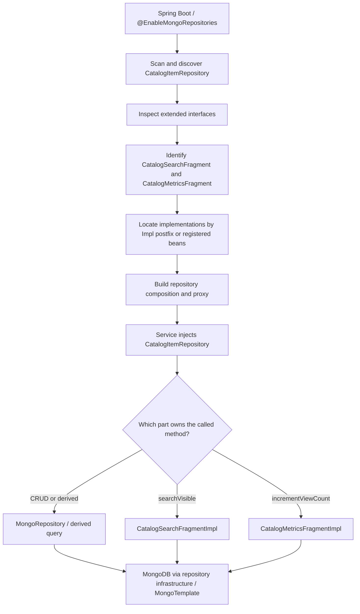
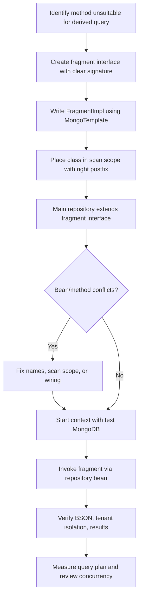

# Naming Conventions, Implementation Scanning, and Fragment Composition

With **Spring Data MongoDB**, an interface extending `MongoRepository` already includes operations such as `save`, `findById`, `deleteById`, and queries derived from method names. However, a requirement may exceed the expressive power of derived queries: searching with multiple optional conditions, running complex aggregations, performing conditional writes, or building a query that needs `MongoTemplate`. In those cases, you do not have to abandon repositories or rewrite all CRUD operations.

Spring Data allows **extending a repository with fragments** (*repository fragment*): you declare an interface containing custom methods, write a corresponding implementation class, and have the main repository **extend the fragment interface**. Spring Data discovers implementation classes based on **naming conventions and scan scope**, then composes them with the base repository into a single repository object for the application to use.

Architecture example:

```text
CatalogItemRepository
  ├── MongoRepository<CatalogItem, ObjectId>  (base CRUD and queries)
  ├── CatalogSearchFragment                  (custom search)
  │     └── CatalogSearchFragmentImpl        (MongoTemplate)
  └── CatalogMetricsFragment                 (metrics updates)
        └── CatalogMetricsFragmentImpl       (MongoTemplate)

The application only injects CatalogItemRepository.
```

This lesson belongs to the **Extended Repositories** chapter of the **SPRING_DATA_MONGODB** module: using Spring Data MongoDB to connect, map documents, query via repositories or `MongoTemplate`, test, and diagnose performance. The focus is on three tightly coupled parts: **naming conventions**, **how Spring Data scans and detects implementation classes**, and **how multiple fragments are composed**.

After this lesson, you will be able to:

1. Distinguish between a repository interface, fragment interface, implementation class, and repository proxy.
2. Name implementations properly following `<FragmentInterfaceName>Impl` and configure custom postfixes when needed.
3. Organize packages so the repository scanner discovers implementation classes.
4. Compose two or more fragments into the same repository without rewriting CRUD.
5. Inject `MongoTemplate` into fragments to build dynamic queries, updates, or aggregations.
6. Identify issues when multiple implementations share a name, bean name, or method signature.
7. Distinguish the **recommended fragment model** from legacy whole-repository implementation naming.
8. Test a truly composed repository with MongoDB, multi-tenant data, and scanning configurations.

## 1. Why Do We Need Repository Fragments?

Suppose a product catalog application has a `CatalogItem` entity. Basic need:

```java
interface CatalogItemRepository
        extends MongoRepository<CatalogItem, ObjectId> {

    Optional<CatalogItem> findByTenantIdAndSkuAndDeletedFalse(
        String tenantId, String sku);
}
```

Spring Data can implement this derived method without requiring you to write `CatalogItemRepositoryImpl`. However, when you need a dynamic filter such as:

```text
tenantId  required from login session
deleted   = false
status    = ACTIVE
name      contains a literal string, optional
price     >= minPrice, optional
limit     between 1–100
sort      price DESC, _id DESC
```

a method name chained with `And`, `Or`, and `GreaterThan` becomes unreadable, especially with optional criteria. A custom fragment can use `Criteria`, `Query`, and `MongoTemplate` to construct a clear query.

You **do not have to choose between "repository" and "MongoTemplate"**: you can use `MongoTemplate` inside the fragment implementation and keep the main repository as the unified entry point.

### 1.1. How Do the Components Differ?

| Component | Example | Role |
| --- | --- | --- |
| Main repository | `CatalogItemRepository` | API used in services; composes CRUD and fragments |
| Base repository | `MongoRepository<CatalogItem, ObjectId>` | CRUD methods and features provided by Spring Data |
| Fragment interface | `CatalogSearchFragment` | Custom method contract |
| Fragment implementation | `CatalogSearchFragmentImpl` | Execution logic for fragment methods |
| Repository proxy | Bean created by Spring Data | Dispatches calls to the appropriate implementation |
| MongoTemplate | `MongoTemplate` | Builds and executes MongoDB queries/writes inside the fragment |

**Common misconception:** Spring Data **does not require** every repository to have a class with the same name plus `Impl`. It automatically generates the repository proxy and base implementation. You only write implementations for the **custom fragments** your application needs.

## 2. Naming Conventions Used by Spring Data for Detection

Default convention for each fragment:

```text
Interface:       CatalogSearchFragment
Implementation:  CatalogSearchFragmentImpl

Interface:       CatalogMetricsFragment
Implementation:  CatalogMetricsFragmentImpl
```

The default postfix is **`Impl`**. If an interface name changes, check the corresponding implementation name. Note:

- `CatalogSearchFragmentImpl` is the implementation of **`CatalogSearchFragment`**, not `CatalogItemRepository`.
- The implementation class must actually `implements CatalogSearchFragment` and provide the required methods.
- The class must be found by Spring Data within the **appropriate package scope** or registered as a bean usable by the repository infrastructure.
- Naming alone is **not enough** if the main repository does not `extends CatalogSearchFragment`.

### 2.1. Writing a Minimal Fragment

```java
public interface CatalogSearchFragment {
    List<CatalogItem> searchVisible(
        String trustedTenantId,
        String keyword,
        BigDecimal minimumPrice,
        int limit);
}
```

Implementation:

```java
public class CatalogSearchFragmentImpl
        implements CatalogSearchFragment {

    private final MongoTemplate mongoTemplate;

    public CatalogSearchFragmentImpl(
            MongoTemplate mongoTemplate) {
        this.mongoTemplate = mongoTemplate;
    }

    @Override
    public List<CatalogItem> searchVisible(
            String tenantId,
            String keyword,
            BigDecimal minimumPrice,
            int limit) {
        // Build Query/Criteria and call mongoTemplate.find(...).
        throw new UnsupportedOperationException(
            "Full implementation in section 4"
        );
    }
}
```

Main repository composing the interface:

```java
public interface CatalogItemRepository
        extends MongoRepository<CatalogItem, ObjectId>,
                CatalogSearchFragment {

    Optional<CatalogItem> findByTenantIdAndSkuAndDeletedFalse(
        String tenantId, String sku);
}
```

Once the `CatalogItemRepository` bean exists, calls to `searchVisible` are routed to the matching fragment implementation. The `findById` method continues to be provided by repository infrastructure; `findByTenantIdAndSkuAndDeletedFalse` continues to be derived.

### 2.2. Recommended Package Structure

```text
com.example.catalog
  ├── CatalogApplication.java
  ├── domain
  │   └── CatalogItem.java
  └── repository
      ├── CatalogItemRepository.java
      ├── CatalogSearchFragment.java
      ├── CatalogSearchFragmentImpl.java
      ├── CatalogMetricsFragment.java
      └── CatalogMetricsFragmentImpl.java
```

Placing the repository and fragment implementations in `com.example.catalog.repository` keeps scanning conventions transparent. In more complex layouts, implementations may reside in subpackages within the scanned infrastructure scope, but this must be verified with integration tests. **Do not place classes in a module/package outside the search scope and assume Spring Data will discover them automatically.**

### 2.3. Main Repository Name Plus `Impl`: Legacy Style to Avoid Confusing

Historically, customization was tied to the **name of the main repository**, such as:

```text
CatalogItemRepository
CatalogItemRepositoryImpl
```

Detecting a single custom implementation named after the repository is a **legacy** style that is easily confused with the base repository implementation and difficult to scale into multiple independent capabilities. In modern Spring Data, **prefer fragment interface + fragment-named implementation**:

```text
CatalogSearchFragment + CatalogSearchFragmentImpl
CatalogMetricsFragment + CatalogMetricsFragmentImpl
```

Specifically, do not create a class named `CatalogItemRepositoryImpl` just to add methods for `CatalogSearchFragment`: that class might be picked up by legacy compatibility rules or obscure responsibilities. If maintaining a legacy project, identify the existing repository implementation model before migrating to fragments.

## 3. Repository and Fragment Implementation Scanning

### 3.1. Spring Boot Auto-Configuration

In a Spring Boot application with sensible package layout:

```java
package com.example.catalog;

import org.springframework.boot.SpringApplication;
import org.springframework.boot.autoconfigure.SpringBootApplication;

@SpringBootApplication
public class CatalogApplication {
    public static void main(String[] args) {
        SpringApplication.run(CatalogApplication.class, args);
    }
}
```

Spring Boot normally configures repository scanning automatically when Spring Data MongoDB and required configurations are present. In this example, `CatalogApplication` is in the parent package of `com.example.catalog.repository`, so repositories underneath can be discovered via standard auto-configuration.

Do not assume `@SpringBootApplication` automatically turns **every** interface on the entire classpath into a repository. Scan scope depends on Boot/Spring Data settings, root packages, and auto-configuration conditions. Multi-module projects may require explicit declarations.

### 3.2. Specifying Repository Base Packages When Needed

If the application spans multiple package areas or requires explicit configuration, you can use:

```java
package com.example.catalog;

import com.example.catalog.repository.CatalogItemRepository;
import org.springframework.context.annotation.Configuration;
import org.springframework.data.mongodb.repository.config.EnableMongoRepositories;

@Configuration
@EnableMongoRepositories(
    basePackageClasses = CatalogItemRepository.class
)
public class CatalogRepositoryConfiguration {
}
```

`basePackageClasses` selects the package containing a marker class/interface with less reliance on string literals than `basePackages = "..."`. In this example, infrastructure scans the package containing `CatalogItemRepository` for repository interfaces; fragment implementations must live where infrastructure can locate them.

When explicitly declaring `@EnableMongoRepositories` in Spring Boot, be careful to avoid overlapping scan configurations or creating repository beans twice. Add explicit configuration only when module design calls for it; do not treat it as mandatory for every Boot project.

### 3.3. Distinguishing Repository Scan from Component Scan

These two concepts are related but **not identical**:

- **Repository scanning** discovers repository interfaces, creates repository proxies, and coordinates finding matching fragment implementations.
- **Component scanning** discovers Spring components such as `@Component`, `@Service`, and `@Configuration` within scanned packages.

A fragment implementation can be recognized by Spring Data via **naming convention** without needing `@Repository` or `@Component` just to be composed. When you want manual registration or custom bean lifecycle control, you must understand the repository infrastructure's bean naming and selection rules.

Adding `@Component` to every fragment class is not a universal fix for uncomposed fragments: if the postfix is wrong, the implemented interface is wrong, beans collide, or the package is wrong, that annotation will not fix the root cause.

### 3.4. Changing the Implementation Postfix with `repositoryImplementationPostfix`

Spring Data MongoDB lets you configure a postfix other than `Impl`:

```java
@Configuration
@EnableMongoRepositories(
    basePackageClasses = CatalogItemRepository.class,
    repositoryImplementationPostfix = "Custom"
)
public class CatalogRepositoryConfiguration {
}
```

Then the conventional implementation class for `CatalogSearchFragment` becomes:

```java
public class CatalogSearchFragmentCustom
        implements CatalogSearchFragment {
    // Custom logic.
}
```

This is **an alternative configuration option** to the `Impl` example, not a requirement to create both `CatalogSearchFragmentImpl` and `CatalogSearchFragmentCustom`. The postfix applies at the repository configuration level, so review the entire scan scope before changing it to avoid breaking detection of other fragments.

### 3.5. When a Class Has the Right Name but Still Is Not Discovered

Check in order:

1. Does the main repository `extends` the exact fragment interface?
2. Is the implementation named `<FragmentInterfaceName>Impl` (or configured postfix) and does it `implements` the right interface?
3. Is the repository interface inside Spring Data MongoDB's scan scope?
4. Is the implementation in a package searched by repository infrastructure?
5. Is there a bean with the same name or another class with the same name in a different package causing ambiguity?
6. Are constructor dependencies such as `MongoTemplate` available from Spring?
7. Do method signatures match the interface, including generic parameters and return types?

Do not verify solely because the IDE sees the class. You must **start the application context or run a repository test** to be sure the bean is composed and calls actually reach the right fragment.

## 4. Complete Example: Search Fragment with `MongoTemplate`

This section illustrates the classes needed in a Spring Boot project with Spring Data MongoDB. Each code block corresponds to **one Java file**; packages/imports are included so it can become a standalone exercise. The example uses the `fragment_catalog_lab` collection for the practice environment.

### 4.1. Domain Document: `CatalogItem`

```java
package com.example.catalog.domain;

import java.math.BigDecimal;
import org.bson.types.ObjectId;
import org.springframework.data.annotation.Id;
import org.springframework.data.mongodb.core.mapping.Document;
import org.springframework.data.mongodb.core.mapping.Field;
import org.springframework.data.mongodb.core.mapping.FieldType;

@Document(collection = "fragment_catalog_lab")
public class CatalogItem {
    @Id
    private ObjectId id;

    private String labRun;
    private String tenantId;
    private String sku;
    private String name;
    private String status;
    private boolean deleted;

    @Field(targetType = FieldType.DECIMAL128)
    private BigDecimal price;

    private long viewCount;

    protected CatalogItem() {}

    public CatalogItem(
            String labRun,
            String tenantId,
            String sku,
            String name,
            String status,
            boolean deleted,
            BigDecimal price) {
        this.labRun = labRun;
        this.tenantId = tenantId;
        this.sku = sku;
        this.name = name;
        this.status = status;
        this.deleted = deleted;
        this.price = price;
        this.viewCount = 0L;
    }

    public ObjectId getId() { return id; }
    public String getLabRun() { return labRun; }
    public String getTenantId() { return tenantId; }
    public String getSku() { return sku; }
    public String getName() { return name; }
    public String getStatus() { return status; }
    public boolean isDeleted() { return deleted; }
    public BigDecimal getPrice() { return price; }
    public long getViewCount() { return viewCount; }
}
```

`@Id ObjectId id` maps to BSON `_id`; `@Field(targetType = FieldType.DECIMAL128)` specifies storing `BigDecimal price` as Decimal128 so numeric price comparisons do not rely on strings. Sample document:

```javascript
{
  _id: ObjectId("665f1f2a4b6c7d8e9f001234"),
  labRun: "demo-001",
  tenantId: "T1",
  sku: "BK-001",
  name: "Java Fundamentals",
  status: "ACTIVE",
  deleted: false,
  price: NumberDecimal("120.00"),
  viewCount: NumberLong("0")
}
```

`labRun` is a practice-exercise marker, not a required property on a real product. With multi-tenant data, `tenantId` must be verified from the session/token or checked server-side on creation and queries; having a `tenantId` field on an entity **does not automatically guarantee authorization**.

### 4.2. Fragment Interface: `CatalogSearchFragment`

```java
package com.example.catalog.repository;

import com.example.catalog.domain.CatalogItem;
import java.math.BigDecimal;
import java.util.List;

public interface CatalogSearchFragment {
    List<CatalogItem> searchVisible(
        String trustedTenantId,
        String keyword,
        BigDecimal minimumPrice,
        int limit);
}
```

The interface does not extend `MongoRepository`, needs no `@Repository` annotation, and does not connect to MongoDB directly. It is a **partial-capability contract** to be composed into the main repository.

### 4.3. Implementation: `CatalogSearchFragmentImpl`

```java
package com.example.catalog.repository;

import com.example.catalog.domain.CatalogItem;
import java.math.BigDecimal;
import java.util.List;
import java.util.regex.Pattern;
import org.springframework.data.domain.Sort;
import org.springframework.data.mongodb.core.MongoTemplate;
import org.springframework.data.mongodb.core.query.Criteria;
import org.springframework.data.mongodb.core.query.Query;

public class CatalogSearchFragmentImpl
        implements CatalogSearchFragment {

    private final MongoTemplate mongoTemplate;

    public CatalogSearchFragmentImpl(
            MongoTemplate mongoTemplate) {
        this.mongoTemplate = mongoTemplate;
    }

    @Override
    public List<CatalogItem> searchVisible(
            String trustedTenantId,
            String keyword,
            BigDecimal minimumPrice,
            int limit) {

        if (trustedTenantId == null || trustedTenantId.isBlank()) {
            throw new IllegalArgumentException("Missing tenant");
        }
        if (limit < 1 || limit > 100) {
            throw new IllegalArgumentException(
                "limit must be in [1, 100]"
            );
        }
        if (minimumPrice != null && minimumPrice.signum() < 0) {
            throw new IllegalArgumentException("Negative minimum price");
        }
        if (keyword != null && keyword.length() > 80) {
            throw new IllegalArgumentException("Keyword too long");
        }

        Criteria criteria = Criteria.where("tenantId")
            .is(trustedTenantId)
            .and("deleted").is(false)
            .and("status").is("ACTIVE");

        if (minimumPrice != null) {
            criteria.and("price").gte(minimumPrice);
        }

        if (keyword != null && !keyword.isBlank()) {
            Pattern literal = Pattern.compile(
                Pattern.quote(keyword.trim()),
                Pattern.CASE_INSENSITIVE
            );
            criteria.and("name").regex(literal);
        }

        Query query = Query.query(criteria)
            .with(Sort.by(
                Sort.Order.desc("price"),
                Sort.Order.desc("id")
            ))
            .limit(limit);

        return mongoTemplate.find(query, CatalogItem.class);
    }
}
```

Explanation:

1. **Mandatory filters** `tenantId + deleted=false + status=ACTIVE` are fixed in code.
2. **Optional filters** add conditions only when the caller actually supplies `minimumPrice` or `keyword`.
3. `Pattern.quote` turns the keyword into a **literal** search, preventing strings like `.*` or `C++` from acting as query-controlling regex expressions.
4. `limit` is bounded between 1–100 to prevent returning too many documents in one call.
5. `Sort` combines `price` and `id` as a tie-breaker so documents with equal prices maintain deterministic ordering. When querying via a domain class, `id` maps to BSON `_id`.
6. `MongoTemplate.find` applies `CatalogItem` mapping, including Decimal128 for `price`.

This is an example of a **fragment implementing dynamic queries**, without any need to write `CatalogItemRepositoryImpl`. All query conditions are Java-typed, with field names/operators defined in code; raw JSON sent by clients is not parsed into filters.

**Caveat to remember:** substring regex on `name`, especially case-insensitive, may not utilize a B-tree index efficiently. For large-scale text search, evaluate search indexes or dedicated search solutions and measure the query plan. This example prioritizes demonstrating composition and input safety.

### 4.4. Main Repository Using the Fragment

```java
package com.example.catalog.repository;

import com.example.catalog.domain.CatalogItem;
import java.util.Optional;
import org.bson.types.ObjectId;
import org.springframework.data.mongodb.repository.MongoRepository;

public interface CatalogItemRepository
        extends MongoRepository<CatalogItem, ObjectId>,
                CatalogSearchFragment {

    Optional<CatalogItem> findByTenantIdAndSkuAndDeletedFalse(
        String tenantId,
        String sku);
}
```

Once Spring Data creates the repository bean, the service can use **the same object** for both capabilities:

```java
CatalogItem item = repository
    .findByTenantIdAndSkuAndDeletedFalse(
        trustedTenantId, "BK-001"
    )
    .orElseThrow();

List<CatalogItem> visible = repository.searchVisible(
    trustedTenantId,
    "Java",
    new BigDecimal("50.00"),
    20
);
```

Here `repository` is an injected `CatalogItemRepository` bean, `trustedTenantId` comes from a trusted server context, and the code resides in an appropriate service method. **Derived methods** and **fragment methods** live together on the repository's public interface, yet are executed by different components.

## 5. Composing Multiple Fragments in One Repository

As features grow, there is no need to bloat `CatalogSearchFragment` into an interface holding every operation. Split distinct responsibilities:

```text
CatalogSearchFragment   -> complex queries/filters
CatalogMetricsFragment  -> metric update operations
CatalogItemRepository   -> combined API for the service
```

### 5.1. Second Fragment: `CatalogMetricsFragment`

```java
package com.example.catalog.repository;

import org.bson.types.ObjectId;

public interface CatalogMetricsFragment {
    boolean incrementViewCount(
        String trustedTenantId,
        ObjectId itemId);
}
```

Corresponding implementation:

```java
package com.example.catalog.repository;

import com.example.catalog.domain.CatalogItem;
import com.mongodb.client.result.UpdateResult;
import org.bson.types.ObjectId;
import org.springframework.data.mongodb.core.MongoTemplate;
import org.springframework.data.mongodb.core.query.Criteria;
import org.springframework.data.mongodb.core.query.Query;
import org.springframework.data.mongodb.core.query.Update;

public class CatalogMetricsFragmentImpl
        implements CatalogMetricsFragment {

    private final MongoTemplate mongoTemplate;

    public CatalogMetricsFragmentImpl(
            MongoTemplate mongoTemplate) {
        this.mongoTemplate = mongoTemplate;
    }

    @Override
    public boolean incrementViewCount(
            String trustedTenantId,
            ObjectId itemId) {

        if (trustedTenantId == null || trustedTenantId.isBlank()
                || itemId == null) {
            throw new IllegalArgumentException("Missing ID/tenant");
        }

        Query query = Query.query(
            Criteria.where("id").is(itemId)
                .and("tenantId").is(trustedTenantId)
                .and("deleted").is(false)
                .and("status").is("ACTIVE")
        );

        Update update = new Update().inc("viewCount", 1);
        UpdateResult result = mongoTemplate.updateFirst(
            query, update, CatalogItem.class
        );
        return result.getModifiedCount() == 1;
    }
}
```

The filter includes the unique `id`, so at most one document is updated while scoping tenant and status. `$inc` performs an atomic counter increment on the matching document, but if a **new business request** is retried due to a client timeout, the counter can increment a second time. For metrics requiring *exactly once* semantics, the service needs an idempotency key or deduplication mechanism, not just `$inc`.

### 5.2. Repository Composing Both Fragments

```java
package com.example.catalog.repository;

import com.example.catalog.domain.CatalogItem;
import java.util.Optional;
import org.bson.types.ObjectId;
import org.springframework.data.mongodb.repository.MongoRepository;

public interface CatalogItemRepository
        extends MongoRepository<CatalogItem, ObjectId>,
                CatalogSearchFragment,
                CatalogMetricsFragment {

    Optional<CatalogItem> findByTenantIdAndSkuAndDeletedFalse(
        String tenantId,
        String sku);
}
```

When the application injects `CatalogItemRepository`, a single repository object provides:

| Method | Implementation source |
| --- | --- |
| `save`, `findById`, `deleteById` | Base repository provided by Spring Data |
| `findByTenantIdAndSkuAndDeletedFalse` | Query derivation mechanism |
| `searchVisible` | `CatalogSearchFragmentImpl` |
| `incrementViewCount` | `CatalogMetricsFragmentImpl` |

There is no need to write a manual `CatalogItemRepositoryImpl implements CatalogItemRepository` class to coordinate them. **Repository composition** is Spring Data's responsibility.

### 5.3. Composition Order and Method Signature Collisions

Spring Data supports multiple fragments and defines precedence rules when components provide methods with identical signatures. Custom fragments can take precedence over base methods or repository aspects in some scenarios; fragment declaration order can also participate in selection. Therefore, **do not rely on duplicate method names for implicit business behavior**.

Confusing example:

```java
public interface FragmentA {
    long refresh(String tenantId);
}

public interface FragmentB {
    long refresh(String tenantId);
}

public interface CatalogItemRepository
        extends MongoRepository<CatalogItem, ObjectId>,
                FragmentA, FragmentB {
}
```

Both fragments define `refresh(String)`. Even if the framework has a rule for choosing an implementation, maintainers cannot easily tell from the repository API which behavior actually runs. A better approach:

```java
public interface CatalogSearchFragment {
    List<CatalogItem> searchVisible(
        String trustedTenantId,
        String keyword,
        BigDecimal minimumPrice,
        int limit);
}

public interface CatalogMetricsFragment {
    boolean incrementViewCount(
        String trustedTenantId,
        ObjectId itemId);
}
```

These are **two distinct method contracts**, matching the full signatures in sections 4 and 5; in a real project, place each public interface in its own Java file and add the necessary imports. Keep responsibilities non-overlapping, and avoid accidentally **overriding** `MongoRepository` methods like `save` or `deleteById` without intentional design, thorough testing, and a clear understanding of composition order.

## 6. Bean Names, Multiple Implementations, and Manual Registration

Class naming conventions help Spring Data find candidates, but in large projects you may encounter **multiple beans** or **multiple classes with the same name**. For example:

```text
com.example.catalog.repository.CatalogSearchFragmentImpl
com.example.legacy.CatalogSearchFragmentImpl
```

If both sit within discoverable infrastructure scope and can participate in the same fragment, selecting a single implementation becomes ambiguous. Bean selection should never be treated as a lucky accident in production.

### 6.1. Bean Naming Conventions and Control

Spring Data can use **bean names** to resolve candidates or pick up a manually registered implementation. Under common conventions, the bean name tied to `CatalogSearchFragment` and the `Impl` postfix takes the form:

```text
catalogSearchFragmentImpl
```

When customizing configuration, check the documentation/behavior of your exact Spring Data MongoDB version and align the bean name with what repository infrastructure expects. Do not pick an arbitrary bean name and assume Spring Data will use it simply because the class implements the same interface.

Manual registration example (instead of automatic class discovery):

```java
package com.example.catalog;

import com.example.catalog.repository.CatalogSearchFragment;
import com.example.catalog.repository.CatalogSearchFragmentImpl;
import org.springframework.context.annotation.Bean;
import org.springframework.context.annotation.Configuration;
import org.springframework.data.mongodb.core.MongoTemplate;

@Configuration
public class CatalogFragmentWiringConfiguration {

    @Bean("catalogSearchFragmentImpl")
    public CatalogSearchFragment catalogSearchFragment(
            MongoTemplate mongoTemplate) {
        return new CatalogSearchFragmentImpl(mongoTemplate);
    }
}
```

In this example, the implementation is created with the Spring-provided `MongoTemplate`. **Do not** simultaneously register another bean with the same name (for example, adding `@Component("catalogSearchFragmentImpl")` on the implementation class), because duplicate registration can fail or depend on application bean-overriding rules.

Manual registration is useful when you need special constructor injection, custom lifecycle management, or exact control over which implementation is used. However, **it is not a required step**: with the default layout and naming in sections 2–5, prefer letting Spring Data auto-compose when all conditions are satisfied.

### 6.2. When Two Implementations Share the Same Name

Safe ways to resolve this:

1. **Remove the unused class** from scanned packages if it is legacy code.
2. **Rename and split interfaces** if there are genuinely two distinct responsibilities.
3. **Restrict scan scope** of repository configuration so unrelated implementations are excluded.
4. **Assign clear bean names** and test candidate selection when manual registration is required.
5. **Test method behavior**, not merely that the application context starts up.

Do not resolve conflicts by sprinkling `@Primary` everywhere and ignoring the root cause. Which implementation repository infrastructure composes should never be an obscure side effect difficult to verify in code review.

### 6.3. Constructor Injection and Fragment Dependencies

An implementation may require beans such as:

```java
public CatalogSearchFragmentImpl(
        MongoTemplate mongoTemplate,
        CatalogSearchPolicy searchPolicy) {
    // Store provided dependencies.
}
```

`CatalogSearchPolicy` here is a hypothetical application service, **not a built-in Spring Data API**. It must be created/registered as a Spring bean before infrastructure constructs the fragment. If constructor dependencies are unsatisfied, failures typically occur at application context startup rather than when invoking the method.

Do not arbitrarily call `new MongoTemplate(...)` inside a fragment when the application already has a configured `MongoTemplate` with proper connection, converters, mapping, and transaction/session settings. Injecting the shared bean ensures the fragment uses the application's data configuration.

## 7. Using One Fragment Across Multiple Repositories

A benefit of fragment architecture is **sharing behavior** across multiple repositories when methods and data types permit. For example, both `CatalogItemRepository` and a digital-product repository might need a specialized filter or operation.

However, sharing does not mean forcing every fragment into an overly generic interface. Distinguish two levels:

- **Domain-specific fragment**: `CatalogSearchFragment` directly uses `CatalogItem`, `CatalogItem.class`, `price`, and `status`. It is suited for the CatalogItem repository.
- **Generic fragment**: a generic interface with a clear enough contract to reuse across multiple entities. The implementation must know the corresponding domain type, ID type, mapping, and query rules.

### 7.1. Generic Interface Example (Conceptual)

```java
public interface CountByTenantFragment {
    long countVisibleForTenant(String trustedTenantId);
}
```

This interface is not parameterized by entity, but if the implementation needs to return counts across **different collections**, it cannot simply hardcode `CatalogItem.class` and assume the fragment works on any repository. Proper generic implementation may require repository metadata/domain type, a factory, or a dedicated fragment design.

For small-to-medium problems, prefer concrete fragments that are easy to read and test. Abstract only when multiple repositories genuinely share identical business invariants and a clear mapping strategy.

### 7.2. Do Not Confuse an Intermediate Repository Interface with a Fragment

A shared base interface can extend `MongoRepository` for other repositories to inherit:

```java
import org.springframework.data.repository.NoRepositoryBean;
import org.springframework.data.mongodb.repository.MongoRepository;

@NoRepositoryBean
public interface SharedMongoRepository<T, ID>
        extends MongoRepository<T, ID> {
    // Shared contract across repositories, if needed.
}
```

`@NoRepositoryBean` prevents infrastructure from trying to instantiate a concrete repository bean for the still-generic intermediate interface. This is a **repository inheritance concern**, distinct from a fragment interface like `CatalogSearchFragment` (which does not extend `MongoRepository` and does not need `@NoRepositoryBean` just to declare custom methods).

If you use a **custom base repository implementation** module-wide, you modify the repository factory's base class mechanism with a much wider impact than a fragment. Choose fragments when you only need to attach a few custom behaviors to one or a handful of repositories.

## 8. Startup and Dispatch Flow of a Fragment Method

To visualize what happens when the application starts:



This diagram shows a **conceptual model**; internal factory/proxy classes, callback ordering, and bean-creation details depend on the Spring Data version. What matters for implementers is the contract: Spring creates the main repository, fragment implementations are composed when names/scopes/beans match, and application calls go through the existing repository bean.

### 8.1. What Happens If You Forget `extends CatalogSearchFragment`?

Even if `CatalogSearchFragmentImpl` exists and `MongoTemplate` injects cleanly, if the main repository **does not extend** `CatalogSearchFragment`, then `searchVisible` **is not part of the API** of `CatalogItemRepository`. Services cannot call it through the repository without changing types or accessing the fragment directly.

### 8.2. What Happens If the Implementation Is Misnamed?

`CatalogSearchImpl` might be a valid Java class, yet it does not match the default convention for `CatalogSearchFragment`. If the repository expects a fragment method and infrastructure has no matching implementation, the application may fail at startup or attempt to parse the method as a query depending on configuration.

**Do not** guess startup outcomes from a class name alone. Read the cause in the repository factory exception, fix the name/scope, and verify with an integration test.

### 8.3. Do Not Put Data-Mutating Logic in the Constructor

Fragment implementations are typically instantiated when the application context starts. Never place collection drops, demo seeding, bulk updates, or migrations in the constructor just because it holds `MongoTemplate`. Data operations with side effects must be organized under dedicated initialization/migration mechanisms with controlled permissions, environments, and retry handling.

## 9. `mongosh` Practice: Proving Fragment Query Semantics

Fragment composition happens inside the JVM; there is no `mongosh` command to "compose a fragment." However, you should run the **equivalent BSON query** to confirm `searchVisible` targets the intended documents, and then use the integration test in section 10 to verify Spring Data's composition actually works.

**Use only a test database.** The commands below create documents with a `labRun` marker and randomized tenants, then clean up only the data from that practice run.

### 9.1. Create a Dataset with Multiple Tenants and Statuses

```javascript
use spring_data_training

const lab = db.getCollection("fragment_catalog_lab");
const labRun = "extended-repository-002-" +
  new ObjectId().toHexString();
const tenant1 = labRun + "-T1";
const tenant2 = labRun + "-T2";

const inserted = lab.insertMany([
  {
    labRun: labRun, tenantId: tenant1, label: "A",
    sku: "BK-01", name: "Java Fundamentals",
    status: "ACTIVE", deleted: false,
    price: NumberDecimal("120.00"),
    viewCount: NumberLong("0")
  },
  {
    labRun: labRun, tenantId: tenant1, label: "B",
    sku: "BK-02", name: "Java Intro",
    status: "ACTIVE", deleted: false,
    price: NumberDecimal("40.00"),
    viewCount: NumberLong("0")
  },
  {
    labRun: labRun, tenantId: tenant1, label: "C",
    sku: "DB-01", name: "MongoDB Guide",
    status: "ACTIVE", deleted: false,
    price: NumberDecimal("150.00"),
    viewCount: NumberLong("0")
  },
  {
    labRun: labRun, tenantId: tenant1, label: "D",
    sku: "BK-03", name: "Java Draft",
    status: "DRAFT", deleted: false,
    price: NumberDecimal("180.00"),
    viewCount: NumberLong("0")
  },
  {
    labRun: labRun, tenantId: tenant1, label: "E",
    sku: "BK-04", name: "Java Obsolete",
    status: "ACTIVE", deleted: true,
    price: NumberDecimal("140.00"),
    viewCount: NumberLong("0")
  },
  {
    labRun: labRun, tenantId: tenant2, label: "F",
    sku: "BK-01", name: "Java Fundamentals",
    status: "ACTIVE", deleted: false,
    price: NumberDecimal("120.00"),
    viewCount: NumberLong("0")
  },
  {
    labRun: labRun, tenantId: tenant1, label: "G",
    sku: "BK-05", name: "Advanced Java",
    status: "ACTIVE", deleted: false,
    price: NumberDecimal("90.00"),
    viewCount: NumberLong("0")
  }
]);

printjson({
  labRun: labRun,
  tenant1: tenant1,
  tenant2: tenant2
});
print(lab.countDocuments({ labRun: labRun })); // Expected: 7
```

Run subsequent commands in the **same shell session**, since `lab`, `labRun`, `tenant1`, and `tenant2` variables are not persisted across sessions.

### 9.2. Query Equivalent to `searchVisible`

With `keyword = "Java"`, `minimumPrice = 50.00`, and `limit = 20`:

```javascript
const visible = lab.find(
  {
    labRun: labRun,
    tenantId: tenant1,
    status: "ACTIVE",
    deleted: false,
    price: { $gte: NumberDecimal("50.00") },
    name: { $regex: "Java", $options: "i" }
  },
  {
    _id: 1, label: 1,
    tenantId: 1, name: 1, price: 1
  }
)
.sort({ price: -1, _id: -1 })
.limit(20)
.toArray();

printjson(visible.map(d => d.label));
// Expected: ["A", "G"] — A is more expensive than G.
```

B fails `minimumPrice`; C does not contain Java; D is DRAFT; E is soft-deleted; F belongs to `tenant2`. The string `Java` in this example contains no regex metacharacters. When queries accept arbitrary user input, the Java fragment uses `Pattern.quote` to prevent input from becoming regex operators; the raw script above merely illustrates a known keyword.

### 9.3. Metric Update Equivalent to the Second Fragment

Retrieve document A's ID:

```javascript
const itemA = lab.findOne({
  labRun: labRun,
  tenantId: tenant1,
  label: "A"
});

const increment = lab.updateOne(
  {
    _id: itemA._id,
    tenantId: tenant1,
    status: "ACTIVE",
    deleted: false
  },
  { $inc: { viewCount: NumberLong("1") } }
);

printjson({
  matched: increment.matchedCount,
  modified: increment.modifiedCount
});
// Expected: 1, 1.

printjson(lab.findOne(
  { _id: itemA._id },
  { _id: 0, label: 1, viewCount: 1 }
));
// Expected: A has viewCount = 1.
```

This matches the logic in `CatalogMetricsFragmentImpl.incrementViewCount`. Since the filter includes the unique `_id`, only one document is updated.

### 9.4. Must Not Modify Another Tenant's Document

```javascript
const itemF = lab.findOne({
  labRun: labRun,
  tenantId: tenant2,
  label: "F"
});

const blocked = lab.updateOne(
  {
    _id: itemF._id,
    tenantId: tenant1,
    status: "ACTIVE",
    deleted: false
  },
  { $inc: { viewCount: 1 } }
);

printjson({
  matched: blocked.matchedCount,
  modified: blocked.modifiedCount
});
// Expected: 0, 0 — F still belongs to tenant2.
```

Tenant authorization must be determined/verified **server-side**. A query with a properly named `tenantId` field is still insecure if the API blindly accepts an arbitrary tenant from the request without checking permissions.

### 9.5. Exact Cleanup by Marker

```javascript
const toRemove = lab.countDocuments({ labRun: labRun });
print("Number of session documents to clean up: " + toRemove);

const cleanup = lab.deleteMany({ labRun: labRun });
printjson({ deletedCount: cleanup.deletedCount });

print(lab.countDocuments({ labRun: labRun })); // 0
```

Never replace `{ labRun: labRun }` with `{}` or call `drop()` if the collection may hold someone else's data. These practice documents were not created via a Java entity, so they may lack `_class`; that does not affect raw query verification.

## 10. Integration Testing: Proving the Repository Truly Composes Fragments

Relying on naming-convention theory alone is not enough. A wrong postfix, package scan, or bean wiring error can prevent the application context from creating the repository, or cause methods to miss the intended class. An **integration test** should:

- Start up the real repository bean with the corresponding Spring Data MongoDB configuration.
- Insert fixtures across multiple tenants, including documents that fail the filter.
- Call `searchVisible` through **`CatalogItemRepository`**, not directly via `new CatalogSearchFragmentImpl(...)`.
- Call `incrementViewCount` through the same repository and verify BSON afterward.
- Clean up only created data even if assertions fail.

### 10.1. JUnit 5 and `@DataMongoTest`

The following example uses a dedicated test MongoDB (local/test container). Adjust imports/configuration according to your Spring Boot version. The classes `CatalogItem`, `CatalogSearchFragment`, `CatalogSearchFragmentImpl`, `CatalogMetricsFragment`, `CatalogMetricsFragmentImpl`, and `CatalogItemRepository` are the ones declared in sections 4–5.

```java
package com.example.catalog.repository;

import static org.junit.jupiter.api.Assertions.*;
import static com.mongodb.client.model.Filters.eq;

import com.example.catalog.domain.CatalogItem;
import java.math.BigDecimal;
import java.util.List;
import java.util.Set;
import java.util.UUID;
import java.util.stream.Collectors;
import org.bson.Document;
import org.bson.types.ObjectId;
import org.junit.jupiter.api.Test;
import org.springframework.beans.factory.annotation.Autowired;
import org.springframework.boot.test.autoconfigure.data.mongo.DataMongoTest;
import org.springframework.data.mongodb.core.MongoTemplate;
import org.springframework.data.mongodb.core.query.Criteria;
import org.springframework.data.mongodb.core.query.Query;

@DataMongoTest
class CatalogFragmentCompositionTest {

    @Autowired
    CatalogItemRepository repository;

    @Autowired
    MongoTemplate template;

    private CatalogItem insert(
            String run, String tenant,
            String sku, String name,
            String status, boolean deleted,
            String price) {
        return repository.insert(new CatalogItem(
            run, tenant, sku, name, status,
            deleted, new BigDecimal(price)
        ));
    }

    private Document raw(CatalogItem item) {
        Document stored = template
            .getCollection("fragment_catalog_lab")
            .find(eq("_id", item.getId()))
            .first();
        assertNotNull(stored);
        return stored;
    }

    private void cleanup(String run) {
        template.remove(
            Query.query(Criteria.where("labRun").is(run)),
            CatalogItem.class
        );
    }

    @Test
    void fragmentsWorkThroughTheComposedRepository() {
        String run = UUID.randomUUID().toString();
        String t1 = run + "-T1";
        String t2 = run + "-T2";

        CatalogItem a = insert(
            run, t1, "BK-01", "Java Fundamentals",
            "ACTIVE", false, "120.00"
        );
        CatalogItem g = insert(
            run, t1, "BK-05", "Advanced Java",
            "ACTIVE", false, "90.00"
        );
        insert(
            run, t1, "BK-02", "Java Intro",
            "ACTIVE", false, "40.00"
        );
        insert(
            run, t1, "BK-03", "Java Draft",
            "DRAFT", false, "180.00"
        );
        insert(
            run, t1, "BK-04", "Java Old",
            "ACTIVE", true, "140.00"
        );
        CatalogItem otherTenant = insert(
            run, t2, "BK-01", "Java Fundamentals",
            "ACTIVE", false, "120.00"
        );

        try {
            List<CatalogItem> results = repository.searchVisible(
                t1, "Java", new BigDecimal("50.00"), 20
            );

            List<ObjectId> resultIds = results.stream()
                .map(CatalogItem::getId)
                .toList();

            assertEquals(List.of(a.getId(), g.getId()), resultIds);

            assertTrue(repository.incrementViewCount(
                t1, a.getId()
            ));
            assertFalse(repository.incrementViewCount(
                t1, otherTenant.getId()
            ));

            assertEquals(1L,
                ((Number) raw(a).get("viewCount")).longValue());
            assertEquals(0L,
                ((Number) raw(otherTenant).get("viewCount")).longValue());

            assertTrue(repository
                .findByTenantIdAndSkuAndDeletedFalse(t1, "BK-01")
                .isPresent());
        } finally {
            cleanup(run);
        }
    }
}
```

The test invokes **two fragment methods through one repository bean**. If fragments are not composed properly, either the application context or the call exposes the error; if a fragment query is wrong, assertions on ID sets, ordering, and tenants fail.

In this example, A's price (120) is greater than G's (90), so `price DESC, id DESC` places A before G. Do not guess orderings for equal-priced documents without a tie-breaker. The test also proves that the derived method `findByTenantIdAndSkuAndDeletedFalse` continues to work alongside fragments.

**Testing status:** the code in this lesson is an example for learners to implement and **was not executed during authoring**. When integrating into a real project, pick your Spring Boot/Spring Data MongoDB versions, configure an isolated test MongoDB, and verify that `@DataMongoTest` scans your module's repository/fragment packages properly. If the test slice does not pick up custom scan configuration, supply appropriate test configuration/`@Import` rather than accidentally pointing tests at production MongoDB.

### 10.2. Testing Implementation Discovery

Create an intentional test variation to practice diagnostics:

1. Rename `CatalogSearchFragmentImpl` to `CatalogSearchImplementation` while keeping the default `Impl` postfix.
2. Start the test context; observe the repository/fragment error message when Spring Data no longer recognizes the implementation.
3. Restore the correct name and rerun the test.
4. Move the implementation outside the scan scope, observe the difference, and restore it.
5. Try configuring `repositoryImplementationPostfix = "Custom"` and renaming the class to `CatalogSearchFragmentCustom` on a separate experimental branch.

Perform these experiments only in a lab environment; never tweak production configurations "just to see" while other repositories share the common postfix.

## 11. Common Pitfalls in Naming, Scanning, and Composition

| Symptom | Possible cause | Resolution |
| --- | --- | --- |
| Repository bean fails to initialize after adding a custom method | Fragment implementation missing, misnamed, wrong package, or uncomposed | Check `extends Fragment`, `FragmentImpl` name, scan scope, and startup logs |
| Framework tries to parse custom method as a derived query | Method not recognized as belonging to an implemented fragment | Verify fragment contract and implementation class |
| Fragment class exists but service cannot see the method | Main repository forgot `extends CatalogSearchFragment` | Add fragment interface to the main repository |
| Changing `Impl` to `Custom` makes fragment "disappear" | Repository implementation postfix does not match class name | Align `repositoryImplementationPostfix` and class name |
| Two `CatalogSearchFragmentImpl` classes in different packages | Ambiguous candidates or bean names | Narrow scan scope, split interfaces, name beans clearly, and test |
| Duplicate bean name error | Both `@Bean("catalogSearchFragmentImpl")` and `@Component` share the same name | Pick a single registration mechanism |
| Constructor error missing `MongoTemplate` | MongoDB auto-config did not create template, wrong qualifier, or slice test missing config | Check Mongo configuration and dependency injection |
| `MongoRepository` works, but fragment scanned in another module is missing | Scanned repository package does not include the implementation per discovery rules | Place implementation within scope or wire deliberately |
| Method with identical signature in two fragments | Unclear fragment conflict/dispatch for readers | Use distinct methods; do not rely on implicit composition order |
| Accidentally overriding `save` or `deleteById` | Fragment declares methods matching base API | Avoid collisions or design intentional overrides with thorough tests |
| Custom query returns nothing after refactoring `@Field` | Fragment used mismatched BSON field names | Use domain-class mapping, inspect raw BSON and queries |
| Fragment query leaks another tenant's data | Missing tenant filter or untrusted tenant source | Enforce tenant from auth context, test T2 data |
| Regex with `.*` returns too many documents | Input treated as regex expression rather than literal | `Pattern.quote` and limit keyword length |
| Slow query despite properly composed fragment | Not a composition bug; likely missing index/regex/large collection | Run `explain` and measure workload |
| `$inc` increments `viewCount` twice | Business request retried | Service-level idempotency and deduplication strategy |
| Slice test fails to create custom fragment | Test bootstrap/package config differs from runtime | Align packages/config, add `@Import` as needed, use isolated test DB |
| Spring tries to instantiate generic intermediate interface as repository | Missing `@NoRepositoryBean` on base repository interface | Annotate base interface appropriately; distinguish from fragments |
| Naming implementation after repository instead of fragment | Confusing legacy model with fragment composition | Use `CatalogSearchFragmentImpl` named after the fragment interface |

### 11.1. Diagnose in Order Instead of Guessing

When the application fails at startup, follow a structured process:

1. **Note the interface failing bean creation**: full repository name and package.
2. **Inspect the method involved**: is it `MongoRepository`, a derived query, or a fragment?
3. **Compare interface and implementation**: identical method signature? Does the class `implements` the right fragment?
4. **Check postfix**: default `Impl` or a customized postfix?
5. **Check package scan**: where Spring Data looks for repositories and where fragment implementations live.
6. **Check bean definitions**: are there duplicate bean names, two candidates, or a manually registered bean?
7. **Check dependency injection**: are `MongoTemplate`/constructor dependencies available?
8. **Run context and real method tests**: ensure dispatch reaches the right implementation, not merely that Java compiles.

Avoid the reflex to "sprinkle `@Component` everywhere" before knowing whether the problem is scanning, naming, or dependency wiring. Each category needs to be fixed at the right layer.

### 11.2. Logging and Errors You May Encounter

Depending on your Spring Data/Boot version and how repositories are bootstrapped, errors may appear as:

- `BeanCreationException` or repository factory exceptions.
- `PropertyReferenceException` if the framework tries to create a derived query for an unparseable method.
- `NoSuchBeanDefinitionException` if a dependency is unregistered.
- Ambiguity errors when multiple compatible beans/candidates exist.

These are **investigation clues**, not an exhaustive list of mandatory exceptions for every fragment error. Read the **root cause** in the stack trace rather than jumping to conclusions from outer wrapper exceptions.

You can enable `DEBUG` logging for repository/Spring Data packages in **test environments** to diagnose scanning and bootstrap. Avoid enabling broad verbose logging in production if it risks exposing query data or adding unnecessary overhead.

## 12. Indexes and Performance of Queries Inside Fragments

Routing a method through a fragment **does not make MongoDB optimize indexes automatically**. Every index choice still rests on filters, sorts, projections, and data characteristics.

### 12.1. Index for the `searchVisible` Query

Required query pattern:

```javascript
{
  tenantId: "T1",
  deleted: false,
  status: "ACTIVE",
  price: { $gte: NumberDecimal("50.00") }
}
```

with sort:

```javascript
{ price: -1, _id: -1 }
```

a **candidate** compound index to test:

```javascript
db.fragment_catalog_lab.createIndex(
  {
    tenantId: 1,
    deleted: 1,
    status: 1,
    price: -1,
    _id: -1
  },
  { name: "idx_tenant_visible_price_id" }
);
```

Putting equality fields (`tenantId`, `deleted`, `status`) before the sort pair helps the index serve the query well. However, the `price >= ...` range filter, sorting, per-tenant data skew, and optional predicates all influence the plan; **measure** rather than assuming this index is always optimal.

### 12.2. Why Optional Regex Needs Separate Evaluation

The fragment allows searching `name` for a literal keyword using a **non-anchored** regex. A B-tree index on `name` usually cannot efficiently support an arbitrary-position substring search with `Pattern.CASE_INSENSITIVE` the way a pure prefix filter does.

At larger data volumes, the application should consider:

- Limiting keyword length and returned document count.
- A search index or dedicated search service for full-text/search workloads.
- Splitting a simple prefix search endpoint if UX allows, and designing a matching index.
- Measuring latency, documents examined, and resource usage per workload.

Never replace `Pattern.quote` with client-supplied raw regex just to get "advanced search": doing so alters the input contract and can create expensive expressions.

### 12.3. Inspecting the Query Plan with `explain`

```javascript
db.fragment_catalog_lab.find({
  tenantId: "TENANT_THUC_TE",
  status: "ACTIVE",
  deleted: false,
  price: { $gte: NumberDecimal("50.00") }
})
.sort({ price: -1, _id: -1 })
.limit(20)
.explain("executionStats");
```

Substitute a real tenant on your **test database**. Observe:

| Metric | Question |
| --- | --- |
| `winningPlan` | Are `IXSCAN`, `COLLSCAN`, `SORT`, or related stages present? |
| `totalKeysExamined` | How many index entries were read? |
| `totalDocsExamined` | How many documents had to be inspected? |
| `nReturned` | Does the result match filter logic and limit? |
| `executionTimeMillis` | Latency of this run, not a long-term guarantee |

A seven-document practice dataset may cause MongoDB to choose a collection scan even when an index exists. Never extrapolate performance at millions of documents from a tiny sample collection.

### 12.4. Optimizing Fragment Updates

`incrementViewCount` targets a document by unique `_id` along with tenant/status/deleted. The default index on `_id` can already be effective for single-document identification; do not create a new compound index for **every** filter variant just because tenant is included in the query.

However, if a real workload heavily updates a single hot document, write contention or replication lag can still bottleneck even with good index usage. `$inc` reduces lost updates on a single document, though it does not eliminate concentrated update load.

## 13. Transactions, Entity Lifecycle, and Consistency When Composing Fragments

Splitting code into fragments **does not change MongoDB's consistency guarantees**. What matters remains which operations execute, on how many documents, and within which transaction/session.

### 13.1. Single Document vs. Multiple Documents

- `MongoTemplate.updateFirst` filtering on `_id` updates at most one document, and that single-document update is atomic.
- `MongoTemplate.updateMulti` affects multiple documents; the entire set is not automatically an atomic transaction.
- If a fragment method performs `find` followed by `update` as two separate operations, there is a concurrency gap unless you use version/CAS conditions or an appropriate transaction mechanism.

Therefore, do not adopt fragments expecting "better transactions than repositories." Transactions are determined by services, transaction managers, sessions, and supporting MongoDB infrastructure.

### 13.2. Transactions When a Service Calls Multiple Methods on One Repository

A service may call `searchVisible` and then `incrementViewCount` on the same repository. That **does not** make the two calls a single transaction. If business rules require multiple MongoDB writes to commit or roll back together, evaluate `MongoTransactionManager` and `@Transactional` on a supporting deployment (properly configured replica set or sharded cluster).

Sending emails or publishing messages outside MongoDB also does not join that transaction. For critical side effects, consider outbox/idempotency patterns and retry workflows instead of relying on fragment call order.

### 13.3. Entity Callbacks and Auditing

`CatalogMetricsFragmentImpl` uses `MongoTemplate.updateFirst` with `$inc` instead of `repository.save(entity)`. Therefore, do not assume every **entity lifecycle callback** or `@LastModifiedDate` runs just like `save`.

If an update needs timestamps or an expected version, include them in the update/query per contract and test raw BSON. Splitting code into fragments does not automatically add optimistic locking or auditing.

### 13.4. Concurrency and Thread Safety of Implementations

Fragment implementations are normally managed by Spring as shared beans. Avoid keeping **per-request state** in instance fields, for example:

```java
// DO NOT: store per-request tenant state in a shared bean.
private String currentTenant;
```

Keep tenant, pagination cursors, and filters in **method parameters or safe request contexts**. `MongoTemplate` is designed for dependency injection; `Query`/`Criteria` builders should be created per invocation rather than storing a shared mutable query object modified across threads.

## 14. Design Checklist for Repository Fragments

Before introducing a new fragment to a repository, review in order:

1. **Clear contract**: does the fragment contain methods that genuinely need custom implementation rather than duplicating `MongoRepository` methods?
2. **Consistent naming**: does `CatalogSearchFragment` pair with `CatalogSearchFragmentImpl` when the default postfix is `Impl`?
3. **Proper package**: is the implementation class within repository infrastructure's discoverable scope?
4. **Repository inheritance**: does the main interface `extends CatalogSearchFragment`?
5. **No bean conflicts**: are there duplicate class/bean names or conflicting method signatures?
6. **Configured postfix**: has `repositoryImplementationPostfix` been changed in this module?
7. **Dependency injection**: are `MongoTemplate` and related beans available with the right qualifiers/configuration?
8. **Security**: are tenant and permissions verified before the repository call and enforced across every query branch?
9. **Data types**: are `@Field`, BSON Decimal128/ObjectId/Date, and raw field names consistent?
10. **Return types**: should the method return `List`, `Page`, `UpdateResult`, or a single entity? Does the signature express it cleanly?
11. **Concurrency**: can read-modify-write operations suffer race conditions? Are CAS/versioning or transactions needed?
12. **Performance**: which index supports the filters/sorts? Could regex, skip, or bulk updates create heavy load?
13. **Testing**: is there an integration test starting the truly composed repository and invoking all fragment methods?
14. **Maintainability**: can another fragment be added without breaking names, composition order, or existing behavior?

### Quick Comparison: Three Issues Often Confused

| Question | Which layer? | How to verify |
| --- | --- | --- |
| Does Spring create `CatalogItemRepository`? | Repository scanning/bootstrap | Start application context, inject bean |
| Does `searchVisible` dispatch to the right class? | Fragment discovery/composition | Call method through repository, verify real side effects |
| Does `searchVisible` return right records quickly? | MongoDB query/data/indexes | Multi-tenant fixtures, raw BSON, `explain` |

A repository can be created cleanly and dispatch to the right fragment while the MongoDB logic inside is still buggy. Conversely, `CatalogSearchFragmentImpl` may work when instantiated with `new`, while the main repository fails to compose it due to wrong naming or package placement. Test **both layers**.

## 15. Practice Exercises

**Exercise 1 — Classifying components.** Given a diagram with `CatalogItemRepository`, `MongoRepository`, `CatalogSearchFragment`, `CatalogSearchFragmentImpl`, and `MongoTemplate`. Identify which interfaces are developer-declared, which are Spring Data infrastructure, and which bean the service should inject.

**Exercise 2 — Naming conventions.** An `InventoryReportFragment` interface has a `summarizeByTenant(...)` method. Name the implementation using the default postfix. If `repositoryImplementationPostfix = "Custom"`, what is the new class name? When changing the postfix, what must be checked on other fragments?

**Exercise 3 — Package scanning.** A repository resides in `com.acme.catalog.repository`, while the implementation sits in `com.external.fragments`. Without changing method source code, propose how to organize packages or bean wiring so the fragment is discovered. Explain how to verify in the application context.

**Exercise 4 — One repository, two fragments.** Create `InventorySearchFragment` with `findLowStock(...)` and `InventoryMetricsFragment` with `increaseCounter(...)`. Have `InventoryRepository` extend `MongoRepository` plus both fragments. Write the matching implementation classes injecting `MongoTemplate`.

**Exercise 5 — Fragment vs. derived query.** A repository has `findByTenantIdAndSkuAndDeletedFalse` and fragment `searchVisible`. Identify which part is handled by query derivation and which by custom implementation. Explain why `CatalogItemRepositoryImpl` does not need to be written.

**Exercise 6 — Manual bean registration.** Configure `@Bean("catalogSearchFragmentImpl")` to instantiate the implementation with `MongoTemplate`. Explain why you should not also place `@Component("catalogSearchFragmentImpl")` on the same class without controlling registration.

**Exercise 7 — Bean ambiguity.** Two `CatalogSearchFragmentImpl` classes exist in two different scanned packages. List three fixes to select the intended implementation deliberately and testably rather than by chance.

**Exercise 8 — Signature collision.** Two fragments both declare `refresh(String tenantId)`. Analyze the risk of composing both, even though the framework defines precedence rules. Rename methods or split responsibilities to eliminate ambiguity.

**Exercise 9 — Multi-tenant security.** Write a custom fragment searching catalog items by keyword and minimum price. The filter must require `tenantId` from server context, `deleted=false`, and `status=ACTIVE`. Add a matching document for T2 and prove it does not appear.

**Exercise 10 — Safe regex.** A client enters `C++` or `.*` to search product names literally. Apply `Pattern.quote(...)` in the fragment; limit length and explain why unanchored regex can slow down queries.

**Exercise 11 — Numeric mapping.** The entity uses `@Field(targetType = FieldType.DECIMAL128)` for `BigDecimal price`. Use `MongoTemplate` to filter `price >= 50.00` and inspect raw BSON Decimal128. Explain the risk if legacy data stored `price` as a BSON String.

**Exercise 12 — Indexes.** Given tenant/status/deleted filters, a minimum price condition, and sort `price DESC, _id DESC`, propose a candidate compound index. Run `explain("executionStats")` and explain why performance cannot be concluded from a seven-document dataset.

**Exercise 13 — Composition integration test.** Using `@DataMongoTest` or an equivalent test MongoDB setup, insert A, B, C... as in section 9; call `repository.searchVisible(...)`, `repository.incrementViewCount(...)`, and the derived method. Assert exact IDs/ordering and that T2 documents remain unmodified. Clean up using a dedicated marker.

**Exercise 14 — Legacy migration.** A project has an old `CatalogItemRepositoryImpl` containing search and metrics methods. Propose splitting it into `CatalogSearchFragment` and `CatalogMetricsFragment` with properly named implementations. Explain how to avoid accidentally composing with the legacy class while it still sits in the scan scope.

**Exercise 15 — Base repository vs. fragment.** Create `SharedMongoRepository<T,ID>` extending `MongoRepository` and explain the role of `@NoRepositoryBean`. Compare it with `CatalogSearchFragment` which does not extend `MongoRepository`; when should each be used?

**Exercise 16 — Concurrency.** A fragment reads `viewCount` via `findById`, increments it in Java, and calls `save`. How can two concurrent requests lose views? Rewrite it with `MongoTemplate.updateFirst` and `$inc`; explain the limitation when a business request is retried.

**Exercise 17 — Transactions.** A service calls `searchVisible` and then updates two collections through two different fragments. Analyze whether composing fragments automatically guarantees shared commit/rollback. Propose transaction/outbox/idempotency strategies per consistency needs.

### Short Solution Hints for Common Traps

- **Exercise 2:** `InventoryReportFragmentImpl` under default `Impl`; `InventoryReportFragmentCustom` when postfix `Custom` is configured.
- **Exercise 5:** `findBy...` derives a query; `searchVisible` routes to the fragment implementation. No class implementing the entire main repository is needed.
- **Exercise 6:** One bean name should not be registered twice; use auto-detection **or** controlled manual wiring.
- **Exercise 9:** The query must enforce `tenantId` from a trusted source, not just keyword/price.
- **Exercise 13:** Fragments must be called through the **repository bean**; calling the implementation directly does not verify composition.
- **Exercise 15:** `@NoRepositoryBean` applies to intermediate generic base repository interfaces; a fragment interface is a custom-method contract.

## 16. Implementation Workflow Summary



### Key Takeaways

**A fragment-extended repository is built from three core pieces:** a fragment interface, a conventionally named implementation class (default `FragmentInterfaceImpl`), and a main repository extending the fragment interface. Spring Data MongoDB discovers implementations within scan scope or via bean wiring, and **composes the pieces into a repository proxy** so services only need to inject a single interface.

As capabilities grow, **compose multiple fragments instead of writing one giant `RepositoryImpl`**. Do not confuse class discovery with proper method dispatch; nor confuse proper dispatch with a safe and efficient query. Always verify package scans, postfixes, bean names, method signatures, tenant boundaries, BSON mapping, real repository tests, and query plans. These practices allow extending `MongoRepository` with `MongoTemplate` while keeping responsibilities clear, testable, and maintainable.
