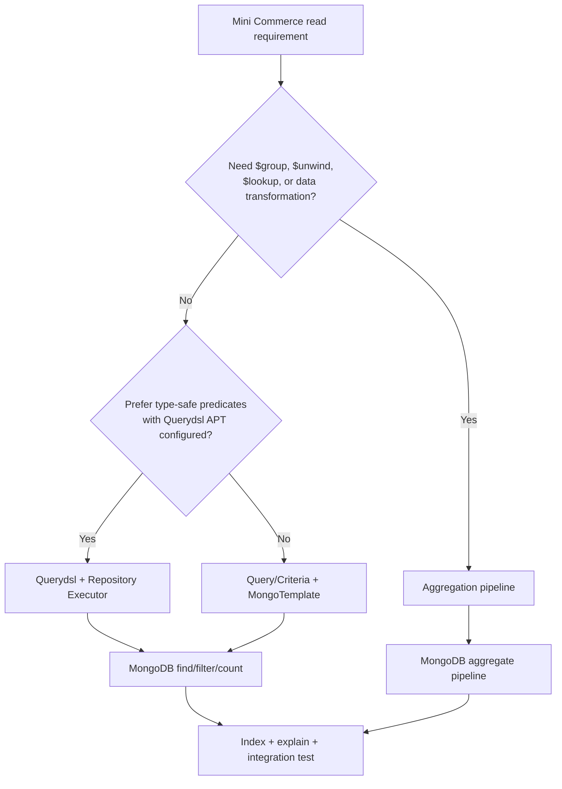
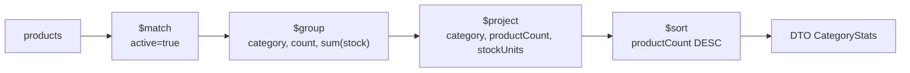
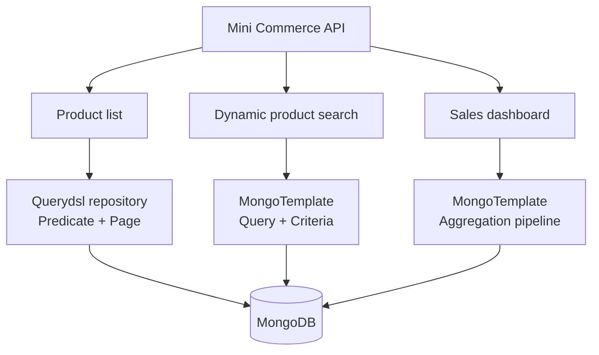

# Distinguishing Querydsl, Query/Criteria, and Aggregation Pipelines

## 1. The Problem to Solve

In **Spring Data MongoDB**, an application has multiple ways to express read queries: repository method names, JSON `@Query`, **Querydsl**, `Query`/`Criteria` with `MongoTemplate`, or **aggregation pipelines**. These approaches are not sequential "upgrade tiers"; each is built for a distinct category of needs.

The **Mini Commerce** application has `Product`, `Customer`, and `Order`. Consider three requirements:

1. **Product listing:** find active products in category `phu-kien` priced from 100,000 to under 200,000 VND, sorted by price ascending, paginated.
2. **Catalog report:** how many active products and what total stock quantity exist in each category?
3. **Order report:** how many units of each SKU were sold in orders with status `PAID`?

The first requirement is primarily **filtering documents and returning entities**; either Querydsl or `Query`/`Criteria` fits well. The remaining two require **grouping, transforming, summarizing**, and sometimes **unwinding arrays into multiple records**; an aggregation pipeline is the natural tool.

This lesson belongs to the **Extended Repositories** chapter within `SPRING_DATA_MONGODB`: connections, BSON mapping, querying via `MongoTemplate`/repositories, aggregations, indexes, transactions, reactive access, testing, and data performance diagnostics.

### Learning Objectives

After this lesson, you will be able to:

- Distinguish **Querydsl Predicate**, **Query/Criteria**, and **Aggregation** by capability, implementation cost, and result shape.
- Understand the setup concepts for Querydsl, generating `QProduct`, and using `QuerydslPredicateExecutor`.
- Write dynamic queries with optional criteria using `Criteria` and `MongoTemplate`.
- Build pipelines with `$match`, `$project`, `$unwind`, `$group`, `$sort`, and `$limit`.
- Translate a simple filter requirement between Querydsl and `Criteria`, while **never** forcing aggregation requirements into Querydsl.
- Handle Java property names vs. BSON field names such as `price → unit_price`.
- Design appropriate sorting, pagination, indexes, transactions, and reactive queries.
- Test real results and inspect `explain("executionStats")` before drawing performance conclusions.

**Prerequisites:** Java 17+, Spring Boot with Spring Data MongoDB, familiarity with `MongoRepository`, `@Document`, `@Id`, `@Field`, `Query`, and BSON. Code examples use synchronous Java APIs unless explicitly noted as reactive.

## 2. Decision Matrix: Choosing the Tool by Question

| Criterion | Querydsl | Query/Criteria | Aggregation pipeline |
| --- | --- | --- | --- |
| Primary purpose | **Type-safe predicates** for finding/filtering entities | **Dynamic filters** and MongoDB query options | **Transforming, grouping, computing, joining data** |
| Java syntax | `QProduct.product.price.goe(...)` | `Criteria.where("price").gte(...)` | `Aggregation.match(...)`, `group(...)`, `project(...)` |
| Dynamic queries with optional params | Great fit with `BooleanBuilder` | Great fit with building `Criteria`/`Query` | Can add/omit pipeline stages |
| Compile-time field checks | Strong with generated `Q` classes | Mostly **String** field paths | DSL uses field paths/Strings and mapping context |
| Requires annotation processing | **Yes**, to generate `Q` classes | No | No |
| Repository integration | `QuerydslPredicateExecutor` | Repository fragment/custom + `MongoTemplate` | `@Aggregation` or `MongoTemplate.aggregate(...)` |
| `$group`/`$unwind`/`$lookup` | Not its primary role | Standard `find` cannot perform these stages | **Yes** |
| Output | Mostly entities/projections and `find/count/exists` | Entities/DTOs, count, exists, updates | Transformed entities/DTOs/reports |
| Pageable/Sort | Yes via repository executor | Yes via `Query`, `Pageable` | Supports `$sort/$skip/$limit`, but page metadata must be designed |
| Index planning | Depends on generated BSON filter | Depends on generated BSON filter | Depends on stages and pipeline order |
| Reactive path | `ReactiveQuerydslPredicateExecutor` | `ReactiveMongoTemplate` | `ReactiveMongoTemplate.aggregate(...)` |

**Never choose a tool merely because "type-safe is always faster" or "aggregation is always more powerful."** MongoDB executes the resulting BSON command; speed depends primarily on query shape, indexes, data, payload size, and execution plan, not just the Java API name.



### 2.1. When Are Derived Query Methods or @Query Enough?

Do not create a custom repository just to replace:

```java
Page<Product> findByActiveTrueAndCategory(
    String category, Pageable pageable);
```

When conditions are fixed, a repository method is clear enough. When an API has dozens of optional filter combinations, a huge method name becomes unmaintainable; consider Querydsl or `Criteria` then. If a filter needs specialized BSON operators yet stays static, JSON `@Query` with parameter binding is a middle ground.

## 3. The Product–Customer–Order Model

### 3.1. Product Entity

```java
package com.example.minicommerce.domain;

import java.math.BigDecimal;
import java.util.List;

import org.springframework.data.annotation.Id;
import org.springframework.data.mongodb.core.mapping.Document;
import org.springframework.data.mongodb.core.mapping.Field;
import org.springframework.data.mongodb.core.mapping.FieldType;

@Document(collection = "products")
public class Product {
    @Id
    private String id;
    private String sku;
    private String name;
    private String category;
    private boolean active;
    private int stock;

    @Field(name = "unit_price", targetType = FieldType.DECIMAL128)
    private BigDecimal price;

    private List<String> tags;

    public Product() {}

    public String getId() { return id; }
    public void setId(String id) { this.id = id; }
    public String getSku() { return sku; }
    public void setSku(String sku) { this.sku = sku; }
    public String getName() { return name; }
    public void setName(String name) { this.name = name; }
    public String getCategory() { return category; }
    public void setCategory(String category) {
        this.category = category;
    }
    public boolean isActive() { return active; }
    public void setActive(boolean active) { this.active = active; }
    public int getStock() { return stock; }
    public void setStock(int stock) { this.stock = stock; }
    public BigDecimal getPrice() { return price; }
    public void setPrice(BigDecimal price) { this.price = price; }
    public List<String> getTags() { return tags; }
    public void setTags(List<String> tags) { this.tags = tags; }
}
```

Note:

- Java property `id` is stored as BSON `_id`.
- Java property `price` is stored as BSON `unit_price` with type **Decimal128**.
- `tags` is a string array, so element queries can leverage a multikey index.
- Create `BigDecimal` from strings; never use `double` arithmetic for money.

### 3.2. Order Entity for Reporting Exercises

```java
package com.example.minicommerce.domain;

import java.math.BigDecimal;
import java.time.Instant;
import java.util.List;

import org.springframework.data.annotation.Id;
import org.springframework.data.mongodb.core.mapping.Document;
import org.springframework.data.mongodb.core.mapping.Field;
import org.springframework.data.mongodb.core.mapping.FieldType;

@Document(collection = "orders")
public class Order {
    @Id
    private String id;
    private String customerId;
    private String status;
    private Instant placedAt;

    @Field(targetType = FieldType.DECIMAL128)
    private BigDecimal totalAmount;

    private List<OrderLine> lines;

    public String getId() { return id; }
    public String getCustomerId() { return customerId; }
    public String getStatus() { return status; }
    public Instant getPlacedAt() { return placedAt; }
    public BigDecimal getTotalAmount() { return totalAmount; }
    public List<OrderLine> getLines() { return lines; }

    public static class OrderLine {
        private String sku;
        private int quantity;

        @Field(targetType = FieldType.DECIMAL128)
        private BigDecimal unitPrice;

        public String getSku() { return sku; }
        public int getQuantity() { return quantity; }
        public BigDecimal getUnitPrice() { return unitPrice; }
    }
}
```

This example is solely for reporting queries. In a real application, add constructors/setters for entities, name/price snapshots, validation, and `Customer` links; never pass a partially populated `Order` object to `save` and overwrite existing fields.

### 3.3. Sample Dataset for Comparing Results

In `mongosh` on a **test** database:

```javascript
use mini_commerce

db.products.insertMany([
  {
    _id: "q-product-1",
    sku: "KBD-001",
    name: "Mini Keyboard",
    category: "phu-kien",
    active: true,
    stock: 8,
    unit_price: NumberDecimal("129900.00"),
    tags: ["office", "featured"]
  },
  {
    _id: "q-product-2",
    sku: "MOU-001",
    name: "Mini Mouse",
    category: "phu-kien",
    active: true,
    stock: 15,
    unit_price: NumberDecimal("179000.00"),
    tags: ["office"]
  },
  {
    _id: "q-product-3",
    sku: "OLD-001",
    name: "Keyboard Old",
    category: "phu-kien",
    active: false,
    stock: 4,
    unit_price: NumberDecimal("99000.00"),
    tags: ["clearance"]
  },
  {
    _id: "q-product-4",
    sku: "HOME-001",
    name: "Desk Lamp",
    category: "gia-dung",
    active: true,
    stock: 12,
    unit_price: NumberDecimal("159000.00"),
    tags: ["featured"]
  }
]);

db.orders.insertMany([
  {
    _id: "q-order-A",
    customerId: "customer-001",
    status: "PAID",
    placedAt: ISODate("2026-11-19T09:00:00Z"),
    totalAmount: NumberDecimal("438800.00"),
    lines: [
      { sku: "KBD-001", quantity: 2,
        unitPrice: NumberDecimal("129900.00") },
      { sku: "MOU-001", quantity: 1,
        unitPrice: NumberDecimal("179000.00") }
    ]
  },
  {
    _id: "q-order-B",
    customerId: "customer-002",
    status: "PAID",
    placedAt: ISODate("2026-11-20T09:00:00Z"),
    totalAmount: NumberDecimal("129900.00"),
    lines: [
      { sku: "KBD-001", quantity: 1,
        unitPrice: NumberDecimal("129900.00") }
    ]
  },
  {
    _id: "q-order-C",
    customerId: "customer-001",
    status: "CANCELLED",
    placedAt: ISODate("2026-11-20T10:00:00Z"),
    totalAmount: NumberDecimal("179000.00"),
    lines: [
      { sku: "MOU-001", quantity: 1,
        unitPrice: NumberDecimal("179000.00") }
    ]
  }
]);
```

Insert only once on an empty test database or one isolated by ID. Re-running with the same `_id`s triggers duplicate-key errors. If the collection holds other documents, queries without an ID filter may return extra rows; the integration tests below use a separate set of IDs.

Expected outcomes from the fixture:

| Question | Result |
| --- | --- |
| Active + `phu-kien` + 100,000 ≤ price < 200,000 | `q-product-1`, `q-product-2` |
| Active by category | `phu-kien`: 2 products; `gia-dung`: 1 |
| Total stock for active `phu-kien` | 8 + 15 = **23** |
| SKUs sold in `PAID` orders | `KBD-001`: **3**; `MOU-001`: **1** |
| Total amount of `PAID` orders from `totalAmount` | **568,700** VND |

Do not use this mock dataset to drive production decisions. Category names and SKUs are learning examples.

## 4. What Is Querydsl in Spring Data MongoDB?

**Querydsl** constructs queries using **typed Java expressions** generated from the domain model. Instead of writing `"price"` as a string literal, you reference the generated property on `QProduct`:

```java
QProduct p = QProduct.product;

Predicate predicate = p.active.isTrue()
    .and(p.category.eq("phu-kien"))
    .and(p.price.goe(new BigDecimal("100000.00")))
    .and(p.price.lt(new BigDecimal("200000.00")));
```

If `Product.price` is renamed to `unitPrice`, stale references to `p.price` no longer match the regenerated `QProduct`, allowing the IDE/compiler to catch them. With `Criteria.where("price")`, the field name is a string so the compiler cannot catch similar errors.

However, **Querydsl is not a MongoDB SQL engine**. `QuerydslPredicateExecutor` expresses predicates for document queries; it **does not automatically turn arbitrary SQL join/group/window expressions into MongoDB pipelines**.

### 4.1. Q-Types from Annotation Processing

`QProduct` is **not** a class bundled with Spring Data MongoDB. The build needs:

1. Querydsl core/modules compatible with your project version.
2. Querydsl annotation processing or `org.springframework.data.mongodb.repository.support.MongoAnnotationProcessor` configured.
3. The generated sources directory recognized by your build tool and IDE.
4. `QProduct` regenerated whenever entity fields/types change.

Spring Data MongoDB documentation describes configuring `MongoAnnotationProcessor` because Querydsl is **not a mandatory dependency** for all MongoDB users. If you only need a few simple filters, adding APT may be unnecessary overhead.

### 4.2. Notes on Querydsl Versions and Forks

Current Spring Data documentation notes that original Querydsl maintenance slowed down and the community maintains a fork under **OpenFeign Querydsl** with groupId `io.github.openfeign.querydsl`; Spring Data supports this fork on a **best-effort** basis. Some older projects use `com.querydsl`.

Do not mix artifact families or versions arbitrarily. When configuring Maven or Gradle:

- Choose **one** Querydsl family compatible with your Spring Boot/Spring Data/Java/Jakarta stack.
- Keep `querydsl-mongodb`, `querydsl-apt`, and `querydsl-core` aligned on the same version.
- Ensure the annotation processor uses the right version, classpath, and generated source directories.
- Check for transitive MongoDB driver conflicts; reference docs include examples excluding older drivers from Querydsl dependencies.
- Verify how `MongoAnnotationProcessor` is registered in your compiler plugin/Gradle APT setup.
- Never hardcode dependency versions without checking your **real project's** BOM and dependency tree.

That is why the sections below assume **`QProduct` has already been generated successfully**, rather than pretending a single dependency snippet always works across every Spring Data MongoDB 4.x/5.x release.

### 4.3. Repository Integrating Querydsl

```java
package com.example.minicommerce.repository;

import org.springframework.data.mongodb.repository.MongoRepository;
import org.springframework.data.querydsl.QuerydslPredicateExecutor;

import com.example.minicommerce.domain.Product;

public interface ProductRepository extends
        MongoRepository<Product, String>,
        QuerydslPredicateExecutor<Product> {

    // Derived queries or @Query can be added here.
}
```

Once the build generates `QProduct`, call:

```java
import java.math.BigDecimal;
import org.springframework.data.domain.Page;
import org.springframework.data.domain.PageRequest;
import org.springframework.data.domain.Pageable;
import org.springframework.data.domain.Sort;
import com.querydsl.core.types.Predicate;

import com.example.minicommerce.domain.QProduct;

QProduct p = QProduct.product;

Predicate predicate = p.active.isTrue()
    .and(p.category.eq("phu-kien"))
    .and(p.price.goe(new BigDecimal("100000.00")))
    .and(p.price.lt(new BigDecimal("200000.00")));

Pageable page = PageRequest.of(
    0, 20,
    Sort.by(Sort.Order.asc("price"), Sort.Order.asc("id")));

Page<Product> result =
    productRepository.findAll(predicate, page);
```

Note that `com.querydsl.core.types.Predicate` is the namespace for the corresponding Querydsl API family; when using the fork, check packages against your chosen artifacts. `QProduct` typically lives in the same package as the entity.

On the fixture, the result is `q-product-1` followed by `q-product-2` in ascending price order. `PageRequest` page indexes **start at 0** and `Page` may issue a count query to compute totals.

### 4.4. Dynamic Predicates with BooleanBuilder

Suppose a search API takes optional `category`, `minPrice`, `maxPrice`, and `skuPrefix`:

```java
import java.math.BigDecimal;

import com.querydsl.core.BooleanBuilder;
import com.querydsl.core.types.Predicate;

public Predicate buildProductPredicate(
        String category,
        BigDecimal minPrice,
        BigDecimal maxPrice,
        String skuPrefix) {

    QProduct p = QProduct.product;
    BooleanBuilder where = new BooleanBuilder(p.active.isTrue());

    if (category != null && !category.isBlank()) {
        where.and(p.category.eq(category));
    }

    if (minPrice != null) {
        where.and(p.price.goe(minPrice));
    }

    if (maxPrice != null) {
        where.and(p.price.lt(maxPrice));
    }

    if (skuPrefix != null && !skuPrefix.isBlank()) {
        where.and(p.sku.startsWith(skuPrefix));
    }

    return where;
}
```

This is a service method with appropriate `QProduct` imports. `BooleanBuilder` is helpful because each condition is a typed expression. Validate `minPrice <= maxPrice`, `skuPrefix` length, tenant, and permissions before executing.

**Never treat `startsWith` or `containsIgnoreCase` as free lookups.** They can translate into regexes or corresponding BSON filters; prefix indexing/collation and case sensitivity must be checked against the final BSON query.

### 4.5. Reactive Querydsl

Spring Data MongoDB also provides `ReactiveQuerydslPredicateExecutor`:

```java
import org.springframework.data.mongodb.repository.ReactiveMongoRepository;
import org.springframework.data.querydsl.ReactiveQuerydslPredicateExecutor;

import com.example.minicommerce.domain.Product;

public interface ReactiveProductRepository extends
        ReactiveMongoRepository<Product, String>,
        ReactiveQuerydslPredicateExecutor<Product> {
}
```

```java
import reactor.core.publisher.Flux;

Flux<Product> products =
    reactiveProductRepository.findAll(
        QProduct.product.active.isTrue()
            .and(QProduct.product.category.eq("phu-kien")));
```

Reactive repositories return `Flux<Product>`/`Mono<Long>` for matching operations rather than synchronous `Page<Product>`. Per Spring Data MongoDB documentation, reactive Querydsl **does not support DBRef joins**. Querydsl also does not solve multi-collection `$lookup` in aggregations.

## 5. Query/Criteria: Dynamic Filters Without Generating QProduct

`MongoTemplate` lets you write filters using `Query` and `Criteria`:

```java
import java.math.BigDecimal;
import java.util.List;

import org.springframework.data.domain.Sort;
import org.springframework.data.mongodb.core.query.Criteria;
import org.springframework.data.mongodb.core.query.Query;

Query query = Query.query(
    Criteria.where("active").is(true)
        .and("category").is("phu-kien")
        .and("price")
            .gte(new BigDecimal("100000.00"))
            .lt(new BigDecimal("200000.00")));

query.with(Sort.by(
    Sort.Order.asc("price"),
    Sort.Order.asc("id")));
query.limit(20);

List<Product> products =
    mongoTemplate.find(query, Product.class);
```

Semantically, this filter matches the Querydsl version in the previous section. With `Product.class`, the framework maps `price` to BSON `unit_price`. In raw `mongosh`:

```javascript
db.products.find({
  active: true,
  category: "phu-kien",
  unit_price: {
    $gte: NumberDecimal("100000.00"),
    $lt: NumberDecimal("200000.00")
  }
})
.sort({ unit_price: 1, _id: 1 })
.limit(20);
```

**Important:** Both Querydsl and `Criteria` **must be verified against real BSON**, especially when `@Field`, `Decimal128`, custom converters, or nested Java property paths are involved.

### 5.1. Building a Dynamic Query with Optional Conditions

```java
import java.math.BigDecimal;
import java.util.ArrayList;
import java.util.List;

import org.springframework.data.domain.Pageable;
import org.springframework.data.mongodb.core.query.Criteria;
import org.springframework.data.mongodb.core.query.Query;

public Query buildProductQuery(
        String category,
        BigDecimal minPrice,
        BigDecimal maxPrice,
        String skuPrefix,
        Pageable pageable) {

    List<Criteria> conditions = new ArrayList<>();
    conditions.add(Criteria.where("active").is(true));

    if (category != null && !category.isBlank()) {
        conditions.add(Criteria.where("category").is(category));
    }

    if (minPrice != null || maxPrice != null) {
        Criteria price = Criteria.where("price");
        if (minPrice != null) {
            price.gte(minPrice);
        }
        if (maxPrice != null) {
            price.lt(maxPrice);
        }
        conditions.add(price);
    }

    if (skuPrefix != null && !skuPrefix.isBlank()) {
        conditions.add(
            Criteria.where("sku").regex(
                "^" + java.util.regex.Pattern.quote(skuPrefix)));
    }

    Criteria root = new Criteria().andOperator(
        conditions.toArray(Criteria[]::new));

    return Query.query(root).with(pageable);
}
```

Above is an illustrative service method, not a full class. `Pattern.quote` turns the prefix input into a literal regex; add length/character limits and inspect `explain` because escaping can influence prefix index optimization.

`Criteria` has the advantage of requiring no Querydsl APT, supporting many MongoDB operators directly, and integrating easily with `MongoTemplate`. Trade-off: field names like `"price"`/`"category"` are strings, prone to refactoring mistakes without tests.

### 5.2. Queries with Multiple Conditions and Array `$elemMatch`

An `Order` question: "Has an `OrderLine` matching both SKU `KBD-001` and `quantity >= 2`."

```java
Query matchingLine = Query.query(
    Criteria.where("lines").elemMatch(
        Criteria.where("sku").is("KBD-001")
            .and("quantity").gte(2)));

List<Order> orders =
    mongoTemplate.find(matchingLine, Order.class);
```

Writing two top-level dotted predicates `"lines.sku"` and `"lines.quantity"` allows MongoDB to match **two separate elements** of the array. `$elemMatch` enforces that both conditions hold on **the same element**.

A Querydsl `Predicate` works nicely for many property equalities, but when you need detailed BSON expressions like `$elemMatch`, `$expr`, collation, `arrayFilters`, or geo operators, `Criteria`/`MongoTemplate` is usually more direct and controllable.

### 5.3. Controlling Projection, Sort, Collation, and Hints

`Query` carries options beyond the filter:

```java
Query options = Query.query(
    Criteria.where("active").is(true));

options.fields()
    .include("sku")
    .include("name")
    .include("price");

options.with(Sort.by(
    Sort.Order.asc("price"),
    Sort.Order.asc("id")));

options.limit(20);

List<Product> summary =
    mongoTemplate.find(options, Product.class);
```

An entity read via **partial projection** is not a complete document safe to `save`; use DTOs or interface projections for read-only APIs. If the application needs collation, `Query.collation(...)` declares comparison rules; raw BSON and indexes must use matching collations. `Query.withHint(...)` should be reserved for cases backed by query plans/benchmarks rather than arbitrary hints.

### 5.4. Querydsl and Criteria Share the Same Limit When Only Using find

`MongoTemplate.find(query, Product.class)` returns matching `Product` documents. It does not synthesize a summary document showing "product count and total stock per category." That report needs a pipeline or application code iterating over all documents.

Computing on the server with aggregation is usually far better than pulling thousands of documents over the network just to sum numbers in the JVM.

## 6. Aggregation Pipelines: Transforming Results Stage by Stage

MongoDB aggregation takes an **ordered list of stages**, each receiving documents from the previous stage and passing transformed documents to the next.



Common stages:

| Stage | Function | Mini Commerce example |
| --- | --- | --- |
| `$match` | Filter documents | `status = PAID` |
| `$project` | Select/compute fields, expressions | Normalize output names, compute line totals |
| `$unwind` | Split array elements into intermediate docs | Each `OrderLine` becomes one row |
| `$group` | Group, `$sum`/`$avg`/`$count` | Products per category |
| `$sort` | Sort current stream | Categories with most products |
| `$skip`/`$limit` | Paginate/limit | Top 20 categories |
| `$lookup` | Join documents from another collection | Orders enriched with Customer info |
| `$facet` | Multiple pipeline branches in one command | Data page plus total group count |
| `$addFields`/`$set` | Add computed fields | Rule-based totals |

**Stage order changes both semantics and cost.** `$match` on `Order` before `$unwind` shrinks the number of elements unwound. `$group` usually collapses many documents into a few groups; `$sort` after grouping sorts **groups**, not original documents.

## 7. Reporting Product Count and Stock by Category

### 7.1. Pipeline in mongosh

```javascript
db.products.aggregate([
  { $match: { active: true } },
  {
    $group: {
      _id: "$category",
      productCount: { $sum: 1 },
      stockUnits: { $sum: "$stock" }
    }
  },
  {
    $project: {
      _id: 0,
      category: "$_id",
      productCount: 1,
      stockUnits: 1
    }
  },
  { $sort: { productCount: -1, category: 1 } }
]);
```

On the fixture:

```json
[
  {
    "category": "phu-kien",
    "productCount": 2,
    "stockUnits": 23
  },
  {
    "category": "gia-dung",
    "productCount": 1,
    "stockUnits": 12
  }
]
```

`$group` counts active `Product` documents, not distinct values. `stockUnits` is total stock units, not revenue or order count.

### 7.2. Writing It with Spring Data Aggregation DSL

```java
package com.example.minicommerce.service;

import java.util.List;

import org.springframework.data.domain.Sort;
import org.springframework.data.mongodb.core.MongoTemplate;
import org.springframework.data.mongodb.core.aggregation.Aggregation;
import org.springframework.data.mongodb.core.aggregation.AggregationResults;
import org.springframework.data.mongodb.core.query.Criteria;

import com.example.minicommerce.domain.Product;

public class CatalogReportService {
    private final MongoTemplate template;

    public CatalogReportService(MongoTemplate template) {
        this.template = template;
    }

    public List<CategoryStats> summarize() {
        Aggregation pipeline = Aggregation.newAggregation(
            Aggregation.match(
                Criteria.where("active").is(true)),
            Aggregation.group("category")
                .count().as("productCount")
                .sum("stock").as("stockUnits"),
            Aggregation.project("productCount", "stockUnits")
                .and("_id").as("category")
                .andExclude("_id"),
            Aggregation.sort(
                Sort.by(Sort.Order.desc("productCount"),
                        Sort.Order.asc("category")))
        );

        AggregationResults<CategoryStats> results =
            template.aggregate(
                pipeline, Product.class, CategoryStats.class);

        return results.getMappedResults();
    }

    public static class CategoryStats {
        private String category;
        private long productCount;
        private long stockUnits;

        public String getCategory() { return category; }
        public void setCategory(String value) { category = value; }
        public long getProductCount() { return productCount; }
        public void setProductCount(long value) { productCount = value; }
        public long getStockUnits() { return stockUnits; }
        public void setStockUnits(long value) { stockUnits = value; }
    }
}
```

`Aggregation.newAggregation(...)` builds the pipeline. `MongoTemplate.aggregate(pipeline, Product.class, CategoryStats.class)` picks the collection from `Product.class` and maps output to the DTO.

**Do not confuse DTO names with entities.** After `$group`, `_id` is the grouping key; `$project` renames it to `category`. `CategoryStats` is not a `Product` you can pass to `save`.

### 7.3. Why Is Querydsl Not an Equivalent Option?

A predicate like `QProduct.product.active.isTrue()` only describes **which `Product`s are selected**; it does not express `$group` summing stock into `CategoryStats` documents. Trying to solve this by fetching `Product`s via a Querydsl repository and summing in Java pulls excess data, misses server-side aggregation, and wastes bandwidth.

This is a textbook case for **choosing aggregation from the start**.

## 8. Line-Item Reporting: `$unwind` Before `$group`

Mini Commerce stores `Order.lines` as an array of documents. Requirement: "How many units of each SKU were sold in `PAID` orders?"

### 8.1. Correct Pipeline

```javascript
db.orders.aggregate([
  { $match: { status: "PAID" } },
  { $unwind: "$lines" },
  {
    $group: {
      _id: "$lines.sku",
      unitsSold: { $sum: "$lines.quantity" }
    }
  },
  {
    $project: {
      _id: 0,
      sku: "$_id",
      unitsSold: 1
    }
  },
  { $sort: { unitsSold: -1, sku: 1 } }
]);
```

Result on the fixture:

```json
[
  { "sku": "KBD-001", "unitsSold": 3 },
  { "sku": "MOU-001", "unitsSold": 1 }
]
```

`q-order-C` is excluded because `status = CANCELLED`. Order A has two independent lines; `$unwind` produces one intermediate document per line before grouping by SKU.

### 8.2. Pipeline in Spring Data

```java
import java.util.List;

import org.springframework.data.domain.Sort;
import org.springframework.data.mongodb.core.aggregation.Aggregation;
import org.springframework.data.mongodb.core.aggregation.AggregationResults;
import org.springframework.data.mongodb.core.query.Criteria;

Aggregation pipeline = Aggregation.newAggregation(
    Aggregation.match(Criteria.where("status").is("PAID")),
    Aggregation.unwind("lines"),
    Aggregation.group("lines.sku")
        .sum("lines.quantity").as("unitsSold"),
    Aggregation.project("unitsSold")
        .and("_id").as("sku")
        .andExclude("_id"),
    Aggregation.sort(
        Sort.by(Sort.Order.desc("unitsSold"),
                Sort.Order.asc("sku")))
);

AggregationResults<SkuSales> results =
    mongoTemplate.aggregate(pipeline, Order.class, SkuSales.class);

List<SkuSales> sales = results.getMappedResults();
```

DTO:

```java
public class SkuSales {
    private String sku;
    private long unitsSold;

    public String getSku() { return sku; }
    public void setSku(String sku) { this.sku = sku; }
    public long getUnitsSold() { return unitsSold; }
    public void setUnitsSold(long unitsSold) {
        this.unitsSold = unitsSold;
    }
}
```

The call above lives in a service with `MongoTemplate mongoTemplate` injected and `Order`, `SkuSales` properly imported. `SkuSales` is a reporting read DTO, not the root entity of `orders`.

### 8.3. Common Mistake

```javascript
db.orders.find({
  "lines.sku": "KBD-001"
});
```

This only **filters orders containing the SKU**. It does not compute units sold. If Java code grabs `Order.totalAmount` from those orders and sums them, it **includes unrelated items** from multi-SKU orders. To get revenue per SKU, use `$unwind`/`$match` and multiply `quantity × unitPrice` on **each `OrderLine`**.

## 9. Total Revenue: Pay Attention to Decimal128 and Order Status

A simple report totaling paid orders:

```javascript
db.orders.aggregate([
  { $match: { status: "PAID" } },
  {
    $group: {
      _id: null,
      paidRevenue: { $sum: "$totalAmount" },
      paidOrderCount: { $sum: 1 }
    }
  }
]);
```

On the fixture, `paidRevenue = NumberDecimal("568700.00")` and `paidOrderCount = 2`. This assumes `totalAmount` is **Decimal128**, finalized accurately when creating the order. If BSON mixes `String`/`Double`/`Decimal128`, `$sum` may fail financial expectations. Audit and normalize data before reconciling.

When computing revenue per SKU, you can write:

```javascript
db.orders.aggregate([
  { $match: { status: "PAID" } },
  { $unwind: "$lines" },
  {
    $group: {
      _id: "$lines.sku",
      unitsSold: { $sum: "$lines.quantity" },
      revenue: {
        $sum: {
          $multiply: [
            "$lines.unitPrice",
            "$lines.quantity"
          ]
        }
      }
    }
  },
  { $sort: { revenue: -1 } }
]);
```

`$multiply` with `Decimal128` and an integer computes results per BSON/Decimal128 arithmetic rules; if business logic involves taxes, discounts, refunds, or cancellations, model the **exact accounting rules** rather than extrapolating from this simple example.

## 10. When You Need to Combine Customer and Order: `$lookup`

In MongoDB, `Product`/`Customer`/`Order` are typically modeled with **embedded documents or references**, not automatic SQL joins.

If you need a list of `PAID` orders with `Customer` details:

```javascript
db.orders.aggregate([
  { $match: { status: "PAID" } },
  {
    $lookup: {
      from: "customers",
      localField: "customerId",
      foreignField: "_id",
      as: "customer"
    }
  },
  { $unwind: "$customer" },
  {
    $project: {
      _id: 1,
      placedAt: 1,
      totalAmount: 1,
      "customer.fullName": 1
    }
  }
]);
```

`$lookup` produces a `customer` array. `$unwind` turns that array into an object per document and by default **drops** orders without a matching customer. To retain orphan orders, use `preserveNullAndEmptyArrays: true`.

**Why doesn't Querydsl replace `$lookup`?** `QuerydslPredicateExecutor` supports predicates on a single repository's documents, not multi-collection joins. When server-side join-like queries are required, choose aggregation `$lookup` (or consider embedded/snapshot schemas), checking indexes on `customers._id` and large-data costs.

Do not treat `$lookup` as a free SQL join: watch cardinality, intermediate document size, tenant predicates, and indexes on the foreign collection. Queries returning personal data require projections and access checks.

## 11. Querydsl, Criteria, and Aggregation Can Coexist in One Application

The three approaches are not mutually exclusive:



A clean architecture might look like:

- A repository with basic finders and `QuerydslPredicateExecutor` for type-safe search UIs.
- A **repository fragment/service** building `Query`/`Criteria` for complex filters, metadata, collation, or custom updates.
- A **reporting service** using `Aggregation`/`MongoTemplate.aggregate` returning statistics DTOs.
- Each branch verified for BSON and indexes, never treating report outputs as saveable entities.

### 11.1. Repository Fragment When a Dedicated API Is Needed

When you want dynamic queries inside the repository layer rather than in a service, use the custom repository fragment pattern:

```java
public interface ProductSearchRepository {
    List<Product> search(ProductSearchFilter filter);
}
```

```java
public interface ProductRepository
        extends MongoRepository<Product, String>,
                QuerydslPredicateExecutor<Product>,
                ProductSearchRepository {
}
```

A `ProductSearchRepositoryImpl` can inject `MongoTemplate` and construct `Criteria`. `ProductSearchFilter` is a project-defined DTO, not a built-in Spring Data class.

Advantage: keeps the repository contract clean and avoids infinitely growing `findBy…And…Or…` methods. In real implementations, follow the repository fragment conventions and bean registration rules of your Spring Data version.

### 11.2. @Aggregation on Repositories

Spring Data MongoDB also allows declaring a static pipeline via `@Aggregation` on repository methods:

```java
import java.util.List;
import org.springframework.data.mongodb.repository.Aggregation;

public interface OrderReportRepository
        extends MongoRepository<Order, String> {

    @Aggregation(pipeline = {
        "{ '$match': { 'status': ?0 } }",
        "{ '$unwind': '$lines' }",
        "{ '$group': { '_id': '$lines.sku', " +
            "'unitsSold': { '$sum': '$lines.quantity' } } }",
        "{ '$project': { '_id': 0, " +
            "'sku': '$_id', 'unitsSold': 1 } }"
    })
    List<SkuSales> countUnitsBySku(String status);
}
```

`@Aggregation` suits static pipelines where only parameter values change. For pipelines with conditional stages, complex calculations, or stage-by-stage testing, `MongoTemplate.aggregate(...)` can be easier to maintain.

**Do not confuse** `org.springframework.data.mongodb.repository.Aggregation` (the annotation) with `org.springframework.data.mongodb.core.aggregation.Aggregation` (the DSL class); they share a name but serve different roles.

## 12. Mapping: Java Properties vs. BSON Keys

In `Product`:

```java
@Field(name = "unit_price", targetType = FieldType.DECIMAL128)
private BigDecimal price;
```

Three ways to express the same filter:

```java
// Querydsl uses typed properties:
QProduct.product.price.goe(new BigDecimal("100000.00"));

// Criteria uses Java property names when querying with Product.class:
Criteria.where("price").gte(new BigDecimal("100000.00"));
```

```javascript
// Raw mongosh uses the actual BSON field:
{ unit_price: { $gte: NumberDecimal("100000.00") } }
```

Spring Data entity mapping normally resolves aliases and conversions across Querydsl, `Criteria`, and typed aggregations when configured properly. Watch out for special cases:

1. Raw `MongoCollection<Document>` from the Java driver ignores Spring's `@Field`.
2. An aggregation `$project` stage can **rename or drop fields**; subsequent stages cannot refer to dropped fields by their old names.
3. In newer Spring Data versions, typed aggregation does not always reject references to nonexistent properties; you can enable **strictMapping** to tighten checks if needed.
4. Custom converters for money, enums, or `_id` affect filters and output mapping; verify with raw BSON readbacks.
5. Querydsl generated `Q` classes must stay in sync with the current domain model; stale Q classes give a false sense of type safety based on outdated metadata.

**Separate two verification layers:** the compiler prevents many type/property errors in Querydsl; integration tests verify BSON, mapping, data, and semantics on real MongoDB.

## 13. Pagination and Sorting: Page Differs from Pipelines

### 13.1. Querydsl Page

```java
Pageable pageable = PageRequest.of(
    0, 20,
    Sort.by(Sort.Order.asc("price"),
            Sort.Order.asc("id")));

Page<Product> products =
    productRepository.findAll(predicate, pageable);
```

`Page` usually requires a count to populate `totalElements`. When only "Load more" is needed, use a return type or batching strategy that avoids counting total pages.

### 13.2. Criteria Query

```java
Query query = Query.query(
    Criteria.where("active").is(true));

query.with(pageable);

List<Product> products =
    mongoTemplate.find(query, Product.class);
```

If you need `PageImpl<Product>`, compute the total with a **filter-only `Query`** lacking the data query's `skip/limit`, and weigh the cost of counting.

### 13.3. Aggregation Pagination

```javascript
db.products.aggregate([
  { $match: { active: true } },
  { $sort: { unit_price: 1, _id: 1 } },
  { $skip: 20 },
  { $limit: 20 }
]);
```

If sorting after `$group`, ordering applies to **groups** rather than raw `Product` documents. Aggregation does not produce `Page<T>`/`totalPages` out of the box. You can run a separate count pipeline or `$facet` returning `data` and `totalCount` branches when required, though `$facet` is not always faster than separate queries; benchmark it.

### 13.4. Deterministic Sorting and Deep Offsets

When multiple products share a price, include a unique tie-breaker:

```javascript
{ unit_price: 1, _id: 1 }
```

Omitting sort or sorting solely on non-unique prices causes unpredictable ordering across pages. With deep `skip`, even an ideal index incurs scanning/skipping overhead. For deep sequential paging, consider **keyset/cursor pagination** based on `(unit_price, _id)` or another stable sort key.

## 14. Indexes and Explain: Measure the Final BSON

All three APIs can emit the exact same BSON filter, so optimization always starts with the **real MongoDB query**.

### 14.1. Index for Product Queries

```javascript
db.products.createIndex({
  active: 1,
  category: 1,
  unit_price: 1,
  _id: 1
});
```

Query:

```javascript
db.products.find({
  active: true,
  category: "phu-kien",
  unit_price: {
    $gte: NumberDecimal("100000.00"),
    $lt: NumberDecimal("200000.00")
  }
})
.sort({ unit_price: 1, _id: 1 })
.limit(20)
.explain("executionStats");
```

This is a **proposed index to evaluate**, not a mandatory setup. Before deploying, review data cardinality, frequent filters, active-flag selectivity, sorting, and write overhead. Extra indexes consume disk/RAM and slow down writes.

### 14.2. Index for Aggregation

For the Order pipeline:

```javascript
db.orders.createIndex({
  status: 1,
  placedAt: -1
});
```

An initial `$match: {status:"PAID"}` can leverage an index depending on selectivity. However, `$unwind` and `$group` over arrays still process matching line items rather than turning the whole aggregation into an index-only query.

With `$lookup` joining `customerId → customers._id`, `_id` is indexed by default; if joining on another `foreignField`, evaluate a supporting index there.

### 14.3. Reading executionStats

| Metric | Practical meaning |
| --- | --- |
| `winningPlan` | Which plan did the server pick? `IXSCAN`, `COLLSCAN`, `FETCH`, `SORT`? |
| `totalKeysExamined` | Is it scanning an excessive number of index entries? |
| `totalDocsExamined` | Actual documents inspected |
| `nReturned` | Records returned by the query |
| `executionTimeMillis` | Timing of this explain run; measure further on representative workloads |
| Aggregation stage statistics | Are `$group`/`$sort` stages consuming heavy resources? |

**Never** benchmark Querydsl/Criteria/aggregation on 4 fixture documents and draw conclusions. You need large datasets, realistic price/category distributions, identical filters/sorts, warm-up runs, and server observation. When comparing Querydsl with `Criteria`, ensure the generated filters are **truly equivalent**.

## 15. Security, Data Integrity, and Maintainability

### 15.1. Type-Safe Predicates Are Not Authorization

`QProduct.product.active.isTrue()` does not enforce tenant isolation or read permissions. In multi-store systems, every query must constrain `tenantId` or an appropriate authorization scope.

Querydsl supports web integration such as `@QuerydslPredicate`. Never expose arbitrary domain properties/predicates to clients without a **binding whitelist**, input validation, page size caps, and field allowlists. Type-safe does not mean client queries are safe or cheap.

### 15.2. Criteria and JSON Injection

`Criteria.where("name").is(userInput)` passes values as typed parameters without string concatenation. For literal substring regex searches, use `Pattern.quote(...)` and bound lengths; accepting arbitrary regex patterns risks CPU-intensive queries.

JSON `@Query` also supports `?0`/`?1` parameter binding; avoid concatenating raw request strings into BSON. For custom aggregations, never accept raw pipeline JSON from requests without strict server-side control.

### 15.3. Never Save Aggregation DTOs Back

`CategoryStats` and `SkuSales` outputs do not represent full `Product` or `Order` documents. Calling `save` on projected/partial entities causes data loss. Separate reporting DTOs from command DTOs and root entities.

### 15.4. Transactions and Reactive Access

Ordinary read queries do not need multi-document transactions just to combine criteria. When creating an Order, decrementing stock across multiple Products, and updating a Customer, transactions may be required to preserve invariants; choose `MongoTransactionManager`/reactive transaction manager on a supporting topology.

Aggregation `$lookup` is not a transaction and provides no rollback. Reactive drivers/`ReactiveMongoTemplate` provide non-blocking I/O; they do **not** make an unindexed pipeline faster or consume less memory.

## 16. Testing All Three Approaches Against Real MongoDB

Mocking repositories does not verify that `QProduct`/`Criteria`/pipelines map properly to BSON or that operators behave as expected in the database. Use **real MongoDB or Testcontainers**, an isolated test database, and unique fixture IDs.

### 16.1. Integration Test Ensuring Querydsl and Criteria Return the Same Products

```java
package com.example.minicommerce;

import static org.junit.jupiter.api.Assertions.*;

import java.math.BigDecimal;
import java.util.List;
import java.util.Set;
import java.util.stream.Collectors;

import org.bson.Document;
import org.bson.types.Decimal128;
import org.junit.jupiter.api.Test;
import org.springframework.beans.factory.annotation.Autowired;
import org.springframework.boot.test.context.SpringBootTest;
import org.springframework.data.mongodb.core.MongoTemplate;
import org.springframework.data.mongodb.core.query.Criteria;
import org.springframework.data.mongodb.core.query.Query;

import com.example.minicommerce.domain.Product;
import com.example.minicommerce.domain.QProduct;
import com.example.minicommerce.repository.ProductRepository;

@SpringBootTest
class QueryApproachIntegrationTest {

    @Autowired MongoTemplate template;
    @Autowired ProductRepository repository;

    @Test
    void querydslAndCriteriaSelectSameProducts() {
        List<String> ids = List.of(
            "query-test-1",
            "query-test-2",
            "query-test-3");

        var raw = template.getCollection("products");
        Document onlyFixture =
            new Document("_id", new Document("$in", ids));

        raw.deleteMany(onlyFixture);
        try {
            raw.insertMany(List.of(
                product(ids.get(0), true, "phu-kien",
                    "129900.00"),
                product(ids.get(1), true, "phu-kien",
                    "179000.00"),
                product(ids.get(2), false, "phu-kien",
                    "159000.00")
            ));

            QProduct p = QProduct.product;
            var predicate = p.id.in(ids)
                .and(p.active.isTrue())
                .and(p.category.eq("phu-kien"))
                .and(p.price.goe(new BigDecimal("100000.00")))
                .and(p.price.lt(new BigDecimal("200000.00")));

            Set<String> querydslIds = toIds(
                repository.findAll(predicate));

            Query criteria = Query.query(
                Criteria.where("id").in(ids)
                    .and("active").is(true)
                    .and("category").is("phu-kien")
                    .and("price")
                        .gte(new BigDecimal("100000.00"))
                        .lt(new BigDecimal("200000.00")));

            Set<String> criteriaIds = toIds(
                template.find(criteria, Product.class));

            assertEquals(Set.of(ids.get(0), ids.get(1)),
                querydslIds);
            assertEquals(querydslIds, criteriaIds);
        } finally {
            raw.deleteMany(onlyFixture);
        }
    }

    private static Document product(
            String id, boolean active,
            String category, String price) {
        return new Document("_id", id)
            .append("sku", id)
            .append("name", "Test product")
            .append("active", active)
            .append("category", category)
            .append("stock", 5)
            .append("unit_price",
                new Decimal128(new BigDecimal(price)));
    }

    private static Set<String> toIds(
            Iterable<Product> products) {
        java.util.HashSet<String> ids =
            new java.util.HashSet<>();
        for (Product product : products) {
            ids.add(product.getId());
        }
        return ids;
    }
}
```

This test relies on annotation processing **having generated `QProduct`** and the repository extending `QuerydslPredicateExecutor`. If the build lacks Q-classes, compilation fails; that reflects Querydsl setup rather than a MongoDB query bug.

### 16.2. Testing Aggregation Grouping and DTO Mapping

A separate integration test can insert three Product fixtures and run the pipeline scoped to those test IDs:

```java
import java.util.List;
import org.springframework.data.mongodb.core.aggregation.Aggregation;
import org.springframework.data.mongodb.core.query.Criteria;

Aggregation pipeline = Aggregation.newAggregation(
    Aggregation.match(
        Criteria.where("id").in(
            "query-test-1", "query-test-2", "query-test-3")),
    Aggregation.match(
        Criteria.where("active").is(true)),
    Aggregation.group("category")
        .count().as("productCount")
        .sum("stock").as("stockUnits"),
    Aggregation.project("productCount", "stockUnits")
        .and("_id").as("category")
        .andExclude("_id")
);

var results = template.aggregate(
    pipeline,
    Product.class,
    CatalogReportService.CategoryStats.class);

var groups = results.getMappedResults();
assertEquals(1, groups.size());
assertEquals("phu-kien", groups.get(0).getCategory());
assertEquals(2L, groups.get(0).getProductCount());
assertEquals(10L, groups.get(0).getStockUnits());
```

This is a **test body** to place inside a `@Test` method with the three fixtures seeded, `template` injected, and `assertEquals` and `CatalogReportService` imported. Delete only test data inside an isolated test database.

### 16.3. Recommended Test Matrix

| Scenario | Expectation |
| --- | --- |
| Querydsl `QProduct` generated | Build exposes typed properties |
| Entity renames `price` | Q-class regenerates; old references fail compile |
| Querydsl and `Criteria` with same filter | Return identical set of Products |
| `Decimal128` pricing | Range comparisons match exact BSON type |
| `@Field("unit_price")` | Java property queries physical BSON field |
| Null optional filters | Do not emit unintended null-equality checks |
| `lines` array same element | `$elemMatch` returns matching Orders |
| Aggregation `$group` | Accurate Product counts and stock sums |
| Aggregation `$unwind` | Accurate units sold per SKU |
| `CANCELLED` orders | Excluded from `PAID` statistics |
| `$lookup` pipeline | Handles existing and missing Customers |
| Stable sort/pagination | Uses tie-breaker, no duplicates on static data |
| Reactive Querydsl | `Flux` emits matching documents on subscribe |
| Reactive aggregation | `Flux<DTO>` matches synchronous totals |
| Indexed query plan | `explain` confirms plan fits workload |
| Tenant isolation | Filters never access other tenants' data |

## 17. Common Mistakes

| Symptom | Cause | Fix |
| --- | --- | --- |
| Missing `QProduct` | Annotation processor not run / IDE missing generated sources | Configure APT, rebuild, verify compiler |
| Querydsl startup version error | Mixing original/fork artifacts, transitive driver, or Jakarta mismatch | Pick one consistent version set per official docs |
| Querydsl runs slowly | Final predicate emits unindexed regex/range | Inspect real BSON and `explain` |
| Entity rename compiles cleanly with `Criteria` | `Criteria` field paths are strings | Refactor with mapping tests and integration tests |
| Querydsl cannot compute category totals | Predicates only filter documents | Use aggregation `$group` |
| Wrong SKU totals | Matched Order then summed all lines | `$unwind`/filter individual lines before `$group` |
| `$project` drops fields needed for group/sort | Earlier stage removed or renamed the field | Check stage order and aliases |
| Aggregation DTO fields are null/zero | Output names do not match DTO properties | Check `$project`/aliases and raw BSON |
| `$lookup` drops Orders lacking a Customer | `$unwind` drops empty/missing arrays | Use `preserveNullAndEmptyArrays` when needed |
| Price sorting behaves oddly | Mixed `String`/`Double`/`Decimal128` data | Audit, migrate, standardize `@Field` |
| Querydsl ignore-case misses indexes | Case-insensitive regex differs from collation equality | Distinguish semantics, optimize appropriately |
| Slow aggregation | Late `$match`, `$unwind` on huge arrays, missing indexes | Optimize stage order and check `explain` |
| `$facet` report too resource-heavy | Multiple branches process many docs | Benchmark and consider separate queries |
| `Page` counts slowly | Total pages trigger extra count | Use `Slice`/keyset or separate query where suitable |
| Querydsl exposes all fields on web API | Missing binding whitelist / auth | Enforce tenant, whitelist properties, bound queries |
| Stream/Flux stalls system | Unbounded results or blocking event loop | Paginate/limit and keep I/O non-blocking |
| Saving aggregation output | Output is a DTO/projection, not full entity | Separate reads/writes; never replace docs from DTOs |

## 18. Practice Exercises

**Exercise 1 — Filtering products three ways.** Use the Mini Commerce fixture. Write a Querydsl `Predicate`, a `Criteria` `Query`, and a `$match/$sort/$limit`-only aggregation listing active `phu-kien` items priced from 100,000 up to (excluding) 200,000. Compare result IDs, sort order, and generated BSON.

**Exercise 2 — Dynamic Querydsl.** Build a `BooleanBuilder` with optional `category`/`minPrice`/`maxPrice`/`skuPrefix`. Enable annotation processing to generate `QProduct` and demonstrate the compiler catching a removed property after refactoring.

**Exercise 3 — Dynamic Criteria.** Write the same filter using `List<Criteria>` and `andOperator(...)`. Add tag filtering, `$elemMatch` on `OrderLine`, and collation when needed. Verify `price → unit_price` field aliasing.

**Exercise 4 — Catalog aggregation.** Use `$match + $group + $project + $sort` to get Product counts and total stock per category. Return `CategoryStats`, not `Product`.

**Exercise 5 — Sales report.** Filter `PAID` Orders, `$unwind` lines, and `$group` by SKU; verify `KBD-001 = 3` and `MOU-001 = 1`. Extend to compute revenue `quantity × unitPrice` with `Decimal128`.

**Exercise 6 — Lookup.** Create `Customer` documents matching `Order.customerId` and run `$lookup`. Compare with and without `preserveNullAndEmptyArrays` when an Order references a missing Customer.

**Exercise 7 — Indexes.** Create a compound index for active/category/price/ID, run `explain("executionStats")`, and compare two equivalent BSON queries produced by Querydsl and `Criteria`. Do not judge performance solely by Java method timing.

**Exercise 8 — Pagination and security.** Restrict page size/sort fields, enforce tenant permissions, and add an ID tie-breaker. When total pages are unneeded, compare `Slice`/cursor pagination against deep `Page`.

**Extended Exercise — Reactive and repository fragment.** Use `ReactiveQuerydslPredicateExecutor` to find Products, `ReactiveMongoTemplate.aggregate(...)` for stats, build a `ProductSearchRepository` fragment for `Criteria`, and verify with `StepVerifier`.

### Self-Check Questions

1. What advantage does Querydsl have over `Criteria`, and what annotation-processing cost does it introduce?
2. Why doesn't "type-safe" Querydsl mean queries run faster?
3. When are simple derived queries preferable to Querydsl or custom `Criteria`?
4. How do `QuerydslPredicateExecutor` and `ReactiveQuerydslPredicateExecutor` differ in return types?
5. Why is `Query`/`Criteria` better suited for specialized MongoDB operators?
6. When do you need `$group` aggregation instead of `find`/`count`?
7. Why is `$unwind` necessary when summing quantities by `OrderLine.sku`?
8. How does `$lookup` differ from expecting Querydsl to "join"?
9. After `$project` renames a field, which field name do later stages use?
10. How does `@Field("unit_price")` affect Querydsl, `Criteria`, aggregation, and raw `mongosh`?
11. Why isn't `$facet` automatically the optimal pagination choice?
12. To measure real performance, what should you compare in `explain("executionStats")`?

**Expected takeaway:** learners know when to choose **Querydsl** for type-safe predicates when builds generate Q-types, **Query/Criteria** for controlled MongoDB filters/options, and **aggregation** for reporting/transforming/grouping/unwinding/lookup. They also understand that all Java layers merely construct BSON operations; correctness and performance must be verified against real data, mappings, indexes, and execution plans.

## References

- [Spring Data MongoDB — Querydsl Extension](https://docs.spring.io/spring-data/mongodb/reference/repositories/core-extensions.html): `QuerydslPredicateExecutor`, `ReactiveQuerydslPredicateExecutor`, Q-type generation, OpenFeign fork support.
- [Spring Data MongoDB — Querying Documents](https://docs.spring.io/spring-data/mongodb/reference/mongodb/template-query-operations.html): `Query`, `Criteria`, filters, projections, sorting, collation, and reactive queries.
- [Spring Data MongoDB — Aggregation Framework Support](https://docs.spring.io/spring-data/mongodb/reference/mongodb/aggregation-framework.html): `Aggregation`, `AggregationResults`, stages, and typed mapping.
- [Spring Data MongoDB — Repository Query Methods](https://docs.spring.io/spring-data/mongodb/reference/mongodb/repositories/query-methods.html): derived queries, JSON `@Query`, pagination, and `@Aggregation`.
- [Spring Data MongoDB — Custom Repository Implementations](https://docs.spring.io/spring-data/commons/reference/repositories/custom-implementations.html): repository fragments and custom implementations.
- [MongoDB Manual — Aggregation Pipeline](https://www.mongodb.com/docs/manual/core/aggregation-pipeline/): `$match`, `$group`, `$unwind`, `$project`, `$lookup`, and stage ordering.
- [MongoDB Manual — Compound Indexes](https://www.mongodb.com/docs/manual/core/indexes/index-types/index-compound/): indexes tailored to filters and sorts.
- [MongoDB Manual — Explain Results](https://www.mongodb.com/docs/manual/reference/explain-results/): `winningPlan`, `totalKeysExamined`, `totalDocsExamined`, and `executionStats`.
