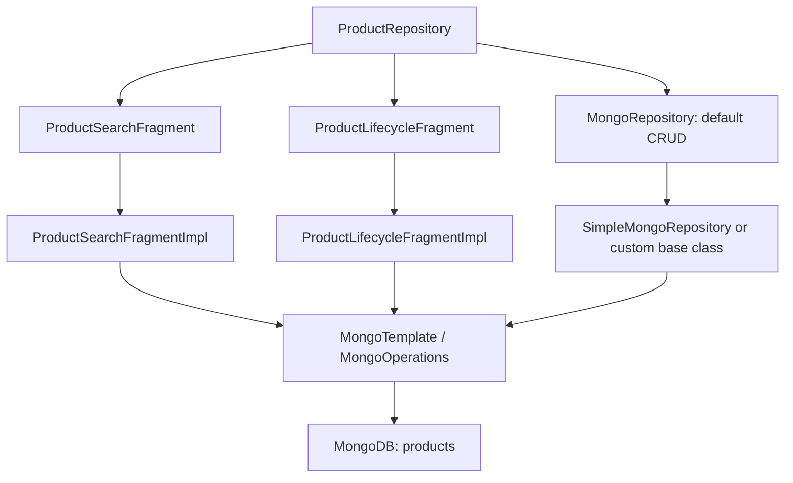

# Reusing Fragments and Customizing Base Repositories When Needed

## 1. The Problem: When CRUD and Derived Queries Are No Longer Enough

In a catalog management application, `ProductRepository` can start very simply:

```java
import org.springframework.data.mongodb.repository.MongoRepository;

public interface ProductRepository
        extends MongoRepository<ProductDocument, String> {}
```

Spring Data MongoDB creates a default implementation for `save`, `findById`, `findAll`, `deleteById`, and query methods derived from method names. This suffices for most CRUD operations.

As the system grows, further requirements arise:

- The product search screen needs **optional** criteria, DTO projections, sorting, and result limits.
- Multiple repositories share tenant-scoped reads or standardized search patterns.
- Specific repositories have business rules needing atomic updates via `MongoTemplate` instead of `findById → mutate in Java → save`.
- Every repository in a module needs a **consistent base method**, such as `getRequiredById(id)` throwing an error when a record is missing.
- The engineering team wants controlled extensibility without rewriting `MongoRepository` or interfering with all of Spring Data's internals.

There are two main extension points:

1. **Repository fragment:** a small behavioral interface with an independent implementation that Spring Data **composes** into whichever repositories need it.
2. **Custom repository base class:** a base implementation replacing/extending `SimpleMongoRepository` for repositories within `@EnableMongoRepositories` scope.

This lesson belongs to the **Extended Repositories** chapter of the **SPRING_DATA_MONGODB** module. Alongside Java syntax, we connect to real MongoDB, `MongoTemplate`, queries/aggregations, indexes, transactions, reactive access, testing, and performance diagnostics.

**Design principle:** localized extensions use **fragments**; uniform base behavior across an entire module warrants considering a **custom base class**. Never introduce a global base class just to solve a single product-specific query.

## 2. Three Levels of Repository Extension

| Approach | Scope | Use when | Risk if overused |
| --- | --- | --- | --- |
| Derived query / `@Query` | One repository method | Simple filters, clear JSON queries | Combinatorial method variants, hard-to-maintain logic |
| **Repository fragment** | Only repositories that `extends` the fragment | Dynamic queries, custom updates, reusable APIs | Method name collisions or misconfigured implementation discovery |
| **Custom base repository** | Repositories within the base class configuration scope | Consistent base API/behavior across many repositories | Wide impact on save/delete, transactions, mapping, callbacks |

Fragments are **composable**: a single repository can combine multiple fragment interfaces. A fragment implementation is a Spring bean discovered and invoked by repository composition, not an independent repository needing its own `@EnableMongoRepositories`.

A base repository, by contrast, is tied to the factory creating repositories. Changing the base class requires a matching constructor and `repositoryBaseClass` configuration; you cannot simply drop in a class named `ProductRepositoryImpl` and expect every repository to change behavior.

### 2.1. Overview Diagram



Spring Data places a **repository proxy** in front of the implementations. Callers invoke methods on `ProductRepository`, and the proxy routes calls to the matching fragment or base implementation. There is no need to write a single Java class implementing all of `ProductRepository`.

## 3. Dataset and Model Used Throughout the Lesson

Suppose each product belongs to a tenant and has a category, price, and active flag. The collection contains these BSON fields:

```javascript
db.products.insertMany([
  {
    _id: "p-101",
    tenant_id: "tenant-A",
    name: "Mechanical Keyboard",
    category: "keyboard",
    price_cents: NumberLong("1850000"),
    active: true
  },
  {
    _id: "p-102",
    tenant_id: "tenant-A",
    name: "Wireless Mouse",
    category: "mouse",
    price_cents: NumberLong("650000"),
    active: true
  },
  {
    _id: "p-103",
    tenant_id: "tenant-A",
    name: "Old Keyboard",
    category: "keyboard",
    price_cents: NumberLong("500000"),
    active: false
  },
  {
    _id: "p-104",
    tenant_id: "tenant-B",
    name: "Other Tenant Keyboard",
    category: "keyboard",
    price_cents: NumberLong("900000"),
    active: true
  }
]);
```

This is simulated data. `insertMany` should only run against a test database. Documents inserted directly via `mongosh` may lack the `_class` type hint that Spring Data writes by default.

### 3.1. BSON-Mapped Entity

```java
import org.springframework.data.mongodb.core.mapping.Document;
import org.springframework.data.mongodb.core.mapping.Field;
import org.springframework.data.mongodb.core.mapping.FieldType;
import org.springframework.data.mongodb.core.mapping.MongoId;

@Document(collection = "products")
public record ProductDocument(
    @MongoId(FieldType.STRING)
    String id,

    @Field("tenant_id")
    String tenantId,

    String name,
    String category,

    @Field("price_cents")
    Long priceCents,

    boolean active
) {}
```

Key points:

- `id` maps to `_id` as a BSON string.
- Java property `tenantId` is stored under BSON field `tenant_id`.
- Java property `priceCents` maps to `price_cents`; this is an illustrative minor currency unit convention, not applicable to every currency.
- `active` is a stored boolean, not an automatic access-control check.

Repositories and `MongoTemplate` given `ProductDocument` metadata map property paths such as `tenantId` and `priceCents` to their corresponding BSON fields. When calling the raw driver `getCollection("products")`, you must use the real BSON names.

## 4. First Fragment: Interface Describing Custom Behavior

Suppose an admin endpoint searches active products, optionally filtering by category and price range. The repository does not need a separate method for every combination of `category`, `minPrice`, and `maxPrice`.

Define the criteria DTO:

```java
public record ProductSearchFilter(
    String category,
    Long minPriceCents,
    Long maxPriceCents
) {}
```

Define the read-only DTO:

```java
public record ProductSummary(
    String id,
    String name,
    String category,
    Long priceCents
) {}
```

A fragment is a **plain Java interface** and does not need to extend `Repository`:

```java
import java.util.List;

public interface ProductSearchFragment {

    List<ProductSummary> searchActive(
        String trustedTenantId,
        ProductSearchFilter filter,
        int requestedLimit
    );
}
```

The name `ProductSearchFragment` communicates its capability clearly. When a repository wants this capability, it simply adds `extends ProductSearchFragment`.

**Do not** return a partially loaded `ProductDocument` when the goal is a read-only listing; `ProductSummary` makes the contract explicit. Likewise, never pass a raw JSON filter string from HTTP straight into MongoDB.

## 5. Fragment Implementation: `ProductSearchFragmentImpl`

Spring Data's default discovery convention is **fragment interface name + `Impl` postfix**. Thus, the implementation class for `ProductSearchFragment` is named `ProductSearchFragmentImpl`.

```java
import java.util.List;
import java.util.Objects;

import org.springframework.data.domain.Sort;
import org.springframework.data.mongodb.core.MongoTemplate;
import org.springframework.data.mongodb.core.query.Criteria;
import org.springframework.data.mongodb.core.query.Query;
import org.springframework.stereotype.Component;

@Component
public class ProductSearchFragmentImpl
        implements ProductSearchFragment {

    private final MongoTemplate template;

    public ProductSearchFragmentImpl(MongoTemplate template) {
        this.template = Objects.requireNonNull(template);
    }

    @Override
    public List<ProductSummary> searchActive(
        String trustedTenantId,
        ProductSearchFilter filter,
        int requestedLimit
    ) {
        if (trustedTenantId == null
                || trustedTenantId.isBlank()) {
            throw new IllegalArgumentException(
                "Tenant is required"
            );
        }

        Objects.requireNonNull(filter, "filter");

        if (filter.minPriceCents() != null
                && filter.maxPriceCents() != null
                && filter.minPriceCents() > filter.maxPriceCents()) {
            throw new IllegalArgumentException(
                "Invalid price range"
            );
        }

        if (requestedLimit < 1 || requestedLimit > 100) {
            throw new IllegalArgumentException(
                "Limit must be within 1..100"
            );
        }

        Criteria criteria = Criteria.where("tenantId")
            .is(trustedTenantId)
            .and("active").is(true);

        String category = filter.category();
        if (category != null && !category.isBlank()) {
            criteria.and("category").is(category.trim());
        }

        Query query = Query.query(criteria);

        if (filter.minPriceCents() != null
                || filter.maxPriceCents() != null) {
            Criteria price = Criteria.where("priceCents");

            if (filter.minPriceCents() != null) {
                price.gte(filter.minPriceCents());
            }
            if (filter.maxPriceCents() != null) {
                price.lte(filter.maxPriceCents());
            }

            query.addCriteria(price);
        }

        query.with(Sort.by(
            Sort.Order.asc("name"),
            Sort.Order.asc("id")
        ));
        query.limit(requestedLimit);

        return template.query(ProductDocument.class)
            .as(ProductSummary.class)
            .matching(query)
            .all();
    }
}
```

This code demonstrates a **fluent query** in `MongoTemplate`:

- `query(ProductDocument.class)` specifies the **source entity** and collection.
- `Criteria.where("tenantId")` maps to `tenant_id` via `@Field`.
- `priceCents` maps to `price_cents`.
- `as(ProductSummary.class)` projects results into a DTO instead of the full entity.
- `matching(query)` applies filters, sorting, and limits.
- `all()` executes and returns `List<ProductSummary>`.

DTO projections allow the framework to optimize fetched fields, yet **do not guarantee every setup fetches strictly four BSON fields**. With custom converters or specialized constructor mappings, inspect the emitted MongoDB command and verify against real BSON results.

### 5.1. Why Use a Fragment Instead of Code in the Controller?

A fragment centralizes persistence logic for a use case:

- Testable independently of HTTP.
- Reusable across multiple services and composed repositories.
- Combines operations with `MongoTemplate` when derived methods grow unwieldy.
- Keeps controllers unaware of collection names, MongoDB `Criteria`, and projection rules.

**Tenant must come from a trusted identity**, such as a security context or authenticated service. Never take `trustedTenantId` directly from a client-supplied query parameter and treat it as authorization.

### 5.2. Nulls, Prices, and BSON Types

The example uses `Long` for `priceCents` and `gte/lte` filters. If legacy documents store prices as strings/Decimal128 or lack the field, comparisons can behave unexpectedly. Standardize schemas, validate inputs, and test against real BSON.

Never use `Double` for currency when exact monetary arithmetic is required; depending on currency, store integer minor units or BSON Decimal128 with `BigDecimal` and explicit rounding/scale rules.

## 6. Composing the Fragment into `ProductRepository`

The repository can extend both the default interface and the fragment:

```java
import org.springframework.data.mongodb.repository.MongoRepository;

public interface ProductRepository
        extends MongoRepository<ProductDocument, String>,
                ProductSearchFragment {
}
```

When Spring Data initializes the repository, it discovers `ProductSearchFragment`'s implementation (defaulting to the `Impl` postfix) within the scan scope and composes it into the proxy.

Callers can run:

```java
List<ProductSummary> results = productRepository.searchActive(
    "tenant-A",
    new ProductSearchFilter("keyboard", 0L, 2000000L),
    20
);

for (ProductSummary item : results) {
    System.out.printf("%s: %s%n", item.id(), item.name());
}
```

With the sample data, `p-101` matches; `p-103` does not because it is inactive; `p-104` does not because it belongs to another tenant. With matching indexes and sorts, reads can be optimized; verify exact outputs on real MongoDB.

**There is no need to create `ProductRepositoryImpl implements ProductRepository`.** Doing so pulls you toward implementing the entire repository API manually, counter to Spring Data's composition model.

### 6.1. Naming and Package Notes

A clean layout:

```text
com.example.catalog.persistence
├── ProductDocument.java
├── ProductRepository.java
├── ProductSearchFragment.java
├── ProductSearchFragmentImpl.java
├── ProductSearchFilter.java
└── ProductSummary.java
```

Spring Data discovers custom fragment implementations according to repository infrastructure's package scope and naming rules. Implementations can be registered as Spring beans (for example with `@Component`) and receive `MongoTemplate` via constructor injection.

If startup reports a **missing implementation**, check:

1. Does the repository actually `extends ProductSearchFragment`?
2. Is the class named `ProductSearchFragmentImpl` with the configured postfix?
3. Are both interface and implementation inside the scan scope?
4. Do constructor dependencies resolve cleanly?
5. Is there a duplicate implementation or bean name causing ambiguity?
6. Was the fragment accidentally placed in a package excluded by scan configuration?

Do not rename multiple classes randomly at once. Inspect startup logs and scan configuration before making changes.

## 7. A Fragment Is a Reusable Unit, Not Tied to a Single Repository

When you want `ProductSearchFragment` in multiple places for the same `ProductDocument` aggregate, you can compose that interface into different repositories exposing different default method sets.

For example, a repository exposing only search for an internal export job:

```java
import org.springframework.data.repository.Repository;

public interface ProductLookupRepository
        extends Repository<ProductDocument, String>,
                ProductSearchFragment {
}
```

It can share the same `ProductSearchFragmentImpl`, while not exposing full CRUD APIs unless those methods are declared/extended. Another service can inject `ProductLookupRepository` instead of `ProductRepository` when it should only read via search.

**Note:** two repository interfaces for the same domain type create distinct beans sharing the fragment. Injecting by concrete repository interface is unambiguous; if injecting via a common super-interface matched by both, use qualifiers or layout changes to avoid ambiguity.

### 7.1. Reusing a Fragment Across Multiple Domain Types

A fragment shared across `ProductDocument` and `CustomerDocument` must handle **domain type and collection** properly. If an implementation hardcodes `ProductDocument.class`, it cannot magically query `CustomerDocument` merely because a new repository extends the interface.

You can design a generic fragment accepting the domain class **from internal code**:

```java
import java.util.List;

public interface TenantScopedReader<T> {
    List<T> findActiveForTenant(
        Class<T> domainType,
        String trustedTenantId,
        int limit
    );
}
```

Shared implementation:

```java
import java.util.List;
import org.springframework.data.mongodb.core.MongoTemplate;
import org.springframework.data.mongodb.core.query.Criteria;
import org.springframework.data.mongodb.core.query.Query;

public class TenantScopedReaderImpl<T>
        implements TenantScopedReader<T> {

    private final MongoTemplate template;

    public TenantScopedReaderImpl(MongoTemplate template) {
        this.template = template;
    }

    @Override
    public List<T> findActiveForTenant(
        Class<T> domainType,
        String trustedTenantId,
        int limit
    ) {
        if (trustedTenantId == null
                || trustedTenantId.isBlank()
                || limit < 1 || limit > 100) {
            throw new IllegalArgumentException(
                "Invalid query parameters"
            );
        }

        Query query = Query.query(
            Criteria.where("tenantId").is(trustedTenantId)
                .and("active").is(true)
        );
        query.limit(limit);

        return template.find(query, domainType);
    }
}
```

With this pattern, `ProductRepository` can add `TenantScopedReader<ProductDocument>`; a `CustomerDocument` repository should only use it if customer documents actually share compatible `tenantId` and `active` properties.

**In return**, the method must receive `ProductDocument.class` or `CustomerDocument.class` from a trusted service. Never accept arbitrary `Class<?>` or collection names from HTTP clients. When domain requirements diverge significantly, prefer **a shared internal helper/service** with separate domain-specific fragments rather than forcing mismatched schemas into one generic fragment.

### 7.2. When to Extract a Helper Instead of Sharing a Fragment?

A shared `SearchQueryBuilder` or `TenantCriteriaFactory` can construct `Criteria`, while each fragment decides its own domain type and DTOs. That avoids passing `Class<T>` or collection names into fragment APIs while keeping each aggregate's contract explicit.

You can reuse **implementation logic** without necessarily reusing a **public repository interface**. This is often cleaner when two collections differ in indexes, field names, or permission policies.

## 8. Composing Multiple Fragments in One Repository

Suppose products also need state-transition operations:

```java
public interface ProductLifecycleFragment {

    boolean deactivate(
        String trustedTenantId,
        String productId
    );
}
```

The implementation can use `MongoTemplate.updateFirst` with conditions:

```java
import com.mongodb.client.result.UpdateResult;

import org.springframework.data.mongodb.core.MongoTemplate;
import org.springframework.data.mongodb.core.query.Criteria;
import org.springframework.data.mongodb.core.query.Query;
import org.springframework.data.mongodb.core.query.Update;
import org.springframework.stereotype.Component;

@Component
public class ProductLifecycleFragmentImpl
        implements ProductLifecycleFragment {

    private final MongoTemplate template;

    public ProductLifecycleFragmentImpl(MongoTemplate template) {
        this.template = template;
    }

    @Override
    public boolean deactivate(
        String trustedTenantId,
        String productId
    ) {
        Query query = Query.query(
            Criteria.where("id").is(productId)
                .and("tenantId").is(trustedTenantId)
                .and("active").is(true)
        );

        Update update = new Update()
            .set("active", false);

        UpdateResult result = template.updateFirst(
            query, update, ProductDocument.class
        );

        return result.getModifiedCount() == 1;
    }
}
```

Now the repository can compose both:

```java
public interface ProductRepository
        extends MongoRepository<ProductDocument, String>,
                ProductSearchFragment,
                ProductLifecycleFragment {
}
```

`ProductLifecycleFragmentImpl` only updates `active` via `$set`, without loading the whole entity and calling `save`. MongoDB executes an atomic single-document update matching the filter; multi-document transitions or external event emissions are not covered by that single atomic update.

### 8.1. Method Conflicts and Precedence Order

In repository composition, custom fragments typically take precedence over base implementations and repository aspects. When multiple fragments declare identical method signatures, **fragment declaration order** can affect which implementation is chosen. Therefore:

- Prefer **unique method names** across fragments.
- Never rely on `extends` order as an implicit "business override" mechanism.
- Avoid overriding default `save`/`delete` in a fragment unless backed by a clear contract and thorough tests.
- For genuinely module-wide shared behavior, consider a base repository instead of composing fragments with overlapping overrides.
- Write dispatch tests proving Spring Data selects the expected implementation in your version.

Never assume Java source method ordering or package class ordering dictates fragment selection.

## 9. Legacy Extension Path: Repository-Named `ProductRepositoryImpl`

Some legacy projects contain:

```java
public class ProductRepositoryImpl {
    // Additional methods discovered via ProductRepository + Impl naming.
}
```

This is the **single custom implementation** pattern tied to the repository name, retained for backward compatibility but **not preferred** for new code. It can be confused with fragment implementations and makes reuse harder.

Prefer:

```text
ProductSearchFragment          → ProductSearchFragmentImpl
ProductLifecycleFragment       → ProductLifecycleFragmentImpl
ProductRepository              → extends needed fragments
```

Instead of:

```text
ProductRepository              → ProductRepositoryImpl (holding all custom methods)
```

When migrating, check all methods, bean names, qualifiers, and transactions attached to the legacy implementation before renaming. Do not delete the legacy class immediately if other repositories still depend on it.

### 9.1. Customizable Implementation Postfix

If the project configures a postfix other than `Impl`:

```java
import org.springframework.context.annotation.Configuration;
import org.springframework.data.mongodb.repository.config.EnableMongoRepositories;

@Configuration
@EnableMongoRepositories(
    basePackages = "com.example.catalog.persistence",
    repositoryImplementationPostfix = "Custom"
)
public class MongoRepositoryConfiguration {}
```

Then `ProductSearchFragmentCustom` becomes the conventional name. **Never mix `ProductSearchFragmentImpl` and `ProductSearchFragmentCustom` without understanding the configuration**, as that creates ambiguity. With explicit bean registration, bean naming also affects how Spring Data binds implementations to fragments.

Check Javadoc for your version and scan configurations in your project. Many Spring Boot apps do not need `@EnableMongoRepositories` at all if auto-configuration already discovers repositories properly.

## 10. Custom Repository Base: A Very Different Problem from Fragments

Suppose a module has 15 repositories and code repeatedly writes:

```java
ProductDocument product = repository.findById(id)
    .orElseThrow(
        () -> new java.util.NoSuchElementException(
            "Record not found: " + id
        )
    );
```

The team wants every repository to expose `getRequiredById(id)` returning the entity or throwing an exception. A fragment across 15 repositories could work, but requires extending it repeatedly and dealing with generic domain types. A **custom base repository** is an option when the new API belongs on the shared base repository contract across the module.

To illustrate, we define:

1. **A base repository interface** declaring the new method.
2. **A base repository implementation** extending `SimpleMongoRepository`.
3. **Repository factory configuration** setting `repositoryBaseClass`.

This change has a much broader blast radius than a fragment: review carefully, especially if modifying `save`, `delete`, callbacks, or optimistic locking.

## 11. Base Interface with `@NoRepositoryBean`

```java
import org.springframework.data.repository.NoRepositoryBean;
import org.springframework.data.mongodb.repository.MongoRepository;

@NoRepositoryBean
public interface RequiredFindRepository<T, ID>
        extends MongoRepository<T, ID> {

    T getRequiredById(ID id);
}
```

`@NoRepositoryBean` is critical: this interface is only a **generic base contract**, not a repository for a concrete entity. The annotation prevents Spring Data from trying to instantiate a repository bean directly for `RequiredFindRepository<T,ID>` during scanning.

`getRequiredById(ID id)` is not a derived query inferred from an entity property; we **provide its implementation** in the custom base class.

If you only need a pure Java helper like:

```java
default T getRequiredById(ID id) {
    return findById(id).orElseThrow();
}
```

you can write a `default method` directly on the extended interface **without replacing the base class**. However, some teams want base behavior that can be instrumented or combined with shared implementation internals, which is where a base class fits. Always pick the **simplest extension level sufficient for the need**.

## 12. Base Implementation Extending `SimpleMongoRepository`

Sample implementation:

```java
import java.util.NoSuchElementException;

import org.springframework.data.mongodb.core.MongoOperations;
import org.springframework.data.mongodb.repository.query.MongoEntityInformation;
import org.springframework.data.mongodb.repository.support.SimpleMongoRepository;

public class RequiredFindMongoRepository<T, ID>
        extends SimpleMongoRepository<T, ID>
        implements RequiredFindRepository<T, ID> {

    public RequiredFindMongoRepository(
        MongoEntityInformation<T, ID> entityInformation,
        MongoOperations mongoOperations
    ) {
        super(entityInformation, mongoOperations);
    }

    @Override
    public T getRequiredById(ID id) {
        return findById(id).orElseThrow(
            () -> new NoSuchElementException(
                "Entity not found with ID: " + id
            )
        );
    }
}
```

Technical details:

- `SimpleMongoRepository<T, ID>` is the standard base implementation in Spring Data MongoDB.
- The constructor must accept **`MongoEntityInformation<T,ID>`** and **`MongoOperations`** per your version's factory contract, forwarding them to `super(...)`.
- The new method delegates to `findById` to leverage built-in mapping and MongoDB operations.
- The class does not need `@Repository` to be selected as `repositoryBaseClass` via `@EnableMongoRepositories`.
- Never instantiate `new RequiredFindMongoRepository(...)` manually in services; the repository proxy/factory creates and wires it.

Exception handling here is illustrative. In public APIs, never automatically echo raw IDs or sensitive data in HTTP error responses. Services/controllers should translate exceptions into appropriate status codes and messages.

### 12.1. Do Not Use Inheritance Just to Customize Error Messages

If the sole goal is "return 404 when a product is missing", a service method calling `findById(...).orElseThrow(...)` is plenty. Changing the global base repository for a tiny requirement complicates design and increases testing/migration cost.

A base class makes sense when **many repositories** share a genuinely consistent API or behavioral invariant.

## 13. Registering the Base Class via `@EnableMongoRepositories`

```java
import org.springframework.context.annotation.Configuration;
import org.springframework.data.mongodb.repository.config.EnableMongoRepositories;

@Configuration
@EnableMongoRepositories(
    basePackages = "com.example.catalog.persistence",
    repositoryBaseClass = RequiredFindMongoRepository.class
)
public class CatalogMongoRepositoriesConfig {}
```

Then a repository uses the base interface:

```java
public interface ProductRepository
        extends RequiredFindRepository<ProductDocument, String>,
                ProductSearchFragment,
                ProductLifecycleFragment {
}
```

Caller:

```java
ProductDocument product = productRepository
    .getRequiredById("p-101");

List<ProductSummary> summaries = productRepository
    .searchActive(
        "tenant-A",
        new ProductSearchFilter("keyboard", null, null),
        20
    );
```

Here `getRequiredById` comes from the **custom base**, while `searchActive` comes from the **fragment**. The repository still retains standard CRUD methods inherited from `SimpleMongoRepository`.

### 13.1. Configuration Scope Is Critical

`repositoryBaseClass` applies to repositories within that `@EnableMongoRepositories` scope. If a module has multiple repository groups with different configs, verify clearly:

- Which packages belong to which scanner?
- Could the same repository interface accidentally be scanned twice?
- Do Spring Boot auto-configuration and `@EnableMongoRepositories` overlap?
- Are MongoDB and JPA repositories mixed in the same package, causing store ambiguity?
- Should repositories outside this scope keep a different base class?

Never assume a configuration bean placed anywhere in the app automatically applies to every repository system-wide. Test context startup and actual method dispatch.

### 13.2. Base Implementation Does Not Replace Custom Repository Factories

Setting `repositoryBaseClass` covers many needs. If you need to alter the **entire repository/proxy creation pipeline**, such as customizing metadata or factory behavior, you may have to extend `MongoRepositoryFactoryBean`/`MongoRepositoryFactory` per your version's API.

That is a deeper intervention with higher upgrade/compatibility cost. Do not jump to a custom factory if you only need an extra method.

## 14. Choosing Default Method, Fragment, or Custom Base Class?

Pragmatic decision table:

| Need | Preferred choice |
| --- | --- |
| Converting `Optional<T>` into a simple exception | Service or interface `default method` |
| Optional search/aggregation specific to products | **ProductSearchFragment** |
| Dedicated state update with conditional `$set` | **ProductLifecycleFragment** |
| Sharing a capability across a few repositories with identical schema | Reusable fragment or shared helper |
| Similar query logic across domains with differing schemas | Shared helper/builder, separate per-domain fragments |
| Uniform base API across all repositories in a module | Base interface + **custom base class**, if default methods fall short |
| Customizing proxy creation and repository factory internals | Custom factory (last resort, only when truly required) |
| Enforcing business validation/authorization | Service/domain policy; not necessarily a repository extension |
| Turning every `delete` into a soft delete | Requires careful global design, not merely overriding one method |

**Never override the base class just to mask dangerous methods.** For example, overriding `deleteById` expecting no physical deletes anywhere is flawed: other `delete` overloads, batch operations, template calls, raw drivers, or custom queries can still delete. A soft-delete policy must govern every write path, read filter, index, retention rule, and test.

## 15. Overriding Default Methods: Power Comes with Risk

A custom base class can override methods like `save(S entity)` or `deleteById(ID id)`. However, remember:

- `save` has **insert-or-update** semantics depending on ID/metadata and mapping.
- `MongoRepository.saveAll(...)` may follow its own execution path; never assume every bulk method routes through your overridden `save` as expected.
- `MongoTemplate.updateFirst(...)`, `bulkOps(...)`, and the raw MongoDB Driver bypass repository base `save`.
- Callbacks, auditing, and `@Version` follow Spring Data MongoDB contracts; custom raw replacements can skip them.
- Repository fragments with matching methods can take precedence over the base implementation.
- In reactive applications, an imperative base class **does not apply** to `ReactiveMongoRepository`.

Minimal example of a pre-save hook (illustrative only, not a replacement for domain validation):

```java
public interface ValidatedBeforeSave {
    void validateForPersistence();
}
```

```java
public class ValidatingMongoRepository<T, ID>
        extends SimpleMongoRepository<T, ID> {

    public ValidatingMongoRepository(
        MongoEntityInformation<T, ID> info,
        MongoOperations operations
    ) {
        super(info, operations);
    }

    @Override
    public <S extends T> S save(S entity) {
        if (entity instanceof ValidatedBeforeSave validatable) {
            validatable.validateForPersistence();
        }
        return super.save(entity);
    }
}
```

If using this class in a real project, add imports as in section 12 and configure `repositoryBaseClass=ValidatingMongoRepository.class`. It **only** validates entities implementing `ValidatedBeforeSave` when routed through the overridden `save`; never advertise it as an unbypassable validation firewall.

Use Bean Validation, domain services, or MongoDB schema validation for invariants enforced across all write paths. A repository base is not a data firewall.

## 16. Fragments Do Not Create Transactions Automatically

A fragment can execute multiple MongoDB operations:

```java
public void reserveAndRecord(
    String productId,
    long quantity
) {
    // 1. Check and deduct stock.
    // 2. Insert a Reservation document.
}
```

If two writes target **two documents or two collections**, they do not automatically commit together just because the method lives in a fragment or repository.

When modifying **one document** via `updateFirst` with a filter and `$inc`/`$set`, MongoDB guarantees single-document atomicity. If business rules require multiple documents to commit/roll back together, evaluate MongoDB transactions on a supporting deployment.

### 16.1. Place Transactions at Service Boundaries

Example transaction manager configuration:

```java
import org.springframework.context.annotation.Bean;
import org.springframework.context.annotation.Configuration;
import org.springframework.data.mongodb.MongoDatabaseFactory;
import org.springframework.data.mongodb.MongoTransactionManager;

@Configuration
public class MongoTransactionConfig {

    @Bean
    public MongoTransactionManager mongoTransactionManager(
        MongoDatabaseFactory factory
    ) {
        return new MongoTransactionManager(factory);
    }
}
```

Coordinating service:

```java
import org.springframework.stereotype.Service;
import org.springframework.transaction.annotation.Transactional;

@Service
public class CatalogWorkflowService {

    private final ProductRepository products;

    public CatalogWorkflowService(ProductRepository products) {
        this.products = products;
    }

    @Transactional(
        transactionManager = "mongoTransactionManager"
    )
    public void deactivateAndWriteAudit(
        String trustedTenantId,
        String productId
    ) {
        boolean changed = products.deactivate(
            trustedTenantId, productId
        );
        if (!changed) {
            throw new IllegalStateException(
                "Unable to transition product status"
            );
        }

        // Write audit inside the same MongoDB transaction using
        // repository/template sharing the session/transaction context.
    }
}
```

This is an illustrative skeleton: the audit write needs real implementation and proper transaction configuration. `@Transactional` works when the method is called through a Spring proxy; self-invocation within the same instance may bypass the proxy. A MongoDB transaction does not cover emails, HTTP calls, or external message brokers.

**Avoid** holding long transactions open while scanning millions of records. Use checkpoints/idempotency for batch workflows.

### 16.2. Fragments and Repository Exception Translation

When implementations use `MongoTemplate` via Spring Data, MongoDB exceptions are normally translated into Spring's `DataAccessException` hierarchy on appropriate paths. If a fragment invokes raw `MongoCollection`, you may receive driver exceptions directly and bypass converter/transaction conventions.

Never swallow exceptions just to return `true`/`false` unconditionally. For conditional updates, distinguish not-found, invalid state, permission mismatch, and network errors with uncertain outcomes.

## 17. Fragments in Reactive Repositories

With Spring WebFlux, fragments should use **ReactiveMongoTemplate** and return `Mono`/`Flux`, never calling blocking repositories/templates inside a reactive pipeline.

Define a separate interface:

```java
import reactor.core.publisher.Flux;

public interface ReactiveProductSearchFragment {

    Flux<ProductSummary> searchActiveReactive(
        String trustedTenantId,
        String category,
        int limit
    );
}
```

Implementation:

```java
import org.springframework.data.domain.Sort;
import org.springframework.data.mongodb.core.ReactiveMongoTemplate;
import org.springframework.data.mongodb.core.query.Criteria;
import org.springframework.data.mongodb.core.query.Query;

import reactor.core.publisher.Flux;

public class ReactiveProductSearchFragmentImpl
        implements ReactiveProductSearchFragment {

    private final ReactiveMongoTemplate template;

    public ReactiveProductSearchFragmentImpl(
        ReactiveMongoTemplate template
    ) {
        this.template = template;
    }

    @Override
    public Flux<ProductSummary> searchActiveReactive(
        String trustedTenantId,
        String category,
        int limit
    ) {
        if (trustedTenantId == null
                || trustedTenantId.isBlank()
                || limit < 1 || limit > 100) {
            return Flux.error(
                new IllegalArgumentException(
                    "Invalid query parameters"
                )
            );
        }

        Criteria criteria = Criteria.where("tenantId")
            .is(trustedTenantId)
            .and("active").is(true);

        if (category != null && !category.isBlank()) {
            criteria.and("category").is(category.trim());
        }

        Query query = Query.query(criteria)
            .with(
                Sort.by(
                    Sort.Order.asc("name"),
                    Sort.Order.asc("id")
                )
            );
        query.limit(limit);

        return template.query(ProductDocument.class)
            .as(ProductSummary.class)
            .matching(query)
            .all();
    }
}
```

Reactive repository:

```java
import org.springframework.data.mongodb.repository.ReactiveMongoRepository;

public interface ReactiveProductRepository
        extends ReactiveMongoRepository<ProductDocument, String>,
                ReactiveProductSearchFragment {
}
```

Implementation discovery also needs naming/scanning aligned with reactive repository config. Instead of `@EnableMongoRepositories`, reactive repositories use `@EnableReactiveMongoRepositories` when explicit configuration is required.

**Note:** a custom base class extending `SimpleMongoRepository` does not apply to reactive repositories; the reactive world has its own `SimpleReactiveMongoRepository` implementation and constructors per version. Never mix imperative and reactive base classes into one class.

### 17.1. Backpressure and Reactive Transactions

Returning `Flux<ProductSummary>` does not imply the query is indexed or bounded; this example explicitly sets `limit`. Avoid `block()` on event loops and avoid unbounded `collectList()`.

If a reactive workflow needs multi-document transactions, you need `ReactiveMongoTransactionManager` and proper reactive context handling, such as `TransactionalOperator`. Imperative `MongoTransactionManager` cannot substitute for it.

## 18. Repository Fragments and Aggregation

When queries only need simple equality or regex checks, derived queries or `@Query` may suffice. Fragments shine when you need to **build dynamic aggregations** from multiple inputs and map results to DTOs.

Example MongoDB pipeline counting active products per category within a tenant:

```javascript
db.products.aggregate([
  {
    $match: {
      tenant_id: "tenant-A",
      active: true
    }
  },
  {
    $group: {
      _id: "$category",
      productCount: { $sum: 1 }
    }
  },
  { $sort: { productCount: -1, _id: 1 } }
]);
```

The fragment can use:

```java
import java.util.List;

import org.springframework.data.mongodb.core.MongoTemplate;
import org.springframework.data.mongodb.core.aggregation.Aggregation;
import org.springframework.data.mongodb.core.query.Criteria;

public record CategoryCount(
    String id,
    long productCount
) {}

public List<CategoryCount> countByCategory(
    MongoTemplate template,
    String trustedTenantId
) {
    Aggregation aggregation = Aggregation.newAggregation(
        Aggregation.match(
            Criteria.where("tenantId").is(trustedTenantId)
                .and("active").is(true)
        ),
        Aggregation.group("category")
            .count().as("productCount"),
        Aggregation.sort(
            org.springframework.data.domain.Sort.by(
                org.springframework.data.domain.Sort.Order
                    .desc("productCount"),
                org.springframework.data.domain.Sort.Order
                    .asc("_id")
            )
        )
    );

    return template.aggregate(
        aggregation,
        ProductDocument.class,
        CategoryCount.class
    ).getMappedResults();
}
```

This snippet shows a helper method that can live inside a reporting fragment; declare a matching interface to expose it on a repository. `ProductDocument.class` tells Spring Data the input collection and `tenantId` → `tenant_id` mapping.

**Verify result shape:** `$group` produces `_id` as the category; `CategoryCount(String id, ...)` uses `id` as a mapping choice, whereas if the API expects `category`, add a `$project`/alias and integration test it. An aggregation fragment **does not need** to return full entities.

## 19. Indexes and Performance: Fragments Do Not Make Queries Faster Automatically

From the `searchActive` example, filters include:

```text
tenantId = ...
active = true
category = ... (optional)
priceCents >= min (optional)
priceCents <= max (optional)
sort name ASC, id ASC
limit <= 100
```

An index that can help when filtering category and sorting by name:

```javascript
db.products.createIndex({
  tenant_id: 1,
  active: 1,
  category: 1,
  name: 1,
  _id: 1
});
```

With a `price_cents` range filter and `name` sort, a different index might fit better; no single index optimizes every combination. Choose indexes based on **real query patterns** and `explain` measurements.

Example:

```javascript
db.products.find({
  tenant_id: "tenant-A",
  active: true,
  category: "keyboard"
})
.sort({ name: 1, _id: 1 })
.limit(20)
.explain("executionStats");
```

Inspect:

| Metric | Meaning |
| --- | --- |
| `IXSCAN`, `COLLSCAN` | Is an index used? |
| `totalKeysExamined` | How many index entries were scanned? |
| `totalDocsExamined` | How many source documents were read? |
| Sort stage | Is the query sorting in memory outside the index? |
| `nReturned` | Is result count bounded? |
| BSON payload size | Did DTO projection actually reduce transferred data? |
| p95/p99 latency | Responsiveness under realistic load |

"Moving a query into a fragment" only **organizes code**. It does not add indexes, caching, transactions, or N+1 protection. You must design queries and indexes around business workloads.

### 19.1. N+1 Queries Inside a Fragment

A listing fragment might call `template.find(...)` for 20 products and then loop 20 times calling another repository to load stock or supplier details. That is still an N+1 query despite having a single entry point.

When related data is needed, consider `$in` batch queries, precomputed snapshots, `$lookup` aggregations, or adjusted document design. Never assume fragments automatically resolve ID references.

## 20. Integration Testing Fragments and Base Repositories

Mock unit tests are useful for verifying validation and query building, yet **do not prove** that the repository factory composed the fragment, `@Field` mapped properly, or the custom base class was picked up. Use integration tests against real MongoDB—for example Testcontainers with `@DataMongoTest` in Spring Boot.

### 20.1. Testing Fragment Dispatch Through the Repository Proxy

Example test where the repository is scanned alongside `ProductSearchFragmentImpl` against an isolated test MongoDB:

```java
import static org.assertj.core.api.Assertions.assertThat;

import java.util.List;

import org.junit.jupiter.api.Test;
import org.springframework.beans.factory.annotation.Autowired;
import org.springframework.boot.test.autoconfigure.data.mongo.DataMongoTest;
import org.springframework.data.mongodb.core.MongoTemplate;

@DataMongoTest
class ProductSearchFragmentIntegrationTest {

    @Autowired ProductRepository products;

    @Autowired MongoTemplate template;

    @Test
    void repositoryDelegatesToFragmentAndKeepsTenantFilter() {
        template.insert(new ProductDocument(
            "frag-01", "tenant-A",
            "Keyboard A", "keyboard", 100000L, true
        ));
        template.insert(new ProductDocument(
            "frag-02", "tenant-A",
            "Suspended Keyboard", "keyboard",
            80000L, false
        ));
        template.insert(new ProductDocument(
            "frag-03", "tenant-B",
            "Keyboard B", "keyboard",
            90000L, true
        ));

        List<ProductSummary> results = products.searchActive(
            "tenant-A",
            new ProductSearchFilter(
                "keyboard", 50000L, 150000L
            ),
            10
        );

        assertThat(results)
            .extracting(ProductSummary::id)
            .containsExactly("frag-01");
    }
}
```

This test proves Spring Data dispatches through the fragment implementation **provided the test context scanned and registered the fragment**. When a slice test skips `@Component` depending on scan boundaries, add `@Import(ProductSearchFragmentImpl.class)` or adjust test repository config; avoid double-registering the same bean name.

This test sample was not executed while authoring this lesson. With fixed IDs, clean up test data or use an isolated database/collection before re-running.

### 20.2. Testing a Custom Base Repository

If the project uses `RequiredFindRepository` and `RequiredFindMongoRepository`:

```java
import static org.assertj.core.api.Assertions.assertThat;
import static org.assertj.core.api.Assertions.assertThatThrownBy;

import java.util.NoSuchElementException;

import org.junit.jupiter.api.Test;

@Test
void customBaseMethodWorks() {
    ProductDocument saved = products.save(
        new ProductDocument(
            "base-01", "tenant-A", "Mouse",
            "mouse", 50000L, true
        )
    );

    assertThat(products.getRequiredById(saved.id()).id())
        .isEqualTo(saved.id());

    assertThatThrownBy(
        () -> products.getRequiredById("does-not-exist")
    ).isInstanceOf(NoSuchElementException.class);
}
```

This is an **illustrative test method inside a test class having the `products` field**, not a standalone Java file. To run it, `ProductRepository` must extend `RequiredFindRepository` and the context must apply `@EnableMongoRepositories(repositoryBaseClass=RequiredFindMongoRepository.class)`. Without that config, tests fail at repository startup because the new method has no implementation.

### 20.3. Cases to Test

| Scenario | Expectation |
| --- | --- |
| Repository extends fragment | Proxy calls the right `FragmentImpl` |
| Missing fragment bean / wrong name | Startup or dispatch error caught early |
| Two fragments with colliding methods | Outcome controlled by design/order, unambiguous |
| `tenantId` and `@Field` | BSON query uses exact `tenant_id` |
| Category search, price range | Filter and DTO map cleanly |
| Limit input 0 or 10,000 | Service rejects without issuing broad query |
| Inactive product or wrong tenant | Never returned |
| Custom base `getRequiredById` | Returns entity when present, throws when missing |
| Base class scope | Intended repositories use new base; others unaffected |
| Concurrent `deactivate` | Conditional update yields expected modifiedCount |
| Multi-document transaction | Commits/rolls back cleanly on test replica set if implemented |
| Reactive fragment | Publisher is non-blocking and dispatches properly |
| Migration from legacy repo-named Impl | No leftover ambiguity or silent overrides |

## 21. When to Override Base Behavior Instead of Composing a Fragment?

Some needs genuinely span **across** many repositories:

- Standardizing `getRequiredById` or shared base read contracts.
- Integrating instrumentation on a specific base repository path.
- Providing reusable base methods across many aggregates where a `default method` falls short.
- Adjusting verified persistence behaviors module-wide.

Still analyze these questions:

1. Which module scope actually needs the new base class?
2. Should repositories outside that scope keep default behavior?
3. Can the new method be written as a simpler `default method` or service helper?
4. Is there risk of altering `save`, `delete`, optimistic locking, or mapping callback semantics?
5. Could any repository fragment define an overlapping method taking higher precedence?
6. Might bulk writes, `MongoTemplate`, or the raw driver bypass the new policy?
7. Does the team have sufficient integration tests against MongoDB across repositories and your Spring Data version?
8. Must it also apply to reactive repositories—and if so, does it need a separate implementation?

There is no rule saying "more custom base classes is better." Good design uses the **smallest extension scope** that solves the problem with an explicit API and no surprise behavior changes on other repositories.

## 22. Common Misconceptions

**"To add one method, I must create `ProductRepositoryImpl implements ProductRepository`."** False. With Spring Data, creating a **fragment interface + implementation** and extending the fragment is the modern approach.

**"`ProductSearchFragmentImpl` will be discovered regardless of where it sits."** Not guaranteed. Naming, package scanning, and bean registration determine whether composition succeeds.

**"`@Component` alone guarantees the repository automatically exposes that method."** False. The repository must declare the fragment interface or configure composition accordingly.

**"Having a `save` method with the same signature in a fragment does not affect CRUD."** It can affect dispatch because custom fragments have high priority; method overrides must be reviewed and tested.

**"A single fragment can be shared across all entities without knowing the domain type."** False if the implementation hardcodes collections/entities. Generic fragments require safe runtime domain-type handling or shared helpers.

**"`@NoRepositoryBean` on a base interface is optional."** It is crucial when a generic interface extends `MongoRepository`; omitting it makes the scanner attempt to instantiate a repository without a concrete domain type.

**"Setting `repositoryBaseClass` in one config changes every repository in the app."** False. It only affects repositories within that configuration's scan scope.

**"A custom base class needs a no-arg constructor."** False. The factory normally requires a constructor taking `MongoEntityInformation` and `MongoOperations` matching the base type.

**"Overriding `save` in the base means raw `MongoTemplate.updateFirst` also runs that validation."** False. Independent write paths do not route through the repository base.

**"A fragment executing two updates means they share a transaction."** False. Multi-document writes require proper transaction manager/session/transaction setup.

**"A reactive repository fragment can call `MongoTemplate` and wrap with `Mono.just(result)`."** That still blocks threads; always use `ReactiveMongoTemplate`.

**"Returning a DTO guarantees MongoDB only transfers four fields."** Not by default. Inspect commands and measure transferred payload when optimization actually matters.

**"Fragments automatically optimize indexes."** False. Indexes belong to schema and query planning and must match actual filters and sorts.

## 23. Implementation Checklist for Real Projects

| Check | Question to answer |
| --- | --- |
| Need | Is derived query, fragment, or base class the lowest-risk extension? |
| Naming | Matches `FragmentNameImpl` or configured postfix? |
| Package scan | Is fragment implementation in scope and registered as a Spring bean? |
| Repository composition | Does the repository `extends` all needed fragments? |
| Method conflicts | No unintended duplicate signatures, dispatch tested? |
| Reuse | Does the fragment hardcode domain type or use controlled generics? |
| Base interface | Has `@NoRepositoryBean` and clear generic types? |
| Base constructor | Compatible with version's `MongoEntityInformation`/`MongoOperations`? |
| Base configuration | `@EnableMongoRepositories(repositoryBaseClass=...)` properly scoped, no duplicate scans? |
| Model mapping | `@Field`, String/ObjectId IDs, converters, and DTOs tested? |
| Authorization | Tenant ID from trusted source and present in every filter? |
| Query cost | Appropriate sort/limit/projection/index, `explain` measured? |
| Writes | Uses conditional/atomic updates where needed instead of read-modify-save? |
| Transactions | Multi-doc writes use proper transaction context instead of assuming fragments are transactional? |
| Reactive | Uses dedicated reactive fragment without blocking the event loop? |
| Tests | Integration tests cover fragments + base class + real MongoDB? |
| Version upgrades | Factory constructors, repository composition, scanning, and callbacks verified? |

## 24. References and Version Caveats

Repository fragments and custom base classes are Spring Data repository infrastructure mechanisms; MongoDB mapping relies on `MongoTemplate`/`MongoOperations`. Always check documentation for the **exact dependency versions in your build**, not only the latest Javadocs.

- [Spring Data MongoDB — Custom Repository Implementations](https://docs.spring.io/spring-data/mongodb/reference/repositories/custom-implementations.html)
- [Spring Data Commons — Custom Repository Implementations](https://docs.spring.io/spring-data/commons/reference/repositories/custom-implementations.html)
- [Spring Data MongoDB — MongoRepositories](https://docs.spring.io/spring-data/mongodb/reference/mongodb/repositories/repositories.html)
- [Spring Data MongoDB — EnableMongoRepositories Javadoc](https://docs.spring.io/spring-data/mongodb/reference/api/java/org/springframework/data/mongodb/repository/config/EnableMongoRepositories.html)
- [Spring Data MongoDB — SimpleMongoRepository Javadoc](https://docs.spring.io/spring-data/mongodb/reference/api/java/org/springframework/data/mongodb/repository/support/SimpleMongoRepository.html)
- [Spring Data MongoDB — MongoTemplate Fluent API](https://docs.spring.io/spring-data/mongodb/reference/mongodb/template-query-operations.html)
- [MongoDB Manual — Query Documents](https://www.mongodb.com/docs/manual/tutorial/query-documents/)
- [MongoDB Manual — Explain Results](https://www.mongodb.com/docs/manual/reference/explain-results/)

**Conclusion:** In Spring Data MongoDB, **repository fragments** let you build custom query/update capabilities as **interface + `...Impl`** pairs and compose them into whichever repositories need them, enabling controlled reuse of implementations. A **custom repository base class** extends `SimpleMongoRepository` and is registered via `@EnableMongoRepositories(repositoryBaseClass=...)` when uniform base behavior across many repositories is genuinely needed. Prefer the smallest customization level, avoid method conflicts, enforce mapping/tenant/transaction boundaries, keep imperative and reactive stacks separate, and test the repository proxy against real MongoDB before broad adoption.
