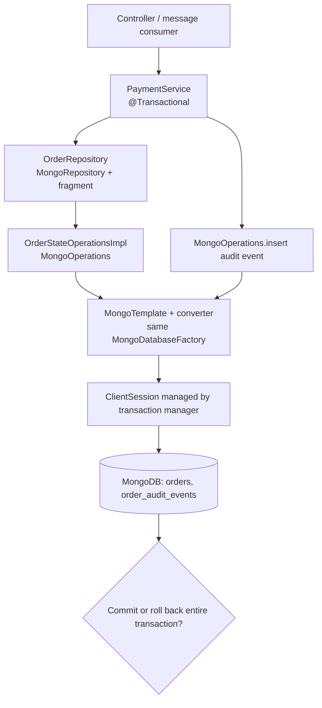
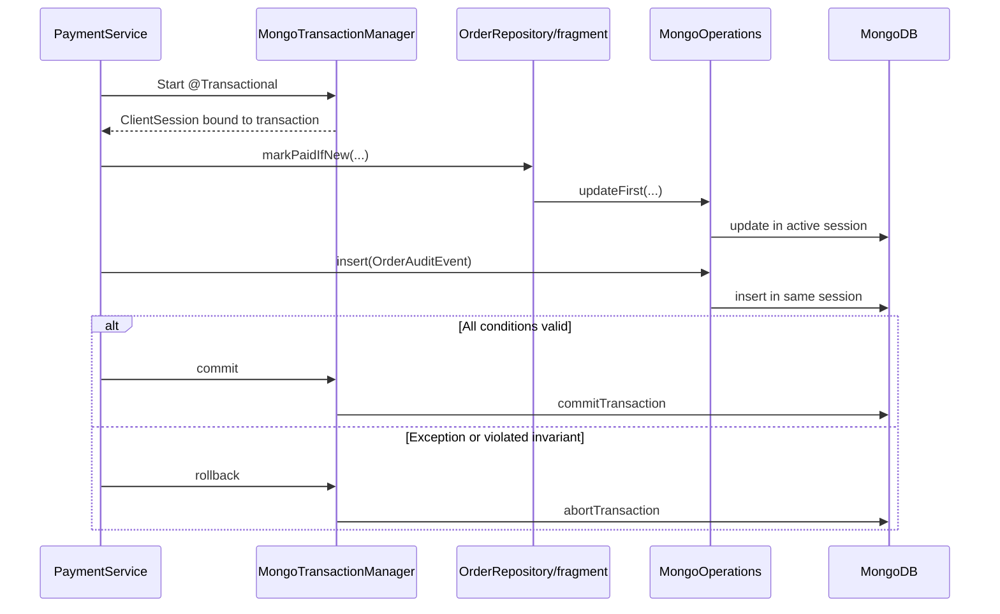

# Keeping Mapping, Sessions, and Transaction Boundaries Consistent

In **Spring Data MongoDB**, extending repositories lets you move queries or write operations that cannot be expressed cleanly as derived methods into a dedicated component. For instance, `MongoRepository<Order, ObjectId>` can provide standard CRUD, while a **repository fragment** built with `MongoOperations` supports dynamic filters, conditional updates, or complex queries. However, "the extended repository runs" does not automatically mean it **behaves consistently** with the rest of the application.

Three things must stay consistent:

1. **Mapping:** the main repository, fragment, and `MongoTemplate` must share the same understanding of entities, collection names, BSON types, `@Field`, `@Id`, converters, and callbacks.
2. **Session:** operations expected to run within the same MongoDB session must actually use the **same managed `ClientSession`**; opening a new `MongoClient` or switching carelessly to the native driver can drop the context.
3. **Transaction boundaries:** a business flow involving multiple operations must clearly define **who opens the transaction, where commit/rollback occurs, which operations participate**, and which conditions are business invariants.

This lesson belongs to the **Extended Repositories** chapter of the **SPRING_DATA_MONGODB** module. We will build an example from `MongoRepository`, a custom fragment, and `MongoOperations` through `@Transactional` and rollback testing. The material also connects repositories with `MongoTemplate`, the native Java Driver, optimistic locking, reactive access, and MongoDB diagnostics.

## 1. Scenario: Confirming an Order and Writing an Audit Event

Suppose the system has `orders` and `order_audit_events` collections. Confirming payment must:

- Target the exact order belonging to the current tenant.
- Transition status only from `NEW` to `PAID`.
- Insert a corresponding audit record.
- If inserting the audit fails, business rules require **not leaving the order transitioned to PAID on its own**.
- If data changes concurrently, never silently overwrite the newer status.

Sample documents:

```javascript
// orders
{
  _id: ObjectId("674000000000000000000801"),
  tenant_id: "T1",
  status: "NEW",
  total_cents: NumberLong("350000"),
  version: NumberLong("0")
}

// order_audit_events
{
  _id: ObjectId("674000000000000000000901"),
  tenant_id: "T1",
  order_id: ObjectId("674000000000000000000801"),
  event_key: "payment-123",
  event_type: "ORDER_PAID",
  occurred_at: ISODate("2026-11-20T02:00:00Z")
}
```

Transitioning status on a single document can be done with an atomic update. However, requiring **shared commit/rollback with the audit record** spans two collections, so if atomicity is mandatory, a **real MongoDB transaction** on a supporting topology is required.



**Correct flow:** the service layer owns the business boundary; the repository and fragment participate together in the transaction via Spring Data MongoDB; mapping remains unified. **Broken flow:** the fragment creates its own `MongoClient` and writes outside the transaction the service thinks it controls.

## 2. Shared Entity and Mapping Metadata

Minimal order entity:

```java
import org.bson.types.ObjectId;
import org.springframework.data.annotation.Id;
import org.springframework.data.annotation.Version;
import org.springframework.data.mongodb.core.mapping.Document;
import org.springframework.data.mongodb.core.mapping.Field;

@Document(collection = "orders")
public class Order {
    @Id
    private ObjectId id;

    @Field("tenant_id")
    private String tenantId;

    private String status;

    @Field("total_cents")
    private long totalCents;

    @Version
    private Long version;

    public Order() {}

    public Order(
            ObjectId id, String tenantId,
            String status, long totalCents) {
        this.id = id;
        this.tenantId = tenantId;
        this.status = status;
        this.totalCents = totalCents;
    }

    public ObjectId getId() { return id; }
    public String getTenantId() { return tenantId; }
    public String getStatus() { return status; }
    public long getTotalCents() { return totalCents; }
    public Long getVersion() { return version; }

    public void changeStatus(String value) {
        status = value;
    }
}
```

Audit event resides in another collection:

```java
import java.time.Instant;
import org.bson.types.ObjectId;
import org.springframework.data.annotation.Id;
import org.springframework.data.mongodb.core.mapping.Document;
import org.springframework.data.mongodb.core.mapping.Field;

@Document(collection = "order_audit_events")
public class OrderAuditEvent {
    @Id
    private ObjectId id;

    @Field("tenant_id")
    private String tenantId;

    @Field("order_id")
    private ObjectId orderId;

    @Field("event_key")
    private String eventKey;

    @Field("event_type")
    private String eventType;

    @Field("occurred_at")
    private Instant occurredAt;

    public OrderAuditEvent() {}

    public OrderAuditEvent(
            ObjectId id,
            String tenantId,
            ObjectId orderId,
            String eventKey,
            String eventType,
            Instant occurredAt) {
        this.id = id;
        this.tenantId = tenantId;
        this.orderId = orderId;
        this.eventKey = eventKey;
        this.eventType = eventType;
        this.occurredAt = occurredAt;
    }

    public ObjectId getId() { return id; }
    public String getTenantId() { return tenantId; }
    public ObjectId getOrderId() { return orderId; }
    public String getEventKey() { return eventKey; }
    public String getEventType() { return eventType; }
    public Instant getOccurredAt() { return occurredAt; }
}
```

When calling Spring Data APIs with `Order.class`, the Java names mean:

| Java property | BSON field | Meaning |
| --- | --- | --- |
| `id` | `_id` | ObjectId identifier of the order |
| `tenantId` | `tenant_id` | Multi-tenant data boundary |
| `status` | `status` | Order status |
| `totalCents` | `total_cents` | Monetary value in minor units |
| `version` | `version` | Used for optimistic locking per Spring Data rules |
| `OrderAuditEvent.orderId` | `order_id` | Audited order ID |

**Mapping metadata is a shared contract.** Fragments should never guess BSON names or ID types from HTTP API field names. The same `tenantId` property must consistently map to `tenant_id` via `@Field`; the same `ObjectId` must never be stored as an ObjectId in one place and a hex BSON String in another.

## 3. Why Should Custom Repositories Prefer MongoOperations?

Extended repositories are commonly introduced when derived methods like `findByTenantIdAndStatus(...)` grow too long or conditional operations are required.

**The preferred choice for a fragment working with Spring Data entities** is injecting the Spring-managed `MongoOperations` or `MongoTemplate`. That gives you:

- The same **`MongoMappingContext` / `MappingMongoConverter`** as standard repositories when configured properly.
- The same `@Document`, `@Field`, `@Id`, and custom conversion rules.
- Participation in the **thread-bound transaction/ClientSession** managed by `MongoTransactionManager`.
- `Criteria`, `Query`, `Update`, and auditing/exception translation across supported operations.

```java
import org.springframework.data.mongodb.core.MongoOperations;
import org.springframework.stereotype.Repository;

@Repository
public class SomeFragmentHelper {
    private final MongoOperations operations;

    public SomeFragmentHelper(MongoOperations operations) {
        this.operations = operations;
    }
}
```

This snippet shows only the dependency. In real fragments, you normally **do not** instantiate a `MongoClient` inside or call `new MongoTemplate(...)` separately when the application already configures a matching template.

**Note:** Spring Data does not guarantee that **every `MongoOperations` API** shares identical callbacks or version semantics with `repository.save`. Mapping and transaction contexts are shared under the same infrastructure, yet the specific read/write method governs callbacks, auditing, optimistic locking, and query count.

## 4. Building the Repository Fragment Properly

A fragment consists of a **behavioral interface**, an **implementation**, and the main repository **extending the fragment interface**.

### 4.1. Fragment Interface

```java
import java.util.List;
import org.bson.types.ObjectId;

public interface OrderStateOperations {
    List<Order> findPending(
        String tenantId, long minimumTotalCents, int limit
    );

    boolean markPaidIfNew(ObjectId id, String tenantId);
}
```

The interface does not need to extend `MongoRepository`. It declares only the custom operations the application wants. `markPaidIfNew` is **a single-document conditional update**, not the entire payment business flow.

### 4.2. Fragment Implementation

By repository fragment naming convention, the implementation uses the `Impl` postfix:

```java
import java.util.List;
import com.mongodb.client.result.UpdateResult;
import org.bson.types.ObjectId;
import org.springframework.data.domain.Sort;
import org.springframework.data.mongodb.core.MongoOperations;
import org.springframework.data.mongodb.core.query.Criteria;
import org.springframework.data.mongodb.core.query.Query;
import org.springframework.data.mongodb.core.query.Update;

public class OrderStateOperationsImpl implements OrderStateOperations {
    private final MongoOperations operations;

    public OrderStateOperationsImpl(MongoOperations operations) {
        this.operations = operations;
    }

    @Override
    public List<Order> findPending(
            String tenantId, long minimumTotalCents, int limit) {

        if (tenantId == null || tenantId.isBlank()) {
            throw new IllegalArgumentException("Missing tenant");
        }
        if (minimumTotalCents < 0 || limit < 1 || limit > 100) {
            throw new IllegalArgumentException("Invalid conditions");
        }

        Query query = Query.query(
            Criteria.where("tenantId").is(tenantId)
                .and("status").is("NEW")
                .and("totalCents").gte(minimumTotalCents)
        ).with(Sort.by(Sort.Order.asc("id")))
         .limit(limit);

        return operations.find(query, Order.class);
    }

    @Override
    public boolean markPaidIfNew(ObjectId id, String tenantId) {
        if (id == null || tenantId == null || tenantId.isBlank()) {
            throw new IllegalArgumentException("Missing ID or tenant");
        }

        Query target = Query.query(
            Criteria.where("id").is(id)
                .and("tenantId").is(tenantId)
                .and("status").is("NEW")
        );

        Update changes = new Update().set("status", "PAID");

        UpdateResult result =
            operations.updateFirst(target, changes, Order.class);

        return result.getMatchedCount() == 1;
    }
}
```

Analysis:

- `Criteria.where("tenantId")`, `where("totalCents")`, and `where("id")` use **Java property names**, mapped to `tenant_id`, `total_cents`, and `_id`.
- `operations.find(query, Order.class)` returns `Order` entities built by the converter, not raw `Document`s.
- `updateFirst` updates only `status` on the matched document; it does not overwrite the entire document like `save`.
- `status = "NEW"` enforces a *conditional state transition*. If another request already changed status, the predicate no longer matches.
- Returning `matchedCount == 0` **does not automatically throw an exception**: callers must decide whether it means 404, 409, authorization denial, or an idempotent replay.

**Note on `@Version`:** Spring Data MongoDB can auto-increment version on certain update calls when the update omits that field, yet that **does not mean** `markPaidIfNew` verified **which version a stale caller previously read**. In this example, `status = NEW` is the primary guard. If business rules require an expected version, include it in the filter and keep version increment policy consistent—never increment version twice if the framework also manages it.

### 4.3. Main Repository Composing the Fragment

```java
import org.bson.types.ObjectId;
import org.springframework.data.mongodb.repository.MongoRepository;

public interface OrderRepository
        extends MongoRepository<Order, ObjectId>, OrderStateOperations {

    long countByTenantIdAndStatus(String tenantId, String status);
}
```

Spring Data composes `OrderStateOperationsImpl` into the repository when discovered via fragment/postfix conventions and matching scan scope. If your project changes postfixes, package scanning, or defines fragment beans explicitly, verify your project's repository composition configuration.

**Do not subclass `SimpleMongoRepository` solely to add those two methods** when a fragment suffices; subclassing increases coupling to internal implementation details and can complicate upgrades.

## 5. Mapping Must Remain Consistent Across Repository, Fragment, and MongoTemplate

With the model above, this query:

```java
Query query = Query.query(
    Criteria.where("tenantId").is("T1")
        .and("totalCents").gte(100_000L)
);
List<Order> orders = operations.find(query, Order.class);
```

is semantically equivalent to BSON filter:

```javascript
db.orders.find({
  tenant_id: "T1",
  total_cents: { $gte: NumberLong("100000") }
});
```

**Equivalent only when:**

1. `Order.class` uses accurate `@Document("orders")` and `@Field` annotations.
2. `MongoOperations` uses the matching converter, custom conversions, and database factory.
3. BSON fields actually store types compatible with Java types—e.g. `total_cents` is numeric and `_id` is a BSON ObjectId.
4. No unverified discriminator/type alias or custom mapping policy alters query meaning.

### What Changes When Switching to a Raw MongoCollection?

```java
import org.bson.Document;

// Native driver API; does not automatically apply entity mapping metadata.
var collection = mongoTemplate.getCollection("orders");

var raw = collection.find(
    new Document("tenant_id", "T1")
).first();
```

This native query reads a raw `Document`. It **does not automatically inspect `@Field("tenant_id")`** on `Order` to turn `"tenantId"` into `"tenant_id"`, nor does it apply all Spring converters/callbacks.

If you write:

```java
// Wrong field name for the BSON schema in this example:
collection.find(new Document("tenantId", "T1"));
```

the query returns empty even though `findByTenantId("T1")` works. This is a **split-mapping bug**, not MongoDB query engine inconsistency.

Use the raw driver only with a clear reason: specialized operations unavailable in Spring Data, BSON types not mapped conveniently, or direct driver APIs. When doing so, explicitly handle **BSON names**, data types, needed conversions, sessions, and error handling.

### Custom Converters and Callbacks

If an entity contains money objects, custom IDs, encrypted fields, or `@ReadingConverter`/`@WritingConverter`, sharing `MongoTemplate` with common converters keeps behavior aligned with repositories. Still, callbacks depend on **operation type**: `save` has a different lifecycle from `updateFirst`; native driver calls, bulk writes, and aggregations can bypass certain entity callbacks.

Never equate "shares mapping" with "every write path emits the same events." For auditing, security, and critical validation, enforce invariants at the right layer and test the **actual write path**, not only a test for `repository.save`.

## 6. What Is a Session and Why Must the Same Session Be Shared?

A MongoDB **`ClientSession`** carries state for transactions and features like causal consistency where supported. A session is bound to a MongoDB client/deployment; operations participating in the same transaction must be sent **within that exact session/transaction**.

In synchronous Spring Data MongoDB:

- `MongoTransactionManager` manages transactions and binds `ClientSession` to the **execution context/thread** through Spring transaction infrastructure and `MongoDatabaseFactory`.
- Operations on `MongoTemplate`/`MongoOperations` configured with that same factory and transaction manager can automatically pick up the bound session without services passing `ClientSession` into every call.
- Standard repositories and fragments using the same Spring Data infrastructure participate naturally in one transaction boundary.

**Clean mental model:** the fragment receives a Spring-injected `MongoOperations`; the service opens the transaction; repository, fragment, and template all operate on that shared infrastructure.



What matters is **the same factory/session**, not merely "one Java method calling another sequentially." Two templates backed by separate factories or a manually created native client will not share the same session context.

## 7. Configuring MongoTransactionManager

To use Spring-managed transactions in a synchronous MongoDB application, you need the right transaction manager, matching database factory, and a supporting MongoDB topology.

```java
import org.springframework.context.annotation.Bean;
import org.springframework.context.annotation.Configuration;
import org.springframework.data.mongodb.MongoDatabaseFactory;
import org.springframework.data.mongodb.MongoTransactionManager;

@Configuration
public class MongoTransactionConfiguration {

    @Bean
    public MongoTransactionManager mongoTransactionManager(
            MongoDatabaseFactory factory) {
        return new MongoTransactionManager(factory);
    }
}
```

Transaction manager auto-configuration varies across Spring Boot/Spring Data versions. **Verify the actual bean**: adding `@Transactional` to a service without an appropriate transaction manager does not automatically create MongoDB multi-document transactions.

Practical prerequisites:

| Factor | Requirement / Check |
| --- | --- |
| MongoDB topology | Replica set or sharded cluster supporting transactions; standalone MongoDB is insufficient |
| `MongoDatabaseFactory` | Transaction manager and template/repository must share compatible infrastructure |
| `MongoClient` | Never instantiate a second client inside fragments if sharing sessions |
| `@Transactional` | Placed on entry points invoked through a Spring proxy, backed by the right transaction manager |
| Write commands | Operations needing shared commit/rollback must actually participate in the session |
| Exceptions | Runtime exceptions usually trigger rollback by default; checked exceptions need explicit policy if rollback is desired |
| Read/write concern | Choose appropriately for consistency requirements and topology; test commit/rollback |
| Collections/indexes | Prepare schemas/indexes ahead of time; avoid DDL unsupported inside transactions in your version/topology |

Never assume a standalone MongoDB used for simple tests supports transactions. For integration tests verifying multi-collection rollback, **Testcontainers MongoDB replica set** or a real test replica set is the appropriate choice.

## 8. Put Transaction Boundaries at the Service Layer, Not Split Inside Fragments

A service implementing the business workflow:

```java
import java.time.Instant;
import org.bson.types.ObjectId;
import org.springframework.data.mongodb.core.MongoOperations;
import org.springframework.stereotype.Service;
import org.springframework.transaction.annotation.Transactional;

@Service
public class PaymentService {
    private final OrderRepository orders;
    private final MongoOperations operations;

    public PaymentService(
            OrderRepository orders, MongoOperations operations) {
        this.orders = orders;
        this.operations = operations;
    }

    @Transactional(transactionManager = "mongoTransactionManager")
    public void confirmPayment(
            ObjectId orderId,
            String authorizedTenant,
            String paymentEventKey,
            ObjectId auditId) {

        if (authorizedTenant == null || authorizedTenant.isBlank()) {
            throw new IllegalArgumentException("Missing tenant");
        }
        if (paymentEventKey == null || paymentEventKey.isBlank()) {
            throw new IllegalArgumentException("Missing event key");
        }

        boolean changed =
            orders.markPaidIfNew(orderId, authorizedTenant);

        if (!changed) {
            // Business rule forbids writing audit if order is no longer NEW.
            throw new IllegalStateException(
                "Order missing, wrong tenant, or state changed"
            );
        }

        operations.insert(new OrderAuditEvent(
            auditId,
            authorizedTenant,
            orderId,
            paymentEventKey,
            "ORDER_PAID",
            Instant.now()
        ));
    }
}
```

With **proper transaction configuration**, both the update and the insert run within one MongoDB transaction. If inserting the audit fails with a duplicate key, the runtime exception propagates out of `confirmPayment(...)` and rolls back the transaction; the order's status returns to its pre-transaction state.

**Service-level boundaries** fit because they enclose the **business intent** spanning two repositories/collections. Placing `@Transactional` solely on the `markPaidIfNew` fragment allows that transaction to finish **before** the audit is inserted, violating the all-or-nothing invariant.

### Why Use a Conditional State Transition?

Suppose the same order receives two concurrent confirm requests. Both may start while the status is `NEW`. The condition:

```javascript
{
  _id: orderId,
  tenant_id: authorizedTenant,
  status: "NEW"
}
```

acts as a state guard. Once one transaction commits `NEW → PAID`, the second request cannot assume the state transition still applies. Inside MongoDB transactions, concurrent writes can also raise write conflicts/transaction aborts requiring retry handling per contract.

**Note on idempotency:** this illustrative implementation deliberately **throws an error** if the order is no longer `NEW`. In a real payment API, retries after an already committed success must be recognized by `paymentEventKey` (plus tenant/order) to distinguish a **valid replay** from a **new payment or invalid state**. Never change this example into "if already PAID, insert another audit."

## 9. @Transactional Is a Spring Proxy: Self-Invocation and Other Threads

A common mistake is calling a `@Transactional` method **from another method in the same instance**, bypassing the proxy under default Spring AOP configuration:

```java
@Service
class PaymentFacade {
    public void handlePayment() {
        confirmInsideThisClass(); // May bypass the transactional proxy.
    }

    @Transactional
    public void confirmInsideThisClass() {
        // Cannot safely assume a transaction was started here.
    }
}
```

In Spring's standard proxy-based AOP model, **self-invocation** does not trigger the interceptor. The simple fix is placing the transactional method on a separate Spring bean and invoking it **through the Spring-managed bean**, as with `PaymentService` above.

Other boundaries to watch:

- `@Async`, `CompletableFuture.supplyAsync`, or manual threads: synchronous transactions **do not propagate automatically to new threads**.
- Creating a `MongoClient` or `MongoTemplate` outside the Spring context: does not share the same factory/session.
- Mixing two different transaction managers (MongoDB and RDBMS): a single `@Transactional` picks **one manager** per configuration; it does not create a two-database distributed transaction.
- `private` methods or methods not intercepted under proxy settings: may fail to open transactions as assumed.
- Catching and **swallowing exceptions** in the service: Spring may commit because the method returned normally, unless the transaction is marked rollback-only or policy dictates otherwise.

### Rollback Does Not Depend Only on Exception Class

By default, Spring typically rolls back on `RuntimeException` and `Error`. If business code uses **checked exceptions**, you may need:

```java
@Transactional(
    transactionManager = "mongoTransactionManager",
    rollbackFor = Exception.class
)
public void confirmAndNotify() throws Exception {
    // Illustrative boundary; external notification side effects
    // do not automatically roll back with MongoDB.
}
```

Do not turn every error into a checked exception assuming rollback always happens. Equally, never assume an email/S3/Kafka/third-party call sent inside a MongoDB transaction rolls back if the database aborts. When coordinating external systems, consider an outbox and idempotent consumers.

## 10. Mixing the Native MongoDB Driver: Sessions Can Be Dropped

This is especially important inside repository fragments.

**Safe path, staying within Spring Data:**

```java
mongoOperations.updateFirst(
    target,
    new Update().set("status", "PAID"),
    Order.class
);
```

**Risky path if sessions are not managed:**

```java
import static com.mongodb.client.model.Filters.eq;
import static com.mongodb.client.model.Updates.set;

// Inside a @Transactional service, never assume this native call
// automatically binds to Spring's transactional ClientSession.
mongoTemplate.getCollection("orders")
    .updateOne(
        eq("_id", orderId),
        set("status", "PAID")
    );
```

The native call above invokes the Java Driver API directly without a `ClientSession` argument in its signature. **Never assume it participates in the Spring-managed transaction** just because `mongoTemplate` was used to obtain the collection. Accessing native collections, commands, or driver requests requires checking session-binding behavior for your version and API path; the lowest-risk route is using `MongoOperations` whenever an equivalent API exists.

If you must use the native driver, pass **the right `ClientSession`**:

```java
import com.mongodb.client.ClientSession;
import com.mongodb.client.MongoCollection;
import org.bson.Document;

void markPaidNative(
        ClientSession session,
        MongoCollection<Document> orders,
        ObjectId orderId,
        String tenantId) {

    orders.updateOne(
        session,
        new Document("_id", orderId)
            .append("tenant_id", tenantId),
        new Document("$set", new Document("status", "PAID"))
    );
}
```

This snippet merely illustrates the **driver signature accepting a session**. The caller must supply a valid `ClientSession`, bound to the active transaction (if required) and created from a **`MongoClient` matching** the `MongoCollection`. Never pass a session created from client A into operations on a collection from client B.

**Another hazard:** `MongoCollection<Document>` uses raw BSON names and native documents; it does not apply Spring Data's `@Field`, `@Id`, custom converters, or callbacks. Having the right session with wrong mapping still corrupts data.

## 11. Manual ClientSession Management vs. @Transactional

Sometimes an application needs explicit `ClientSession` control for specific options or specialized driver calls. `MongoTemplate` provides `withSession(...)` to return a session-bound operations handle where supported by your version.

Structural illustration:

```java
import com.mongodb.client.ClientSession;
import com.mongodb.client.MongoClient;
import org.springframework.data.mongodb.core.MongoOperations;
import org.springframework.data.mongodb.core.MongoTemplate;

void workInManualSession(
        MongoClient client,
        MongoTemplate template,
        OrderAuditEvent event) {

    try (ClientSession session = client.startSession()) {
        session.startTransaction();

        try {
            MongoOperations sessionOps = template.withSession(session);

            // Every Spring Data operation joining this session
            // must be invoked through sessionOps.
            sessionOps.insert(event);

            session.commitTransaction();
        } catch (RuntimeException ex) {
            session.abortTransaction();
            throw ex;
        }
    }
}
```

This is a **simplified** example of the session lifecycle: open, start transaction, run session-bound operations, commit or abort, and close. Production code must also address transaction options, error labels, commit retries, and unknown commit result handling.

**Do not blindly mix both mechanisms.** When using `MongoTransactionManager` and `@Transactional`, let Spring manage the session instead of opening a fresh session inside a fragment; a new session will not belong to the active transaction. Conversely, when managing sessions manually, every operation belonging to the transaction must use **session-scoped operations or driver methods accepting the session**.

If `MongoTemplate` and `MongoClient` do not belong to the same MongoDB deployment infrastructure, manual session handling fails too. Two separate clusters **cannot be joined into a distributed transaction** by passing the same `ClientSession` variable.

## 12. Does Same Session Mean Same Transaction?

**No.** A `ClientSession` can be used without starting a transaction, for instance for configured causal consistency. Sharing a session maintains session context, yet **a transaction must be explicitly started and completed** (manually or via a transaction manager).

| Scenario | Same session? | Atomic multi-document transaction? |
| --- | --- | --- |
| Repository and fragment share `MongoOperations`, no `@Transactional` | May use same client infrastructure, no active transaction | **No** |
| `@Transactional` with proper `MongoTransactionManager`, Spring Data ops participate | **Yes**, managed by transaction manager | **Yes**, when server/topology and operations support it |
| Manually opened `ClientSession` without `startTransaction()` | Has session | **No** |
| Manually opened session with `startTransaction()`; all ops use that session | **Yes** | **Yes**, within MongoDB limits |
| One operation in transaction + native operation without session | **Not guaranteed** | Cannot assume both commit/roll back together |
| Two `MongoTemplate`s backed by independent database factories/clients | Do not automatically share sessions | No shared transaction |

MongoDB allows transactions spanning multiple collections and, on supporting topologies, multiple databases **within the same deployment**. Always remember **topology limits, server version, deployment config, and session binding**; merely having two URIs pointing to localhost does not mean they belong to one transaction.

## 13. @Version and Optimistic Locking Do Not Replace Transactions

An entity with `@Version` helps prevent overwriting stale data on API paths supporting optimistic locking.

Example:

```java
Order order = repository.findById(orderId).orElseThrow();

// After reading, another request may modify the document.
order.changeStatus("PAID");

// The save path can verify the expected version:
repository.save(order);
```

If the document's version changed since reading, Spring Data can throw `OptimisticLockingFailureException` when using acknowledged write concerns. Test against your exact version and operation type.

**However, `@Version` does not span two collections**: `order` saving cleanly does not make a subsequent `audit` insert roll back if no transaction is active.

### Partial Updates with Version: Do Not Guess

A fragment calling `MongoOperations.updateFirst(...)` by status **without expected version in the filter**:

```java
Query filter = Query.query(
    Criteria.where("id").is(orderId)
        .and("tenantId").is(tenantId)
        .and("status").is("NEW")
);

Update update = new Update().set("status", "PAID");
```

protects the **state transition from NEW**, yet does not check which version a reader observed. Some Spring Data update APIs may auto-increment the version field; auto-incrementing **is not the same as** asserting an expected version.

If you need version-based CAS:

```java
long expectedVersion = 3L;

Query guarded = Query.query(
    Criteria.where("id").is(orderId)
        .and("tenantId").is(tenantId)
        .and("version").is(expectedVersion)
        .and("status").is("NEW")
);

// When using @Version, clarify which layer increments version.
Update guardedChanges = new Update().set("status", "PAID");

UpdateResult r = operations.updateFirst(
    guarded, guardedChanges, Order.class
);

if (r.getMatchedCount() == 0) {
    throw new IllegalStateException(
        "Order missing or concurrently modified"
    );
}
```

When using `@Version`, do not add an extra `inc("version", 1)` if the framework already increments it automatically. Conversely, with the native driver or bulk APIs lacking version handling, **you must design explicit version checks and increments** if business rules demand them.

**Remember:** optimistic locking solves **lost updates on one document**, transactions solve **atomicity across a group of operations**, and idempotency solves **re-processed requests**. The three problems are related but cannot substitute for one another.

## 14. Repository Fragments and BulkOperations: Callback/Version Limitations

Bulk write paths can bypass entity-level mechanisms you rely on with `save`:

```java
import org.springframework.data.mongodb.core.BulkOperations;

var result = mongoTemplate.bulkOps(
        BulkOperations.BulkMode.ORDERED,
        Order.class)
    .updateOne(
        Query.query(Criteria.where("tenantId").is(tenantId)
                            .and("status").is("NEW")),
        new Update().set("status", "REVIEW"))
    .execute();
```

Classic `BulkOperations` batches multiple writes on a single collection. **Never assume every operation runs full optimistic locking, lifecycle callbacks, and individual entity auditing like `MongoRepository.save`**. With bulk writes, it is also difficult to map an aggregate result back to identify which specific document failed a version expectation without careful design.

A bulk write can **participate in an active transaction** when sharing MongoDB infrastructure and session; however, it **does not start a transaction automatically** just because multiple operations are batched. Ordered/unordered mode governs execution order and error handling within the batch, not atomic multi-operation commit/rollback.

In newer MongoDB Server/Driver/Spring Data releases supporting multi-collection bulk writes, the same rules apply: session and transaction behavior must be verified independently for the bulk API.

## 15. Reactive Repositories Use a Different Session Model

When an application uses **ReactiveMongoRepository** and **ReactiveMongoTemplate**, transactions are not propagated via thread-bound context as in the synchronous path. Reactor carries transaction context in the **Reactor Context**, because a single publisher can hop across threads.

Illustrative reactive service:

```java
import java.time.Instant;
import org.bson.types.ObjectId;
import org.springframework.data.mongodb.core.ReactiveMongoTemplate;
import org.springframework.data.mongodb.core.query.Criteria;
import org.springframework.data.mongodb.core.query.Query;
import org.springframework.data.mongodb.core.query.Update;
import org.springframework.stereotype.Service;
import org.springframework.transaction.annotation.Transactional;
import reactor.core.publisher.Mono;

@Service
public class ReactivePaymentService {
    private final ReactiveMongoTemplate template;

    public ReactivePaymentService(ReactiveMongoTemplate template) {
        this.template = template;
    }

    @Transactional(
        transactionManager = "reactiveMongoTransactionManager"
    )
    public Mono<Void> confirmPayment(
            ObjectId orderId,
            String tenantId,
            ObjectId auditId,
            String eventKey) {

        Query target = Query.query(
            Criteria.where("id").is(orderId)
                .and("tenantId").is(tenantId)
                .and("status").is("NEW")
        );

        return template.updateFirst(
                target,
                new Update().set("status", "PAID"),
                Order.class
            )
            .flatMap(result -> {
                if (result.getMatchedCount() != 1) {
                    return Mono.error(new IllegalStateException(
                        "Order is no longer NEW"
                    ));
                }

                OrderAuditEvent event = new OrderAuditEvent(
                    auditId, tenantId, orderId,
                    eventKey, "ORDER_PAID", Instant.now()
                );
                return template.insert(event);
            })
            .then();
    }
}
```

For this code to be truly transactional:

- Configure `ReactiveMongoTransactionManager` with the matching reactive database factory.
- Operations must stay **within the same reactive chain**, never calling `subscribe()` manually inside fragments or callbacks.
- Never call `block()` on a WebFlux event loop, or call synchronous `MongoTemplate` inside a reactive transaction expecting it to participate.
- Return the `Mono` to the caller/framework for proper subscription and error handling.
- Confirm your MongoDB topology supports transactions.

Transaction manager bean example:

```java
import org.springframework.context.annotation.Bean;
import org.springframework.context.annotation.Configuration;
import org.springframework.data.mongodb.ReactiveMongoDatabaseFactory;
import org.springframework.data.mongodb.ReactiveMongoTransactionManager;

@Configuration
class ReactiveMongoTxConfiguration {
    @Bean
    ReactiveMongoTransactionManager reactiveMongoTransactionManager(
            ReactiveMongoDatabaseFactory factory) {
        return new ReactiveMongoTransactionManager(factory);
    }
}
```

**Distinction:** despite sharing the `@Transactional` annotation name, sync transactions bind sessions to threads, whereas reactive transactions propagate via Reactor Context. Never mix the two drivers assuming transactions cross over merely because they target the same database.

## 16. Multiple MongoTemplates or MongoClients: Route Explicitly

An application may connect to multiple databases, for example:

- Template A: `orderMongoTemplate` pointing to database `shop`.
- Template B: `analyticsMongoTemplate` pointing to database `analytics`.
- A third client manually constructed for batch jobs.

If a fragment accidentally injects `analyticsMongoTemplate`, querying `Order.class` may run against **the `orders` collection inside `analytics`** and return empty or write to the wrong database.

When multiple `MongoOperations` beans exist, use `@Qualifier`:

```java
import org.springframework.beans.factory.annotation.Qualifier;
import org.springframework.data.mongodb.core.MongoOperations;

public class OrderStateOperationsImpl implements OrderStateOperations {
    private final MongoOperations operations;

    public OrderStateOperationsImpl(
            @Qualifier("orderMongoTemplate") MongoOperations operations) {
        this.operations = operations;
    }

    // Other methods as in section 4.
}
```

**The snippet above shows an alternative constructor**; never place two implementation classes with the same name in the project simultaneously. With multiple `MongoDatabaseFactory` and transaction manager beans, explicitly name the manager on services rather than relying on defaults that might open transactions on an unrelated database.

Multiple databases **within the same MongoDB deployment** can sometimes share sessions/transactions when factories/clients are designed accordingly. Never assume compatibility simply from having multiple templates. **Two independent clusters** cannot automatically form a distributed MongoDB transaction.

## 17. Idempotency, Unique Indexes, and Write Results

In payment confirmation, a request can be retried due to network glitches or client timeouts. A transaction guarantees atomic commit/rollback of a group of MongoDB writes when properly configured, yet **does not automatically make the whole API idempotent**.

Add a unique index on the audit key scoped by tenant:

```javascript
db.order_audit_events.createIndex(
  { tenant_id: 1, event_key: 1 },
  { unique: true, name: "unique_tenant_event_key" }
);
```

This index prevents the same `eventKey` from being written twice within the same tenant. However:

- A duplicate key on retry does not automatically prove whether the earlier attempt committed **everything** or stopped midway under older code.
- Check both the audit record by `tenant + eventKey` and the order status to **reconcile**.
- When a request retries after a successful commit, `markPaidIfNew` returns false because the order is already `PAID`; handle replays by business key instead of treating every false as a new failure.
- Never publish external events directly inside a MongoDB transaction expecting them to roll back if MongoDB aborts.

If you need post-commit message broker publishing, writing an **outbox document** inside the same MongoDB transaction paired with a relay worker and idempotent consumer is far safer than calling the broker mid-transaction.

## 18. Indexes and Fragment Performance Matter Just as Much

Correct mapping and transactions do not prevent unindexed queries from becoming bottlenecks.

For example, `findPending(...)` filters:

```javascript
{
  tenant_id: "T1",
  status: "NEW",
  total_cents: { $gte: NumberLong("100000") }
}
```

Consider a compound index:

```javascript
db.orders.createIndex(
  { tenant_id: 1, status: 1, total_cents: 1, _id: 1 },
  { name: "orders_tenant_status_total" }
);
```

This follows the idea of **equality fields before range fields**, yet must still be checked against the actual sort. When sorting by `_id` alongside a range on `total_cents`, this index **does not guarantee eliminating an in-memory sort stage**. Never say "we added a compound index so the query definitely won't sort": verify with `explain`.

```javascript
db.orders.find({
  tenant_id: "T1",
  status: "NEW",
  total_cents: { $gte: NumberLong("100000") }
})
.sort({ _id: 1 })
.limit(20)
.explain("executionStats");
```

Inspect `winningPlan`, `totalKeysExamined`, `totalDocsExamined`, `nReturned`, any `SORT` stage, and latency under realistic workloads. For updates filtering by `_id` plus tenant/status, the unique `_id` index is usually a strong starting point; you may not need another compound index solely because tenant is in the filter.

**Long-running transactions hold resources longer** and face higher write-conflict/abort rates when multiple writers touch the same documents. Never scan millions of records or make slow external network calls inside a transaction when workflows can be split.

## 19. Integration Testing: Mapping and Rollback Must Be Proven

Mocking `OrderRepository` or `MongoOperations` only checks which Java methods were called. It **does not prove**:

- `tenantId` translates to `tenant_id`.
- `@Id ObjectId` queries with the right BSON type.
- `OrderStateOperationsImpl` is composed into `OrderRepository`.
- `PaymentService` is invoked through a transactional proxy.
- Both writes share the **same session** and roll back together in MongoDB.
- Native driver calls participate in the session or bypass it.

To verify, run against a dedicated **integration test MongoDB replica set** (e.g. Testcontainers configured as a replica set) with a Spring context providing `MongoTransactionManager` and repository fragments.

### 19.1. Testing Mapping and Fragment Composition

```java
import static org.assertj.core.api.Assertions.assertThat;

import java.util.List;
import org.bson.types.ObjectId;
import org.junit.jupiter.api.Test;
import org.springframework.beans.factory.annotation.Autowired;
import org.springframework.boot.test.context.SpringBootTest;
import org.springframework.data.mongodb.core.MongoTemplate;

@SpringBootTest
class OrderFragmentMappingTest {
    @Autowired MongoTemplate template;
    @Autowired OrderRepository orders;

    @Test
    void fragmentUsesSameFieldMappingAsRepository() {
        String tenant = "test-" + new ObjectId().toHexString();
        Order order = new Order(
            new ObjectId(), tenant, "NEW", 350_000L
        );

        template.insert(order);

        List<Order> found = orders.findPending(
            tenant, 300_000L, 10
        );

        assertThat(found)
            .extracting(Order::getId)
            .containsExactly(order.getId());
    }
}
```

This test inserts an entity via Spring Data and queries it through the fragment. It proves the fragment is composed into the repository and `tenantId`/`totalCents` filter mappings work. For deeper independent verification, use the native driver to inspect raw BSON for `tenant_id`, `total_cents`, and `_id`.

### 19.2. Testing Rollback When Audit Insert Triggers a Duplicate Key

Set up a pre-existing `OrderAuditEvent` sharing the `_id` intended for insertion. When the service marks the order `PAID` and then fails inserting the audit, the transaction must roll back:

```java
import static org.assertj.core.api.Assertions.assertThat;
import static org.assertj.core.api.Assertions.assertThatThrownBy;

import java.time.Instant;
import org.bson.types.ObjectId;
import org.junit.jupiter.api.Test;
import org.springframework.beans.factory.annotation.Autowired;
import org.springframework.boot.test.context.SpringBootTest;
import org.springframework.data.mongodb.core.MongoTemplate;

@SpringBootTest
class PaymentTransactionIntegrationTest {
    @Autowired MongoTemplate template;
    @Autowired PaymentService payments;

    @Test
    void failedAuditInsertRollsBackOrderStatus() {
        String tenant = "test-" + new ObjectId().toHexString();
        ObjectId orderId = new ObjectId();
        ObjectId duplicateAuditId = new ObjectId();

        template.insert(new Order(
            orderId, tenant, "NEW", 350_000L
        ));

        template.insert(new OrderAuditEvent(
            duplicateAuditId, tenant, orderId,
            "existing-event", "PREEXISTING",
            Instant.now()
        ));

        assertThatThrownBy(() -> payments.confirmPayment(
            orderId,
            tenant,
            "payment-123",
            duplicateAuditId
        )).isInstanceOf(RuntimeException.class);

        Order after = template.findById(orderId, Order.class);

        assertThat(after).isNotNull();
        assertThat(after.getStatus()).isEqualTo("NEW");
    }
}
```

This test intentionally triggers a duplicate key. **Never run against production**; use an isolated test database. Before running, ensure:

1. Test MongoDB is a **replica set** supporting transactions.
2. Spring context provides **MongoTransactionManager** for the right factory and `@Transactional` service is called via proxy.
3. Repository fragment and `MongoTemplate` share the same MongoDB infrastructure.
4. The test method **does not accidentally wrap an outer transaction** altering production-like behavior.
5. The unique `_id` index is active and errors propagate to the service.

Tests should also cover the **happy path** (order transitions `NEW → PAID` and audit commits together), **`matched = 0`** (wrong status/tenant writes no audit), and **replaying a payment key** per your idempotency policy.

### 19.3. Test Detecting Out-of-Session Native Calls

Write a separate test performing a native update **without `ClientSession`** inside a transaction and intentionally triggering rollback. If the native update persists after rollback, that proves **the native path bypassed the session boundary**. Because this test **mutates data outside the transaction**, run it only on a completely isolated test database, never a shared collection.

Never mock `getCollection()` and claim transaction safety is verified: observe actual BSON after commit/abort.

## 20. Common Pitfalls and How to Avoid Them

| Pitfall | Symptom / Consequence | Resolution |
| --- | --- | --- |
| Fragment creates a new `MongoClient` | Operations do not join open sessions/transactions | Inject Spring-managed `MongoOperations` |
| Using Java property names in native `Document` | Queries return empty or write wrong field names | Use real BSON names in native calls, or Spring Data mapping |
| Fragment injects template for wrong database | Reads/writes wrong collection in another DB | `@Qualifier`, explicit factory/manager wiring |
| Putting `@Transactional` only on fragment | External audit is not in the same transaction | Place boundary on service spanning the business flow |
| Spring self-invocation calling transactional method | Interceptor bypassed under default proxy mode | Call through another Spring bean or refactor service |
| `@Async` / manual threads inside sync transaction | Thread-bound transaction lost | Keep work on same call context or redesign workflow |
| Native driver without passing `ClientSession` | Can write outside the transaction | Use `MongoOperations` or driver overloads accepting session |
| Opening a manual session inside `@Transactional` | Two uncoordinated sessions/transactions | Pick **one** intentional session management mechanism |
| Assuming session implies transaction | No multi-document rollback | Must call `startTransaction`/commit/abort or use tx manager |
| Assuming `@Version` guards every `updateFirst` | Lost updates / stale writes slip through | Put expected version/status in filter and test write path |
| Treating bulk updates like entity `save` | Skips auditing/callbacks/optimistic locking | Check specific API contract and enforce invariants explicitly |
| Catching exceptions and returning normally | Transaction commits partial writes | Propagate exception or mark rollback-only |
| Mixing sync and reactive repos in one transaction | Disconnected contexts/sessions | Never mix; use matching transaction manager and reactive chain |
| Writing audit even when `matched = 0` | Audit created though order never transitioned | Check write result and abort business operation |
| Using standalone MongoDB in tx tests | Unsupported transaction error | Use a MongoDB replica set / sharded test setup |
| Expecting transactions to roll back emails/brokers | External side effects persist after abort | Outbox pattern and idempotent consumers |

## 21. Design Checklist Before Implementing a Fragment

Before adding an extended repository, answer:

1. **Scope:** is this logic a query/write on **a single collection**, or a **multi-collection business workflow**?
2. **API:** can `Criteria`/`Query`/`Update` via `MongoOperations` cover it, or is the native driver genuinely required?
3. **Mapping:** are entity types, collections, `@Id`, `@Field`, and custom converters used consistently?
4. **Session:** which factory and client do template/repository use; which operations must share the same session?
5. **Transaction:** which service opens the transaction; are `MongoTransactionManager` and a supporting topology present?
6. **Rollback:** how are `matched=0`, audit insert errors, or mismatched read/write concerns handled?
7. **Concurrency:** do `@Version`, expected status/version, unique indexes, and idempotency keys protect all invariants?
8. **Async/Reactive:** does the flow use sync Spring transactions or Reactor Context; could new threads or extra `subscribe()` calls break context?
9. **Performance:** do indexes fit filters/sorts; are transactions kept short; are batches/outboxes needed?
10. **Testing:** are there raw BSON tests for mapping and replica-set tests for commit/rollback?

If multi-document atomicity is unnecessary, a **single-document conditional update** is simpler and faster than opening a transaction. When two collections must commit together, **never run two sequential `save` calls and hope for consistency**.

## 22. Self-Check Questions

**1.** Why inject `MongoOperations` into a custom repository fragment?  
**Answer:** to share mapping, converters, database factory, and Spring-managed transaction/session handling with the main repository under the same configuration.

**2.** Which MongoDB field does `Criteria.where("tenantId")` map to inside the fragment?  
**Answer:** `tenant_id` via `@Field("tenant_id")` on `Order` when querying with `Order.class`.

**3.** Is `MongoCollection<Document>.updateOne(...)` without a `ClientSession` guaranteed to join `@Transactional`?  
**Answer:** never assume so. Use `MongoOperations` or pass the right session to a supported driver overload.

**4.** Given a `ClientSession` where no transaction was started, will two writes roll back together?  
**Answer:** no. Sessions and transactions are separate concepts.

**5.** Why place the `@Transactional` boundary on the service rather than solely on the fragment?  
**Answer:** the service encompasses both the order update and the audit insert; the fragment executes only part of the business flow.

**6.** Does `@Version` replace multi-collection transactions?  
**Answer:** no. It primarily detects stale writes on a single entity along version-aware API paths.

**7.** Does `matchedCount=0` in `markPaidIfNew` automatically throw an exception and abort the transaction?  
**Answer:** no. The caller must inspect the return value and throw an exception or handle it per business logic.

**8.** Do two independent `MongoClient`s pointing to the same database URI automatically share transactions?  
**Answer:** never assume so. Sessions bind to matching client and transaction infrastructure, not merely identical URI strings.

**9.** Do Spring synchronous transactions propagate automatically into `CompletableFuture` or `@Async`?  
**Answer:** no; thread-bound transactions do not automatically cross thread boundaries.

**10.** In WebFlux, what binds reactive operations into one transaction?  
**Answer:** `ReactiveMongoTransactionManager` and Reactor Context along the same publisher chain, backed by a transaction-capable MongoDB topology.

## 23. Practice Exercises and References

**Practice exercises:**

1. Create `Order` and `OrderAuditEvent` entities per the lesson in a test MongoDB database.
2. Create `OrderStateOperations` and `OrderStateOperationsImpl`, and compose them into `OrderRepository`.
3. Insert a new order, call `findPending(...)`, and inspect raw BSON `tenant_id` and `total_cents` via a raw query.
4. Build `PaymentService.confirmPayment(...)` with `MongoTransactionManager` and a test MongoDB replica set.
5. Write a happy-path test: `status=PAID` and audit created in the same transaction.
6. Write a test forcing a duplicate key on the audit insert, verifying order status rolls back to `NEW`.
7. Call `markPaidIfNew` when status is not `NEW`; confirm no audit record is added.
8. Intentionally call the native driver without passing a session in a **dedicated test database** to observe out-of-transaction write risks.
9. Compare optimistic locking via `repository.save` against a conditional update using `expectedVersion`.
10. Build a reactive service if your project includes the reactive driver: verify transaction context stays intact across chained publishers.
11. Run `explain("executionStats")` on fragment queries and measure transaction overhead under realistic data.

**Official documentation to verify APIs per version:**

- [Spring Data — Custom Repository Implementations](https://docs.spring.io/spring-data/commons/reference/repositories/custom-implementations.html).
- [Spring Data MongoDB — Transactions](https://docs.spring.io/spring-data/mongodb/reference/mongodb/client-session-transactions.html).
- [Spring Data MongoDB — Template API and Mapping](https://docs.spring.io/spring-data/mongodb/reference/mongodb/template-api.html).
- [Spring Data MongoDB — Saving, Updating and Removing Documents](https://docs.spring.io/spring-data/mongodb/reference/mongodb/template-crud-operations.html).
- [MongoDB Manual — Transactions](https://www.mongodb.com/docs/manual/core/transactions/).
- [MongoDB Java Driver — Client Sessions](https://www.mongodb.com/docs/drivers/java/sync/current/crud/transactions/).

**Conclusion:** a solid **extended repository** does more than add methods to `MongoRepository`—it keeps **mapping consistent, sessions unified, and transaction boundaries aligned with business intent**. Inject Spring-managed `MongoOperations` in fragments, put `@Transactional` on services when multiple operations must commit or roll back together, and drop to the native driver only when you explicitly manage BSON names, converters, and passing `ClientSession`. `@Version`, unique indexes, idempotency, and transactions address different risk classes; none of them replaces the others. Prove your design with integration tests against transaction-capable MongoDB rather than trusting annotations or API names alone.
