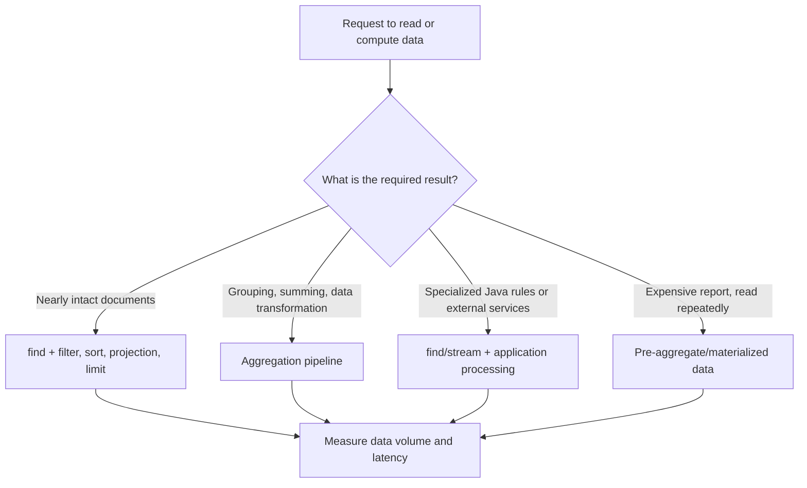
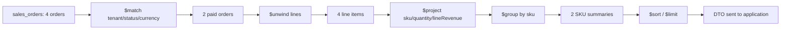

# When to Use Aggregation Instead of `find` and Application-Side Processing?

## 1. Design Question: Where Should Data Be Computed?

In **Spring Data MongoDB**, `MongoTemplate.find(...)` and standard repository methods are well suited for **fetching documents that match a condition**. Once the documents are retrieved, the Java application can filter, transform, accumulate, group, and sort the results. However, if a query returns hundreds of thousands of orders only to ultimately display **20 rows of revenue by product**, loading all documents into the application can waste network bandwidth, memory, and Java CPU.

MongoDB provides the **aggregation pipeline**: stages such as `$match`, `$unwind`, `$project`, `$group`, `$sort`, and `$limit` process data **directly on the MongoDB server**, and then transfer only the aggregated results back to the application.

For example, a sales system needs a report:

> Within the logged-in tenant, for orders paid in VND, what are the total quantity and revenue per SKU? Return at most the top 20 SKUs by revenue.

We can choose:

1. Use `find` to fetch paid orders into Java; iterate over `lines` and compute revenue.
2. Use aggregation with `$match` → `$unwind` → `$project` → `$group` → `$sort` → `$limit`.
3. If the report is read thousands of times but updated infrequently, build a **pre-aggregated summary table / materialized view** maintained by a separate workflow.

No single option always wins. The decision depends on **data size, number of documents to return, business logic complexity, indexes, MongoDB resources, application resources, data freshness, and operational requirements**.

This is the introductory lesson of the **Basic Aggregation** chapter in the **SPRING_DATA_MONGODB** module: connecting, mapping documents, and working via `MongoTemplate` or repositories, with a focus on choosing the right query strategy, testing, and evaluating performance.

## 2. Distinguishing `find`, Aggregation, and Application-Side Processing



| Criterion | `find` + Java | Aggregation on MongoDB |
| --- | --- | --- |
| Natural purpose | Read documents, process business logic on entities | Transform a document set into reports/groups/new results |
| Data over network | Can be large if fetching many source documents | Usually smaller if the pipeline reduces results |
| Processing CPU | Mainly on the application for computation | Mainly on the MongoDB server for stages |
| Memory | Application must manage received documents | Pipeline may need server memory, especially grouping/sorting stages |
| Object mapping | Read entities/DTOs via converter | Map pipeline output to a DTO with a different schema from the source |
| Index | Usable for suitable filters/sorts | Early stages like `$match`, sometimes `$sort`, can use indexes |
| Flexibility | Easy to use Java libraries and call external services | Limited to operators/stages supported by MongoDB |
| Testability | Unit testing Java business logic is convenient | Must test pipeline with real BSON data |
| Risks | N+1 queries, over-fetching, high heap usage | Complex pipelines, DB memory/CPU pressure, BSON expressions hard to debug |

**Two things to remember:** aggregation **does not automatically mean faster than every `find`**; and application-side processing **is not necessarily wrong** if the dataset is small, already tightly filtered, or the logic must be executed in Java.

## 3. Preparing the Order Model and Expected Figures

### 3.1. Java Entity

Each order contains a `lines` array. Money is stored as **integer VND** to illustrate multiplication/addition without binary floating-point issues. In a multi-currency system, currencies and conversion rules must be separated before summing revenue.

```java
package example.sales;

public record SalesLine(
    String sku,
    int quantity,
    long unitPriceVnd
) {}
```

```java
package example.sales;

import java.time.Instant;
import java.util.List;
import org.springframework.data.mongodb.core.mapping.Document;
import org.springframework.data.mongodb.core.mapping.FieldType;
import org.springframework.data.mongodb.core.mapping.MongoId;

@Document(collection = "sales_orders")
public record SalesOrder(
    @MongoId(FieldType.STRING) String id,
    String tenantId,
    String status,
    String currency,
    Instant createdAt,
    List<SalesLine> lines
) {}
```

`@MongoId(FieldType.STRING)` specifies that `_id` is stored as a BSON String, making tests clear. `SalesLine` is a nested object in the `lines` array; when using `$unwind`, an order with two lines produces **two intermediate documents**, without modifying the source document.

### 3.2. Fixture with Two Paid Orders, One Pending Order, and Another Tenant

```javascript
db.sales_orders.insertMany([
  {
    _id: "order-101", tenantId: "shop-01",
    status: "PAID", currency: "VND",
    createdAt: ISODate("2026-11-19T10:00:00Z"),
    lines: [
      { sku: "A", quantity: NumberInt("2"), unitPriceVnd: NumberLong("1000") },
      { sku: "B", quantity: NumberInt("1"), unitPriceVnd: NumberLong("2000") }
    ]
  },
  {
    _id: "order-102", tenantId: "shop-01",
    status: "PAID", currency: "VND",
    createdAt: ISODate("2026-11-20T09:00:00Z"),
    lines: [
      { sku: "A", quantity: NumberInt("1"), unitPriceVnd: NumberLong("1500") },
      { sku: "B", quantity: NumberInt("3"), unitPriceVnd: NumberLong("2000") }
    ]
  },
  {
    _id: "order-103", tenantId: "shop-01",
    status: "PENDING", currency: "VND",
    createdAt: ISODate("2026-11-20T10:00:00Z"),
    lines: [
      { sku: "A", quantity: NumberInt("5"), unitPriceVnd: NumberLong("1000") }
    ]
  },
  {
    _id: "order-201", tenantId: "shop-02",
    status: "PAID", currency: "VND",
    createdAt: ISODate("2026-11-20T11:00:00Z"),
    lines: [
      { sku: "A", quantity: NumberInt("9"), unitPriceVnd: NumberLong("1000") }
    ]
  }
]);
```

Only **order-101 and order-102** belong to `shop-01`, with `status=PAID` and `currency=VND`. Revenue per line is:

\[
\text{lineRevenueVnd}=\text{quantity}\times\text{unitPriceVnd}.
\]

Expected results:

| SKU | Quantity Sold | Revenue VND | Calculation |
| --- | ---: | ---: | --- |
| B | 4 | 8,000 | `1 × 2,000 + 3 × 2,000` |
| A | 3 | 3,500 | `2 × 1,000 + 1 × 1,500` |

`PENDING` orders and orders from `shop-02` must not be counted. When writing multi-tenant systems, **tenantId must be determined from server-side identity/authorization** rather than accepting an arbitrary client value as proof of access.

## 4. Option A: `find` and Compute in Java

### 4.1. Query Only Matching Orders

```java
import org.springframework.data.mongodb.core.query.Criteria;
import org.springframework.data.mongodb.core.query.Query;

Query query = Query.query(
    Criteria.where("tenantId").is("shop-01")
        .and("status").is("PAID")
        .and("currency").is("VND")
);
```

`find` executes **document filtering** on the server:

```java
List<SalesOrder> orders =
    mongoTemplate.find(query, SalesOrder.class);
```

Then the application loops over each `lines`, summing quantities and revenue. This is easy-to-understand code and can be completely correct from a business perspective.

### 4.2. Java Accumulation Code

Define the report return DTO:

```java
package example.sales;

public record SkuRevenue(
    String sku,
    long totalQuantity,
    long revenueVnd
) {}
```

Example calculation function from loaded data:

```java
import java.util.ArrayList;
import java.util.Comparator;
import java.util.HashMap;
import java.util.List;
import java.util.Map;

public List<SkuRevenue> calculateInJava(
        List<SalesOrder> orders) {

    Map<String, long[]> bySku = new HashMap<>();

    for (SalesOrder order : orders) {
        if (order.lines() == null) {
            continue;
        }
        for (SalesLine line : order.lines()) {
            long[] total = bySku.computeIfAbsent(
                line.sku(), ignored -> new long[2]
            );

            total[0] += line.quantity();
            total[1] += (long) line.quantity()
                * line.unitPriceVnd();
        }
    }

    List<SkuRevenue> summaries = new ArrayList<>();
    bySku.forEach((sku, total) ->
        summaries.add(new SkuRevenue(
            sku, total[0], total[1]
        ))
    );

    summaries.sort(
        Comparator.comparingLong(SkuRevenue::revenueVnd)
            .reversed()
            .thenComparing(SkuRevenue::sku)
    );
    return summaries;
}
```

The function above assumes data has already been **filtered for the right tenant/status/currency** in the preceding query and that `quantity` and `unitPriceVnd` are valid. It does not enforce authorization itself, does not guard against `long` overflow, and does not replace source data validation.

### 4.3. When Is This Approach Good Enough?

- A single query returns only dozens or a few hundred small documents.
- The application needs to **read whole documents** to execute many other business rules.
- The computation requires a specialized Java library that MongoDB does not provide.
- Data sources include MongoDB and external sources that cannot be easily combined into one pipeline.
- Read volume is small enough and easy to control via projection, pagination, or streaming.

Consider **field projection** to reduce payload if only `lines` and a few fields are needed, but never treat a partially loaded entity as safe to `save` back.

### 4.4. Risks When the Result Set Is Large

If `find` returns hundreds of thousands of orders, the application has to receive and map all those documents before producing two summary rows. Consequences can include:

- High network traffic and costly serialization/deserialization.
- Large heap usage, increased GC, and slow response times.
- Large documents containing unrelated fields may also be read.
- Concurrent report requests putting load across multiple application instances.

You can use `MongoTemplate.stream(...)` or a driver cursor to avoid holding all documents in a `List`, but **streaming only reduces concurrent memory demand in the application; it does not automatically reduce the number of documents or bytes transferred over the network**.

## 5. Option B: Push Grouping/Summing Down to MongoDB

An aggregation pipeline takes a stream of documents, transforms them through stages, and returns the final result. For the revenue-by-SKU example:



### 5.1. Complete Pipeline in `mongosh`

```javascript
db.sales_orders.aggregate([
  {
    $match: {
      tenantId: "shop-01",
      status: "PAID",
      currency: "VND"
    }
  },
  { $unwind: "$lines" },
  {
    $project: {
      _id: 0,
      sku: "$lines.sku",
      quantity: "$lines.quantity",
      lineRevenueVnd: {
        $multiply: [
          "$lines.quantity",
          "$lines.unitPriceVnd"
        ]
      }
    }
  },
  {
    $group: {
      _id: "$sku",
      totalQuantity: { $sum: "$quantity" },
      revenueVnd: { $sum: "$lineRevenueVnd" }
    }
  },
  {
    $project: {
      _id: 0,
      sku: "$_id",
      totalQuantity: 1,
      revenueVnd: 1
    }
  },
  { $sort: { revenueVnd: -1, sku: 1 } },
  { $limit: 20 }
]);
```

Equivalent result:

```javascript
[
  { sku: "B", totalQuantity: 4, revenueVnd: NumberLong("8000") },
  { sku: "A", totalQuantity: 3, revenueVnd: NumberLong("3500") }
]
```

Depending on the operator and input numeric types, the BSON numeric representation in the output may be Int32/Int64 or another numeric type; `NumberLong(...)` here represents the target numeric type in the example, not a guarantee that every configuration will always return Long. Tests must verify the calculation and actual data types.

### 5.2. Role of Each Stage

| Stage | Operation | Meaning in the Example |
| --- | --- | --- |
| `$match` | Filter documents | Exclude other tenants, unpaid orders, other currencies |
| `$unwind` | Split array into multiple rows | Each line is processed as an intermediate document |
| `$project` | Select/create fields | Compute `quantity × unitPriceVnd` |
| `$group` | Group by key | Sum units sold and revenue for the same SKU |
| `$project` after group | Rename output fields | Turn group `_id` into `sku` |
| `$sort` | Sort aggregated results | Highest revenue first, SKU tie-breaker |
| `$limit` | Limit output | Return at most 20 SKUs |

On a small dataset, results will not necessarily run faster than Java. The value of aggregation becomes clearer when **the number of input documents is much larger than the number of final result rows**.

## 6. Implementing with the Spring Data Aggregation DSL

### 6.1. Defining the Service

Spring Data MongoDB provides the `Aggregation` DSL and operations corresponding to pipeline stages. The snippet below uses `MongoTemplate.aggregate(...)` and maps the results to the `SkuRevenue` record.

```java
package example.sales;

import java.util.List;
import org.springframework.data.domain.Sort;
import org.springframework.data.mongodb.core.MongoTemplate;
import org.springframework.data.mongodb.core.aggregation.Aggregation;
import org.springframework.data.mongodb.core.aggregation.AggregationResults;
import org.springframework.data.mongodb.core.aggregation.ArithmeticOperators;
import org.springframework.data.mongodb.core.query.Criteria;
import org.springframework.stereotype.Service;

@Service
public class SalesAggregationService {

    private final MongoTemplate template;

    public SalesAggregationService(MongoTemplate template) {
        this.template = template;
    }

    public List<SkuRevenue> revenueBySku(
            String authorizedTenantId,
            int topN) {

        if (authorizedTenantId == null ||
                authorizedTenantId.isBlank()) {
            throw new IllegalArgumentException(
                "Invalid tenantId"
            );
        }
        if (topN < 1 || topN > 100) {
            throw new IllegalArgumentException(
                "topN must be between 1 and 100"
            );
        }

        Aggregation pipeline = Aggregation.newAggregation(
            Aggregation.match(
                Criteria.where("tenantId").is(authorizedTenantId)
                    .and("status").is("PAID")
                    .and("currency").is("VND")
            ),

            Aggregation.unwind("lines"),

            Aggregation.project()
                .and("lines.sku").as("sku")
                .and("lines.quantity").as("quantity")
                .and(
                    ArithmeticOperators.Multiply
                        .valueOf("lines.quantity")
                        .multiplyBy("lines.unitPriceVnd")
                ).as("lineRevenueVnd"),

            Aggregation.group("sku")
                .sum("quantity").as("totalQuantity")
                .sum("lineRevenueVnd").as("revenueVnd"),

            Aggregation.project()
                .and("_id").as("sku")
                .and("totalQuantity").as("totalQuantity")
                .and("revenueVnd").as("revenueVnd")
                .andExclude("_id"),

            Aggregation.sort(
                Sort.by(
                    Sort.Order.desc("revenueVnd"),
                    Sort.Order.asc("sku")
                )
            ),
            Aggregation.limit(topN)
        );

        AggregationResults<SkuRevenue> results =
            template.aggregate(
                pipeline,
                SalesOrder.class,
                SkuRevenue.class
            );
        return results.getMappedResults();
    }
}
```

Explanation of common pitfalls:

1. `SalesOrder.class` tells Spring Data the **input type and mapping** of the `sales_orders` collection.
2. `SkuRevenue.class` is the **aggregated result type**, completely different from the source order schema; never `save` this DTO as a `SalesOrder`.
3. `Aggregation.group("sku")` produces the `_id` key in the intermediate document. The next project stage renames `_id` to the `sku` field expected by the DTO.
4. `ArithmeticOperators.Multiply` generates the BSON `$multiply` expression; ensure source values are numeric and within valid numeric bounds.
5. `topN` is validated before passing to `limit`; the tenant is passed from an authenticated source, not an unchecked client parameter.

Specific DSL APIs and mappings in a project with custom converters or a different Spring Data version may require adjustments. Test the actual BSON and DTO output; do not equate syntax examples with a verified build.

### 6.2. Why Not Return the `SalesOrder` Entity?

Aggregation here returns documents of the form:

```javascript
{ sku: "A", totalQuantity: 3, revenueVnd: 3500 }
```

They do not have `tenantId`, `status`, `createdAt`, `lines`, or an order `_id`. Forcing them into `SalesOrder` produces an incomplete object, obscures the data contract, and causes bugs when downstream code treats it as a full entity. **A report DTO is a separate read model.**

## 7. When Is `find` + Projection the Better Option?

Many requirements sound like "aggregation" when they are really just finding and presenting a list.

### 7.1. Fetching Only Recent Paid Orders

```java
import org.springframework.data.domain.Sort;
import org.springframework.data.mongodb.core.query.Criteria;
import org.springframework.data.mongodb.core.query.Query;

Query query = Query.query(
    Criteria.where("tenantId").is(authorizedTenantId)
        .and("status").is("PAID")
);

query.with(Sort.by(
    Sort.Order.desc("createdAt"),
    Sort.Order.desc("id")
));
query.limit(20);

List<SalesOrder> latest =
    template.find(query, SalesOrder.class);
```

This is a natural `find` query: conditions, sorting, and limits can be resolved directly by MongoDB. There is no `$group`, aggregate computation, or schema-changing output. Writing an aggregation just to do `$match` + `$sort` + `$limit` may be unnecessary.

### 7.2. Needing Only a Few Document Fields

```java
Query query = Query.query(
    Criteria.where("tenantId").is(authorizedTenantId)
        .and("status").is("PAID")
);
query.fields()
    .include("status")
    .include("createdAt");
query.limit(20);

List<SalesOrder> summaries =
    template.find(query, SalesOrder.class);
```

This example illustrates **field projection in `find`**. The received `SalesOrder` instances contain only partial data; never treat them as complete entities and call `save` to replace documents. In an application, prefer choosing a DTO/projection type for list screens when possible.

**Pragmatic rule:** if filter/sort/projection/limit already expresses the requirement, start with `find`. Switch to aggregation only when you need **data transformation**, **grouping**, **cross-document computation**, or a significant reduction in data sent back to Java.

## 8. Not Every Calculation Needs `$group`

Before building a complex pipeline, check whether simpler APIs answer the question.

| Question | Good Way to Start |
| --- | --- |
| Does the tenant have any PAID orders? | `exists` / `existsBy...` |
| What is the total number of PAID orders? | `count` / `countBy...` |
| Fetch the 20 latest orders | `find` + sort + limit |
| Which distinct SKUs appear in the document set? | `distinct` / `findDistinct` when it meets the need |
| Revenue per SKU | Aggregation with `$unwind` and `$group` |
| Total revenue per day | Aggregation grouping by day + timezone |
| Top SKUs by total revenue | Aggregation + sort + limit |
| Combine multiple collections by reference key | Can use `$lookup` or multi-query strategy; measure and check access rights |

### 8.1. Counting Documents vs. Counting Array Elements

```javascript
db.sales_orders.countDocuments({
  tenantId: "shop-01",
  status: "PAID"
});
// 2 order documents.
```

However, after `$unwind: "$lines"`, the two PAID orders in the fixture produce **4 intermediate rows**. Using `$group` + `$sum: 1` after unwind **counts line items**, not orders.

To count **distinct orders** per SKU group, you may need to keep the original `_id` and use `$addToSet` on order IDs followed by `$size`, or design an appropriate pipeline. This consumes more resources, so cardinality must be considered.

### 8.2. `distinct` vs. Occurrence Frequency

`distinct("lines.sku")` can give the list of SKUs, but **does not give quantity sold or revenue**. When counts/sums per value are needed, `$group` is more appropriate.

## 9. Stage Order Affects the Number of Intermediate Documents

### 9.1. Place `$match` Early When Conditions Do Not Depend on Later Calculations

Conceptually inefficient:

```javascript
[
  { $unwind: "$lines" },
  { $group: { _id: "$lines.sku", units: { $sum: "$lines.quantity" } } },
  { $match: { "_id": "A" } }
]
```

This pipeline processes many rows before keeping only SKU-A. Depending on the transformation, the MongoDB optimizer may move some valid filter predicates, but **do not rely on the optimizer to fix every non-selective design**.

For tenant/status/currency conditions already present on the order, place `$match` **before** `$unwind`. Conditions depending on `lineRevenueVnd` must be placed **after** the stage that creates this field.

### 9.2. Sorting Before and After `$group` Have Different Meanings

```javascript
// Sort orders before grouping:
{ $sort: { createdAt: -1 } }

// Sort grouped results:
{ $sort: { revenueVnd: -1, sku: 1 } }
```

A `$group` stage **does not guarantee preserving input order**. If the goal is top SKUs by revenue, `$sort` must come after revenue has been computed. Putting `$limit: 20` before `$group` will only aggregate the first 20 documents/lines, changing **the meaning of the report**.

### 9.3. Early or Late Projection?

A `$project` can reduce fields in intermediate documents or compute derived fields. However, MongoDB can also optimize which fields are used between stages. Adding an early `$project` **does not automatically make a pipeline faster**; what matters is avoiding pushing large data through expensive stages unnecessarily.

In the example pipeline, `$project` sits after `$unwind` to compute `lineRevenueVnd` from each line before feeding `$group`.

## 10. `$unwind`: Empty Arrays, Null, and Row Multiplication

`$unwind: "$lines"` creates one intermediate document per array element. For empty arrays, null, or missing fields, the default unwind form **drops the document from the output**.

```javascript
// Document without lines:
{
  _id: "order-empty",
  tenantId: "shop-01",
  status: "PAID",
  currency: "VND",
  lines: []
}
```

If reporting **revenue by SKU**, dropping orders with no lines may be right. If reporting **PAID order count**, dropping this order is wrong. You must choose the strategy based on metric semantics.

If you actually need to preserve documents without elements:

```javascript
{
  $unwind: {
    path: "$lines",
    preserveNullAndEmptyArrays: true
  }
}
```

In that case, subsequent stages must handle null/missing `lines` carefully; do not accidentally aggregate a null SKU group or run `$multiply` on incomplete data. In particular, an extremely large array can cause an **explosion in intermediate documents**, making `$group` or `$sort` consume far more resources than expected.

### 10.1. Multiply Then Sum vs. Sum Then Multiply

Prices of SKU-A lines in the fixture differ: 1,000 and 1,500 VND.

Correct:

\[
\operatorname{revenue}(A)=
(2\times 1000)+(1\times 1500)=3500.
\]

Do not take an arbitrary unit price after grouping and multiply by total quantity 3. If prices vary by time, promotions, or discounts, revenue must be determined **per line** before summing across the group.

## 11. BSON Types and Metric Accuracy

### 11.1. MongoDB Does Not Automatically Fix Mistyped Data

If a legacy document has:

```javascript
{
  lines: [
    { sku: "A", quantity: "2", unitPriceVnd: "1000" }
  ]
}
```

then `quantity` and `unitPriceVnd` are **String**, not numeric BSON. `$multiply` or `$sum` may behave unexpectedly or fail on invalid inputs. Do not conclude a pipeline is correct solely because it passes on newly seeded fixtures.

You can inspect data types:

```javascript
db.sales_orders.aggregate([
  { $unwind: "$lines" },
  {
    $group: {
      _id: {
        quantityType: { $type: "$lines.quantity" },
        priceType: { $type: "$lines.unitPriceVnd" }
      },
      count: { $sum: 1 }
    }
  }
]);
```

Inspect raw BSON, apply schema validation, and migrate data when needed. Avoid blindly using `$toLong` or `$toDecimal` if dirty data could cause conversion errors or alter semantics.

### 11.2. Integer VND and Overflow

The example uses `long` for prices and revenue, which works when products trade only in whole VND and values stay within bounds. However, `quantity × unitPriceVnd` and summing many lines can **exceed the range** of a numeric type if the system handles massive volumes.

In multi-currency systems with fractional amounts, choose a consistent money model such as integer minor units or `Decimal128`, with explicit conversion and rounding rules. Never sum revenues from different currencies into a single number just because they are all numeric BSON.

### 11.3. `$sum` and Missing/Null

Accumulators like `$sum` have specific rules for handling non-numeric/missing values. Relying on a stage "not throwing an error" to conclude that every line was counted is unsafe: invalid data can be ignored or yield unexpected results.

For financial/audit reports, add validation, count valid and anomalous lines, or route malformed records to a separate reconciliation flow.

## 12. Performance: Shifting Cost from Java to MongoDB

### 12.1. When Aggregation Creates an Advantage

Consider a hypothetical workload:

```text
1,000,000 orders / month
2 lines per order on average
50,000 distinct SKUs
UI only fetches top 20 SKUs by revenue
```

With `find` + Java, the application might have to receive millions of documents/lines to output 20 rows. With aggregation, MongoDB still must process matching data, but only **sends around 20 final result documents** back to the application.

The benefit is usually reduced network payload and reduced Java object mapping/heap usage. **The total amount of computation does not disappear**: it runs on the server, where it may compete for resources with other read/write queries.

### 12.2. Blocking Stages and Server Memory

Stages like `$group` or `$sort` generally must accumulate state before emitting results. When the number of groups or intermediate rows is large, they can cause memory pressure, spill to temporary disk if supported/configured, or fail by exceeding resource limits.

MongoDB provides `allowDiskUse` for certain aggregations that need temporary disk when exceeding memory thresholds, depending on version/configuration. **Enabling `allowDiskUse` does not automatically make a pipeline faster**; disk spill can increase latency. Measure and check whether you can filter earlier, reduce cardinality, adjust indexes, or pre-build stored reports.

### 12.3. Which Index Helps the Pipeline?

For the first stage:

```javascript
{
  $match: {
    tenantId: "shop-01",
    status: "PAID",
    currency: "VND"
  }
}
```

candidate index:

```javascript
db.sales_orders.createIndex(
  { tenantId: 1, status: 1, currency: 1 },
  { name: "by_tenant_status_currency" }
);
```

Three leading equality fields help narrow the documents entering the pipeline when the workload fits. If queries also frequently filter by a `createdAt` range, evaluate adding the time field afterward; key order and selectivity must be based on actual queries.

**Indexes do not automatically speed up every stage:** after `$unwind` and `$group` produce newly computed revenue values, sorting by aggregated `revenueVnd` generally cannot directly use an index on the source document like `find().sort({createdAt:-1})` can.

### 12.4. Inspect `explain` Instead of Guessing

```javascript
db.sales_orders.explain("executionStats").aggregate([
  {
    $match: {
      tenantId: "shop-01",
      status: "PAID",
      currency: "VND"
    }
  },
  { $unwind: "$lines" },
  {
    $group: {
      _id: "$lines.sku",
      totalQuantity: { $sum: "$lines.quantity" }
    }
  },
  { $sort: { totalQuantity: -1, _id: 1 } },
  { $limit: 20 }
]);
```

This `explain` example intentionally simplifies the metric to total quantity rather than the full revenue query. Useful metrics include index scan vs. collection scan, number of documents examined, stage cardinality, execution time, and memory/spill when reported by the server/version.

Comparing against `find` requires the same dataset, same filter, same output requirements, and same read/write load. Do not compare a pipeline returning 20 SKUs against an un-limited `find` and conclude every aggregation is superior.

## 13. Time-Range Queries and Grouping by Day

Reports often require revenue by day or month. Here, **business time** may follow Vietnam timezone rather than defaulting to UTC.

Conceptual example in `mongosh`:

```javascript
db.sales_orders.aggregate([
  {
    $match: {
      tenantId: "shop-01",
      status: "PAID",
      currency: "VND"
    }
  },
  {
    $group: {
      _id: {
        $dateToString: {
          format: "%Y-%m-%d",
          date: "$createdAt",
          timezone: "Asia/Ho_Chi_Minh"
        }
      },
      orderCount: { $sum: 1 }
    }
  },
  { $sort: { _id: 1 } }
]);
```

This pipeline **counts orders per day**, rather than computing revenue by SKU. It illustrates how aggregation expresses grouping by a value **computed** from a field.

To compute revenue per day, line revenue calculation must be added; to compute by **payment date**, the schema must include `paidAt` (do not substitute `createdAt` when the two timestamps differ). That is a business decision, not something pipeline mechanics can infer.

For user-supplied date ranges, prefer filtering with `[from, toExclusive)` as `Instant` values converted from the timezone. Consistent half-open intervals help reduce input volume before grouping.

## 14. Repository `@Aggregation` for Fixed Pipelines

Not every aggregation query requires a service layer manually building the DSL. Spring Data MongoDB supports `@Aggregation` on repository methods for fixed pipelines with bound parameters:

```java
package example.sales;

import java.util.List;
import org.springframework.data.mongodb.repository.Aggregation;
import org.springframework.data.mongodb.repository.MongoRepository;

public interface SalesOrderRepository
        extends MongoRepository<SalesOrder, String> {

    @Aggregation(pipeline = {
        "{ '$match': { 'tenantId': ?0, " +
            "'status': 'PAID', 'currency': 'VND' } }",
        "{ '$unwind': '$lines' }",
        "{ '$group': { '_id': '$lines.sku', " +
            "'totalQuantity': { '$sum': '$lines.quantity' } } }",
        "{ '$project': { '_id': 0, 'sku': '$_id', " +
            "'totalQuantity': 1 } }",
        "{ '$sort': { 'sku': 1 } }"
    })
    List<SkuUnits> unitsBySku(String authorizedTenantId);
}
```

`SkuUnits` is a separate DTO:

```java
package example.sales;

public record SkuUnits(
    String sku,
    long totalQuantity
) {}
```

**The repository example calculates quantity rather than revenue**, since its purpose is to illustrate `@Aggregation` binding and mapping. It fits fixed reports called frequently; with many optional filters and dynamic stages, the DSL or a custom repository is easier to read and control.

Note the import names: `org.springframework.data.mongodb.repository.Aggregation` is the **annotation**, whereas `org.springframework.data.mongodb.core.aggregation.Aggregation` is the **DSL class**. They are distinct.

The `tenantId` argument must be controlled by the service/authorization layer. Binding `?0` does not enforce authorization on its own.

## 15. Reactive Aggregation: Same Pipeline, Different Consumption

In WebFlux systems, `ReactiveMongoTemplate.aggregate(...)` returns a `Flux<T>`, allowing results to be processed on demand instead of forcing receipt of a full `List`:

```java
import org.springframework.data.mongodb.core.ReactiveMongoTemplate;
import org.springframework.data.mongodb.core.aggregation.Aggregation;
import reactor.core.publisher.Flux;

Flux<SkuRevenue> report = reactiveMongoTemplate.aggregate(
    pipeline,
    SalesOrder.class,
    SkuRevenue.class
);
```

The example above assumes `pipeline` is built as in Section 6 and `reactiveMongoTemplate` is injected from the Spring context. Pipeline semantics and output mapping do not differ.

**Reactive does not make `$group` non-blocking on the MongoDB server.** The server still must execute the stage and may need to accumulate groups before emitting results. `Flux` helps manage application I/O; it does not eliminate server CPU/RAM cost or add indexes.

Another mistake:

```java
Mono<List<SkuRevenue>> all =
    reactiveMongoTemplate.aggregate(
        pipeline, SalesOrder.class, SkuRevenue.class
    ).collectList();
```

`collectList()` holds all emitted results in application memory. Fine for top 20; for a report with millions of groups, it can cause heap pressure. When output is large, enforce limits, pagination/streaming, and proper resource policies.

## 16. Data Consistency: A Pipeline Is Not a Write Transaction

A typical aggregation is a **read command**, but that does not automatically turn documents read from a collection experiencing concurrent writes into an immutable snapshot across all server versions/topologies and read concerns.

For example, while a report is running, a `PENDING` order might transition to `PAID`. What is observed depends on timing, read mechanisms, and MongoDB consistency policies. If the business requires financial reports with a strict cutoff point, you must define:

- Cutoff timestamp and reportable statuses;
- Whether to use transactions/snapshot reads or pre-computed periodic reports;
- How to handle late updates or cancellations/refunds;
- Data versioning, read concern, and read preference;
- How to reconcile results against source events.

Similarly, write stages such as `$merge` or `$out` can create/update other data. **They are not default behavior of every pipeline**, and using them requires write permissions, an idempotency strategy, and controls for refreshing reports.

### 16.1. Materialized Summary When Reports Are Called Continuously

If a SKU report over several years of data is requested very frequently, recomputing from scratch on every request can overload MongoDB CPU. One approach is storing a summary table keyed by (`tenantId`, `sku`, `day`) and updating it via business events or scheduled jobs.

In exchange, pre-aggregated data can **lag** behind the source. You need a strategy for:

1. Unique identifying keys for each summary group.
2. Avoiding duplicate event processing, especially when incrementing revenue with `$inc`.
3. Handling cancellations, refunds, price adjustments, and late-arriving data.
4. Having a reconciliation/rebuild job for the whole dataset or a time window.
5. Clearly exposing data latency and last-updated timestamps.

Direct aggregation reads and materialized views are a trade-off between **data freshness and computation cost**, not merely a syntax optimization.

## 17. Integration Testing: Comparing Java and Pipeline

A useful test must verify **the same input, same filters, and same metrics** across both approaches. Use data where SKUs repeat across orders, unit prices differ, unpaid orders exist, and another tenant is present.

### 17.1. Testing with Spring Data MongoDB

JUnit 5 + Spring Boot Mongo test slice example (requires a configured test MongoDB):

```java
package example.sales;

import static org.junit.jupiter.api.Assertions.*;

import java.time.Instant;
import java.util.List;
import java.util.UUID;
import org.junit.jupiter.api.Test;
import org.springframework.beans.factory.annotation.Autowired;
import org.springframework.boot.test.autoconfigure.data.mongo.DataMongoTest;
import org.springframework.context.annotation.Import;
import org.springframework.data.mongodb.core.MongoTemplate;

@DataMongoTest
@Import(SalesAggregationService.class)
class SalesAggregationTest {

    @Autowired
    MongoTemplate template;

    @Autowired
    SalesAggregationService service;

    @Test
    void groupsRevenueBySkuWithCorrectTenantAndStatus() {
        String suffix = UUID.randomUUID().toString();
        String tenant = "shop-" + suffix;
        Instant time =
            Instant.parse("2026-11-20T09:00:00Z");

        template.insertAll(List.of(
            new SalesOrder(
                "paid-a-" + suffix, tenant, "PAID", "VND", time,
                List.of(
                    new SalesLine("A", 2, 1000L),
                    new SalesLine("B", 1, 2000L)
                )
            ),
            new SalesOrder(
                "paid-b-" + suffix, tenant, "PAID", "VND", time,
                List.of(
                    new SalesLine("A", 1, 1500L),
                    new SalesLine("B", 3, 2000L)
                )
            ),
            new SalesOrder(
                "pending-" + suffix, tenant, "PENDING", "VND", time,
                List.of(new SalesLine("A", 5, 1000L))
            ),
            new SalesOrder(
                "other-" + suffix, "other-" + suffix,
                "PAID", "VND", time,
                List.of(new SalesLine("A", 9, 1000L))
            )
        ));

        List<SkuRevenue> actual =
            service.revenueBySku(tenant, 20);

        assertEquals(
            List.of(
                new SkuRevenue("B", 4L, 8000L),
                new SkuRevenue("A", 3L, 3500L)
            ),
            actual
        );
    }

    @Test
    void emptyTenantHasNoReportRows() {
        String tenant = "unused-" + UUID.randomUUID();
        assertTrue(service.revenueBySku(tenant, 20).isEmpty());
    }
}
```

This test verifies that `$match` filters out unpaid orders and other tenants, `$unwind` produces lines properly, `$multiply` computes line totals, `$group` sums by SKU, and `$sort` returns revenue order.

**Test execution requirement:** `@DataMongoTest` only configures the MongoDB-focused Spring context; it does not guarantee a MongoDB server is already running. Use a dedicated test instance or Testcontainers compatible with your project's Spring Boot version. At the time of authoring, the code in this lesson has not been executed in a live build/test run.

### 17.2. Testing to Catch Post-Group Multiplication Bugs

Do not only use lines with the same `unitPriceVnd`. In the fixture, SKU-A has prices **1,000** and **1,500**, exposing wrong formulas like `(sum quantity) × (one unit price)`. The correct result is 3,500 VND.

Add these cases when expanding your suite:

| Case | What to Verify |
| --- | --- |
| Two lines with the same SKU in one order | Total quantity/revenue is accurate; do not assume unique lines |
| `lines=[]` | Contributes no revenue, yet still counted if metric is order count |
| Missing/null quantity | Clear validation or handling policy, never silently corrupt numbers |
| `unitPriceVnd` is a String in a legacy document | Detect mistyped data |
| Order in another tenant | Excluded from the report |
| Non-VND currency | Not summed together without conversion |
| Refunded/cancelled orders | Excluded or handled per revenue definition |
| `topN=1` | Returns the single highest-revenue SKU |
| Two SKUs with equal revenue | Secondary `sku` sort key yields deterministic order |
| Large dataset | Check pipeline resources, indexes, and disk spill |

### 17.3. Verifying Two Implementations for the Same Metric

To compare accurately:

1. Use `find` to load **only orders with the same tenant/status/currency**.
2. Run `calculateInJava` from Section 4.
3. Run `SalesAggregationService.revenueBySku` with `topN` large enough not to drop any group.
4. Compare the `SkuRevenue` lists after normalizing sort order.
5. Run both on edge cases: empty arrays, duplicate SKUs, varying prices, date boundaries, and mistyped data.

When the two diverge, check first: **are the filters equivalent, did schema/rounding change, and is one side counting lines while the other counts orders?**

## 18. Common Mistakes

| Symptom | Possible Cause | Resolution |
| --- | --- | --- |
| Java report consumes excessive RAM | `find` loads too many documents and groups in app | Use aggregation or streaming/projection if appropriate |
| Aggregation is slow despite returning few rows | `$unwind` creates many rows, `$group` has high cardinality | Filter early, inspect schema, explain, and DB resources |
| Revenue is inflated | `PENDING`, other tenant, or other currency leaked in | Accurate `$match` at the start |
| Quantity total is right but revenue is wrong | Multiplied price after grouping instead of per line | Compute line revenue before `$group` |
| Report loses orders without lines | `$unwind` drops empty arrays by default | Clarify metric; preserve empty arrays if required |
| Order count is multiplied | `$unwind` turns one order into multiple lines | Count distinct orders or group first as needed |
| DTO missing data / null fields | Projection output does not match DTO fields | Align `$project` field names and test mapping |
| `$sort`/`$limit` gives wrong top results | Limit placed before group or sort in wrong stage | Group and compute metrics before sort/limit |
| Money amounts inaccurate | Mixed Double/BSON types or currencies | Standardize units, Decimal128/minor units, and validation |
| Java query and pipeline return different results | Different null/missing handling, filters, dates, or arithmetic | Compare BSON queries and fixtures |
| Index does not help aggregated sort | Sorting on a post-group computed field | Check `explain`; do not assume source index covers it |
| Repeated calls to the same report strain DB | Recomputing all data on every request | Consider pre-aggregated summaries and refresh strategy |
| Reactive pipeline still overloads DB | `$group` is server-side work | Optimize stages/indexes, do not just switch to `Flux` |
| Other tenant data exposed | Missing mandatory filter or trusting client tenant | Bind tenant from server-side security context |

### Diagnostic Workflow

1. Explicitly state the **metric**: order count, line count, total quantity, or net revenue after discounts/refunds?
2. Confirm filters for tenant, status, currency, and time range.
3. Inspect raw data: BSON types, empty arrays, null/missing, prices, and quantities.
4. Run prefix pipelines on a small fixture, observing intermediate document counts after `$unwind` and `$group`.
5. Inspect the DTO structure after `$project`, especially the group `_id` field.
6. Cross-check results against a simple Java implementation for the same metric.
7. Use `explain("executionStats")`, profiler, and metrics to examine indexes, scans, and memory/spill.
8. Only with empirical numbers, decide whether to keep `find`, switch to aggregation, or store pre-aggregated data.

## 19. Practice Exercises

### Exercise 1 — Compare Two Approaches

From the Section 3 fixture, implement both `find` + Java loop and aggregation. Compare the two `SkuRevenue` lists, measuring fetched document count and final row count. Explain why with four test orders, aggregation is not necessarily faster.

### Exercise 2 — Stage Order

Run the pipeline with `$match` before `$unwind`, then try moving `$match` after `$unwind`. Observe intermediate document counts. Next, intentionally place `$limit: 1` before `$group` and explain why revenue results are no longer accurate.

### Exercise 3 — Empty Arrays and Missing Fields

Add a PAID order with `lines: []` and an order missing `lines`. Build two reports: total PAID orders and total revenue by SKU. Observe how default `$unwind` vs. `preserveNullAndEmptyArrays` affects each metric.

### Exercise 4 — Revenue by Local Day

Group PAID orders by `Asia/Ho_Chi_Minh` day using `$dateToString` or a suitable date operator. Compare UTC boundaries with local dates. If payment date is required, add `paidAt` instead of reusing `createdAt`.

### Exercise 5 — Indexes and Performance

Generate a sufficiently large test dataset and propose an index on `tenantId`, `status`, `currency`, and `createdAt` when ranged. Run `explain` and compare documents examined before/after indexing. Observe that the index speeds up early pipeline filtering but does not automatically index aggregated `revenueVnd`.

### Exercise 6 — Materialized Report

Design a `daily_sku_revenue` collection keyed by (`tenantId`, `day`, `sku`). Describe how to update it on PAID orders, cancellations, or refunds, how to prevent duplicate event processing, and the reconciliation schedule. Explain when a pre-computed table beats running aggregation from scratch.

### Self-Check Questions

- When is `find` + projection + sort + limit sufficient?
- Which costs does aggregation typically reduce, and which costs does it shift to the MongoDB server?
- Why should `$match` usually come early before `$unwind`?
- Does `$group` guarantee preserving input document order?
- Why must `$sort` and `$limit` for top SKUs come **after** computing revenue?
- How does `countDocuments` differ from counting lines after unwind?
- Why must line revenue be calculated before grouping when the same SKU has two different prices?
- How does default `$unwind` handle empty/missing arrays?
- Does a `Flux` from reactive aggregation eliminate MongoDB server memory pressure?
- Why is a plain aggregation command not automatically equivalent to an accounting snapshot report?
- When is a materialized summary or staging dataset needed instead of recomputing every query?

## Key Takeaways

In **Spring Data MongoDB**, **use `find`** when the main goal is retrieving documents via filter/sort/projection/limit, especially for small datasets or Java business processing. **Consider aggregation** when you need to compute across and group many documents, process arrays, produce metrics/summaries, or return a small result set from a large input volume. The pipeline `$match → $unwind → $project → $group → $sort → $limit` is a classic pattern, though performance depends on indexes, cardinality, BSON data, and MongoDB server resources. For expensive reports read continuously, consider **storing aggregated results** with refresh and reconciliation mechanisms. Always test metrics with edge-case fixtures, enforce tenant isolation, and inspect `explain` before finalizing architecture.

## References

- [Spring Data MongoDB Reference — Aggregation Framework Support](https://docs.spring.io/spring-data/mongodb/reference/mongodb/aggregation-framework.html)
- [Spring Data MongoDB Reference — Querying Documents](https://docs.spring.io/spring-data/mongodb/reference/mongodb/template-query-operations.html)
- [Spring Data MongoDB API — Aggregation](https://docs.spring.io/spring-data/mongodb/docs/current/api/org/springframework/data/mongodb/core/aggregation/Aggregation.html)
- [MongoDB Manual — Aggregation Operations](https://www.mongodb.com/docs/manual/aggregation/)
- [MongoDB Manual — Aggregation Pipeline Optimization](https://www.mongodb.com/docs/manual/core/aggregation-pipeline-optimization/)
- [MongoDB Manual — Aggregation Pipeline Limits](https://www.mongodb.com/docs/manual/core/aggregation-pipeline-limits/)
