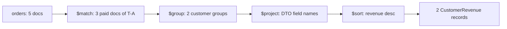
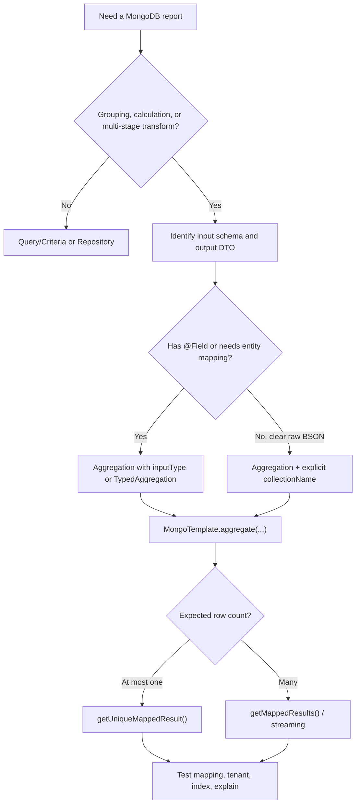

# `Aggregation`, `TypedAggregation`, and `AggregationResults` in Spring Data MongoDB

## 1. From Document Queries to Data-Processing Pipelines

With **Spring Data MongoDB**, a Java application can read documents using repositories, perform flexible operations with `MongoTemplate`, and build reports with the **MongoDB Aggregation Framework**. Unlike a `find` query that fetches documents matching a condition, aggregation lets you **pass documents through multiple sequential processing steps**, such as filtering orders, grouping by customer, summing revenue, renaming fields, and sorting results.

This topic in the **Basic Aggregation** chapter clearly distinguishes three Spring Data abstractions:

1. **`Aggregation`:** describes a pipeline composed of `AggregationOperation` stages such as `match`, `group`, `project`, `sort`, and `limit`.
2. **`TypedAggregation<T>`:** a pipeline with an **input domain type**; Spring Data can use the mapping metadata of `T` to translate Java property names into BSON field names.
3. **`AggregationResults<O>`:** the result returned after `MongoTemplate` executes the pipeline, containing objects mapped to the **output type** `O` along with raw result information for inspection when needed.

Remember the flow:

```text
Documents in collection
    ↓ $match
Filtered documents
    ↓ $group
Documents per group, with _id as the group key
    ↓ $project
Result documents with aliases matching the DTO contract
    ↓ $sort
Sorted results
    ↓ MongoTemplate.aggregate(...)
AggregationResults<ReportDto>
    ↓ getMappedResults()
List<ReportDto>
```

These three concepts **are not three different ways of writing the same thing**:

| Component | Created When? | What Question Does It Answer? |
|---|---|---|
| `Aggregation` | When building the Java pipeline | *Which stages run, and in what order?* |
| `TypedAggregation<Order>` | When binding a pipeline to a source document type | *Which input model do the properties in stages belong to?* |
| `AggregationResults<CustomerRevenue>` | After calling `MongoTemplate.aggregate(...)` | *Which Java type was the output BSON mapped to, and how many results were returned?* |

**Goal:** build a pipeline yourself, understand when to use typed aggregation, call the right `MongoTemplate.aggregate` overload, safely read `AggregationResults`, and verify actual queries and results against MongoDB.

## 2. Sample Dataset and Reporting Problem

### 2.1. The `orders` Collection

In a test database, insert five orders:

```javascript
db.orders.insertMany([
  {
    _id: "O-101", tenant_id: "T-A", customer_id: "C-01",
    status: "PAID", total_cents: NumberLong(15000),
    created_at: ISODate("2026-01-05T10:00:00Z")
  },
  {
    _id: "O-102", tenant_id: "T-A", customer_id: "C-01",
    status: "PAID", total_cents: NumberLong(7000),
    created_at: ISODate("2026-01-08T10:00:00Z")
  },
  {
    _id: "O-103", tenant_id: "T-A", customer_id: "C-02",
    status: "PAID", total_cents: NumberLong(9000),
    created_at: ISODate("2026-01-11T10:00:00Z")
  },
  {
    _id: "O-104", tenant_id: "T-A", customer_id: "C-02",
    status: "NEW", total_cents: NumberLong(5000),
    created_at: ISODate("2026-01-13T10:00:00Z")
  },
  {
    _id: "O-201", tenant_id: "T-B", customer_id: "C-01",
    status: "PAID", total_cents: NumberLong(100000),
    created_at: ISODate("2026-01-09T10:00:00Z")
  }
]);
```

Convention: `total_cents` is an integer amount in the **smallest currency unit**. We intentionally include order `O-201` belonging to tenant `T-B` and order `O-104` with status `NEW` to catch pipelines missing a filter step.

Requirement: **aggregate paid orders of tenant T-A by customer**, returning:

| customerId | orderCount | revenueCents |
|---|---:|---:|
| C-01 | 2 | 22000 |
| C-02 | 1 | 9000 |

In total there are **3 PAID orders** and **31,000 cents** belonging to T-A. Do not add the 5,000 cents of the NEW order or the 100,000 cents of the other tenant.

### 2.2. Corresponding Entity in Spring Data

The examples use Java 17+, Spring Data MongoDB, and Spring Boot; place classes in appropriate Java files:

```java
import java.time.Instant;
import org.springframework.data.annotation.Id;
import org.springframework.data.mongodb.core.mapping.Document;
import org.springframework.data.mongodb.core.mapping.Field;

@Document(collection = "orders")
public class PurchaseOrder {
    @Id
    private String id;

    @Field("tenant_id")
    private String tenantId;

    @Field("customer_id")
    private String customerId;

    private String status;

    @Field("total_cents")
    private long totalCents;

    @Field("created_at")
    private Instant createdAt;

    protected PurchaseOrder() {}

    public PurchaseOrder(String id, String tenantId, String customerId,
            String status, long totalCents, Instant createdAt) {
        this.id = id;
        this.tenantId = tenantId;
        this.customerId = customerId;
        this.status = status;
        this.totalCents = totalCents;
        this.createdAt = createdAt;
    }

    public String getId() { return id; }
    public String getTenantId() { return tenantId; }
    public String getCustomerId() { return customerId; }
    public String getStatus() { return status; }
    public long getTotalCents() { return totalCents; }
    public Instant getCreatedAt() { return createdAt; }
}
```

Names in the **Java domain** differ from BSON names:

| Java Property | BSON Field | Why? |
|---|---|---|
| `id` | `_id` | `@Id` |
| `tenantId` | `tenant_id` | `@Field("tenant_id")` |
| `customerId` | `customer_id` | `@Field("customer_id")` |
| `totalCents` | `total_cents` | `@Field("total_cents")` |
| `createdAt` | `created_at` | `@Field("created_at")` |
| `status` | `status` | Same name |

Distinguishing Java names from BSON names is the key to understanding what `TypedAggregation` does.

### 2.3. Report DTO, Not Source Entity

The output is no longer an order, but an aggregation per customer:

```java
public record CustomerRevenue(
    String customerId,
    long orderCount,
    long revenueCents
) {}
```

`CustomerRevenue` does not need `@Document`, because it is the **aggregation output type**. The pipeline's job is to emit fields with matching names and types so Spring Data can map them into the constructor/record.

## 3. Writing the Pure MongoDB Pipeline Before Translating to Java

One way to avoid logic bugs is to write and verify the pipeline in `mongosh` first:

```javascript
db.orders.aggregate([
  { $match: { tenant_id: "T-A", status: "PAID" } },
  {
    $group: {
      _id: "$customer_id",
      orderCount: { $sum: 1 },
      revenueCents: { $sum: "$total_cents" }
    }
  },
  {
    $project: {
      _id: 0,
      customerId: "$_id",
      orderCount: 1,
      revenueCents: 1
    }
  },
  { $sort: { revenueCents: -1, customerId: 1 } }
]);
```

### 3.1. Meaning of Each Stage

| Stage | Input Data | Output Data / Effect |
|---|---|---|
| `$match` | 5 orders | 3 orders for T-A with status PAID |
| `$group` | 3 orders | 2 groups by `customer_id`; `_id` is now the **group key** |
| `$project` | 2 groups | Copies group key to `customerId`, drops `_id`, keeps aggregated totals |
| `$sort` | 2 report rows | Sorts by revenue descending, then customerId ascending |

`$group` does not guarantee output order. If an endpoint requires a specific order, **add `$sort` explicitly**. Never infer order from IDs, source document positions, or insertion order.

### 3.2. Expected BSON Result

```javascript
[
  { customerId: "C-01", orderCount: 2, revenueCents: NumberLong(22000) },
  { customerId: "C-02", orderCount: 1, revenueCents: NumberLong(9000) }
]
```

This is an illustrative shape; the exact BSON type of an aggregated number depends on input types and MongoDB's numeric accumulation/promotion rules. When mapping to `long`, ensure values stay within supported bounds and inputs share consistent units.

### 3.3. Stages Chain Together, Never Run Independently



Each stage receives **the output of the previous stage** and cannot always see every field of the source collection. After `$group`, if a field is not preserved in an accumulator or group key, it is no longer available to reference as before.

## 4. `Aggregation`: Building a Pipeline with the Spring Data DSL

`Aggregation` is an object describing a pipeline built from `AggregationOperation` steps. Static factory methods in `Aggregation` keep Java code close to MongoDB stages:

```java
import org.springframework.data.domain.Sort;
import org.springframework.data.mongodb.core.aggregation.Aggregation;
import org.springframework.data.mongodb.core.aggregation.AggregationResults;
import org.springframework.data.mongodb.core.query.Criteria;

Aggregation pipeline = Aggregation.newAggregation(
    Aggregation.match(
        Criteria.where("tenantId").is("T-A")
            .and("status").is("PAID")),
    Aggregation.group("customerId")
        .count().as("orderCount")
        .sum("totalCents").as("revenueCents"),
    Aggregation.project("orderCount", "revenueCents")
        .and("_id").as("customerId")
        .andExclude("_id"),
    Aggregation.sort(
        Sort.by(
            Sort.Order.desc("revenueCents"),
            Sort.Order.asc("customerId")))
);

AggregationResults<CustomerRevenue> result =
    mongoTemplate.aggregate(
        pipeline, PurchaseOrder.class, CustomerRevenue.class);
```

This example assumes `mongoTemplate` is an injected `MongoTemplate` bean in a service. Calling `aggregate(pipeline, PurchaseOrder.class, CustomerRevenue.class)` tells Spring Data:

- `PurchaseOrder.class` is the **input type** used to pick the collection from `@Document` and apply mapping metadata.
- `CustomerRevenue.class` is the **output type** used to materialize result documents.
- `pipeline` defines the operations; **creating an `Aggregation` does not execute a query**. The query is only sent when calling `MongoTemplate.aggregate(...)`.

### 4.1. Reading Spring DSL Alongside `mongosh`

| Spring Data DSL | MongoDB Stage | Purpose |
|---|---|---|
| `Aggregation.match(Criteria...)` | `$match` | Filter documents |
| `Aggregation.group("customerId")` | `$group` with group key | Group by customer |
| `.count().as("orderCount")` | `$sum: 1` | Count orders |
| `.sum("totalCents").as("revenueCents")` | `$sum: "$total_cents"` | Sum amounts |
| `Aggregation.project(...).and("_id").as("customerId")` | `$project` | Alias/keep fields |
| `Aggregation.sort(...)` | `$sort` | Sort results |

In `Aggregation.group("customerId")`, **`customerId` is a Java property** when an appropriate input mapping context is active; MongoDB needs to see `customer_id`. Never mix physical BSON names and Java names in the same DSL without knowing which mapping context the API applies.

### 4.2. Using `@Document` or an Explicit Collection Name?

Calling:

```java
mongoTemplate.aggregate(
    pipeline,
    PurchaseOrder.class,
    CustomerRevenue.class
);
```

uses `@Document(collection = "orders")` on `PurchaseOrder` as the default collection name. Another overload takes a String collection name to run the pipeline on a chosen collection:

```java
mongoTemplate.aggregate(
    pipeline,
    "orders",
    CustomerRevenue.class
);
```

**These two overloads are not automatically equivalent with respect to mapping.** The overload taking only a collection name without an input type may not know that `tenantId` should become `tenant_id`. To both override the collection and keep entity mapping, use `TypedAggregation` in the next section, or build stages with **actual BSON field names**.

## 5. `TypedAggregation<T>`: Declaring the Input Document Type

`TypedAggregation<T>` is a specialization of `Aggregation` with an **explicitly declared input type `T`** at pipeline creation:

```java
import org.springframework.data.mongodb.core.aggregation.TypedAggregation;

TypedAggregation<PurchaseOrder> typedPipeline =
    Aggregation.newAggregation(
        PurchaseOrder.class,
        Aggregation.match(
            Criteria.where("tenantId").is("T-A")
                .and("status").is("PAID")),
        Aggregation.group("customerId")
            .count().as("orderCount")
            .sum("totalCents").as("revenueCents"),
        Aggregation.project("orderCount", "revenueCents")
            .and("_id").as("customerId")
            .andExclude("_id"),
        Aggregation.sort(
            Sort.by(
                Sort.Order.desc("revenueCents"),
                Sort.Order.asc("customerId")))
    );
```

Unlike `Aggregation.newAggregation(stage1, stage2, ...)`, the factory here accepts **`PurchaseOrder.class` as its first argument**. Spring Data uses entity metadata to resolve field paths, including `@Field` and identifiers.

### 5.1. Using Typed Aggregation with an Explicit Collection

```java
AggregationResults<CustomerRevenue> results =
    mongoTemplate.aggregate(
        typedPipeline,
        "orders",
        CustomerRevenue.class);
```

This call uses the **input type from `TypedAggregation<PurchaseOrder>`** and the **collectionName from the String argument**. This is useful when the same BSON schema is stored in `orders`, `orders_archive`, or a staging collection, provided you verify that those collections are truly compatible with `PurchaseOrder`.

`TypedAggregation` does not switch databases, grant extra permissions, automatically enforce tenant authorization, or guarantee that an overridden collection has the same indexes/validators.

### 5.2. Typed Does Not Mean the Output Must Be `PurchaseOrder`

This is a very common misconception:

```text
TypedAggregation<PurchaseOrder>
       ↓ execute pipeline
AggregationResults<CustomerRevenue>
```

`PurchaseOrder` is the **input domain type**; `CustomerRevenue` is the **output projection/DTO**. `$group` can collapse many source documents into a few report rows, so the output does not need to match the source entity's structure.

### 5.3. Input Type Mapping and Custom Stages

Typed aggregation lets Spring Data map known properties. However, a stage built directly with raw `org.bson.Document` does not automatically go through the same property-renaming logic as typed DSL operations:

```java
import org.bson.Document;
import org.springframework.data.mongodb.core.aggregation.AggregationOperation;

AggregationOperation rawMatch = context ->
    new Document("$match",
        new Document("tenant_id", "T-A")
            .append("status", "PAID"));
```

Because this stage hand-writes BSON, it uses the **physical `tenant_id`**, not the entity's `tenantId`. Conversely, in `Aggregation.match(Criteria.where("tenantId")...)`, the Java property name is mapped according to the input context.

**Rule:** know which stages pass through Spring Data mapping and which return raw BSON—especially when entities use `@Field`, embedded documents, custom converters, or property renames during refactoring.

## 6. Choosing the Right `MongoTemplate.aggregate` Overload

`MongoTemplate` is a **synchronous** API for executing pipelines. Depending on the overload, it takes information about the collection, input type, and output type.

| Call | Collection Source | Input Mapping | Result Type |
|---|---|---|---|
| `aggregate(aggregation, PurchaseOrder.class, CustomerRevenue.class)` | `@Document` on `PurchaseOrder` | Domain type from `PurchaseOrder.class` parameter | `CustomerRevenue` |
| `aggregate(aggregation, "orders", CustomerRevenue.class)` | Explicit String name | Does not assume `PurchaseOrder` as input | `CustomerRevenue` |
| `aggregate(typedAggregation, "orders", CustomerRevenue.class)` | Explicit String name | Domain type inside `TypedAggregation<PurchaseOrder>` | `CustomerRevenue` |
| `aggregate(typedAggregation, CustomerRevenue.class)` | Metadata from typed input | Domain type inside typed aggregation | `CustomerRevenue` |

Overload signatures and exact behaviors vary by Spring Data MongoDB version; consult `MongoOperations`/`MongoTemplate` in your active dependencies. The table illustrates the principle of separating input/collection/output rather than listing every overload.

### 6.1. Choosing an Overload Based on the Problem

For a normal report on the declared collection:

```java
AggregationResults<CustomerRevenue> result =
    mongoTemplate.aggregate(
        pipeline,
        PurchaseOrder.class,
        CustomerRevenue.class
    );
```

For an archive collection with the **same BSON schema**:

```java
AggregationResults<CustomerRevenue> result =
    mongoTemplate.aggregate(
        typedPipeline,
        "orders_archive",
        CustomerRevenue.class
    );
```

For a pipeline written directly with **physical BSON names** on an explicit collection:

```java
Aggregation bsonPipeline = Aggregation.newAggregation(
    Aggregation.match(
        Criteria.where("tenant_id").is("T-A")
            .and("status").is("PAID")),
    Aggregation.group("customer_id")
        .count().as("orderCount")
        .sum("total_cents").as("revenueCents"),
    Aggregation.project("orderCount", "revenueCents")
        .and("_id").as("customerId")
        .andExclude("_id")
);

var result = mongoTemplate.aggregate(
    bsonPipeline, "orders", CustomerRevenue.class);
```

In the last example, we intentionally use `tenant_id`, `customer_id`, and `total_cents` since no input domain type is specified. Still, pipelines involving many calculations, arrays, nested properties, or custom converters are usually easier to maintain with an explicit mapping context.

### 6.2. Collection Name and Database Are Two Different Decisions

Passing `"orders_archive"` to `aggregate` **does not switch databases**. The database is determined by `MongoDatabaseFactory`/`MongoTemplate` and your active connection settings. If a report needs data from multiple databases, implement controlled routing/factory architecture; never pass `"dbName.collection"` as a collection name expecting it to switch databases automatically.

Different collections do not share indexes automatically. Using `TypedAggregation<PurchaseOrder>` to read `orders_archive` still requires verifying that the archive collection has compatible schema, permissions, indexes, and data lifecycle.

### 6.3. `aggregate` Does Not Turn the Source Collection Into the Output Collection

`MongoTemplate.aggregate(...)` returns results to the application; the `$match`, `$group`, `$project`, and `$sort` stages in this lesson **do not overwrite source documents**. MongoDB has write stages such as `$merge` and `$out` in specialized pipelines, but those mutate data and require dedicated permissions, transaction/retention handling.

Never take a report DTO produced by aggregation and pass it to `mongoTemplate.save(dto)` as if it were a source order: the DTO does not share the same identity, schema, or semantics as `PurchaseOrder`.

## 7. `AggregationResults<O>`: How to Read the Results

After executing a pipeline, `MongoTemplate.aggregate(...)` returns `AggregationResults<O>`. This object is a **result wrapper**, not an unexecuted stream or an automatic `Page`.

### 7.1. `getMappedResults`: Multiple Result Rows

```java
AggregationResults<CustomerRevenue> results =
    mongoTemplate.aggregate(
        pipeline, PurchaseOrder.class, CustomerRevenue.class);

java.util.List<CustomerRevenue> rows =
    results.getMappedResults();

for (CustomerRevenue row : rows) {
    System.out.println(
        row.customerId() + ": " +
        row.orderCount() + " orders, " +
        row.revenueCents() + " cents");
}
```

With the sample data, the list has two elements: `C-01` and `C-02`. `getMappedResults()` returns results mapped from BSON to Java using `CustomerRevenue.class`. It does not wrap results in a `Page`, does not compute total page counts, and applies no row limit unless the pipeline includes `$limit`.

When no documents match `$match`, a `$group` pipeline like this typically returns an **empty list**, not a single item with `orderCount = 0`.

### 7.2. `getUniqueMappedResult`: When the Pipeline Produces at Most One Row

If you want a report of **all PAID orders of T-A combined** (without grouping by customer), use an unkeyed `$group`:

```java
public record TenantRevenueSummary(
    long orderCount,
    long revenueCents
) {}
```

```java
Aggregation summaryPipeline = Aggregation.newAggregation(
    Aggregation.match(
        Criteria.where("tenantId").is("T-A")
            .and("status").is("PAID")),
    Aggregation.group()
        .count().as("orderCount")
        .sum("totalCents").as("revenueCents"),
    Aggregation.project("orderCount", "revenueCents")
        .andExclude("_id")
);

AggregationResults<TenantRevenueSummary> summaryResults =
    mongoTemplate.aggregate(
        summaryPipeline,
        PurchaseOrder.class,
        TenantRevenueSummary.class);

TenantRevenueSummary summary =
    summaryResults.getUniqueMappedResult();
```

Expected result: `orderCount = 3`, `revenueCents = 31000`.

`getUniqueMappedResult()` is the right API when **the pipeline is designed to return at most one row**:

- **One** result: returns that object.
- **Zero** results: may return `null`.
- **Multiple** results: throws an error for violating uniqueness, rather than picking the first row.

Never call `getUniqueMappedResult()` on a pipeline grouping by customer without a limit and expect Spring to merge the groups into one row.

### 7.3. Do Not Confuse `getUniqueMappedResult` with "Take the First Row"

If the task is actually to find **the single customer with the highest revenue**, define:

```java
Aggregation topCustomerPipeline = Aggregation.newAggregation(
    Aggregation.match(
        Criteria.where("tenantId").is("T-A")
            .and("status").is("PAID")),
    Aggregation.group("customerId")
        .sum("totalCents").as("revenueCents"),
    Aggregation.project("revenueCents")
        .and("_id").as("customerId")
        .andExclude("_id"),
    Aggregation.sort(
        Sort.by(
            Sort.Order.desc("revenueCents"),
            Sort.Order.asc("customerId"))),
    Aggregation.limit(1)
);
```

After `$limit: 1`, you can use `getUniqueMappedResult()` with a matching output DTO containing only `customerId` and `revenueCents`. **Do not** map this pipeline into `CustomerRevenue` if that DTO also expects `orderCount` that the pipeline no longer projects; when changing projections, update the DTO contract to match.

Corresponding DTO example:

```java
public record TopCustomerRevenue(
    String customerId,
    long revenueCents
) {}
```

### 7.4. `getRawResults`: Inspecting Raw Command Output

```java
org.bson.Document raw = results.getRawResults();

// Use only for controlled debugging in test environments.
System.out.println(raw.toJson());
```

`getRawResults()` exposes the **raw BSON representation** returned by the driver/Spring Data, useful for investigating discrepancies between MongoDB output and Java DTOs. **Never hardcode** a path like `raw.get("result")` assuming metadata, cursor wrappers, or field structures stay identical across every driver/server version.

If you just want to see mapped output documents without command metadata, `getMappedResults()` is clearer. To inspect **BSON fields before DTO mapping**, temporarily run the pipeline with `org.bson.Document.class` as the output type in an integration test.

### 7.5. Temporarily Returning `Document` to Verify Aliases

```java
AggregationResults<org.bson.Document> docs =
    mongoTemplate.aggregate(
        pipeline,
        PurchaseOrder.class,
        org.bson.Document.class);

for (org.bson.Document document : docs.getMappedResults()) {
    System.out.println(document.toJson());
}
```

This verifies whether `customerId`, `orderCount`, and `revenueCents` match the DTO contract. Never log raw documents containing personal information in production logs. For performance debugging, log minimized/sanitized metadata.

## 8. Mapping Results to DTOs and Data-Type Pitfalls

### 8.1. MongoDB Does Not Know Java Constructor Parameter Names Automatically

Each MongoDB report row in Section 3 has the shape:

```javascript
{
  customerId: "C-01",
  orderCount: 2,
  revenueCents: NumberLong(22000)
}
```

If the Java record is defined as:

```java
public record CustomerRevenue(
    String customerId,
    long orderCount,
    long revenueCents
) {}
```

then the output names `customerId`, `orderCount`, and `revenueCents` must match the constructor/properties used by Spring Data. If the pipeline returns `"_id": "C-01"` without aliasing it to `customerId`, do not assume constructor parameter `customerId` will automatically receive the `_id` group key.

A common mistake:

```javascript
// After $group, _id IS the customer ID.
{
  _id: "C-01",
  orderCount: 2,
  revenueCents: NumberLong(22000)
}
```

Without a mapping from `_id` to `customerId`, the Java object may end up with missing fields or unexpected mapping behavior. Adding an explicit `$project` alias makes tests much more reliable.

### 8.2. Counts and Monetary Amounts: Choosing the Right Types

`$sum: 1` produces a count; `$sum: "$total_cents"` sums numeric field values. The BSON type of an aggregated number depends on source data, overflow behavior, and MongoDB's numeric rules.

| Data | Suggested Java Type | What to Verify |
|---|---|---|
| Accumulated order count | `long` | Always numeric and non-null? |
| Total cents from BSON Int64 | `long` | Risk of overflow on very large totals? |
| Ratios / averages | `BigDecimal`/`Decimal128` or `double` per contract | Precision and rounding rules |
| Field that may be missing/null | `Long` or suitable nullable type | Distinguish missing data from 0 |
| Group key is an `ObjectId` | `ObjectId`/`String` per schema | Does converter translate properly? |

For money, prefer storing integer minor units or `Decimal128` depending on domain rules rather than computing money with `double` and hoping for no rounding drift. For `$avg`, explicitly decide return type and display formatting.

### 8.3. A DTO Is Not an Entity for Writing Back

`CustomerRevenue` does not represent a document in `orders`: each row may aggregate many orders. Never call `mongoTemplate.save(customerRevenue)` to alter source data.

When updating an order, update the specific `PurchaseOrder` through CRUD/update APIs. When persisting physical reports, treat that as a separate materialized-report design with its own collection, identity, schedule, permissions, and synchronization strategy.

### 8.4. Early `$project` Must Not Drop Fields Needed Later

Example of a logically broken pipeline:

```javascript
[
  { $project: { customer_id: 1 } },
  {
    $group: {
      _id: "$customer_id",
      revenueCents: { $sum: "$total_cents" }
    }
  }
]
```

`$project` dropped `total_cents` before `$group` needed it. MongoDB will not reach back into source documents to recover dropped fields in later stages. If you want to trim fields early, keep every field actually needed downstream:

```javascript
{ $project: { customer_id: 1, total_cents: 1 } }
```

Usually you can put `$match` early and let the optimizer prune unused fields; do not add manual `$project` stages just because you assume every `$project` makes a query faster.

## 9. Core `AggregationOperation` Stages and Execution Order

### 9.1. `$match`: Filtering Documents

```java
Aggregation.match(
    Criteria.where("tenantId").is("T-A")
        .and("status").is("PAID")
)
```

This is a `MatchOperation`. When executed with `PurchaseOrder.class`, Spring Data knows `tenantId` maps to BSON `tenant_id`. Placing an appropriate `$match` near the start of the pipeline reduces documents flowing through costly stages and gives the database a chance to use indexes.

In production systems, `tenantId` must come from an **authenticated security context**; never trust a client-supplied value to determine which tenant a caller is allowed to view.

### 9.2. `$group`: Grouping and Accumulating

```java
Aggregation.group("customerId")
    .count().as("orderCount")
    .sum("totalCents").as("revenueCents")
```

In MongoDB, `$group` outputs one document per distinct group key value, stored in `_id`. Accumulators such as `$sum`, `$avg`, `$min`, `$max`, or `$push` collapse multiple source documents into a single value per group.

A **keyless** group:

```java
Aggregation.group()
    .count().as("orderCount")
    .sum("totalCents").as("revenueCents")
```

returns totals across the entire input stream. If the preceding `$match` leaves zero documents, a group pipeline typically returns **zero result rows** instead of emitting a zero summary. When an API requires zero values for empty input, handle that via application defaults or an explicit pipeline rule.

### 9.3. `$project`: Selecting Fields and Aliasing

```java
Aggregation.project("orderCount", "revenueCents")
    .and("_id").as("customerId")
    .andExclude("_id")
```

This stage keeps the two accumulators and renames `_id` from the group to `customerId`. Note:

- `_id` after `$group` is the **group key**, no longer the original order ID.
- `customerId` is a **new output alias**, not the physical `customer_id` field in `orders`.
- Any fields not included in `$project` are unavailable to subsequent stages.
- MongoDB keeps `_id` by default unless excluded; `andExclude("_id")` prevents it from leaking outside the DTO contract.

### 9.4. `$sort`, `$limit`, `$skip`

```java
Aggregation.sort(
    Sort.by(
        Sort.Order.desc("revenueCents"),
        Sort.Order.asc("customerId"))
)
```

Here, sorting runs **after `$project`**, so it uses the aliases present in the output. After `$sort`, add `$limit` to return at most N groups:

```java
Aggregation.limit(10)
```

For subsequent pages:

```java
Aggregation.skip(10L);
Aggregation.limit(10L);
```

These last two lines show **two separate stages**; when assembling `newAggregation(...)`, place `skip` before `limit` for offset pagination. Large `skip` values can be expensive, and continuously mutating datasets can cause duplicate or skipped entries across pages.

### 9.5. Why Does Stage Order Change Result Semantics?

Compare two pipelines:

```javascript
// A: Limit to first 2 input orders before grouping.
[
  { $match: { tenant_id: "T-A", status: "PAID" } },
  { $sort: { created_at: 1 } },
  { $limit: 2 },
  { $group: {
      _id: "$customer_id",
      revenueCents: { $sum: "$total_cents" }
  }}
]

// B: Group all valid orders, then take top 2 customers.
[
  { $match: { tenant_id: "T-A", status: "PAID" } },
  { $group: {
      _id: "$customer_id",
      revenueCents: { $sum: "$total_cents" }
  }},
  { $sort: { revenueCents: -1 } },
  { $limit: 2 }
]
```

Pipeline A sums only **the two earliest orders**, whereas pipeline B sums **all valid orders** and then takes the top two groups. Both are syntactically valid, yet mean completely different things. Never add `$limit` early just to cut cost when a report requires totals across all matching data.

### 9.6. Stages Beyond the Minimal Scope

The Aggregation Framework also includes `$unwind`, `$lookup`, `$addFields`/`$set`, `$bucket`, `$facet`, `$count`, `$replaceRoot`, and many specialized expressions. Spring Data provides corresponding API/DSL support depending on version.

- `$unwind` splits each element of an array into its own output document, which can increase intermediate document count.
- `$lookup` joins data from another collection; evaluate indexes, authorization, intermediate sizes, and schemas.
- `$facet` computes multiple pipeline branches over the same input, useful for paged results plus totals, though subject to memory/size limits.
- `$count` counts incoming documents at **that stage's position** in the pipeline, not the source collection's total count.

In foundational exercises, master `match → group → project → sort` before expanding to more complex stages.

## 10. Typed Aggregation, Field Names, Aliases, and Mapping Checks

### 10.1. Java Properties and BSON Fields Must Be Consistent

Example entity:

```java
@Field("customer_id")
private String customerId;

@Field("total_cents")
private long totalCents;
```

In typed DSL:

```java
Aggregation.group("customerId")
    .sum("totalCents").as("revenueCents")
```

Logically, MongoDB needs to receive:

```javascript
{
  $group: {
    _id: "$customer_id",
    revenueCents: { $sum: "$total_cents" }
  }
}
```

If you accidentally pass `"customer_id"` into a DSL expecting a Java property path, behavior may diverge or depend on relaxed field reference handling. In new code, stick to a clear rule:

1. **Typed DSL:** reference Java properties in stages where Spring Data mapping applies.
2. **Raw BSON stages:** reference physical BSON field names.
3. **After creating aliases:** reference the output field name emitted by the previous stage; do not treat it as a source entity property anymore.

### 10.2. `TypedAggregation` Does Not Verify Every Field in All Versions

Some Spring Data MongoDB versions offer stricter mapping checks on field references (e.g., **strict mapping** via aggregation options). In other versions or under default relaxed configuration, referencing a non-existent property path on the domain type may **not throw an error when constructing the pipeline**.

Thus, **typed does not mean absolute compile-time type safety**. A typo like `"totalCent"` might only surface at runtime when the query runs or silently returns wrong numbers. Combine:

- Unit tests on pipeline structure where the project supports inspection.
- Integration tests with real BSON documents.
- Observation of emitted pipelines and raw outputs.
- Strict field mapping configuration appropriate for your framework version where helpful.

### 10.3. Do Not Treat Sibling Aliases in the Same Stage as Temporary Variables

Suppose you want to compute `grossCents` and then `netCents`:

```javascript
// Do not expect grossCents in the same $project
// to reference the value just computed immediately above.
{
  $project: {
    grossCents: { $add: ["$subtotal_cents", "$shipping_cents"] },
    netCents: { $subtract: ["$grossCents", "$discount_cents"] }
  }
}
```

`"$grossCents"` inside a `$project` stage is not a "Java variable" automatically holding the sibling field just defined. To use an intermediate calculation, compute it in an **earlier stage**:

```javascript
[
  {
    $set: {
      grossCents: { $add: ["$subtotal_cents", "$shipping_cents"] }
    }
  },
  {
    $project: {
      grossCents: 1,
      netCents: {
        $subtract: [
          "$grossCents",
          { $ifNull: ["$discount_cents", NumberLong(0)] }
        ]
      }
    }
  }
]
```

In our main lesson example, we group directly on stored `totalCents`, so `$set` is not needed. This snippet illustrates the rule: **one stage's output is the next stage's input**.

### 10.4. Inspect the Raw Pipeline When Suspecting Mapping Issues

When Java results are null or MongoDB reports missing fields, inspect layer by layer:

```text
PurchaseOrder.customerId
        ↓ @Field
orders.customer_id
        ↓ $group
_id = customer ID
        ↓ $project alias
customerId (output BSON)
        ↓ Spring conversion
CustomerRevenue.customerId()
```

If the error is at the input layer, check `@Field` and typed aggregation. If at the alias layer, check `$project`. If raw BSON is right but the DTO is wrong, check constructor/property types and custom converters. **Never edit every layer at once**, as that obscures the root cause.

## 11. Mandatory Filters, Dynamic Conditions, and Security

### 11.1. Tenant Filtering Is Not Optional

In a multi-tenant setup, the pipeline must be scoped by a `tenantId` from a trusted source:

```java
import org.springframework.data.mongodb.core.query.Criteria;

public Aggregation buildRevenuePipeline(
        String authenticatedTenantId,
        String requestedStatus) {

    if (authenticatedTenantId == null
            || authenticatedTenantId.isBlank()) {
        throw new IllegalArgumentException("Missing tenant context");
    }
    if (!"PAID".equals(requestedStatus)) {
        throw new IllegalArgumentException("Unsupported status");
    }

    return Aggregation.newAggregation(
        Aggregation.match(
            Criteria.where("tenantId")
                .is(authenticatedTenantId)
                .and("status").is("PAID")),
        Aggregation.group("customerId")
            .count().as("orderCount")
            .sum("totalCents").as("revenueCents"),
        Aggregation.project("orderCount", "revenueCents")
            .and("_id").as("customerId")
            .andExclude("_id"),
        Aggregation.sort(
            Sort.by(Sort.Order.desc("revenueCents"),
                Sort.Order.asc("customerId")))
    );
}
```

This is a **factory method inside a service**, using the `Aggregation` and `Sort` imports from Section 4. `authenticatedTenantId` must come from a verified session/token or authorization context; never take a `tenantId` parameter declared by the client as-is.

If the product allows multiple statuses, validate against an enum/allowlist and build `Criteria` explicitly. Never accept arbitrary stage arrays or raw BSON queries directly from clients into `MongoTemplate.aggregate(...)`.

### 11.2. Never Let Tenant Scope Be Bypassed by OR

Incorrect example:

```javascript
{
  $or: [
    { tenant_id: "T-A" },
    { status: "PAID" }
  ]
}
```

This matches every PAID order of every other tenant. Correct structure:

```javascript
{
  $and: [
    { tenant_id: "T-A" },
    { $or: [{ status: "PAID" }, { status: "NEW" }] }
  ]
}
```

The security layer determines which dataset is accessible; aggregation merely computes within that dataset. If additional stages like `$lookup` or `$facet` pull in other collections, verify authorization constraints across **every accessed data source**, rather than assuming one `$match` on the primary collection protects every joined collection.

### 11.3. Validation and Resource Budgets

If clients can choose `groupBy`, `sortBy`, or row limits, only allow server-listed keys:

| Public Parameter | Recommended Policy |
|---|---|
| `groupBy` | Only `customer`, `status` if supported; map to fixed Java properties |
| `status` | Enum/allowlist, e.g., `PAID` |
| `sortBy` | Only allowed output aliases such as `revenueCents`, `customerId` |
| `direction` | `asc` or `desc` |
| `limit` | Positive integer capped per SLA |
| `timeRange` | Validated range with explicit timezone and inclusive/exclusive bounds |

**Never concatenate** client-supplied property paths or operators directly into `$group`/`$project`. An "arbitrary aggregation" API can expose internal data and trigger resource-exhausting queries even when input JSON parses cleanly.

## 12. Pagination and Counting Aggregated Results

### 12.1. `AggregationResults` Is Not a `Page`

`AggregationResults<CustomerRevenue>` returns a list of mapped report rows. It **does not automatically know the total number of groups** to build a `Page<CustomerRevenue>` like a paged repository query.

If an API needs a page of 20 customers by highest revenue, the pipeline must:

1. Filter all authorized orders.
2. Group all matching data to be summed.
3. Sort groups in a deterministic order.
4. **Only then** apply `$skip` and `$limit` for the requested page of groups.

```java
int pageIndex = 0;
int pageSize = 20;

if (pageIndex < 0 || pageSize < 1 || pageSize > 100) {
    throw new IllegalArgumentException("Invalid page parameters");
}

long offset = (long) pageIndex * pageSize;

Aggregation pagedPipeline = Aggregation.newAggregation(
    Aggregation.match(
        Criteria.where("tenantId").is("T-A")
            .and("status").is("PAID")),
    Aggregation.group("customerId")
        .count().as("orderCount")
        .sum("totalCents").as("revenueCents"),
    Aggregation.project("orderCount", "revenueCents")
        .and("_id").as("customerId")
        .andExclude("_id"),
    Aggregation.sort(
        Sort.by(
            Sort.Order.desc("revenueCents"),
            Sort.Order.asc("customerId"))),
    Aggregation.skip(offset),
    Aggregation.limit(pageSize)
);

var rows = mongoTemplate.aggregate(
    pagedPipeline,
    PurchaseOrder.class,
    CustomerRevenue.class
).getMappedResults();
```

Adding `customerId` as a tie-breaker stabilizes ordering when two groups have equal `revenueCents`. On continuously updated datasets, offset paging can still duplicate or omit rows between calls; use snapshot/read-consistency designs or alternative pagination where required.

### 12.2. Counting Groups vs. Counting Orders

In paid T-A data:

```text
Order count:       3
Customer count:    2
```

To count the rows after `$group`:

```java
public record GroupCount(long totalGroups) {}
```

```java
Aggregation countGroups = Aggregation.newAggregation(
    Aggregation.match(
        Criteria.where("tenantId").is("T-A")
            .and("status").is("PAID")),
    Aggregation.group("customerId"),
    Aggregation.count().as("totalGroups")
);

GroupCount count = mongoTemplate.aggregate(
    countGroups,
    PurchaseOrder.class,
    GroupCount.class
).getUniqueMappedResult();

long totalGroups = count == null ? 0L : count.totalGroups();
```

`Aggregation.count()` after `group("customerId")` counts the **number of groups**, not orders. Placing `count` before `group` changes its meaning. When the pipeline yields zero groups after filtering, `getUniqueMappedResult()` may be null; the code maps that to 0 per the API contract.

If the application runs two separate pipelines for content and count, they may observe data at **two different points in time** while writes occur. `$facet` can produce both data and count in a single pipeline for some use cases, but carries its own costs and limits; do not assume it is always faster than two indexed queries.

### 12.3. Do Not Put `limit` Before `group` to "Speed Up" Wrongly

A page of 20 **grouped** results does not mean `$limit: 20` on **input orders**. Limiting orders before `$group` makes `revenueCents` a partial sum over just those 20 orders, not total customer revenue across the reporting period.

When a report is too heavy, consider time filters/indexes, daily pre-aggregation, materialized views, or dedicated reporting pipelines rather than silently altering data semantics.

## 13. `AggregationOptions`, Streaming, and Reactive Execution

### 13.1. Pipeline Execution Options

MongoDB aggregation may require workload-specific options such as `allowDiskUse`, collation, batch size, comment, time limits, and execution settings. Spring Data MongoDB provides `AggregationOptions` for options supported by your library version.

Conceptual configuration example for a large reporting pipeline:

```java
import org.springframework.data.mongodb.core.aggregation.AggregationOptions;

AggregationOptions options = AggregationOptions.builder()
    .allowDiskUse(true)
    .build();

Aggregation configured = Aggregation.newAggregation(
    Aggregation.match(
        Criteria.where("tenantId").is("T-A")
            .and("status").is("PAID")),
    Aggregation.group("customerId")
        .sum("totalCents").as("revenueCents")
).withOptions(options);
```

`allowDiskUse(true)` lets the server use disk space in supported aggregation stages when memory is insufficient, depending on MongoDB version and deployment policies. It **does not** lift the 16 MiB BSON document size limit and does not turn an unindexed pipeline into an efficient one.

**Strict mapping**, collation, and other settings have version-specific APIs in Spring Data. Before production use, check the `AggregationOptions` Javadoc for your version and test against an actual MongoDB Server.

### 13.2. When Results Are Too Large to Load Into One `List`

`getMappedResults()` returns a materialized list. If an aggregation yields hundreds of thousands of rows, account for JVM heap, network, and processing time. With synchronous Spring Data MongoDB, **`aggregateStream`** is available in supported versions:

```java
import org.springframework.data.util.CloseableIterator;

try (CloseableIterator<CustomerRevenue> cursor =
        mongoTemplate.aggregateStream(
            pipeline,
            PurchaseOrder.class,
            CustomerRevenue.class)) {

    while (cursor.hasNext()) {
        CustomerRevenue row = cursor.next();
        // Process each row; do not collect all into a List.
    }
}
```

Closing the cursor is essential to release resources. Streaming does not mean the server avoids memory/disk usage for `$group`/`$sort` before emitting the first row, nor does it solve pipeline bottlenecks on its own.

When exporting report files, combine streaming with row-by-row/chunked writing. Avoid buffering every result in a Java collection only to write it out at the end.

### 13.3. `ReactiveMongoTemplate` Returns `Flux` Instead of `AggregationResults`

With reactive access, the pipeline model is similar, while consumption differs:

```java
import reactor.core.publisher.Flux;
import org.springframework.data.mongodb.core.ReactiveMongoTemplate;

Flux<CustomerRevenue> report = reactiveMongoTemplate.aggregate(
    pipeline,
    PurchaseOrder.class,
    CustomerRevenue.class
);

// Compose further with Reactor; do not call block() on the event loop.
```

`reactiveMongoTemplate` is a configured reactive bean; `ReactiveMongoTemplate.aggregate(...)` returns `Flux<CustomerRevenue>`, **not synchronous `AggregationResults<CustomerRevenue>`**. Reactor enables asynchronous processing and backpressure on the subscriber side, without eliminating `$group` or `$sort` costs on the server.

Never mix synchronous and reactive transaction managers arbitrarily; if a pipeline participates in a reactive transaction, use `ReactiveMongoTransactionManager`/Reactor Context and test on a compatible MongoDB topology.

## 14. Indexes, `explain`, and Performance Diagnostics

### 14.1. Match as Early as Possible to Enable Index Usage

For workloads filtering by tenant, status, and sometimes a time range, consider an index aligned with common queries:

```javascript
db.orders.createIndex(
  { tenant_id: 1, status: 1, created_at: -1 },
  { name: "ix_orders_tenant_status_created" }
);
```

This is a **candidate index to benchmark**, not a universal formula for every pipeline. If queries only group by customer, another index including `customer_id` in the key might help some workloads, depending on selectivity, sorting, collection size, and the query planner.

When filtering by a `createdAt` range, place it in the leading `$match`:

```java
Aggregation.match(
    Criteria.where("tenantId").is("T-A")
        .and("status").is("PAID")
        .and("createdAt")
            .gte(java.time.Instant.parse("2026-01-01T00:00:00Z"))
            .lt(java.time.Instant.parse("2026-02-01T00:00:00Z"))
)
```

A half-open interval `[from, until)` avoids guessing "end-of-day" precision. For local-date user inputs, convert consistently using the business timezone into `Instant`.

### 14.2. Explaining Aggregation in `mongosh`

```javascript
db.orders.explain("executionStats").aggregate([
  { $match: { tenant_id: "T-A", status: "PAID" } },
  {
    $group: {
      _id: "$customer_id",
      orderCount: { $sum: 1 },
      revenueCents: { $sum: "$total_cents" }
    }
  },
  { $sort: { revenueCents: -1 } }
]);
```

Indicators to check:

| Concept | How to Use It |
|---|---|
| `IXSCAN` | Index scan used; examine scan width rather than relying solely on stage name |
| `COLLSCAN` | Full collection scan; may be reasonable for tiny collections |
| `totalKeysExamined` | Number of index keys scanned |
| `totalDocsExamined` | Number of documents examined |
| `nReturned` | Rows returned at the corresponding plan layer, not always equal to source order count |
| `$group` / `$sort` | Check memory/disk spill pressure, group count, and processing cost |
| `executionTimeMillis` | Single timing measurement; test across multiple runs and realistic load |

Do not expect `IXSCAN` to definitely appear on a five-document dataset. The query planner may choose `COLLSCAN` as cheaper. To tune properly, test on production-like scale and distributions and inspect latency and resource metrics over multiple runs.

### 14.3. Sorting by Computed Revenue Does Not Inherit Input Indexes

`revenueCents` is computed by `$sum` **after `$group`**. An index on `total_cents` does not turn into an index pre-sorted by per-customer total revenue. MongoDB usually must compute the groups before sorting them.

If customer revenue reports are called very frequently over hundreds of millions of orders, consider periodic summaries or materialized reports; decide explicitly on near-real-time updates, backfills, and late data handling. This is a trade-off between report freshness and query cost.

### 14.4. Risks of Heavy Stages/Expressions

- `$group` with a huge number of keys can consume substantial memory; `allowDiskUse` is only a conditional operational mitigation.
- `$sort` after grouping on a computed field must sort the grouped set and typically cannot use an index.
- `$lookup` into another collection can raise cost and widen data access boundaries.
- `$unwind` on a long array can multiply intermediate document counts.
- `$facet`, `$bucket`, and array-building accumulators can hit server resource limits.
- A single huge output document can still exceed the BSON limit even if source documents are small.

Never try to fix every slow aggregation by increasing connection pools, JVM memory, or timeouts. First inspect **input filtering, indexes, group cardinality, stage ordering, data types, and output group counts**.

## 15. Integration Testing from BSON to `AggregationResults`

### 15.1. Contracts to Prove

A proper integration test checks **multiple layers**, not just calling a mocked method:

1. Source BSON has `tenant_id`, `customer_id`, and `total_cents` with correct types.
2. `Aggregation` runs with the right **input mapping context** and collection.
3. `$match` keeps only PAID orders of T-A.
4. `$group` produces the exact group count and revenue totals.
5. `$project` creates aliases that map into `CustomerRevenue`.
6. `AggregationResults.getMappedResults()` returns accurate data and order when `$sort` is applied.
7. `getUniqueMappedResult()` is only used when at most one row is expected, and empty results are handled properly.
8. `TypedAggregation` with an explicit collection name yields identical results when schemas are compatible.

Mocking `MongoTemplate.aggregate(...)` can test that a service invoked the API, but **cannot prove** real MongoDB executes grouping, mapping, or sorting accurately. That requires a MongoDB integration test, such as Testcontainers or an isolated test database.

### 15.2. JUnit 5 + AssertJ and Test Data

Example using Spring Boot test, real MongoDB, and isolated test data. Testcontainers/MongoDB connection imports and setup belong to project configuration:

```java
import java.time.Instant;
import java.util.Date;
import java.util.List;

import org.bson.Document;
import org.junit.jupiter.api.BeforeEach;
import org.junit.jupiter.api.Test;
import org.springframework.beans.factory.annotation.Autowired;
import org.springframework.boot.test.autoconfigure.data.mongo.DataMongoTest;
import org.springframework.data.domain.Sort;
import org.springframework.data.mongodb.core.MongoTemplate;
import org.springframework.data.mongodb.core.aggregation.Aggregation;
import org.springframework.data.mongodb.core.aggregation.AggregationResults;
import org.springframework.data.mongodb.core.aggregation.TypedAggregation;
import org.springframework.data.mongodb.core.query.Criteria;

import static org.assertj.core.api.Assertions.assertThat;

@DataMongoTest
class BasicAggregationIntegrationTest {
    @Autowired
    MongoTemplate template;

    @BeforeEach
    void seed() {
        // ONLY run on an isolated test database.
        template.getCollection("orders").deleteMany(new Document());
        template.getCollection("orders").insertMany(List.of(
            order("O-101", "T-A", "C-01", "PAID", 15000L,
                "2026-01-05T10:00:00Z"),
            order("O-102", "T-A", "C-01", "PAID", 7000L,
                "2026-01-08T10:00:00Z"),
            order("O-103", "T-A", "C-02", "PAID", 9000L,
                "2026-01-11T10:00:00Z"),
            order("O-104", "T-A", "C-02", "NEW", 5000L,
                "2026-01-13T10:00:00Z"),
            order("O-201", "T-B", "C-01", "PAID", 100000L,
                "2026-01-09T10:00:00Z")
        ));
    }

    private static Document order(
            String id, String tenant, String customer, String status,
            long amount, String at) {
        return new Document("_id", id)
            .append("tenant_id", tenant)
            .append("customer_id", customer)
            .append("status", status)
            .append("total_cents", amount)
            .append("created_at", Date.from(Instant.parse(at)));
    }

    private static Aggregation revenuePipeline() {
        return Aggregation.newAggregation(
            Aggregation.match(
                Criteria.where("tenantId").is("T-A")
                    .and("status").is("PAID")),
            Aggregation.group("customerId")
                .count().as("orderCount")
                .sum("totalCents").as("revenueCents"),
            Aggregation.project("orderCount", "revenueCents")
                .and("_id").as("customerId")
                .andExclude("_id"),
            Aggregation.sort(
                Sort.by(
                    Sort.Order.desc("revenueCents"),
                    Sort.Order.asc("customerId")))
        );
    }

    @Test
    void aggregatesWithInputTypeAndMapsToDto() {
        AggregationResults<CustomerRevenue> results =
            template.aggregate(
                revenuePipeline(),
                PurchaseOrder.class,
                CustomerRevenue.class);

        var rows = results.getMappedResults();
        assertThat(rows).hasSize(2);
        assertThat(rows)
            .extracting(CustomerRevenue::customerId)
            .containsExactly("C-01", "C-02");
        assertThat(rows)
            .extracting(CustomerRevenue::orderCount)
            .containsExactly(2L, 1L);
        assertThat(rows)
            .extracting(CustomerRevenue::revenueCents)
            .containsExactly(22000L, 9000L);
    }

    @Test
    void typedAggregationKeepsEntityMappingWithCollectionName() {
        TypedAggregation<PurchaseOrder> typed =
            Aggregation.newAggregation(
                PurchaseOrder.class,
                Aggregation.match(
                    Criteria.where("tenantId").is("T-A")
                        .and("status").is("PAID")),
                Aggregation.group("customerId")
                    .count().as("orderCount")
                    .sum("totalCents").as("revenueCents"),
                Aggregation.project("orderCount", "revenueCents")
                    .and("_id").as("customerId")
                    .andExclude("_id"),
                Aggregation.sort(
                    Sort.by(
                        Sort.Order.desc("revenueCents"),
                        Sort.Order.asc("customerId")))
            );

        var rows = template.aggregate(
            typed, "orders", CustomerRevenue.class)
            .getMappedResults();

        assertThat(rows)
            .extracting(CustomerRevenue::revenueCents)
            .containsExactly(22000L, 9000L);
    }

    @Test
    void rawDocumentsShowAliasesBeforeDtoMapping() {
        var documents = template.aggregate(
            revenuePipeline(),
            PurchaseOrder.class,
            Document.class
        ).getMappedResults();

        assertThat(documents).hasSize(2);
        assertThat(documents.get(0).getString("customerId"))
            .isEqualTo("C-01");
        assertThat(documents.get(0).containsKey("_id")).isFalse();
        assertThat(documents.get(0).containsKey("revenueCents"))
            .isTrue();
    }

    @Test
    void singleSummaryHasUniqueMappedResult() {
        Aggregation summary = Aggregation.newAggregation(
            Aggregation.match(
                Criteria.where("tenantId").is("T-A")
                    .and("status").is("PAID")),
            Aggregation.group()
                .count().as("orderCount")
                .sum("totalCents").as("revenueCents"),
            Aggregation.project("orderCount", "revenueCents")
                .andExclude("_id")
        );

        TenantRevenueSummary row = template.aggregate(
            summary,
            PurchaseOrder.class,
            TenantRevenueSummary.class
        ).getUniqueMappedResult();

        assertThat(row).isNotNull();
        assertThat(row.orderCount()).isEqualTo(3L);
        assertThat(row.revenueCents()).isEqualTo(31000L);
    }

    @Test
    void emptyGroupCanReturnNoUniqueResult() {
        Aggregation noData = Aggregation.newAggregation(
            Aggregation.match(
                Criteria.where("tenantId").is("T-UNKNOWN")),
            Aggregation.group()
                .count().as("orderCount"),
            Aggregation.project("orderCount")
                .andExclude("_id")
        );

        var row = template.aggregate(
            noData, PurchaseOrder.class, TenantRevenueSummary.class)
            .getUniqueMappedResult();

        assertThat(row).isNull();
    }
}
```

This example assumes `PurchaseOrder`, `CustomerRevenue`, and `TenantRevenueSummary` are the classes/records declared in previous sections. `@DataMongoTest` and connection/Testcontainers configuration may vary across Spring Boot versions; adjust dependencies and imports if using a newer version with package changes.

**Never run `deleteMany(new Document())` in a shared or production database.** In real test suites, use randomized/isolated databases, clean up by test namespace, and verify access permissions.

### 15.3. Testing Untyped Aggregation with Physical BSON Names

The typed path may succeed while an overload taking only a collection name returns empty because Java property names were used. To verify the explicit BSON path:

```java
Aggregation rawFields = Aggregation.newAggregation(
    Aggregation.match(
        Criteria.where("tenant_id").is("T-A")
            .and("status").is("PAID")),
    Aggregation.group("customer_id")
        .count().as("orderCount")
        .sum("total_cents").as("revenueCents"),
    Aggregation.project("orderCount", "revenueCents")
        .and("_id").as("customerId")
        .andExclude("_id")
);

var rows = template.aggregate(
    rawFields, "orders", CustomerRevenue.class)
    .getMappedResults();

assertThat(rows)
    .extracting(CustomerRevenue::revenueCents)
    .containsExactlyInAnyOrder(22000L, 9000L);
```

This snippet fits into the preceding test class with `template` and AssertJ already available. Expectations match the typed pipeline because filters and references use actual BSON fields. When custom metadata, converters, or complex raw stages are involved, verify the actual generated command rather than assuming equivalence.

### 15.4. Edge Cases to Add

| Case | What to Verify |
|---|---|
| No PAID orders | `getMappedResults()` is empty; summary can be null |
| One customer with multiple orders | `$sum` and `count` accumulate accurately |
| Orders from another tenant | Current tenant's totals and counts remain uncontaminated |
| An order with status NEW | Excluded from PAID report |
| Renaming `@Field` | Typed mapping works; raw BSON stages must be updated |
| DTO missing `customerId` alias | Test detects mapping failure |
| Multi-field `$group` | `_id` key becomes an embedded object; projection must match |
| `$sort` with equal values | Deterministic tie-breaker present |
| Grouping on missing/null field | Null/missing grouping policy explicitly defined |
| Amounts exceeding `long` range | Verify overflow/precision or use appropriate schema |
| Aggregation returns huge group counts | Cap results, stream, and measure memory |
| Running against archive collection | Override collection mapping and indexes verified |

### 15.5. Verify the Data Contract, Not Just Row Count

A test asserting only `assertThat(rows).hasSize(2)` **is not enough**. A pipeline missing the tenant filter might coincidentally still return two customers, while `C-01` revenue inflates by `100000` cents from T-B.

Verify simultaneously:

- The set of group keys.
- Count per group.
- Total amount per group.
- DTO aliases and data types.
- Behavior when data is empty.
- Sort stability when ordering is part of the API contract.

Never draw performance conclusions from a tiny fixture alone, because MongoDB may choose very different plans as collection size grows.

## 16. Diagnosing Common Errors

| Symptom | Possible Cause | Check / Fix |
|---|---|---|
| `aggregate(...)` returns empty list despite collection having data | Wrong collection name, Java property used without input mapping, wrong tenant/status filter | Check `aggregate` overload, `@Field` mapping, and actual BSON query |
| `revenueCents` is all 0 | `$sum` references non-existent field or wrong data type | Inspect `total_cents`, numeric types, raw `$group` |
| DTO has `customerId = null` | `$group` leaves key in `_id` without aliasing | Add `$project customerId: "$_id"` |
| `getUniqueMappedResult()` errors with multiple results | Pipeline returns multiple groups | Use `getMappedResults()` or ensure pipeline yields at most one row |
| `getUniqueMappedResult()` returns null | No input left after `$match`/`$group` | Define empty-report default and test it |
| T-A report includes T-B orders | Missing tenant filter or mis-scoped OR | Wrap optional filters inside mandatory tenant AND |
| `@Field("customer_id")` is not applied | Raw `Document` stage or overload without input type | Use typed DSL or physical BSON names |
| Sort by `customer_id` after projection fails | Field already aliased to `customerId` | Sort by the output alias from the preceding stage |
| `$project` causes zero/wrong totals | Dropped required field before `$group` | Retain fields until computation finishes |
| `$limit` makes revenue too small | Limiting input orders before grouping | Limit **output groups** only for top-N customers |
| `AggregationResults` lacks total pages | Not a `Page` | Run a separate count-groups query or design `$facet` |
| Pipeline emits right BSON but record mapping fails | Constructor parameter names/types mismatch aliases | Temporarily return `Document.class` and inspect raw output |
| Query slow despite adding an index | Sorting by computed sum, high group cardinality, non-selective index | Run `explain`, filter early, consider materialized reports |
| Enabling `allowDiskUse` still fails | Not all limits are sort/group memory; could be BSON size, timeout, or permissions | Distinguish error type; check limits and server version |
| Tests pass but production is wrong | Fixture omits large scale, nulls, legacy schemas, tenants, or versions | Add edge cases and benchmark on realistic distributions |

### 16.1. Six-Step Investigation Process

1. **Right database and collection?** Compare `@Document(collection = ...)`, `collectionName` argument, `MongoDatabaseFactory`, and access rights.
2. **Right input field names?** Check `@Field`, `@Id`, typed/untyped overloads, and raw stages.
3. **Right filter conditions?** Check tenant, status, time range, null/missing values, numeric formats, and timezone.
4. **Right stage order?** Check which fields were dropped after project/group, position of sort/skip/limit, and final aliases.
5. **Right output DTO?** Temporarily read `org.bson.Document.class` and compare constructor parameters, aliases, and BSON types.
6. **Right server cost?** Run `explain("executionStats")` on the equivalent pipeline and inspect index scans, group cardinality, sorting, and data volume.

Do not patch `CustomerRevenue` when the root cause is a BSON query, and do not modify `@Field` on the entity when `$project` simply omitted an alias. Isolating each layer speeds up root-cause analysis.

### 16.2. `aggregate` vs. `find` vs. Repository `@Aggregation`

Alongside the `MongoTemplate` DSL, Spring Data MongoDB supports declaring pipelines with the repository `@Aggregation` annotation. They serve similar needs with different trade-offs:

| Mechanism | Strengths | When to Consider |
|---|---|---|
| `MongoTemplate.find(Query, Entity.class)` | Reads documents by filter with basic projection | No grouping or complex transformation needed |
| `MongoTemplate.aggregate(Aggregation, ...)` | Explicit stage structure, easy DSL/dynamic construction | Reports, grouping, aliases, formulas, multi-stage flows |
| `TypedAggregation<T>` | Attaches input type, clear `@Field` mapping | Domain model properties differ from BSON names; collection overrides |
| Repository `@Aggregation` | Static pipeline declared next to repository method | Short reports with rarely changing pipelines |
| Raw BSON `AggregationOperation` | Fine-grained control over MongoDB commands | Stages/expressions not yet cleanly modeled by DSL |
| `ReactiveMongoTemplate.aggregate` | Reactive stream results | End-to-end reactive applications |

Choose based on clarity and testability. Never convert a simple `find` to aggregation just to use more DSL stages; conversely, never stitch data together in Java when the server can group and filter cleanly with a well-designed pipeline.

## 17. Comprehensive Practice Lab

**Context:** build a "paid revenue by customer" endpoint for a tenant administrator in a Spring Data MongoDB application.

### 17.1. Part A — Design and Run the MongoDB Pipeline

1. Create the `orders` collection with the five documents from Section 2 in a test database.
2. Write `$match` for `tenant_id = T-A` and `status = PAID`.
3. Add `$group` by `customer_id`, counting orders with `$sum: 1` and revenue with `$sum: "$total_cents"`.
4. Add `$project` aliasing `_id` to `customerId`, keeping `orderCount` and `revenueCents`.
5. Sort by `revenueCents` descending and `customerId` ascending. Confirm `C-01 = 22000` and `C-02 = 9000`.
6. Try removing the tenant and status `$match` and record why the totals are wrong. Restore the proper filter before continuing.

### 17.2. Part B — Translate to the Aggregation DSL

1. Create `PurchaseOrder` with `@Field("tenant_id")`, `@Field("customer_id")`, and `@Field("total_cents")`.
2. Build `Aggregation.newAggregation(match, group, project, sort)` using the corresponding **Java properties**.
3. Call `mongoTemplate.aggregate(pipeline, PurchaseOrder.class, CustomerRevenue.class)`.
4. Read `getMappedResults()` and assert group keys, order counts, and revenue.
5. Temporarily switch output type to `Document.class` to inspect field names in the resulting BSON.
6. Declare `TypedAggregation<PurchaseOrder>` via `Aggregation.newAggregation(PurchaseOrder.class, ...)`; call `aggregate(typedPipeline, "orders", CustomerRevenue.class)` and compare.

### 17.3. Part C — `AggregationResults` and Single-Row Cases

1. Build a `$match → $group() → $project` pipeline without grouping by customer.
2. Read `getUniqueMappedResult()` into `TenantRevenueSummary` and confirm `3 orders/31000 cents`.
3. Test a tenant with no orders; define null/empty behavior and the API response contract.
4. Try calling `getUniqueMappedResult()` on a pipeline returning two groups to see why it is not "get first element."
5. Inspect `getRawResults()` in a test environment; avoid depending on internal metadata structures across versions.

### 17.4. Part D — Pagination, Indexes, and Security

1. Add `$skip` and `$limit` **after group and sort** to paginate by customer rather than by order.
2. Build a separate `match → group → count` pipeline to count groups; contrast with order count.
3. Try index `{ tenant_id: 1, status: 1, created_at: -1 }` and compare `explain("executionStats")` for filters with and without a time range.
4. Try sorting by `revenueCents` and explain why a source-field index does not automatically index aggregated revenue.
5. Ensure tenant ID comes from the security context, never from an unchecked query parameter.
6. Add tests for `NEW` orders, tenant `T-B`, documents missing `total_cents`/wrong types, and a customer with multiple orders.
7. Evaluate the boundary between `AggregationResults.getMappedResults()` on very large sets versus `aggregateStream(...)` or reactive `Flux`.

### 17.5. Completion Criteria

Learners meet the criteria when they can:

- Accurately distinguish **`Aggregation`**, **`TypedAggregation<T>`**, and **`AggregationResults<O>`**.
- Build a `match → group → project → sort` pipeline independently and explain the output after every stage.
- Pick the right `MongoTemplate.aggregate(...)` overload for proper input mapping and collection selection.
- Never confuse the `_id` group key with source document `_id`; define explicit DTO aliases.
- Use `getMappedResults()` for multi-row results and `getUniqueMappedResult()` strictly for at most one row.
- Compare raw BSON when Java mapping/types look wrong.
- Enforce tenant authorization, pagination, and performance validation via indexes/`explain`.
- Write integration tests verifying actual revenue amounts, not merely group counts.

## 18. Quick Reference Table

| Concept / API | Correct Understanding |
|---|---|
| `Aggregation.newAggregation(...)` | Creates a pipeline definition; does not execute it yet |
| `Aggregation.match(Criteria...)` | Filters input documents |
| `Aggregation.group("customerId")` | Groups by Java property when input mapping applies |
| `Aggregation.project(...)` | Selects fields and defines output aliases |
| `Aggregation.sort(...)` | Sorts output at that stage's position |
| `Aggregation.skip/limit(...)` | Paginates at the point where the stage is applied |
| `TypedAggregation<PurchaseOrder>` | Attaches source document type to map properties properly |
| `aggregate(pipeline, PurchaseOrder.class, CustomerRevenue.class)` | Input type + output DTO; collection inferred from entity |
| `aggregate(typedPipeline, "orders", CustomerRevenue.class)` | Input mapping from typed pipeline; explicit collection |
| `aggregate(pipeline, "orders", CustomerRevenue.class)` | Explicit collection; does not infer `PurchaseOrder` from DTO |
| `AggregationResults<CustomerRevenue>` | Execution result holding mapped results and raw reply |
| `getMappedResults()` | List of all mapped rows |
| `getUniqueMappedResult()` | Single row or null; multiple rows throw an error |
| `getRawResults()` | Raw BSON reply for debugging; structure varies by version |
| `_id` after `$group` | Group key, not necessarily the source document ID |
| `@Field` | Maps Java property name ↔ BSON field |
| `Document.class` as output type | Helpful for inspecting raw pipeline output |
| `AggregationOptions` | Tunes execution options per API/version |
| `aggregateStream(...)` | Sequential synchronous reading for large results |
| `ReactiveMongoTemplate.aggregate(...)` | Returns `Flux<O>`, not `AggregationResults<O>` |

### Decision Flowchart



**Conclusion:** `Aggregation` describes **data transformation steps**, `TypedAggregation<T>` supplies **input document type context**, and `AggregationResults<O>` represents **results processed by MongoDB and mapped by Spring Data**. Choosing the right input mapping, declaring clear output aliases, and testing step by step helps applications build meaningful, accurate, and easily diagnosable reports.

**References:** [Spring Data MongoDB — Aggregation Framework Support](https://docs.spring.io/spring-data/mongodb/reference/mongodb/aggregation-framework.html), [Spring Data MongoDB — Aggregation API Javadoc](https://docs.spring.io/spring-data/mongodb/docs/current/api/org/springframework/data/mongodb/core/aggregation/Aggregation.html), [Spring Data MongoDB — AggregationResults API](https://docs.spring.io/spring-data/mongodb/docs/current/api/org/springframework/data/mongodb/core/aggregation/AggregationResults.html), [MongoDB — Aggregation Pipeline](https://www.mongodb.com/docs/manual/core/aggregation-pipeline/), [MongoDB — $group](https://www.mongodb.com/docs/manual/reference/operator/aggregation/group/), [MongoDB — Explain](https://www.mongodb.com/docs/manual/reference/command/explain/). When implementing, verify overloads, mapping semantics, numeric conversions, options, and streaming/reactive APIs against the Spring Data MongoDB and MongoDB Server versions in your project.
