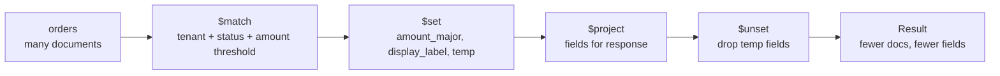

# `$match`, `$project`, `$set`, and `$unset`

## 1. Aggregation Pipelines and the Role of the Four Stages

In **Spring Data MongoDB**, `Aggregation` combines multiple **stages** so MongoDB processes data step by step. Each stage receives a stream of documents from the previous stage, then **filters, transforms, or forwards** documents to the next stage. `MongoTemplate.aggregate(...)` and `ReactiveMongoTemplate.aggregate(...)` execute pipelines from Java rather than writing them only in `mongosh`.

Four foundational stages in this lesson:

| Stage | Meaning | Effect on Result Stream |
| --- | --- | --- |
| `$match` | Keeps documents matching filter conditions | **Reduces document count**; does not create fields |
| `$project` | Selects, drops, renames, or computes output fields | **Reshapes** each document |
| `$set` | Adds/overwrites fields from values or expressions | Preserves existing fields unless explicitly overwritten |
| `$unset` | Drops one or more fields from documents moving through the pipeline | Removes fields from **intermediate results** |

Example business question: "For **SHOP-A**, fetch paid orders worth at least 400,000 minor units, compute the display amount, and return a summary **without customer email or internal notes**."



**Most important point:** aggregation stages only construct **query results**; they never modify documents stored in the collection. `$set` and `$unset` in an **aggregation pipeline** are not the same as `db.collection.updateOne(..., {$set: ...})` or `Update.set(...)` in Spring Data MongoDB.

### Distinguishing Regular Queries from Aggregation

A `find` query can filter, project fields, and sort:

```javascript
db.orders.find(
  { tenant_id: "SHOP-A", status: "PAID" },
  { _id: 1, status: 1, amount_minor: 1 }
)
```

When multiple transformation steps or derived fields depending on other fields are needed, a pipeline is often clearer:

```javascript
db.orders.aggregate([
  { $match: { tenant_id: "SHOP-A", status: "PAID" } },
  { $set: { amount_major: { $divide: ["$amount_minor", 100] } } },
  { $project: { _id: 1, amount_major: 1, status: 1 } }
])
```

`$divide` is an **aggregation expression** used inside `$set`. `"$amount_minor"` denotes **referencing the field's value** in the current document, not a literal string.

## 2. Consistent Sample Dataset for the Lesson

Assume a multi-tenant system stores orders in the `orders` collection of database `aggregation_stage_demo`. Physical field names in MongoDB use `snake_case`, while Java entities can use `camelCase` with `@Field`.

| Meaning | BSON Name | Illustrative Type |
| --- | --- | --- |
| Order ID | `_id` | BSON String |
| Tenant | `tenant_id` | String |
| Status | `status` | String |
| Amount in minor units | `amount_minor` | Int64 |
| Creation time | `created_at` | BSON Date |
| Customer info | `customer` | Embedded document |
| Internal note | `internal_note` | String |
| Line items | `lines` | Array of embedded documents |

### Seeding Data via `mongosh`

Practice only on an **empty test database**; never run arbitrary seed/delete commands against production:

```javascript
use aggregation_stage_demo

db.orders.insertMany([
  {
    _id: "ORD-001",
    tenant_id: "SHOP-A",
    status: "PAID",
    amount_minor: NumberLong("450000"),
    created_at: ISODate("2026-11-10T08:00:00Z"),
    customer: { name: "An", email: "an@example.test" },
    internal_note: "Internal reconciliation",
    lines: [
      { sku: "BOOK-101", quantity: 2, unit_minor: NumberLong("150000") },
      { sku: "PEN-201", quantity: 1, unit_minor: NumberLong("150000") }
    ]
  },
  {
    _id: "ORD-002",
    tenant_id: "SHOP-A",
    status: "CREATED",
    amount_minor: NumberLong("900000"),
    created_at: ISODate("2026-11-11T08:00:00Z"),
    customer: { name: "Bình", email: "binh@example.test" },
    internal_note: "Pending payment",
    lines: [
      { sku: "BOOK-202", quantity: 3, unit_minor: NumberLong("300000") }
    ]
  },
  {
    _id: "ORD-003",
    tenant_id: "SHOP-A",
    status: "PAID",
    amount_minor: NumberLong("900000"),
    created_at: ISODate("2026-11-12T08:00:00Z"),
    customer: { name: "Chi", email: "chi@example.test" },
    internal_note: "VIP customer",
    lines: [
      { sku: "BOOK-303", quantity: 3, unit_minor: NumberLong("300000") }
    ]
  },
  {
    _id: "ORD-004",
    tenant_id: "SHOP-B",
    status: "PAID",
    amount_minor: NumberLong("750000"),
    created_at: ISODate("2026-11-13T08:00:00Z"),
    customer: { name: "Dũng", email: "dung@example.test" },
    internal_note: "Other tenant",
    lines: [
      { sku: "BOOK-404", quantity: 5, unit_minor: NumberLong("150000") }
    ]
  },
  {
    _id: "ORD-005",
    tenant_id: "SHOP-A",
    status: "PAID",
    amount_minor: NumberLong("350000"),
    created_at: ISODate("2026-11-14T08:00:00Z"),
    customer: { name: "Em", email: "em@example.test" },
    internal_note: "Below threshold order",
    lines: [
      { sku: "BOOK-505", quantity: 1, unit_minor: NumberLong("350000") }
    ]
  }
])
```

Re-running when those `_id` values already exist will raise a duplicate key error. Email values use the `example.test` domain as dummy data.

An illustrative URI for a Spring Boot project (without real credentials):

```properties
spring.data.mongodb.uri=mongodb://localhost:27017/aggregation_stage_demo
```

Inspect a sample document:

```javascript
db.orders.findOne({ _id: "ORD-001" })
```

### Expected Results at Each Phase

Given `tenant_id = SHOP-A`, `status = PAID`, and `amount_minor >= 400000`:

| ID | Matches `$match`? | Reason |
| --- | --- | --- |
| `ORD-001` | Yes | SHOP-A, PAID, 450,000 |
| `ORD-002` | No | Not yet paid |
| `ORD-003` | Yes | SHOP-A, PAID, 900,000 |
| `ORD-004` | No | Belongs to SHOP-B |
| `ORD-005` | No | Only 350,000 |

Hence only **2 documents** remain after `$match`. Subsequent transformations yield `amount_major` values of **4500** and **9000**, respectively. Here `major/minor` merely illustrates a ratio of 100; real financial applications must define currency units and precision explicitly rather than assuming every currency uses this ratio.

## 3. `$match`: Filtering Early and Enforcing Tenant Boundaries

`$match` takes a MongoDB query predicate similar to `find`'s filter. It **does not** pick output fields or compute amounts; it solely decides which documents move forward.

```javascript
db.orders.aggregate([
  {
    $match: {
      tenant_id: "SHOP-A",
      status: "PAID",
      amount_minor: { $gte: NumberLong("400000") }
    }
  }
])
```

Within a single stage, conditions on different fields combine via **AND** filter semantics. The two matching documents are `ORD-001` and `ORD-003`. Do not assume result ordering without a `$sort`.

### A `$match` Stage with Complex Logic

To filter `tenant = SHOP-A` where `status = PAID` **or** amount is at least 800,000:

```javascript
{
  $match: {
    $and: [
      { tenant_id: "SHOP-A" },
      {
        $or: [
          { status: "PAID" },
          { amount_minor: { $gte: NumberLong("800000") } }
        ]
      }
    ]
  }
}
```

**Never place the tenant condition inside an OR group** when tenant is an authorization boundary. Writing `tenant = SHOP-A OR status = PAID` allows SHOP-B documents to match as well. Tenant conditions must come from an authenticated and authorized context, never purely from a client-passed string.

### `$match` on a Field Computed in a Prior Stage

`$match` can also filter on a newly computed field:

```javascript
db.orders.aggregate([
  { $set: { is_large: { $gte: ["$amount_minor", 500000] } } },
  { $match: { is_large: true } }
])
```

However, if you only need to filter directly on `amount_minor`, place `$match: { amount_minor: { $gte: ... } }` **before** computation so MongoDB has a chance to use an index and reduce processed documents. Only when a predicate genuinely depends on a newly computed value does `$set` followed by `$match` make sense.

### What `$match` Does Not Do

- `$match` does not group, count by category, or join another collection; use `$group`/`$lookup` when required.
- `$match` does not guarantee index usage: that depends on stage position, predicates, indexes, and MongoDB optimization.
- `$match` does not modify stored data.
- `$match` does not enforce authorization automatically; the application must construct the proper filter.

## 4. `$project`: Returning Only Needed Fields and Computing New Ones

`$project` controls **the shape of each output document**. It can:

1. **Include** fields to keep.
2. **Exclude** fields to omit.
3. **Rename** fields via expressions referencing original fields.
4. **Compute** output fields using aggregation expressions.
5. **Construct nested structures** for DTO/API responses.

### Keeping Only ID, Status, and Amount

```javascript
db.orders.aggregate([
  { $match: { tenant_id: "SHOP-A", status: "PAID" } },
  {
    $project: {
      _id: 1,
      status: 1,
      amount_minor: 1
    }
  }
])
```

`1` here is a **field inclusion** directive, not a numeric value to assign. To set a field to the literal number 1, use `$literal` or an appropriate expression.

### Default Behavior of `_id`

If `$project` does not mention `_id`, MongoDB still **keeps `_id`** by default. When the response should omit the ID, exclude it explicitly:

```javascript
{
  $project: {
    _id: 0,
    status: 1,
    amount_minor: 1
  }
}
```

### Do Not Arbitrarily Mix Include and Exclude

This violates standard projection rules:

```javascript
// Avoid: mixing status inclusion and internal_note exclusion.
{
  $project: {
    status: 1,
    internal_note: 0
  }
}
```

The standard exception is `_id`: `_id: 0` can appear alongside included fields. MongoDB also supports conditional field exclusion via `$$REMOVE`, which is a separate mechanism; never assume mixed include/exclude works in general.

When you only want to **drop** a few fields while **keeping everything else**, `$unset` is much clearer than listing every field in `$project`.

## 5. Advanced `$project`: Renaming, Computing, and Nested Structures

### Renaming and Computing New Fields

A projection can output `orderId`, `total`, and `customerName` matching response names:

```javascript
db.orders.aggregate([
  { $match: { tenant_id: "SHOP-A" } },
  {
    $project: {
      _id: 0,
      orderId: "$_id",
      customerName: "$customer.name",
      total: { $divide: ["$amount_minor", 100] }
    }
  }
])
```

`"$_id"` and `"$customer.name"` are **field path expressions**. MongoDB reads the field from the source document and assigns it to the new output field name. `$project` does not rename fields stored in the collection.

### Building New Embedded Objects

Sometimes responses call for clearer JSON nesting:

```javascript
{
  $project: {
    _id: 0,
    order: {
      id: "$_id",
      status: "$status"
    },
    buyer: {
      name: "$customer.name"
    },
    amountMajor: {
      $divide: ["$amount_minor", 100]
    }
  }
}
```

Illustrative result:

```javascript
{
  order: {
    id: "ORD-001",
    status: "PAID"
  },
  buyer: {
    name: "An"
  },
  amountMajor: 4500
}
```

Inside `$project`, expressions are evaluated **per input document**; they do not sum across multiple orders. To sum revenue across orders in a tenant, use `$group` or an appropriate aggregation stage.

### Missing Fields or Null: Using `$ifNull`

In real data, `customer.name` may be absent. Do not assume string concatenation always receives valid Strings:

```javascript
{
  $project: {
    _id: 1,
    safeCustomerName: {
      $ifNull: ["$customer.name", "Unnamed customer"]
    }
  }
}
```

`$ifNull` uses the fallback when the expression evaluates to null or missing under MongoDB semantics. When building display labels with `$concat`, handle potentially null fields first; otherwise the concatenated label can unexpectedly become null.

### Literal or Field Path?

Compare two expressions:

```javascript
{
  $project: {
    sourceValue: "$status",
    literalValue: { $literal: "$status" }
  }
}
```

- `sourceValue` receives the value of the `status` field, e.g., `"PAID"`.
- `literalValue` receives the exact string `"$status"`.

Similarly, inside `$project`, `1`/`0` mean include/exclude, so if you want a literal integer value, use `$literal` to avoid ambiguity.

### Path Collision Warning

A projection defining both a parent field and a child field simultaneously can be rejected by MongoDB due to **path collision**:

```javascript
// Error example: including customer while also specifying customer.name.
{
  $project: {
    customer: 1,
    "customer.name": 1
  }
}
```

Instead, pick one explicit form: keep all of `customer` or keep only needed subfields (e.g., `"customer.name": 1`). Do not rely on JavaScript property order to resolve path collisions.

## 6. `$set`: Adding Fields Without Losing Other Fields

`$set` in an aggregation pipeline is an **alias for `$addFields`**. It creates or reassigns field values on documents flowing through the pipeline.

```javascript
db.orders.aggregate([
  { $match: { _id: "ORD-001" } },
  {
    $set: {
      amount_major: {
        $divide: ["$amount_minor", 100]
      },
      display_label: {
        $concat: ["$customer.name", " / ", "$status"]
      }
    }
  }
])
```

The output still contains original fields like `tenant_id`, `amount_minor`, `customer`, `internal_note`, and `lines`, **along with**:

```javascript
{
  amount_major: 4500,
  display_label: "An / PAID"
}
```

The two fields shown above are just what was **added**; `$set` does not drop existing fields.

### Overwriting Fields in the Stream

`$set` can replace the value of an existing field:

```javascript
{
  $set: {
    status: { $toLower: "$status" }
  }
}
```

After this stage, `status` in the **intermediate document** becomes `"paid"` instead of `"PAID"`. However, the stored value in `orders` remains unchanged because `aggregate(...)` only reads and transforms data. If later stages filter `status = "PAID"`, they will **not match** the newly lowercased value. Stage order affects semantics, not just performance.

### Adding Fields to Subdocuments

`$set` supports nested paths, for example:

```javascript
{
  $set: {
    "customer.display_name": {
      $ifNull: ["$customer.name", "Customer"]
    }
  }
}
```

This modifies the **subdocument in the pipeline result**, not a database update to `customer.display_name`.

### Is `$set` Always Better Than `$project`?

No. If the goal is a DTO with only a few fields, `$project` clearly expresses an **output allowlist**. If you need to keep most of the document and just compute a few values for downstream stages, `$set` is cleaner. They can be combined:

```javascript
db.orders.aggregate([
  { $match: { status: "PAID" } },
  { $set: { amount_major: { $divide: ["$amount_minor", 100] } } },
  { $project: { _id: 1, amount_major: 1 } }
])
```

**Do not add an unnecessary `$set`** when `$project` can compute the output fields directly; prefer fewer, clearer stages. MongoDB can optimize some transformations, though not all arbitrary expressions are optimized identically.

## 7. `$unset`: Removing Fields from Intermediate Documents

In aggregation, `$unset` is an alias for a `$project` stage that **excludes fields**. It accepts a single field string or an array of field names:

```javascript
// Remove one field.
{ $unset: "internal_note" }

// Remove multiple fields.
{ $unset: ["internal_note", "customer.email"] }
```

`$unset` does not delete data from the collection. It only drops those fields from documents continuing down the pipeline. Calling `db.orders.findOne(...)` afterward still shows `internal_note` and `email` unless a separate **update command** ran.

### Removing a Subfield While Keeping the Parent

```javascript
db.orders.aggregate([
  { $match: { _id: "ORD-001" } },
  { $unset: "customer.email" },
  {
    $project: {
      _id: 1,
      customer: 1
    }
  }
])
```

Result:

```javascript
{
  _id: "ORD-001",
  customer: {
    name: "An"
  }
}
```

If `$unset` is placed before `$project`, dropped fields are no longer available to later stages. For instance, removing `customer.name` before building `display_label` with `$concat` from the name will not yield the intended output.

### Using `$unset` to Drop Temporary Fields

`$set` can create scratch fields for checks or calculations:

```javascript
db.orders.aggregate([
  {
    $set: {
      scratch: { $gte: ["$amount_minor", 400000] }
    }
  },
  { $match: { scratch: true } },
  { $unset: "scratch" }
])
```

The `scratch` field exists between stages but is absent from the final output. In this case, writing `$match` directly on `amount_minor` is cleaner and more index-friendly unless the scratch value is genuinely needed for another transformation.

### Can `$unset` Act as Sensitive Data Protection?

`$unset` removes email or notes from the **returned result**, but it does not enforce access control policies or guarantee that other query paths hide the same fields. For public APIs, prefer an explicit **allowlist `$project`** in the final stage or strict DTO mapping.

In particular, projecting `customer: 1` and forgetting `$unset: "customer.email"` can leak emails in JSON responses. Never rely purely on stage ordering without explicitly testing which fields appear in the output.

## 8. Combining All Four Stages: A Deterministic Pipeline

The pipeline below intentionally uses `$match`, `$set`, `$project`, and `$unset` to illustrate data flow:

```javascript
db.orders.aggregate([
  // 1. Select the right tenant, status, and amount threshold.
  {
    $match: {
      tenant_id: "SHOP-A",
      status: "PAID",
      amount_minor: { $gte: NumberLong("400000") }
    }
  },

  // 2. Add computed values and a temporary field.
  {
    $set: {
      amount_major: { $divide: ["$amount_minor", 100] },
      display_label: {
        $concat: [
          { $ifNull: ["$customer.name", "Unnamed customer"] },
          " / ",
          "$status"
        ]
      },
      scratch_flag: "REMOVE_ME"
    }
  },

  // 3. Shape the document; intentionally keep email to demonstrate unset.
  {
    $project: {
      _id: 1,
      customer: {
        name: "$customer.name",
        email: "$customer.email"
      },
      amount_major: 1,
      display_label: 1,
      scratch_flag: 1
    }
  },

  // 4. Remove the temporary field and email from the final output.
  { $unset: ["scratch_flag", "customer.email"] }
])
```

**Expected output** (ordering between the two documents is not guaranteed without `$sort`):

```javascript
{
  _id: "ORD-001",
  customer: { name: "An" },
  amount_major: 4500,
  display_label: "An / PAID"
}
{
  _id: "ORD-003",
  customer: { name: "Chi" },
  amount_major: 9000,
  display_label: "Chi / PAID"
}
```

### Stage-by-Stage Breakdown

| Stage | Remaining Docs | Field Changes |
| --- | ---: | --- |
| Source `orders` | 5 | All BSON fields in stored documents |
| `$match` | 2 | Document shape unchanged |
| `$set` | 2 | Adds `amount_major`, `display_label`, `scratch_flag` |
| `$project` | 2 | Keeps only `_id`, `customer`, `amount_major`, `display_label`, `scratch_flag` |
| `$unset` | 2 | Drops `scratch_flag` and `customer.email` |

Since both `$set` and `$project` can compute fields, a **shorter** pipeline is easy to write for production:

```javascript
db.orders.aggregate([
  {
    $match: {
      tenant_id: "SHOP-A",
      status: "PAID",
      amount_minor: { $gte: NumberLong("400000") }
    }
  },
  {
    $project: {
      _id: 1,
      customer: { name: "$customer.name" },
      amount_major: { $divide: ["$amount_minor", 100] },
      display_label: {
        $concat: [
          { $ifNull: ["$customer.name", "Unnamed customer"] },
          " / ",
          "$status"
        ]
      }
    }
  }
])
```

**Prefer shorter, clearer pipelines that return only allowed fields** when temporary fields are unnecessary. The four-stage version above is a behavioral comparison exercise, not a requirement that every API use all four stages.

## 9. Running Aggregation with `MongoTemplate` and the Java DSL

In Spring Boot with `spring-boot-starter-data-mongodb`, Spring Data MongoDB provides the `Aggregation` builder and `AggregationOperation`. Start with an entity carrying metadata to map Java properties to BSON fields.

### Source Entity `OrderDocument`

```java
package com.example.orders;

import org.springframework.data.mongodb.core.mapping.Document;
import org.springframework.data.mongodb.core.mapping.Field;
import org.springframework.data.mongodb.core.mapping.FieldType;
import org.springframework.data.mongodb.core.mapping.MongoId;

@Document(collection = "orders")
public class OrderDocument {

    @MongoId(FieldType.STRING)
    private String id;

    @Field("tenant_id")
    private String tenantId;

    private String status;

    @Field("amount_minor")
    private Long amountMinor;

    private Customer customer;

    protected OrderDocument() {}

    public String getId() { return id; }
    public String getTenantId() { return tenantId; }
    public String getStatus() { return status; }
    public Long getAmountMinor() { return amountMinor; }
    public Customer getCustomer() { return customer; }

    public static class Customer {
        private String name;
        private String email;

        protected Customer() {}

        public String getName() { return name; }
        public String getEmail() { return email; }
    }
}
```

This entity declares only the fields used in our examples. MongoDB documents may also contain `created_at`, `internal_note`, and `lines`; omitting a Java property does not delete those fields from MongoDB during **read aggregations**.

### Simple DSL-Only Example

```java
import java.util.List;
import org.bson.Document;
import org.springframework.data.mongodb.core.aggregation.Aggregation;
import org.springframework.data.mongodb.core.aggregation.AggregationResults;
import org.springframework.data.mongodb.core.query.Criteria;

Aggregation aggregation = Aggregation.newAggregation(
    Aggregation.match(
        Criteria.where("tenantId").is("SHOP-A")
            .and("status").is("PAID")
    ),
    Aggregation.project("status")
        .andExclude("_id")
);

AggregationResults<Document> results =
    mongoTemplate.aggregate(
        aggregation, OrderDocument.class, Document.class);

List<Document> documents = results.getMappedResults();
```

In `Aggregation.match`, `tenantId` is a **Java property** mapped to `tenant_id` when Spring Data applies `OrderDocument` metadata. With `Aggregation.project("status")`, output retains only `status`; `andExclude("_id")` drops the ID.

`mongoTemplate.aggregate(aggregation, OrderDocument.class, Document.class)` derives the collection name from source entity metadata and returns `org.bson.Document` rows. For typed API responses, map to a suitable DTO/record once the output schema is finalized.

### When to Use the DSL vs. Raw Stages

Spring Data provides dedicated DSL builders for `match`, `project`, adding fields, and other transformations. However, when learning MongoDB syntax directly or using a stage not conveniently exposed by your library version's DSL, you can supply a **custom `AggregationOperation`** returning a BSON `Document`.

This cleanly demonstrates exact `$set` and `$unset` semantics while avoiding dependence on builder names that vary across library versions.

## 10. Complete Java: `Aggregation.match` Combined with Explicit BSON Stages

The snippet below implements Section 8's four-stage pipeline. It deliberately combines:

- `Aggregation.match(...)` with **Java properties** and entity mapping metadata.
- Custom `AggregationOperation` instances with **physical BSON fields** such as `amount_minor` and `customer.name`.
- `Document` output to inspect exact BSON shapes.

```java
package com.example.orders;

import java.util.List;
import org.bson.Document;
import org.springframework.data.mongodb.core.MongoTemplate;
import org.springframework.data.mongodb.core.aggregation.Aggregation;
import org.springframework.data.mongodb.core.aggregation.AggregationOperation;
import org.springframework.data.mongodb.core.aggregation.AggregationResults;
import org.springframework.data.mongodb.core.query.Criteria;
import org.springframework.stereotype.Service;

@Service
public class OrderSummaryAggregationService {

    private final MongoTemplate template;

    public OrderSummaryAggregationService(MongoTemplate template) {
        this.template = template;
    }

    public List<Document> summarizePaidOrders(
            String authorizedTenantId, long minAmountMinor) {

        if (authorizedTenantId == null
                || authorizedTenantId.isBlank()
                || minAmountMinor < 0) {
            throw new IllegalArgumentException(
                "Invalid order filter");
        }

        AggregationOperation setStage = context -> new Document(
            "$set",
            new Document("amount_major",
                new Document("$divide", List.of(
                    "$amount_minor", 100
                )))
                .append(
                    "display_label",
                    new Document("$concat", List.of(
                        new Document("$ifNull", List.of(
                            "$customer.name",
                            "Unnamed customer"
                        )),
                        " / ",
                        "$status"
                    ))
                )
                .append("scratch_flag", "REMOVE_ME")
        );

        AggregationOperation projectStage = context -> new Document(
            "$project",
            new Document("_id", 1)
                .append(
                    "customer",
                    new Document("name", "$customer.name")
                        .append("email", "$customer.email")
                )
                .append("amount_major", 1)
                .append("display_label", 1)
                .append("scratch_flag", 1)
        );

        AggregationOperation unsetStage = context -> new Document(
            "$unset",
            List.of("scratch_flag", "customer.email")
        );

        Aggregation pipeline = Aggregation.newAggregation(
            Aggregation.match(
                Criteria.where("tenantId").is(authorizedTenantId)
                    .and("status").is("PAID")
                    .and("amountMinor").gte(minAmountMinor)
            ),
            setStage,
            projectStage,
            unsetStage
        );

        AggregationResults<Document> result = template.aggregate(
            pipeline, OrderDocument.class, Document.class);

        return result.getMappedResults();
    }
}
```

Calling the service:

```java
List<Document> summaries =
    orderSummaryAggregationService.summarizePaidOrders(
        "SHOP-A", 400_000L);

for (Document summary : summaries) {
    System.out.println(summary.toJson());
}
```

This yields `ORD-001` and `ORD-003` as in Section 8, though **do not rely on element order** without a sort stage.

### Why Not Mix Java and BSON Names Arbitrarily?

With the Java DSL using entity metadata:

```java
Criteria.where("tenantId").is("SHOP-A")
    .and("amountMinor").gte(400_000L);
```

the framework maps this to:

```javascript
{
  tenant_id: "SHOP-A",
  amount_minor: { $gte: NumberLong("400000") }
}
```

In the custom `AggregationOperation` above, however, we construct `new Document("$set", ...)` using `"$amount_minor"`. Raw stages of this kind must use **physical BSON names**; they do not automatically pass through the same property mapping shown in `Aggregation.match(Criteria...)`.

**Practical rule:** in the DSL, use Java property names and verify metadata; in raw BSON, use verified collection BSON names. If custom converters or alternate mapping mechanisms are active, inspect the emitted command in tests rather than guessing from source code.

### An Output DTO Instead of `Document`

When standardizing an API response, define a DTO:

```java
package com.example.orders;

public record OrderSummaryDto(
    String id,
    String customerName,
    double amountMajor,
    String displayLabel
) {}
```

This DTO **does not match** the field names of the current pipeline (`_id`, `customer.name`, `amount_major`, `display_label`). Therefore, never assume Spring Data will populate `OrderSummaryDto` from this pipeline without adding matching aliases or an explicit mapper.

Example mapper reading `Document` into the record:

```java
public static OrderSummaryDto toDto(Document source) {
    Document customer = source.get("customer", Document.class);
    Number amount = (Number) source.get("amount_major");

    return new OrderSummaryDto(
        source.getString("_id"),
        customer == null ? null : customer.getString("name"),
        amount == null ? 0.0 : amount.doubleValue(),
        source.getString("display_label")
    );
}
```

This function illustrates type conversion; in financial systems **never use `double` for exact monetary representation** when decimal precision is required. Standardize units, use `BigDecimal`/Decimal128 or keep `long` minor units as appropriate, and test division/rounding behavior.

## 11. Stage Order Determines Which Fields Remain Usable

A pipeline is not a set of stages that can be freely reordered. For example:

```javascript
db.orders.aggregate([
  { $project: { status: 1 } },
  { $match: { amount_minor: { $gte: NumberLong("400000") } } }
])
```

This drops `amount_minor` in `$project`. The subsequent `$match` **no longer has that field** on intermediate documents to filter as intended. Place `$match` on source fields before dropping fields:

```javascript
db.orders.aggregate([
  { $match: { amount_minor: { $gte: NumberLong("400000") } } },
  { $project: { status: 1 } }
])
```

### Placing `$match` Based on Field Dependencies

| Condition Type | Sensible Position | Reason |
| --- | --- | --- |
| Comparing source fields `status`, `tenant_id` | Usually before `$set`/`$project` | Reduces documents early, enables index usage |
| Comparing `amount_major` computed in `$set` | After the stage creating `amount_major` | Value did not exist earlier |
| Filtering on a field removed by `$unset` | Before `$unset`, or redesign | Cannot filter on a dropped field |
| Filtering on a field renamed by `$project` | After renaming or on original name earlier | Input/output field names differ |

MongoDB's pipeline optimizer may move or split certain `$match` conditions when transformations are independent and moving **preserves semantics**. Never code under the assumption that every stage gets pushed to the top, especially when `$match` depends on computed fields or ordering/limit stages are present.

### Is an Early `$project` Always Faster?

Not necessarily. An early `$project` can shrink intermediate payloads, but it can also strip fields needed by later stages. MongoDB can automatically optimize field dependencies across many pipelines. In most cases, prefer **early `$match` on source fields, keeping needed fields, and a clear output `$project`**. Only conclude something is faster after checking `explain` on real data.

### `$set` and `$unset` Never Modify Stored Data

Verify after running a pipeline:

```javascript
db.orders.findOne(
  { _id: "ORD-001" },
  { customer: 1, internal_note: 1, amount_major: 1 }
)
```

`customer.email` and `internal_note` remain in the stored document; `amount_major` does not appear in the collection just because an aggregation computed it. To update stored documents, use controlled write operations (e.g., `updateOne` with update operators), or specialized write pipelines with `$merge`/`$out` where authorized—never the read stages in this lesson.

## 12. Arrays, Embedded Documents, and Conditional Transformations

An order has a `lines` field that is an array of embedded documents:

```javascript
lines: [
  { sku: "BOOK-101", quantity: 2, unit_minor: NumberLong("150000") },
  { sku: "PEN-201", quantity: 1, unit_minor: NumberLong("150000") }
]
```

### `$match` on Array Elements

To find orders containing **a single line item** with both matching SKU and quantity at least 2, use `$elemMatch` in the filter:

```javascript
db.orders.aggregate([
  {
    $match: {
      tenant_id: "SHOP-A",
      lines: {
        $elemMatch: {
          sku: "BOOK-101",
          quantity: { $gte: 2 }
        }
      }
    }
  }
])
```

`$elemMatch` ensures multiple conditions hold on **the same array element**. Writing `"lines.sku": "BOOK-101"` and `"lines.quantity": { $gte: 2 }` separately can match **two different elements** in the same document.

### `$set` with `$map` to Derive Fields from an Array

If you want only a list of SKUs instead of full line items, create `sku_list`:

```javascript
db.orders.aggregate([
  { $match: { _id: "ORD-001" } },
  {
    $set: {
      sku_list: {
        $map: {
          input: "$lines",
          as: "line",
          in: "$$line.sku"
        }
      }
    }
  },
  {
    $project: {
      _id: 1,
      sku_list: 1
    }
  }
])
```

Result:

```javascript
{
  _id: "ORD-001",
  sku_list: ["BOOK-101", "PEN-201"]
}
```

Inside `$map`, `$$line` is the variable representing each array element. **`"$lines"`** references the source field; **`"$$line.sku"`** references the property of the current element. When `lines` may be null/missing or non-array, check `$map` behavior and use `$ifNull`/schema normalization appropriately.

### `$project` Can Transform Arrays, Not Automatically Filter Elements

`$project: { lines: 1 }` keeps the entire `lines` array in the output; it **does not select** only lines with large quantities. To produce a filtered subarray, use `$filter`:

```javascript
{
  $project: {
    _id: 1,
    expensive_lines: {
      $filter: {
        input: "$lines",
        as: "line",
        cond: { $gte: ["$$line.unit_minor", 200000] }
      }
    }
  }
}
```

`$filter` returns an array of elements matching the condition; for ORD-001, no line has `unit_minor >= 200000`, so `expensive_lines` is an empty array. This **transforms the result**, without deleting lines from stored documents.

### Dot Path vs. Whole Subdocument Matching

`$match: { "customer.name": "An" }` matches a nested field. By contrast, `$match: { customer: { name: "An" } }` performs **subdocument equality**, which has different semantics and is sensitive to extra/missing fields and BSON field order. When matching only on name, use dot notation.

## 13. Indexes and `explain`: Performance Depends on `$match` Placement

Aggregation pipelines still execute on MongoDB and incur I/O, index, CPU, and memory costs like any query. Writing four stages does not create indexes or make the database faster by itself.

### Candidate Compound Index

For workloads filtering frequently by `tenant_id`, `status`, and `amount_minor >= threshold`, you can test:

```javascript
db.orders.createIndex(
  {
    tenant_id: 1,
    status: 1,
    amount_minor: 1
  },
  { name: "orders_tenant_status_amount" }
)
```

The first two fields are **equality** predicates, while `amount_minor` is a **range** predicate. This is a candidate to verify on real data, not a blanket formula for every aggregation. If the API also sorts by `created_at`, evaluate key order, sort direction, and range conditions rather than adding indexes blindly.

### Reading the Pipeline Query Plan

```javascript
db.orders.explain("executionStats").aggregate([
  {
    $match: {
      tenant_id: "SHOP-A",
      status: "PAID",
      amount_minor: { $gte: NumberLong("400000") }
    }
  },
  {
    $project: {
      _id: 1,
      status: 1,
      amount_minor: 1
    }
  }
])
```

Plan stages and structures in `explain` vary by MongoDB version and execution engine. Focus on:

| Indicator | What to Answer |
| --- | --- |
| `winningPlan` or equivalent plan info | Which index was chosen, and what is the scan shape? |
| `IXSCAN` / `COLLSCAN` | Was an index used or a full collection scan? |
| `totalKeysExamined` | How many index keys were scanned? |
| `totalDocsExamined` | How many documents were read? |
| `nReturned` | How many results were returned? |
| `executionTimeMillis` | Measured execution time for this run—is it stable across runs? |
| `PROJECTION` / `FETCH` stages if present | Did MongoDB have to fetch full documents for required fields? |

With only five sample documents, `COLLSCAN` is normal for the query planner; do not treat that as a missing-index bug on tiny data. Measure on representative distributions, data sizes, and load.

### A Small `$project` Is Not Always a Covered Query

A pipeline returning only `_id`, `status`, and `amount_minor` shrinks the network payload, yet a **covered query** requires the index to satisfy all filter and projection fields under MongoDB's rules. For instance, the candidate index above does not explicitly include `_id` in its key; do not claim it avoids document fetches just because `IXSCAN` appears.

Adding fields to an index enlarges the index and increases insert/update/delete overhead. Weigh read gains against write costs and memory budgets rather than making covering indexes for every DTO.

### Can Computed `$set` Filters Use Indexes?

Filtering directly on `amount_minor >= 400000` allows MongoDB to use a matching index. Computing `amount_major` in `$set` and filtering on the derived field does not let the database automatically use `amount_minor`'s index in the same way. The query planner may optimize certain expressions, so verify actual pipelines.

An order that is usually easier to optimize:

```javascript
[
  { $match: { tenant_id: "SHOP-A", status: "PAID" } },
  { $set: { amount_major: { $divide: ["$amount_minor", 100] } } },
  { $project: { _id: 1, amount_major: 1 } }
]
```

If you only need documents with `amount_minor >= 400000`, add that predicate directly to the initial `$match` rather than filtering on `amount_major` later.

### Do Not Expect `explain` to Measure Total Java Response Time

`explain("executionStats")` diagnoses MongoDB execution. It does not capture full network latency, BSON → Java conversion, JSON serialization, service CPU, or client latency. When evaluating APIs, also measure application p95/p99, payload sizes, and response throughput.

## 14. Protecting Sensitive Fields and Controlling API Output

Aggregation helps construct a **read model** from a collection containing many fields, but it does not replace authentication/authorization. There are two independent responsibilities:

1. **Which documents are allowed to be read?** Enforce tenant, status, and permissions in `$match`.
2. **Which fields are allowed to be returned?** Use an allowlist `$project` or strict DTO/mapper to prevent field leaks.

Minimal response example:

```javascript
db.orders.aggregate([
  { $match: { tenant_id: "SHOP-A", status: "PAID" } },
  {
    $project: {
      _id: 1,
      customerName: "$customer.name",
      amountMinor: "$amount_minor"
    }
  }
])
```

The result excludes `customer.email`, `internal_note`, `lines`, and `tenant_id`. This allowlist style makes it easier to audit **permitted output fields** than returning nearly everything and writing multiple `$unset` clauses for sensitive fields.

### Security Guidelines

- Never let callers submit a raw JSON stage array for direct execution without strict validation; arbitrary pipelines can access out-of-scope fields, run costly queries, or invoke unintended stages.
- Use an **authenticated** tenant ID, never blindly trusting a query string.
- Disallow or strictly validate client-supplied field paths; never interpolate arbitrary field names into `$project` or `$unset`.
- `Document` results are flexible objects: returning them directly from an API risks exposing unexpected fields if the pipeline changes. Use strict DTOs/mappers at external boundaries.
- Never log whole documents containing emails, payment notes, or customer info during debugging.
- Write negative tests verifying **forbidden fields are absent**, not only that expected fields are present.

### Distinguishing Read `$unset` from `Update.unset`

```java
// Read aggregation stage: field is only removed from pipeline result.
AggregationOperation unsetStage = context ->
    new Document("$unset", "internal_note");

// Write update operator: removes field from stored document
// when executing an appropriate update operation.
org.springframework.data.mongodb.core.query.Update update =
    new org.springframework.data.mongodb.core.query.Update()
        .unset("internalNote");
```

In the update snippet, `internalNote` is a hypothetical Java property mapped to `internal_note` on the write entity. **Constructing `Update` has not executed any command yet**; you must invoke a write API such as `MongoTemplate.updateFirst` to mutate the database. Never lump both uses of "unset" together without specifying read vs. write context.

## 15. Integration Testing Against Real MongoDB

Aggregation tests must verify **matched documents**, **output shapes**, and that **source data stays unmodified**. Mocking `MongoTemplate` checks which Java methods were called, but does not prove MongoDB actually interprets `$project`, `$set`, or `$unset` properly.

With Spring Boot 3.x, you can use `@DataMongoTest` with an isolated test MongoDB (e.g., Testcontainers). The example below injects `MongoTemplate` and invokes the service from Section 10.

**Warning:** `deleteMany(new Document())` deletes **every document** in the connected database's collection. Use only on an isolated test database; never run on production or shared environments.

```java
package com.example.orders;

import java.util.Date;
import java.time.Instant;
import java.util.List;
import org.bson.Document;
import org.junit.jupiter.api.BeforeEach;
import org.junit.jupiter.api.Test;
import org.springframework.beans.factory.annotation.Autowired;
import org.springframework.boot.test.autoconfigure.data.mongo.DataMongoTest;
import org.springframework.data.mongodb.core.MongoTemplate;

import static org.assertj.core.api.Assertions.assertThat;

@DataMongoTest
class BasicAggregationStagesTest {

    @Autowired
    MongoTemplate template;

    OrderSummaryAggregationService service;

    @BeforeEach
    void seedOnlyIsolatedTestDatabase() {
        template.getCollection("orders")
            .deleteMany(new Document());

        Date created = Date.from(
            Instant.parse("2026-11-10T08:00:00Z"));

        template.getCollection("orders").insertMany(List.of(
            new Document("_id", "ORD-001")
                .append("tenant_id", "SHOP-A")
                .append("status", "PAID")
                .append("amount_minor", 450_000L)
                .append("created_at", created)
                .append("customer", new Document("name", "An")
                    .append("email", "an@example.test"))
                .append("internal_note", "Internal"),

            new Document("_id", "ORD-002")
                .append("tenant_id", "SHOP-A")
                .append("status", "CREATED")
                .append("amount_minor", 900_000L)
                .append("created_at", created)
                .append("customer", new Document("name", "Bình")
                    .append("email", "binh@example.test")),

            new Document("_id", "ORD-003")
                .append("tenant_id", "SHOP-A")
                .append("status", "PAID")
                .append("amount_minor", 900_000L)
                .append("created_at", created)
                .append("customer", new Document("name", "Chi")
                    .append("email", "chi@example.test")),

            new Document("_id", "ORD-004")
                .append("tenant_id", "SHOP-B")
                .append("status", "PAID")
                .append("amount_minor", 750_000L)
                .append("created_at", created)
                .append("customer", new Document("name", "Dũng")
                    .append("email", "dung@example.test")),

            new Document("_id", "ORD-005")
                .append("tenant_id", "SHOP-A")
                .append("status", "PAID")
                .append("amount_minor", 350_000L)
                .append("created_at", created)
                .append("customer", new Document("name", "Em")
                    .append("email", "em@example.test"))
        ));

        service = new OrderSummaryAggregationService(template);
    }

    @Test
    void matchKeepsOnlyPaidTenantOrdersAboveThreshold() {
        List<Document> results = service.summarizePaidOrders(
            "SHOP-A", 400_000L);

        assertThat(results)
            .extracting(d -> d.getString("_id"))
            .containsExactlyInAnyOrder("ORD-001", "ORD-003");
    }

    @Test
    void projectAndUnsetDoNotExposeEmailOrScratchField() {
        List<Document> results = service.summarizePaidOrders(
            "SHOP-A", 400_000L);

        for (Document row : results) {
            assertThat(row).doesNotContainKeys(
                "scratch_flag",
                "internal_note",
                "tenant_id",
                "amount_minor"
            );

            Document customer = row.get("customer", Document.class);
            assertThat(customer).isNotNull();
            assertThat(customer).containsKey("name");
            assertThat(customer).doesNotContainKey("email");
        }
    }

    @Test
    void setComputesValuesAndDoesNotPersistThem() {
        List<Document> results = service.summarizePaidOrders(
            "SHOP-A", 400_000L);

        Document first = results.stream()
            .filter(d -> "ORD-001".equals(d.getString("_id")))
            .findFirst()
            .orElseThrow();

        Number amount = (Number) first.get("amount_major");
        assertThat(amount.doubleValue()).isEqualTo(4500.0);
        assertThat(first.getString("display_label"))
            .isEqualTo("An / PAID");

        Document stored = template.getCollection("orders")
            .find(new Document("_id", "ORD-001"))
            .first();

        assertThat(stored).isNotNull();
        assertThat(stored).doesNotContainKey("amount_major");
        assertThat(stored).containsKey("internal_note");
        assertThat(stored.get("customer", Document.class))
            .containsKey("email");
    }
}
```

### Why Test Negative Conditions Too?

Asserting only "it has `customer.name`" is insufficient for public responses. An accidental change to `$project: { customer: 1 }` can re-expose email. Tests should assert that `email` and `internal_note` **do not appear** in the result, alongside validating expected fields.

### Additional Test Cases

1. Missing/null `customer.name`: `$ifNull` generates the right fallback label.
2. Missing `amount_minor` or wrong BSON type: confirm policy (exclude, error, or normalize data).
3. Exact boundary `400000`: `$gte` must include boundary documents.
4. Order from another tenant with matching status and amount: must never leak into results.
5. Changing `@Field("amount_minor")`: verify mapping across `Aggregation.match` and raw `Document`.
6. Pipeline without `$sort`: tests must not depend on implicit order.
7. `$project` with path collision: server must reject rather than silently guessing.
8. Nested documents/arrays: verify `$map` and `$elemMatch` on multi-element data.
9. Large datasets: check `explain`, scanned document counts, and result mapping overhead.

## 16. Reactive Aggregation Using the Same Stages

For **reactive** applications, `ReactiveMongoTemplate` also offers `aggregate(...)`, returning `Flux<T>` rather than synchronous `AggregationResults<T>`.

```java
import java.util.List;
import org.bson.Document;
import org.springframework.data.mongodb.core.ReactiveMongoTemplate;
import org.springframework.data.mongodb.core.aggregation.Aggregation;
import org.springframework.data.mongodb.core.aggregation.AggregationOperation;
import org.springframework.data.mongodb.core.query.Criteria;
import reactor.core.publisher.Flux;

AggregationOperation setStage = context -> new Document(
    "$set",
    new Document("amount_major",
        new Document("$divide", List.of("$amount_minor", 100))
    )
);

AggregationOperation projectStage = context -> new Document(
    "$project",
    new Document("_id", 1)
        .append("amount_major", 1)
);

Aggregation pipeline = Aggregation.newAggregation(
    Aggregation.match(
        Criteria.where("tenantId").is("SHOP-A")
            .and("status").is("PAID")
    ),
    setStage,
    projectStage
);

Flux<Document> result = reactiveMongoTemplate.aggregate(
    pipeline,
    OrderDocument.class,
    Document.class
);
```

This snippet lives inside a component injecting `ReactiveMongoTemplate` with reactive MongoDB dependencies configured. It shows **the same pipeline concepts** in reactive access; to add `$unset`, append a similar `AggregationOperation` before or at the end of the pipeline.

**Operational notes:**

- `Flux` executes when subscribed; never call `block()` on reactive request threads.
- Reactive execution does not make an unindexed `$match` fast.
- Avoid `collectList()` on a pipeline that could return millions of documents; use `$limit` and proper filters where bounded.
- Never share mutable stage/config objects across concurrent requests. Build pipelines from verified inputs.
- Backpressure regulates stream consumption, **it does not replace** tenant filters, indexes, or MongoDB query cost limits.

## 17. Diagnosing Common Errors

| Symptom | Possible Cause | Fix |
| --- | --- | --- |
| `$match` finds no results | Mixed Java property and BSON names, wrong database, or wrong value type | Check `@Field`, `_id`, BSON `$type`, and collection |
| `$match` returns other tenants' orders | Tenant placed in an OR group or taken from unverified request | Keep tenant in AND branch and verify authorization |
| `$project` drops a field needed by a later stage | Projected too narrowly too early | Move `$match`/`$set` needing source fields earlier |
| `$project` reports path collision | Included both parent field and child field inconsistently | Choose one representation of the field |
| `$project` errors on mixed include/exclude | Wrote `status: 1` and `internal_note: 0` together | Use inclusion allowlist or separate `$unset`; treat `_id` as the exception |
| `_id` still appears in response | `$project` retains `_id` by default | Set `_id: 0` when unwanted |
| `$concat` produces null | Input contains null/missing field | Use `$ifNull` or normalize documents |
| `$set` not visible in stored documents | Read aggregation, not an update | Distinguish pipeline stage from update operator |
| `$unset` leaves email in collection | Removed only from pipeline stream | Use an actual update if data mutation is intended |
| Sensitive field reappears | `$project`/DTO fails to restrict final fields or misses `$unset` | Assert absence of sensitive fields in output tests |
| Raw `Document` ignores `@Field` | Hand-written BSON field name is wrong | Use real BSON names and inspect commands sent to MongoDB |
| `$match` after `$set` is slow | Filtering on computed field hampers index use | Filter on source field first when semantically equivalent |
| `$match` on array matches across elements | Independent dot paths instead of same element | Use `$elemMatch` |
| Aggregation is slow despite small output | Non-selective filter, missing index, CPU-heavy stage | Run `explain` and benchmark on representative data/load |
| DTO mapping misses fields | Pipeline aliases differ from DTO property/constructor names | Check output schema, use a mapper, or define explicit aliases |
| Output order changes between runs | Missing `$sort` | Add sort with a unique tie-breaker when order must be deterministic |

## 18. Self-Practice Exercises

### Exercise 1. Distinguishing Roles

**Question:** A pipeline needs to select `PAID` orders, compute `amount_major`, and return only `_id` and `amount_major`. Which stages should be used?

**Answer:** `$match` to filter, `$set` or an expression inside `$project` to compute `amount_major`, and `$project` to pick output fields. You can use just `$match` + `$project` if `$project` performs the division directly.

### Exercise 2. Value of `_id`

```javascript
{ $project: { status: 1 } }
```

**Question:** Does `_id` remain?

**Answer:** Yes, `_id` is retained by default in `$project`. Specify `_id: 0` to drop it.

### Exercise 3. Include and Exclude

```javascript
{ $project: { status: 1, internal_note: 0 } }
```

**Question:** Why shouldn't you use this?

**Answer:** Mixing include and exclude violates standard `$project` rules (with `_id` as the common exception). Use inclusion-only for allowed fields or add a separate `$unset` stage.

### Exercise 4. Is `$set` Read or Write?

```javascript
db.orders.aggregate([
  { $set: { display_label: "READY" } }
])
```

**Question:** Do documents in the collection gain a `display_label` field?

**Answer:** No. Stages in a read pipeline transform only result documents. Writing requires an update operation or an explicit write pipeline.

### Exercise 5. Stage Order

```javascript
[
  { $project: { status: 1 } },
  { $match: { amount_minor: { $gte: 400000 } } }
]
```

**Question:** What is wrong?

**Answer:** `amount_minor` was dropped in `$project` before `$match` needed it. Filter with `$match` earlier or retain the field until filtering completes.

### Exercise 6. Nested Fields

**Question:** How do you return the customer's name without returning email and internal notes?

**Answer:** Use `$project: { _id: 1, customerName: "$customer.name" }` and omit `email` and `internal_note`. This serves as an output allowlist.

### Exercise 7. Arrays and `$elemMatch`

**Question:** An order has line BOOK-101 quantity 1 and line PEN-201 quantity 3. Should the query "has a line with BOOK-101 and quantity ≥ 2" match?

**Answer:** No. Use `$elemMatch` to enforce both SKU and quantity on **the same element**.

### Exercise 8. Java Properties and BSON

An entity uses `@Field("amount_minor") Long amountMinor`. **Question:** In `Aggregation.match(Criteria.where(...))`, which name do you write? When building `new Document("$set", ...)`, which field do you reference?

**Answer:** The DSL uses Java property `"amountMinor"` with entity metadata; raw BSON uses physical reference `"$amount_minor"`. Always inspect the generated query to verify.

### Exercise 9. Unordered Output

**Question:** A `$match → $project` pipeline returns two orders. Can you assume `ORD-001` always precedes `ORD-003`?

**Answer:** No. When an API requires deterministic order, add `$sort` on business keys plus a unique tie-breaker for stable pagination.

## 19. Pipeline Design Checklist

1. **Define the output:** which documents, which fields, and which computed values are needed?
2. **Filter the right scope:** apply `$match` for tenant/permissions, status, and business conditions.
3. **Prefer filtering on source fields:** place indexable predicates before computation stages when semantically equivalent.
4. **Choose `$set` for adding/overwriting intermediate fields**, never confusing it with a database update.
5. **Choose `$project` for output allowlists**, aliases, and expressions; check `_id` and path collisions.
6. **Choose `$unset` to remove fields** while keeping others; never treat it as access control.
7. **Verify stage dependencies:** fields not yet created or already dropped cannot be referenced downstream as expected.
8. **Align Java and BSON:** `@Field`, BSON types, raw stages, and result DTOs must match.
9. **Control null/missing and arrays:** apply `$ifNull`, `$map`, `$filter`, and `$elemMatch` accurately.
10. **Never trust implicit ordering:** add `$sort` whenever sorted output is required.
11. **Bound results and check indexes:** monitor `explain("executionStats")`, p95/p99, result counts, and payload size.
12. **Test that sensitive fields are absent**, not just that valid values are present.
13. **Separate reads from writes:** read aggregations do not mutate collections.
14. **Use `MongoTemplate` or reactive template appropriately**, avoiding the assumption that unbounded queries are safe merely because they return lists/streams.

## 20. Conclusion

In **Spring Data MongoDB**, `$match`, `$project`, `$set`, and `$unset` are the four foundational tools for **filtering documents and shaping aggregation outputs**. `$match` narrows the dataset by conditions, `$set` adds or overrides values in the stream, `$project` selects/computes/renames output fields, and `$unset` drops unneeded fields from intermediate documents. **Stage order matters** because each stage only sees fields preserved by the preceding stage.

In production applications, enforce tenant/authorization predicates in filters, prefer allowlist projections, keep mapping metadata aligned with BSON, verify output against real MongoDB, and inspect `explain` with proper indexes. These stages **never modify stored documents**; when writes are needed, treat that as a separate workflow with atomicity, idempotency, and dedicated tests.
