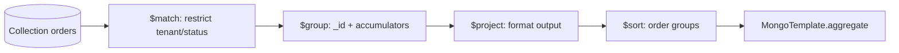

# `$group`, Accumulators, and Group Keys

> **Chapter:** Basic Aggregation  
> **Module:** `SPRING_DATA_MONGODB` — using Spring Data MongoDB to connect, map documents, and operate on MongoDB via `MongoTemplate` or repositories. This lesson dives into `$group`, **group key `_id`**, **accumulators**, and designing data reports with the Aggregation API. These decisions relate to queries, indexes, transactions, reactive access, testing, and performance diagnostics.

## 1. The Problem: Computing Reports Without Loading Millions of Documents Into the JVM

Suppose an order system needs to answer: how many `PAID` orders does tenant A have, what is the revenue per status, which month has the highest sales, and which product is purchased the most?

An inefficient approach is loading the entire collection with `mongoTemplate.findAll(Order.class)` and then using Java Streams for `groupingBy`, `sum`, and `average`. At scale, the application receives massive amounts of BSON, instantiates millions of objects, risks exhausting the heap, and creates unnecessary network load.

A MongoDB aggregation pipeline processes data on the server:



`$group` gathers documents sharing the same **group key value** and computes one output document per group. It is typically a **blocking stage**: the server may need to scan many documents and hold aggregation state before emitting output. Few output rows does not automatically mean the query is cheap.

**Goals after this lesson:** read and write `_id` properly in `$group`, distinguish accumulators, understand why `$sort`/`$unwind` change results, translate pipelines into Spring Data, and know when to optimize indexes and memory.

## 2. Sample Dataset and Hand-Calculated Results

Run on an **isolated test database**. The `drop()` command below deletes the current collection; never execute it on production:

```javascript
db.orders.drop();

db.orders.insertMany([
  {
    _id: "A-001", tenantId: "TENANT-A", status: "PAID",
    amount: NumberDecimal("120.00"),
    createdAt: ISODate("2026-11-01T01:00:00Z"),
    lines: [
      { sku: "BOOK-01", quantity: 2, unitPrice: NumberDecimal("50.00") },
      { sku: "PEN-02", quantity: 1, unitPrice: NumberDecimal("20.00") }
    ]
  },
  {
    _id: "A-002", tenantId: "TENANT-A", status: "PAID",
    amount: NumberDecimal("80.00"),
    createdAt: ISODate("2026-11-03T02:00:00Z"),
    lines: [
      { sku: "BOOK-01", quantity: 1, unitPrice: NumberDecimal("80.00") }
    ]
  },
  {
    _id: "A-003", tenantId: "TENANT-A", status: "PENDING",
    amount: NumberDecimal("40.00"),
    createdAt: ISODate("2026-11-04T03:00:00Z"),
    lines: []
  },
  {
    _id: "A-004", tenantId: "TENANT-A", status: "PAID",
    amount: NumberDecimal("100.00"),
    createdAt: ISODate("2026-10-31T18:30:00Z"),
    lines: [
      { sku: "PEN-02", quantity: 5, unitPrice: NumberDecimal("20.00") }
    ]
  },
  {
    _id: "B-001", tenantId: "TENANT-B", status: "PAID",
    amount: NumberDecimal("300.00"),
    createdAt: ISODate("2026-11-02T05:00:00Z"),
    lines: []
  },
  {
    _id: "B-002", tenantId: "TENANT-B", status: "PENDING",
    amount: NumberDecimal("75.00"),
    createdAt: ISODate("2026-11-04T06:00:00Z"),
    lines: []
  }
]);
```

| Order | Tenant | Status | Amount | UTC Timestamp |
| --- | --- | --- | ---: | --- |
| A-001 | TENANT-A | PAID | 120.00 | Nov 1, 01:00 |
| A-002 | TENANT-A | PAID | 80.00 | Nov 3, 02:00 |
| A-003 | TENANT-A | PENDING | 40.00 | Nov 4, 03:00 |
| A-004 | TENANT-A | PAID | 100.00 | **Oct 31, 18:30** |
| B-001 | TENANT-B | PAID | 300.00 | Nov 2, 05:00 |
| B-002 | TENANT-B | PENDING | 75.00 | Nov 4, 06:00 |

This set has 6 orders: **tenant A has 3 PAID orders** with sum `120 + 80 + 100 = 300` and average `100`; tenant A also has one PENDING order with amount `40`.

Order `A-004` was created on **Nov 1 at 01:30 in `Asia/Ho_Chi_Minh`**, even though its UTC timestamp falls in October. This is a critical test case when grouping by month.

## 3. Structure of a `$group` Stage

A `$group` stage consists of an `_id` key and one or more accumulator fields:

```javascript
{
  $group: {
    _id: "$status",
    orderCount: { $sum: 1 },
    grossAmount: { $sum: "$amount" }
  }
}
```

**`_id` in the group output is not necessarily the source document's `_id`.** Here `_id` is the status, e.g., `"PAID"`. To keep individual order IDs, you must explicitly collect them with an accumulator—though you should not gather all IDs for reports that only need counts.

### 3.1. Grouping by Status

```javascript
db.orders.aggregate([
  { $match: { tenantId: "TENANT-A" } },
  {
    $group: {
      _id: "$status",
      orderCount: { $sum: 1 }
    }
  },
  { $sort: { _id: 1 } }
]);
```

Expected meaning of result:

```javascript
{ _id: "PAID", orderCount: 3 }
{ _id: "PENDING", orderCount: 1 }
```

`$match` retains 4 orders belonging to TENANT-A. `$group` routes documents into two groups: `PAID` and `PENDING`. Each document contributes **1** to `$sum: 1`. The final `$sort` orders only **the grouped rows**.

**Never rely on `$group` output order** without a `$sort` after grouping.

### 3.2. `$sum: 1` vs. `$count`: Two Different Contexts

```javascript
orderCount: { $sum: 1 }
```

This is a very common accumulator: it adds `1` for **each document entering the group**. It does not count a property and does not know what an "order" is if an earlier `$unwind` turned each document into a line item.

MongoDB 5.0+ also provides the `$count` accumulator inside `$group`:

```javascript
db.orders.aggregate([
  { $group: { _id: "$status", orderCount: { $count: {} } } }
]);
```

Do not confuse it with the **pipeline-level `$count` stage**, which simply counts total documents passing through:

```javascript
db.orders.aggregate([
  { $match: { tenantId: "TENANT-A", status: "PAID" } },
  { $count: "orderCount" }
]);
// Result: { orderCount: 3 }
```

For broad compatibility across versions, `$sum: 1` inside `$group` is generally more portable.

## 4. Group Key `_id`: Single, Composite, Null, and Expression

### 4.1. Single Field

```javascript
db.orders.aggregate([
  { $group: { _id: "$tenantId", orders: { $sum: 1 } } },
  { $sort: { _id: 1 } }
]);
// TENANT-A: 4; TENANT-B: 2
```

### 4.2. Composite Key Over Multiple Fields

To group by **(tenant, status)** pair:

```javascript
db.orders.aggregate([
  {
    $group: {
      _id: {
        tenant: "$tenantId",
        state: "$status"
      },
      orders: { $sum: 1 },
      total: { $sum: "$amount" }
    }
  },
  { $sort: { "_id.tenant": 1, "_id.state": 1 } }
]);
```

Result:

```javascript
{ _id: { tenant: "TENANT-A", state: "PAID" }, orders: 3, total: NumberDecimal("300.00") }
{ _id: { tenant: "TENANT-A", state: "PENDING" }, orders: 1, total: NumberDecimal("40.00") }
{ _id: { tenant: "TENANT-B", state: "PAID" }, orders: 1, total: NumberDecimal("300.00") }
{ _id: { tenant: "TENANT-B", state: "PENDING" }, orders: 1, total: NumberDecimal("75.00") }
```

The group key is an **embedded document**; later stages must reference `"_id.tenant"`/`"_id.state"` rather than assuming those fields remain at the root. When mapping to a Java DTO, align key names and structure.

### 4.3. Grouping the Whole Set: `_id: null`

```javascript
db.orders.aggregate([
  { $match: { tenantId: "TENANT-A", status: "PAID" } },
  {
    $group: {
      _id: null,
      orders: { $sum: 1 },
      total: { $sum: "$amount" },
      average: { $avg: "$amount" }
    }
  }
]);
```

Result:

```javascript
{ _id: null, orders: 3, total: NumberDecimal("300.00"), average: NumberDecimal("100.00") }
```

`_id: null` means **all input documents enter a single group**. It does not mean source documents have `_id = null`. You must filter by tenant before grouping if the caller only has access to one tenant; otherwise the total leaks other customers' data.

### 4.4. Expression Group Key

```javascript
db.orders.aggregate([
  {
    $group: {
      _id: { $toUpper: "$status" },
      orders: { $sum: 1 }
    }
  }
]);
```

An expression can normalize `"paid"` and `"PAID"` into the same key. When a field can be missing/null or have unexpected types, establish explicit handling rules instead of relying on data "looking right."

### 4.5. Missing vs. Null When Auditing Schemas

When grouping directly on `_id: "$customerSegment"`, documents with missing fields and explicit nulls typically fall into the same `null` group. To **audit data types**, use `$type` as an **aggregation expression**:

```javascript
db.orders.aggregate([
  {
    $group: {
      _id: { $type: "$customerSegment" },
      orders: { $sum: 1 }
    }
  }
]);
```

`$type` returns `"missing"`, `"null"`, or `"string"`. This **groups by BSON type**, not by customer segment values; applications should only use it for schema auditing or migrations.

## 5. `$sum` and `$avg` Accumulators

```javascript
db.orders.aggregate([
  { $match: { tenantId: "TENANT-A" } },
  {
    $group: {
      _id: "$status",
      orderCount: { $sum: 1 },
      totalAmount: { $sum: "$amount" },
      avgAmount: { $avg: "$amount" }
    }
  },
  { $sort: { _id: 1 } }
]);
```

| Status | orderCount | totalAmount | avgAmount |
| --- | ---: | ---: | ---: |
| PAID | 3 | 300.00 | 100.00 |
| PENDING | 1 | 40.00 | 40.00 |

### 5.1. `$sum` and `$avg` with Missing, Null, and Mistyped Values

Suppose a group receives three documents:

```javascript
{ status: "PAID", amount: NumberDecimal("100.00") }
{ status: "PAID", amount: null }
{ status: "PAID" } // missing amount
```

`$sum: "$amount"` yields 100.00; `$avg: "$amount"` averages **valid numeric values only**—so 100.00 in this example, **not 100/3**. If there are zero numeric inputs, `$avg` returns null. Never assume missing/null carries the business meaning of 0.

Count documents with numeric amounts separately:

```javascript
db.orders.aggregate([
  {
    $group: {
      _id: "$status",
      allOrders: { $sum: 1 },
      numericOrders: {
        $sum: { $cond: [{ $isNumber: "$amount" }, 1, 0] }
      },
      revenue: { $sum: "$amount" },
      average: { $avg: "$amount" }
    }
  }
]);
```

`$isNumber` does not convert a string `"100"` into a number. If legacy data mixes String, Double, and Decimal128, standardize storage and run migrations before relying on financial reports.

### 5.2. Money Should Be Stored as `Decimal128`

```javascript
{ amount: NumberDecimal("120.00") }
```

In Spring Data:

```java
import java.math.BigDecimal;
import org.springframework.data.mongodb.core.mapping.Field;
import org.springframework.data.mongodb.core.mapping.FieldType;

// Inside the entity:
@Field(targetType = FieldType.DECIMAL128)
private BigDecimal amount;
```

`Decimal128` gives far more suitable decimal precision than `double` for monetary calculations. Still, define precision/scale/rounding rules—do not treat `Decimal128` as an automatic cure for mistyped inputs.

## 6. `$min`/`$max` vs. `$first`/`$last`

### 6.1. Finding Extrema with `$min` and `$max`

```javascript
db.orders.aggregate([
  { $match: { tenantId: "TENANT-A", status: "PAID" } },
  {
    $group: {
      _id: null,
      minAmount: { $min: "$amount" },
      maxAmount: { $max: "$amount" },
      oldestTime: { $min: "$createdAt" },
      newestTime: { $max: "$createdAt" }
    }
  }
]);
```

In tenant A's PAID group, `minAmount = 80`, `maxAmount = 120`, and `oldestTime` is `2026-10-31T18:30:00Z` from A-004.

### 6.2. `$first`/`$last` Require Input Ordering

```javascript
db.orders.aggregate([
  { $match: { tenantId: "TENANT-A" } },
  { $sort: { createdAt: -1, _id: -1 } },
  {
    $group: {
      _id: "$status",
      newestOrderId: { $first: "$_id" },
      oldestOrderId: { $last: "$_id" }
    }
  },
  { $sort: { _id: 1 } }
]);
```

`$sort` **before** grouping feeds documents into accumulators from newest to oldest. The PAID group yields `newestOrderId = "A-002"`, `oldestOrderId = "A-004"`. PENDING has only A-003, so both IDs are A-003.

| Sort Position | Effect |
| --- | --- |
| Before `$group` | Controls **document order within each group**, critical for `$first`, `$last`, and `$push`. |
| After `$group` | Orders **the resulting group rows**. |

Sorting after grouping **cannot** retroactively fix `$first` computed earlier.

**Do not confuse `$min("$amount")` with `$first("$amount")`**: min finds the smallest value; first takes the value of the first document **in input order**. To retrieve the ID of the order with the highest amount, sort by amount first and use `$first`, or use `$top` on supported versions.

## 7. `$push` and `$addToSet`: Keeping a List or a Set?

```javascript
db.orders.aggregate([
  { $match: { tenantId: "TENANT-A" } },
  { $sort: { createdAt: 1, _id: 1 } },
  {
    $group: {
      _id: "$status",
      orderIds: { $push: "$_id" },
      tenantSet: { $addToSet: "$tenantId" }
    }
  }
]);
```

- **`$push`** appends each document's value to an array, **allowing duplicates**; to make array order meaningful, sort input documents before grouping.
- **`$addToSet`** keeps only **distinct values** per BSON equality rules and **does not guarantee element order**.

Do not build `allIds: { $push: "$_id" }` across millions of documents if you only need a count. Huge output arrays consume server memory and can exceed the **16 MiB limit on a single output BSON document**. `allowDiskUse` cannot fix an **oversized output document**.

### 7.1. Counting Distinct Values Without Storing All IDs in an Array

An obvious idea is `$addToSet` customer IDs followed by `$size`, yet that distinct array can grow massive. When cardinality is very high, consider two `$group` stages:

```javascript
db.orders.aggregate([
  {
    $group: {
      _id: { tenant: "$tenantId", state: "$status" }
    }
  },
  {
    $group: {
      _id: "$_id.tenant",
      distinctStatusCount: { $sum: 1 }
    }
  }
]);
```

The first `$group` emits each `(tenant, status)` pair once; the second `$group` counts distinct statuses per tenant. This avoids a huge distinct array in the output, though it still holds group state on the server, so performance should still be measured.

## 8. Grouping by Month: Key Computed via a Timezone-Aware Expression

For Vietnamese monthly revenue reports, define the business timezone explicitly. Timestamp `2026-10-31T18:30:00Z` has **UTC month 10** but belongs to **month 11** in `Asia/Ho_Chi_Minh` (UTC+07:00).

### 8.1. `$dateTrunc` by Local Month

MongoDB 5.0+ supports `$dateTrunc`:

```javascript
db.orders.aggregate([
  { $match: { tenantId: "TENANT-A", status: "PAID" } },
  {
    $group: {
      _id: {
        month: {
          $dateTrunc: {
            date: "$createdAt",
            unit: "month",
            timezone: "Asia/Ho_Chi_Minh"
          }
        }
      },
      orders: { $sum: 1 },
      revenue: { $sum: "$amount" }
    }
  },
  { $sort: { "_id.month": 1 } }
]);
```

**Business result:** all three `PAID` orders of tenant A (`A-001`, `A-002`, `A-004`) fall into **November in Vietnam time**. That month group has `orders = 3` and `revenue = 300.00`.

`$dateTrunc` returns a **BSON Date** representing the bucket start in the chosen timezone. Printed as ISO UTC, that timestamp may read as **the end of Oct 31 UTC**, because local midnight at the start of the month corresponds to an earlier UTC day. Do not misread that UTC display as the "wrong month."

### 8.2. Combining Tenant and Month

```javascript
db.orders.aggregate([
  {
    $group: {
      _id: {
        tenant: "$tenantId",
        month: {
          $dateTrunc: {
            date: "$createdAt",
            unit: "month",
            timezone: "Asia/Ho_Chi_Minh"
          }
        }
      },
      orders: { $sum: 1 },
      revenue: { $sum: "$amount" }
    }
  },
  { $sort: { "_id.tenant": 1, "_id.month": 1 } }
]);
```

If an API serves only tenant A, add `$match tenantId` before `$group`. Grouping across all tenants like this is appropriate only for authorized system-wide reports.

### 8.3. When the Server Does Not Support `$dateTrunc`

On older MongoDB versions, consider `$dateToString`/date operators with `timezone` to produce `"YYYY-MM"` keys, or normalize reporting periods at ingestion time. Check your actual server version; do not copy a `$dateTrunc` pipeline onto a server lacking the operator.

When both filtering by month and grouping by local month, compute `from`/`to` boundaries in `$match createdAt` **for that same timezone**. Filtering from `2026-11-01T00:00:00Z` and then grouping in Vietnam time drops part of local Nov 1.

## 9. `$unwind` Before `$group`: From Orders to Line Items

In our dataset, each `Order` holds a `lines` array. Before `$unwind`, `$sum: 1` counts **orders**; after `$unwind`, each element of `lines` becomes **an input document** to the next stage.

### 9.1. Aggregating by SKU

```javascript
db.orders.aggregate([
  { $match: { tenantId: "TENANT-A", status: "PAID" } },
  { $unwind: "$lines" },
  {
    $group: {
      _id: "$lines.sku",
      lineCount: { $sum: 1 },
      unitsSold: { $sum: "$lines.quantity" },
      revenue: {
        $sum: {
          $multiply: ["$lines.quantity", "$lines.unitPrice"]
        }
      }
    }
  },
  { $sort: { _id: 1 } }
]);
```

Results verifiable by hand:

| SKU | lineCount | unitsSold | revenue |
| --- | ---: | ---: | ---: |
| BOOK-01 | 2 | 3 | 180.00 |
| PEN-02 | 2 | 6 | 120.00 |

`A-001` has two lines, `A-002` has one line, and `A-004` has one line. After unwind there are **4 lines**, despite starting from **3 PAID orders**.

Never label `lineCount` as `orderCount` when an order can contain multiple lines. `unitsSold` is total item quantity, and `revenue` here is computed per line as `quantity × unitPrice`. If order amounts include discounts, shipping, or taxes, line totals will not necessarily equal order totals; define KPIs strictly according to accounting contracts.

### 9.2. Counting Unique Orders Containing a SKU

If the same SKU appears twice inside one order, `lineCount` counts two lines. To compute **distinct orders per SKU**, use two-stage grouping:

```javascript
db.orders.aggregate([
  { $match: { tenantId: "TENANT-A", status: "PAID" } },
  { $unwind: "$lines" },
  {
    $group: {
      _id: { sku: "$lines.sku", orderId: "$_id" }
    }
  },
  {
    $group: {
      _id: "$_id.sku",
      distinctOrderCount: { $sum: 1 }
    }
  },
  { $sort: { _id: 1 } }
]);
```

The first `$group` deduplicates `(sku, orderId)` pairs. The second `$group` counts distinct pairs per SKU, not array occurrences.

### 9.3. Empty Arrays, Null, or Missing Fields

`$unwind: "$lines"` **drops documents** whose `lines` field is empty, null, or missing by default. To keep line-less orders in the report, use:

```javascript
{
  $unwind: {
    path: "$lines",
    preserveNullAndEmptyArrays: true
  }
}
```

When enabling this option, handle null/missing `lines.sku` before grouping; otherwise you may generate an `_id: null` group and mislabel it as "Unknown SKU." Always define whether the target unit is **order**, **line**, or **unit**.

## 10. Consecutive `$group` Stages and Field Scope After Each Stage

A pipeline can group by tenant and then group across all tenants:

```javascript
db.orders.aggregate([
  { $match: { status: "PAID" } },
  {
    $group: {
      _id: "$tenantId",
      tenantOrders: { $sum: 1 },
      tenantRevenue: { $sum: "$amount" }
    }
  },
  {
    $group: {
      _id: null,
      totalPaidOrders: { $sum: "$tenantOrders" },
      totalRevenue: { $sum: "$tenantRevenue" },
      tenantCount: { $sum: 1 }
    }
  }
]);
```

Result across both tenants in the sample dataset:

```javascript
{
  _id: null,
  totalPaidOrders: 4,
  totalRevenue: NumberDecimal("600.00"),
  tenantCount: 2
}
```

**The second `$group` stage can no longer see `amount` from the source documents.** It sees only the output of the preceding stage: `_id`, `tenantOrders`, and `tenantRevenue`. Therefore:

```javascript
// WRONG in the second stage: the amount field does not exist at this point.
{ $group: { _id: null, total: { $sum: "$amount" } } }
```

You must reference `"$tenantRevenue"`. This is a frequent bug when a long pipeline is assembled from separate stage fragments.

### 10.1. `$sortByCount` Is Shorthand for Distribution Counts

```javascript
db.orders.aggregate([
  { $match: { tenantId: "TENANT-A" } },
  { $sortByCount: "$status" }
]);
```

Semantically, this is nearly equivalent to `$group` by `status` with `count: { $sum: 1 }`, followed by `$sort: { count: -1 }`. When two groups tie in count, tie-breaking order is unspecified by the count-only sort.

`$sortByCount` is convenient when you only want **frequencies**, and less suitable than full `$group` when you also need monetary sums, min/max, or multiple accumulators.

### 10.2. `$skip`/`$limit` Before vs. After `$group`

```javascript
db.orders.aggregate([
  { $match: { tenantId: "TENANT-A" } },
  { $group: { _id: "$status", orders: { $sum: 1 } } },
  { $sort: { orders: -1, _id: 1 } },
  { $skip: 0 },
  { $limit: 10 }
]);
```

This returns **at most 10 groups** computed over all matching documents. Moving `$limit: 10` **before `$group`** builds the report from just **10 source documents**, yielding wrong totals. When paginating grouped output, place `$sort/$skip/$limit` **after grouping**.

## 11. Spring Data MongoDB: Java Models for Aggregation

Java 17+ example:

```java
package demo.orders;

import java.math.BigDecimal;
import java.time.Instant;
import java.util.List;
import org.springframework.data.annotation.Id;
import org.springframework.data.mongodb.core.mapping.Document;
import org.springframework.data.mongodb.core.mapping.Field;
import org.springframework.data.mongodb.core.mapping.FieldType;

@Document(collection = "orders")
public record Order(
    @Id String id,
    String tenantId,
    String status,
    @Field(targetType = FieldType.DECIMAL128) BigDecimal amount,
    Instant createdAt,
    List<OrderLine> lines
) {}

record OrderLine(
    String sku,
    int quantity,
    @Field(targetType = FieldType.DECIMAL128) BigDecimal unitPrice
) {}
```

`Order` is a public record. Package-private `OrderLine` can share the file in this example; in larger apps place it in its own file. `@Field(targetType = DECIMAL128)` writes `BigDecimal` values as BSON Decimal128 instead of relying on other default conversions.

If a system's source documents use `@Field("total_amount")` instead of `amount`, the Spring Data Aggregation API applies mapping metadata when given the **input type**. In `mongosh` or the raw Java Driver, you must write the **exact BSON field name** in the collection.

## 12. `MongoTemplate.aggregate` with `$match`, `$group`, and `$sort`

### 12.1. Grouping by Status in Spring Data

```java
import static org.springframework.data.mongodb.core.aggregation.Aggregation.*;

import org.bson.Document;
import org.springframework.data.domain.Sort;
import org.springframework.data.mongodb.core.aggregation.Aggregation;
import org.springframework.data.mongodb.core.aggregation.AggregationResults;
import org.springframework.data.mongodb.core.query.Criteria;

Aggregation aggregation = newAggregation(
    match(Criteria.where("tenantId").is("TENANT-A")
        .and("status").is("PAID")),
    group("status")
        .count().as("orderCount")
        .sum("amount").as("totalAmount")
        .avg("amount").as("averageAmount")
        .min("amount").as("minAmount")
        .max("amount").as("maxAmount"),
    sort(Sort.Direction.ASC, "_id")
);

AggregationResults<Document> results =
    mongoTemplate.aggregate(aggregation, Order.class, Document.class);

for (Document row : results.getMappedResults()) {
    String status = row.getString("_id");
    Number count = (Number) row.get("orderCount");
    Object total = row.get("totalAmount");
    // This is the group BSON output; check total's type before casting.
}
```

`mongoTemplate` is an injected `MongoTemplate` bean; this snippet sits inside a service or test rather than a standalone Java file. How it works:

1. `Order.class` specifies the **`orders` collection** and field mapping metadata.
2. `match(Criteria...)` builds the `$match` filter.
3. `group("status")` produces `_id: "$status"`, while `count/sum/avg/min/max` map to MongoDB accumulators.
4. `sort(..., "_id")` orders outputs by group key.
5. `Document.class` lets you inspect raw output before deciding on a DTO.

**Do not confuse `group(...).count().as(...)` with `MongoTemplate.count(Query, ...)`.** One is an accumulator inside the pipeline; the other executes a standalone count query.

### 12.2. DTO Output via `$project` After Grouping

After `$group`, the source `status` field is no longer at the output root. To give a DTO `status` instead of `_id`, add `$project`:

```javascript
db.orders.aggregate([
  { $match: { tenantId: "TENANT-A", status: "PAID" } },
  {
    $group: {
      _id: "$status",
      orderCount: { $sum: 1 },
      totalAmount: { $sum: "$amount" }
    }
  },
  {
    $project: {
      _id: 0,
      status: "$_id",
      orderCount: 1,
      totalAmount: 1
    }
  }
]);
```

Spring Data:

```java
Aggregation summary = newAggregation(
    match(Criteria.where("tenantId").is("TENANT-A")
        .and("status").is("PAID")),
    group("status")
        .count().as("orderCount")
        .sum("amount").as("totalAmount"),
    project("orderCount", "totalAmount")
        .and("_id").as("status")
        .andExclude("_id")
);

List<StatusSummary> rows = mongoTemplate
    .aggregate(summary, Order.class, StatusSummary.class)
    .getMappedResults();
```

Separate DTO:

```java
package demo.orders;

import java.math.BigDecimal;

public record StatusSummary(
    String status,
    long orderCount,
    BigDecimal totalAmount
) {}
```

Place `StatusSummary` in its own appropriately named Java file. Spring Data maps the aliases `status`, `orderCount`, and `totalAmount` onto the DTO. Always test actual results with `Decimal128` on your active mapping version rather than assuming a DTO with mismatched constructor parameter names fills automatically.

### 12.3. Composite Keys in `Aggregation.group`

```java
Aggregation byTenantAndStatus = newAggregation(
    group("tenantId", "status")
        .count().as("orders")
        .sum("amount").as("revenue"),
    sort(Sort.Direction.ASC, "_id.tenantId", "_id.status")
);

List<Document> grouped = mongoTemplate
    .aggregate(byTenantAndStatus, Order.class, Document.class)
    .getMappedResults();
```

The output contains an embedded `_id` document with `tenantId` and `status`. For a DTO:

```java
public record GroupKey(String tenantId, String status) {}

public record TenantStatusTotals(
    GroupKey id,
    long orders,
    BigDecimal revenue
) {}
```

These two public records must reside in **two separate Java files** (or one must be made nested/package-private). This illustrates the mapping structure rather than asserting every ID alias maps identically across all versions; verify `Document` output first and write an integration test for the DTO.

### 12.4. Grouping the Entire Set with `group()`

```java
Aggregation totals = newAggregation(
    match(Criteria.where("tenantId").is("TENANT-A")),
    group()
        .count().as("orders")
        .sum("amount").as("grossAmount")
);
```

Keyless `group()` corresponds to `_id: null`. Never write `group("id")` or `group("_id")` when you want an overall total: that creates **one group per document** instead.

### 12.5. Spring Data `unwind` Followed by Grouping by SKU

```java
Aggregation bySku = newAggregation(
    match(Criteria.where("tenantId").is("TENANT-A")
        .and("status").is("PAID")),
    unwind("lines"),
    group("lines.sku")
        .count().as("lineCount")
        .sum("lines.quantity").as("unitsSold"),
    sort(Sort.Direction.ASC, "_id")
);

List<Document> skuRows = mongoTemplate
    .aggregate(bySku, Order.class, Document.class)
    .getMappedResults();
```

Here `unwind("lines")` turns each array element into a pipeline document. `group("lines.sku")` counts **lines per SKU**; `sum("lines.quantity")` sums unit counts. To compute `quantity × unitPrice` revenue, use `ArithmeticOperators.Multiply` or an aggregation expression supported by your version; never assume `sum("lines.unitPrice")` accounts for quantity.

### 12.6. Repository `@Aggregation` for Fixed Reports

For static pipelines, you can declare them directly on a repository method via `org.springframework.data.mongodb.repository.Aggregation`:

```java
package demo.orders;

import java.math.BigDecimal;
import java.util.List;
import org.springframework.data.mongodb.repository.MongoRepository;
import org.springframework.data.mongodb.repository.Aggregation;

public interface OrderReportRepository
        extends MongoRepository<Order, String> {

    @Aggregation(pipeline = {
        "{ '$match': { 'tenantId': ?0, 'status': 'PAID' } }",
        "{ '$group': { '_id': '$status', " +
          "'orders': { '$sum': 1 }, 'revenue': { '$sum': '$amount' } } }",
        "{ '$project': { '_id': 0, 'status': '$_id', " +
          "'orders': 1, 'revenue': 1 } }"
    })
    List<PaidStatusTotal> paidTotalsForTenant(String tenantId);
}

record PaidStatusTotal(
    String status, long orders, BigDecimal revenue
) {}
```

This keeps `PaidStatusTotal` package-private; if declared `public`, put it in its own Java file. `?0` is bound by Spring Data from the `tenantId` parameter. Since the pipeline fixes `status='PAID'`, each tenant gets at most one status group row in standard datasets.

**Do not confuse the two `Aggregation` classes:** `repository.Aggregation` is a method annotation; `core.aggregation.Aggregation` is the pipeline builder used with `MongoTemplate`. When dynamic conditions, complex stage options, explainability, or execution options are needed, `MongoTemplate`/`ReactiveMongoTemplate` is usually easier to maintain than a huge JSON annotation.

## 13. Empty Results, Numeric Types, and Real-World Mapping

### 13.1. When `$match` Matches Zero Documents

```javascript
db.orders.aggregate([
  { $match: { tenantId: "TENANT-UNKNOWN" } },
  { $group: { _id: null, grossAmount: { $sum: "$amount" } } }
]);
// No groups: result is typically [].
```

Never assume `{_id: null, grossAmount: 0}` is always emitted. In Spring Data:

```java
Document one = mongoTemplate
    .aggregate(totals, Order.class, Document.class)
    .getUniqueMappedResult();

if (one == null) {
    // No documents entered $group:
    // return 0 per API contract if business rules require it.
}
```

In this snippet `totals` represents an aggregation matching the filter under test; if reusing `totals` from Section 12.4, pass a non-existent tenant to exercise the empty case. Never call `get(0)` when the result list may be empty.

### 13.2. `Decimal128` Sums in BSON

When all `amount` values are `Decimal128`, `$sum` typically returns `Decimal128`. With `org.bson.Document`:

```java
Object rawTotal = row.get("totalAmount");

if (rawTotal instanceof org.bson.types.Decimal128 decimal) {
    java.math.BigDecimal precise = decimal.bigDecimalValue();
    // Use precise for further calculation or DTO mapping.
} else if (rawTotal instanceof Number number) {
    // Only use when schema permits this numeric type.
    java.math.BigDecimal converted =
        new java.math.BigDecimal(number.toString());
}
```

`row` is the loop variable from the previous example; also handle `null` or other BSON types if legacy data exists. Never blindly cast every number to `Integer`, since sums can overflow `int` and `Decimal128` is not an `Integer`.

### 13.3. Stages After `$group` Only See New Fields

If `$group` outputs `{_id, orders, revenue}`, subsequent `$sort` or `$project` stages can only reference those fields; do not reference `"$amount"` unless `$group` explicitly accumulated it. Keep aliases **consistent** between the pipeline and DTO.

## 14. Optimizing `$group`: Match Early, Index Properly, and Watch Memory

### 14.1. Why Put `$match` Before `$group`?

`$group` has to process every document entering the stage. If the application only needs `PAID` orders of tenant A, filtering by tenant and status **before grouping** reduces the volume to aggregate:

```javascript
db.orders.aggregate([
  {
    $match: {
      tenantId: "TENANT-A",
      status: "PAID"
    }
  },
  {
    $group: {
      _id: "$status",
      orders: { $sum: 1 },
      revenue: { $sum: "$amount" }
    }
  }
]);
```

Never blindly move a filter after `$group` if it acts on **source document fields** absent from the output. Only refactor stage order when semantics are guaranteed equivalent. MongoDB's optimizer handles some pushdowns, yet explicit design remains easier to understand, test, and diagnose.

### 14.2. Candidate Index

For reports regularly filtering by `tenantId`, `status`, and a `createdAt` range:

```javascript
db.orders.createIndex({
  tenantId: 1,
  status: 1,
  createdAt: 1
});
```

Such an index can speed up the **`$match`** stage. If you also `$sort` before `$group` for `$first`/`$last`, check whether the index supports both filtering and sort order.

**Having an index does not mean MongoDB skips computing accumulators.** `$sum` still must examine all matching values, and `$push`/`$addToSet` may keep large state in memory during aggregation. This index is a **candidate to benchmark**, not an unconditional rule.

### 14.3. `explain` for Aggregation

```javascript
db.orders.explain("executionStats").aggregate([
  { $match: { tenantId: "TENANT-A", status: "PAID" } },
  {
    $group: {
      _id: "$status",
      orders: { $sum: 1 },
      revenue: { $sum: "$amount" }
    }
  }
]);
```

Inspect fields available in your MongoDB version: `winningPlan`, `IXSCAN`/`COLLSCAN`, `totalKeysExamined`, `totalDocsExamined`, returned counts, timing, and spill information across aggregation stages. Do not take a single `explain` timing as representative under full concurrent load.

### 14.4. Group Key Cardinality and Memory Cost

| Group Key | Expected Group Count | Primary Risk |
| --- | --- | --- |
| `status` | Usually a few groups | Each group accumulates huge arrays if using `$push`. |
| `tenantId + status` | Tenants × statuses | Group count scales with tenant count. |
| `customerId` | Potentially millions | High group state memory and large output. |
| Source document `_id` | Nearly equal to document count | Grouping fails to reduce cardinality. |
| `month` | Dozens/hundreds of periods | Easier to manage with reasonable time filters. |

A single output group containing 1 million IDs in `$push` **can be worse** than thousands of small summary rows. Before going to production, estimate input document count, distinct key count, per-accumulator state, and output size.

### 14.5. Disk Spill and `allowDiskUse`

MongoDB enforces memory limits on specific aggregation stages. Depending on version, server configuration, and stage, MongoDB may spill to disk or fail if memory thresholds are exceeded.

With `mongosh`:

```javascript
db.orders.aggregate(
  [
    { $match: { tenantId: "TENANT-A" } },
    {
      $group: {
        _id: "$status",
        orders: { $sum: 1 },
        revenue: { $sum: "$amount" }
      }
    }
  ],
  { allowDiskUse: true }
);
```

With Spring Data:

```java
import org.springframework.data.mongodb.core.aggregation.AggregationOptions;

Aggregation pipeline = newAggregation(
    match(Criteria.where("tenantId").is("TENANT-A")),
    group("status").count().as("orders")
);

Aggregation withDisk = pipeline.withOptions(
    AggregationOptions.builder().allowDiskUse(true).build()
);
```

`allowDiskUse(true)` only **permits** supported stages to use temporary disk when needed; it does not make aggregation cheaper and does not lift the **16 MiB limit per BSON document**. Starting with MongoDB 6.0+, `allowDiskUseByDefault` may affect default behavior; verify your actual server version and topology.

## 15. Extended Accumulators and Version Differences

Beyond common accumulators, MongoDB provides accumulators for statistics and top-N selection:

| Accumulator | Meaning | Notes |
| --- | --- | --- |
| `$stdDevPop` | Population standard deviation | Requires understanding population statistics and numeric types. |
| `$stdDevSamp` | Sample standard deviation | Differs from `$stdDevPop` on small sample sizes. |
| `$top`/`$bottom` | Picks first/last element by inner `sortBy` | MongoDB 5.2+; verify API support. |
| `$topN`/`$bottomN` | Picks N elements by custom sort order | Can produce large output arrays. |
| `$firstN`/`$lastN` | Keeps first/last N elements in input order | Requires pre-group sort for meaningful order. |
| `$maxN`/`$minN` | Returns N extreme values | Does not automatically include the ID of the document holding each extremum. |
| `$median` | Approximate median in supported versions | MongoDB 7.0+; not available on every server. |

Example of `$top` picking the **newest order per status** on supported versions:

```javascript
db.orders.aggregate([
  { $match: { tenantId: "TENANT-A" } },
  {
    $group: {
      _id: "$status",
      newestOrder: {
        $top: {
          sortBy: { createdAt: -1, _id: -1 },
          output: { id: "$_id", createdAt: "$createdAt" }
        }
      }
    }
  }
]);
```

`$top` includes **`sortBy` inside the accumulator**, unlike `$first` which relies on input document order. When running older Spring Data or MongoDB versions, `$sort` + `$group` + `$first` is more compatible than copying an API missing in your version.

## 16. Reactive Aggregation: `Flux` Does Not Make Server Grouping Lighter

With `ReactiveMongoTemplate`, the pipeline mirrors the imperative version:

```java
import org.bson.Document;
import org.springframework.data.mongodb.core.aggregation.Aggregation;
import org.springframework.data.mongodb.core.query.Criteria;
import reactor.core.publisher.Flux;

Aggregation agg = newAggregation(
    match(Criteria.where("tenantId").is("TENANT-A")),
    group("status")
        .count().as("orders")
        .sum("amount").as("revenue")
);

Flux<Document> resultFlux =
    reactiveMongoTemplate.aggregate(agg, Order.class, Document.class);
```

`reactiveMongoTemplate` is an injected bean; this code runs in a service/test importing static builders from `Aggregation`. `Flux` merely describes the pipeline until subscribed.

Reactive backpressure governs how the subscriber consumes **aggregation output**, but **does not prevent `$group` from holding state on the server**. Grouping across millions of IDs still produces heavy output even if consumed reactively.

Only collect results when the group count is known to be bounded:

```java
import java.util.List;
import reactor.core.publisher.Mono;

Mono<List<Document>> summaries = resultFlux.collectList();
```

For high-cardinality groups, avoid unbounded `collectList()`; stream via `Flux`, cap downstream concurrency, and monitor heap. Never call `block()` on an event loop waiting for a report.

## 17. Transactions, Access Control, and Report Consistency

### 17.1. `$group` Does Not Automatically Share a Snapshot With Other Queries

Aggregation reads database data according to active read concern and execution time; it does not open a transaction or freeze a snapshot across **separate requests**. If orders are created or cancelled while a dashboard fires multiple endpoints, totals and counts across two APIs can observe different points in time.

When business rules require accounting/audit reports over a fixed snapshot, design appropriate read concerns, transactions/snapshots, or immutable data sources supported by your MongoDB topology. That carries operational cost; avoid long transactions for routine dashboards unless necessary.

### 17.2. Tenant Permissions Must Be Applied Before Grouping

```javascript
// RIGHT: aggregate only TENANT-A data.
[
  { $match: { tenantId: "TENANT-A", status: "PAID" } },
  { $group: { _id: null, revenue: { $sum: "$amount" } } }
]
```

`tenantId` must originate from a verified principal/security context, never an arbitrary user-provided string. A `$group { _id: null }` pipeline missing a tenant `$match` can leak **system-wide** revenue even though it outputs only one row.

### 17.3. Correct Aggregation on Dirty Data Still Yields Wrong Business Results

`$sum: 1` counts documents. If a single business order was recorded twice due to missing idempotency or unique indexes, the pipeline counts two documents—accurate to BSON yet wrong for a "unique orders" KPI. Enforce data normalization, business keys, deduplication policies, and KPI-aligned testing.

## 18. Integration Tests: Hand-Calculate, Seed Real BSON, Verify Java

### 18.1. Tests Need Distinct Data

With the six documents from Section 2, we can verify:

- Grouping by tenant/status yields **4 groups**.
- Tenant A has `PAID = 3`, `PENDING = 1`.
- Tenant A PAID has `sum = 300`, `avg = 100`, `min = 80`, `max = 120`.
- Order A-004 falls in **November in `Asia/Ho_Chi_Minh`** despite being October in UTC.
- After unwind, BOOK-01 has **2 lines, 3 units, line revenue 180**.
- Tenant B's PENDING order never enters Tenant A's PAID total.

If tests only seed identical orders with identical statuses and amounts, filter and accumulator bugs easily go unnoticed.

### 18.2. JUnit 5 Test with `MongoTemplate`

Below is an **integration test class** for Spring Boot using `@DataMongoTest` and an independent test MongoDB (such as Testcontainers); never run `deleteMany` on production:

```java
package demo.orders;

import static org.assertj.core.api.Assertions.assertThat;
import static org.springframework.data.mongodb.core.aggregation.Aggregation.*;

import java.math.BigDecimal;
import java.time.Instant;
import java.util.Date;
import java.util.List;
import org.bson.Document;
import org.bson.types.Decimal128;
import org.junit.jupiter.api.BeforeEach;
import org.junit.jupiter.api.Test;
import org.springframework.beans.factory.annotation.Autowired;
import org.springframework.boot.test.autoconfigure.data.mongo.DataMongoTest;
import org.springframework.data.mongodb.core.MongoTemplate;
import org.springframework.data.mongodb.core.aggregation.Aggregation;
import org.springframework.data.mongodb.core.query.Criteria;

@DataMongoTest
class OrderGroupingTest {
    @Autowired MongoTemplate mongoTemplate;

    private Document order(String id, String tenant, String status,
                           String amount, String createdAt) {
        return new Document("_id", id)
            .append("tenantId", tenant)
            .append("status", status)
            .append("amount",
                new Decimal128(new BigDecimal(amount)))
            .append("createdAt",
                Date.from(Instant.parse(createdAt)));
    }

    @BeforeEach
    void seed() {
        // Isolated TEST database: never run on a live collection.
        mongoTemplate.getCollection("orders")
            .deleteMany(new Document());
        mongoTemplate.getCollection("orders").insertMany(List.of(
            order("A-001", "TENANT-A", "PAID", "120.00",
                  "2026-11-01T01:00:00Z"),
            order("A-002", "TENANT-A", "PAID", "80.00",
                  "2026-11-03T02:00:00Z"),
            order("A-003", "TENANT-A", "PENDING", "40.00",
                  "2026-11-04T03:00:00Z"),
            order("A-004", "TENANT-A", "PAID", "100.00",
                  "2026-10-31T18:30:00Z"),
            order("B-001", "TENANT-B", "PAID", "300.00",
                  "2026-11-02T05:00:00Z")
        ));
    }

    @Test
    void totalsForPaidOrdersInTenantA() {
        Aggregation pipeline = newAggregation(
            match(Criteria.where("tenantId").is("TENANT-A")
                .and("status").is("PAID")),
            group()
                .count().as("orders")
                .sum("amount").as("total")
                .avg("amount").as("average")
        );

        Document row = mongoTemplate
            .aggregate(pipeline, "orders", Document.class)
            .getUniqueMappedResult();

        assertThat(row).isNotNull();
        assertThat(((Number) row.get("orders")).longValue())
            .isEqualTo(3L);
        assertThat(((Decimal128) row.get("total")).bigDecimalValue())
            .isEqualByComparingTo(new BigDecimal("300.00"));
        assertThat(((Decimal128) row.get("average")).bigDecimalValue())
            .isEqualByComparingTo(new BigDecimal("100.00"));
    }

    @Test
    void noInputProducesNoGroup() {
        Aggregation pipeline = newAggregation(
            match(Criteria.where("tenantId").is("UNKNOWN")),
            group().count().as("orders")
        );

        Document row = mongoTemplate
            .aggregate(pipeline, "orders", Document.class)
            .getUniqueMappedResult();

        assertThat(row).isNull();
    }
}
```

This example demonstrates syntax and assertions. `@DataMongoTest` **does not guarantee a running MongoDB server**; tests require connection configuration. Spring Boot annotation packages can vary across versions, so check actual dependencies before compiling. For `Decimal128` accumulators, casts rely on uniform seeding; production data mixing numeric types needs a distinct conversion policy.

### 18.3. Recommended Additional Test Cases

| Test | Expectation |
| --- | --- |
| Composite key | Exactly four groups and `_id.tenant`/`_id.state` fields. |
| Group with `_id: null` | One row when input exists; zero rows when match is empty. |
| `$avg` with null/missing | Denominator counts only numeric inputs. |
| `$min`/`$max` | Finds lowest and highest amounts. |
| `$first` without sort | Never test assuming natural order. |
| `$first` with sort + ID | Picks the exact newest order per group. |
| `$push`/`$addToSet` | Differ on duplicates; never assert order for `$addToSet`. |
| `$unwind` | Line count and order count differ. |
| `$dateTrunc` | A-004 belongs to November in Vietnam timezone. |
| String `"120"` in `amount` | Not automatically treated as `Decimal128`. |
| Missing tenant filter | Test exposes leak risk and enforces fixed tenant filter. |
| Index/explain | Inspect query plans and memory on representative datasets. |

## 19. Common Errors and Diagnostics

| Symptom | Cause | Fix |
| --- | --- | --- |
| Every order forms its own group | Using `_id: "$_id"` instead of a business key. | Group by status, tenant, month, or composite key. |
| `status` disappears from output | Group only outputs `_id` and accumulators. | Add `$project` to alias `$_id` to `status`. |
| Tenant A total includes Tenant B data | Missing `$match tenantId`. | Enforce authorization before grouping. |
| `$first` picks a non-newest order | Missing `$sort` before group. | Sort by `createdAt` and ID before grouping. |
| Groups appear in random order | Group does not guarantee output order. | Add `$sort` after group. |
| `$avg` differs from `total/orderCount` | Missing/null/mistyped amounts present. | Count numeric values and define missing policy. |
| Revenue lands in the wrong month | Grouped month in UTC instead of local timezone. | Specify explicit timezone and test month boundaries. |
| Post-unwind count exceeds order count | Each array item became a document. | Distinguish `lineCount` from `distinctOrderCount`. |
| Exceeds 16 MiB BSON limit | `$push` collects too many items in one group. | Do not store every ID; stream or redesign. |
| `$addToSet` has unexpected order | Sets do not guarantee order. | Sort output if needed. |
| Stage after group cannot see `amount` | Field was dropped from previous group's output. | Reference accumulator aliases from the prior group. |
| Group slow despite index | Many groups, many matching docs, heavy accumulators. | Check `$match`, cardinality, explain, and spill. |
| Java DTO missing fields or wrong types | Group/`Decimal128` output mismatches DTO. | Inspect raw `Document`, then project/convert precisely. |
| API expects 0 but aggregation is empty | `$group` had zero input, emitting no groups. | Handle fallback intentionally in the service layer. |

**Debug checklist:** (1) inspect raw data and BSON types; (2) identify whether the input unit is **order or line**; (3) verify `$match` and tenant scope; (4) check `_id` key; (5) review accumulator types; (6) check `$sort` before/after grouping; (7) read raw BSON output; (8) reconcile with Java DTO; (9) measure explain, memory, and disk spill.

## 20. Practice Lab: Revenue Dashboard and SKU Statistics

**Context:** build a revenue reporting API for tenant A and system-wide summaries. Practice on a test MongoDB using the six documents from Section 2.

1. Seed the six orders with BSON `Decimal128`, `ISODate`, and `lines` arrays. Hand-calculate counts per tenant/status.
2. Write `$match` for tenant A + `$group` by status + `$sum: 1`. Verify PAID = 3 and PENDING = 1.
3. Add `$sum: "$amount"`, `$avg`, `$min`, and `$max`; confirm PAID total = 300, avg = 100, min = 80, max = 120.
4. Write a composite key `{ tenant: "$tenantId", state: "$status" }`; verify all four groups across both tenants.
5. Write `_id: null` for tenant A total revenue; compare against a system-wide report and analyze authorization risks.
6. Sort by `createdAt DESC, _id DESC` before grouping and use `$first/$last` to fetch newest/oldest order IDs.
7. Use `$push` for IDs and `$addToSet` for statuses; explain differences in duplicates, ordering, and BSON size limits.
8. Use `$dateTrunc` with `Asia/Ho_Chi_Minh` and verify A-004 belongs to **November**.
9. Use `$unwind` to group by SKU, verifying BOOK-01 units = 3 and PEN-02 units = 6; write a two-stage group to count distinct orders.
10. Chain two `$group` stages to compute per-tenant totals and then system totals; never share authorization boundaries with regular tenant APIs.
11. Translate the `$match/$group/$sort` pipeline into Spring Data `Aggregation.newAggregation` and read `Document` results.
12. Add `$project` after group to map to `StatusSummary`; verify `Decimal128` to `BigDecimal`.
13. Write a test where `$match` yields zero rows: confirm `getUniqueMappedResult()` returns `null`.
14. Create candidate index `tenantId + status + createdAt` and run `explain("executionStats")` on a representative test dataset.
15. Test grouping by a high-cardinality key and evaluate memory and `allowDiskUse`; never run heavy experiments on production.
16. Write a `ReactiveMongoTemplate.aggregate` version returning `Flux<Document>` and collect only when group count is bounded.

### Self-Check Questions

- How does `_id` in `$group` output differ from source document `_id`?
- Does `$sum: 1` count orders or lines when placed after `$unwind`?
- How does the `$count` accumulator differ from the `$count` stage?
- When do you use `_id: null`, and what is the multi-tenant risk?
- How is a composite key for tenant and status written?
- How does `$avg` treat numeric values, null, missing, and Strings?
- How do `$min/$max` differ from `$first/$last`?
- Why does `$sort` before vs. after grouping have different effects?
- How do `$push` and `$addToSet` differ regarding duplicates and order?
- How do you count orders containing SKU X without double-counting multiple lines of the same SKU?
- Why can month in UTC differ from month in `Asia/Ho_Chi_Minh`?
- Can a stage after `$group` still access source `amount` if it was not accumulated?
- Why doesn't `allowDiskUse` solve an output BSON document exceeding 16 MiB?
- Why doesn't returning a `Flux` automatically reduce server-side group memory?

## 21. Key Takeaways and Reference Documentation

- **`$group` gathers documents by group key `_id`** and computes accumulators for each group. Keys can be a field, composite document, expression, or `null` to group everything.
- **`$sum: 1` counts documents entering a group**; `$sum: "$amount"` sums numeric values; `$avg` does not treat missing/null as 0.
- **`$min/$max` find extrema**, while `$first/$last` depend on document order and typically require `$sort` before grouping.
- **`$push` keeps values including duplicates**; `$addToSet` deduplicates without guaranteeing order, and both can cause large memory/output footprints.
- **`$unwind` changes the counting unit** from orders to lines; line count, unit count, and distinct order count are not equivalent.
- **`$dateTrunc` with business timezones** avoids assigning UTC timestamps to the wrong reporting period.
- **After grouping, source fields do not automatically remain in output**: use accumulator aliases, `_id`, or `$project` for subsequent stages.
- **`MongoTemplate.aggregate` and `ReactiveMongoTemplate.aggregate`** run pipelines from Spring Data; verify BSON/DTO types instead of guessing casts.
- **Early `$match`, suitable indexes, and cardinality control** matter more than blindly turning on `allowDiskUse`.
- **Multi-tenant data must be authorized before grouping**; aggregation does not replace transactions, validation, or consistency policies.

Official references to verify per MongoDB/Spring Data version:

- [MongoDB — $group stage](https://www.mongodb.com/docs/manual/reference/operator/aggregation/group/)
- [MongoDB — $sum accumulator](https://www.mongodb.com/docs/manual/reference/operator/aggregation/sum/)
- [MongoDB — $avg accumulator](https://www.mongodb.com/docs/manual/reference/operator/aggregation/avg/)
- [MongoDB — $first accumulator](https://www.mongodb.com/docs/manual/reference/operator/aggregation/first/)
- [MongoDB — $last accumulator](https://www.mongodb.com/docs/manual/reference/operator/aggregation/last/)
- [MongoDB — $push accumulator](https://www.mongodb.com/docs/manual/reference/operator/aggregation/push/)
- [MongoDB — $addToSet accumulator](https://www.mongodb.com/docs/manual/reference/operator/aggregation/addToSet/)
- [MongoDB — $unwind stage](https://www.mongodb.com/docs/manual/reference/operator/aggregation/unwind/)
- [MongoDB — $dateTrunc](https://www.mongodb.com/docs/manual/reference/operator/aggregation/dateTrunc/)
- [MongoDB — Aggregation Pipeline Limits](https://www.mongodb.com/docs/manual/core/aggregation-pipeline-limits/)
- [Spring Data MongoDB — Aggregation Framework Support](https://docs.spring.io/spring-data/mongodb/reference/mongodb/aggregation-framework.html)
- [Spring Data MongoDB — Aggregation API](https://docs.spring.io/spring-data/mongodb/reference/api/java/org/springframework/data/mongodb/core/aggregation/Aggregation.html)
