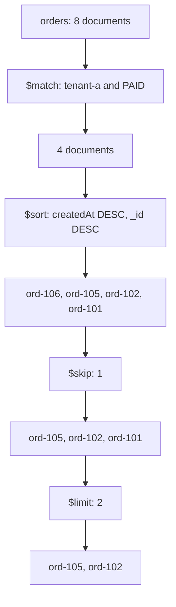

# `$sort`, `$skip`, `$limit`, and `$count`

## 1. The Problem: Sorting, Paginating, and Counting in Aggregation

An order management screen needs to display the 20 most recent paid orders for a tenant. One UI might only need a **Load more** button, whereas another admin screen needs "1,234 orders found" and "Page 3/62". A report may also need to count records after grouping data rather than counting raw source documents.

MongoDB aggregation pipelines solve these cases with four foundational stages:

- **`$sort`:** sorts the current set of documents in the pipeline.
- **`$skip`:** skips a given number of documents at the start of the current stream.
- **`$limit`:** caps how many documents continue forward.
- **`$count`:** counts documents **reaching that exact stage position** and emits a summary document.

They frequently work alongside `$match`, `$project`, `$group`, and sometimes `$facet`. Even a slight mistake in **stage order** can produce wrong results, unexpected totals, or far costlier queries.

This lesson belongs to the **Basic Aggregation** chapter in the **SPRING_DATA_MONGODB** module. Beyond understanding BSON pipelines, it applies Spring Data MongoDB to connect, map documents, and execute queries via `MongoTemplate`/`MongoOperations` or repositories, while tying into query design, indexes, reactive access, transactions, testing, and performance diagnostics.

After this lesson, you will be able to:

1. Write a `$match → $sort → $skip → $limit` pipeline and explain its output.
2. Distinguish `$count` over the **entire filtered set** from counting **the paginated slice**.
3. Handle empty results properly when `$count` emits no document.
4. Use the Spring Data Aggregation DSL to build bounded pipelines with clear return types.
5. Choose between two separate queries (page + count) and a single `$facet` pipeline.
6. Design deterministic sorts, appropriate indexes, and deep-offset limits.
7. Write integration tests with sufficient data to catch stage-order bugs, duplicate sort keys, and concurrency issues.

> Examples use `mongosh` syntax and Java 17+ with modern Spring Data MongoDB APIs. Query planner optimizations, memory limits, reactive behavior, and transactions vary across MongoDB server and Spring Data versions. Always verify on your project's actual versions.

## 2. Sample Dataset and Expected Output

### 2.1. Creating the Practice Collection

Suppose the `orders` collection stores:

```javascript
db.orders.insertMany([
  {
    _id: "ord-101",
    tenantId: "tenant-a",
    status: "PAID",
    amount_vnd: NumberLong("100000"),
    createdAt: ISODate("2026-11-18T08:00:00Z")
  },
  {
    _id: "ord-102",
    tenantId: "tenant-a",
    status: "PAID",
    amount_vnd: NumberLong("200000"),
    createdAt: ISODate("2026-11-18T08:00:00Z")
  },
  {
    _id: "ord-103",
    tenantId: "tenant-a",
    status: "READY_TO_SHIP",
    amount_vnd: NumberLong("180000"),
    createdAt: ISODate("2026-11-19T09:00:00Z")
  },
  {
    _id: "ord-104",
    tenantId: "tenant-a",
    status: "READY_TO_SHIP",
    amount_vnd: NumberLong("80000"),
    createdAt: ISODate("2026-11-20T01:00:00Z")
  },
  {
    _id: "ord-105",
    tenantId: "tenant-a",
    status: "PAID",
    amount_vnd: NumberLong("300000"),
    createdAt: ISODate("2026-11-20T02:00:00Z")
  },
  {
    _id: "ord-106",
    tenantId: "tenant-a",
    status: "PAID",
    amount_vnd: NumberLong("50000"),
    createdAt: ISODate("2026-11-20T03:00:00Z")
  },
  {
    _id: "ord-107",
    tenantId: "tenant-a",
    status: "CANCELLED",
    amount_vnd: NumberLong("20000"),
    createdAt: ISODate("2026-11-20T04:00:00Z")
  },
  {
    _id: "ord-201",
    tenantId: "tenant-b",
    status: "PAID",
    amount_vnd: NumberLong("900000"),
    createdAt: ISODate("2026-11-20T05:00:00Z")
  }
]);
```

Run only on a verified **test** collection/database, never directly on production. The dataset intentionally includes:

- Four `PAID` orders for `tenant-a`: `ord-101`, `ord-102`, `ord-105`, `ord-106`.
- Two orders sharing the exact same `createdAt`: `ord-101` and `ord-102`.
- One `PAID` order from another tenant: `ord-201`, which **must be excluded** when querying `tenant-a`.
- Other statuses to test the effectiveness of `$match`.

### 2.2. Target Order

When filtering `tenant-a`, `PAID`, and sorting **`createdAt DESC, _id DESC`**, the target order is:

```text
Position 0: ord-106   2026-11-20 03:00Z
Position 1: ord-105   2026-11-20 02:00Z
Position 2: ord-102   2026-11-18 08:00Z
Position 3: ord-101   2026-11-18 08:00Z
```

The last two orders share the same timestamp but differ in `_id`, so `_id DESC` serves as a **tie-breaker**. Sorting only by `createdAt` gives MongoDB no guarantee of fixed order among records sharing the same key value.

With `skip = 1`, `limit = 2`, the expected output is **`ord-105` followed by `ord-102`**. Total matching orders equal **4**.

## 3. Pipelines Are Ordered Transformation Chains

The aggregation is executed as:

```javascript
db.orders.aggregate([
  { $match: { tenantId: "tenant-a", status: "PAID" } },
  { $sort: { createdAt: -1, _id: -1 } },
  { $skip: 1 },
  { $limit: 2 }
]);
```

Read it top to bottom:



Each stage sees the output **of the preceding stages**. `$count` placed after `$limit` counts only the capped slice; placed right after `$match`, it counts all filtered documents.

### 3.1. Where Should `$match` Be Placed?

Typically, putting early document filters at the top of the pipeline shrinks the dataset and enables index usage. However, if a filter depends on a field **created by `$project`, `$addFields`, or `$group`**, it must run after that stage—or rely on the server optimizer's ability to reorder compatible stages.

Never force every `$match` to the top if the condition only exists after a computation step.

## 4. `$sort`: Ordering the Document Stream

### 4.1. Syntax

```javascript
{ $sort: { createdAt: -1, _id: -1 } }
```

`1` means **ascending**; `-1` means **descending**. With multiple keys, MongoDB compares the first key first, falling back to subsequent keys on ties.

Example:

```javascript
db.orders.aggregate([
  { $match: { tenantId: "tenant-a" } },
  { $sort: { status: 1, createdAt: -1, _id: -1 } }
]);
```

Results are grouped in order by `status` (per comparison rules), then ordered newest-first within each status. String ordering can be affected by **collation** if configured.

### 4.2. Why Is a Unique Tie-Breaker Required?

`$sort` **is not a stable sort across duplicate keys**. If multiple documents share the same `createdAt`, their relative order can vary across runs or query plan changes.

```javascript
// Not deterministic when createdAt can repeat.
{ $sort: { createdAt: -1 } }

// Add unique _id as the final tie-breaker key.
{ $sort: { createdAt: -1, _id: -1 } }
```

On the sample collection, `ord-102` precedes `ord-101` when `createdAt` matches. For offset or cursor pagination, adding a tie-breaker prevents **duplicate or skipped records caused by non-deterministic ordering** on unchanging data.

This is not a snapshot guarantee if documents are concurrently inserted, deleted, or updated on sort keys.

### 4.3. Sorting by Embedded Fields

If documents contain:

```javascript
{
  customer: { profile: { display_name: "An" } }
}
```

you can sort by:

```javascript
{ $sort: { "customer.profile.display_name": 1, _id: 1 } }
```

The path must match the **actual** BSON structure. Even if a Java entity uses `@Field` to rename properties, queries written in `mongosh` must still use the physical BSON names stored in the database.

### 4.4. Null, Missing, and Data Types

If `createdAt` is missing, contains `null`, or mixes BSON Date and String, sort order may violate intuition around "newest." Never use `$sort` to paper over mistyped data. For required pagination keys, enforce validation/migration so values share consistent non-null types.

### 4.5. `$sort` Does Not Create an Index

`$sort` declares desired ordering. Whether MongoDB satisfies it via an index or sorts in memory depends on **pipeline shape**, filters, indexes, collation, and the query planner.

## 5. `$skip`: Skipping the First N Documents in the Current Stream

### 5.1. Syntax and Example

```javascript
db.orders.aggregate([
  { $match: { tenantId: "tenant-a", status: "PAID" } },
  { $sort: { createdAt: -1, _id: -1 } },
  { $skip: 1 }
]);
```

After `$sort`, `ord-106` is skipped, leaving `ord-105`, `ord-102`, and `ord-101`. `$skip` requires a non-negative integer; `0` skips nothing.

```javascript
{ $skip: 0 }
{ $skip: 25 }
```

`$skip` knows nothing about "pages" or "page sizes." It only knows how many documents to discard from the stream emitted by prior stages.

### 5.2. Only Skip After Order Is Established

```javascript
// Unsuitable if the requirement is "skip the newest order".
db.orders.aggregate([
  { $match: { tenantId: "tenant-a", status: "PAID" } },
  { $skip: 1 },
  { $sort: { createdAt: -1, _id: -1 } }
]);
```

This pipeline **drops an arbitrary document before sorting**, offering no guarantee it skipped the newest one. When paginating by time, always place `$sort` **before** `$skip`.

### 5.3. Skip Does Not Mean "Jump Directly to Position N"

With huge offsets like `$skip: 100000`, the server may still have to walk through many results before emitting the requested page. Having an index does not yield O(1) jumping to position 100,001. This is the fundamental limitation of **offset pagination**.

If a UI only scrolls forward deeply, consider keyset scrolling; if jumping directly to page N is needed, offset pagination retains advantages in semantics and simplicity.

## 6. `$limit`: Capping Documents Passing Forward

### 6.1. Syntax

```javascript
db.orders.aggregate([
  { $match: { tenantId: "tenant-a", status: "PAID" } },
  { $sort: { createdAt: -1, _id: -1 } },
  { $limit: 2 }
]);
```

Returns `ord-106` and `ord-105`. `$limit` requires a positive integer; never use `$limit: 0` to represent "return no data." To return zero items, handle the contract in the application or choose a non-matching filter.

### 6.2. Limit Applies Exactly Where Placed

```javascript
// Top 2 across all PAID orders of tenant-a.
[
  { $match: { tenantId: "tenant-a", status: "PAID" } },
  { $sort: { createdAt: -1, _id: -1 } },
  { $limit: 2 }
]
```

Compare with:

```javascript
// Take 2 documents first, then sort just those 2 documents.
[
  { $match: { tenantId: "tenant-a", status: "PAID" } },
  { $limit: 2 },
  { $sort: { createdAt: -1, _id: -1 } }
]
```

The second pipeline **does not guarantee returning the two newest orders**. It merely sorts the two documents that happened to be picked first.

### 6.3. Using Limit to Reduce Downstream Cost

A well-placed `$limit` reduces documents flowing to later stages. Yet placed before `$group` or `$count`, it **changes statistical meaning**:

```javascript
// Counts at most 2 documents instead of the full PAID set.
[
  { $match: { tenantId: "tenant-a", status: "PAID" } },
  { $limit: 2 },
  { $count: "total" }
]
```

This outputs `total = 2`, even though there are 4 PAID orders in the fixture. Be explicit about whether you want **count of the full filter** or **count of the limited slice**.

## 7. `$count`: Counting Documents at That Stage's Position

### 7.1. Correct Syntax

```javascript
db.orders.aggregate([
  { $match: { tenantId: "tenant-a", status: "PAID" } },
  { $count: "total" }
]);
```

Expected output:

```javascript
[{ total: 4 }]
```

`"$count"` takes the **output field name**. `{ $count: "total" }` produces a document with field `total`. It is not `{ $count: true }` or `{ $count: 1 }`.

### 7.2. What Does `$count` Count?

`$count` counts **documents entering that exact stage in the pipeline**. It has no awareness of total documents in the source collection.

| Pipeline | Meaning | Fixture Result |
| --- | --- | --- |
| `$match → $count` | Total records after filter | `4` |
| `$match → $sort → $count` | Total after filter, though sort is usually unnecessary | `4` |
| `$match → $skip(1) → $count` | Records remaining after skip | `3` |
| `$match → $limit(2) → $count` | Records inside the capped set | `2` |
| `$match → $sort → $skip(1) → $limit(2) → $count` | Records on the current page | `2` |
| `$match → $group(status) → $count` | Number of **groups** left, not original orders | Depends on groups |

### 7.3. When the Input Set Is Empty

Crucial point:

```javascript
db.orders.aggregate([
  { $match: { tenantId: "tenant-a", status: "UNKNOWN" } },
  { $count: "total" }
]);
```

If zero documents enter `$count`, MongoDB **does not emit `{ total: 0 }`**. The result is typically an **empty array**:

```javascript
[]
```

Services must distinguish "no result document" from "a result document with `total = 0`." When mapping to a DTO, you may receive `null` or an empty publisher and explicitly convert it to `0` per the API contract.

### 7.4. `$count` Mirrors Grouping to Count

In terms of counting documents, `$count` is conceptually similar to:

```javascript
[
  { $group: { _id: null, total: { $sum: 1 } } },
  { $project: { _id: 0, total: 1 } }
]
```

This expresses **equivalent intent** to `$count: "total"` on non-empty input, though the planner may not execute them identically. Neither produces a zero-count document when the input stream is empty.

### 7.5. `$count` vs. `countDocuments` and `estimatedDocumentCount`

| API | Characteristics |
| --- | --- |
| `{ $count: "total" }` | Pipeline stage counting documents surviving earlier stages |
| `db.orders.countDocuments(filter)` | Helper counting documents by filter; does not run your full pipeline |
| `db.orders.estimatedDocumentCount()` | Estimates total collection documents from metadata; ignores tenant/status filters |
| `MongoOperations.count(query, type)` | Spring Data API counting by query |

Never use estimated collection count to display "tenant-a PAID order count"—it ignores the filter completely.

## 8. Stage Order Determines Semantics

Suppose the user wants the **second page** (0-indexed page 1), page size 2, of tenant-a's PAID orders, along with the total count.

**Content path:**

```javascript
[
  { $match: { tenantId: "tenant-a", status: "PAID" } },
  { $sort: { createdAt: -1, _id: -1 } },
  { $skip: 2 },
  { $limit: 2 }
]
```

Expected: `ord-102` and `ord-101`.

**Total-count path:**

```javascript
[
  { $match: { tenantId: "tenant-a", status: "PAID" } },
  { $count: "total" }
]
```

Expected: `total = 4`.

Never tack `$count` after `$limit` and report that number as the overall total:

```javascript
// Wrong if total must reflect all matching orders.
[
  { $match: { tenantId: "tenant-a", status: "PAID" } },
  { $sort: { createdAt: -1, _id: -1 } },
  { $skip: 2 },
  { $limit: 2 },
  { $count: "total" }
]
```

This returns the count **on the page**, which is 2—not 4.

### 8.1. Design Table by Question

| Business Question | Pipeline |
| --- | --- |
| 10 newest orders for a tenant? | `$match → $sort → $limit` |
| Page 3 (0-indexed), 20 orders per page? | `$match → $sort → $skip(60) → $limit(20)` |
| How many PAID orders exist? | `$match → $count` |
| How many documents are on this page? | `$match → $sort → $skip → $limit → $count` |
| Filtered total plus page items in one result? | `$match → $facet{items, metadata}` |
| Top 5 SKU groups by revenue? | `$match → $unwind → $group → $sort → $limit` |

## 9. Calculating Offset from `pageIndex` and `pageSize`

For **0-based page numbering**:

```text
offset = pageIndex × pageSize
```

Examples:

| pageIndex | pageSize | $skip | $limit |
| --- | --- | --- | --- |
| 0 | 20 | 0 | 20 |
| 1 | 20 | 20 | 20 |
| 2 | 20 | 40 | 20 |
| 5 | 10 | 50 | 10 |

### 9.1. Do Not Trust Raw Page Inputs

In a Java service:

```java
public static long checkedOffset(int pageIndex, int pageSize) {
    if (pageIndex < 0 || pageSize < 1 || pageSize > 100) {
        throw new IllegalArgumentException("Invalid pagination");
    }

    long offset = Math.multiplyExact(
        (long) pageIndex, (long) pageSize
    );
    if (offset > 10_000L) {
        throw new IllegalArgumentException(
            "Deep offset is not supported by this API"
        );
    }
    return offset;
}
```

The `pageSize <= 100` and `offset <= 10000` bounds are **example application policies**, not fixed MongoDB limits. Using `long` and checking for overflow prevents integer arithmetic wrap-around from producing bogus offsets.

### 9.2. What Metadata Should Pagination Return?

When an API only needs "Load more," fetch `pageSize + 1` results to compute `hasNext` **without counting the full set**. When the UI genuinely needs `totalElements` and `totalPages`, accept the count cost or pick another design. Never run total counts out of habit if callers ignore them.

## 10. Fetching Page Items and Total Count Using Two Pipelines

A straightforward and easy-to-optimize approach is running **two independent aggregation pipelines** with the same filter.

### 10.1. Content Pipeline

```javascript
db.orders.aggregate([
  { $match: { tenantId: "tenant-a", status: "PAID" } },
  { $sort: { createdAt: -1, _id: -1 } },
  { $skip: 1 },
  { $limit: 2 },
  { $project: {
      _id: 1,
      status: 1,
      amount_vnd: 1,
      createdAt: 1
  }}
]);
```

Returns `ord-105` and `ord-102` in order.

### 10.2. Count Pipeline

```javascript
db.orders.aggregate([
  { $match: { tenantId: "tenant-a", status: "PAID" } },
  { $count: "total" }
]);
```

Returns a single result document with `total = 4`.

Pros: the content pipeline can leverage indexes supporting sort/limit; the count pipeline skips sorting and unneeded projections. Cons: **two queries**, incurring an extra round trip and possibly observing slightly different snapshots if concurrent writes occur between the two reads.

### 10.3. Why Not Add `$sort` Before `$count`?

When counting a filtered set, order does not matter:

```javascript
// Unnecessary in most cases for counting total PAID orders.
[
  { $match: { tenantId: "tenant-a", status: "PAID" } },
  { $sort: { createdAt: -1, _id: -1 } },
  { $count: "total" }
]
```

The optimizer may eliminate or rewrite unneeded stages, but code should still express intent cleanly: `$match → $count`.

## 11. Using `$facet` to Fetch Page and Total in One Pipeline

When an API needs both page items and total count in **one aggregation command**, `$facet` is an option.

### 11.1. Structure of `$facet`

```javascript
db.orders.aggregate([
  {
    $match: {
      tenantId: "tenant-a",
      status: "PAID"
    }
  },
  {
    $facet: {
      items: [
        { $sort: { createdAt: -1, _id: -1 } },
        { $skip: 1 },
        { $limit: 2 },
        { $project: {
            _id: 1,
            status: 1,
            amount_vnd: 1,
            createdAt: 1
        }}
      ],
      metadata: [
        { $count: "total" }
      ]
    }
  }
]);
```

Output shape:

```javascript
[
  {
    items: [
      { _id: "ord-105", status: "PAID", amount_vnd: NumberLong("300000"),
        createdAt: ISODate("2026-11-20T02:00:00Z") },
      { _id: "ord-102", status: "PAID", amount_vnd: NumberLong("200000"),
        createdAt: ISODate("2026-11-18T08:00:00Z") }
    ],
    metadata: [{ total: 4 }]
  }
]
```

Why is total 4? Because the `metadata` branch runs `$count` on **all documents passing `$match`**, unaffected by `$skip`/`$limit` inside `items`.

### 11.2. Handling `total = 0` for `$facet`

When the filter matches zero documents, the count branch emits `metadata: []`. To return an explicit `0`, add `$project`:

```javascript
db.orders.aggregate([
  { $match: { tenantId: "tenant-a", status: "UNKNOWN" } },
  {
    $facet: {
      items: [
        { $sort: { createdAt: -1, _id: -1 } },
        { $skip: 0 },
        { $limit: 10 }
      ],
      metadata: [{ $count: "total" }]
    }
  },
  {
    $project: {
      items: 1,
      total: {
        $ifNull: [
          { $arrayElemAt: ["$metadata.total", 0] },
          0
        ]
      }
    }
  }
]);
```

Expected output when no orders match:

```javascript
[{ items: [], total: 0 }]
```

`$arrayElemAt` extracts the first element of the total array produced by `metadata`; `$ifNull` supplies `0` if that value is missing/null.

### 11.3. `$facet` Is Not Always Faster Than Two Queries

`$facet` is handy for returning a unified page-and-total structure in a single pipeline. However:

- It processes each branch over the data entering `$facet`, incurring its own memory cost.
- A `$sort` **inside a facet branch** does not necessarily use an index sort the way a standalone top-level sort can.
- Placing `$facet` at the very start of a pipeline hampers index usage; put an indexable `$match` ahead of it.
- `$facet` has resource and output document size limits, especially for oversized pages.
- One aggregation command does not automatically guarantee **strong snapshot isolation** under concurrent writes.

Benchmark **two separate pipelines** against **one `$facet`** on representative data, especially when filters match millions of documents. Never assume one round trip always equals lowest total cost.

## 12. Java Model and MongoDB Field Mapping

Spring Data MongoDB supports domain-typed aggregation using metadata to map Java properties and BSON fields.

```java
package com.example.orders.persistence;

import java.time.Instant;
import org.springframework.data.mongodb.core.mapping.Document;
import org.springframework.data.mongodb.core.mapping.Field;
import org.springframework.data.mongodb.core.mapping.FieldType;
import org.springframework.data.mongodb.core.mapping.MongoId;

@Document(collection = "orders")
public record OrderDocument(
    @MongoId(FieldType.STRING) String id,
    String tenantId,
    String status,
    @Field("amount_vnd") long amountVnd,
    Instant createdAt
) {}
```

| Java Property | BSON Field |
| --- | --- |
| `id` | `_id` |
| `tenantId` | `tenantId` |
| `status` | `status` |
| `amountVnd` | `amount_vnd` |
| `createdAt` | `createdAt` |

When calling `MongoOperations.aggregate(pipeline, OrderDocument.class, ...)`, Spring Data uses input metadata to translate fields. When writing pipelines **directly in `mongosh`**, always use physical BSON names like `_id` and `amount_vnd`.

Once a `$project`/`$group` stage reshapes the intermediate schema, field names in later stages must match **the previous stage's output**, not the original entity. For complex aliases, inspect the BSON command and result mapping in integration tests.

## 13. Spring Data Aggregation DSL: `sort`, `skip`, `limit`

### 13.1. Declaring with the Java API

```java
import java.util.List;
import org.springframework.data.domain.Sort;
import org.springframework.data.mongodb.core.MongoOperations;
import org.springframework.data.mongodb.core.aggregation.Aggregation;
import org.springframework.data.mongodb.core.query.Criteria;
import static org.springframework.data.mongodb.core.aggregation.Aggregation.*;

public final class OrderAggregationGateway {
    private final MongoOperations mongo;

    public OrderAggregationGateway(MongoOperations mongo) {
        this.mongo = mongo;
    }

    public List<OrderDocument> paidPage(
        String authenticatedTenantId, long offset, long pageSize
    ) {
        if (authenticatedTenantId == null
                || authenticatedTenantId.isBlank()
                || offset < 0 || offset > 10_000
                || pageSize < 1 || pageSize > 100) {
            throw new IllegalArgumentException("Invalid query");
        }

        Aggregation pipeline = newAggregation(
            match(Criteria.where("tenantId")
                .is(authenticatedTenantId)
                .and("status").is("PAID")),
            sort(Sort.by(
                Sort.Order.desc("createdAt"),
                Sort.Order.desc("id")
            )),
            skip(offset),
            limit(pageSize)
        );

        return mongo.aggregate(
            pipeline,
            OrderDocument.class,
            OrderDocument.class
        ).getMappedResults();
    }
}
```

Explanation:

1. `match(...)` adds `$match`.
2. `sort(Sort.by(...))` adds descending `$sort`.
3. `skip(offset)` adds `$skip`.
4. `limit(pageSize)` adds `$limit`.
5. `mongo.aggregate(...)` executes and maps results back to `OrderDocument`.

The offset and page size caps here are **business policy**, not universal MongoDB limits. `authenticatedTenantId` must come from an authenticated source. Never take a collection name from untrusted user input.

### 13.2. Calling the Gateway

```java
List<OrderDocument> page = gateway.paidPage(
    "tenant-a", 1L, 2L
);

for (OrderDocument order : page) {
    System.out.println(order.id());
}
// Expected from fixture: ord-105, then ord-102.
```

Here `gateway` is an `OrderAggregationGateway` instance managed by the application service, not a standalone class that exists simply by copying this snippet into a separate file.

### 13.3. Distinguishing Aggregation `skip`/`limit` from `Query`

Spring Data also provides:

```java
// Query API (find), not an aggregation pipeline.
org.springframework.data.mongodb.core.query.Query query =
    org.springframework.data.mongodb.core.query.Query.query(
        Criteria.where("tenantId").is("tenant-a")
    );
query.skip(1L);
query.limit(2);
```

With `Query` and `mongo.find(...)`, skip/limit are query options on a `find` command. In aggregation, `skip(...)`/`limit(...)` are **ordered stages** inside a pipeline. Both can serve simple paging, yet they are not interchangeable across multi-stage pipelines.

## 14. Spring Data Aggregation DSL: `count` and Empty Results

### 14.1. Total Count DTO

```java
public record CountResult(long total) {}
```

In a real Java project, if public, place it in `CountResult.java`. Adjust package visibility if grouping DTOs inside another class.

### 14.2. Calling `count().as("total")`

```java
import org.springframework.data.mongodb.core.aggregation.Aggregation;
import org.springframework.data.mongodb.core.aggregation.AggregationResults;
import org.springframework.data.mongodb.core.query.Criteria;
import static org.springframework.data.mongodb.core.aggregation.Aggregation.*;

Aggregation countPipeline = newAggregation(
    match(Criteria.where("tenantId").is("tenant-a")
        .and("status").is("PAID")),
    count().as("total")
);

AggregationResults<CountResult> result =
    mongo.aggregate(
        countPipeline,
        OrderDocument.class,
        CountResult.class
    );

CountResult row = result.getUniqueMappedResult();
long total = row == null ? 0L : row.total();
```

`mongo.aggregate(...)` assumes an available `MongoOperations`/`MongoTemplate` bean. When zero documents reach `$count`, `getUniqueMappedResult()` may return null; the code converts that to `0`.

### 14.3. Do Not Use `count` After `limit` If the UI Needs Total Count

```java
// Counts records REMAINING AFTER LIMITING.
Aggregation countOnlyPage = newAggregation(
    match(Criteria.where("tenantId").is("tenant-a")),
    limit(2L),
    count().as("total")
);
```

This is only valid when you specifically want the subset size. Never use its result as the tenant's total order count.

### 14.4. `MongoOperations.count(...)` Can Be Simpler

When the goal is simply counting against a plain filter, `mongo.count(query, OrderDocument.class)` is usually cleaner than a dedicated aggregation. Use `$count` in aggregation when counting **after transformations** such as `$unwind`, `$group`, or inside a `$facet` branch.

## 15. `$facet` in Spring Data MongoDB

### 15.1. Combining Two Branches with `facet(...)`

In Spring Data versions supporting `FacetOperation`:

```java
import org.bson.Document;
import org.springframework.data.domain.Sort;
import org.springframework.data.mongodb.core.aggregation.Aggregation;
import org.springframework.data.mongodb.core.query.Criteria;
import static org.springframework.data.mongodb.core.aggregation.Aggregation.*;

Aggregation pagedWithTotal = newAggregation(
    match(Criteria.where("tenantId").is("tenant-a")
        .and("status").is("PAID")),
    facet(
        sort(Sort.by(
            Sort.Order.desc("createdAt"),
            Sort.Order.desc("id")
        )),
        skip(1L),
        limit(2L)
    ).as("items")
     .and(count().as("total")).as("metadata")
);

Document response = mongo.aggregate(
    pagedWithTotal,
    OrderDocument.class,
    Document.class
).getUniqueMappedResult();
```

`facet(...).as("items")` defines the items branch; `.and(count().as("total")).as("metadata")` defines the count branch. This uses the **Spring Data DSL**, while the equivalent JSON pipeline appears in Section 11.

### 15.2. Reading `total` from `Document`

```java
import java.util.List;
import org.bson.Document;

if (response == null) {
    throw new IllegalStateException("Missing facet response");
}

List<Document> items =
    response.getList("items", Document.class);
List<Document> metadata =
    response.getList("metadata", Document.class);

long total = metadata.isEmpty()
    ? 0L
    : ((Number) metadata.get(0).get("total")).longValue();
```

This uses `Document` to illustrate output shape. In production, define a DTO matching your API contract and test nested array mapping. `$facet` can emit one document containing two arrays even when input is empty, in which case `metadata` is empty and `total` becomes `0`.

### 15.3. Remember to Bound Result Size

A facet returning hundreds of thousands of documents in `items` can hit memory limits or the BSON document size limit. Always cap page size before returning arrays to clients. `$facet` resource limits differ from disk spill on stages like `$sort`; **do not** assume `allowDiskUse` solves oversized facets.

## 16. `$count` Before and After `$group`: Counting Records or Counting Groups?

Suppose we ask: "How many distinct order statuses are used in `tenant-a`?" rather than "How many orders?"

```javascript
db.orders.aggregate([
  { $match: { tenantId: "tenant-a" } },
  { $group: { _id: "$status" } },
  { $count: "numberOfStatuses" }
]);
```

In the `tenant-a` fixture, there are three statuses: `PAID`, `READY_TO_SHIP`, and `CANCELLED`. Because `$group` emits **one document per status**, the trailing `$count` returns:

```javascript
[{ numberOfStatuses: 3 }]
```

Placing `$count` right after `$match` yields `7`, since `tenant-a` has 7 orders. This is a textbook example of **count placement determining what unit is counted**.

### 16.1. Top Groups by Order Count

```javascript
db.orders.aggregate([
  { $match: { tenantId: "tenant-a" } },
  {
    $group: {
      _id: "$status",
      numberOfOrders: { $sum: 1 }
    }
  },
  { $sort: { numberOfOrders: -1, _id: 1 } },
  { $limit: 2 }
]);
```

In the fixture: PAID has 4 orders, READY_TO_SHIP has 2, CANCELLED has 1. The top 2 groups are PAID and READY_TO_SHIP.

Appending `{ $count: "groups" }` after `$limit: 2` returns **2 selected groups**, not total distinct groups in the input and not total orders.

### 16.2. Sort After Group

`$group` does not guarantee output order. When the UI wants grouped rows sorted descending by total, **place a `$sort` after `$group`**. Sorting input documents before grouping does not guarantee group output ordering.

## 17. `$unwind` and `$count`: One Order Can Become Multiple Documents

Suppose a document contains `items`:

```javascript
{
  _id: "ord-301",
  tenantId: "tenant-a",
  items: [
    { sku: "BOOK-A", quantity: 1 },
    { sku: "BOOK-B", quantity: 2 }
  ]
}
```

Pipeline:

```javascript
db.orders.aggregate([
  { $match: { _id: "ord-301", tenantId: "tenant-a" } },
  { $unwind: "$items" },
  { $count: "total" }
]);
```

Assuming the illustrative document has been inserted into the test database, this counts **2 line items**, not 1 order, because `$unwind` expands one two-element document into two pipeline documents.

Conversely:

```javascript
db.orders.aggregate([
  { $match: { _id: "ord-301", tenantId: "tenant-a" } },
  { $count: "total" }
]);
```

counts 1 source document. Always ask: **is the counting unit orders, line items, groups, or filtered results?**

## 18. Indexes for `$match` and `$sort`

### 18.1. Candidate Index

For the common query:

```javascript
db.orders.aggregate([
  { $match: { tenantId: "tenant-a", status: "PAID" } },
  { $sort: { createdAt: -1, _id: -1 } },
  { $skip: 1 },
  { $limit: 2 }
]);
```

A candidate compound index:

```javascript
db.orders.createIndex(
  {
    tenantId: 1,
    status: 1,
    createdAt: -1,
    _id: -1
  },
  { name: "ix_orders_tenant_status_recent" }
);
```

`tenantId` and `status` support the equality filters, while the trailing keys support sorting. This is an access-pattern candidate, **not a mandatory default index for every collection**.

If filters also include range predicates on `createdAt`, `amount_vnd`, or other fields, re-evaluate key order and selectivity. Indexes raise write overhead, consume storage, and can slow updates to indexed fields.

### 18.2. Indexes Usually Lose Benefits When Pipelines Reshape Data Before Sorting

Compare:

```javascript
// Often able to use an index for match/sort.
[
  { $match: { tenantId: "tenant-a", status: "PAID" } },
  { $sort: { createdAt: -1, _id: -1 } },
  { $limit: 20 }
]
```

with:

```javascript
// Sort after a group; generally cannot use a simple index
// on original createdAt to sort a newly computed group total.
[
  { $match: { tenantId: "tenant-a" } },
  {
    $group: {
      _id: "$status",
      totalAmount: { $sum: "$amount_vnd" }
    }
  },
  { $sort: { totalAmount: -1 } }
]
```

Never assume an index on source fields optimizes sorting by newly computed aggregate values. Inspect `explain` to see the real query plan.

### 18.3. Explaining Aggregation

```javascript
db.orders.explain("executionStats").aggregate([
  { $match: { tenantId: "tenant-a", status: "PAID" } },
  { $sort: { createdAt: -1, _id: -1 } },
  { $skip: 1 },
  { $limit: 2 }
]);
```

Inspect `winningPlan` (or equivalent plan info for your server version), `IXSCAN`/`COLLSCAN`, keys/docs examined, whether a blocking in-memory sort stage is needed, and `nReturned`.

The optimized pipeline may not display stages in the exact logical order written; MongoDB's optimizer may reorder or coalesce stages when semantics remain preserved. Do not treat differences between the plan and input JSON as a bug.

## 19. Optimizing `$sort`, `$skip`, and `$limit`

### 19.1. Top-K Optimization

With:

```javascript
[
  { $sort: { createdAt: -1, _id: -1 } },
  { $limit: 20 }
]
```

MongoDB can optimize sorting by tracking only the top candidates needed for the limit rather than materializing everything identically. Exact optimization depends on intermediate stages, the query planner, indexes, and server version.

When stages between `$sort` and `$limit` alter document counts, coalescing behavior can change. Avoid claiming "every `$sort + $limit` uses O(20) memory"; inspect the plan and workload.

### 19.2. With `$skip`, Internal Limits Can Exceed Page Size

```javascript
[
  { $sort: { createdAt: -1, _id: -1 } },
  { $skip: 1000 },
  { $limit: 20 }
]
```

Some optimizations rewrite this into "keep top 1,020 and discard the first 1,000," since logically items 1,000 through 1,019 are needed. Thus, **deep skips remain expensive**, even when final page size is just 20.

### 19.3. Sorting and Memory/Disk

`$sort` can be a **blocking stage**: when unable to use an index across a large set, MongoDB must buffer intermediate data before emitting results. Memory limits and disk spill behavior depend on MongoDB server version/settings and `allowDiskUse`.

Example:

```javascript
db.orders.aggregate(
  [
    { $match: { tenantId: "tenant-a" } },
    { $sort: { amount_vnd: -1, _id: 1 } },
    { $limit: 100 }
  ],
  { allowDiskUse: true }
);
```

`allowDiskUse: true` **is not a cure for slow queries**, nor a substitute for good indexes. It can add disk I/O and latency; on some server versions automatic spilling also obeys separate configuration. Prioritize index tuning and stage ordering first.

### 19.4. `$facet` Has Its Own Memory Limits

Do not assume `allowDiskUse` makes an unbounded facet safe. `$facet` has memory and BSON document size limits; its `items` branch must always enforce a `$limit` per API contract. To export large datasets, use streaming or batched reads instead of stuffing everything into one facet result.

## 20. Deep Offsets, Keyset Pagination, and Mutating Data

### 20.1. Offset Pagination Can Duplicate or Miss Records

Suppose a client reads page 1:

```text
ord-106, ord-105
```

Before the client requests page 2 (`skip 2`), a new order with a timestamp newer than `ord-106` is inserted at the top. Existing positions shift, causing page 2 to repeat `ord-105` or skip an order.

Adding `_id` as a tie-breaker solves **duplicate sort keys**, but **does not freeze a snapshot** between requests.

### 20.2. Keyset Scrolling for Deep Lists

When sorting descending by `createdAt` and `_id`, suppose the previous page ended at:

```text
createdAt = 2026-11-20T02:00:00Z
_id = "ord-105"
```

You can continue with:

```javascript
const lastCreatedAt = ISODate("2026-11-20T02:00:00Z");
const lastId = "ord-105";

db.orders.aggregate([
  {
    $match: {
      tenantId: "tenant-a",
      status: "PAID",
      $or: [
        { createdAt: { $lt: lastCreatedAt } },
        {
          createdAt: lastCreatedAt,
          _id: { $lt: lastId }
        }
      ]
    }
  },
  { $sort: { createdAt: -1, _id: -1 } },
  { $limit: 2 }
]);
```

On our fixture, the next results are `ord-102` and `ord-101`. No `$skip: 2` is needed; the cursor resumes from the last read key.

**Requirements:** deterministic sort, exact BSON types for cursor values, supporting index, and non-null immutable sort keys during scrolling. Keyset pagination reduces offset-shift issues, though it still is not a full snapshot across concurrent mutations.

### 20.3. Spring Data `Window` and `ScrollPosition`

In Spring Data MongoDB versions with Scroll API support, `Window<T>` and `ScrollPosition` handle certain keyset/offset scrolling use cases. However, they are not the default return type of `mongo.aggregate(...)` and overloads vary by version.

For aggregated reports or multi-stage pipelines, you may need to **design keyset filters manually** on the output of the appropriate stage rather than mechanically applying a repository scrolling API.

## 21. Collation, BSON Types, and Sort Correctness

### 21.1. Sorting Vietnamese Names

To sort `customerName` according to locale rules, configure collation:

```javascript
db.orders.aggregate(
  [
    { $match: { tenantId: "tenant-a" } },
    { $sort: { customerName: 1, _id: 1 } },
    { $limit: 20 }
  ],
  {
    collation: { locale: "vi", strength: 2 }
  }
);
```

This example only applies if the collection actually contains `customerName`; our fixture does not. Collation alters String comparison, and **indexes must use a matching collation** to support queries/sorts efficiently. Never assume a default-collation index accelerates Vietnamese locale sorting.

### 21.2. Numeric Sorting Differs from String Sorting

`amount_vnd` in the fixture is stored as `NumberLong`. If legacy records store:

```javascript
{ amount_vnd: "100000" }
```

MongoDB compares by BSON type precedence rather than parsing strings as equivalent numbers. Never sort/limit money on a field mixing String and numeric types and expect accurate top amounts. Standardize BSON types and add schema validation.

### 21.3. Missing and Null Fields

When sorting by `createdAt`, documents missing the field still appear according to BSON sort ordering. For "newest" lists, consider schema rules requiring timestamps, or explicit filters excluding incomplete records.

Do not add `$exists` casually if dropping invalid records hides a migration issue; audit and fix source data whenever possible.

## 22. Security, Transactions, and Concurrent Data

### 22.1. Tenant Filters Are Mandatory When Required by Business Rules

A paginated pipeline missing `tenantId` can leak orders from multiple tenants. Neither repositories nor `MongoTemplate` validate tenant values automatically. Services must retrieve the tenant from a trusted authentication context.

```javascript
// Risk if the API is meant to let tenant-a users view only their own data:
[
  { $match: { status: "PAID" } },
  { $sort: { createdAt: -1, _id: -1 } },
  { $limit: 20 }
]
```

Combine `tenantId` and status together. Even the count branch inside `$facet` must enforce the same scope.

### 22.2. Query and Count Are Not Necessarily One Snapshot

Running a page pipeline and a count pipeline as **two separate commands** allows inserts or deletes between calls, so page items and `total` can occasionally diverge.

`$facet` executes two branches within one pipeline over the same `$match` stream, yet **does not automatically guarantee strong snapshot isolation** across all read concerns, topologies, and concurrent writes. When strict point-in-time consistency is required, design read concerns/transactions or snapshot mechanisms and test against your real MongoDB topology.

### 22.3. Are Transactions Needed for Reports?

Many UI screens only require "near-real-time" views and tolerate slight count drift. Avoid opening costly, long-lived transactions just to power a "Next page" button. When financial reconciliation or fixed snapshots are required, architect the consistency level intentionally rather than slapping `@Transactional` on as an automatic fix.

### 22.4. Never Let Users Supply Arbitrary Pipelines

Never accept a JSON array of aggregation stages from a client and forward it directly to `mongo.aggregate(...)`. Unchecked `$lookup`, `$unwind`, or sort/limit stages can leak data or exhaust resources. Construct pipelines only from allowlisted filters/sorts and bounded page sizes and offsets.

## 23. `ReactiveMongoOperations` and Reading Data

In reactive Spring Data MongoDB, use `ReactiveMongoOperations`/`ReactiveMongoTemplate` with `Flux<T>` instead of wrapping blocking calls in `Flux.just(...)`.

### 23.1. Reactive `aggregate` Returns `Flux`

```java
import reactor.core.publisher.Flux;
import org.springframework.data.mongodb.core.ReactiveMongoOperations;
import org.springframework.data.mongodb.core.aggregation.Aggregation;

public class ReactiveOrderQuery {
    private final ReactiveMongoOperations mongo;

    public ReactiveOrderQuery(ReactiveMongoOperations mongo) {
        this.mongo = mongo;
    }

    public Flux<OrderDocument> readPage(Aggregation pipeline) {
        return mongo.aggregate(
            pipeline, OrderDocument.class, OrderDocument.class
        );
    }
}
```

`Flux<OrderDocument>` is an asynchronous result stream; it does not carry total page counts, `hasNext`, or cursor resume tokens automatically.

### 23.2. Reactive Count Can Return an Empty `Flux`

```java
import reactor.core.publisher.Mono;

Mono<Long> count = mongo.aggregate(
    countPipeline,
    OrderDocument.class,
    CountResult.class
)
.next()
.map(CountResult::total)
.defaultIfEmpty(0L);
```

This snippet assumes `mongo` is a `ReactiveMongoOperations` bean and `countPipeline` is built as in Section 14.2. `defaultIfEmpty(0L)` handles `$count`'s empty-input semantics cleanly.

Never call `block()` casually in non-blocking apps. When zipping a page `Flux` and a count `Mono`, understand that the two subscriptions/queries may observe slightly different states during concurrent writes.

## 24. Real Testing: Do Not Check Only Counts

### 24.1. Testing Matrix

| Test Case | Expected from Fixture |
| --- | --- |
| Filter PAID tenant-a | 4 documents |
| Sort `createdAt DESC, _id DESC` | `106, 105, 102, 101` |
| Skip 1, limit 2 | `105, 102` |
| Skip 4, limit 2 | Empty page |
| Limit 2 before sort | Must not be treated as overall top 2 |
| `$match → $count` | `{ total: 4 }` |
| `$match → $limit(2) → $count` | `{ total: 2 }` |
| `$match → $skip(1) → $count` | `{ total: 3 }` |
| Filter status UNKNOWN then count | Zero result documents, not `{ total: 0 }` |
| Facet page + metadata | `items=[105,102]`, `metadata.total=4` |
| Facet empty filter + fallback | `items=[]`, `total=0` |
| Count after group by status | 3 groups for tenant-a |
| Preserve tenant scope | Never returns `ord-201` |
| Equal timestamps | `ord-102` precedes `ord-101` |
| Deep offset or oversized limit | Rejected by policy validation |
| Index/collation | Execution plan observed, not assumed |

### 24.2. Integration Test Skeleton for `MongoTemplate`

The snippet below assumes a configured test MongoDB seeded with the eight documents from Section 2 and an injected `MongoOperations`. This is a JUnit 5 **assertion skeleton**:

```java
import static org.junit.jupiter.api.Assertions.*;
import java.util.List;
import org.junit.jupiter.api.Test;
import org.springframework.data.domain.Sort;
import org.springframework.data.mongodb.core.MongoOperations;
import org.springframework.data.mongodb.core.aggregation.Aggregation;
import org.springframework.data.mongodb.core.query.Criteria;
import static org.springframework.data.mongodb.core.aggregation.Aggregation.*;

class AggregationPaginationIntegrationTest {
    MongoOperations mongo; // Inject from test context.

    @Test
    void sortsAndPaginatesInStableOrder() {
        Aggregation pipeline = newAggregation(
            match(Criteria.where("tenantId").is("tenant-a")
                .and("status").is("PAID")),
            sort(Sort.by(
                Sort.Order.desc("createdAt"),
                Sort.Order.desc("id")
            )),
            skip(1L),
            limit(2L)
        );

        List<OrderDocument> items =
            mongo.aggregate(
                pipeline,
                OrderDocument.class,
                OrderDocument.class
            ).getMappedResults();

        assertEquals(2, items.size());
        assertEquals("ord-105", items.get(0).id());
        assertEquals("ord-102", items.get(1).id());
        assertTrue(items.stream()
            .allMatch(o -> o.tenantId().equals("tenant-a")));
    }
}
```

This snippet is not runnable standalone without test context setup: dependencies, injection, fixture seeding, and cleanup are required. Expected IDs assume the collection has not been altered by other examples.

### 24.3. Testing `$count` on Empty Input

```java
@Test
void countReturnsNoDocumentWhenNothingMatches() {
    Aggregation pipeline = newAggregation(
        match(Criteria.where("tenantId").is("tenant-a")
            .and("status").is("UNKNOWN")),
        count().as("total")
    );

    CountResult row = mongo.aggregate(
        pipeline,
        OrderDocument.class,
        CountResult.class
    ).getUniqueMappedResult();

    assertNull(row);
}
```

Place this method inside the same test class with `mongo` and matching imports. It catches bugs where a service dereferences `total` on a non-existent document.

### 24.4. Testing `$facet` and Empty Metadata

After a facet with `status: UNKNOWN`, assert `items=[]` and `metadata=[]` (or `total=0` if a fallback projection exists). When the filter matches records, assert `metadata` equals **4**, not the page item count.

### 24.5. Check the Plan, Not Just the Output

Functional integration tests can pass on tiny collections even when MongoDB uses `COLLSCAN` and a blocking sort. Before deploying at scale, benchmark with real data/indexes, inspect `explain("executionStats")`, and monitor latency, memory, and disk spill.

## 25. Common Mistakes

| Symptom | Possible Cause | Resolution |
| --- | --- | --- |
| Duplicate items across pages on static data | Sort lacks a tie-breaker key | Add `_id` to `$sort` |
| Page does not show newest records | `$limit` or `$skip` placed before `$sort` | Use `$match → $sort → $skip → $limit` |
| Total always equals page size | `$count` placed after `$limit` | Count before pagination or in a separate facet branch |
| Empty filter throws `NullPointerException` | `$count` emitted no result document | Map `null`/empty to `0` |
| Deep skip is slow | Offset still walks prior records | Cap offset or switch to keyset pagination |
| `$sort` uses excessive memory | Missing index or sorting too large a set | Suitable index, early match, limit, inspect plan |
| `$facet` is slow despite single round trip | Sort/count branches scan many docs | Benchmark against two separate pipelines |
| `$facet` returns oversized document | `items` branch lacks limit | Bound page size and project fields |
| Name sorting ignores Vietnamese rules | Collation not configured | Apply proper collation and matching index |
| Money sorting is wrong | Numeric field mixes String values | Standardize BSON types |
| Count after `$group` misses target | Counting groups instead of orders | Place count properly or use `group.sum` |
| Sort after `$group` missing | Assuming group preserves order | Add `$sort` after grouping |
| Cross-tenant leakage | `$match` missing tenant filter | Enforce tenant from security context |
| Incorrect Java `id` mapping | Mixed Java property and BSON names | Verify `@MongoId` and aggregation mapping |
| Page and total occasionally mismatch | Two queries plus concurrent writes | Accept eventual view or design consistency |
| `$limit: 0` throws error | Limit must be positive | Validate/short-circuit in application |
| Reactive pipeline returns empty count | Unhandled empty `Flux` | `next().defaultIfEmpty(0L)` |
| Adding an index does not speed up sort | Index mismatches filter/sort/collation, or data reshaped first | Analyze plan and adjust index |

### 25.1. Diagnostic Workflow

```text
1. Confirm $match has correct tenant/status and BSON types.
                     ↓
2. Confirm $sort order includes tie-breaker _id.
                     ↓
3. Compute offset = pageIndex × pageSize, check overflow.
                     ↓
4. Verify $skip and $limit appear AFTER sort.
                     ↓
5. Verify whether $count counts full filter, page, or groups.
                     ↓
6. Check empty-result handling for $count and $facet.
                     ↓
7. Inspect explain and indexes; benchmark workload.
                     ↓
8. Test concurrent writes and API limits.
```

Never skip **semantic correctness** steps just to shave off latency numbers.

## 26. Practice Exercises with Solutions

### Exercise 1 — First Page of Two PAID Orders

**Task:** Fetch the two newest PAID orders for `tenant-a`.

**Solution:**

```javascript
db.orders.aggregate([
  { $match: { tenantId: "tenant-a", status: "PAID" } },
  { $sort: { createdAt: -1, _id: -1 } },
  { $skip: 0 },
  { $limit: 2 }
]);
```

Expected: `ord-106`, then `ord-105`. `$skip: 0` can be omitted, kept here to illustrate the first-page formula.

### Exercise 2 — Second Page

**Task:** With page size 2 and 0-based page index, fetch page index 1.

**Solution:**

```javascript
db.orders.aggregate([
  { $match: { tenantId: "tenant-a", status: "PAID" } },
  { $sort: { createdAt: -1, _id: -1 } },
  { $skip: 2 },
  { $limit: 2 }
]);
```

Expected: `ord-102`, then `ord-101`.

### Exercise 3 — Why Does Sort Need `_id`?

**Task:** `ord-101` and `ord-102` share the same `createdAt`. Can you sort solely by `createdAt DESC`?

**Solution:** Not if you want stable pagination. Add `_id DESC` for a total ordering across documents sharing the same timestamp.

### Exercise 4 — Total Count or Page Count?

**Task:** What will `$match(PAID) → $sort → $skip(1) → $limit(2) → $count("total")` return on the fixture? Is that all PAID orders?

**Solution:** It returns `2`, because count sits after pagination. Total PAID orders for `tenant-a` is `4`. If the UI needs the overall total, run a separate `$match → $count` pipeline or a count branch in `$facet`.

### Exercise 5 — Empty Set

**Task:** `$match` matches zero documents before `$count: "total"`. Can the client safely read `getUniqueMappedResult().total()`?

**Solution:** Unsafe, because `$count` emits no document on empty input. Check for null or empty publisher and return `0` per the service contract.

### Exercise 6 — Writing with the Spring Data DSL

**Task:** Using `MongoOperations`, fetch two PAID orders of `tenant-a` after skipping one sorted record.

**Solution:**

```java
Aggregation pipeline = newAggregation(
    match(Criteria.where("tenantId").is("tenant-a")
        .and("status").is("PAID")),
    sort(Sort.by(
        Sort.Order.desc("createdAt"),
        Sort.Order.desc("id")
    )),
    skip(1L),
    limit(2L)
);

List<OrderDocument> page = mongo.aggregate(
    pipeline, OrderDocument.class, OrderDocument.class
).getMappedResults();
```

This assumes the imports and `mongo` bean from Section 13. Never use `Query.skip(...)` to replace a `$skip` stage inside `Aggregation`.

### Exercise 7 — Facet for Page + Total

**Task:** The UI needs the slice after skip/limit and the total filtered count in one result.

**Solution:** Use:

```javascript
[
  { $match: { tenantId: "tenant-a", status: "PAID" } },
  {
    $facet: {
      items: [
        { $sort: { createdAt: -1, _id: -1 } },
        { $skip: 1 },
        { $limit: 2 }
      ],
      metadata: [{ $count: "total" }]
    }
  }
]
```

`items` has 2 documents; `metadata.total` is 4. Handle empty `metadata` separately.

### Exercise 8 — Count After Group

**Task:** A pipeline matches `tenant-a`, groups by `status`, and then runs `$count`. Is the result order count or status count?

**Solution:** It is the **number of status groups** after `$group`—`3` on the fixture. To count orders, place `$count` before `$group` (or use `$sum: 1` inside each group to count orders per status).

### Exercise 9 — Misplaced Sort and Limit

**Task:** A developer writes `$match → $limit(10) → $sort(createdAt DESC)` and calls it "the 10 newest orders." Is this right?

**Solution:** No. Limiting before sorting picks 10 arbitrary documents that may not be the newest, and sorts only those 10. Place `$sort` before `$limit`.

### Exercise 10 — Optimizing Deep Pages

**Task:** A user scrolls to offset 100,000; fetching page size 20 is very slow despite an index. Can we conclude the index is broken?

**Solution:** No. Offset pagination still skips through huge numbers of prior positions. If the use case only scrolls forward, consider keyset pagination on `(createdAt, _id)` with a supporting index and cursor; if random page jumps are required, evaluate offset caps, caching, and UX.

### Exercise 11 — Sorting Vietnamese Text

**Task:** A collection stores customer names as Vietnamese Strings. Can we assume default ascending sort matches linguistic order?

**Solution:** No. Specify the required collation and create indexes with matching collation for efficient sorting. Test accented characters rather than relying on byte order or default collation.

### Exercise 12 — Protecting Tenant Data

**Task:** A reporting aggregation accepts `tenantId` from an unverified client query parameter. Is adding `$match` on that value sufficient security?

**Solution:** No. Extract the tenant or verify permissions from the security context. Enforce that exact tenant scope on page, count, and facet queries; never allow users to request arbitrary tenants.

## 27. Production Readiness Checklist

| Review Question | How to Verify |
| --- | --- |
| Which documents does the pipeline count? | State the counting unit at `$count`'s position |
| Are tenant/owner filters enforced? | `$match` uses verified security context |
| Is sort order deterministic? | `_id` added as tie-breaker |
| Does sort target the right BSON field? | Java/`@Field` mapping and real BSON checked |
| Is collation configured if needed? | Accented text tested; index uses same collation |
| Are skip/limit in the right order? | `$match → $sort → $skip → $limit` |
| Is offset computed safely? | `pageIndex`/`pageSize` validated, `long` arithmetic |
| Are page size and deep offsets capped? | Tested API policy |
| Does the page actually need total count? | Count only when UI uses it |
| Count before or after pagination? | Separate branches matching intent |
| Is empty-input `$count` handled? | `null`/empty mapped to `0` |
| Is facet output bounded? | Limit and projection inside `items` branch |
| Does facet beat two queries on real load? | Benchmarked with metrics, not guessed |
| Is sort supported by an index? | `getIndexes()`, `explain("executionStats")` |
| Do group/unwind stages shift counting units? | Intermediate counts tested |
| Are date/numeric BSON types consistent? | BSON validation/migration |
| What happens if data mutates between pages? | Concurrency tested; UX/consistency policy set |
| Does reactive count handle empty Flux? | `defaultIfEmpty(0L)` tested |
| Do Spring Data/driver/server support the API? | Dependencies and integration tests verified |
| Are client-supplied pipelines blocked? | Allowlisted fields/stages/sorts only |

### Key Takeaways

1. **`$sort` orders**, **`$skip` discards**, **`$limit` caps**, and **`$count` counts documents reaching that exact stage**.
2. For offset pagination, the standard order is **`$match → $sort → $skip → $limit`**; add `_id` to `$sort` as a tie-breaker.
3. **`$count` after `$limit` counts only the capped slice**, not all filtered records. To get the overall total, count in a separate query/branch or use `$facet`.
4. **`$count` emits no `{ total: 0 }` document on empty input**; application code must handle empty results.
5. **`$facet` bundles page + count in one aggregation**, yet carries its own costs and limits; do not assume it beats two well-indexed queries.
6. **Sorting and indexes** govern performance; deep `$skip` remains expensive even when returning only 20 records.
7. **Field mapping, tenant filters, BSON types, concurrency, and integration tests** are prerequisites for correctness and safety before optimizing.
