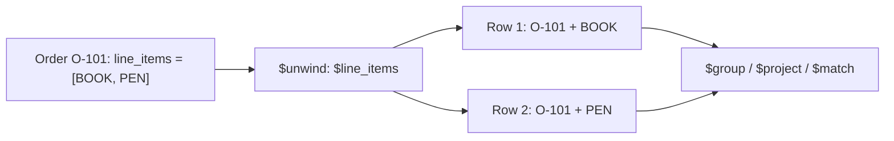

# `$unwind` and Handling Arrays or Empty Values

In MongoDB, an order often has multiple line items, an article has multiple tags, and a course has multiple lessons. When you need to compute **revenue by SKU**, inspect **individual elements** after splitting an array, or combine data via `$lookup`, you will encounter the **`$unwind`** aggregation stage. This stage turns a document containing an array into **multiple documents in the processing stream**, one per element.

The easiest mistake to make is not `$unwind` syntax itself, but **empty values**: `[]` arrays, BSON `null`, missing fields, and **non-array** values all behave differently. Forgetting `preserveNullAndEmptyArrays` can silently drop every order without line items from a report. Conversely, enabling it and blindly using `$group.count()` can **count a phantom line** for every empty order.

This lesson belongs to the **Basic Aggregation** chapter of the `SPRING_DATA_MONGODB` module, using Spring Data MongoDB to connect, map documents, and operate on MongoDB via `MongoTemplate`/repositories—while also connecting to queries, indexes, transactions, reactive access, testing, and data performance diagnostics.

> **Remember:** `$unwind` transforms **the aggregation result stream**; it **never modifies stored documents** in the collection. The `preserveNullAndEmptyArrays` option decides whether documents without elements are retained; it **does not fabricate an actual array element**. Design subsequent `$match`, `$group`, and `$project` stages around that distinction.

## 1. Learning Objectives

After this lesson, you will be able to:

1. Describe how `$unwind` changes document **count** and **shape** in a pipeline.
2. Write both syntax forms: `{ $unwind: "$field" }` and `{ $unwind: { path: "$field", ... } }`.
3. Distinguish populated arrays, `[]`, `null`, missing fields, and non-array scalar/object values.
4. Use `preserveNullAndEmptyArrays: true` to retain empty documents and `includeArrayIndex` to track element positions.
5. Build pipelines with `Aggregation.unwind(...)` or `UnwindOperation.newUnwind()` in Spring Data MongoDB.
6. Apply typed aggregation with `@Field` and map results to a DTO instead of forcing unwound rows back into an entity containing a `List`.
7. Combine `$match`, `$group`, `$sum`, `$project`, and `$addFields` to compute accurately after unwind.
8. Distinguish **input document count**, **array element count**, and **pipeline row count**.
9. Handle null/missing with `$ifNull` and check types with `$isArray` before calling `$size`.
10. Analyze `$unwind` after `$lookup`, multiple/nested arrays, and row-multiplication risks.
11. Design integration tests, read `explain`, evaluate indexes, and recognize atomicity/consistency boundaries.
12. Choose `$filter`/`$map` instead of `$unwind` when transforming arrays without inflating row counts.

## 2. What Does `$unwind` Do in an Aggregation Pipeline?

Consider an input document:

```javascript
{
  _id: "O-101",
  state: "PAID",
  line_items: [
    { sku: "BOOK", quantity: 2 },
    { sku: "PEN",  quantity: 3 }
  ]
}
```

A stage:

```javascript
{ $unwind: "$line_items" }
```

produces **two documents in the pipeline**:

```javascript
{ _id: "O-101", state: "PAID",
  line_items: { sku: "BOOK", quantity: 2 } }

{ _id: "O-101", state: "PAID",
  line_items: { sku: "PEN", quantity: 3 } }
```

Other fields like `_id` and `state` are preserved on each output row; `line_items` alone changes from an array into **a single element** of that array. Seeing the same `_id` appear multiple times in the pipeline **is not a stored duplicate-key violation**, because these are temporary intermediate documents, not inserts back into the collection.

If an input has N line items, default `$unwind` emits **N output rows**. If N = 0 or the field is null/missing, by default it emits **0 rows**; this behavior is explored using reference data below.

Diagram:



### 2.1. When Is Unwind Needed?

- Computing total units sold per `sku` inside a `line_items` array.
- Analyzing individual reviews inside `reviews[]`, then grouping by rating.
- Following `$lookup` to process each document in the joined array.
- Expanding elements to filter, sort, or map into a "one record per row" DTO.
- Processing multi-level nested arrays with sequential `$unwind` stages.

### 2.2. When Is It Not Needed?

- Only checking whether **any element matches conditions**: use `$elemMatch`.
- Keeping the parent document and **filtering elements within the array**: use `$filter`.
- Only needing element count: `$size` on a validated array is more direct.
- Transforming each element while keeping the array intact: use `$map`.

Do not add `$unwind` by default to every query touching an array; every stage affects cardinality and pipeline cost.

## 3. Running Dataset: All Five States of an Array Field

Create a test collection `training_orders` with six documents. The dataset intentionally includes one document with a **legacy mistyped value** to contrast scalars/objects against arrays.

```javascript
db.training_orders.insertMany([
  {
    _id: "O-A",
    tenant_id: "tenant-a",
    state: "PAID",
    line_items: [
      { sku: "BOOK", quantity: 2, unit_price_cents: NumberLong("1000") },
      { sku: "PEN", quantity: 3, unit_price_cents: NumberLong("200") }
    ]
  },
  {
    _id: "O-B",
    tenant_id: "tenant-a",
    state: "PAID",
    line_items: []
  },
  {
    _id: "O-C",
    tenant_id: "tenant-a",
    state: "PAID",
    line_items: null
  },
  {
    _id: "O-D",
    tenant_id: "tenant-a",
    state: "PAID"
    // Intentionally omit the line_items field
  },
  {
    _id: "O-E",
    tenant_id: "tenant-a",
    state: "PAID",
    line_items: [
      { sku: "BOOK", quantity: 1, unit_price_cents: NumberLong("1000") }
    ]
  },
  {
    _id: "O-F",
    tenant_id: "tenant-a",
    state: "PAID",
    line_items: {
      sku: "BOOK", quantity: 1, unit_price_cents: NumberLong("1000")
    }
    // Legacy data with wrong schema: object instead of array
  }
]);
```

**Input table:**

| Document | `line_items` | Classification | Valid Element Count If Schema Requires Array |
| --- | --- | --- | ---: |
| `O-A` | `[BOOK, PEN]` | 2-element array | 2 |
| `O-B` | `[]` | Empty array | 0 |
| `O-C` | `null` | Null | 0 |
| `O-D` | Field absent | Missing | 0 |
| `O-E` | `[BOOK]` | 1-element array | 1 |
| `O-F` | Single object `{sku:"BOOK",…}` | **Non-array** | Invalid per schema; MongoDB unwind still processes it |

Five core states to distinguish: populated array, empty array, null, missing, and non-array value (including scalar strings or objects). `O-F` is included to **demonstrate server behavior**, not to endorse mixing schemas in production.

**Never run this script against production.** Re-running it on a test database with fixed `_id` values causes duplicate key errors; isolate the test database or generate randomized tenant/ID values in integration tests.

## 4. `$unwind` Syntax: Field Path Form and Document Form

### 4.1. Short Form: Field Path

```javascript
db.training_orders.aggregate([
  { $match: { tenant_id: "tenant-a", state: "PAID" } },
  { $unwind: "$line_items" }
]);
```

The short form is equivalent to the document form specifying only `path`:

```javascript
{ $unwind: { path: "$line_items" } }
```

In BSON aggregation, `path` **must start with `$`** as a field reference, e.g., `"$line_items"`. Do not confuse it with the literal field name `"line_items"` used in `$match`.

### 4.2. Extended Form: Options

```javascript
{
  $unwind: {
    path: "$line_items",
    includeArrayIndex: "lineIndex",
    preserveNullAndEmptyArrays: true
  }
}
```

| Option | Type | Meaning |
| --- | --- | --- |
| `path` | String field path | Array or value to unwind |
| `includeArrayIndex` | String field name | Adds a field holding the **element's array index** |
| `preserveNullAndEmptyArrays` | Boolean | Retains documents whose path is `null`/missing/`[]` |

`preserveNullAndEmptyArrays` defaults to **false**. `includeArrayIndex` is optional: if omitted, no index field is created.

## 5. Default Behavior: Empty Arrays, Null, and Missing Are Dropped

Run:

```javascript
db.training_orders.aggregate([
  { $match: { tenant_id: "tenant-a" } },
  { $unwind: "$line_items" },
  { $project: { _id: 1, "line_items.sku": 1 } }
]);
```

Logical output on the dataset:

| `_id` | Value After Unwind | Row Count |
| --- | --- | ---: |
| `O-A` | BOOK, PEN | 2 |
| `O-B` | No rows | 0 |
| `O-C` | No rows | 0 |
| `O-D` | No rows | 0 |
| `O-E` | BOOK | 1 |
| `O-F` | BOOK from non-array object | 1 |
| **Total** | | **4** |

`O-F` is crucial: when `path` is not an array **yet holds a non-null, non-missing, non-empty-array value**, MongoDB **treats it as a single-element value**, emitting one row. An object with a valid `sku` can still slip into reports despite breaking schema rules.

### 5.1. `$unwind` Is Not a Schema Validator

If your application requires `line_items` to be an array, having `$unwind` accept a standalone object **does not make that data valid**. Use JSON Schema validation, migration tests, or `$isArray` filtering when analyzing historical data.

### 5.2. What Does "Document Disappeared" Mean?

`O-B`, `O-C`, and `O-D` are removed **from the pipeline stream** from the unwind stage onward. The source documents **are not deleted** from the collection.

An aggregation query may intentionally exclude line-less orders when summing SKU revenue. However, if the requirement is **"display all orders, including orders with no items yet,"** default behavior is wrong.

## 6. `preserveNullAndEmptyArrays`: Keeping Documents Without Elements

Enable the option:

```javascript
db.training_orders.aggregate([
  { $match: { tenant_id: "tenant-a" } },
  {
    $unwind: {
      path: "$line_items",
      preserveNullAndEmptyArrays: true
    }
  },
  { $project: { _id: 1, line_items: 1 } }
]);
```

Document-by-document output:

| Document | Rows by Default | Rows with `preserve=true` | Shape of Path in Output |
| --- | ---: | ---: | --- |
| `O-A`: 2 elements | 2 | 2 | Each row holds BOOK/PEN object |
| `O-B`: `[]` | 0 | 1 | `line_items` field is **omitted** from output |
| `O-C`: `null` | 0 | 1 | `line_items: null` is preserved |
| `O-D`: missing | 0 | 1 | `line_items` field **remains missing** |
| `O-E`: 1 element | 1 | 1 | BOOK object |
| `O-F`: single object | 1 | 1 | Original object preserved |
| **Total** | **4** | **7** | |

Common misconception: `preserveNullAndEmptyArrays=true` **does not convert `[]` into `[null]`**, nor does it insert a null line item into the database. It simply emits **one representative row for the parent document**, where the path may be absent or null.

### 6.1. Document Count Before and After Unwind No Longer Matches

Before unwind there are **6 orders**, after default unwind **4 rows**, and after unwind with `preserve=true` **7 rows**. Therefore:

- `count input documents` = 6.
- `count unwind rows default` = 4.
- `count unwind rows preserve=true` = 7.
- `count valid array elements` (excluding mistyped O-F) = **3** (2 from O-A and 1 from O-E).

A `$group: { _id: null, rows: { $sum: 1 } }` after unwind **does not count orders**, and with `preserve=true` it **does not count real line items** either.

## 7. `includeArrayIndex`: Capturing Each Element's Original Position

```javascript
db.training_orders.aggregate([
  { $match: { tenant_id: "tenant-a" } },
  {
    $unwind: {
      path: "$line_items",
      includeArrayIndex: "lineIndex",
      preserveNullAndEmptyArrays: true
    }
  },
  {
    $project: {
      _id: 1,
      lineIndex: 1,
      line_items: 1
    }
  }
]);
```

Comparison:

| Document | Row | `lineIndex` |
| --- | --- | --- |
| `O-A` | BOOK | 0 |
| `O-A` | PEN | 1 |
| `O-E` | BOOK | 0 |
| `O-F` | Non-array object | `null` |
| `O-B` | Preserved empty array | `null` / absent depending on result shape |
| `O-C` | Preserved null | `null` / absent depending on result shape |
| `O-D` | Preserved missing | `null` / absent depending on result shape |

MongoDB uses **0-based indexing**. For array elements, the index is a BSON integer that may display as `Long(0)` in `mongosh`. For non-array inputs, MongoDB outputs `null` for `includeArrayIndex`, not index 0 of a real array.

For rows preserved from null/missing/`[]`, never treat `lineIndex` as a valid element index; projection and mapping may drop null fields from DTOs. Use a nullable Java type like `Long` rather than `long` when receiving these rows.

### 7.1. Never Use Array Index as an Immutable Identifier

`lineIndex=1` is the position **in the array at the time the aggregation read it**, not a business ID. Any `$push`, `$pull`, `$sort`, or array reordering can put a different element at that index later.

If an API needs to update a specific line item accurately, store a `lineId`/`sku` with proper domain invariants—never use a report's array index as a unique write key.

## 8. Normalizing Null/Missing Before Unwind with `$ifNull`

Sometimes instead of keeping empty orders, you want to ensure `line_items` is always an array before processing.

```javascript
db.training_orders.aggregate([
  {
    $set: {
      line_items: { $ifNull: ["$line_items", []] }
    }
  },
  { $unwind: "$line_items" }
]);
```

`$ifNull` replaces `null` and missing fields with `[]`. However, **because default `$unwind` drops `[]`**, those orders **still produce zero output rows**. `$ifNull` **is not equivalent** to `preserveNullAndEmptyArrays: true`.

Table:

| Input | After `$ifNull: […, []]` | Default `$unwind` |
| --- | --- | --- |
| `[]` | `[]` | 0 rows |
| `null` | `[]` | 0 rows |
| Missing | `[]` | 0 rows |
| `[BOOK, PEN]` | Array kept | 2 rows |
| Non-array object | **Object kept** | 1 row |

**Trap:** `$ifNull` handles only **null and missing**, not non-null objects or strings. For historical data containing non-arrays, use `$isArray`.

## 9. `$isArray` and `$cond`: Distinguishing Valid Arrays from Scalars

When the schema strictly requires an array, you can normalize:

```javascript
db.training_orders.aggregate([
  {
    $set: {
      line_items: {
        $cond: [
          { $isArray: "$line_items" },
          "$line_items",
          []
        ]
      }
    }
  },
  { $unwind: "$line_items" }
]);
```

After the `$set` stage:

- O-A/O-E retain their arrays.
- O-B stays `[]`.
- O-C/O-D become `[]`.
- O-F (non-array object) becomes `[]`.

With default unwind, only **3 line items from the two valid orders** remain.

In this pipeline, `$isArray` checks the BSON type. It does not mutate source documents, because `$set` here is an **aggregation stage** (alias of `$addFields`), not an `updateOne`.

### 9.1. Never Apply `$size` Directly to a Non-Array

Unsafe on mixed data:

```javascript
{
  $project: {
    itemCount: { $size: "$line_items" }
  }
}
```

`$size` requires its expression to evaluate to an array. If the field is null, missing, or an object, the operation fails.

Safe version:

```javascript
db.training_orders.aggregate([
  {
    $project: {
      itemCount: {
        $cond: [
          { $isArray: "$line_items" },
          { $size: "$line_items" },
          0
        ]
      }
    }
  }
]);
```

Resulting `itemCount` per order: O-A = 2, O-B = 0, O-C = 0, O-D = 0, O-E = 1, O-F = 0. This **counts array elements without unwinding**.

### 9.2. Distinguish Business Nulls from Schema Errors

Turning a mistyped object into `[]` is an **analytical policy**, not always business-accurate. If document O-F represented a valid single line item under an older schema, migrating it from an object to a one-element array preserves data better than silently discarding it.

Before normalizing, decide explicitly: **fail fast**, **ignore mistyped documents**, **migrate**, or **interpret non-arrays as single elements**. Write tests matching that choice.

## 10. Combining `$match` Before and After `$unwind`

To retrieve **only BOOK lines for tenant-a**:

```javascript
db.training_orders.aggregate([
  { $match: { tenant_id: "tenant-a" } },
  { $unwind: "$line_items" },
  { $match: { "line_items.sku": "BOOK" } },
  {
    $project: {
      _id: 1,
      sku: "$line_items.sku",
      quantity: "$line_items.quantity"
    }
  }
]);
```

O-A's PEN line is excluded **after** unwinding. Orders without lines are also dropped by default unwind.

### 10.1. Pre-Unwind Match and Post-Unwind Match Are Not Mechanically Interchangeable

```javascript
db.training_orders.aggregate([
  { $match: { "line_items.sku": "BOOK" } },
  { $unwind: "$line_items" }
]);
```

`$match` before unwind only selects **documents containing at least one BOOK**. After unwind, however, that document emits **both BOOK and PEN**. If the goal is **only BOOK rows**, you still need `$match` after unwind.

To shrink the input documents early, place a selective `$match` before **and** repeat the element predicate after when semantically sound:

```javascript
db.training_orders.aggregate([
  {
    $match: {
      tenant_id: "tenant-a",
      "line_items.sku": "BOOK"
    }
  },
  { $unwind: "$line_items" },
  { $match: { "line_items.sku": "BOOK" } }
]);
```

The leading filter can leverage a suitable index; the trailing filter ensures only **matching elements** survive.

### 10.2. `$match` After `preserve` Can Wipe Out Preserved Rows

```javascript
[
  {
    $unwind: {
      path: "$line_items",
      preserveNullAndEmptyArrays: true
    }
  },
  { $match: { "line_items.sku": "BOOK" } }
]
```

The second `$match` drops O-B/O-C/O-D because they have no `line_items.sku`. Consequently, the pipeline **no longer preserves empty orders**, even though unwind enabled preserve.

To preserve empty orders **and** keep only BOOK items, express the condition explicitly—such as using `$facet` branches or tagging valid rows before filtering; with `$lookup` left joins, similarly take care not to accidentally turn them into inner joins.

## 11. `$group` After Unwind: Counting Rows vs. Counting Orders

### 11.1. Counting Rows After Default Unwind

```javascript
db.training_orders.aggregate([
  { $match: { tenant_id: "tenant-a" } },
  { $unwind: "$line_items" },
  {
    $group: {
      _id: "$state",
      rowCount: { $sum: 1 }
    }
  }
]);
```

With the six-order dataset including mistyped O-F, the result for `PAID` is `rowCount = 4`.

### 11.2. With `preserve=true`, `$sum: 1` Counts "Representative Rows"

```javascript
db.training_orders.aggregate([
  { $match: { tenant_id: "tenant-a" } },
  {
    $unwind: {
      path: "$line_items",
      preserveNullAndEmptyArrays: true
    }
  },
  {
    $group: {
      _id: "$state",
      rowCount: { $sum: 1 }
    }
  }
]);
```

The result is `rowCount = 7`—**neither** 6 orders **nor** 3 valid array elements.

### 11.3. Counting Actual Orders

If the goal is solely **order count**, do not unwind:

```javascript
db.training_orders.aggregate([
  { $match: { tenant_id: "tenant-a" } },
  { $group: { _id: "$state", orderCount: { $sum: 1 } } }
]);
```

Result: `orderCount = 6`. If you already unwound for other calculations, you can group by order ID first to deduplicate and then group by state; however, that adds cost and requires preserving the order ID.

### 11.4. Counting Valid Array Elements

On mixed data when policy dictates counting only real arrays, avoid unwinding:

```javascript
db.training_orders.aggregate([
  { $match: { tenant_id: "tenant-a" } },
  {
    $project: {
      state: 1,
      itemCount: {
        $cond: [
          { $isArray: "$line_items" },
          { $size: "$line_items" },
          0
        ]
      }
    }
  },
  {
    $group: {
      _id: "$state",
      validArrayItems: { $sum: "$itemCount" }
    }
  }
]);
```

Result: `validArrayItems = 3`, excluding mistyped O-F. These three concepts—**6 input orders / 7 preserved rows / 3 valid array items**—must be applied precisely according to the report specification.

## 12. Summing Quantity and Revenue by SKU

When data **is guaranteed schema-compliant** (each `line_items` is an array with valid quantities and unit prices), a basic report is:

```javascript
db.training_orders.aggregate([
  { $match: { tenant_id: "tenant-a", state: "PAID" } },
  { $unwind: "$line_items" },
  {
    $group: {
      _id: "$line_items.sku",
      totalQuantity: { $sum: "$line_items.quantity" },
      revenueCents: {
        $sum: {
          $multiply: [
            "$line_items.quantity",
            "$line_items.unit_price_cents"
          ]
        }
      }
    }
  },
  { $sort: { _id: 1 } }
]);
```

On valid **O-A and O-E** records, output:

| SKU | Quantity Sold | Revenue (cents) |
| --- | ---: | ---: |
| BOOK | 3 | 3,000 |
| PEN | 3 | 600 |

If **mistyped O-F is not handled**, MongoDB unwind still treats O-F's object as one element, adding 1 to BOOK quantity and 1,000 to revenue. Hence the query above is only accurate with a strict schema invariant or explicit filter/migration.

One way to exclude non-arrays before unwind:

```javascript
db.training_orders.aggregate([
  {
    $match: {
      tenant_id: "tenant-a",
      state: "PAID",
      $expr: { $isArray: "$line_items" }
    }
  },
  { $unwind: "$line_items" },
  {
    $group: {
      _id: "$line_items.sku",
      totalQuantity: { $sum: "$line_items.quantity" },
      revenueCents: {
        $sum: {
          $multiply: [
            "$line_items.quantity", "$line_items.unit_price_cents"
          ]
        }
      }
    }
  },
  { $sort: { _id: 1 } }
]);
```

### 12.1. Currency and Quantity Types

Examples use `NumberLong` for unit prices and integer cents to avoid floating-point errors within the lesson's scope. In real monetary systems, you may use BSON `Decimal128` mapped to `BigDecimal` with appropriate Spring Data configuration; verify overflow, precision, currency, and rounding rules.

### 12.2. What If Quantity or Price Is Null/Missing?

Never quietly treat revenue as 0 or ignore rows without an explicit policy. `$sum` and `$multiply` have specific semantics for non-numeric/null values; designs need input validation or transparent `$ifNull`/`$cond` handling alongside tracking error row counts in reports.

## 13. Spring Data MongoDB: `Aggregation.unwind` and `UnwindOperation`

Spring Data MongoDB supports `$unwind` via `Aggregation` factory methods and the `UnwindOperation` builder. With **typed aggregation**, you reference Java properties and let `@Field` metadata translate them to BSON.

### 13.1. Java Model with `@Field` Aliases

```java
package dev.learning.aggregation;

import java.util.List;
import org.springframework.data.annotation.Id;
import org.springframework.data.mongodb.core.mapping.Document;
import org.springframework.data.mongodb.core.mapping.Field;

@Document("training_orders")
public record TrainingOrder(
    @Id String id,
    @Field("tenant_id") String tenantId,
    String state,
    @Field("line_items") List<OrderLine> items) {
}

public record OrderLine(
    String sku,
    int quantity,
    @Field("unit_price_cents") long unitPriceCents) {
}
```

**Place each `public record` in its own Java file.** In Java the collection field is named `items`, whereas in BSON it is `line_items`. Property `tenantId` maps to `tenant_id`.

In the typed API, use Java property names:

```java
import org.springframework.data.mongodb.core.aggregation.Aggregation;
import org.springframework.data.mongodb.core.aggregation.TypedAggregation;
import org.springframework.data.mongodb.core.query.Criteria;

TypedAggregation<TrainingOrder> pipeline =
    Aggregation.newAggregation(
        TrainingOrder.class,
        Aggregation.match(
            Criteria.where("tenantId").is("tenant-a")),
        Aggregation.unwind("items")
    );
```

Logical BSON after mapping:

```javascript
[
  { $match: { tenant_id: "tenant-a" } },
  { $unwind: "$line_items" }
]
```

To verify real field names, inspect via a **CommandListener**, profiler, or real BSON data. Do not rely solely on `toString()` of `Query`/pipeline before mapping to confirm the exact command sent to the driver.

### 13.2. Common Overloads

```java
// Short form: drops null / missing / [] by default:
var simple = Aggregation.unwind("items");

// Preserve empty, no array index needed:
var keepEmpty = Aggregation.unwind("items", true);

// With index, skips empty by default:
var withIndex = Aggregation.unwind("items", "itemIndex");

// With index and preserves empty documents:
var both = Aggregation.unwind("items", "itemIndex", true);
```

These are **four alternative options**, not four sequential stages for the same array. Unwinding `items` twice in a row makes no sense once the first stage turns the array into a single element, producing unexpected results and unreadable pipelines.

### 13.3. `UnwindOperation` Builder

```java
import org.springframework.data.mongodb.core.aggregation.UnwindOperation;

UnwindOperation operation =
    UnwindOperation.newUnwind()
        .path("items")
        .arrayIndex("itemIndex")
        .preserveNullAndEmptyArrays();
```

The builder also provides `noArrayIndex()` and `skipNullAndEmptyArrays()` when toggling options explicitly. Choosing between the builder and `Aggregation.unwind(...)` is a matter of code readability; both produce an `UnwindOperation`.

### 13.4. Running Aggregation Returning BSON `Document`

```java
import java.util.List;
import org.bson.Document;
import org.springframework.data.mongodb.core.MongoTemplate;
import org.springframework.data.mongodb.core.aggregation.Aggregation;
import org.springframework.data.mongodb.core.aggregation.TypedAggregation;
import org.springframework.data.mongodb.core.query.Criteria;

TypedAggregation<TrainingOrder> aggregation =
    Aggregation.newAggregation(
        TrainingOrder.class,
        Aggregation.match(
            Criteria.where("tenantId").is(authorizedTenant)),
        Aggregation.unwind("items", "itemIndex", true)
    );

List<Document> rows = mongoTemplate.aggregate(
        aggregation, "training_orders", Document.class
    ).getMappedResults();
```

`authorizedTenant` must come from a **server-authenticated source**, never an unchecked request parameter. With `Document.class`, results contain BSON field names such as `line_items`, alongside the newly added `itemIndex` field.

Note: each row after unwind contains **one `OrderLine` object**, no longer a `List<OrderLine>`. Mapping output back into `TrainingOrder.class` with `items: List<OrderLine>` will likely fail or yield malformed shapes. Use a **separate output DTO/type** when reading post-unwind rows.

## 14. Using a Projection DTO After Unwind

A report API might only need order ID, SKU, quantity, and index:

```java
package dev.learning.aggregation;

public record OrderLineView(
    String orderId,
    String sku,
    Integer quantity,
    Long itemIndex) {
}
```

Use `Long` instead of `long` for `itemIndex` because rows preserved from null/missing/`[]` or non-array scalars have no real array index.

Pipeline:

```java
import org.springframework.data.mongodb.core.aggregation.Aggregation;
import org.springframework.data.mongodb.core.aggregation.TypedAggregation;
import org.springframework.data.mongodb.core.query.Criteria;

TypedAggregation<TrainingOrder> pipeline =
    Aggregation.newAggregation(
        TrainingOrder.class,
        Aggregation.match(
            Criteria.where("tenantId").is(authorizedTenant)),
        Aggregation.unwind("items", "itemIndex", true),
        Aggregation.project()
            .and("_id").as("orderId")
            .and("items.sku").as("sku")
            .and("items.quantity").as("quantity")
            .and("itemIndex").as("itemIndex")
    );

List<OrderLineView> views = mongoTemplate.aggregate(
    pipeline, "training_orders", OrderLineView.class
).getMappedResults();
```

`items.sku` and `items.quantity` are input entity properties, and Spring Data translates them via `@Field` in the typed pipeline. In the output, `orderId`, `sku`, `quantity`, and `itemIndex` are **output shape aliases**.

**Verify with your Spring Data version:** after `$project`/`$group`, aliases and mapping contexts differ from source properties. Raw stages like `Aggregation.stage(String)` or `org.bson.Document` use **actual BSON names** instead of Java properties. Never assume raw expressions are renamed automatically by Spring Data.

### 14.1. Preserved Rows in DTOs

O-B/O-C/O-D have no real line item, yet `preserve=true` still emits rows. In `OrderLineView`, `sku`/`quantity`/`itemIndex` can be null. Using primitive `int quantity` instead of `Integer` can turn null into a default or break mapping depending on object instantiation. **Use nullable wrappers** whenever output contains missing/null values.

If the API only returns **real line items**, use `preserve=false` and proper filtering/schema checks. If the API returns **a row even when the order is empty**, use `preserve=true` and design the DTO with an explicit `hasItem` or `itemPresent` indicator.

## 15. Grouping in Spring Data After Unwind

On array-compliant data, group by SKU:

```java
import org.springframework.data.mongodb.core.aggregation.Aggregation;
import org.springframework.data.mongodb.core.aggregation.TypedAggregation;
import org.springframework.data.mongodb.core.query.Criteria;

public record QuantityBySku(String sku, long totalQuantity) {}

TypedAggregation<TrainingOrder> pipeline =
    Aggregation.newAggregation(
        TrainingOrder.class,
        Aggregation.match(
            Criteria.where("tenantId").is(authorizedTenant)
                .and("state").is("PAID")),
        Aggregation.unwind("items"),
        Aggregation.group("items.sku")
            .sum("items.quantity").as("totalQuantity"),
        Aggregation.project("totalQuantity")
            .and("_id").as("sku"),
        Aggregation.sort(
            org.springframework.data.domain.Sort.Direction.ASC, "sku")
    );

List<QuantityBySku> quantities = mongoTemplate.aggregate(
    pipeline, "training_orders", QuantityBySku.class
).getMappedResults();
```

`QuantityBySku` is a **separate Java record**. Run only against datasets conforming to the array schema, or prepend an `$isArray` check to drop legacy mistyped records like O-F if required by business rules.

Common grouping mistakes:

- Calling `group("state").count().as("orderCount")` **after unwind** and presenting it as total orders; it actually counts rows.
- Enabling `preserve=true` and counting an empty row as an item.
- Grouping by `items.sku` after a projection already removed it.
- Referencing alias `itemIndex` as if it existed before unwind.
- Using `Long` for cent totals without checking overflow, decimal representation, and validation.

## 16. Nested Arrays: Sequential Unwinds and Row Explosion Risks

A course has multiple sections, and each section has multiple lessons:

```javascript
{
  _id: "COURSE-01",
  sections: [
    {
      code: "backend",
      lessons: [
        { key: "mongo-101" },
        { key: "spring-201" }
      ]
    },
    {
      code: "frontend",
      lessons: []
    }
  ]
}
```

Run two stages:

```javascript
db.courses.aggregate([
  { $unwind: "$sections" },
  { $unwind: "$sections.lessons" }
]);
```

Result contains **two backend rows**; the frontend section with `lessons: []` is dropped at the second stage.

To also keep sections with zero lessons:

```javascript
db.courses.aggregate([
  { $unwind: "$sections" },
  {
    $unwind: {
      path: "$sections.lessons",
      preserveNullAndEmptyArrays: true
    }
  }
]);
```

Now there are **three rows**: backend/mongo-101, backend/spring-201, and a representative row for frontend with no lesson. If you run `$group.count()` afterward and call it "lesson count," the frontend row **overcounts by one**.

### 16.1. Two Independent Arrays Produce a Cartesian Product

Document:

```javascript
{
  _id: "D-1",
  tags: ["java", "mongo"],
  channels: ["web", "mobile", "email"]
}
```

Pipeline:

```javascript
[
  { $unwind: "$tags" },
  { $unwind: "$channels" }
]
```

Emits **2 × 3 = 6 rows**, pairing every tag with every channel. With N elements in one array and M in another independent array, row count expands to N × M.

Do not confuse this with nested `sections[].lessons[]`, where each lesson belongs to one section: after two-level unwind, row count equals **the sum of lessons across sections** (adjusted for `preserve`). On large datasets, analyze cardinality before chaining multiple unwinds.

### 16.2. Unwind Order Affects Conditions and Mapping

After `$unwind: "$sections"`, `sections` is no longer an array—it is a single section object. After `$unwind: "$sections.lessons"`, `sections.lessons` is no longer an array—it is a single lesson object.

Use DTOs matching the **new shape** at the output. Downstream `$match` stages can filter directly on `"sections.lessons.key"` of the unwound lesson; do not confuse that with pre-unwind dot notation across multiple elements.

## 17. `$lookup` + `$unwind`: Inner Join vs. Left Outer Join

`$lookup` stores its matches inside an **array**. For each order with `customer_id`, for instance:

```javascript
db.training_orders.aggregate([
  {
    $lookup: {
      from: "customers",
      localField: "customer_id",
      foreignField: "_id",
      as: "customer"
    }
  },
  { $unwind: "$customer" }
]);
```

If no customer matches, `$lookup` sets `customer: []`. Default `$unwind` **drops unmatched orders**, making the pipeline behave much like an **inner join**.

To retain orders without a matched customer:

```javascript
db.training_orders.aggregate([
  {
    $lookup: {
      from: "customers",
      localField: "customer_id",
      foreignField: "_id",
      as: "customer"
    }
  },
  {
    $unwind: {
      path: "$customer",
      preserveNullAndEmptyArrays: true
    }
  }
]);
```

Now unmatched orders produce a row, akin to a **left outer join**. Still, be careful:

```javascript
[
  { $lookup: { from: "customers",
      localField: "customer_id",
      foreignField: "_id",
      as: "customer" } },
  { $unwind: { path: "$customer",
      preserveNullAndEmptyArrays: true } },
  { $match: { "customer.level": "VIP" } }
]
```

The final `$match` drops orders that didn't match or lack `customer.level`. If the business rule actually requires keeping orders with no customer while keeping only VIP customers when present, use an appropriate conditional/group/subpipeline join rather than relying solely on `preserve`.

MongoDB can coalesce adjacent `$lookup` + `$unwind` + `$match` stages in execution plans. Read `explain` instead of assuming displayed separate stages reflect exact runtime overhead.

## 18. `$facet`: Computing Order Count and Item Count in Parallel

When a response needs both **total orders** and **line item count after unwind**, `$facet` splits the stream into branches to avoid mixing cardinalities:

```javascript
db.training_orders.aggregate([
  { $match: { tenant_id: "tenant-a" } },
  {
    $facet: {
      orders: [
        { $count: "totalOrders" }
      ],
      linesAfterUnwind: [
        { $unwind: "$line_items" },
        { $count: "totalRows" }
      ]
    }
  }
]);
```

On our sample dataset:

```javascript
[
  {
    orders: [{ totalOrders: 6 }],
    linesAfterUnwind: [{ totalRows: 4 }]
  }
]
```

Here `totalRows = 4` **includes** one row from non-array O-F. To count **valid array elements**, prepend `$expr/$isArray` in that branch or compute `$size` per order before `$group`.

`$facet` has its own resource and output size limits; never build branches returning millions of documents in one response. This example outputs only two tiny count objects.

## 19. `$filter` and `$map`: Keeping the Parent Document Instead of Unwinding

If you only want to return BOOK lines inside each order **without multiplying rows**, use `$filter`:

```javascript
db.training_orders.aggregate([
  { $match: { tenant_id: "tenant-a" } },
  {
    $project: {
      _id: 1,
      bookItems: {
        $filter: {
          input: {
            $cond: [
              { $isArray: "$line_items" },
              "$line_items",
              []
            ]
          },
          as: "line",
          cond: { $eq: ["$$line.sku", "BOOK"] }
        }
      }
    }
  }
]);
```

Each order produces **one output document** with `bookItems[]`, even when the list is empty. This fits "one order + matching items" APIs cleanly.

`$map` transforms each array element into a new shape inside the array; `$reduce` accumulates within an array. When you only need array projection or per-document accumulation, these operators avoid spawning intermediate rows.

### 19.1. Selection Guide

| Goal | Usually Appropriate Approach |
| --- | --- |
| One row per line item | `$unwind` |
| One parent document with a filtered array | `$filter` |
| One parent document with a transformed array | `$map` |
| Count elements in an array | `$size` after type check |
| Aggregate across orders by SKU | `$unwind` + `$group` |
| Join and retain unmatched parents | `$lookup` + `$unwind preserve=true` |
| Check only whether any item matches conditions | `$elemMatch`/`$match` |

## 20. Performance and Pipeline Design

### 20.1. Filter Early When Possible

`$unwind` can **multiply row counts** before costly stages like `$sort` or `$group`. Placing selective parent-field `$match` stages **before unwind** shrinks the data flowing downstream.

Example:

```javascript
db.training_orders.aggregate([
  { $match: { tenant_id: "tenant-a", state: "PAID" } },
  { $unwind: "$line_items" },
  { $match: { "line_items.sku": "BOOK" } },
  {
    $group: {
      _id: "$line_items.sku",
      quantity: { $sum: "$line_items.quantity" }
    }
  }
]);
```

Candidate index for parent filters:

```javascript
db.training_orders.createIndex(
  { tenant_id: 1, state: 1 },
  { name: "tenant_state" }
);
```

If queries regularly look up orders containing a given SKU, evaluate a multikey index:

```javascript
db.training_orders.createIndex(
  { tenant_id: 1, "line_items.sku": 1 },
  { name: "tenant_item_sku" }
);
```

Indexes must match **BSON names** and actual query shapes. Never assume an index automatically accelerates a `$match` placed **after unwind**; check `explain` and consider adding a selective pre-filter that preserves semantics.

### 20.2. Reading `explain`

With `mongosh`:

```javascript
db.training_orders.explain("executionStats").aggregate([
  { $match: { tenant_id: "tenant-a", state: "PAID" } },
  { $unwind: "$line_items" },
  { $group: {
      _id: "$line_items.sku",
      quantity: { $sum: "$line_items.quantity" }
  }}
]);
```

Check per server version:

- `winningPlan`, `IXSCAN`/`COLLSCAN` for collection-access stages.
- `totalKeysExamined` and `totalDocsExamined` at the query source.
- Input and output document counts for `$unwind` and `$group`.
- Any separate `$sort` stage and memory spill.
- Execution time, data read, and intermediate result volume.
- Cases where the optimizer merges `$lookup` + `$unwind` + `$match` in explain.

Exact JSON paths in `explain` vary by MongoDB version and execution engine, so do not assume identical output structure across versions.

### 20.3. `allowDiskUse` Does Not Solve Row Explosion

Blocking stages like `$sort`/`$group` can consume substantial memory and optionally spill to disk. `allowDiskUse` helps work around memory caps on certain stages, **not reduce multiplied row counts from unwind** or replace proper indexes. Real cost reduction comes from filtering early, dropping unused fields, avoiding unnecessary unwinds, and choosing the right data model.

### 20.4. Do Not Rely on Implicit Output Ordering

`includeArrayIndex` reflects original element positions. If an API requires deterministic ordering, add an explicit `$sort` on parent key + `itemIndex`. Never treat the fact that a simple pipeline currently preserves array order as a stable sort contract after adding `$group`, `$lookup`, `$facet`, or running on a sharded cluster.

## 21. Integration Testing: Default, Preserve, and Scalar Cases

A solid test suite covers **populated arrays, `[]`, `null`, missing, and non-arrays**; testing only two-element arrays misses cardinality bugs.

Use `@SpringBootTest` with an **isolated test MongoDB**. Seed randomized tenant/ID values; never run `deleteAll()` on collections that might ever point at production.

### 21.1. Fixture Using Typed Entities and Raw `Document` for Legacy Cases

```java
package dev.learning.aggregation;

import static org.assertj.core.api.Assertions.assertThat;

import java.util.List;
import java.util.UUID;
import org.bson.Document;
import org.junit.jupiter.api.Test;
import org.springframework.beans.factory.annotation.Autowired;
import org.springframework.boot.test.context.SpringBootTest;
import org.springframework.data.mongodb.core.MongoTemplate;
import org.springframework.data.mongodb.core.aggregation.Aggregation;
import org.springframework.data.mongodb.core.aggregation.TypedAggregation;
import org.springframework.data.mongodb.core.query.Criteria;

@SpringBootTest
class UnwindIntegrationTest {

    @Autowired MongoTemplate template;

    private String seed() {
        String suffix = UUID.randomUUID().toString();
        String tenant = "tenant-a-" + suffix;

        template.insert(new TrainingOrder(
            "O-A-" + suffix, tenant, "PAID",
            List.of(
                new OrderLine("BOOK", 2, 1000L),
                new OrderLine("PEN", 3, 200L)
            )));

        template.insert(new TrainingOrder(
            "O-B-" + suffix, tenant, "PAID", List.of()));

        // Raw data to distinguish BSON null from missing field:
        template.getCollection("training_orders")
            .insertOne(new Document("_id", "O-C-" + suffix)
                .append("tenant_id", tenant)
                .append("state", "PAID")
                .append("line_items", null));

        template.getCollection("training_orders")
            .insertOne(new Document("_id", "O-D-" + suffix)
                .append("tenant_id", tenant)
                .append("state", "PAID"));

        template.insert(new TrainingOrder(
            "O-E-" + suffix, tenant, "PAID",
            List.of(new OrderLine("BOOK", 1, 1000L))));

        // Intentionally wrong schema: object instead of array:
        template.getCollection("training_orders")
            .insertOne(new Document("_id", "O-F-" + suffix)
                .append("tenant_id", tenant)
                .append("state", "PAID")
                .append("line_items",
                    new Document("sku", "BOOK")
                        .append("quantity", 1)
                        .append("unit_price_cents", 1000L)));

        return tenant;
    }

    private List<Document> unwindRows(
            String tenant, boolean preserve) {

        TypedAggregation<TrainingOrder> aggregation =
            Aggregation.newAggregation(
                TrainingOrder.class,
                Aggregation.match(
                    Criteria.where("tenantId").is(tenant)),
                Aggregation.unwind("items", "itemIndex", preserve)
            );

        return template.aggregate(
            aggregation, "training_orders", Document.class
        ).getMappedResults();
    }

    @Test
    void defaultSkipsEmptyNullMissingButKeepsNonArray() {
        String tenant = seed();

        List<Document> rows = unwindRows(tenant, false);

        assertThat(rows).hasSize(4);
        assertThat(rows.stream()
            .filter(d -> d.getString("_id").startsWith("O-A-"))
            .count()).isEqualTo(2L);
        assertThat(rows.stream()
            .filter(d -> d.getString("_id").startsWith("O-F-"))
            .count()).isEqualTo(1L);
    }

    @Test
    void preserveKeepsOneRowForEveryEmptyInput() {
        String tenant = seed();

        List<Document> rows = unwindRows(tenant, true);

        assertThat(rows).hasSize(7);
        assertThat(rows.stream()
            .filter(d -> d.getString("_id").startsWith("O-B-"))
            .count()).isEqualTo(1L);
        assertThat(rows.stream()
            .filter(d -> d.getString("_id").startsWith("O-C-"))
            .count()).isEqualTo(1L);
        assertThat(rows.stream()
            .filter(d -> d.getString("_id").startsWith("O-D-"))
            .count()).isEqualTo(1L);
    }
}
```

**Note:** the code above uses one test class and the two standalone domain records from Section 13. Raw documents O-C/O-D/O-F intentionally omit Spring Data's `_class`: the typed aggregation here only filters by mapped `tenantId` and does not restrict by `_class` like typed query-by-example; inspect actual emitted queries if your project configures custom mapping/aggregation rules.

### 21.2. Checking Indices and Differences with Non-Arrays

Add to the same test class:

```java
@Test
void arrayIndicesStartAtZeroAndScalarHasNoIndex() {
    String tenant = seed();
    List<Document> rows = unwindRows(tenant, true);

    List<Document> two = rows.stream()
        .filter(d -> d.getString("_id").startsWith("O-A-"))
        .toList();

    assertThat(two).hasSize(2);
    assertThat(two.stream()
        .map(d -> ((Number) d.get("itemIndex")).longValue()))
        .containsExactlyInAnyOrder(0L, 1L);

    Document scalar = rows.stream()
        .filter(d -> d.getString("_id").startsWith("O-F-"))
        .findFirst().orElseThrow();

    assertThat(scalar.get("itemIndex")).isNull();
}
```

Goal: confirm `includeArrayIndex` yields 0/1 for the array and `null` for the non-array object. With projection/DTO mapping, null index fields may be omitted or skipped by serializers, so inspecting raw `Document` reveals the difference cleanly.

### 21.3. Testing Raw `$size` Before Unwind

```java
@Test
void sizeOnlyCountsActualArrays() {
    String tenant = seed();

    var aggregation = Aggregation.newAggregation(
        Aggregation.match(Criteria.where("tenant_id").is(tenant)),
        Aggregation.stage("""
        {
          "$project": {
            "itemCount": {
              "$cond": [
                { "$isArray": "$line_items" },
                { "$size": "$line_items" },
                0
              ]
            }
          }
        }
        """)
    );

    List<Document> counts = template.aggregate(
        aggregation, "training_orders", Document.class
    ).getMappedResults();

    assertThat(counts).hasSize(6);
    assertThat(counts.stream()
        .mapToInt(d -> ((Number) d.get("itemCount")).intValue())
        .sum()).isEqualTo(3);
}
```

This is intentionally a **raw pipeline** verifying `$isArray`/`$size`. Java text blocks require Java 15+ (modern Spring Boot typically uses Java 17+). If your Spring Data version lacks `Aggregation.stage(String)`, use a custom `AggregationOperation` returning a BSON `Document`, or test in `mongosh`; never assume identical builder APIs across every version.

### 21.4. Additional Test Matrix

| Case | Expectation |
| --- | --- |
| 0-element array | 0 rows by default, 1 row if preserved |
| BSON null | 0/1 row depending on preserve; field null when kept |
| Missing field | 0/1 row depending on preserve; field stays missing |
| Non-array object/string | 1 row if non-null; `arrayIndex` is null |
| Array containing null elements | Each element including null occupies one index |
| Multi-element array | One row per element; indices `0..N-1` |
| `$match` after unwind | May drop some elements or preserved rows |
| `$group.count()` after preserve | Counts pipeline rows; may exceed real item count |
| Unguarded `$size` on non-array | Can fail; guard with `$isArray` |
| Two independent arrays | Two unwinds can generate N × M rows |
| Unmatched `$lookup` | Default unwind drops parent; preserve keeps parent |
| `@Field` mapping | Typed field `items` targets `line_items` in BSON |
| Security scope | Never returns rows from another tenant |

## 22. Reactive Aggregation and Handling Large Results

`ReactiveMongoTemplate` provides `aggregate(...)` returning `Flux<T>`:

```java
import org.bson.Document;
import reactor.core.publisher.Flux;
import org.springframework.data.mongodb.core.aggregation.Aggregation;

Flux<Document> lines = reactiveMongoTemplate.aggregate(
    aggregation, "training_orders", Document.class
);
```

`aggregation` here is the typed pipeline built in Section 13. For many line items:

- `Flux` enables asynchronous consumption and backpressure, **without removing the row-multiplication cost of `$unwind`**.
- Avoid `collectList()` across millions of rows when incremental processing is intended.
- Never call `block()` casually on an event loop.
- Handle subscription cancellation properly when clients disconnect.
- Enforce tenant authorization, `maxTime`/timeouts, and response size bounds.
- `$unwind` remains a read aggregation; it does not open a transaction or guarantee a shared snapshot across independent calls.

For large export jobs, consider driver/aggregation cursor streaming, chunking, or dedicated read-model pipelines rather than stuffing every row into one HTTP response.

## 23. Atomicity, Consistency, and Mutating Data

`$unwind` does not modify the collection, yet outputs reflect data observed during aggregation under the active read concern and consistency model.

- If the application reads `count` in one request and runs an `$unwind` report in another, data may change in between.
- An order with a long array may be updated by concurrent requests between separate reads.
- A multi-stage aggregation **does not equal a multi-document transaction**.
- When a report needs consistent "as-of" figures, evaluate snapshot reads/transactions or materialized reports tailored to your MongoDB topology and workload.
- Avoid holding long-running multi-document transactions just to stream huge result sets without assessing operational limits.

For writes, use `Update`/`findAndModify`/repositories with optimistic locking and idempotency. `$unwind` is strictly an aggregation **read and analysis** stage.

## 24. Common Mistakes

| Mistake | Symptom | Fix |
| --- | --- | --- |
| Using `$unwind: "$items"` expecting empty orders to stay | Orders with `[]`/null/missing vanish | Set `preserveNullAndEmptyArrays: true` |
| Enabling preserve and treating every row as a real item | Item counts are inflated | Count pre-unwind with `$size` or filter real items |
| Calling `$size` on missing/scalar | Aggregation errors | Guard with `$isArray` |
| Assuming `$ifNull` fixes non-array objects | Legacy objects still unwind into rows | Use `$isArray`/migration |
| Thinking `$unwind` rejects bad scalar/object schemas | Unexpected rows enter reports | Add schema validation or pre-filtering |
| Mapping unwound rows into an entity with `List` | Mapping errors or broken fields | Use a dedicated output DTO |
| Matching SKU only before unwind | Returns non-matching SKUs from matched orders | Match elements again after unwind |
| Matching SKU right after preserve | Empty orders disappear | Redesign logic to retain parents |
| Counting post-unwind group rows as orders | Order count grows with item count | Group pre-unwind or count distinct orders |
| Unwinding two independent arrays | Row count explodes to N × M | Consider `$filter`/`$map` or alternate pipelines |
| Using `includeArrayIndex` as a business ID | Updates hit wrong items when arrays reorder | Store immutable item IDs |
| Using Java name `items` in raw stage | Misses BSON `line_items` | Use physical BSON names or typed builders |
| Missing tenant match | Leaks other tenants' rows | Filter by server-authenticated tenant |
| Creating index on Java property in `mongosh` | BSON query misses expected index | Create indexes on physical BSON names |
| Relying on `allowDiskUse` for row explosion | Pipeline stays slow/heavy | Filter earlier, reduce unwinds and fields |
| Treating read aggregation as an immutable snapshot | Reports shift across requests | Define read concern/snapshot policies |

## 25. Practice Exercises

**Exercise 1 — Default output count.** Given the six orders O-A…O-F in Section 3, run `$unwind: "$line_items"`. How many rows? Explain why O-F still emits one row. **Answer:** 4 rows.

**Exercise 2 — Preserving empty values.** Enable `preserveNullAndEmptyArrays: true`. Predict row count and shapes of O-B/O-C/O-D. **Answer:** 7 rows; `[]`/missing omit the path field, `null` keeps `null`.

**Exercise 3 — Array index.** Add `includeArrayIndex: "lineIndex"`. Predict indices for BOOK/PEN in O-A and for scalar object O-F. **Hint:** 0/1 and `null`.

**Exercise 4 — Guarding `$size`.** Write a pipeline counting real array elements per order, returning 0 for null/missing/scalar. **Hint:** `$cond: [{$isArray: "$line_items"}, {$size: "$line_items"}, 0]`.

**Exercise 5 — Match before/after.** Retrieve BOOK lines. Compare placing the SKU `$match` before vs. after unwind. Why can O-A still emit PEN if you only match before?

**Exercise 6 — Order and item counts.** Use `$facet` with two branches: branch one counts 6 orders, branch two uses default unwind to count 4 rows. Design a third branch counting **3 valid array elements**.

**Exercise 7 — Typed Spring Data.** Declare `@Field("line_items") List<OrderLine> items`. Use `Aggregation.unwind("items", "itemIndex", true)` and verify the emitted command uses `"$line_items"`.

**Exercise 8 — DTO after unwind.** Write `OrderLineView(String orderId, String sku, Integer quantity, Long itemIndex)`. Why are `Long`/`Integer` helpful when `preserve=true`?

**Exercise 9 — Grouping revenue.** Group by SKU, computing quantity and `quantity × unitPrice`. Ensure schema-invalid O-F is excluded when policy accepts only arrays.

**Exercise 10 — Nested arrays.** With backend having 2 lessons and frontend having 0 lessons, compare two default unwinds against making the second unwind `preserve=true`. **Answer:** 2 vs. 3 rows.

**Exercise 11 — Lookup.** Join customer and unwind with and without preserve. Explain why a `$match` on `customer.level` after preserve turns a left join into an inner join in the output.

**Exercise 12 — Performance.** Capture `explain("executionStats")` for a pipeline filtering tenant before unwind versus unwinding the whole collection first; compare input cardinality, index scans, and group/sort memory.

## 26. Release Checklist and Official Documentation

- [ ] Decided whether one row **per element** or one row **per parent document** is required.
- [ ] Audited whether data contains arrays, `[]`, `null`, missing, or non-arrays.
- [ ] Remembered default `$unwind` **drops null/missing/`[]`** yet **keeps non-null scalars**.
- [ ] Enabled `preserveNullAndEmptyArrays` only when representative rows for empty parents are needed.
- [ ] Avoided counting preserved rows as real items; separated `itemCount` and `orderCount`.
- [ ] Used `includeArrayIndex` with nullable `Long` DTO fields when indices are required.
- [ ] Never used `arrayIndex` as an immutable update identifier.
- [ ] Guarded `$size` with `$isArray` when schema compliance is not guaranteed.
- [ ] Used `$ifNull` only for null/missing, not expecting it to fix non-array objects/strings.
- [ ] Distinguished pre-unwind document matching from post-unwind element matching.
- [ ] Calculated cardinality before chaining unwinds over multiple/nested arrays.
- [ ] Verified typed field mapping via `@Field`, and used physical BSON names in raw stages.
- [ ] Mapped post-unwind output to a dedicated DTO instead of an entity holding a `List`.
- [ ] Enforced server-authenticated tenant authorization early in the pipeline.
- [ ] Created indexes and reviewed `explain` on representative datasets.
- [ ] Added test cases for null, missing, `[]`, non-array, index, nested arrays, `$lookup`, and `$group`.
- [ ] Considered `$filter`/`$map` when the array should stay inside the parent document.
- [ ] Evaluated read consistency requirements for critical business numbers.

### Official Documentation

1. [MongoDB Manual — $unwind](https://www.mongodb.com/docs/manual/reference/operator/aggregation/unwind/): syntax, non-array behavior, `preserveNullAndEmptyArrays`, and `includeArrayIndex`.
2. [Spring Data MongoDB — Aggregation Framework Support](https://docs.spring.io/spring-data/mongodb/reference/mongodb/aggregation-framework.html): typed aggregation and stage builders.
3. [Spring Data MongoDB — Aggregation API](https://docs.spring.io/spring-data/mongodb/docs/current/api/org/springframework/data/mongodb/core/aggregation/Aggregation.html): `unwind(String)`, `unwind(String, boolean)`, `unwind(String, String, boolean)` overloads.
4. [Spring Data MongoDB — UnwindOperation API](https://docs.spring.io/spring-data/mongodb/docs/current/api/org/springframework/data/mongodb/core/aggregation/UnwindOperation.html): `newUnwind()` builder.
5. [MongoDB Manual — $ifNull](https://www.mongodb.com/docs/manual/reference/operator/aggregation/ifnull/): treating missing and undefined as null.
6. [MongoDB Manual — $isArray](https://www.mongodb.com/docs/manual/reference/operator/aggregation/isArray/): checking BSON arrays.
7. [MongoDB Manual — $size](https://www.mongodb.com/docs/manual/reference/operator/aggregation/size/): counting array elements and non-array errors.
8. [MongoDB Manual — $filter](https://www.mongodb.com/docs/manual/reference/operator/aggregation/filter/): retaining matching elements without unwinding.
9. [MongoDB Manual — $lookup](https://www.mongodb.com/docs/manual/reference/operator/aggregation/lookup/): array lookup results and left outer joins.
10. [MongoDB Manual — Aggregation Pipeline Optimization](https://www.mongodb.com/docs/manual/core/aggregation-pipeline-optimization/): `$match` pushdown and `$lookup`/`$unwind` coalescing.
11. [MongoDB Manual — Aggregation Pipeline Limits](https://www.mongodb.com/docs/manual/core/aggregation-pipeline-limits/): pipeline resources and disk spills.
12. [MongoDB Manual — Aggregation Explain](https://www.mongodb.com/docs/manual/reference/explain-results/): reading plans and execution statistics.
13. [Spring Data MongoDB — Reactive Template](https://docs.spring.io/spring-data/mongodb/reference/mongodb/template-api.html): reactive aggregation and `MongoTemplate` APIs.

**Conclusion:** `$unwind` expands an array into multiple intermediate rows for element-level filtering and aggregation. By default, `[]`, null, and missing values are dropped; enabling `preserveNullAndEmptyArrays` preserves one representative row per empty document. **Non-null non-arrays still emit one row**, so validate schemas when arrays are mandatory. In Spring Data MongoDB, combine `Aggregation.unwind(...)` with typed mapping, test output DTOs thoroughly, avoid miscounting rows after unwind, and verify cardinality and indexes before running large reports.
