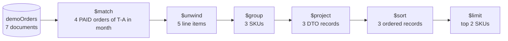

# Testing Each Stage with Small Datasets and Real Pipelines

An **aggregation pipeline** is a sequential chain of data transformations executed by the MongoDB Server: filtering documents, unwinding arrays into multiple rows, grouping data, summing totals, projecting fields, and sorting. In **Spring Data MongoDB**, you can build pipelines with `Aggregation` and run them through `MongoTemplate`, or declare static pipelines on repositories. A pipeline running without errors does not guarantee **correct results**: misplacing a stage, forgetting a tenant filter, dropping empty-array documents, or grouping by the wrong key can all produce wrong reports without throwing an exception.

This lesson presents a repeatable workflow: **prepare a small dataset with hand-verified results → test each stage independently → assemble the full pipeline → translate to Spring Data → integration test against real MongoDB → measure performance on representative data**. Our running example is a report of **units sold by SKU** from multi-line orders, scoped by tenant and time window.

This topic sits in the **Basic Aggregation** chapter of the `SPRING_DATA_MONGODB` module. It covers connecting to MongoDB, mapping documents, operating via `MongoTemplate`/repositories, query design, indexes, transactions, reactive access, testing, and performance diagnostics. The primary focus here is **correctness and stage-by-stage verifiability**, rather than cramming every MongoDB operator into one giant pipeline.

After this lesson, you will be able to:

- Read a pipeline left-to-right and determine **inputs, outputs, document count, and schema** after each stage.
- Hand-calculate expected outputs for `$match`, `$unwind`, `$group`, `$project`, `$sort`, and `$limit` on small datasets.
- Run pipeline prefixes in `mongosh`, establish checkpoints, and pinpoint the first stage that breaks results.
- Build the equivalent pipeline with `MongoTemplate.aggregate(...)` and map results into a DTO/record.
- Test both the **happy path and edge cases**: other tenants, excluded statuses, empty arrays, duplicate SKUs, ties, boundary timestamps, and numeric types.
- Use `explain`, indexes, and representative datasets to evaluate real pipelines after verifying logic.

## 1. Pipeline Mindset: Every Stage Transforms a Set of Documents

An aggregation pipeline is an **ordered array of stages**, for example:

```javascript
db.demoOrders.aggregate([
  { $match: { status: "PAID" } },
  { $unwind: "$lines" },
  { $group: { _id: "$lines.sku", units: { $sum: "$lines.quantity" } } },
  { $sort: { units: -1, _id: 1 } },
  { $limit: 10 }
]);
```

MongoDB Server reads documents from the collection, passes them through each stage, and feeds each stage's output into the next:



Not only do **values** change; document **shape** and **count** can change too:

| Stage | Purpose | Typical Effect |
| --- | --- | --- |
| `$match` | Filters matching documents | Shrinks document count; keeps document structure |
| `$unwind` | Expands each array element into its own document | Can increase row count, or drop empty/null arrays |
| `$group` | Groups by a key and applies accumulators | Usually reduces row count; creates group key `_id` |
| `$project` | Selects, renames, or computes fields | Changes schema; can drop fields needed by later stages |
| `$sort` | Orders by one or more keys | Does not alter row count; can consume memory |
| `$limit` | Keeps at most the first N documents at that spot | Reduces row count; placing early can **alter report semantics** |

**Verification rule:** after each stage, answer three questions: **how many rows remain? which fields does each row have? are the values sensible?** Checking only the final result lets early-stage bugs hide behind later transformations.

### 1.1. `find` vs. `aggregate`

`find` works well for filtering documents, picking fields, and simple sorting. `aggregate` is used when **transforming** data—unwinding arrays, grouping, summing, joining collections, or building reports. Both execute on MongoDB Server; never pull all orders into Java just to run `stream().groupingBy(...)` when the server can compute it cleanly.

For example, "fetch paid orders" only needs `find`; "sum total quantity per SKU across all line items of PAID orders" requires array expansion and grouping, making aggregation the natural fit.

## 2. Practical Problem: Monthly Unit Sales by SKU

Each order stores:

- `_id`: unique order code (BSON String).
- `tenantId`: business unit / data scope.
- `status`: `PAID`, `PENDING`, or another status.
- `createdAt`: order creation timestamp (BSON Date).
- `lines`: array of line items, each holding `sku`, `quantity`, and `lineTotalVnd`.

Suppose a report needs the **top 2 SKUs by total units sold**, counting only `PAID` orders of tenant `T-A` in the interval:

```text
2026-10-01T00:00:00Z <= createdAt < 2026-11-01T00:00:00Z
```

On quantity ties, prefer the SKU with higher gross revenue; if still tied, sort SKU ascending for deterministic order.

**Illustrative conventions:** `lineTotalVnd` is the recorded total for **that line item** per sample business rules, not unit price; `quantity` is always a positive integer. This report **does not handle refunds, returns, or order-level discount allocations**. If a real application includes those events, define the revenue formula before writing `$sum`.

### 2.1. Small Dataset: Seven Orders Intentionally Planting Edge Cases

Run all commands below only on an **isolated test database**, never on a live collection. To re-run cleanly, use a fresh test database or clean only the fixture safely before inserting.

```javascript
db.demoOrders.insertMany([
  {
    _id: "O-100", tenantId: "T-A", status: "PAID",
    createdAt: ISODate("2026-10-02T08:00:00Z"),
    lines: [
      { sku: "A", quantity: 2, lineTotalVnd: NumberLong("200000") },
      { sku: "B", quantity: 1, lineTotalVnd: NumberLong("50000") }
    ]
  },
  {
    _id: "O-101", tenantId: "T-A", status: "PAID",
    createdAt: ISODate("2026-10-15T09:00:00Z"),
    lines: [
      { sku: "A", quantity: 1, lineTotalVnd: NumberLong("100000") },
      { sku: "C", quantity: 3, lineTotalVnd: NumberLong("75000") }
    ]
  },
  {
    _id: "O-102", tenantId: "T-A", status: "PENDING",
    createdAt: ISODate("2026-10-20T10:00:00Z"),
    lines: [
      { sku: "A", quantity: 5, lineTotalVnd: NumberLong("500000") }
    ]
  },
  {
    _id: "O-103", tenantId: "T-A", status: "PAID",
    createdAt: ISODate("2026-10-25T11:00:00Z"),
    lines: []
  },
  {
    _id: "O-104", tenantId: "T-A", status: "PAID",
    createdAt: ISODate("2026-10-30T12:00:00Z"),
    lines: [
      { sku: "B", quantity: 1, lineTotalVnd: NumberLong("50000") }
    ]
  },
  {
    _id: "O-105", tenantId: "T-B", status: "PAID",
    createdAt: ISODate("2026-10-10T13:00:00Z"),
    lines: [
      { sku: "A", quantity: 10, lineTotalVnd: NumberLong("1000000") }
    ]
  },
  {
    _id: "O-106", tenantId: "T-A", status: "PAID",
    createdAt: ISODate("2026-11-01T00:00:00Z"),
    lines: [
      { sku: "C", quantity: 10, lineTotalVnd: NumberLong("250000") }
    ]
  }
]);
```

Purpose of the special records:

| ID | Test Scenario | Expected Behavior |
| --- | --- | --- |
| `O-100`, `O-101`, `O-104` | PAID orders with single or multiple lines; repeated SKUs across orders | Included in report |
| `O-102` | Right tenant/month, but `PENDING` | Excluded by `$match` |
| `O-103` | `PAID` yet `lines: []` | Passes `$match`, produces 0 rows in default `$unwind` |
| `O-105` | `PAID` in month, but belongs to `T-B` | Excluded to prevent cross-tenant leakage |
| `O-106` | Right tenant/status, but timestamp equals `toExclusive` | Excluded by `$lt` (not `$lte`) |

**Do not seed only "happy" data.** If every order had one line and a unique SKU, bugs in `$unwind` or `$group` could still look plausible. Small test datasets should contain **repeated group keys, empty arrays, excluded rows, ties, and boundary timestamps**.

### 2.2. Hand-Calculating Expected Results

Only `O-100`, `O-101`, `O-103`, and `O-104` survive `$match`; among them, `O-103` has an empty array.

| SKU | Valid Quantities | Total `units` | `lineTotalVnd` Values | `grossVnd` |
| --- | --- | ---: | --- | ---: |
| A | 2 + 1 | 3 | 200,000 + 100,000 | 300,000 |
| B | 1 + 1 | 2 | 50,000 + 50,000 | 100,000 |
| C | 3 | 3 | 75,000 | 75,000 |

Sorted by `units DESC, grossVnd DESC, sku ASC`, the exact order is:

1. **A** — 3 units, 300,000 VND.
2. **C** — 3 units, 75,000 VND.
3. **B** — 2 units, 100,000 VND.

Top 2 must be **A and C**, not A and B. This catches bugs where sorting mistakenly prioritizes revenue before units sold.

## 3. `$match` Stage: Filtering Accurately Before Summing

Mandatory conditions cover tenant, status, and a **half-open** time range:

```javascript
const fromInclusive = ISODate("2026-10-01T00:00:00Z");
const toExclusive = ISODate("2026-11-01T00:00:00Z");

const matchStage = {
  $match: {
    tenantId: "T-A",
    status: "PAID",
    createdAt: { $gte: fromInclusive, $lt: toExclusive }
  }
};

db.demoOrders.aggregate([matchStage]).toArray();
```

Output must contain **four documents**: `O-100`, `O-101`, `O-103`, `O-104`. If `O-102` appears, status filtering failed; if `O-105` appears, tenant filtering is missing; if `O-106` appears, time boundary logic is wrong.

To check count without printing every field:

```javascript
db.demoOrders.aggregate([
  matchStage,
  { $count: "ordersAfterMatch" }
]).toArray();

// [{ ordersAfterMatch: 4 }]
```

`$count` here is a **temporary diagnostic stage**, not part of the final report pipeline. It lets you ask "how many documents remain after `$match`?" without transferring thousands of documents to the client.

### 3.1. Why Put `$match` Early?

Filtering seven orders down to four means `$unwind` and `$group` only touch four valid orders. At scale, placing indexable filters early reduces I/O, memory, and CPU.

Still, not every `$match` can be pushed to the top. A filter on `units`—a field **created after `$group`**—must follow `$group`; pushing it earlier fails because the field does not exist yet. MongoDB's optimizer can reorder certain stages when semantics stay unchanged, but explicit logical ordering remains essential.

### 3.2. Timestamps and Timezones

BSON Date stores an instant in time. Hence `[2026-10-01T00:00:00Z, 2026-11-01T00:00:00Z)` is **October in UTC**, not automatically "October in Vietnam time." If business reporting uses `Asia/Ho_Chi_Minh`, the service must convert local month start/end timestamps into corresponding `Instant` values before building `$match`.

Using `$lt(toExclusive)` prevents double-counting boundary documents across consecutive reporting windows. Never switch to `$lte(endOfDay)` and guess millisecond/nanosecond end-of-day precision.

## 4. `$unwind` Stage: Turning Orders Into Line Items

Matching orders store `lines` as an array. To group by SKU inside the array, unwind it:

```javascript
const unwindStage = { $unwind: "$lines" };

db.demoOrders.aggregate([
  matchStage,
  unwindStage,
  { $project: {
      _id: 1,
      "lines.sku": 1,
      "lines.quantity": 1,
      "lines.lineTotalVnd": 1
  } }
]).toArray();
```

Expected output (abbreviated; do not rely on order before sorting):

| `_id` | `lines.sku` | `quantity` | `lineTotalVnd` |
| --- | --- | ---: | ---: |
| O-100 | A | 2 | 200,000 |
| O-100 | B | 1 | 50,000 |
| O-101 | A | 1 | 100,000 |
| O-101 | C | 3 | 75,000 |
| O-104 | B | 1 | 50,000 |

**Five documents remain after unwind**, even though `$match` picked four orders. `O-103` has `lines: []`, so default `$unwind` **emits nothing for it**.

```javascript
db.demoOrders.aggregate([
  matchStage,
  unwindStage,
  { $count: "linesAfterUnwind" }
]).toArray();

// [{ linesAfterUnwind: 5 }]
```

If you predicted four ("one per order") or six (counting an extra row for the empty array), stop immediately and refine your mental model of `$unwind` before writing `$group`.

### 4.1. `preserveNullAndEmptyArrays` Can Alter Report Semantics

To retain documents with empty/null/missing arrays, MongoDB provides:

```javascript
{
  $unwind: {
    path: "$lines",
    preserveNullAndEmptyArrays: true
  }
}
```

Depending on `lines`'s state (empty, null, missing), those documents are retained **without a valid line item**. Grouping afterward by `lines.sku` can introduce an `_id: null` group or "phantom" counts.

When reporting **units sold**, dropping orders with no line items via default unwind is right. When reporting **all orders including line-less ones**, you may need `preserve` with separate handling. **Never enable the option just to make post-unwind row counts look like input order counts.**

### 4.2. Grouping Before Unwind Is a Mistake

Grouping by `"$lines.sku"` **before** unwinding means inputs still hold **SKU arrays** or array-spanning paths. The group key is no longer an individual SKU, and `$sum("$lines.quantity")` will not sum individual line items as intended. For per-SKU reports, confirm the stream is **one row per element** before grouping.

## 5. `$group` Stage: Choosing the Group Key and Accumulators

After `$unwind`, each document is a single line item. Group by SKU and sum two metrics:

```javascript
const groupStage = {
  $group: {
    _id: "$lines.sku",
    units: { $sum: "$lines.quantity" },
    grossVnd: { $sum: "$lines.lineTotalVnd" }
  }
};

db.demoOrders.aggregate([
  matchStage,
  unwindStage,
  groupStage
]).toArray();
```

Expected **three group documents**, ignoring order:

```javascript
[
  { _id: "A", units: 3, grossVnd: NumberLong("300000") },
  { _id: "B", units: 2, grossVnd: NumberLong("100000") },
  { _id: "C", units: 3, grossVnd: NumberLong("75000") }
]
```

MongoDB may display numbers as `NumberInt`, `NumberLong`, or Extended JSON depending on data and environment; the **values** to check are 3/300,000, 2/100,000, and 3/75,000. Output ordering from `$group` **is not guaranteed** without `$sort`.

### 5.1. `_id` After Group Is the **Group Key**, Not the Order ID

Before `$group`, `_id` was the order code like `"O-100"`. After `$group`, `_id` is the SKU like `"A"`. This is a **major schema shift**:

| Before Group | After Group |
| --- | --- |
| `_id = "O-100"` | `_id = "A"` |
| `tenantId = "T-A"` | No longer a separate field unless placed in an accumulator/key |
| `lines.sku = "A"` | SKU is inside `_id` |
| `lines.quantity = 2` | `units = 3` (summed across orders) |
| `lines.lineTotalVnd = 200000` | `grossVnd = 300000` |

Hence writing `$sort: { "lines.sku": 1 }` afterward references a non-existent field. Sort by `_id`, or use `$project` to alias the group key to `sku`.

### 5.2. `$sum` Does Not Automatically Fix Mistyped Data

`$sum` adds numeric values. If a line stores `quantity` as BSON String `"2"`, do not expect it to sum as `2`; accumulators generally ignore non-numeric values. The pipeline **still returns results, just with wrong numbers**.

For money, this example uses **integer VND** stored as 64-bit BSON integers to avoid double rounding drift. For decimal currencies, consider BSON `Decimal128` mapped to `BigDecimal`. On large datasets, verify numeric ranges and output types instead of assuming every sum fits in a Java `int`.

### 5.3. `$sum: 1` Is Not `$sum: "$lines.quantity"`

These two expressions serve different goals:

```javascript
{
  $group: {
    _id: "$lines.sku",
    numberOfLines: { $sum: 1 },
    units: { $sum: "$lines.quantity" }
  }
}
```

For SKU A, there are **2 line items** (in O-100 and O-101) but **3 units**. Using `$sum: 1` for `units` returns 2 and silently corrupts the report. Integration tests with `quantity > 1` catch this immediately.

### 5.4. Counting Distinct Orders per SKU Is a Separate Problem

One order can contain the same SKU on multiple lines. `$sum: 1` after unwind counts **lines**, not necessarily **distinct orders**. To answer "how many orders contain SKU A?", group by `(sku, orderId)` pairs or apply a deduplication step before counting.

This lesson asks for **units sold**, so `$sum("$lines.quantity")` directly is exact.

## 6. `$project` Stage: Shaping the DTO and Avoiding Key Confusion

After grouping, the SKU key sits in `_id`. We want API output shaped as:

```json
{
  "sku": "A",
  "units": 3,
  "grossVnd": 300000
}
```

Add `$project`:

```javascript
const projectStage = {
  $project: {
    _id: 0,
    sku: "$_id",
    units: 1,
    grossVnd: 1
  }
};

db.demoOrders.aggregate([
  matchStage,
  unwindStage,
  groupStage,
  projectStage
]).toArray();
```

Document count remains **three**. The new schema has only `sku`, `units`, and `grossVnd`; `_id` was excluded since the DTO does not want it.

### 6.1. Checking Fields After Projection

Common bugs:

```javascript
// WRONG: group turned SKU into _id; "lines.sku" no longer exists.
{ $project: { _id: 0, sku: "$lines.sku", units: 1 } }

// WRONG: dropped grossVnd, yet the next stage sorts by grossVnd.
{ $project: { _id: 0, sku: "$_id", units: 1 } }
```

Once a field is excluded by `$project`, later stages **cannot reach back to the source document**. Keep a stage-by-stage schema table: before group has `lines.sku`, after group has `_id`, and after project has `sku`.

### 6.2. Projection Is Not Where You Fix Monetary Formulas

To compute `grossVnd` from `quantity × unitPriceVnd`, use `$multiply` in an appropriate stage. Because our fixture already stores `lineTotalVnd`, summing it matches the sample rule.

Never sum `order.totalVnd` after unwinding multi-line orders: an **order-level** total gets repeated on every line, multiplying revenue erroneously. Always check whether a field is **order-level or line-level** before choosing stages and accumulators.

## 7. `$sort` and `$limit` Stages: Picking Top 2 in the Right Order

Requirement: rank by highest units sold first; on ties, highest gross revenue; if still tied, SKU ascending.

```javascript
const sortStage = {
  $sort: { units: -1, grossVnd: -1, sku: 1 }
};

const limitStage = { $limit: 2 };

db.demoOrders.aggregate([
  matchStage,
  unwindStage,
  groupStage,
  projectStage,
  sortStage
]).toArray();
```

Output after sorting has **three rows**, ordered:

```javascript
[
  { sku: "A", units: 3, grossVnd: NumberLong("300000") },
  { sku: "C", units: 3, grossVnd: NumberLong("75000") },
  { sku: "B", units: 2, grossVnd: NumberLong("100000") }
]
```

Units sold takes precedence, so **C precedes B even though B's `grossVnd` exceeds C's**. Finally append `$limit`:

```javascript
db.demoOrders.aggregate([
  matchStage,
  unwindStage,
  groupStage,
  projectStage,
  sortStage,
  limitStage
]).toArray();

// Top 2: A (3, 300000), C (3, 75000).
```

### 7.1. Why Not Push `$limit` Before `$group`?

Writing:

```javascript
[
  matchStage,
  { $limit: 2 }, // WRONG when the goal is top SKUs for the entire month!
  unwindStage,
  groupStage
]
```

aggregates only **the first two matching orders picked before grouping**, not all qualifying orders in the month. Results depend on arbitrary scan order and drop data. **`$limit` restricts data right where it sits**. MongoDB optimizes `$sort + $limit` under valid conditions, but never rewrites limit across `$group` in a way that alters **semantics**.

### 7.2. Does Sort Need a Secondary Tie-Breaker?

Yes. If two SKUs tie on `units` and `grossVnd`, omitting `sku` leaves their relative order unspecified. For top-N APIs, pagination, and deterministic test snapshots, an explicit tie-breaker stabilizes output. Here `sku` is the unique group key, making it ideal.

### 7.3. When Pagination Is Needed

You can place `$skip` and `$limit` after `$sort`, though deep offsets are costly and live updates between requests can shift pages. For frequent summary reports, consider saving a result snapshot, setting a cutoff, or building cursor pagination over **the grouped output sort keys**. Never confuse keyset pagination on source orders with keyset pagination on aggregated SKU tables.

## 8. Checking Every Pipeline Prefix with a `mongosh` Script

Instead of copying six separate pipelines, store stages in an array during a **test `mongosh` session**:

```javascript
const pipeline = [
  matchStage,
  unwindStage,
  groupStage,
  projectStage,
  sortStage,
  limitStage
];

const names = [
  "$match", "$unwind", "$group", "$project", "$sort", "$limit"
];

for (let i = 1; i <= pipeline.length; i++) {
  const prefix = pipeline.slice(0, i);
  const rows = db.demoOrders.aggregate(prefix).toArray();

  print("--- After " + names[i - 1] + " ---");
  print("Document count: " + rows.length);
  printjson(rows);
}
```

This assumes `matchStage`, `unwindStage`, `groupStage`, `projectStage`, `sortStage`, and `limitStage` were already defined in **the same `mongosh` session** as earlier sections. Only call `toArray()` on **small fixtures**, never on production pipelines returning millions of documents.

### 8.1. Count and Schema Checkpoint Table

| Checkpoint | Expected Docs | Key Fields | Verification Question |
| --- | ---: | --- | --- |
| Source collection | 7 | `_id, tenantId, status, createdAt, lines` | Was the fixture seeded properly? |
| After `$match` | 4 | Same as source order docs | Right tenant/status/month? |
| After `$unwind` | 5 | `lines` is an object with `sku/quantity/lineTotalVnd` | Empty array handled per rules? |
| After `$group` | 3 | `_id, units, grossVnd` | A/B/C totals accurate? |
| After `$project` | 3 | `sku, units, grossVnd` | Renamed `_id` to `sku`? |
| After `$sort` | 3 | Same 3 fields, ordered | A, C, B or wrong order? |
| After `$limit` | 2 | `sku, units, grossVnd` | Exactly A and C? |

If step 4 is right and step 5 is wrong, the bug lies in `$project`, so leave `$group` untouched. If step 2 is wrong, fix `$match` or the fixture before looking at accumulation.

### 8.2. Diagnosing via `$count` Instead of Fetching Every Prefix Row

When a pipeline handles many documents, append `$count` right after the stage under inspection:

```javascript
function countAfter(prefix) {
  return db.demoOrders.aggregate([
    ...prefix,
    { $count: "n" }
  ]).toArray();
}

printjson(countAfter([matchStage]));              // [{ n: 4 }]
printjson(countAfter([matchStage, unwindStage])); // [{ n: 5 }]
printjson(countAfter([
  matchStage, unwindStage, groupStage
]));                                              // [{ n: 3 }]
```

**Edge case:** if zero documents enter `$count`, the stage emits **zero documents**, not `{ n: 0 }`. Tests must handle empty arrays. Remember that a diagnostic count is **a modified pipeline with an extra stage**, not the final report output.

### 8.3. Checking Intermediate Values When Row Volume Is Large

Insert a diagnostic `$project` right after `$unwind` showing only `orderId`, `sku`, `quantity`, and `lineTotalVnd`. Add `$sort` by `_id`/`sku` for repeatable comparisons. On large datasets, limit rows **after the stage being checked** solely for spot sampling—never treat a `$limit`-capped diagnostic query as proof that full group sums are accurate.

**Testing discipline:** change only one assumption or one stage at a time while keeping the fixture and expected output fixed. Changing filters, group keys, and sorts all at once makes it impossible to tell what caused an output shift.

## 9. Rewriting the Pipeline in Spring Data MongoDB

Once every stage is verified in `mongosh`, translate the exact intent to Spring Data. `MongoTemplate` provides `Aggregation`, `Criteria`, and `Sort` to build Java pipelines; Spring Data maps property names/values to BSON via entity metadata when supplied with the right input type.

### 9.1. Source Entity and Output DTO

Java 17+ example:

```java
import java.time.Instant;
import java.util.List;
import org.springframework.data.mongodb.core.mapping.Document;
import org.springframework.data.mongodb.core.mapping.MongoId;

// A product line inside an order.
record DemoOrderLine(
        String sku,
        int quantity,
        long lineTotalVnd
) {}

@Document(collection = "demoOrders")
public record DemoOrder(
        @MongoId String id,
        String tenantId,
        String status,
        Instant createdAt,
        List<DemoOrderLine> lines
) {}
```

Aggregation output maps to a DTO, **not `DemoOrder`**:

```java
// An aggregated report row, not corresponding to an order document.
public record SkuSalesRow(
        String sku,
        long units,
        long grossVnd
) {}
```

`DemoOrder.id` is BSON String `_id`, `createdAt` is BSON Date mapped to `Instant`, and `lines` is an array of embedded documents. Totals use `long` since the example counts integer VND. Report rows after `$group`/`$project` lack `tenantId`, `status`, and `createdAt`, so **never map aggregation results into `DemoOrder` and call `save`**.

### 9.2. Testable Pipeline Service

```java
import java.time.Instant;
import java.util.List;
import org.springframework.data.domain.Sort;
import org.springframework.data.mongodb.core.MongoTemplate;
import org.springframework.data.mongodb.core.aggregation.Aggregation;
import org.springframework.data.mongodb.core.aggregation.AggregationResults;
import org.springframework.data.mongodb.core.query.Criteria;
import org.springframework.stereotype.Service;

@Service
public class SkuSalesReportService {

    private final MongoTemplate template;

    public SkuSalesReportService(MongoTemplate template) {
        this.template = template;
    }

    public List<SkuSalesRow> topSkus(
            String authorizedTenantId,
            Instant fromInclusive,
            Instant toExclusive,
            long topN
    ) {
        if (authorizedTenantId == null || authorizedTenantId.isBlank()
                || fromInclusive == null || toExclusive == null
                || !fromInclusive.isBefore(toExclusive)
                || topN < 1 || topN > 100) {
            throw new IllegalArgumentException(
                    "Invalid tenant, time range, or topN");
        }

        Criteria filter = Criteria.where("tenantId")
                .is(authorizedTenantId)
                .and("status").is("PAID")
                .and("createdAt").gte(fromInclusive).lt(toExclusive);

        Aggregation pipeline = Aggregation.newAggregation(
                Aggregation.match(filter),
                Aggregation.unwind("lines"),
                Aggregation.group("lines.sku")
                        .sum("lines.quantity").as("units")
                        .sum("lines.lineTotalVnd").as("grossVnd"),
                Aggregation.project("units", "grossVnd")
                        .and("_id").as("sku")
                        .andExclude("_id"),
                Aggregation.sort(Sort.by(
                        Sort.Order.desc("units"),
                        Sort.Order.desc("grossVnd"),
                        Sort.Order.asc("sku"))),
                Aggregation.limit(topN)
        );

        AggregationResults<SkuSalesRow> result =
                template.aggregate(
                        pipeline,
                        DemoOrder.class,
                        SkuSalesRow.class);

        return result.getMappedResults();
    }
}
```

Usage:

```java
List<SkuSalesRow> top2 = reportService.topSkus(
        "T-A",
        Instant.parse("2026-10-01T00:00:00Z"),
        Instant.parse("2026-11-01T00:00:00Z"),
        2
);

// top2[0] = ("A", 3, 300000)
// top2[1] = ("C", 3, 75000)
```

Here `reportService` is an injected `SkuSalesReportService` in a controller/service/test; calling code requires `Instant` and `List` imports. Passing input type `DemoOrder.class` lets Spring Data map domain properties. If physical field names are overridden via `@Field`, inspect the actual BSON pipeline and test DTO mapping.

### 9.3. Comparing Each Java Stage Against `mongosh`

| `mongosh` | Spring Data | What to Compare |
| --- | --- | --- |
| `{ $match: ... }` | `Aggregation.match(Criteria...)` | tenant, status, and time interval |
| `{ $unwind: "$lines" }` | `Aggregation.unwind("lines")` | 5 lines, empty array skipped |
| `{ $group: { _id: "$lines.sku", ... } }` | `Aggregation.group("lines.sku").sum(...)` | A/B/C, both sums |
| `{ $project: { sku: "$_id", ... } }` | `Aggregation.project(...).and("_id").as("sku")` | DTO `sku` field |
| `{ $sort: ... }` | `Aggregation.sort(Sort.by(...))` | priority: units, gross, sku |
| `{ $limit: 2 }` | `Aggregation.limit(2)` | only A and C |

**Field-name note:** `id` is the Java property stored in BSON as `_id`. After `$group`, the group key sits in `_id`, though it is **no longer the order ID**. If `@Field` is applied to `lines.lineTotalVnd`, or custom converters are registered, verify the generated pipeline emits the right BSON paths.

### 9.4. Why Does `MongoTemplate` Fit This Pipeline Well?

Repositories support `@Aggregation` for static pipelines. However, when you have **dynamic tenant/time windows, variable `topN`, multiple stages, and stage-by-stage debugging needs**, assembling pipelines via `MongoTemplate`/`Aggregation` is easier to structure into testable methods.

Choosing one API over another does not make MongoDB Server execute faster by itself. Both `@Aggregation` and `MongoTemplate.aggregate` must be evaluated by **final BSON pipeline**, indexes, and real outputs.

## 10. Using "Inspection" Stages in Spring Data During Development

While debugging, you do not always need to run the entire pipeline. **Truncate at the stage under inspection** and return `Document` or a diagnostic DTO.

For instance, to check only order count after match and line count after unwind, run two **independent** aggregations:

```java
import java.time.Instant;
import java.util.List;
import org.bson.Document;
import org.springframework.data.mongodb.core.MongoTemplate;
import org.springframework.data.mongodb.core.aggregation.Aggregation;
import org.springframework.data.mongodb.core.query.Criteria;

Criteria filter = Criteria.where("tenantId").is("T-A")
        .and("status").is("PAID")
        .and("createdAt")
        .gte(Instant.parse("2026-10-01T00:00:00Z"))
        .lt(Instant.parse("2026-11-01T00:00:00Z"));

Aggregation countOrders = Aggregation.newAggregation(
        Aggregation.match(filter),
        Aggregation.count().as("n"));

Aggregation countLines = Aggregation.newAggregation(
        Aggregation.match(filter),
        Aggregation.unwind("lines"),
        Aggregation.count().as("n"));

List<Document> orders = template.aggregate(
        countOrders, DemoOrder.class, Document.class)
        .getMappedResults();
List<Document> lines = template.aggregate(
        countLines, DemoOrder.class, Document.class)
        .getMappedResults();

// With fixture: orders[0].get("n") == 4;
//               lines[0].get("n") == 5.
```

This snippet belongs in a service/test with `template` injected. If `$count` receives empty input, `getMappedResults()` returns an empty list; never call `get(0)` without checking size first. In tests, read `Document.get("n")` via `Number.longValue()` instead of assuming fixed BSON int/long representation.

### 10.1. Debugging `$group` Before `$project`

```java
Aggregation grouped = Aggregation.newAggregation(
        Aggregation.match(filter),
        Aggregation.unwind("lines"),
        Aggregation.group("lines.sku")
                .sum("lines.quantity").as("units")
                .sum("lines.lineTotalVnd").as("grossVnd")
);

List<Document> rawGroups = template.aggregate(
        grouped, DemoOrder.class, Document.class)
        .getMappedResults();
```

Each `Document` must have `_id` as SKU along with `units` and `grossVnd`. Never assert list order on `rawGroups` before sorting: `$group` **does not guarantee output order**. Convert them into a map keyed by `_id` to assert order-independently.

### 10.2. Inspect the Actual Command Instead of Assuming DSL Translation

When using Java properties, `@Field`, DTO constructors, or custom stages, do not just inspect the `Aggregation` object in a debugger. Use **MongoDB Driver command monitoring** in tests or the MongoDB profiler (where authorized) to see the real `aggregate` command and pipeline sent.

Query logs may expose tenant IDs, search criteria, or sensitive data. Mask sensitive fields appropriately and restrict verbose logging to authorized environments. Never treat `pipeline.toString()` as conclusive proof of the exact BSON processed by driver/server.

## 11. End-to-End Integration Testing

Unit testing a pipeline-builder method cannot verify how MongoDB executes `$unwind`, `$group`, BSON Dates, Java record mapping, or sorting. To guard against regressions, run against a **real yet isolated test MongoDB instance**, such as Testcontainers with `@DataMongoTest`.

### 11.1. Test Slice and Seeding Data

Spring Boot 3.x, Java 17+ example using `DemoOrder`, `DemoOrderLine`, `SkuSalesRow`, and `SkuSalesReportService` from Section 9:

```java
import static org.assertj.core.api.Assertions.assertThat;

import java.time.Instant;
import java.util.List;
import java.util.Map;
import org.bson.Document;
import org.junit.jupiter.api.BeforeEach;
import org.junit.jupiter.api.Test;
import org.springframework.beans.factory.annotation.Autowired;
import org.springframework.boot.test.autoconfigure.data.mongo.DataMongoTest;
import org.springframework.data.mongodb.core.MongoTemplate;
import org.springframework.data.mongodb.core.aggregation.Aggregation;
import org.springframework.data.mongodb.core.query.Criteria;
import org.springframework.data.mongodb.core.query.Query;

@DataMongoTest
class SkuSalesAggregationIntegrationTest {

    @Autowired
    MongoTemplate template;

    private SkuSalesReportService service;

    private static Instant t(String iso) {
        return Instant.parse(iso);
    }

    private static DemoOrderLine line(
            String sku, int quantity, long grossVnd
    ) {
        return new DemoOrderLine(sku, quantity, grossVnd);
    }

    private static DemoOrder order(
            String id, String tenant, String status,
            String createdAt, DemoOrderLine... lines
    ) {
        return new DemoOrder(
                id, tenant, status, t(createdAt), List.of(lines));
    }

    @BeforeEach
    void seedFixture() {
        service = new SkuSalesReportService(template);

        // Use only on an isolated test database, never on production.
        template.remove(new Query(), DemoOrder.class);
        template.insertAll(List.of(
                order("O-100", "T-A", "PAID",
                        "2026-10-02T08:00:00Z",
                        line("A", 2, 200_000L),
                        line("B", 1, 50_000L)),
                order("O-101", "T-A", "PAID",
                        "2026-10-15T09:00:00Z",
                        line("A", 1, 100_000L),
                        line("C", 3, 75_000L)),
                order("O-102", "T-A", "PENDING",
                        "2026-10-20T10:00:00Z",
                        line("A", 5, 500_000L)),
                order("O-103", "T-A", "PAID",
                        "2026-10-25T11:00:00Z"),
                order("O-104", "T-A", "PAID",
                        "2026-10-30T12:00:00Z",
                        line("B", 1, 50_000L)),
                order("O-105", "T-B", "PAID",
                        "2026-10-10T13:00:00Z",
                        line("A", 10, 1_000_000L)),
                order("O-106", "T-A", "PAID",
                        "2026-11-01T00:00:00Z",
                        line("C", 10, 250_000L))
        ));
    }

    @Test
    void finalPipelineReturnsTopTwoInCorrectOrder() {
        List<SkuSalesRow> rows = service.topSkus(
                "T-A",
                t("2026-10-01T00:00:00Z"),
                t("2026-11-01T00:00:00Z"),
                2
        );

        assertThat(rows).extracting(SkuSalesRow::sku)
                .containsExactly("A", "C");
        assertThat(rows).extracting(SkuSalesRow::units)
                .containsExactly(3L, 3L);
        assertThat(rows).extracting(SkuSalesRow::grossVnd)
                .containsExactly(300_000L, 75_000L);
    }

    @Test
    void matchAndUnwindProduceExpectedCounts() {
        Criteria filter = Criteria.where("tenantId").is("T-A")
                .and("status").is("PAID")
                .and("createdAt")
                .gte(t("2026-10-01T00:00:00Z"))
                .lt(t("2026-11-01T00:00:00Z"));

        Aggregation afterMatch = Aggregation.newAggregation(
                Aggregation.match(filter),
                Aggregation.count().as("n")
        );

        Aggregation afterUnwind = Aggregation.newAggregation(
                Aggregation.match(filter),
                Aggregation.unwind("lines"),
                Aggregation.count().as("n")
        );

        Document countOrders = template.aggregate(
                afterMatch, DemoOrder.class, Document.class)
                .getUniqueMappedResult();
        Document countLines = template.aggregate(
                afterUnwind, DemoOrder.class, Document.class)
                .getUniqueMappedResult();

        assertThat(countOrders).isNotNull();
        assertThat(countLines).isNotNull();
        assertThat(((Number) countOrders.get("n")).longValue())
                .isEqualTo(4L);
        assertThat(((Number) countLines.get("n")).longValue())
                .isEqualTo(5L);
    }
}
```

These two tests verify **two different layers**: one checks the final pipeline output, while the other catches bugs early at `$match`/`$unwind`. The seed data includes pending orders, another tenant, empty arrays, and exact boundary timestamps; tests do not check only "happy" cases.

`@DataMongoTest` does not automatically guarantee a MongoDB Server is running in every project. Configure the test MongoDB URI (e.g., via Testcontainers) and Spring Boot Test/JUnit/AssertJ dependencies. `template.remove(new Query(), ...)` **wipes the entire target collection**, so it is only safe against an isolated test database.

### 11.2. Testing `$group` Before `$project`

Another valuable test: execute up to `$group` and assert by SKU map, **without relying on order**:

```java
import java.util.Map;
import java.util.stream.Collectors;
import org.bson.Document;

Map<String, Document> bySku = rawGroups.stream()
        .collect(Collectors.toMap(
                doc -> doc.getString("_id"),
                doc -> doc));

assertThat(bySku.keySet()).containsExactlyInAnyOrder("A", "B", "C");
assertThat(((Number) bySku.get("A").get("units")).longValue())
        .isEqualTo(3L);
assertThat(((Number) bySku.get("B").get("grossVnd")).longValue())
        .isEqualTo(100_000L);
```

This is a **fragment inside a test** that already built `rawGroups` as in Section 10.1 with AssertJ imported; it is not a standalone test. It separates accumulation errors in `$group` from field-renaming errors in `$project`.

### 11.3. Testing Invalid Inputs and Empty Result Sets

Alongside the core fixture, test blank tenants, `from >= to`, `topN` = 0 or out of bounds, and a month with zero PAID orders. When a reporting pipeline matches nothing, `getMappedResults()` returns an empty list; **never turn it into a fake `{ sku: null, units: 0 }` row**.

For pipelines using `$count`, also distinguish empty input from returning a document with `count = 0`. Keep JSON/API expectations consistent across both cases.

## 12. Complete Standalone Pipeline Without Prior `mongosh` Variables

Earlier sections used variables like `matchStage` and `unwindStage` to inspect step by step. Once validated, here is the **self-contained copy-pasteable version for `mongosh`** on a seeded test database:

```javascript
db.demoOrders.aggregate([
  {
    $match: {
      tenantId: "T-A",
      status: "PAID",
      createdAt: {
        $gte: ISODate("2026-10-01T00:00:00Z"),
        $lt: ISODate("2026-11-01T00:00:00Z")
      }
    }
  },
  {
    $unwind: "$lines"
  },
  {
    $group: {
      _id: "$lines.sku",
      units: { $sum: "$lines.quantity" },
      grossVnd: { $sum: "$lines.lineTotalVnd" }
    }
  },
  {
    $project: {
      _id: 0,
      sku: "$_id",
      units: 1,
      grossVnd: 1
    }
  },
  {
    $sort: {
      units: -1,
      grossVnd: -1,
      sku: 1
    }
  },
  {
    $limit: 2
  }
]).toArray();
```

Expected output, ignoring `NumberInt`/`NumberLong` printing differences:

```json
[
  {"sku": "A", "units": 3, "grossVnd": 300000},
  {"sku": "C", "units": 3, "grossVnd": 75000}
]
```

Each stage has one clear job:

1. `$match` lets only authorized, in-period data pass.
2. `$unwind` expands an order of N lines into N line rows.
3. `$group` groups lines by SKU and sums **line-level** metrics.
4. `$project` translates the schema from group `_id` to `sku` for the DTO.
5. `$sort` enforces ranking priority and tie-breakers.
6. `$limit` selects the top two SKUs **after** all groups have been computed.

**Never treat these three as equivalent:** "first two orders," "first two line items," and "top two best-selling SKUs." They correspond to placing `$limit` **before unwind**, **after unwind**, or **after group + sort**, yielding completely different results.

### 12.1. Confirming Report Date Semantics

This example filters by `createdAt` (order creation time) because the sample schema only has that field. In real sales systems, managers often want reports by **payment timestamp `paidAt`**, not creation time. An order created at the end of September and paid in early October would be missed by `createdAt` even though it belongs in October revenue.

Before deploying a pipeline to production, lock down:

- Report by creation date, payment date, or accounting recognition date?
- Does `PAID` include partially refunded orders?
- Is `lineTotalVnd` already net of discounts, vouchers, and taxes?
- Can an order's `lines` change after payment?
- Do `deleted`, `cancelledAt`, or refund documents need filtering?

**A pipeline can be syntactically valid yet wrong in metric definition.** Confirm expected outputs with business stakeholders before tuning indexes.

### 12.2. When Output Is a Summary Table, Never `save` It as a Source Document

`SkuSalesRow` holds only `sku`, `units`, and `grossVnd`, not a `DemoOrder`. Use it for report responses, CSV exports, caches, or writing to a dedicated materialized-view collection with its own schema. **Never map aggregated results into an order entity and call `save`**, since it is not a complete order document.

When persisting periodic reports, design a composite key `tenantId + period + sku`, snapshot timestamp, calculation version, and dedicated update/upsert strategy. Never overwrite the source collection with grouped output.

## 13. Edge Cases to Verify Before Trusting Metrics

A good small fixture does not only contain expected rows; it includes **adversarial inputs** testing pipeline assumptions.

| Scenario | Consequence If Unchecked | Resolution |
| --- | --- | --- |
| `lines: []` | Default `$unwind` drops the document | Confirm whether report counts lines or orders |
| Missing/null `lines` | May be dropped, or form a null group under preserve | Define schema and explicit handling |
| `lines` written as an object instead of array | `$unwind` processes non-arrays, inflating counts unexpectedly | Schema validation and negative tests |
| Two lines with same SKU in one order | `$sum: 1` counts 2 lines, not 1 SKU/order | Clarify whether metric is units, lines, or unique orders |
| `quantity = 0` or negative | `units` decreases or stalls | Domain validation; define return/adjustment semantics |
| `quantity` stored as String | Numeric accumulators skip or miscalculate | Standardize BSON types and validators |
| `lineTotalVnd` stored as double | Sum incurs floating-point drift | Use integer minor units or `Decimal128` |
| `sku` null or empty string | `$group` creates an invalid SKU bucket | Validate, or filter intentionally after unwind |
| `PENDING` order with many lines | Sales counts inflated if status filter missing | Test wrong-status orders explicitly |
| Other tenant sharing same SKU | Cross-tenant data mixed if tenant filter missing | Enforce mandatory tenant filter at pipeline start |
| Order at exact `toExclusive` | Double-counted across periods if using `$lte` | Use half-open `$gte`/`$lt` intervals |
| Multiple SKUs tied on `units` | Top-N shifts without tie-breaker | Sort further by `grossVnd` and `sku` |
| Source data changes mid-run | Two runs return slightly different results | Define consistency/cutoff and snapshot strategy if needed |

### 13.1. Adding a SKU-Less Line to Observe Consequences

Example in an **isolated test database**:

```javascript
db.demoOrders.insertOne({
  _id: "O-BAD-SKU",
  tenantId: "T-A",
  status: "PAID",
  createdAt: ISODate("2026-10-17T00:00:00Z"),
  lines: [
    { quantity: 1, lineTotalVnd: NumberLong("10000") }
  ]
});
```

Re-running the pipeline **without SKU validation** lets `$group` by `lines.sku` emit an `_id: null` bucket. Malformed data might miss the top 2, yet still corrupt report semantics and surface whenever group lists are small.

A validation stage after unwind:

```javascript
{
  $match: {
    "lines.sku": { $type: "string", $ne: "" },
    "lines.quantity": { $type: "number", $gt: 0 }
  }
}
```

This is an **illustrative filter policy**. When financial reports must account transparently for dropped records, count and report **excluded error rows** rather than silently scrubbing data and claiming every order was counted. Add write-path validators and alerts on schema violations.

After inserting `O-BAD-SKU`, counts after `$match` and `$unwind` **are no longer 4 and 5**. Keep the **clean baseline fixture** separate from negative-data test runs instead of mutating it and reusing old expected counts.

### 13.2. Why Not Use `$first` to "Pick One Representative SKU"?

`$first` is an accumulator that picks the first value under a meaningful sort order; it does not magically fix a wrong grouping key. When selecting the newest order or a representative line, define an explicit sort and tie-breaker first. Never use `$first` to paper over missing fields from broken grouping.

### 13.3. How Missing Differs from BSON `null`

When debugging, `$type` distinguishes missing fields from explicit BSON `null`:

```javascript
db.demoOrders.aggregate([
  { $match: { _id: "O-100" } },
  {
    $project: {
      linesType: { $type: "$lines" },
      tenantType: { $type: "$tenantId" },
      createdAtType: { $type: "$createdAt" }
    }
  }
]);
```

In aggregation, `$type` returns `"missing"` for absent fields and `"null"` when explicitly null. Java converter outputs often collapse both to Java `null`; inspect raw BSON when diagnosing data issues.

## 14. From Small Datasets to Production-Scale Pipelines

A pipeline returning **A, C** across seven documents only verifies **fixture logic**. Running over millions of orders requires inspecting per-stage cost and scalability.

### 14.1. Index for Leading Filter Conditions

For filtering `tenantId = "T-A"`, `status = "PAID"`, and ranged `createdAt`:

```javascript
db.demoOrders.createIndex({
  tenantId: 1,
  status: 1,
  createdAt: 1
});
```

This is a **starting candidate index**, not universally optimal. Equality on tenant/status followed by time range can leverage index prefix ordering. Selectivity, frequency of other queries, and write-time index maintenance overhead must be measured on real workloads.

If the application uses `soft delete` or extra predicates, index design must consider the overall query mix. Never build a giant compound index spanning every field just because a pipeline touches them across stages.

### 14.2. Using `explain("executionStats")`

MongoDB lets you inspect aggregation execution plans with `explain`:

```javascript
const pipeline = [
  {
    $match: {
      tenantId: "T-A",
      status: "PAID",
      createdAt: {
        $gte: ISODate("2026-10-01T00:00:00Z"),
        $lt: ISODate("2026-11-01T00:00:00Z")
      }
    }
  },
  { $unwind: "$lines" },
  {
    $group: {
      _id: "$lines.sku",
      units: { $sum: "$lines.quantity" },
      grossVnd: { $sum: "$lines.lineTotalVnd" }
    }
  },
  { $project: { _id: 0, sku: "$_id", units: 1, grossVnd: 1 } },
  { $sort: { units: -1, grossVnd: -1, sku: 1 } },
  { $limit: 2 }
];

db.demoOrders.explain("executionStats").aggregate(pipeline);
```

Inspect metrics reported for your MongoDB version:

- `IXSCAN`/`COLLSCAN` and number of documents/index keys scanned in the query stage.
- Number of documents entering `$unwind` and rows emitted.
- Number of groups produced by `$group`, reflecting SKU cardinality.
- Whether sorting consumes high memory or spills to disk.
- Server execution time versus network transfer and Java mapping time.

Depending on server version and optimizer, the optimized pipeline may **not display every stage in the exact original JavaScript order**. Never assume a pipeline is broken just because `explain` merges or pushes operations down—what matters is preserved semantics and results.

### 14.3. Resource Consumption of `$group` and `$sort`

`$group` aggregates per SKU, consuming memory proportional to group count; `$sort` orders those grouped rows. When SKU counts and document volumes grow large, these stages can pressure RAM/disk and increase latency.

MongoDB imposes memory limits and provides disk spill options like `allowDiskUse` where appropriate; default rules vary by server version and config. **Turning on `allowDiskUse` will not fix a poorly filtered pipeline or exploding group cardinality.**

Example running an aggregation with disk/time options when genuinely needed and operationally approved:

```javascript
db.demoOrders.aggregate(pipeline, {
  allowDiskUse: true,
  maxTimeMS: 30000
});
```

`maxTimeMS` caps server command execution time without guaranteeing frontend response timing by itself; pair it with service timeouts and retry policies. Never raise resource ceilings in production without empirical measurements.

### 14.4. Do Not Optimize in the Wrong Order

Recommended workflow:

1. **Lock down metric definitions**: which date field counts, which orders qualify, and exact quantity/amount formulas.
2. **Test correctness** on a small fixture with edge cases and hand-calculated expectations.
3. **Measure the baseline pipeline** on production-like data using `explain` and metrics.
4. **Add/tune indexes and early filters** if scanning is the bottleneck.
5. **Revisit reporting architecture** if frequent queries must aggregate massive datasets: caches, pre-aggregation/materialized views, or scheduled jobs.
6. **Re-run correctness tests** after every optimization—especially if altering `$match`, `$unwind`, `$sort`, or `$limit` positions.

A fast pipeline producing wrong numbers due to an early limit is still broken. A pipeline accurate on tiny data that takes minutes under 100 concurrent requests is not production-ready either.

## 15. Diagnostics: Which Stage Produced the Wrong Output?

When final results diverge, find the **first stage that deviates from the expected table**, rather than guessing fixes on the final stage.

| Symptom | Stage to Check First | Common Cause | How to Verify |
| --- | --- | --- | --- |
| Tenant T-B data appears in T-A report | `$match` | Missing tenant filter or mis-scoped OR | Count and print `_id/tenantId` after match |
| PENDING orders included | `$match` | Wrong status filter, or match placed after group | Check if O-102 was excluded |
| Start/end boundary orders missing or extra | `$match` | Wrong UTC/timezone conversion, `$lte` vs. `$lt` | Test O-106 right on `toExclusive` |
| 4 orders after match yet 4 instead of 5 after unwind | `$unwind` | Array not expanded properly or bad seed data | Print `_id + lines.sku` of each row |
| `sku = null` group after unwind | `$unwind`/`$group` | Empty arrays preserved or line missing SKU | Check schema and `preserveNullAndEmptyArrays` |
| SKU A has 2 units instead of 3 | `$group` | Used `$sum: 1` instead of `$sum(quantity)` | Inspect both A lines (quantities 2 and 1) |
| Gross for A is double-counted | `$group`/`$unwind` | Summed order-level total after unwind | Confirm field is order-level vs. line-level |
| Gross differs from hand math while units match | `$group`/BSON type | Wrong money field, String values, or double | Print `lines.lineTotalVnd` and `$type` |
| Output has `_id` instead of `sku` | `$project` | Forgot to rename group `_id` | Inspect output right after group/project |
| Top 2 is A, B instead of A, C | `$sort` | Sorted gross before units, or wrong direction | Inspect all 3 SKUs **before limit** |
| Output reflects only first two orders | `$limit` | Limit placed before unwind/group | Check counts on each prefix |
| Spring Data returns DTO with null `sku` | `$project`/mapping | Alias mismatch or BSON/Java field mismatch | Inspect post-project BSON and DTO constructor |
| Pipeline passes tests yet is slow in production | `$match`/index, `$group`/`$sort` | Collection scan, huge group cardinality, RAM-heavy sort | `explain("executionStats")` and metrics |
| Report shifts between two consecutive runs | Data consistency / period definition | Concurrent writes, refunds, late updates | Enforce cutoff/snapshot and metric rules |

### 15.1. Investigating a Specific Bug Step by Step

Suppose the report currently returns:

```json
[
  {"sku": "A", "units": 2, "grossVnd": 300000},
  {"sku": "B", "units": 2, "grossVnd": 100000}
]
```

Revenue is right, yet A's unit count is wrong. Proceed in order:

1. Verify `$match` yields exactly four orders; if yes, filtering is fine.
2. Verify `$unwind` emits five rows with two SKU-A lines (quantities 2 and 1).
3. Run `$group` **without project/sort/limit** and inspect A's `units`.
4. If A shows `units: 2`, look for `$sum: 1` or a bad quantity field path.
5. If A shows `units: 3` yet final output shows 2, check `$project`/mapping or a downstream stage overwriting it.
6. Fix the faulty stage, then re-run the **entire integration suite**, not just the failing stage test.

This method distinguishes **where the bug originates** from **where symptoms surface**. `$limit` merely exposed the wrong top 2; the actual defect might live in `$group` or `$sort`.

### 15.2. Document Count vs. Unit Count

Name the unit explicitly at every step:

```text
7 order documents
  ↓ $match
4 order documents
  ↓ $unwind
5 line documents
  ↓ $group
3 SKU groups
  ↓ $project + $sort + $limit
2 SKU result rows
```

Post-unwind document count equals **total array elements across matching orders**, not total unit quantity. In the fixture, there are 5 line documents representing **8 units sold** (A3 + B2 + C3). Never loosely use "8 products," "5 lines," and "4 orders" as interchangeable phrases for the same metric.

## 16. Production Deployment: Data Integrity, Resource Caps, and Reactive Access

### 16.1. Tenant Is an Authorization Boundary, Not Just a Report Filter

In our example, `authorizedTenantId` must come from the security context or an authenticated principal. Never blindly trust a client-supplied `tenantId` parameter that a caller could change from `T-A` to `T-B`.

Every query path—repositories, `MongoTemplate`, aggregations, exports, and background jobs—must enforce tenant isolation under the same rule. Placing `$match` at the top of a pipeline is not secure if the input tenant ID was never authorized.

### 16.2. Bounding Output Rows and Bytes Returned

`$limit: 2` only caps **output rows after grouping/sorting**; it does not limit source documents scanned or intermediate lines. A top-2 report can still scan millions of orders and lines to aggregate every SKU.

Therefore:

- Bound query windows on interactive APIs—for instance, prevent users from querying many years of raw data in a single synchronous request.
- Enforce concurrency caps, per-tenant quotas, and timeouts.
- Build periodic summaries or materialized views when heavy reports run frequently over massive datasets.
- Monitor scanned documents, group/sort time, response sizes, and resource usage.
- Never call `getMappedResults()` on pipelines returning millions of rows when only a few groups are needed.

### 16.3. Streaming Aggregation for Large Outputs

When aggregation outputs are huge, `MongoTemplate` supports streaming aggregation in compatible API versions, allowing row-by-row consumption instead of buffering everything in a `List`. With Java `Stream<T>`, **always close the stream in `try-with-resources`**:

```java
import java.util.stream.Stream;

// pipeline here is an Aggregation that may return many rows.
try (Stream<SkuSalesRow> stream = template.aggregateStream(
        pipeline, DemoOrder.class, SkuSalesRow.class)) {
    stream.forEach(this::writeReportRow);
}
```

This assumes `template`, `pipeline`, and `writeReportRow` are defined in the service. Even if the consumer callback throws, `try-with-resources` closes the cursor. Never call `stream.toList()` on millions of rows expecting memory savings.

**Note:** streaming outputs **does not make `$group`/`$sort` memoryless on the server**. Blocking stages still finish required server work before emitting results, depending on the execution plan.

### 16.4. Reactive Aggregation

Reactive applications can use `ReactiveMongoTemplate.aggregate(...)` returning `Flux<SkuSalesRow>`:

```java
import org.springframework.data.mongodb.core.ReactiveMongoTemplate;
import reactor.core.publisher.Flux;

public Flux<SkuSalesRow> topSkusReactive(
        ReactiveMongoTemplate template,
        Aggregation pipeline
) {
    return template.aggregate(
            pipeline, DemoOrder.class, SkuSalesRow.class);
}
```

`Flux` is consumed via subscription with cancellation/backpressure support—**do not wrap it in Java `Stream` `try-with-resources`**. The pipeline still executes on MongoDB Server subject to the same index, grouping, sorting, and data constraints. Never call `block()` on an event loop waiting for a report, and never call unbounded `collectList()`.

### 16.5. Transactions and Snapshots

A plain read aggregation does not freeze results into a **multi-minute immutable snapshot** while concurrent writers modify orders. If accounting reports require point-in-time consistency, define read concern/snapshot policies or freeze and version finalized reports within your MongoDB deployment's capabilities.

Do not wrap long read pipelines inside multi-document transactions casually "just to be safe": transactions carry operational cost and limits. Match consistency mechanisms to actual report requirements rather than flipping every switch arbitrarily.

## 17. Exercises: Extending the Pipeline with Two Requirements

Keep the exact **seven fixture documents** from Section 2 so every result can be hand-verified.

### Exercise 1 — Line Count per SKU

Besides `units` and `grossVnd`, add `lineCount` counting **how many line items** contributed to each SKU.

**Question:** after `$group`, what is `lineCount` for A, B, and C?

Answer:

| SKU | `lineCount` | `units` | `grossVnd` |
| --- | ---: | ---: | ---: |
| A | 2 | 3 | 300,000 |
| B | 2 | 2 | 100,000 |
| C | 1 | 3 | 75,000 |

Add an accumulator:

```javascript
{
  $group: {
    _id: "$lines.sku",
    lineCount: { $sum: 1 },
    units: { $sum: "$lines.quantity" },
    grossVnd: { $sum: "$lines.lineTotalVnd" }
  }
}
```

To expose `lineCount` in the API, update **both `$project` and the DTO**. Adding it to `$group` without including it in `$project` leaves `lineCount` missing from the final output.

### Exercise 2 — Keep Only SKUs Selling at Least Three Units

After `$group`, filter `units >= 3`. Place `$match` **after grouping**:

```javascript
[
  { $match: {
      tenantId: "T-A",
      status: "PAID",
      createdAt: {
        $gte: ISODate("2026-10-01T00:00:00Z"),
        $lt: ISODate("2026-11-01T00:00:00Z")
      }
  } },
  { $unwind: "$lines" },
  { $group: {
      _id: "$lines.sku",
      units: { $sum: "$lines.quantity" },
      grossVnd: { $sum: "$lines.lineTotalVnd" }
  } },
  { $match: { units: { $gte: 3 } } },
  { $project: { _id: 0, sku: "$_id", units: 1, grossVnd: 1 } },
  { $sort: { units: -1, grossVnd: -1, sku: 1 } }
]
```

Result: only **A and C**. Never put `units >= 3` inside the first `$match` because order documents **do not have a `units` field**—that field is born only after `$group`.

### Exercise 3 — What Happens If the Tenant Filter Is Dropped?

If `tenantId: "T-A"` is removed from `$match`, order `O-105` from tenant T-B enters the pipeline. For SKU A:

```text
units = 2 + 1 + 10 = 13
grossVnd = 200000 + 100000 + 1000000 = 1300000
```

This is a **cross-tenant data leak**, not a minor metric bug. A security test for any report must verify that aggregations **never** include data from another tenant.

### Exercise 4 — Why Is Placing `$limit: 2` Right After Match Wrong?

Because that picks **two orders**, not **top 2 SKUs after grouping**. Without a sort before limit, the two orders picked aren't even deterministic by business order. For top-2 best-selling SKUs, limit only **after grouping everything and sorting the groups**.

### Exercise 5 — Converting from UTC Month to Vietnam Time Month

Suppose business reporting spans from start of Oct 1 to before start of Nov 1 **in `Asia/Ho_Chi_Minh`**. Before building `Criteria`, convert both local boundaries to `Instant`:

```java
import java.time.LocalDate;
import java.time.ZoneId;
import java.time.Instant;

ZoneId businessZone = ZoneId.of("Asia/Ho_Chi_Minh");

Instant from = LocalDate.of(2026, 10, 1)
        .atStartOfDay(businessZone).toInstant();
Instant to = LocalDate.of(2026, 11, 1)
        .atStartOfDay(businessZone).toInstant();

// Use createdAt >= from and createdAt < to in $match.
```

Never append `"Z"` to a local date string and treat it as UTC. This rule is critical for multi-timezone tenants, reporting periods, and accounting closeouts.

### Exercise 6 — Distinguishing Line Revenue from Order-Level Totals

Suppose order `O-100` stores `orderTotalVnd = 250000`, while its A and B lines are 200,000 and 50,000. Summing `{ $sum: "$orderTotalVnd" }` **after unwind** duplicates `orderTotalVnd` across every line of O-100, counting it twice.

Therefore:

- To sum **line-item** amounts, use `lines.lineTotalVnd` as in the main pipeline.
- To sum **order-level** totals, group by tenant/month **before unwind** or run a separate pipeline at the order level.
- To allocate order-level fees/discounts down to SKUs, define explicit allocation rules and compute them carefully before grouping.

This is a widespread reporting bug because the pipeline runs cleanly while inflating totals by array length.

## 18. Stage-by-Stage Verification Checklist Before Sign-Off

1. **Is the business question crystal clear?** Top SKUs by quantity, gross revenue, or unique orders? Period by `createdAt` or `paidAt`?
2. **Is the small fixture hand-verifiable?** Includes duplicates, excluded statuses, another tenant, empty arrays, time boundaries, and ties?
3. **Does `$match` filter tenant, status, and a half-open time range?** Tenant comes from an authorized context.
4. **Did you count documents after `$match`?** In this lesson's fixture: **4 orders**.
5. **Does `$unwind` target the right array path?** Do you know whether empty/null arrays are dropped or retained per options?
6. **Did you count rows after `$unwind`?** In the fixture: **5 rows**, neither 5 orders nor 8 units.
7. **Does `$group` use the right key and accumulators?** `$sum: 1` counts rows; `$sum(quantity)` counts units.
8. **Did you inspect every group before sorting/limiting?** A = (3, 300,000), B = (2, 100,000), C = (3, 75,000).
9. **Does `$project` retain/rename every field needed downstream and by the DTO?** Group `_id` is SKU, not order ID.
10. **Does `$sort` have the right priority and tie-breakers?** Expected post-sort order: A, C, B.
11. **Is `$limit` placed after all groups are aggregated?** Expected top 2: A and C.
12. **Does every prefix have a test or checkpoint?** Never assert only final output size.
13. **Are BSON types right?** `quantity` and amounts are numeric, `createdAt` is Date, IDs and group keys match expected types.
14. **Is Spring Data DTO mapping verified?** Test `sku`, `units`, `grossVnd` aliases on real MongoDB, not just mocked templates.
15. **Are empty results and invalid inputs tested?** Empty `$count` emits no document; never assume `{ n: 0 }`.
16. **Has real performance been checked?** Index `$match` fields, run `explain`, measure group/sort cardinality and elapsed time.
17. **Can concurrent writes shift outputs?** If point-in-time reporting is required, establish explicit cutoff/snapshot policies.
18. **Were correctness tests re-run after every optimization?** Moving `$match`/`$sort`/`$limit` can change report semantics.

**Rule of thumb:** when learning aggregation, **never write a full pipeline and inspect only the final two rows**. Start with a **hand-verified small fixture**, check **document counts and schemas after every stage**, then run the **equivalent pipeline via `MongoTemplate`** against real MongoDB. Only after logic is proven correct should you optimize indexes, batches, and memory. `$match` narrows the source, `$unwind` sets the counting unit, `$group` sums the right metrics, `$project` shapes the output, and `$sort` + `$limit` pick the exact top-N.

### References

- [Spring Data MongoDB — Aggregation Framework Support](https://docs.spring.io/spring-data/mongodb/reference/mongodb/aggregation-framework.html): using `Aggregation`, `MongoTemplate.aggregate`, operations, projections, and DTO mapping.
- [MongoDB — Aggregation Pipeline](https://www.mongodb.com/docs/manual/core/aggregation-pipeline/): stage model and pipeline data flow.
- [MongoDB — `$match`](https://www.mongodb.com/docs/manual/reference/operator/aggregation/match/): document filtering and match placement.
- [MongoDB — `$unwind`](https://www.mongodb.com/docs/manual/reference/operator/aggregation/unwind/): empty/null arrays, `preserveNullAndEmptyArrays`, and output shapes.
- [MongoDB — `$group`](https://www.mongodb.com/docs/manual/reference/operator/aggregation/group/): group keys, accumulators, and performance notes.
- [MongoDB — `$project`](https://www.mongodb.com/docs/manual/reference/operator/aggregation/project/): selecting/renaming fields and `_id`.
- [MongoDB — Aggregation Pipeline Optimization](https://www.mongodb.com/docs/manual/core/aggregation-pipeline-optimization/): stage reordering and version-specific optimizations.
- [MongoDB — Explain Results](https://www.mongodb.com/docs/manual/reference/explain-results/): interpreting query plans and execution statistics.
