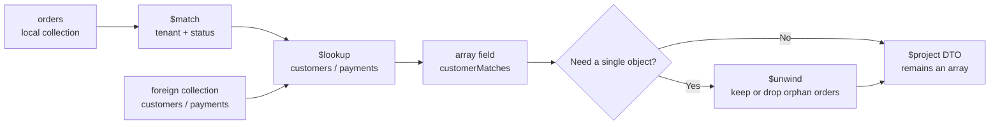

# $lookup: Joining Collections by Field or Pipeline

## 1. Why Do We Need $lookup?

MongoDB encourages designing documents around aggregate boundaries, yet real-world applications still have relationships across multiple collections. In the **Mini Commerce** system using **Spring Data MongoDB**, an `Order` stores a `customerId` pointing to a `Customer`; `Payment` receipts are stored separately because they have a different lifecycle, authorization model, and update frequency than orders.

Suppose an admin screen needs to display: “Each paid order, its corresponding customer name, and its most recently captured payment receipt.” This could be solved with multiple `findById` calls in Java, but doing so easily causes **N+1 queries**, wastes round-trips, and makes it difficult to filter or sort by related data. MongoDB provides the **`$lookup`** stage to bring data from another collection into the same aggregation pipeline.

Two main approaches:

1. **Field-based equality join:** uses `from`, `localField`, `foreignField`, and `as` when the join condition is equality.
2. **Pipeline-based lookup:** uses `let`, `pipeline`, and `$expr`—and can optionally combine `localField`/`foreignField`—to perform multiple conditions, status filtering, projection, sorting, limiting, or computations on the target collection.

This lesson belongs to the **Advanced Aggregation** chapter of `SPRING_DATA_MONGODB`. In addition to `mongosh` syntax, we will implement it using `MongoTemplate`, `LookupOperation`, and repository `@Aggregation`, while also examining indexes, transactions, reactive access, testing, and data performance diagnostics.

### Learning Objectives

After this lesson, you will be able to:

- Accurately explain the **left outer join** behavior of `$lookup` and why the output is always an **array**.
- Write `$lookup` using a `localField`/`foreignField` pair and handle unmatched documents with `$unwind` with or without `preserveNullAndEmptyArrays`.
- Use `let`/`$$variable` and `$expr` to express conditional joins referencing fields from the outer document.
- Combine **equality join + foreign pipeline** for cleaner filtering and projection.
- Use `Aggregation.lookup(...)` and `LookupOperation` with Spring Data MongoDB, returning DTOs instead of persisting joined results as entities.
- Handle BSON vs. Java property names, `null`, arrays, mismatched key types, orphaned data, and consistency.
- Enforce **tenant isolation** on both the source collection and the joined collection.
- Inspect query plans with `explain("executionStats")`, especially indexes on **foreignField** and limitations when using `$expr`.
- Apply pagination, reactive access, and transactions appropriately, and build integration tests with real data.

**Prerequisites:** Java 17+, Spring Boot and `spring-boot-starter-data-mongodb`, a running MongoDB instance, and familiarity with `@Document`/`@Id`, `MongoTemplate`, `Aggregation`, `Criteria`, and BSON. Examples use the synchronous API; in the reactive section, we compare with `ReactiveMongoTemplate`. Always check your project's MongoDB and Spring Data versions before applying version-specific features.

## 2. Decision Table: Field Join or Pipeline?

| Requirement | Field-based lookup | Pipeline-based lookup |
| --- | --- | --- |
| `Order.customerId = Customer._id` | **Best fit** | Possible, but more verbose |
| Only fetch Customers with `active=true` | Requires post-join filtering or a pipeline | **Best fit**: filter early on foreign collection |
| `tenantId` must match between Order and Customer | Insufficient with a single field pair | **Best fit**: add `$eq` inside `$expr` |
| Get the latest `CAPTURED` payment per Order | Cannot select newest automatically | **Best fit**: `$match/$sort/$limit` |
| Fetch only `fullName`/`email` from Customer | Can project after lookup | Can project directly inside the foreign pipeline |
| Lookup with multiple conditions/expressions | Limited | `let` + `$expr` |
| Lookup by an indexed unique key | Simple and usually efficient | Supported; verify index usage in pipeline |
| Aggregate multiple foreign records | Usually requires extra stages after lookup | Can `$group` directly inside the foreign pipeline |

**Core concept:** `$lookup` is not an automatic SQL join generated from `@DBRef` or `@DocumentReference`. It is an **aggregation stage** that you explicitly define. It joins data inside MongoDB and appends a result array field to each document flowing through the pipeline.



## 3. Preparing Mini Commerce Data

### 3.1. Collections and Join Keys

| Collection | Keys | Role |
| --- | --- | --- |
| `orders` | `_id`, `tenantId`, `customerId`, `status`, `totalAmount` | Input documents for the aggregation |
| `customers` | `_id`, `tenantId`, `active`, `fullName`, `email` | Foreign collection for customer lookup |
| `payments` | `_id`, `tenantId`, `order_id`, `status`, `capturedAt` | Foreign collection for order receipt lookup |
| `products` | `_id`, `sku`, `unit_price` | Product data, used when extending reports |

To avoid ID conversion edge cases in the initial steps, the examples use **BSON String** for `Order._id`, `Customer._id`, and reference keys. In other systems, if `Customer._id` is actually a BSON ObjectId while `Order.customerId` is an incompatible String, an equality lookup can return an empty array even when their displayed values look identical.

### 3.2. Fixture in mongosh

Use a **dedicated test database**—never run this on production:

```javascript
use mini_commerce

db.customers.insertMany([
  {
    _id: "customer-001",
    tenantId: "shop-a",
    fullName: "Nguyễn Thị Lan",
    email: "lan@example.test",
    active: true
  },
  {
    _id: "customer-002",
    tenantId: "shop-a",
    fullName: "Trần Văn Mai",
    email: "mai@example.test",
    active: false
  },
  {
    _id: "customer-003",
    tenantId: "shop-b",
    fullName: "Lê Anh Bảo",
    email: "bao@example.test",
    active: true
  }
]);

db.orders.insertMany([
  {
    _id: "order-101",
    tenantId: "shop-a",
    customerId: "customer-001",
    status: "PAID",
    placedAt: ISODate("2026-11-19T08:00:00Z"),
    totalAmount: NumberDecimal("150000.00")
  },
  {
    _id: "order-102",
    tenantId: "shop-a",
    customerId: "customer-002",
    status: "PAID",
    placedAt: ISODate("2026-11-19T09:00:00Z"),
    totalAmount: NumberDecimal("99000.00")
  },
  {
    _id: "order-103",
    tenantId: "shop-a",
    customerId: "customer-missing",
    status: "PLACED",
    placedAt: ISODate("2026-11-20T10:00:00Z"),
    totalAmount: NumberDecimal("80000.00")
  },
  {
    _id: "order-104",
    tenantId: "shop-b",
    customerId: "customer-003",
    status: "PAID",
    placedAt: ISODate("2026-11-20T11:00:00Z"),
    totalAmount: NumberDecimal("180000.00")
  },
  {
    _id: "order-105",
    tenantId: "shop-a",
    customerId: "customer-001",
    status: "PAID",
    placedAt: ISODate("2026-11-20T12:00:00Z"),
    totalAmount: NumberDecimal("200000.00")
  }
]);

db.payments.insertMany([
  {
    _id: "payment-101-a",
    tenantId: "shop-a",
    order_id: "order-101",
    status: "AUTHORIZED",
    capturedAt: null
  },
  {
    _id: "payment-101-b",
    tenantId: "shop-a",
    order_id: "order-101",
    status: "CAPTURED",
    capturedAt: ISODate("2026-11-19T08:10:00Z")
  },
  {
    _id: "payment-105-a",
    tenantId: "shop-a",
    order_id: "order-105",
    status: "CAPTURED",
    capturedAt: ISODate("2026-11-20T12:10:00Z")
  },
  {
    _id: "payment-104-a",
    tenantId: "shop-b",
    order_id: "order-104",
    status: "CAPTURED",
    capturedAt: ISODate("2026-11-20T11:10:00Z")
  },
  {
    _id: "payment-101-wrong-tenant",
    tenantId: "shop-b",
    order_id: "order-101",
    status: "CAPTURED",
    capturedAt: ISODate("2026-11-20T13:00:00Z")
  }
]);
```

**Security note:** The last payment intentionally has `order_id = order-101` while belonging to `shop-b`. It helps test data-leak bugs if a lookup joins only by `order_id` without checking `tenantId`. This is a synthetic fixture, not a valid transaction in a real sales system.

### 3.3. Expected Results

| Order | Tenant | Customer | Active? | Correct-tenant CAPTURED payment? |
| --- | --- | --- | --- | --- |
| `order-101` | shop-a | Nguyễn Thị Lan | Yes | `payment-101-b` |
| `order-102` | shop-a | Trần Văn Mai | No | None |
| `order-103` | shop-a | Not found | — | None |
| `order-104` | shop-b | Lê Anh Bảo | Yes | `payment-104-a` |
| `order-105` | shop-a | Nguyễn Thị Lan | Yes | `payment-105-a` |

Re-running `insertMany` with the same `_id` values will fail with a duplicate key error. Use an isolated fixture per test, clean up safely, and never execute commands that delete an entire production collection.

## 4. $lookup with localField and foreignField

This is the shortest form for joining on an equality condition:

```javascript
db.orders.aggregate([
  {
    $lookup: {
      from: "customers",
      localField: "customerId",
      foreignField: "_id",
      as: "customerMatches"
    }
  }
]);
```

Meaning of each field:

| Field | Meaning |
| --- | --- |
| `from` | Foreign collection in the same database; here `customers` |
| `localField` | Field on the **input** pipeline document, `orders.customerId` |
| `foreignField` | Field in the **joined** collection, `customers._id` |
| `as` | Name of the **array** added to each Order, `customerMatches` |

Abbreviated output:

```json
[
  {
    "_id": "order-101",
    "customerId": "customer-001",
    "customerMatches": [
      { "_id": "customer-001", "fullName": "Nguyễn Thị Lan",
        "tenantId": "shop-a", "active": true }
    ]
  },
  {
    "_id": "order-103",
    "customerId": "customer-missing",
    "customerMatches": []
  }
]
```

This illustrates **two documents** from the result set with fields abbreviated. The original dataset has five Orders, so a pipeline without `$match` processes all five.

### 4.1. Left Outer Join, Not Inner Join

`$lookup` **preserves the input Order** even when no matching Customer exists. When there is no match, the `as` field contains an **empty array `[]`**, not `null`, and the Order is not automatically dropped.

If `customerId` matches multiple documents on `foreignField` (when there is no unique index), `customerMatches` can contain **multiple elements**. In the fixture, `customers._id` is unique, so each Order has 0 or 1 Customer.

**Do not assume Orders automatically have SQL-like foreign-key integrity.** MongoDB does not enforce that `customerId` must exist; the application must decide how to handle orphaned data.

### 4.2. $lookup Does Not Replace the Root Document

`$lookup` adds the `customerMatches` field to the current Order. Fields such as `status`, `placedAt`, and `totalAmount` remain present unless removed by an earlier or later stage.

If `as` matches an existing field name, `$lookup` **overwrites that field** in the pipeline result. Choose clear names such as `customerMatches` or `latestCapturedPayments` to avoid overwriting business fields with different meanings.

### 4.3. No Ordering Guarantee Inside the Matched Array

Do not rely on the ordering of `customerMatches` when multiple matches exist without a sort inside a foreign pipeline. When a requirement asks for the “latest payment,” add `$sort` with a unique tie-breaker before `$limit` inside the foreign pipeline.

## 5. $unwind: Keep or Drop Orders Without a Customer?

After a lookup, a UI often prefers a single Customer object rather than a one-element array. `$unwind` turns each array element into a separate pipeline document.

### 5.1. Inner-join-like: Drop Unmatched Orders

```javascript
db.orders.aggregate([
  { $match: { tenantId: "shop-a" } },
  {
    $lookup: {
      from: "customers",
      localField: "customerId",
      foreignField: "_id",
      as: "customer"
    }
  },
  { $unwind: "$customer" },
  {
    $project: {
      _id: 1,
      status: 1,
      "customer.fullName": 1
    }
  }
]);
```

`order-103` is dropped because `customer = []`. With the `shop-a` fixture, `order-101`, `order-102`, and `order-105` remain. If one Order matches multiple Customers, `$unwind` can **duplicate the Order into multiple documents**.

### 5.2. Keep Orphan Orders

```javascript
db.orders.aggregate([
  { $match: { tenantId: "shop-a" } },
  {
    $lookup: {
      from: "customers",
      localField: "customerId",
      foreignField: "_id",
      as: "customer"
    }
  },
  {
    $unwind: {
      path: "$customer",
      preserveNullAndEmptyArrays: true
    }
  }
]);
```

With `preserveNullAndEmptyArrays: true`, `order-103` is preserved. The `customer` field may be absent in the output BSON after unwind when there was no match; the DTO should allow a nullable customer.

**Business decision:** An order history screen needs to keep orphan Orders for diagnostics, whereas a report covering only verified customers may choose to exclude ineligible records. Do not let `$unwind` accidentally define business policy.

### 5.3. $arrayElemAt and $first

If you want to keep 1 output document per Order without unwinding:

```javascript
db.orders.aggregate([
  {
    $lookup: {
      from: "customers",
      localField: "customerId",
      foreignField: "_id",
      as: "customerMatches"
    }
  },
  {
    $set: {
      customer: { $arrayElemAt: ["$customerMatches", 0] }
    }
  },
  { $unset: "customerMatches" }
]);
```

This only makes sense when the domain **guarantees** at most one matching Customer. If the foreign key is not unique, taking the first element without sorting is **non-deterministic**. `$unwind` lets you detect multiple-match cases during testing.

## 6. Common Pitfalls: null, missing, array, and BSON Type

### 6.1. Missing Local or Foreign Fields

In an equality `$lookup`, if a source document **lacks `localField`**, MongoDB treats that value as `null` for matching purposes. Likewise, a foreign document **missing `foreignField`** is treated as `null`.

Consequence: if both source and foreign documents have missing/null fields, documents that appear to have no key can **accidentally match each other**. This is especially dangerous when joining on an unvalidated business field.

Mitigation:

```javascript
db.orders.aggregate([
  {
    $match: {
      customerId: { $exists: true, $ne: null },
      tenantId: "shop-a"
    }
  },
  {
    $lookup: {
      from: "customers",
      localField: "customerId",
      foreignField: "_id",
      as: "customerMatches"
    }
  }
]);
```

The `$exists`/`$ne` filter can be backed by schema validation or a required-key policy. If using a foreign pipeline, add a non-null key condition before joining.

### 6.2. String and ObjectId Keys Are Not Equal

Example:

```javascript
// orders:
{ customerId: "507f1f77bcf86cd799439011" }

// customers:
{ _id: ObjectId("507f1f77bcf86cd799439011") }
```

These two values have **different BSON types**; an equality `$lookup` does not automatically coerce String to ObjectId for joining. If legacy schemas have mixed types, the best option is a **normalization migration**. Converting with `$toObjectId`/`$convert` can work temporarily, but requires handling invalid input and often complicates index optimization.

In Spring Data, an `@Id String` field can be mapped to a BSON ObjectId if its value satisfies converter rules; do not guess BSON types from the Java class—inspect the actual documents in MongoDB.

### 6.3. When localField Is an Array

`$lookup` allows an array `localField` to match scalar values of `foreignField` without needing to `$unwind` the source array first:

```javascript
db.orders.aggregate([
  {
    $lookup: {
      from: "products",
      localField: "skuList",
      foreignField: "sku",
      as: "matchedProducts"
    }
  }
]);
```

For example, suppose an Order has `skuList: ["KBD-001", "MOU-001"]`. The resulting `matchedProducts` array contains Products whose SKU belongs to that list. **This is not a 1-to-1 ordered mapping per SKU**, nor does it automatically carry snapshot prices or line quantities. If you need to join data per OrderLine while preserving quantity, use `$unwind` or an appropriate `$map`/pipeline.

### 6.4. Collation and Key Correctness

String comparisons are affected by the operation or collection collation. If SKUs are case-insensitive by business rule, indexes and queries must specify a consistent collation. For reference keys such as `customerId`, however, it is better to use canonical IDs with matching BSON types rather than relying on collation to work around schema drift.

## 7. Spring Data MongoDB: Field-Based LookupOperation

`MongoTemplate` executes the aggregation; `Aggregation.lookup(...)` builds the `$lookup` stage.

### 7.1. Minimal Order and Customer Entities

These are **two separate Java files** in the domain package:

```java
package com.example.minicommerce.domain;

import java.math.BigDecimal;
import java.time.Instant;
import org.springframework.data.annotation.Id;
import org.springframework.data.mongodb.core.mapping.Document;
import org.springframework.data.mongodb.core.mapping.Field;
import org.springframework.data.mongodb.core.mapping.FieldType;

@Document(collection = "orders")
public class Order {
    @Id private String id;
    private String tenantId;
    private String customerId;
    private String status;
    private Instant placedAt;

    @Field(targetType = FieldType.DECIMAL128)
    private BigDecimal totalAmount;

    public Order() {}
    public String getId() { return id; }
    public String getTenantId() { return tenantId; }
    public String getCustomerId() { return customerId; }
    public String getStatus() { return status; }
    public Instant getPlacedAt() { return placedAt; }
    public BigDecimal getTotalAmount() { return totalAmount; }
}
```

```java
package com.example.minicommerce.domain;

import org.springframework.data.annotation.Id;
import org.springframework.data.mongodb.core.mapping.Document;

@Document(collection = "customers")
public class Customer {
    @Id private String id;
    private String tenantId;
    private String fullName;
    private String email;
    private boolean active;

    public Customer() {}
    public String getId() { return id; }
    public String getTenantId() { return tenantId; }
    public String getFullName() { return fullName; }
    public String getEmail() { return email; }
    public boolean isActive() { return active; }
}
```

### 7.2. Service Using Aggregation.lookup

```java
package com.example.minicommerce.service;

import java.util.List;
import org.springframework.data.mongodb.core.MongoTemplate;
import org.springframework.data.mongodb.core.aggregation.Aggregation;
import org.springframework.data.mongodb.core.aggregation.AggregationResults;
import org.springframework.data.mongodb.core.query.Criteria;
import org.springframework.stereotype.Service;

import com.example.minicommerce.domain.Order;

@Service
public class OrderLookupService {

    private final MongoTemplate template;

    public OrderLookupService(MongoTemplate template) {
        this.template = template;
    }

    public List<OrderCustomerView> listForTenant(String tenantId) {
        Aggregation pipeline = Aggregation.newAggregation(
            Aggregation.match(
                Criteria.where("tenantId").is(tenantId)),
            Aggregation.lookup(
                "customers", "customerId", "_id", "customer"),
            Aggregation.unwind("customer", true),
            Aggregation.project()
                .and("_id").as("orderId")
                .and("status").as("status")
                .and("customer.fullName").as("customerName")
                .andExclude("_id")
        );

        AggregationResults<OrderCustomerView> result =
            template.aggregate(
                pipeline, Order.class, OrderCustomerView.class);

        return result.getMappedResults();
    }
}
```

Read DTO:

```java
package com.example.minicommerce.service;

public class OrderCustomerView {
    private String orderId;
    private String status;
    private String customerName;

    public OrderCustomerView() {}
    public String getOrderId() { return orderId; }
    public void setOrderId(String orderId) {
        this.orderId = orderId;
    }
    public String getStatus() { return status; }
    public void setStatus(String status) {
        this.status = status;
    }
    public String getCustomerName() { return customerName; }
    public void setCustomerName(String customerName) {
        this.customerName = customerName;
    }
}
```

`Aggregation.lookup("customers", "customerId", "_id", "customer")` builds an equality lookup. `Aggregation.unwind("customer", true)` preserves Orders when the lookup finds no Customer. `Aggregation.project()` renames and limits fields to return the DTO.

**Important:** The code above filters `tenantId` only on the **orders** collection, while the equality lookup does not check `customers.tenantId`. It is used to introduce the field-based API, and is **not sufficient as a multi-tenant security boundary** if an Order holds a `customerId` pointing to the wrong tenant. In the pipeline section we will fix this by joining on `tenantId` as well.

### 7.3. LookupOperation Builder

You can use the builder for readability:

```java
import org.springframework.data.mongodb.core.aggregation.LookupOperation;

LookupOperation customerLookup = LookupOperation.newLookup()
    .from("customers")
    .localField("customerId")
    .foreignField("_id")
    .as("customerMatches");

Aggregation pipeline = Aggregation.newAggregation(
    Aggregation.match(Criteria.where("tenantId").is("shop-a")),
    customerLookup
);
```

Starting with Spring Data MongoDB 4.1, the builder also supports declaring `let`/`pipeline` for advanced lookups. If your project uses an older API version, check which overloads are available; this lesson uses the Java API from modern Spring Data MongoDB releases.

## 8. Pipeline Lookup: let, $$variable, and $expr

In multi-tenant Mini Commerce, joining only `Order.customerId = Customer._id` is **not enough**. You must simultaneously ensure:

- `Order.customerId = Customer._id`.
- `Order.tenantId = Customer.tenantId`.
- `Customer.active = true`.
- Return a restricted set of fields (e.g., `fullName`), avoiding automatically exposing `email` if not needed.

### 8.1. Correlated Pipeline in mongosh

```javascript
db.orders.aggregate([
  { $match: { tenantId: "shop-a" } },
  {
    $lookup: {
      from: "customers",
      let: {
        oidCustomer: "$customerId",
        oidTenant: "$tenantId"
      },
      pipeline: [
        {
          $match: {
            $expr: {
              $and: [
                { $eq: ["$_id", "$$oidCustomer"] },
                { $eq: ["$tenantId", "$$oidTenant"] }
              ]
            }
          }
        },
        { $match: { active: true } },
        {
          $project: {
            _id: 1,
            fullName: 1,
            tenantId: 1
          }
        }
      ],
      as: "activeCustomer"
    }
  }
]);
```

Explanation:

1. The first `$match` restricts **Orders to tenant shop-a**.
2. `let.oidCustomer` reads `$customerId` **from the current Order**.
3. `let.oidTenant` reads `$tenantId` **from the current Order**.
4. Inside the foreign `pipeline`, `$$oidCustomer` and `$$oidTenant` are **declared variables**; a single `$` such as `$_id` refers to the field on the **current Customer**.
5. `$expr` allows comparing expressions inside `$match`; `$and` combines both conditions.
6. `$match: { active: true }` is a static condition on Customer and **does not need `$expr`** because it does not reference any variable.
7. `$project` limits which fields are emitted outward.

Results on the `shop-a` fixture:

| Order | `activeCustomer` |
| --- | --- |
| `order-101` | Array containing Customer Lan |
| `order-102` | `[]` because Customer Mai is inactive |
| `order-103` | `[]` because Customer was not found |
| `order-105` | Array containing Customer Lan |

### 8.2. Distinguishing $ and $$

| Expression | Meaning inside the foreign pipeline |
| --- | --- |
| `"$_id"` | `_id` field of the current Customer |
| `"$tenantId"` | `tenantId` field of the current Customer |
| `"$$oidCustomer"` | Variable from `let`, holding `Order.customerId` |
| `"$$oidTenant"` | Variable from `let`, holding `Order.tenantId` |
| `"$$ROOT"` | Root document **in the current stage context**, not automatically the outer Order |

If you write `"$customerId"` inside the `customers` pipeline thinking it references the Order, MongoDB looks for `customerId` on **Customer**, which is usually wrong. Use `let` and `$$variable` to pass outer document values.

### 8.3. When Must You Use $expr?

Inside a foreign pipeline `$match`, whenever you want to use values from `let`, you must use `$expr`:

```javascript
{
  $match: {
    $expr: {
      $eq: ["$tenantId", "$$oidTenant"]
    }
  }
}
```

If the condition is simply `{ active: true }`, use a regular `$match`. Do not convert every condition into `$expr` unnecessarily, as that makes pipelines harder to read and can affect index optimization opportunities.

## 9. Combining localField/foreignField with a Foreign Pipeline

In modern MongoDB (the concise correlated subquery syntax supported since 5.0), a `$lookup` can declare **direct join fields** alongside a **foreign pipeline**:

```javascript
db.orders.aggregate([
  { $match: { tenantId: "shop-a" } },
  {
    $lookup: {
      from: "customers",
      localField: "customerId",
      foreignField: "_id",
      let: { currentTenant: "$tenantId" },
      pipeline: [
        {
          $match: {
            active: true,
            $expr: {
              $eq: ["$tenantId", "$$currentTenant"]
            }
          }
        },
        { $project: { _id: 1, fullName: 1 } }
      ],
      as: "activeCustomer"
    }
  }
]);
```

MongoDB performs the equality join on `customerId/_id` and then applies the stages in the foreign pipeline. This syntax can be more readable than expressing the equality join itself inside a single `$expr`.

**Note:** The foreign pipeline still needs `let` for the tenant condition, and `$expr` when referencing `$$currentTenant` inside `$match`. The `localField/foreignField` pair alone does not automatically pass other Order fields into the pipeline.

### 9.1. Where Should $match Be Placed?

```javascript
// $match BEFORE lookup: reduces the number of Orders to process.
{ $match: { tenantId: "shop-a", status: "PAID" } }

// $match INSIDE lookup: reduces the number of Customers/Payments returned.
{ $match: { active: true } }
```

Filtering `activeCustomer` **after** lookup with `$filter` or `$unwind/$match` can also produce the right output, but sometimes passes more foreign documents through the pipeline. Whenever possible, filter early on the side where the condition belongs.

### 9.2. Preventing Data Leaks via Projection

`$project` inside the foreign pipeline restricts which fields are exposed to the `as` output. If the UI only needs the name, do not emit email, phone number, payment details, or internal attributes. **Projection does not replace authorization**, but it is an essential data-minimization layer.

## 10. Advanced Problem: Finding the Latest CAPTURED Payment

An Order can have multiple `Payment` records. Requirement: “For each Order, return the most recent `CAPTURED` payment **within the same tenant**.”

If you only use:

```javascript
{
  $lookup: {
    from: "payments",
    localField: "_id",
    foreignField: "order_id",
    as: "payments"
  }
}
```

you will receive **all** payments matching `order_id`, including `AUTHORIZED` records and the wrong-tenant record in the fixture. That violates both business and security requirements.

### 10.1. Full Pipeline

```javascript
db.orders.aggregate([
  { $match: { tenantId: "shop-a", status: "PAID" } },
  {
    $lookup: {
      from: "payments",
      let: {
        oid: "$_id",
        tenant: "$tenantId"
      },
      pipeline: [
        {
          $match: {
            status: "CAPTURED",
            $expr: {
              $and: [
                { $eq: ["$order_id", "$$oid"] },
                { $eq: ["$tenantId", "$$tenant"] }
              ]
            }
          }
        },
        { $sort: { capturedAt: -1, _id: -1 } },
        { $limit: 1 },
        {
          $project: {
            _id: 1,
            status: 1,
            capturedAt: 1
          }
        }
      ],
      as: "latestCapturedPayments"
    }
  }
]);
```

Results:

- `order-101` → `payment-101-b`. Does not include `payment-101-wrong-tenant` even though its timestamp is newer.
- `order-102` → `[]` because there is no `CAPTURED` payment.
- `order-105` → `payment-105-a`.
- `order-103` does not appear because it is not `PAID`.

Ordering by `{ capturedAt: -1, _id: -1 }` includes `_id` as a unique tie-breaker so the “latest” record is deterministic when multiple payments share the same timestamp. `$limit: 1` inside the **foreign pipeline** limits the number of payments **per Order**, not the total number of Orders.

### 10.2. Combining with $unwind When an Object Is Needed

```javascript
db.orders.aggregate([
  { $match: { tenantId: "shop-a", status: "PAID" } },
  {
    $lookup: {
      from: "payments",
      let: { oid: "$_id", tenant: "$tenantId" },
      pipeline: [
        {
          $match: {
            status: "CAPTURED",
            $expr: {
              $and: [
                { $eq: ["$order_id", "$$oid"] },
                { $eq: ["$tenantId", "$$tenant"] }
              ]
            }
          }
        },
        { $sort: { capturedAt: -1, _id: -1 } },
        { $limit: 1 }
      ],
      as: "payment"
    }
  },
  {
    $unwind: {
      path: "$payment",
      preserveNullAndEmptyArrays: true
    }
  },
  {
    $project: {
      _id: 1,
      status: 1,
      "payment._id": 1,
      "payment.capturedAt": 1
    }
  }
]);
```

This avoids loading the entire payment history onto the screen when only the latest receipt is needed. However, for accurate financial reporting, you also need to account for refunds, chargebacks, partial captures, currencies, and reconciliation; `status = CAPTURED` in this fixture is purely an illustrative rule.

## 11. Spring Data: LookupOperation with let and pipeline

In modern Spring Data MongoDB, the `Aggregation.lookup()` builder supports `let(...)` and `pipeline(...)`. You can pass an explicit BSON stage via `AggregationOperation` when `$expr` expressions are complex.

### 11.1. Customer Lookup with Tenant Guard

```java
import java.util.List;

import org.bson.Document;
import org.springframework.data.mongodb.core.aggregation.Aggregation;
import org.springframework.data.mongodb.core.aggregation.AggregationOperation;
import org.springframework.data.mongodb.core.aggregation.LookupOperation;
import org.springframework.data.mongodb.core.aggregation.VariableOperators;
import org.springframework.data.mongodb.core.query.Criteria;

import static org.springframework.data.mongodb.core.aggregation.VariableOperators.Let.ExpressionVariable.newVariable;

// $expr compares Customer fields against Order variables.
AggregationOperation matchTenantAndCustomer = context ->
    new Document("$match",
        new Document("$expr",
            new Document("$and", List.of(
                new Document("$eq",
                    List.of("$_id", "$$customerKey")),
                new Document("$eq",
                    List.of("$tenantId", "$$tenantKey"))
            ))));

LookupOperation lookup = Aggregation.lookup()
    .from("customers")
    .let(VariableOperators.Let.just(
        newVariable("customerKey").forField("customerId"),
        newVariable("tenantKey").forField("tenantId")))
    .pipeline(
        matchTenantAndCustomer,
        Aggregation.match(
            Criteria.where("active").is(true)),
        Aggregation.project("fullName"))
    .as("activeCustomer");

Aggregation aggregation = Aggregation.newAggregation(
    Aggregation.match(
        Criteria.where("tenantId").is("shop-a")),
    lookup
);
```

Explanation:

- `VariableOperators.Let.just(...)` declares variables for `$lookup`, not a standalone `$let` output computation.
- `newVariable("customerKey").forField("customerId")` reads the source property from `Order`.
- `matchTenantAndCustomer` creates a raw `$match/$expr`, so it uses **Customer's BSON names** and `$$customerKey`/`$$tenantKey`.
- `Aggregation.match(Criteria.where("active").is(true))` applies a static filter inside the foreign pipeline.
- `Aggregation.project("fullName")` retains only the customer name.
- `as("activeCustomer")` creates the result array on each Order.

**Mapping limitation:** raw `AggregationOperation` stages that construct `Document` directly are not necessarily field-mapped by Spring Data the way TypedAggregation stages are. When the foreign side uses `@Field`, verify BSON/variable field paths or use the appropriate DSL/aggregation context. Do not replace the raw BSON key `"$_id"` with the Java property `"id"` inside a foreign expression.

### 11.2. Writing a Pipeline Stage with Explicit BSON

When expressing operators with limited DSL support, you can create an `AggregationOperation`:

```java
AggregationOperation foreignMatch = ctx -> new Document(
    "$match",
    new Document(
        "$expr",
        new Document(
            "$eq",
            List.of("$order_id", "$$orderKey")
        )
    )
);
```

This is a single **stage** inside the foreign pipeline, not the entire `$lookup`. When an application has multiple complex stages, assign each stage to a named variable, add tests verifying the mapped BSON pipeline, and inspect the actual execution plan.

### 11.3. Using the localField/foreignField Overload for Simple Cases

```java
LookupOperation simple = Aggregation.lookup()
    .from("customers")
    .localField("customerId")
    .foreignField("_id")
    .as("customerMatches");
```

For simple equality joins, avoid introducing unnecessary `let`/`$expr`. The field-based variant is less error-prone syntactically and makes the `foreignField` index easier to verify.

## 12. Using @Aggregation on a Repository

A relatively fixed pipeline can be declared using `@Aggregation`:

```java
package com.example.minicommerce.repository;

import java.util.List;
import org.springframework.data.mongodb.repository.MongoRepository;
import org.springframework.data.mongodb.repository.Aggregation;

import com.example.minicommerce.domain.Order;
import com.example.minicommerce.service.OrderCustomerView;

public interface OrderReportRepository
        extends MongoRepository<Order, String> {

    @Aggregation(pipeline = {
        "{ '$match': { 'tenantId': ?0 } }",
        "{ '$lookup': { 'from': 'customers', " +
          "'localField': 'customerId', " +
          "'foreignField': '_id', 'as': 'customer' } }",
        "{ '$unwind': { 'path': '$customer', " +
          "'preserveNullAndEmptyArrays': true } }",
        "{ '$project': { '_id': 0, 'orderId': '$_id', " +
          "'status': 1, 'customerName': " +
          "'$customer.fullName' } }"
    })
    List<OrderCustomerView> findOrderCustomerView(
        String tenantId);
}
```

`@Aggregation` on a repository differs from the `Aggregation` DSL class. In this example, the goal is to demonstrate organizing a **fixed** pipeline; the query still guards tenant only on `orders` and has no tenant condition on `customers`. Do not use this pipeline as-is for a multi-tenant endpoint if source documents can reference the wrong tenant.

When a pipeline requires multiple `let` variables, optional filters, or per-stage testing, `MongoTemplate` with `LookupOperation`/`AggregationOperation` is usually easier to maintain than a very long JSON string in an annotation.

## 13. @DocumentReference and @DBRef vs. $lookup

Spring Data MongoDB supports relationship mapping via `@DBRef` or `@DocumentReference` in suitable models. However:

| Mechanism | Role | Watch out for |
| --- | --- | --- |
| `@DBRef` | Stores/reads DBRefs via mapping | Can trigger extra queries on resolution; not an aggregation join |
| `@DocumentReference` | Flexible document reference relationship | Resolver uses its own query strategy, not `$lookup` by default |
| `$lookup` | Server-side join in **aggregation** | Returns an array; requires projection, indexing, and access control |
| Embedded document | Related data resides in the root document | Fast snapshots, but introduces duplication and update cost |

An `Order` should usually store a **snapshot of name/price/address at order placement time** so history does not change when Customer or Product changes. Do not use `$lookup` against the current Product to **recalculate historical sold prices**, because catalog data can change.

**Not every relationship calls for $lookup.** Decide based on read patterns, consistency requirements, data size, ownership, and update cost.

## 14. Why $lookup Is Not Identical to SQL JOIN

Intuitively `$lookup` behaves like a left outer join, but it has MongoDB-specific characteristics:

1. Results are attached as an **array** `as`, rather than producing one row per match automatically.
2. `$unwind` is what duplicates documents per element, increasing or decreasing the document count after that stage.
3. Standard `$lookup` joins collections within the **same database**; do not write `from: "other_db.customers"` expecting an automatic cross-database join.
4. `$lookup` does not enforce foreign-key constraints.
5. Output documents after joining remain subject to the **BSON document size limit**. An Order with too many referenced payments/lines can exceed the maximum output size.
6. Different MongoDB versions and topologies impose different constraints on sharded collections, transactions, and optimizer engines.
7. Stage order determines both results and cost: joining early and filtering late can do much more work.

For a simple equality join with few matches, `$lookup` is very effective. If a join produces arrays of tens of thousands of elements per document, reconsider your schema, paginate the foreign data, or split the report.

## 15. Performance: Indexes on the Joined Collection

### 15.1. Equality Lookup Needs a foreignField Index

With:

```javascript
{
  $lookup: {
    from: "customers",
    localField: "customerId",
    foreignField: "_id",
    as: "customerMatches"
  }
}
```

MongoDB already provides a default `_id` index on `customers`. Therefore, looking up Customers by `_id` usually has a good starting point.

If joining on `payments.order_id`:

```javascript
db.payments.createIndex({ order_id: 1 });
```

Missing an index on **foreignField** can force each correlated lookup to scan many foreign documents, especially when the number of input Orders is large. Having an index still does not guarantee speed by itself: it also depends on matches per key, projection, cardinality, and post-lookup stages.

### 15.2. Compound Index for the Latest Payment

For the pipeline matching `status = CAPTURED`, `tenantId`, `order_id`, and sorting `capturedAt DESC, _id DESC`, a candidate index to benchmark is:

```javascript
db.payments.createIndex({
  tenantId: 1,
  order_id: 1,
  status: 1,
  capturedAt: -1,
  _id: -1
});
```

This index is a **design candidate**, not a guarantee that MongoDB will use every key for all foreign `$expr` predicates. Comparison forms, `let` values, missing/null state, the query planner, and the server version all affect index utilization.

You should also filter Orders early:

```javascript
db.orders.createIndex({
  tenantId: 1,
  status: 1,
  placedAt: -1,
  _id: -1
});
```

This index serves the **outer pipeline** when filtering and reading Orders; it does not replace an index on `payments`.

### 15.3. Index Limitations with $expr

MongoDB documents that `$eq`, `$lt`, `$lte`, `$gt`, and `$gte` comparisons inside `$expr` **can** use indexes on the `from` collection, subject to constraints:

- The comparison must compare a **field against a value treated as constant for each lookup**, such as a foreign field compared to a resolved `let` variable from the current Order; **field-to-field** comparisons within the foreign document generally cannot use indexes in the same way.
- Indexes are not used for comparisons when the `let` value is empty or missing.
- For `$expr` comparisons inside `$lookup`, MongoDB notes limitations regarding **multikey, partial, or sparse indexes**.
- Actual index usage also depends on the planner, selectivity, and how the pipeline is written.

Do not conclude “`$expr` can never use an index,” nor “with an index, every `$expr` is optimized.” Always verify with `explain` on realistic data.

### 15.4. Limiting the Outer Side Before Lookup

```javascript
db.orders.aggregate([
  { $match: { tenantId: "shop-a", status: "PAID" } },
  { $sort: { placedAt: -1, _id: -1 } },
  { $limit: 20 },
  {
    $lookup: {
      from: "customers",
      localField: "customerId",
      foreignField: "_id",
      as: "customerMatches"
    }
  }
]);
```

If the business requirement asks for the **20 most recent Orders and then shows their Customers**, this restricts how many Orders enter `$lookup`. But if the requirement is “the 20 most recent Orders **that have an active Customer**,” limiting before the lookup can return **fewer than 20 matches** or skip valid Orders beyond the first 20.

**Whether `$limit` goes before or after lookup depends on the API semantics.** Never reorder stages solely for optimization if doing so silently changes the results.

## 16. Explain and Diagnosing a Slow $lookup

In `mongosh`:

```javascript
db.orders.explain("executionStats").aggregate([
  { $match: { tenantId: "shop-a", status: "PAID" } },
  {
    $lookup: {
      from: "customers",
      localField: "customerId",
      foreignField: "_id",
      as: "customerMatches"
    }
  }
]);
```

Depending on MongoDB version and query engine, explain output may include:

| Metric | Interpretation |
| --- | --- |
| `winningPlan`, `queryPlanner` | Input execution plan |
| `IXSCAN` / `COLLSCAN` | Whether an index scan or collection scan occurred |
| `totalKeysExamined` | Number of index entries scanned |
| `totalDocsExamined` | Number of documents inspected |
| `nReturned` | Number of documents returned by the stage/plan |
| `indexesUsed` | Index used in the lookup, **if provided by the explain version/format** |
| `collectionScans` | Number of foreign lookup collection scans, if present |
| `executionTimeMillisEstimate` | Estimated stage duration, not an absolute guarantee across all requests |

Do not expect a fixed JSON path for `indexesUsed` or `EQ_LOOKUP`: explain formats change across versions and engines. MongoDB can use the **slot-based execution engine (SBE)** for certain equality lookups; foreign pipelines disqualify certain SBE optimizations. Never treat a single plan label as a universal performance guarantee across workloads.

### 16.1. Root-Cause Investigation Steps

1. Verify how many Orders remain **after the outer `$match`**.
2. Check that join keys share the same **BSON type** and are not unexpectedly missing/null.
3. Verify indexes on the foreign collection match `foreignField`/pipeline conditions.
4. Check the average and maximum number of matches **per Order**.
5. Compare the field-based `$lookup` and `let/$expr` variants when both have identical semantics.
6. Trim fields with a foreign `$project` so only needed data crosses the network.
7. Inspect explain/profiler output, measuring latency, CPU, memory, and keys/docs examined.
8. Evaluate whether an embedded/snapshot schema, denormalized field, or precomputed report is a better fit.

**Do not treat `allowDiskUse(true)` as a cure-all for lookups.** It can help spill-capable stages such as sort or group under supported conditions, but it will not fix an unindexed join, document size overflow, or authorization gaps.

## 17. Aggregation Options and Output Size

Because every output document carries an `as` array, one-to-many joins can make intermediate documents huge. MongoDB enforces a **16 MiB limit on any returned BSON document**, and stages/engines have their own memory limits. Do not assume a single `$lookup` can embed an entire Payment history inside an Order regardless of size.

### 17.1. Fetch Only What Is Necessary

```javascript
{
  $lookup: {
    from: "payments",
    let: { oid: "$_id", tenant: "$tenantId" },
    pipeline: [
      {
        $match: {
          status: "CAPTURED",
          $expr: {
            $and: [
              { $eq: ["$order_id", "$$oid"] },
              { $eq: ["$tenantId", "$$tenant"] }
            ]
          }
        }
      },
      { $sort: { capturedAt: -1, _id: -1 } },
      { $limit: 1 },
      { $project: { _id: 1, capturedAt: 1 } }
    ],
    as: "latestCapturedPayments"
  }
}
```

Include only the payment ID and timestamp rather than payment method details, tokens, or gateway payloads.

### 17.2. AggregationOptions in Spring Data

```java
import org.springframework.data.mongodb.core.aggregation.Aggregation;
import org.springframework.data.mongodb.core.aggregation.AggregationOptions;

AggregationOptions options = AggregationOptions.builder()
    .allowDiskUse(true)
    .build();

Aggregation configured = aggregation.withOptions(options);
```

`aggregation` is a previously constructed `Aggregation` pipeline. Enable `allowDiskUse` only after understanding which stage needs memory/spill and its I/O cost; do not turn it on unconditionally for every endpoint.

## 18. Pagination with $lookup

Two things are frequently confused:

- **Paginating Orders** and displaying their Customers.
- **Paginating Customers/Payments inside the lookup array**.

### 18.1. Paginating Orders

```javascript
db.orders.aggregate([
  { $match: { tenantId: "shop-a", status: "PAID" } },
  { $sort: { placedAt: -1, _id: -1 } },
  { $skip: 0 },
  { $limit: 20 },
  {
    $lookup: {
      from: "customers",
      localField: "customerId",
      foreignField: "_id",
      as: "customerMatches"
    }
  }
]);
```

`$skip/$limit` bounds **Orders**. Include `_id` in the sort for deterministic ordering when data is unchanged. Deep offset pagination still incurs skip cost; for continuous scrolling, consider cursor/keyset pagination on `(placedAt, _id)`.

### 18.2. Limiting the Foreign Array per Order

```javascript
{
  $lookup: {
    from: "payments",
    localField: "_id",
    foreignField: "order_id",
    pipeline: [
      { $sort: { capturedAt: -1, _id: -1 } },
      { $limit: 3 }
    ],
    as: "recentPayments"
  }
}
```

`$limit: 3` **inside the foreign pipeline** caps the maximum number of Payments **per Order**. This example omits a tenant guard and status filter; use it only when the data source is already isolated and the requirement specifically asks for the three most recent payments regardless of status. In multi-tenant systems, add tenant conditions as shown in Section 10.

### 18.3. Count After Lookup Can Differ from Count Before Lookup

If `$unwind: "$customer"` **drops** unmatched Orders, `$count` after unwind will be smaller than the original Order count. If one Order matches multiple Customers and is unwound, the count can be higher.

When the UI needs `totalElements`, explicitly define whether you are counting **Orders**, **Orders with an active Customer**, or **Order–Customer rows after unwind**. Never use `countDocuments({ tenantId: ... })` for a screen that also filters on foreign Customer fields and assume the total always matches.

## 19. Aggregation for Relational Summaries

After a lookup, you can chain `$group`/`$project`:

```javascript
db.orders.aggregate([
  { $match: { tenantId: "shop-a", status: "PAID" } },
  {
    $lookup: {
      from: "customers",
      localField: "customerId",
      foreignField: "_id",
      as: "customer"
    }
  },
  { $unwind: "$customer" },
  {
    $group: {
      _id: "$customer._id",
      customerName: { $first: "$customer.fullName" },
      paidOrderCount: { $sum: 1 },
      totalPaid: { $sum: "$totalAmount" }
    }
  },
  { $sort: { totalPaid: -1 } }
]);
```

With the `shop-a` fixture, this produces a **per-customer summary**:

| Customer | paidOrderCount | totalPaid |
| --- | ---: | ---: |
| Nguyễn Thị Lan | 2 | 350.000 |
| Trần Văn Mai | 1 | 99.000 |

**Do not treat this report as proof that Customers are active.** The pipeline has no foreign `active` filter. If only active customers should be included, add that condition intentionally and re-verify the totals.

`totalAmount` uses BSON Decimal128. If monetary fields mix String/Double/Decimal128, check types and reconciliation rules; never use unverified aggregation output for financial accounting.

## 20. Multi-Tenant Security: Always Scope Both Collections

A multi-store system cannot rely solely on filtering `orders.tenantId` if `Order.customerId` might be miswritten or maliciously altered to point to a Customer in another tenant.

### 20.1. Dangerous Example

```javascript
db.orders.aggregate([
  { $match: { tenantId: "shop-a" } },
  {
    $lookup: {
      from: "customers",
      localField: "customerId",
      foreignField: "_id",
      as: "customer"
    }
  }
]);
```

If a `shop-a` Order points to a `shop-b` Customer, joining only by `_id` can still return the `shop-b` Customer. **An outer filter does not protect a foreign join.**

### 20.2. Tenant-Safe Join

```javascript
{
  $lookup: {
    from: "customers",
    let: {
      cid: "$customerId",
      tid: "$tenantId"
    },
    pipeline: [
      {
        $match: {
          $expr: {
            $and: [
              { $eq: ["$_id", "$$cid"] },
              { $eq: ["$tenantId", "$$tid"] }
            ]
          }
        }
      },
      { $project: { _id: 1, fullName: 1 } }
    ],
    as: "customer"
  }
}
```

In addition, you should:

- Derive the tenant from an authenticated **security context**/token—never trust a client-supplied `tenantId`.
- Enforce read permissions on `Customer`/`Payment` at the API/service layer.
- Minimize and filter sensitive fields directly inside the foreign pipeline.
- Test cross-tenant foreign records even when the outer Order is valid.
- Guard write paths that create references as well as per-tenant unique keys.

## 21. Sharded Collections, Transactions, and Version Limits

Key MongoDB version milestones to know:

| Feature | Milestone |
| --- | --- |
| Basic `$lookup` | Available since MongoDB versions prior to 5.x |
| Concise correlated lookup with field join + pipeline | MongoDB **5.0** |
| `from` as a sharded collection | MongoDB **5.1** and later |
| SBE capable of executing certain `$lookup` operations | MongoDB **6.0** and later, subject to pipeline/stage conditions |
| `$lookup` inside transactions when foreign collection is sharded | MongoDB **8.0** and later |

Always check your server version, topology, and current restrictions before deploying on a sharded cluster. Inside a foreign lookup pipeline, **`$out` and `$merge` are disallowed**. Specialized stages such as MongoDB Search `$search` have their own version and stage-position rules.

### 21.1. Transactions Do Not Turn $lookup into a Foreign Key

MongoDB transactions provide consistency semantics for reads/writes on supported topologies, but `$lookup` **does not enforce** valid references, tenant boundaries, or cross-document invariants. When creating an Order and Payment:

- Use transactions when invariants require multiple documents to commit atomically.
- Use unique indexes, idempotency keys, and retry handling on writes.
- Store snapshots of critical details (sold price, address) when historical data must remain immutable after placement.
- Do not query the current Customer/Product via `$lookup` and assume it reflects the state at order creation time.

### 21.2. Cross-Query Consistency

A single aggregation may observe documents subject to read concern and topology behavior. Do not assume every ordinary aggregation creates a strict atomic snapshot across all collections under concurrent writes. If specific guarantees are required, design read concern/transactions on a supported MongoDB topology and test race conditions.

## 22. ReactiveMongoTemplate: Returning Flux Instead of List

With the reactive starter, the pipeline keeps the same BSON semantics, while the return type is typically `Flux<DTO>`:

```java
import reactor.core.publisher.Flux;

import org.springframework.data.mongodb.core.aggregation.Aggregation;
import org.springframework.data.mongodb.core.query.Criteria;

Aggregation aggregation = Aggregation.newAggregation(
    Aggregation.match(
        Criteria.where("tenantId").is("shop-a")),
    Aggregation.lookup(
        "customers", "customerId", "_id", "customer"),
    Aggregation.unwind("customer", true),
    Aggregation.project()
        .and("_id").as("orderId")
        .and("customer.fullName").as("customerName")
        .andExclude("_id")
);

Flux<OrderCustomerView> views =
    reactiveMongoTemplate.aggregate(
        aggregation, Order.class, OrderCustomerView.class);
```

`reactiveMongoTemplate` is an injected bean in the reactive service, and `OrderCustomerView`/`Order` belong to the application package. The publisher executes upon subscription. Never call `block()` on a WebFlux event-loop thread.

**Reactive does not reduce join cost:** if `$lookup` lacks an index or returns too many foreign documents, the server still performs all that work. Limiting page size, filtering early, and verifying execution plans remain essential.

### 22.1. StepVerifier for Reactive Aggregation

```java
import reactor.test.StepVerifier;

StepVerifier.create(views.collectList())
    .assertNext(items -> {
        // Verify IDs, customer names, and Order count.
        org.junit.jupiter.api.Assertions.assertFalse(items.isEmpty());
    })
    .verifyComplete();
```

This is a minimal test skeleton; `reactor-test` must be in test scope. For security-sensitive lookups, explicitly assert that no Customer or Payment from another tenant is returned.

## 23. Integration Testing: Field Join, Orphans, and Tenant Guard

A unit test that mocks `MongoTemplate.aggregate(...)` does not prove that `$$...` variables, BSON types, `$unwind`, or DTO mappings behave correctly on MongoDB. Run against a **real MongoDB instance or Testcontainers** in an isolated database.

### 23.1. Field-Based Lookup Test

The following test uses isolated IDs to avoid interfering with other fixtures:

```java
package com.example.minicommerce;

import static org.junit.jupiter.api.Assertions.*;

import java.util.List;
import java.util.Map;
import java.util.function.Function;
import java.util.stream.Collectors;

import org.bson.Document;
import org.junit.jupiter.api.Test;
import org.springframework.beans.factory.annotation.Autowired;
import org.springframework.boot.test.context.SpringBootTest;
import org.springframework.data.mongodb.core.MongoTemplate;
import org.springframework.data.mongodb.core.aggregation.Aggregation;
import org.springframework.data.mongodb.core.query.Criteria;

import com.example.minicommerce.domain.Order;
import com.example.minicommerce.service.OrderCustomerView;

@SpringBootTest
class LookupAggregationIntegrationTest {

    @Autowired MongoTemplate template;

    @Test
    void fieldLookupKeepsOrphanWithUnwindPreserve() {
        String tenant = "lookup-test-tenant";
        List<String> customerIds = List.of(
            "lookup-test-c1", "lookup-test-c2");
        List<String> orderIds = List.of(
            "lookup-test-o1", "lookup-test-o2");

        var customers = template.getCollection("customers");
        var orders = template.getCollection("orders");
        Document customerFilter = new Document(
            "_id", new Document("$in", customerIds));
        Document orderFilter = new Document(
            "_id", new Document("$in", orderIds));

        customers.deleteMany(customerFilter);
        orders.deleteMany(orderFilter);
        try {
            customers.insertMany(List.of(
                new Document("_id", customerIds.get(0))
                    .append("tenantId", tenant)
                    .append("fullName", "Lan Test")
                    .append("active", true),
                new Document("_id", customerIds.get(1))
                    .append("tenantId", tenant)
                    .append("fullName", "Mai Test")
                    .append("active", false)
            ));
            orders.insertMany(List.of(
                new Document("_id", orderIds.get(0))
                    .append("tenantId", tenant)
                    .append("customerId", customerIds.get(0))
                    .append("status", "PAID"),
                new Document("_id", orderIds.get(1))
                    .append("tenantId", tenant)
                    .append("customerId", "lookup-test-missing")
                    .append("status", "PLACED")
            ));

            Aggregation pipeline = Aggregation.newAggregation(
                Aggregation.match(
                    Criteria.where("id").in(orderIds)),
                Aggregation.lookup(
                    "customers", "customerId", "_id", "customer"),
                Aggregation.unwind("customer", true),
                Aggregation.project()
                    .and("_id").as("orderId")
                    .and("customer.fullName").as("customerName")
                    .andExclude("_id")
            );

            List<OrderCustomerView> views = template.aggregate(
                pipeline, Order.class, OrderCustomerView.class)
                .getMappedResults();

            assertEquals(2, views.size());
            Map<String, OrderCustomerView> byId =
                views.stream().collect(Collectors.toMap(
                    OrderCustomerView::getOrderId,
                    Function.identity()));

            assertEquals("Lan Test",
                byId.get(orderIds.get(0)).getCustomerName());
            assertNull(
                byId.get(orderIds.get(1)).getCustomerName());

        } finally {
            orders.deleteMany(orderFilter);
            customers.deleteMany(customerFilter);
        }
    }
}
```

This test verifies that `$lookup` resolves Customer Lan and preserves the orphan Order thanks to `preserveNullAndEmptyArrays`. It is not meant to verify index performance or transactions. Ensure you use a dedicated test database, because cleanup relies only on the chosen fixture IDs.

### 23.2. Testing That Correlated Lookup Does Not Leak Cross-Tenant Payments

A **separate** integration test using Order `lookup-pay-o1` in `shop-test-a` and two Payments with the same `order_id` belonging to two different tenants:

```java
var orders = template.getCollection("orders");
var payments = template.getCollection("payments");

String orderId = "lookup-pay-o1";
String goodId = "lookup-pay-good";
String wrongId = "lookup-pay-wrong";

orders.deleteOne(new Document("_id", orderId));
payments.deleteMany(new Document("_id",
    new Document("$in", List.of(goodId, wrongId))));

try {
    orders.insertOne(new Document("_id", orderId)
        .append("tenantId", "shop-test-a")
        .append("status", "PAID"));

    payments.insertMany(List.of(
        new Document("_id", goodId)
            .append("tenantId", "shop-test-a")
            .append("order_id", orderId)
            .append("status", "CAPTURED"),
        new Document("_id", wrongId)
            .append("tenantId", "shop-test-b")
            .append("order_id", orderId)
            .append("status", "CAPTURED")
    ));

    // Use a BSON pipeline to verify $expr/$$variable behavior precisely.
    Document lookup = new Document("$lookup",
        new Document("from", "payments")
            .append("let", new Document("oid", "$_id")
                .append("tenant", "$tenantId"))
            .append("pipeline", List.of(
                new Document("$match",
                    new Document("$expr",
                        new Document("$and", List.of(
                            new Document("$eq",
                                List.of("$order_id", "$$oid")),
                            new Document("$eq",
                                List.of("$tenantId", "$$tenant"))
                        ))))
            ))
            .append("as", "matchedPayments"));

    List<Document> result = orders.aggregate(List.of(
        new Document("$match", new Document("_id", orderId)),
        lookup
    )).into(new java.util.ArrayList<>());

    assertEquals(1, result.size());
    List<Document> matched =
        result.get(0).getList("matchedPayments", Document.class);
    assertEquals(1, matched.size());
    assertEquals(goodId, matched.get(0).getString("_id"));

} finally {
    orders.deleteOne(new Document("_id", orderId));
    payments.deleteMany(new Document("_id",
        new Document("$in", List.of(goodId, wrongId))));
}
```

The snippet above is a **`@Test` method body**, not a standalone Java class. It assumes `MongoTemplate template` is injected and requires imports for `java.util.List`, `org.bson.Document`, and `assertEquals`. The test deliberately uses the raw driver to avoid mixing entity mapping issues into verifying `$lookup` semantics. Add tests for your project's Spring Data `LookupOperation` builder to check the generated BSON stage after mapping.

### 23.3. Recommended Test Matrix

| Scenario | Expected behavior |
| --- | --- |
| Equality `customerId → _id` | Array contains the matching Customer |
| Missing Customer | `as = []`; Order is not dropped before unwind |
| Default `$unwind` | Drops Orders with no match |
| `$unwind(preserveNullAndEmptyArrays=true)` | Keeps orphan Orders |
| String vs. BSON ObjectId keys | Does not match when types differ |
| Missing/null local field | Does not accidentally match foreign missing/null without a guard |
| Local array with multiple SKUs | Joins multiple scalar Products |
| Foreign `active` filter | Does not return inactive Customers |
| Tenant guard | Does not return Customers/Payments from another tenant |
| `let` / `$$var` / `$expr` | Order variables are compared accurately on foreign docs |
| Latest payment | `$sort`/`$limit` selects the right record |
| Equal timestamps | Uses `_id` tie-breaker |
| `@Field` mapping | DSL uses valid property names; raw BSON uses actual keys |
| DTO projection | Does not leak email or sensitive fields |
| Explain lookup | Verifies foreign index usage for the workload |
| Reactive aggregation | Publisher emits right results without blocking |
| Transactions/sharding | Runs on supported topology/version |

## 24. Common Errors and Troubleshooting

| Symptom | Cause | Resolution |
| --- | --- | --- |
| `customerMatches` is always empty | Wrong `localField/foreignField` or BSON type mismatch | Inspect raw documents and types |
| Orphan Customers not displayed | Default `$unwind` drops empty arrays | Use `preserveNullAndEmptyArrays: true` |
| Same Order appears multiple times | Non-unique foreign key followed by unwind | Check unique indexes and cardinality |
| Wrong Customer attached to Order | Wrong join key or stale reference | Identify canonical key and migrate |
| Cross-tenant data leak | Filtered only outer Orders, no foreign guard | Use `let + $expr` to check tenant on foreign docs |
| Wrong latest payment | Missing `$sort` or tie-breaker | Sort `capturedAt DESC, _id DESC` before limit |
| `$limit` leaves too few Orders | Placed limit before join, then filtered Customers | Check semantics and adjust stage order |
| Lookup returns huge array | Unbounded one-to-many join | Use foreign `$match/$project/$limit` or redesign schema |
| `$expr` does not use index | Field-to-field comparison, missing `let`, or multikey/partial/sparse limits | Review conditions and explain; pick suitable indexes |
| `IXSCAN` is still slow | High cardinality, many foreign matches | Measure keys/docs examined and project fewer fields |
| Raw stage uses Java field name | Not mapped via metadata when writing `Document` directly | Use actual BSON keys |
| `as` overwrites an existing field | Output name collision | Pick a distinct alias and check projection |
| Wrong Order count after join | `$unwind` changes cardinality | Place `$count` according to the intended metric |
| Historical prices shift on lookup | Using current Product to recalculate old Order totals | Store a price snapshot at order creation time |
| Slow query on sharded foreign collection | Network/shard routing/index or unsuitable version | Check topology/version and explain |
| `$out`/`$merge` inside foreign pipeline | Disallowed by MongoDB in lookup pipelines | Move write aggregations to a separate pipeline |
| Reactive query still overloaded | Server-side join lacks index despite non-blocking I/O | Optimize lookup, limits, and concurrency |
| `allowDiskUse` does not help | Unindexed join or document size limit exceeded | Fix query/schema rather than just enabling disk spill |

## 25. Practice Exercises

**Exercise 1 — Field-based lookup.** Create an `Order`/`Customer` fixture. Use `localField: "customerId"` and `foreignField: "_id"`. Verify `as` is a 0- or 1-element array and orphan Orders remain present.

**Exercise 2 — Left vs. inner join.** Run one pipeline with default `$unwind` and another with `preserveNullAndEmptyArrays: true`. Predict the number of Orders returned and explain why they differ.

**Exercise 3 — Correlated lookup.** Write `let` with `cid/tid` and `$expr/$and/$eq` to join Customers by ID and tenant. Filter `active=true` inside the foreign pipeline and confirm inactive Customers are excluded.

**Exercise 4 — Latest payment.** Use `$lookup` on `payments` matching both `order_id` and `tenantId`, filtering `CAPTURED`, sorting `capturedAt DESC, _id DESC`, and limiting to 1. Insert a payment from another tenant with a newer timestamp to verify isolation.

**Exercise 5 — Spring Data DSL.** Write `Aggregation.lookup("customers", ...)` and `LookupOperation.newLookup()` for equality. Then write a `let/pipeline` builder with an `AggregationOperation` producing raw `$expr` and returning a DTO.

**Exercise 6 — Mapping.** Change the foreign key in `Payment` to `@Field("order_id")` on Java property `orderId`; distinguish the name used in Spring DSL vs. raw BSON. Test with real data.

**Exercise 7 — Indexes and explain.** Create an index on `payments.order_id` and a compound index `{tenantId, order_id, status, capturedAt, _id}`. Measure `totalKeysExamined`, `totalDocsExamined`, and `indexesUsed` (if reported on your MongoDB version). Do not extrapolate from a tiny fixture.

**Exercise 8 — Proper pagination.** Build two APIs: (a) the 20 latest Orders with their Customers, (b) the 20 latest Orders **that have an active Customer**. Demonstrate how placing `$limit` before vs. after lookup changes results in API (b).

**Exercise 9 — Consistency.** Discuss when to snapshot Customer/Product data inside an Order, when to look up current data, and which scenarios require specific transaction or read concern settings.

**Stretch Exercise — Reactive and sharding.** Port a lookup to `ReactiveMongoTemplate.aggregate(...)` and test with `StepVerifier`. Check your MongoDB version before using lookup with sharded foreign collections or inside transactions.

### Self-Check Questions

1. Why is `$lookup` a left outer join and why does it always add an array?
2. What do `from`, `localField`, `foreignField`, and `as` mean?
3. If no Customer matches, does the Order still appear? How does `$unwind` change that?
4. When do you need `let` and `$$variable` in a foreign pipeline?
5. Why must a `$match` referencing a `let` variable use `$expr`?
6. What is the difference between using `localField/foreignField` vs. comparing the join keys inside `$expr`?
7. Where should `$sort` and `$limit` be placed to select the latest CAPTURED payment per Order?
8. Why is filtering `orders.tenantId` alone not sufficient for lookup security?
9. When `customerId` is a String and `customers._id` is an ObjectId, what does the lookup return?
10. Which collection holds the most critical index for an equality lookup?
11. What `$expr` limitations prevent MongoDB from using an index?
12. Why does `allowDiskUse` not fix an unindexed foreign join?
13. How can placing a limit before vs. after lookup change business semantics?
14. Why shouldn't you use current Product data from a lookup to recalculate historical Order prices?
15. When are `@DocumentReference` or embedded snapshots preferable to `$lookup`?

**Expected outcome:** Learners understand both **field-based joins** and **pipeline-based joins**, use `MongoTemplate`/`LookupOperation` to build reports, handle `as` arrays and orphan records, enforce tenant isolation on both sides, and control index usage and cardinality. This enables implementing advanced aggregations, testing, and diagnosing Spring Data MongoDB performance without sacrificing correctness or data safety.

## References

- [MongoDB Manual — $lookup](https://www.mongodb.com/docs/manual/reference/operator/aggregation/lookup/): syntax, `let/pipeline`, field-based lookup, limitations, and performance.
- [MongoDB Manual — $unwind](https://www.mongodb.com/docs/manual/reference/operator/aggregation/unwind/): flattening arrays into documents and `preserveNullAndEmptyArrays`.
- [MongoDB Manual — $expr](https://www.mongodb.com/docs/manual/reference/operator/query/expr/): expression comparisons in `$match` and index limitations in lookups.
- [MongoDB Manual — Aggregation Pipeline](https://www.mongodb.com/docs/manual/core/aggregation-pipeline/): stage order, optimization, and limits.
- [MongoDB Manual — Explain Results](https://www.mongodb.com/docs/manual/reference/explain-results/): execution plans, stats, and lookup metrics.
- [Spring Data MongoDB — Aggregation Framework](https://docs.spring.io/spring-data/mongodb/reference/mongodb/aggregation-framework.html): `Aggregation`, `AggregationResults`, DSL, and typed mapping.
- [Spring Data MongoDB API — LookupOperation](https://docs.spring.io/spring-data/mongodb/docs/current/api/org/springframework/data/mongodb/core/aggregation/LookupOperation.html): builder and lookup stage construction.
- [Spring Data MongoDB API — Aggregation](https://docs.spring.io/spring-data/mongodb/docs/current/api/org/springframework/data/mongodb/core/aggregation/Aggregation.html): `lookup(...)`, `unwind(...)`, `match(...)`, and `project(...)`.
- [Spring Data MongoDB — Repository Query Methods](https://docs.spring.io/spring-data/mongodb/reference/mongodb/repositories/query-methods.html): repository `@Aggregation`.
- [Spring Data MongoDB — Client Sessions and Transactions](https://docs.spring.io/spring-data/mongodb/reference/mongodb/client-session-transactions.html): transactions, sessions, and consistency.
