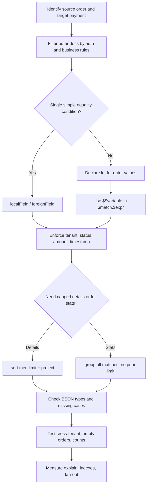

# let, Pipeline Variables, and Correlated Conditions in $lookup

In **Spring Data MongoDB**, aggregation lets you transform documents, group data, and combine results across multiple collections. The **`$lookup`** operator can join documents by a simple key, similar to a *left outer join*. In practice, however, business rules are often richer than “`orders._id = payments.orderId`”: an order should only match payments from the **same tenant**, with an **amount meeting the order's specific threshold**, in a **valid status**, and occurring **after the order was created**.

To express conditions that depend on each outer document (*correlated subquery*), use **`let` inside `$lookup`** to name values from the source document, then reference them with **`$$variable`** syntax inside the target collection's pipeline. When comparing target fields against those variables, wrap the comparison inside **`$expr`** within `$match`.

Conceptual example:

```javascript
{
  $lookup: {
    from: "payments_lookup_lab",
    let: {
      orderKey: "$_id",
      orderTenant: "$tenantId",
      minimum: "$minimumAmount"
    },
    pipeline: [
      {
        $match: {
          $expr: {
            $and: [
              { $eq: ["$orderId", "$$orderKey"] },
              { $eq: ["$tenantId", "$$orderTenant"] },
              { $gte: ["$amount", "$$minimum"] }
            ]
          }
        }
      }
    ],
    as: "eligiblePayments"
  }
}
```

For each incoming order, MongoDB evaluates `orderKey`, `orderTenant`, and `minimum` for the **current order**, runs the correlated query against `payments_lookup_lab`, and attaches the matches to the order's `eligiblePayments` array. This dependency between outer variables and inner fields is what makes the lookup **correlated**.

This lesson belongs to the **Advanced Aggregation** chapter of the **SPRING_DATA_MONGODB** module—applying Spring Data MongoDB to document mapping, repositories/`MongoTemplate`, query and aggregation design, indexing, testing, and performance diagnostics. The direct focus here is **`let`, pipeline variables, and correlated conditions in `$lookup`**, rather than aggregation variables in general.

After this lesson, you will be able to:

1. Distinguish `localField/foreignField` `$lookup` from `let + pipeline` `$lookup`.
2. Understand variable scoping: `$field`, `$$variable`, `$$ROOT`, `$$CURRENT`, `$$NOW`.
3. Write `$match + $expr` properly to compare target document fields against outer variables.
4. Combine equality, time-range, Decimal128, status, and tenant conditions in a single correlated lookup.
5. Use `$project`, `$sort`, `$limit`, and `$group` after filtering without confusing “fetch 2 records” with “sum all records.”
6. Build an equivalent pipeline with `MongoTemplate.aggregate(...)`, knowing when to use a raw `AggregationOperation` vs. Spring Data's DSL.
7. Identify risks from missing fields, BSON type mismatches, unbound variables, name shadowing, and large fan-out.
8. Read `explain("executionStats")`, reason about indexes on the target collection, and test correctness across multiple tenants.

## 1. From Simple `$lookup` to Correlated Joins

### 1.1. Joining on a Single Key

Suppose:

```javascript
// orders_lookup_lab
{ _id: ObjectId("665f1f2a4b6c7d8e9f001234"), tenantId: "T1" }

// payments_lookup_lab
{
  orderId: ObjectId("665f1f2a4b6c7d8e9f001234"),
  tenantId: "T1",
  amount: NumberDecimal("80.00")
}
```

A simple join:

```javascript
db.orders_lookup_lab.aggregate([
  {
    $lookup: {
      from: "payments_lookup_lab",
      localField: "_id",
      foreignField: "orderId",
      as: "payments"
    }
  }
]);
```

`localField` is read from the source document and `foreignField` from the `from` collection. This syntax is concise and suitable when only key matching is required. By default, the result is the `payments` array, even when no record matches (an empty array).

However, if each order only wants payments that belong to the **same tenant**, are **CAPTURED**, occurred **after the order creation time**, and have **`amount >= order.minimumAmount`**, a single equality match cannot express all of those rules.

### 1.2. Why Regular `$match` Is Not Enough

A common mistake:

```javascript
// WRONG if you intend to reference a let variable this way.
{
  $match: {
    orderId: "$$orderKey"
  }
}
```

In regular query syntax, `"$$orderKey"` in the value position is not evaluated as an **aggregation variable**. To compare `orderId` against `orderKey` inside a `$lookup` pipeline, you need an **expression** context:

```javascript
{
  $match: {
    $expr: {
      $eq: ["$orderId", "$$orderKey"]
    }
  }
}
```

Here:

- `"$orderId"` is a **field path** in documents of the target collection `payments_lookup_lab`.
- `"$$orderKey"` is a **variable declared in `$lookup.let`**, receiving its value from the current order.
- `$eq` compares the two values inside an aggregation expression.

Do not confuse `"$orderKey"` with `"$$orderKey"`: a single `$` references a field, while double `$$` references a **variable**.

### 1.3. Three Common Lookup Forms

| Form | Main example | When to use |
| --- | --- | --- |
| `localField/foreignField` | `_id = orderId` | Simple single-key equality |
| `let + pipeline` | `orderId = $$orderKey AND amount >= $$minimum` | Conditions depending on multiple outer order fields |
| `localField/foreignField + pipeline` | Match `_id/orderId` and filter `status` | Concise syntax supported on compatible MongoDB versions |

On MongoDB versions supporting concise correlated lookups, you can combine `localField`/`foreignField` with `pipeline` to express the common equality concisely. Still, when **multiple outer values** and numeric/date expressions are needed, `let + $expr` remains the core skill. Always check syntax and feature compatibility against your project's MongoDB and Spring Data versions before adopting it.

## 2. Full Structure of a Correlated `$lookup`

A standard skeleton:

```javascript
{
  $lookup: {
    from: "<target-collection>",
    let: {
      variableA: "<expression-on-source-document>",
      variableB: "<another-expression>"
    },
    pipeline: [
      { $match: { $expr: { /* use $$variableA, $$variableB */ } } },
      { $project: { /* fields to return */ } }
    ],
    as: "matchedDocuments"
  }
}
```

In this skeleton:

| Component | Role | Common mistake |
| --- | --- | --- |
| `from` | Collection being queried | Confusing with Java entity/repository name |
| `let` | Declares variables for the target pipeline | Using `$variable` instead of `$$variable` |
| `variableA: "$_id"` | Reads `_id` from the **source document** | Thinking it refers to a field in the target collection |
| `pipeline` | Stages executed on the target collection | Forgetting that `$match` here cannot read order fields directly |
| `$match + $expr` | Compares target fields with `let` variables | Writing `{ orderId: "$$orderKey" }` |
| `as` | Output array field on the source document | Colliding with an existing field and overwriting it |

**Crucial detail:** `let` variables are evaluated **per input document**. Thus, the same pipeline can apply different monetary thresholds and timestamps for Order A vs. Order B. That is what separates a correlated lookup from an uncorrelated subquery independent of the source document.

### 2.1. Multi-Stage Pipeline

```javascript
{
  $lookup: {
    from: "payments_lookup_lab",
    let: {
      orderKey: "$_id",
      orderTenant: "$tenantId",
      minimum: "$minimumAmount"
    },
    pipeline: [
      { $match: { status: "CAPTURED" } },
      {
        $match: {
          $expr: {
            $and: [
              { $eq: ["$orderId", "$$orderKey"] },
              { $eq: ["$tenantId", "$$orderTenant"] },
              { $gte: ["$amount", "$$minimum"] }
            ]
          }
        }
      },
      { $sort: { paidAt: -1, _id: -1 } },
      { $limit: 2 },
      { $project: { orderId: 1, amount: 1, paidAt: 1 } }
    ],
    as: "recentEligiblePayments"
  }
}
```

For each order, the result contains **at most the two most recent matching payments**. `$sort` is placed **before** `$limit` to pick the newest two, with `_id` as a tie-breaker when payments share the same `paidAt`. `$project` shrinks the data returned inside the array. If you also need `tenantId` or `status`, include those fields in the projection.

**Do not conclude** that `$limit: 2` means the order only has two payments in total. It only caps the attached array. If business logic requires summing all payments, never limit to two records before `$group` and treat the result as the total payment sum.

### 2.2. Scope of `let` Variables

Variables from `$lookup.let` can be referenced in stages within that `$lookup`'s pipeline, including nested stages following variable scoping rules. However, not every context interprets `$$...` strings as variables:

```javascript
// Valid: inside an aggregation expression.
{ $match: { $expr: { $gte: ["$amount", "$$minimum"] } } }

// Valid: $project uses an expression to compute a field.
{ $project: { amount: 1, expectedMinimum: "$$minimum" } }

// Invalid for comparing variables in regular query syntax.
{ $match: { amount: { $gte: "$$minimum" } } }
```

Furthermore, outer `$lookup.let` does not materialize a **physical field** named `minimum` on payment documents. It only binds a variable in the expression evaluation context without modifying the target collection.

### 2.3. Values from Source Fields and Source Expressions

Values in `let` do not have to be plain field paths. You can supply an expression:

```javascript
let: {
  orderKey: "$_id",
  minAllowed: {
    $ifNull: ["$minimumAmount", NumberDecimal("0")]
  },
  createdCutoff: "$createdAt"
}
```

Here `minAllowed` is computed for **each order**. Still, `$ifNull` should only be used when business rules explicitly define missing `minimumAmount` as 0. If a missing field indicates corrupt data, exclude the document or fix the schema instead of masking it with a default.

## 3. Understanding Aggregation Variables: `$field`, `$$variable`, and System Variables

One reason pipeline `$lookup` can feel hard to read is that MongoDB uses `$` in multiple roles. Knowing **which object an expression reads from** prevents countless logic bugs.

| Syntax | Meaning | Inside `$lookup` pipeline |
| --- | --- | --- |
| `"$amount"` | Value of field `amount` on the **current payment** | Field in the `from` collection |
| `"$$minimum"` | Value of `minimum` declared in `let` | Usually derived from the outer order |
| `"$_id"` | `_id` of the current document in the pipeline | Payment's `_id`, **not** the order's |
| `"$$orderKey"` | Outer order's `_id` bound to a variable | Compared against `payment.orderId` |
| `"$$ROOT"` | Root document of the current stage context | Inside the target pipeline, the current root payment |
| `"$$CURRENT"` | Current document/context when resolving paths | Can be reassigned inside advanced expressions |
| `"$$NOW"` | Current system datetime in aggregation context | Used for intentional time-based checks |

### 3.1. Variables Are Not “Temporary Table Columns”

```javascript
let: { orderKey: "$_id" }
```

does not create an `orderKey` field inside payment or order documents. It merely names a value that `$lookup` passes into its subpipeline. To include it in the output:

```javascript
{
  $project: {
    _id: 1,
    orderId: 1,
    amount: 1,
    lookupOrderKey: "$$orderKey"
  }
}
```

`lookupOrderKey` is a **projected result field of the subpipeline**, not data persisted in the payments collection. Debugging with such a projection is very handy for inspecting which `let` value each target document received.

### 3.2. Do Not Use `$$ROOT` to Mean the Outer Document

Example:

```javascript
{
  $lookup: {
    from: "payments_lookup_lab",
    let: { orderKey: "$_id" },
    pipeline: [
      {
        $project: {
          paymentRoot: "$$ROOT",
          capturedOrderKey: "$$orderKey"
        }
      }
    ],
    as: "debugPayments"
  }
}
```

Inside the target collection's `$project`, `$$ROOT` is the **payment currently being processed**, whereas `$$orderKey` is the outer `_id`. If you want the entire order inside the subpipeline, you must bind it explicitly:

```javascript
let: {
  orderSnapshot: "$$ROOT"
}
```

Then reference `"$$orderSnapshot.tenantId"` or `"$$orderSnapshot._id"` in an expression context. However, **avoid passing entire large documents** through `let` when you only need two or three fields. Binding only the required scalars keeps queries cleaner and easier to control.

### 3.3. `$lookup.let` and the Expression Operator `$let` Are Different Constructs

MongoDB also provides a **`$let`** operator inside aggregation expressions:

```javascript
{
  $project: {
    remainingAmount: {
      $let: {
        vars: {
          paid: { $ifNull: ["$paidAmount", NumberDecimal("0")] },
          total: "$totalAmount"
        },
        in: { $subtract: ["$$total", "$$paid"] }
      }
    }
  }
}
```

This is `$let` **inside an expression**: `vars` defines local variables and `in` returns the computed value. By contrast, `let` in `$lookup` is a **stage option** used to pass outer document values into the target pipeline:

```javascript
{
  $lookup: {
    from: "payments_lookup_lab",
    let: { orderKey: "$_id" },
    pipeline: [ /* $match with $$orderKey */ ],
    as: "payments"
  }
}
```

| `$lookup.let` | `$let` operator |
| --- | --- |
| Declares variables for a correlated lookup pipeline | Declares local variables to evaluate an expression |
| Uses object `let: { name: expr }` | Uses object `$let: { vars: {...}, in: expr }` |
| Passes outer document context into subpipeline | Breaks a large formula into named parts |
| Has no `in` property like the `$let` operator | `in` defines the returned expression value |

Avoid writing `$lookup: { let: { vars: ..., in: ... } }` following the `$let` expression syntax; they are two distinct contracts.

### 3.4. Shadowing and Nested Lookups

When a subpipeline contains a deeper nested `$lookup`, it can access variables from enclosing scopes or declare new variables. Reusing an existing variable name obscures code readability and can change what a reference resolves to.

Recommended naming convention:

```text
outerOrderId      -> order variable
outerTenantId     -> order tenant variable
paymentId         -> variable bound in a deeper lookup
paymentCapturedAt -> payment timestamp
```

Name variables by **source and meaning**, rather than generic names like `id`, `id2`, or `value`. For multi-level pipelines, test each level independently before composing them.

## 4. Business Example: Joining Eligible Payments to Each Order

### 4.1. Two-Collection Model

Collection `orders_lookup_lab`:

```javascript
{
  _id: ObjectId("665f1f2a4b6c7d8e9f001234"),
  tenantId: "T1",
  status: "OPEN",
  createdAt: ISODate("2026-11-20T09:00:00Z"),
  minimumAmount: NumberDecimal("60.00")
}
```

Collection `payments_lookup_lab`:

```javascript
{
  _id: ObjectId("665f1f2a4b6c7d8e9f004567"),
  tenantId: "T1",
  orderId: ObjectId("665f1f2a4b6c7d8e9f001234"),
  status: "CAPTURED",
  amount: NumberDecimal("80.00"),
  paidAt: ISODate("2026-11-20T09:10:00Z")
}
```

A payment is considered **eligible** for a source order when:

```text
payment.orderId  == order._id
payment.tenantId == order.tenantId
payment.status   == "CAPTURED"
payment.amount   >= order.minimumAmount
payment.paidAt   >= order.createdAt
```

Each condition serves a distinct role:

- `orderId` establishes the business link between payment and order.
- `tenantId` enforces the access boundary. A payment with the same `orderId` but a different tenant **must not** be joined.
- `status` admits only successfully captured payments.
- `minimumAmount` **varies per order**; a single global constant cannot express an order-dependent threshold.
- `createdAt` of the order sets the time cutoff; payments dated before order creation do not satisfy the example criteria.

These rules are **exercise conventions**, not universal accounting rules for every product. A payment smaller than `minimumAmount` could still be a valid partial payment in another system. Here `eligiblePayments` simply means “payments passing the defined filter criteria.”

### 4.2. Complete Pipeline: Filter Outer, Then Correlated Lookup

```javascript
db.orders_lookup_lab.aggregate([
  {
    $match: {
      tenantId: "T1",
      status: "OPEN"
    }
  },
  {
    $lookup: {
      from: "payments_lookup_lab",
      let: {
        orderKey: "$_id",
        scopeTenant: "$tenantId",
        minimum: "$minimumAmount",
        orderCreatedAt: "$createdAt"
      },
      pipeline: [
        {
          $match: {
            status: "CAPTURED",
            $expr: {
              $and: [
                { $eq: ["$orderId", "$$orderKey"] },
                { $eq: ["$tenantId", "$$scopeTenant"] },
                { $gte: ["$amount", "$$minimum"] },
                { $gte: ["$paidAt", "$$orderCreatedAt"] }
              ]
            }
          }
        },
        { $sort: { paidAt: -1, _id: -1 } },
        { $limit: 2 },
        {
          $project: {
            _id: 1,
            orderId: 1,
            tenantId: 1,
            amount: 1,
            paidAt: 1
          }
        }
      ],
      as: "eligiblePayments"
    }
  },
  {
    $addFields: {
      eligiblePaymentCount: {
        $size: "$eligiblePayments"
      }
    }
  },
  {
    $project: {
      tenantId: 1,
      status: 1,
      createdAt: 1,
      minimumAmount: 1,
      eligiblePayments: 1,
      eligiblePaymentCount: 1
    }
  }
]);
```

Evaluation flow:

1. The first `$match` filters **orders** by tenant and status.
2. For each remaining order, `$lookup.let` captures its `_id`, `tenantId`, `minimumAmount`, and `createdAt`.
3. Inside `$lookup.pipeline`, `$match` applies the **payment** `status` and four correlated comparison expressions.
4. `$sort` puts newest payments first; `_id` breaks ties when `paidAt` values are equal.
5. `$limit` caps the payment array **per order** at two elements.
6. `$addFields` counts **the payments returned in the array** (at most two), **not the total number of eligible payments if more than two exist**.
7. `$project` keeps only the fields needed by the client.

For orders with no eligible payments, `eligiblePayments` is an empty array and `eligiblePaymentCount` is 0; the order stays in the output. This is the fundamental **left outer join** behavior of `$lookup`.

### 4.3. Filtering Only Orders with at Least One Eligible Payment

After `$lookup`, you can append:

```javascript
{
  $match: {
    "eligiblePayments.0": { $exists: true }
  }
}
```

`eligiblePayments.0` exists only when the array has at least one element. This drops orders with empty arrays, changing the semantics from “return all orders with their payments” to “return only orders that have eligible payments.”

If you need to keep unpaid orders to display a pending-payment status, **do not add this condition**. The difference is an **API contract** decision, not an optional optimization.

### 4.4. `$unwind` and Preserving Empty Orders

If you want one result row per payment:

```javascript
{
  $unwind: {
    path: "$eligiblePayments",
    preserveNullAndEmptyArrays: true
  }
}
```

With `preserveNullAndEmptyArrays: true`, an order without payments is retained without a populated payment object. If you omit this option or set it to `false`, orders with empty arrays are dropped after `$unwind`.

Because `$unwind` creates additional rows, subsequent pagination/`$count` stages count **payment rows**, not **orders**. Choose where to place `$unwind` according to the shape your contract requires.

## 5. Summing All Payments: Never Place `$limit` Before `$group`

These two business questions are different:

1. **Fetch the two most recent eligible payments** per order.
2. **Calculate the total amount of all eligible payments** per order.

In Section 4, `$sort + $limit` answers question 1. To answer question 2, you must aggregate over the **entire set of matching payments** without truncating them first.

### 5.1. `$group` Inside a Correlated Lookup

```javascript
db.orders_lookup_lab.aggregate([
  { $match: { tenantId: "T1", status: "OPEN" } },
  {
    $lookup: {
      from: "payments_lookup_lab",
      let: {
        orderKey: "$_id",
        scopeTenant: "$tenantId",
        minimum: "$minimumAmount",
        orderCreatedAt: "$createdAt"
      },
      pipeline: [
        {
          $match: {
            status: "CAPTURED",
            $expr: {
              $and: [
                { $eq: ["$orderId", "$$orderKey"] },
                { $eq: ["$tenantId", "$$scopeTenant"] },
                { $gte: ["$amount", "$$minimum"] },
                { $gte: ["$paidAt", "$$orderCreatedAt"] }
              ]
            }
          }
        },
        {
          $group: {
            _id: null,
            totalEligibleAmount: { $sum: "$amount" },
            eligibleCount: { $sum: 1 }
          }
        },
        { $project: { _id: 0, totalEligibleAmount: 1, eligibleCount: 1 } }
      ],
      as: "paymentStats"
    }
  },
  {
    $addFields: {
      totalEligibleAmount: {
        $ifNull: [
          { $arrayElemAt: ["$paymentStats.totalEligibleAmount", 0] },
          NumberDecimal("0")
        ]
      },
      eligibleCount: {
        $ifNull: [
          { $arrayElemAt: ["$paymentStats.eligibleCount", 0] },
          0
        ]
      }
    }
  },
  { $project: { tenantId: 1, totalEligibleAmount: 1, eligibleCount: 1 } }
]);
```

Notes:

- Because `$group` produces **one summary document** when matching payments exist and **no document** when none match, `paymentStats` can be an empty array `[]`.
- `$arrayElemAt` extracts the first stats element if present; `$ifNull` returns 0 otherwise.
- `NumberDecimal("0")` keeps the default consistent with the Decimal128 currency type used in this lab.
- There is no `$limit` before `$group`, so `$sum` and count reflect **all eligible payments**, not just the newest two.
- `eligibleCount` is the count of payments passing every filter, not all payments on the order.

If the application needs the **sum of all CAPTURED amounts** regardless of the order's `minimumAmount`, remove `{ $gte: ["$amount","$$minimum"] }`. Statistical correctness depends on the agreed definition of “eligible.”

### 5.2. Combining Details and Summary Statistics

You can run two separate correlated lookups—one for the **two newest payments** and one for **full statistics**—and map both into a DTO. However, running two lookups increases cost; on heavy workloads, consider a `$group` subpipeline that also carries needed details, or a view/materialized summary depending on data design.

Avoid “optimizing” by summing only over an `eligiblePayments` array already capped with `$limit: 2`, as that undercounts totals. When both a capped list and an exact count are needed, keep separate clarity between stages processing all documents and stages capping returned details.

## 6. Syntax Variants and Uncorrelated Lookups

### 6.1. Correlated Lookup with `localField/foreignField` and Pipeline

On MongoDB versions supporting the combined syntax, order ID equality can be written directly while remaining order-dependent predicates use `let`:

```javascript
{
  $lookup: {
    from: "payments_lookup_lab",
    localField: "_id",
    foreignField: "orderId",
    let: {
      scopeTenant: "$tenantId",
      minimum: "$minimumAmount",
      orderCreatedAt: "$createdAt"
    },
    pipeline: [
      {
        $match: {
          status: "CAPTURED",
          $expr: {
            $and: [
              { $eq: ["$tenantId", "$$scopeTenant"] },
              { $gte: ["$amount", "$$minimum"] },
              { $gte: ["$paidAt", "$$orderCreatedAt"] }
            ]
          }
        }
      }
    ],
    as: "eligiblePayments"
  }
}
```

Here `localField/foreignField` handles `order._id = payment.orderId`, so that condition is not repeated inside `$expr`. Tenant, amount, and timestamp still require correlated variables.

**Availability of this syntax depends on your MongoDB server version.** If you want one portable pattern across tests that supports multiple conditions uniformly, the `let + pipeline + $expr` form in Section 4 is clear and reliable.

### 6.2. Uncorrelated Lookup

An *uncorrelated lookup* uses no values from the current order. For example, every order references the same list of enabled status definitions:

```javascript
{
  $lookup: {
    from: "payment_status_definitions",
    pipeline: [
      { $match: { enabled: true } },
      { $project: { _id: 0, code: 1, label: 1 } }
    ],
    as: "availablePaymentStatuses"
  }
}
```

There is no `let` and no order-dependent predicate. Every order receives the same set of status definitions. Under certain versions and conditions, MongoDB can cache the result of an uncorrelated subquery, though you should not assume identical caching behavior or performance across all deployments. For uncorrelated pipelines using random sampling like `$sample` or `$rand`, execution behavior follows version-specific rules.

### 6.3. Differences in Generated Row Counts

Suppose there are 100 orders and an average of 10 payments per order:

| Pipeline pattern | Output shape | Consequence |
| --- | --- | --- |
| Unbounded `$lookup` | 100 orders, each with a payment array | Can create large arrays |
| `$lookup` with `$sort + $limit: 2` | 100 orders, each array at most 2 payments | Bounds per-order payload |
| `$lookup` followed by `$unwind` | Can expand to ~1,000 rows | Pagination and `$count` change meaning |
| `$lookup` with `$group` inside | 100 orders, each with summary stats | Avoids returning all payment details |

Do not judge resource usage solely by the number of orders after `$lookup`. Joined array sizes, candidate payment counts, and stage order can create major performance differences.

## 7. BSON Types and Missing Data: Commonly Overlooked Join Bugs

### 7.1. `ObjectId` and String Are Not Equal

Order has:

```javascript
_id: ObjectId("665f1f2a4b6c7d8e9f001234")
```

Payment has:

```javascript
orderId: "665f1f77..." // e.g., "665f1f2a4b6c7d8e9f001234"
```
Wait—let's check the exact line in the source! Line 691 of 002 is:
`orderId: "665f1f2a4b6c7d8e9f001234"`
Good catch! Keep exact code verbatim! Let's make sure every code block is verbatim.

```javascript
orderId: "665f1f2a4b6c7d8e9f001234"
```

The two values look identical when printed, yet have different **BSON types** (`ObjectId` vs. String), so `$eq: ["$orderId","$$orderKey"]` will not evaluate the relationship as intended. In Java, explicitly use `ObjectId` for IDs and foreign keys, or apply consistent converters across both collections.

When migrating legacy data stored as Strings, you can use type-conversion expressions on supported pipelines. However, converting per document during a join is expensive and limits index optimization; normalizing stored data is preferable.

### 7.2. Decimal128 vs. Double and Currency Strings

`amount` and `minimumAmount` should follow the same monetary storage policy:

```javascript
amount: NumberDecimal("80.00")
minimumAmount: NumberDecimal("60.00")
```

If one side stores the String `"80.00"`, the comparison is no longer a numeric business comparison. If one side uses Double, precision discrepancies can occur in calculations. Spring Data MongoDB maps Java `BigDecimal` to Decimal128 via `@Field(targetType = FieldType.DECIMAL128)`.

Before tuning a join, inspect the types:

```javascript
db.payments_lookup_lab.aggregate([
  {
    $group: {
      _id: { amountType: { $type: "$amount" } },
      documents: { $sum: 1 }
    }
  }
]);
```

Do the same for `orders_lookup_lab.minimumAmount`. This lesson's test data intentionally uses Decimal128 consistently.

### 7.3. BSON Date, Timezones, and Resolution

`paidAt` and `createdAt` in the examples are stored as BSON Date. They represent instants in time (milliseconds since the UTC epoch), not localized display strings like “local date in Vietnam.” In Java, use `Instant` or a time type with clear conversion semantics; avoid concatenating strings such as `"2026-11-20 09:00"` for lexicographic comparison.

If multiple payments share the exact same `paidAt`, sorting solely by `paidAt` leaves a partial order. Add `_id` as a **unique tie-breaker** and keep the exact same sort order across queries and cursors.

### 7.4. `null` or Missing Fields

If an order lacks `minimumAmount`, the expression:

```javascript
{ $gte: ["$amount", "$$minimum"] }
```

loses clear business meaning. MongoDB's cross-type BSON comparison rules can yield unexpected results; never assume missing implicitly means 0.

Choose between two valid policies **before writing the query**:

1. **Require complete fields**: filter for orders whose `minimumAmount` has the expected BSON type and payments whose `amount` has the expected type.
2. **Intentional default value**: bind `let.minimum` with `$ifNull` or an appropriate expression when the product contract defines missing minimum as 0.

Example requiring Decimal128 on orders:

```javascript
{
  $match: {
    tenantId: "T1",
    status: "OPEN",
    minimumAmount: { $type: "decimal" },
    createdAt: { $type: "date" }
  }
}
```

For payments, you can add to the pipeline `$match`:

```javascript
{
  $match: {
    amount: { $type: "decimal" },
    paidAt: { $type: "date" },
    status: "CAPTURED"
  }
}
```

Use these checks when schema consistency is not yet guaranteed. Once MongoDB JSON Schema validation is in place and all writers comply, you can focus on business filters and performance measurement.

### 7.5. Variables from Array or Object Fields

`$lookup.let` can bind expressions evaluating to arrays or objects, but using them in `$eq`, `$in`, or `$gte` behaves differently from scalars. For example, `$in` can check whether a payment key appears in a list of order IDs:

```javascript
{
  $expr: {
    $in: ["$orderId", "$$allowedOrderIds"]
  }
}
```

This only makes sense when `allowedOrderIds` is actually an **array**. On large datasets, passing a long array of IDs into every correlated lookup can be expensive; reconsider the relationship model and indexing. Never blindly copy a scalar `$eq` formula onto an array.

## 8. Spring Data MongoDB: Building a Correlated Lookup with `MongoTemplate`

Spring Data MongoDB provides the Aggregation API, `LookupOperation`, and expression DSLs. These DSLs evolve across releases: method names and `let`/`pipeline` builder support can vary by version. To make **the exact BSON sent to MongoDB** explicit, this section uses a **custom `AggregationOperation` constructing a `Document`**, executed via `MongoTemplate.aggregate`. This is a practical technique whenever a stage or `$lookup` structure is not yet conveniently expressed by your project's DSL version.

### 8.1. Minimal Java Entities

```java
import java.math.BigDecimal;
import java.time.Instant;
import org.bson.types.ObjectId;
import org.springframework.data.annotation.Id;
import org.springframework.data.mongodb.core.mapping.Document;
import org.springframework.data.mongodb.core.mapping.Field;
import org.springframework.data.mongodb.core.mapping.FieldType;

@Document(collection = "orders_lookup_lab")
public class PurchaseOrder {
    @Id
    private ObjectId id;
    private String labRun;
    private String tenantId;
    private String status;
    private Instant createdAt;

    @Field(targetType = FieldType.DECIMAL128)
    private BigDecimal minimumAmount;

    protected PurchaseOrder() {}

    public PurchaseOrder(
            String labRun, String tenantId, String status,
            Instant createdAt, BigDecimal minimumAmount) {
        this.labRun = labRun;
        this.tenantId = tenantId;
        this.status = status;
        this.createdAt = createdAt;
        this.minimumAmount = minimumAmount;
    }

    public ObjectId getId() { return id; }
    public String getLabRun() { return labRun; }
    public String getTenantId() { return tenantId; }
    public String getStatus() { return status; }
    public Instant getCreatedAt() { return createdAt; }
    public BigDecimal getMinimumAmount() { return minimumAmount; }
}
```

And:

```java
import java.math.BigDecimal;
import java.time.Instant;
import org.bson.types.ObjectId;
import org.springframework.data.annotation.Id;
import org.springframework.data.mongodb.core.mapping.Document;
import org.springframework.data.mongodb.core.mapping.Field;
import org.springframework.data.mongodb.core.mapping.FieldType;

@Document(collection = "payments_lookup_lab")
public class OrderPayment {
    @Id
    private ObjectId id;
    private String labRun;
    private String tenantId;
    private ObjectId orderId;
    private String status;
    private Instant paidAt;

    @Field(targetType = FieldType.DECIMAL128)
    private BigDecimal amount;

    protected OrderPayment() {}

    public OrderPayment(
            String labRun, String tenantId, ObjectId orderId,
            String status, Instant paidAt, BigDecimal amount) {
        this.labRun = labRun;
        this.tenantId = tenantId;
        this.orderId = orderId;
        this.status = status;
        this.paidAt = paidAt;
        this.amount = amount;
    }

    public ObjectId getId() { return id; }
    public String getLabRun() { return labRun; }
    public String getTenantId() { return tenantId; }
    public ObjectId getOrderId() { return orderId; }
    public String getStatus() { return status; }
    public Instant getPaidAt() { return paidAt; }
    public BigDecimal getAmount() { return amount; }
}
```

These two classes belong in two separate Java files in a real application. `OrderPayment.orderId` uses `ObjectId` to match `PurchaseOrder.id`. Using Decimal128 in both classes ensures monetary threshold comparisons share the same storage policy. The constructors are intentionally minimal for the lab; production code needs validation, transaction policies, and business constraints.

### 8.2. Constructing BSON Expressions with `Document`

```java
import java.util.List;
import org.bson.Document;
import org.springframework.data.mongodb.core.MongoTemplate;
import org.springframework.data.mongodb.core.aggregation.Aggregation;
import org.springframework.data.mongodb.core.aggregation.AggregationOperation;
import org.springframework.data.mongodb.core.query.Criteria;

public class OrderPaymentAggregationService {

    private final MongoTemplate template;

    public OrderPaymentAggregationService(MongoTemplate template) {
        this.template = template;
    }

    public List<Document> findOrdersWithEligiblePayments(
            String trustedTenantId, String labRun, int perOrderLimit) {

        if (trustedTenantId == null || trustedTenantId.isBlank()) {
            throw new IllegalArgumentException("Missing tenant");
        }
        if (labRun == null || labRun.isBlank()) {
            throw new IllegalArgumentException("Missing lab marker");
        }
        if (perOrderLimit < 1 || perOrderLimit > 20) {
            throw new IllegalArgumentException("Invalid limit");
        }

        // Server-defined operator and field structure.
        Document compareOuterAndInner = new Document("$and", List.of(
            new Document("$eq",
                List.of("$orderId", "$$orderKey")),
            new Document("$eq",
                List.of("$tenantId", "$$scopeTenant")),
            new Document("$eq",
                List.of("$labRun", "$$scopeRun")),
            new Document("$gte",
                List.of("$amount", "$$minimum")),
            new Document("$gte",
                List.of("$paidAt", "$$orderCreatedAt"))
        ));

        Document paymentFilter = new Document("status", "CAPTURED")
            .append("amount", new Document("$type", "decimal"))
            .append("paidAt", new Document("$type", "date"))
            .append("$expr", compareOuterAndInner);

        Document variables = new Document("orderKey", "$_id")
            .append("scopeTenant", "$tenantId")
            .append("scopeRun", "$labRun")
            .append("minimum", "$minimumAmount")
            .append("orderCreatedAt", "$createdAt");

        Document lookupSpec = new Document(
            "from", "payments_lookup_lab"
        )
            .append("let", variables)
            .append("pipeline", List.of(
                new Document("$match", paymentFilter),
                new Document("$sort",
                    new Document("paidAt", -1).append("_id", -1)),
                new Document("$limit", perOrderLimit),
                new Document("$project",
                    new Document("orderId", 1)
                        .append("tenantId", 1)
                        .append("amount", 1)
                        .append("paidAt", 1))
            ))
            .append("as", "eligiblePayments");

        AggregationOperation lookupStage =
            context -> new Document("$lookup", lookupSpec);

        Aggregation aggregation = Aggregation.newAggregation(
            Aggregation.match(
                Criteria.where("labRun").is(labRun)
                    .and("tenantId").is(trustedTenantId)
                    .and("status").is("OPEN")
                    .and("minimumAmount").type(19)
            ),
            lookupStage,
            Aggregation.project(
                "tenantId", "status", "createdAt",
                "minimumAmount", "eligiblePayments"
            )
        );

        return template.aggregate(
            aggregation,
            "orders_lookup_lab",
            Document.class
        ).getMappedResults();
    }
}
```

Detailed explanation:

1. `Aggregation.match(...)` runs on **orders**, applying the lab marker, tenant, status, and BSON type. `type(19)` is the BSON type code for Decimal128; for better readability in a raw stage, you can use `$type: "decimal"`.
2. `variables` declares the variable names `orderKey`, `scopeTenant`, `scopeRun`, `minimum`, and `orderCreatedAt`. Do not include `$$` in **the declared key names**.
3. Inside `compareOuterAndInner`, `"$orderId"` reads the **payment** field, while `"$$orderKey"` reads the **order** variable.
4. `List.of(...)` preserves stage order. `$sort` runs before `$limit`.
5. The custom `AggregationOperation` emits the `$lookup` BSON stage as defined. Because this is a **raw Document**, field paths in the subpipeline must use exact **BSON** names rather than relying on Spring Data to translate raw strings via `@Field`.
6. `MongoTemplate.aggregate(...)` runs the pipeline on `orders_lookup_lab` and maps results to `Document`. For a real API, map into a dedicated output DTO.

**Important regarding isolation:** The demo method includes `labRun` to isolate records from a single lab execution. In production, this marker is unnecessary; `tenantId` must still be checked against authorization, and if the join spans other data scopes, the filter must enforce all of those boundaries.

### 8.3. Avoid `Document.parse` with Client-Supplied JSON

**Unsafe** example:

```java
// DO NOT DO THIS: client controls the entire query structure.
Document filter = Document.parse(clientSuppliedJson);
```

Even inside a fragment, repository, or service, letting a client dictate `$expr`, field names, `from` collection, operators, or pipeline stages can bypass API boundaries, leak data, or trigger heavy queries.

The approach in Section 8.2 keeps a **fixed structure** and injects only validated/authorized values such as `trustedTenantId`, `labRun`, and `perOrderLimit`. If clients need to choose sort fields or filters, use an **allowlist** instead of accepting raw JSON fragments.

### 8.4. When to Use the `LookupOperation` DSL Instead of a Raw Stage?

If your Spring Data MongoDB version has full DSL support for `$lookup` with `let` and `pipeline`, you can use `LookupOperation`/`AggregationExpression` to stay consistent with other stages, leverage Java typing, and use the mapping context. However, **never copy method chains from another version and guess method names**. Check the API matching your application dependencies and inspect the generated BSON pipeline.

Choosing a raw `AggregationOperation` makes the MongoDB stage crystal clear, at the cost that:

- You are responsible for ensuring valid BSON field names and operators.
- Refactoring `@Field` will not automatically update strings inside raw expressions.
- Tests must verify actual execution outputs and edge cases, not just builder construction.
- Never concatenate raw JSON from untrusted input.

### 8.5. Using Inside an Extended Repository

In an application using `MongoRepository`, a **custom repository fragment** can inject `MongoTemplate` and call `template.aggregate(...)`, while the main repository still provides CRUD operations. This is a clean pattern when aggregations require multiple fields and variables that derived query method names cannot express.

Do not try to write a derived query such as `findByPaymentAmountGreaterThanOrderMinimumAmount` to compare fields across **two collections**. Derived queries are a separate mechanism; correlated `$lookup` belongs to the aggregation pipeline.

## 9. Indexes and Performance of Correlated `$lookup`

A correlated lookup may cause MongoDB to search for matching payments **for each outer input order**. When order volume grows, index design, stage order, selectivity, and result array size matter just as much as `let` syntax.

### 9.1. Filter Outer Documents as Early as Possible

If an endpoint only reads OPEN orders for one tenant, place:

```javascript
{
  $match: {
    tenantId: "T1",
    status: "OPEN"
  }
}
```

**before** `$lookup`. This can drastically reduce how many orders execute the join. Joining payments for all orders first and filtering tenant afterward wastes work and increases the risk of pulling out-of-scope data into the pipeline.

For an interface displaying 20 orders per page, you can consider paginating **outer orders before lookup**:

```javascript
[
  { $match: { tenantId: "T1", status: "OPEN" } },
  { $sort: { createdAt: -1, _id: -1 } },
  { $limit: 20 },
  { $lookup: { /* correlated lookup */ } }
]
```

However, that order means “take the 20 newest orders, **then** fetch their payments.” If the endpoint actually means “the 20 newest orders **that have eligible payments**,” placing `$limit` before lookup can return **fewer than 20 orders** or skip qualifying orders beyond the first 20. Define semantics before optimizing stage order.

### 9.2. Indexes on Source and Target Collections

For filtering orders:

```javascript
db.orders_lookup_lab.createIndex(
  {
    tenantId: 1,
    status: 1,
    createdAt: -1,
    _id: -1
  },
  { name: "idx_orders_tenant_status_created_id" }
);
```

This is a candidate index for equality filtering on tenant/status and outer sorting by `createdAt DESC, _id DESC`.

For payments:

```javascript
db.payments_lookup_lab.createIndex(
  {
    orderId: 1,
    tenantId: 1,
    status: 1,
    paidAt: -1,
    _id: -1
  },
  { name: "idx_payments_order_tenant_status_paid_id" }
);
```

This index is a **candidate to benchmark** for finding payments by order, tenant, status, and timestamp order. If a real system always filtered by `labRun` (which only belongs to this lab), that field might also be considered. If the payment collection is logically partitioned differently by tenant, key order could differ. No single compound index is optimal for every query.

### 9.3. When Can `$expr` Use an Index?

You cannot generalize either “`$expr` always uses indexes” or “`$expr` never uses indexes.”

In supported MongoDB versions, certain `$eq`, `$lt`, `$lte`, `$gt`, and `$gte` comparisons **inside `$expr` within a `$lookup` pipeline** can use an index on the target collection when comparing a **field against a value treated as constant for the current outer document evaluation**. A `let` variable from the order can supply that value, subject to planner constraints.

For example:

```javascript
{ $expr: { $eq: ["$orderId", "$$orderKey"] } }
```

has an opportunity to use an index on `orderId` when `$$orderKey` resolves to a concrete value for the order being processed.

By contrast:

```javascript
{ $expr: { $eq: ["$amount", "$paidAmount"] } }
```

compares **two fields within the same payment**, providing no lookup constant for an index range scan like the case above.

Key limitations on index usage for this kind of `$expr` comparison include:

- If a `let` variable resolves to an **empty or missing** value, an index may not be used for that comparison.
- **Multikey indexes** are not used for `$expr` comparisons optimized under the field-vs-constant mechanism in `$lookup` the way scalar field indexes are.
- Complex range/sort index usage depends on pipeline shape, data, server version, and query planner.
- A regular query predicate like `status: "CAPTURED"` may be optimized differently by the planner than an `$expr` predicate.
- Having an index that helps filter `orderId` does not mean every `$sort`, `$gte amount`, and `$gte paidAt` is fully satisfied by the index.

**Practical rule:** run `explain` on the exact pipeline, dataset, and MongoDB version you plan to deploy. Never treat index descriptions as performance guarantees.

### 9.4. Reading `explain("executionStats")` on Aggregation

```javascript
db.orders_lookup_lab.explain("executionStats").aggregate([
  { $match: { tenantId: "TENANT_THUC_TE", status: "OPEN" } },
  {
    $lookup: {
      from: "payments_lookup_lab",
      let: {
        orderKey: "$_id",
        scopeTenant: "$tenantId"
      },
      pipeline: [
        {
          $match: {
            status: "CAPTURED",
            $expr: {
              $and: [
                { $eq: ["$orderId", "$$orderKey"] },
                { $eq: ["$tenantId", "$$scopeTenant"] }
              ]
            }
          }
        }
      ],
      as: "payments"
    }
  }
]);
```

When reading explain output, look for:

| Item | Question to answer |
| --- | --- |
| `winningPlan` or equivalent planner info | Does the outer query use the expected index/scan? |
| `indexesUsed` (if reported for `$lookup`) | Which index is the `from` collection using? |
| `totalKeysExamined` | How many index entries were scanned? |
| `totalDocsExamined` | How many documents were inspected? |
| `collectionScans` or scan stages | Are collection scans happening repeatedly? |
| `nReturned` / outer count | How many documents are ultimately returned? |
| `executionTimeMillisEstimate` / timing | Is stage cost significant? |

Explain output shape varies across MongoDB versions and execution engines. Some fields in the table may not appear or may sit at a different nesting level; inspect **the actual structure returned** instead of looking for a single hardcoded key.

On a dataset of a few dozen documents, the planner may choose a collection scan because it is cheaper than an index. Production evaluation requires representative data, query statistics, concurrency, and real hardware constraints.

### 9.5. Controlling Output Array Size

`$lookup` attaches an array to **every source document**. If an order has hundreds of thousands of payments and the pipeline emits all fields, the result becomes massive; MongoDB also enforces a **16 MiB BSON document size limit**. Individual aggregation stages also have their own memory limits beyond the final document size limit.

Common strategies:

1. Return only needed fields via `$project`.
2. Limit details per order using `$sort + $limit` when the API contract permits.
3. Compute counts/sums with `$group` inside the lookup instead of returning every payment.
4. Paginate outer documents, carefully distinguishing pre-join vs. post-join semantics.
5. Consider querying payments directly by order IDs, materializing summaries, or using an alternative access pattern when fan-out per order is huge.

Do not treat `allowDiskUse` as a way to “bypass all memory limits” or BSON document limits. It only enables disk spilling for supported stages in compatible versions; it does not fix flawed join logic or oversized payloads.

## 10. Multi-Tenant Security for Correlated Queries

A `$lookup` combines data from two collections. Without strict scoping, a query can attach another tenant's payments or expose unauthorized content via the API.

### 10.1. Mistake: Filtering Tenant Only on the Outer Side

```javascript
db.orders_lookup_lab.aggregate([
  { $match: { tenantId: "T1" } },
  {
    $lookup: {
      from: "payments_lookup_lab",
      localField: "_id",
      foreignField: "orderId",
      as: "payments"
    }
  }
]);
```

If the payments collection contains wrong-tenant records sharing an `orderId` with a T1 order (due to bad ingest, migration, logical key reuse, or legacy bugs), the payment array can expose unintended data. When a multi-tenant model requires strict isolation, enforce **both ID and tenant relationships** in the join, or have an equivalent verified data-protection mechanism.

### 10.2. Correct: Include Tenant Inside the Correlated Condition

```javascript
{
  $lookup: {
    from: "payments_lookup_lab",
    let: {
      orderKey: "$_id",
      scopeTenant: "$tenantId"
    },
    pipeline: [
      {
        $match: {
          $expr: {
            $and: [
              { $eq: ["$orderId", "$$orderKey"] },
              { $eq: ["$tenantId", "$$scopeTenant"] }
            ]
          }
        }
      }
    ],
    as: "payments"
  }
}
```

`scopeTenant` comes from an **order already inside the authorized outer set**. Even so, that alone does not verify the caller is allowed to read that tenant's orders! The service layer must obtain `trustedTenantId` from the authentication/authorization context and use it to filter the outer query.

### 10.3. Faulty `$or` Logic Can Weaken Boundaries

```javascript
// WRONG: any CAPTURED payment can match even from another tenant.
{
  $expr: {
    $or: [
      {
        $and: [
          { $eq: ["$orderId", "$$orderKey"] },
          { $eq: ["$tenantId", "$$scopeTenant"] }
        ]
      },
      { $eq: ["$status", "CAPTURED"] }
    ]
  }
}
```

Whenever an `$or` branch omits the mandatory order/tenant conditions, it can pull payments from completely different orders. Keep **mandatory scope conditions** in the outer `$and`, and use `$or` only for business alternatives **within** that scope.

Better version:

```javascript
{
  $expr: {
    $and: [
      { $eq: ["$orderId", "$$orderKey"] },
      { $eq: ["$tenantId", "$$scopeTenant"] },
      {
        $or: [
          { $eq: ["$status", "CAPTURED"] },
          { $eq: ["$status", "SETTLED"] }
        ]
      }
    ]
  }
}
```

Depending on requirements, you can also place a regular predicate `status: { $in: ["CAPTURED","SETTLED"] }` outside `$expr` alongside the remaining correlated conditions.

### 10.4. Never Let Input Alter the `from` Collection

Never allow clients to pick an arbitrary `from` collection name or submit an entire `pipeline` JSON to be executed verbatim. Collection names, field paths, operators, and projections must be controlled by the server. Adjustable parameters—such as trusted tenant, allowlisted status filters, or bounded page sizes—must be validated and properly typed.

**Building raw BSON in Java does not make it safe automatically** if the application interpolates client-controlled operator names or collection names. Query structure and authorization remain the server's responsibility.

## 11. `mongosh` Lab with Two Collections

This lab uses the `spring_data_training` database and two collections: `orders_lookup_lab` and `payments_lookup_lab`. Every document carries a unique `labRun` marker for the run; cleanup commands delete only by that marker. **Never run against production data.**

### 11.1. Create Orders A–E

In a `mongosh` session:

```javascript
use spring_data_training

const orders = db.getCollection("orders_lookup_lab");
const payments = db.getCollection("payments_lookup_lab");

const labRun = "advanced-aggregation-002-" +
  new ObjectId().toHexString();
const t1 = labRun + "-T1";
const t2 = labRun + "-T2";

const idA = new ObjectId();
const idB = new ObjectId();
const idC = new ObjectId();
const idD = new ObjectId();
const idE = new ObjectId();

orders.insertMany([
  {
    _id: idA, labRun: labRun,
    tenantId: t1, label: "A", status: "OPEN",
    createdAt: ISODate("2026-11-20T10:00:00Z"),
    minimumAmount: NumberDecimal("60.00")
  },
  {
    _id: idB, labRun: labRun,
    tenantId: t1, label: "B", status: "OPEN",
    createdAt: ISODate("2026-11-20T11:00:00Z"),
    minimumAmount: NumberDecimal("100.00")
  },
  {
    _id: idC, labRun: labRun,
    tenantId: t2, label: "C", status: "OPEN",
    createdAt: ISODate("2026-11-20T10:30:00Z"),
    minimumAmount: NumberDecimal("50.00")
  },
  {
    _id: idD, labRun: labRun,
    tenantId: t1, label: "D", status: "CLOSED",
    createdAt: ISODate("2026-11-20T12:00:00Z"),
    minimumAmount: NumberDecimal("50.00")
  },
  {
    _id: idE, labRun: labRun,
    tenantId: t1, label: "E", status: "OPEN",
    createdAt: ISODate("2026-11-20T09:00:00Z"),
    minimumAmount: NumberDecimal("20.00")
  }
]);

printjson({
  labRun: labRun, tenant1: t1, tenant2: t2,
  idA: idA, idB: idB, idC: idC, idD: idD, idE: idE
});
print(orders.countDocuments({ labRun: labRun })); // Expected: 5
```

`labRun`, `t1`, `t2`, and the IDs are JavaScript variables **in the current shell session**. Run the subsequent commands in the same session.

### 11.2. Create Payments P1–P12

Helper function for readable sample data:

```javascript
function payment(label, tenantId, orderId, status, amount, paidAt) {
  return {
    labRun: labRun,
    tenantId: tenantId,
    label: label,
    orderId: orderId,
    status: status,
    amount: NumberDecimal(amount),
    paidAt: ISODate(paidAt)
  };
}

payments.insertMany([
  payment("P1", t1, idA, "CAPTURED", "80.00",
          "2026-11-20T10:10:00Z"),
  payment("P2", t1, idA, "CAPTURED", "40.00",
          "2026-11-20T10:20:00Z"),
  payment("P3", t1, idA, "AUTHORIZED", "90.00",
          "2026-11-20T10:25:00Z"),
  payment("P4", t2, idA, "CAPTURED", "100.00",
          "2026-11-20T10:35:00Z"),
  payment("P5", t1, idA, "CAPTURED", "80.00",
          "2026-11-20T09:59:00Z"),
  payment("P6", t1, idB, "CAPTURED", "120.00",
          "2026-11-20T11:15:00Z"),
  payment("P7", t1, idB, "CAPTURED", "130.00",
          "2026-11-20T10:50:00Z"),
  payment("P8", t2, idC, "CAPTURED", "70.00",
          "2026-11-20T10:45:00Z"),
  payment("P9", t1, idD, "CAPTURED", "100.00",
          "2026-11-20T12:15:00Z"),
  payment("P10", t1, idA, "CAPTURED", "95.00",
          "2026-11-20T10:25:00Z"),
  payment("P11", t1, idA, "CAPTURED", "75.00",
          "2026-11-20T10:30:00Z"),
  payment("P12", t1, idB, "PENDING", "200.00",
          "2026-11-20T11:30:00Z")
]);

print(payments.countDocuments({ labRun: labRun })); // Expected: 12
```

Meaning of each payment:

| Payment | Order | Notable condition | Eligible for corresponding order? |
| --- | --- | --- | --- |
| P1 | A | CAPTURED, 80 ≥ 60, after creation | Yes |
| P2 | A | CAPTURED but 40 < 60 | No |
| P3 | A | 90 ≥ 60 but AUTHORIZED | No |
| P4 | A | 100 ≥ 60 but tenant T2 | **No**, security check |
| P5 | A | 80 ≥ 60 but paid before order creation | No |
| P6 | B | CAPTURED, 120 ≥ 100, after creation | Yes |
| P7 | B | 130 ≥ 100 but before creation | No |
| P8 | C | CAPTURED and matches T2 | Yes for C, but C is outside outer T1 set |
| P9 | D | CAPTURED after creation | Yes for D, but D is CLOSED |
| P10 | A | CAPTURED, 95 ≥ 60, after creation | Yes |
| P11 | A | CAPTURED, 75 ≥ 60, after creation | Yes |
| P12 | B | 200 ≥ 100 but PENDING | No |

Intentional test case: **order A has three eligible payments (P1, P10, P11)**, yet the `$limit: 2` example returns only the **two most recent**. This immediately exposes bugs when someone counts or sums over a truncated array.

### 11.3. Run Full Correlated Lookup with Marker and Tenant

```javascript
const correlatedPipeline = [
  {
    $match: {
      labRun: labRun,
      tenantId: t1,
      status: "OPEN",
      minimumAmount: { $type: "decimal" },
      createdAt: { $type: "date" }
    }
  },
  {
    $lookup: {
      from: "payments_lookup_lab",
      let: {
        orderKey: "$_id",
        scopeTenant: "$tenantId",
        scopeRun: "$labRun",
        minimum: "$minimumAmount",
        orderCreatedAt: "$createdAt"
      },
      pipeline: [
        {
          $match: {
            status: "CAPTURED",
            amount: { $type: "decimal" },
            paidAt: { $type: "date" },
            $expr: {
              $and: [
                { $eq: ["$orderId", "$$orderKey"] },
                { $eq: ["$tenantId", "$$scopeTenant"] },
                { $eq: ["$labRun", "$$scopeRun"] },
                { $gte: ["$amount", "$$minimum"] },
                { $gte: ["$paidAt", "$$orderCreatedAt"] }
              ]
            }
          }
        },
        { $sort: { paidAt: -1, _id: -1 } },
        { $limit: 2 },
        {
          $project: {
            _id: 1,
            label: 1,
            tenantId: 1,
            orderId: 1,
            amount: 1,
            paidAt: 1
          }
        }
      ],
      as: "eligiblePayments"
    }
  },
  { $sort: { label: 1 } },
  {
    $project: {
      _id: 1,
      label: 1,
      tenantId: 1,
      minimumAmount: 1,
      eligiblePayments: 1,
      eligiblePaymentCount: { $size: "$eligiblePayments" }
    }
  }
];

const joined = orders.aggregate(correlatedPipeline).toArray();

printjson(joined.map(o => ({
  order: o.label,
  eligiblePayments: o.eligiblePayments.map(p => p.label),
  returnedCount: o.eligiblePaymentCount
})));
```

Expected output:

```javascript
[
  {
    order: "A",
    eligiblePayments: ["P11", "P10"],
    returnedCount: 2
  },
  {
    order: "B",
    eligiblePayments: ["P6"],
    returnedCount: 1
  },
  {
    order: "E",
    eligiblePayments: [],
    returnedCount: 0
  }
]
```

Order A has eligible P1, which is omitted from the array because P11 and P10 are newer. B has one eligible payment P6; E has no matching payments. C (tenant T2) and D (CLOSED) are excluded by the outer `$match`.

**Specifically:** P4 shares A's `orderId` while belonging to tenant T2 and having a timestamp newer than P11. If you forget the tenant condition inside correlated `$expr`, P4 slips into the results and even ranks first after `$sort`. This is a valuable **data isolation** test case.

### 11.4. Computing Accurate Payment Count and Total Without `$limit`

To get exact statistics, build a separate pipeline with `$group` inside the subpipeline:

```javascript
const statsPipeline = [
  {
    $match: {
      labRun: labRun,
      tenantId: t1,
      status: "OPEN"
    }
  },
  {
    $lookup: {
      from: "payments_lookup_lab",
      let: {
        orderKey: "$_id",
        scopeTenant: "$tenantId",
        scopeRun: "$labRun",
        minimum: "$minimumAmount",
        orderCreatedAt: "$createdAt"
      },
      pipeline: [
        {
          $match: {
            status: "CAPTURED",
            $expr: {
              $and: [
                { $eq: ["$orderId", "$$orderKey"] },
                { $eq: ["$tenantId", "$$scopeTenant"] },
                { $eq: ["$labRun", "$$scopeRun"] },
                { $gte: ["$amount", "$$minimum"] },
                { $gte: ["$paidAt", "$$orderCreatedAt"] }
              ]
            }
          }
        },
        {
          $group: {
            _id: null,
            total: { $sum: "$amount" },
            count: { $sum: 1 }
          }
        },
        { $project: { _id: 0, total: 1, count: 1 } }
      ],
      as: "stats"
    }
  },
  {
    $project: {
      _id: 0,
      label: 1,
      total: {
        $ifNull: [
          { $arrayElemAt: ["$stats.total", 0] },
          NumberDecimal("0")
        ]
      },
      count: {
        $ifNull: [
          { $arrayElemAt: ["$stats.count", 0] },
          0
        ]
      }
    }
  },
  { $sort: { label: 1 } }
];

printjson(orders.aggregate(statsPipeline).toArray());
```

Expected output:

| Order | Full count | Full total |
| --- | ---: | ---: |
| A | 3 | 250.00 (= 80 + 95 + 75) |
| B | 1 | 120.00 |
| E | 0 | 0 |

Compare A: `returnedCount` in the `$limit: 2` pipeline is **2**, while the true eligible count is **3**. For revenue or reconciliation reporting, use `statsPipeline` or an approach that sums every match, never summing from a capped array.

### 11.5. Deliberately Testing the Missing Tenant Bug

Use only a **read-only** query without modifying data:

```javascript
const wrongTenantLookup = orders.aggregate([
  { $match: { _id: idA, labRun: labRun } },
  {
    $lookup: {
      from: "payments_lookup_lab",
      let: { orderKey: "$_id", minimum: "$minimumAmount" },
      pipeline: [
        {
          $match: {
            status: "CAPTURED",
            $expr: {
              $and: [
                { $eq: ["$orderId", "$$orderKey"] },
                { $gte: ["$amount", "$$minimum"] }
              ]
            }
          }
        },
        { $sort: { paidAt: -1, _id: -1 } },
        { $project: { _id: 0, label: 1, tenantId: 1 } }
      ],
      as: "wronglyJoined"
    }
  }
]).toArray();

printjson(wrongTenantLookup[0].wronglyJoined);
// May include P4 from tenant2: that is a tenant-boundary bug.
```

The lesson is not “just filter the results later in Java.” Enforce tenant conditions **directly inside the correlated query** and test against wrong-tenant records sharing the same `orderId`.

### 11.6. Reading Explain on the Lab Pipeline

```javascript
orders.explain("executionStats").aggregate(correlatedPipeline);
```

Inspect the outer `$match` and `$lookup` details, reported indexes, keys/docs examined, and scans. If you then create a test index:

```javascript
payments.createIndex(
  { orderId: 1, tenantId: 1, status: 1, paidAt: -1, _id: -1 },
  { name: "idx_payment_lab_order_tenant_status_paid" }
);
```

re-run explain and **compare the actual plan**. On 12 payments, the planner may still choose a scan; the goal here is practicing how to read execution plans, not benchmarking production throughput.

### 11.7. Cleaning Up the Lab Run

After finishing:

```javascript
const orderCount = orders.countDocuments({ labRun: labRun });
const paymentCount = payments.countDocuments({ labRun: labRun });
printjson({ orderCount: orderCount, paymentCount: paymentCount });

const removedPayments = payments.deleteMany({ labRun: labRun });
const removedOrders = orders.deleteMany({ labRun: labRun });

printjson({
  removedPayments: removedPayments.deletedCount,
  removedOrders: removedOrders.deletedCount
});

print(orders.countDocuments({ labRun: labRun }));   // 0
print(payments.countDocuments({ labRun: labRun })); // 0
```

Delete only documents matching your session's `labRun` marker. Never run `deleteMany({})` or `drop()` on potentially shared collections. Any index created during the exercise remains a shared collection structure and **is not removed when deleting test documents**; manage indexes according to your environment's rules and do not drop indexes others rely on.

## 12. Integration Testing in Spring Data MongoDB

A unit test asserting that a `Document` contains `"$expr"` and `"$$orderKey"` is not enough. You must confirm that MongoDB evaluates correlated variables properly, maps ObjectId/Decimal128/Date accurately, and excludes wrong-tenant payments from output.

### 12.1. Required Test Cases

| Case | Data setup | Assertion |
| --- | --- | --- |
| Matching order ID | Payment has `orderId = order._id` | Eligible payment appears |
| Wrong order ID | Payment belongs to another order | Excluded |
| Wrong tenant with same order ID | T2 payment has T1 order's `orderId` | Excluded |
| Wrong status | Payment is AUTHORIZED or PENDING | Excluded |
| Below **this order's** threshold | Amount 40 with minimum 60 | Excluded |
| Different thresholds A vs. B | Minimum A=60, B=100 | Each order uses its own `$$minimum` |
| Wrong timestamp | Payment has `paidAt < order.createdAt` | Excluded |
| Multiple eligible payments | A has P1/P10/P11, limit=2 | Returns two newest payments |
| Order without payments | E has no payments | Empty array; order still returned |
| Order in another tenant | C belongs to T2 | Absent from outer T1 result |
| Order in wrong status | D is CLOSED | Absent from outer OPEN result |
| Summing totals | A has 3 eligible payments | Count=3, total=250, not count=2 |
| Missing field or wrong type | Payment `orderId` String or `amount` String | Not treated as equivalent to valid BSON |
| Query plan | With and without appropriate index | Measure changes; do not guess outcomes |

### 12.2. JUnit 5 with `@DataMongoTest`

The test below uses the `PurchaseOrder`/`OrderPayment` entities and `OrderPaymentAggregationService` from Section 8. The test instantiates the service with the injected `MongoTemplate` to test the exact pipeline without registering extra service beans in the test slice.

```java
import static org.junit.jupiter.api.Assertions.*;

import java.math.BigDecimal;
import java.time.Instant;
import java.util.List;
import java.util.Map;
import java.util.UUID;
import java.util.function.Function;
import java.util.stream.Collectors;
import org.bson.Document;
import org.bson.types.ObjectId;
import org.junit.jupiter.api.Test;
import org.springframework.beans.factory.annotation.Autowired;
import org.springframework.boot.test.autoconfigure.data.mongo.DataMongoTest;
import org.springframework.data.mongodb.core.MongoTemplate;
import org.springframework.data.mongodb.core.query.Criteria;
import org.springframework.data.mongodb.core.query.Query;

@DataMongoTest
class CorrelatedLookupIntegrationTest {

    @Autowired
    MongoTemplate template;

    private PurchaseOrder order(
            String run, String tenant, String status,
            String createdAt, String minimum) {
        return template.insert(new PurchaseOrder(
            run, tenant, status,
            Instant.parse(createdAt), new BigDecimal(minimum)
        ));
    }

    private OrderPayment payment(
            String run, String tenant, ObjectId orderId,
            String status, String paidAt, String amount) {
        return template.insert(new OrderPayment(
            run, tenant, orderId, status,
            Instant.parse(paidAt), new BigDecimal(amount)
        ));
    }

    private void cleanup(String run) {
        template.remove(
            Query.query(Criteria.where("labRun").is(run)),
            OrderPayment.class
        );
        template.remove(
            Query.query(Criteria.where("labRun").is(run)),
            PurchaseOrder.class
        );
    }

    @Test
    void lookupUsesEachOuterOrderAndDoesNotCrossTenant() {
        String run = UUID.randomUUID().toString();
        String tenant1 = run + "-T1";
        String tenant2 = run + "-T2";

        PurchaseOrder a = order(
            run, tenant1, "OPEN",
            "2026-11-20T10:00:00Z", "60.00"
        );
        PurchaseOrder b = order(
            run, tenant1, "OPEN",
            "2026-11-20T11:00:00Z", "100.00"
        );
        PurchaseOrder e = order(
            run, tenant1, "OPEN",
            "2026-11-20T09:00:00Z", "20.00"
        );
        order(
            run, tenant2, "OPEN",
            "2026-11-20T10:30:00Z", "50.00"
        );
        order(
            run, tenant1, "CLOSED",
            "2026-11-20T12:00:00Z", "50.00"
        );

        try {
            OrderPayment p1 = payment(
                run, tenant1, a.getId(), "CAPTURED",
                "2026-11-20T10:10:00Z", "80.00"
            );
            payment(
                run, tenant1, a.getId(), "CAPTURED",
                "2026-11-20T10:20:00Z", "40.00"
            );
            payment(
                run, tenant1, a.getId(), "AUTHORIZED",
                "2026-11-20T10:25:00Z", "90.00"
            );
            payment(
                run, tenant2, a.getId(), "CAPTURED",
                "2026-11-20T10:35:00Z", "100.00"
            );
            payment(
                run, tenant1, a.getId(), "CAPTURED",
                "2026-11-20T09:59:00Z", "80.00"
            );
            OrderPayment p6 = payment(
                run, tenant1, b.getId(), "CAPTURED",
                "2026-11-20T11:15:00Z", "120.00"
            );
            payment(
                run, tenant1, b.getId(), "CAPTURED",
                "2026-11-20T10:50:00Z", "130.00"
            );
            OrderPayment p10 = payment(
                run, tenant1, a.getId(), "CAPTURED",
                "2026-11-20T10:25:00Z", "95.00"
            );
            OrderPayment p11 = payment(
                run, tenant1, a.getId(), "CAPTURED",
                "2026-11-20T10:30:00Z", "75.00"
            );

            OrderPaymentAggregationService service =
                new OrderPaymentAggregationService(template);

            List<Document> rows =
                service.findOrdersWithEligiblePayments(
                    tenant1, run, 2
                );

            Map<ObjectId, Document> byOrderId = rows.stream()
                .collect(Collectors.toMap(
                    d -> d.getObjectId("_id"),
                    Function.identity()
                ));

            assertEquals(3, byOrderId.size());
            assertTrue(byOrderId.containsKey(a.getId()));
            assertTrue(byOrderId.containsKey(b.getId()));
            assertTrue(byOrderId.containsKey(e.getId()));

            List<Document> aPayments = byOrderId.get(a.getId())
                .getList("eligiblePayments", Document.class);
            assertEquals(
                List.of(p11.getId(), p10.getId()),
                aPayments.stream()
                    .map(d -> d.getObjectId("_id"))
                    .toList()
            );
            assertFalse(aPayments.stream()
                .anyMatch(d -> p1.getId().equals(d.getObjectId("_id"))));

            List<Document> bPayments = byOrderId.get(b.getId())
                .getList("eligiblePayments", Document.class);
            assertEquals(1, bPayments.size());
            assertEquals(
                p6.getId(), bPayments.get(0).getObjectId("_id")
            );

            assertTrue(
                byOrderId.get(e.getId())
                    .getList("eligiblePayments", Document.class)
                    .isEmpty()
            );
        } finally {
            cleanup(run);
        }
    }
}
```

This test is designed to **fail** if:

- `$$orderKey` is not bound or compared properly.
- `$$scopeTenant` is omitted in the subpipeline, allowing wrong-tenant payments to appear.
- `status`, `minimumAmount`, or `createdAt` thresholds are bypassed.
- `paidAt DESC` sorting and `$limit: 2` behave incorrectly.
- The outer query fails to scope by tenant, status, or marker.

**Limitation:** This test invokes a service built with raw BSON `Document` objects; it does not verify that a `LookupOperation` DSL in another version produces the same pipeline. The code was authored for instructional purposes and **has not been executed** while writing this lesson. When adopting it in a real project, configure a dedicated test MongoDB instance (e.g., Testcontainers), ensure compatible Spring Data MongoDB and test slice dependencies, and verify against a real engine.

### 12.3. Testing Count and Sum Without `$limit` Truncation

Using the same fixture, you can run `statsPipeline` from Section 11.4 and assert:

```text
Order A: eligibleCount=3, total=250.00
Order B: eligibleCount=1, total=120.00
Order E: eligibleCount=0, total=0.00
```

This is a particularly valuable test: if someone “optimizes” by placing `$limit: 2` **before `$group`**, the test catches the wrong count and sum for A. Assert on `BigDecimal`/Decimal128 after configured conversion rather than comparing formatted display strings unnecessarily.

### 12.4. Testing Query Scope and BSON Types

Two additional tests:

1. Insert a payment whose `orderId` is a **String** holding the hex of `order._id`, with all other fields valid. Confirm it is **not** matched when `$eq` compares ObjectId against String, then normalize foreign keys to ObjectId.
2. Insert a payment whose `amount` is a BSON String `"999.00"`. Because the service pipeline checks `amount: { $type: "decimal" }`, it is excluded. Inspect converters, raw BSON, and a migration plan instead of replacing the entire query with `$toDecimal` without evaluating cost.

### 12.5. Testing Empty Results

For Order E with no payments, `$lookup` produces `eligiblePayments = []`. If a subsequent `$unwind` omits `preserveNullAndEmptyArrays`, E disappears from the output. Write a test explicitly reflecting the API contract: **preserve** or **drop** empty orders, so refactoring never flips this behavior accidentally.

## 13. Common Bugs and Troubleshooting

| Symptom | Common cause | Solution |
| --- | --- | --- |
| Lookup matches no payments even though IDs look identical | BSON `ObjectId` on order vs. String on `payment.orderId` | Inspect raw BSON types and normalize keys |
| `$match` treats `$$orderKey` as a literal string | Comparison placed outside `$expr` | Use `{ $expr: { $eq: ["$orderId","$$orderKey"] } }` |
| Lookup compares payment's ID instead of order's | Used `"$_id"` inside subpipeline instead of `"$$orderKey"` | Distinguish current field vs. outer variable |
| T2 payment leaks into T1 order | Subpipeline checks `orderId` only, or faulty `$or` scope | Bind `scopeTenant` and enforce `$eq` inside `$and` |
| Invalid payment statuses still appear | Forgot `status: "CAPTURED"` or misgrouped `$or` | Filter mandatory status inside subpipeline |
| Payments below threshold still returned | Used global constant instead of each order's `$$minimum` | Bind `minimum: "$minimumAmount"` and check `$gte` direction |
| Payments before order creation still appear | Wrong comparison direction or String instead of BSON Date | Use `{ $gte: ["$paidAt","$$orderCreatedAt"] }` with Dates |
| Empty orders missing from result | Unwound without preserving empty arrays | Use `preserveNullAndEmptyArrays` or skip unwind |
| Count/sum lower than actual | `$limit` placed before `$group` | Aggregate stats over all matching payments |
| Payment array grows too large | No limit or projection after lookup | Use `$project`, `$limit` where valid, or separate aggregate/summary |
| Lookup slows down the whole page | Outer `$match` too late, too many outer rows, or unindexed `from` side | Filter early, run `explain`, test indexes |
| Index exists yet lookup still scans | `$expr` ineligible for index or planner chose another plan | Measure in practice; check empty/missing `let`, multikey, version, stats |
| Variable undefined in pipeline | Declared `let` key differs from `$$...` reference | Match names and inspect with a debug projection |
| Confused `$lookup.let` with expression `$let` | Incorrect `vars/in` structure | Use the syntax matching the pipeline position |
| Raw Spring Data skips field alias | Used `"$minAmount"` while BSON is `"$minimum_amount"` | Verify BSON names and test raw pipeline |
| `MongoTemplate.aggregate` returns wrong numeric type | Inconsistent Double/String/Decimal128 or converter | Declare explicit types and inspect raw documents |
| Joined by outer tenant, yet client can pick another tenant | Outer tenant parameter not authorized | Read tenant from server-side trusted context |
| `$eq` fails on array element | Bound an array instead of a scalar and used wrong operator | Check data types; choose `$in` or `$eq` appropriately |
| Duplicate/unstable ordering on sort/limit | Ties on `paidAt` without tie-breaker key | Add `_id` to `$sort` |
| `MongoTemplate` test passes yet endpoint fails | Different filters/authorization/pagination in service/API | Test both service boundary and real pipeline |

### 13.1. Minimal Debugging Workflow

When a correlated lookup returns wrong results, do not start by adding random stages. Step through sequentially:

1. Run the **outer `$match`** standalone: are the expected order IDs, tenants, and statuses returned?
2. Pick one specific order and note its `_id`, `tenantId`, `minimumAmount`, and `createdAt`.
3. Write a direct **`payments.find(...)` with those literal constants** to see which payments ought to match.
4. Temporarily add a `$project` inside the subpipeline to inspect `$$orderKey`, `$$minimum`, and `$$scopeTenant` (in tests only, never expose on APIs).
5. Check **BSON types** for `orderId`/`_id`, money, and timestamps.
6. Check `$sort`/`$limit` placement and whether any stage drops records before summing.
7. Cross-check raw field names against entity `@Field` annotations.
8. Run `explain("executionStats")` to diagnose performance **only after logic is correct**.

In particular, a fast pipeline that joins payments from another tenant is a **correctness and security failure**, never an acceptable performance trade-off.

## 14. Data Modeling Choices and Advanced Trade-Offs

### 14.1. `$lookup` Is Not a Foreign-Key Constraint

MongoDB does not enforce a foreign-key constraint between `payments.orderId` and `orders._id` just because you write `$lookup`. Applications can still insert a payment referencing a missing order, wrong tenant, or mismatched ID type unless write validation and logic prevent it.

`$lookup` is a **query operation**, not a referential-integrity engine. When strong cross-collection invariants are required, design write workflows, transactions (on supported deployments), reconciliation jobs, and data migrations.

### 14.2. When to Embed Payments Instead of Lookup?

| Design | Pros | Cons |
| --- | --- | --- |
| Payments embedded as an array inside order | Read details in one doc; single-document updates can be atomic | Array growth, 16 MiB doc limit, harder independent payment lifecycle |
| Payments in separate collection, `$lookup` on read | Each payment has its own ID, indexes, lifecycle; multi-dimensional queries | Join fan-out/cost, requires indexes and tenant guards |
| Payment summary stored on order | Fast feeds; avoids joins for frequent totals | Must stay synced on payment writes; risk of stale derived data |
| Separate payment query by order IDs | Flexible batching/DTOs; tailored per API | Application must merge correctly and avoid N+1 calls |

Choose based on **atomic update unit**, growth bounds, primary read paths, write frequency, and consistency needs. Avoid using `$lookup` merely to replicate every SQL join without evaluating document design.

### 14.3. Transactions and Cross-Collection Snapshots

An aggregation reading orders and payments does not automatically provide a **snapshot across multiple independent API requests**. If data changes between calls, repeating the same pipeline can return different results. Read consistency within a single request depends on read concern, sessions/transactions, and your MongoDB topology/version.

If financial reporting requires a consistent point-in-time snapshot, explicitly configure read concern or transaction/snapshot semantics supported by your infrastructure rather than assuming `$lookup` “locks both collections.” For near-real-time dashboards, accepting reads that may observe concurrent writes can be reasonable.

### 14.4. Which Stages Should Not Go Inside `$lookup.pipeline`?

A `$lookup` subpipeline cannot run arbitrary aggregation stages. Write stages such as **`$out` and `$merge` are disallowed** directly inside a `$lookup` pipeline. Keep lookups strictly for querying and transforming results. To materialize reports, organize write pipelines at the top level and verify write permissions, transactions, and limits.

Specialized stages like search have version-specific stage ordering constraints; verify exact support instead of placing them after an arbitrary `$match`.

### 14.5. Post-Lookup Array Transformations Can Alter Cardinality

`$lookup` itself preserves **one output document per input order** with an attached result array. However:

```javascript
{ $unwind: "$eligiblePayments" }
```

can produce **multiple output documents** for a single order. If you subsequently `$group` by tenant, be clear whether you are counting orders or payments. Never let a stage change silently turn a dashboard metric from “10 orders” into “14 payment rows.”

## 15. Production Readiness Checklist for Correlated Lookups

1. **What is the outer set?** Are tenant, status, and scope filtered before the lookup?
2. **What is the foreign set?** Does `from` point to the exact BSON collection name with proper read access?
3. **What are the `let` variables?** Is each variable mapped clearly from an outer field or expression?
4. **Are variable names right?** Does the pipeline use `$$variable` without confusing it with `$field`?
5. **Are correlated conditions in the right place?** Does `$match.$expr` include all `$eq`, `$gte`, and `$and` predicates?
6. **Tenant and authorization?** Are wrong-tenant payments with matching `orderId` excluded?
7. **BSON types?** Are `ObjectId`/String, Decimal128/Double, and Date/String consistent?
8. **Null/missing?** Is there an explicit policy for orders missing thresholds or payments missing amounts?
9. **Is the result array bounded?** Are `$sort/$limit/$project` ordered and sized properly?
10. **Are counts and totals exact?** Are they computed over all matches rather than a `$limit`-capped array?
11. **Is `$unwind` placement intentional?** Are empty orders preserved or dropped according to contract?
12. **Are indexes measured?** Have you checked `indexesUsed`, keys/docs examined, and outer fan-out on your MongoDB version?
13. **Tested across tenants?** Did at least one test include a wrong-tenant payment with the same `orderId`?
14. **Java BSON path verified?** Are raw `Document` keys aligned with `@Field` when refactoring?
15. **Load and consistency?** Do you need batching, summaries, transactions/read concern, or another pattern?

## 16. Self-Practice Exercises

**Exercise 1 — Decode expressions.** Given `let: { orderKey: "$_id" }`, explain the difference between `"$orderId"`, `"$_id"`, `"$$orderKey"`, and `"$$ROOT"` inside the payments pipeline.

**Exercise 2 — Write correlated equality.** Write a `$lookup` from `orders_lookup_lab` to `payments_lookup_lab` matching `payment.orderId = order._id` using `let + $expr`. Then add a condition requiring both `tenantId` fields to match.

**Exercise 3 — Multiple variables.** Each order has `minimumAmount` and `createdAt`. Write `let` and `$expr` to find payments with `amount >= minimumAmount` and `paidAt >= createdAt`, making sure `$gte` argument order is right.

**Exercise 4 — Distinguish `$let` from `$lookup.let`.** Write a `$project` using `$let: {vars, in}` to compute `remainingAmount = total - paid`. Compare that structure with `$lookup`'s `let` and explain when `$$variable` applies.

**Exercise 5 — Tenant boundary.** Use P4 from the lab dataset: tenant T2 with `orderId = idA` of a T1 order. Write the flawed pipeline checking only `orderId`, then fix it with a tenant `$eq`. Assert P4 disappears after the fix.

**Exercise 6 — Status and time.** For P3 AUTHORIZED, too-early P5, and P12 PENDING, explain which conditions filter each one out. How would you handle a payment missing `paidAt`?

**Exercise 7 — Sort and limit.** Order A has valid P1 (10:10), P10 (10:25), and P11 (10:30). Apply `$sort: {paidAt:-1,_id:-1}` and `$limit: 2`. Predict the resulting array, then flip `$sort` to ascending and compare.

**Exercise 8 — Accurate totals via `$group`.** Write a subpipeline computing `total = $sum("$amount")` and `count = $sum(1)` across all eligible payments. Prove A produces `count=3`/`total=250` instead of `count=2`.

**Exercise 9 — Preserving empty orders.** Order E has no payments. Contrast plain `$lookup`, default `$unwind`, and `$unwind` with `preserveNullAndEmptyArrays:true`. Write a test enforcing an API contract that keeps E.

**Exercise 10 — Mismatched key types.** Insert a payment whose `orderId` is a String hex matching `order._id` ObjectId. Verify `$eq` does not match as expected and propose a migration to unify BSON types.

**Exercise 11 — Spring Data MongoDB.** Write an `AggregationOperation` returning `new Document("$lookup", ...)`, invoke `MongoTemplate.aggregate(...)`, and assert the raw `Document` output contains `eligiblePayments`. Never use `Document.parse` on client-submitted JSON.

**Exercise 12 — Lookup DSL.** Using the Spring Data MongoDB version supported in your project, rewrite the pipeline with `LookupOperation`/Aggregation DSL. Compare the emitted BSON stage with the raw version and verify field aliases and `$$...` variables remain accurate.

**Exercise 13 — Index design.** Propose a payment index covering `orderId`, `tenantId`, `status`, and `paidAt`. Run `explain("executionStats")`, identify which index is actually used, and explain cases where `$expr` cannot optimize well with multikey indexes or missing variables.

**Exercise 14 — Controlling fan-out.** An order has 200,000 payments. Propose an approach returning the two newest payments and the exact total amount without returning 200,000 child documents over the API. Compare dual lookups, `$group`, and precomputed summaries.

**Exercise 15 — Pre- vs. post-join pagination.** One endpoint needs T1's 20 newest orders. Another needs the 20 newest orders **that have eligible payments**. For each endpoint, discuss where `$sort/$limit` should go on the outer side and the effect of a post-lookup `$match`.

**Exercise 16 — Nested scopes.** In a nested `$lookup`, name the outer variable `outerOrderId` and the inner variable `paymentId`. Diagram the relationship and explain why naming both `id` leads to bugs.

**Exercise 17 — Multi-tenant test.** Building on `@DataMongoTest` in Section 12, add a wrong-tenant payment that satisfies `orderId`, amount, timestamp, and status. Assert it is excluded, and verify T2 orders are not returned when querying outer T1.

**Exercise 18 — Data modeling trade-offs.** A dashboard reads total payments across millions of orders every minute. Explain when to run correlated `$lookup` directly vs. maintaining a summary/counter on the order, and propose how to preserve consistency for derived fields.

## 17. Implementation Mindset Summary



### Key Takeaways

**`$lookup.let` passes values from each outer document into the target collection's pipeline; `$$variable` reads those values, and `$match.$expr` uses expression operators to compare target fields against outer variables.** Keep `$field` distinct from `$$variable`, and keep `$lookup`'s `let` property distinct from the `$let` expression operator with `vars/in`.

With Spring Data MongoDB, you can express the pipeline using your version's Aggregation DSL or an `AggregationOperation` emitting a BSON `Document`, then execute it via `MongoTemplate.aggregate(...)`. Always verify **ID relationships**, **tenant**, **BSON types**, **status**, **timestamps**, and **stage order**. `$sort/$limit` for capping details cannot replace `$group` for exact totals; `$unwind` alters cardinality; and an index is only proven effective once measured on the real pipeline.

A well-written correlated lookup is a query with **clear business semantics and data boundaries**, not just syntax joining two collections. Verify it with intentionally wrong-tenant, wrong-type, and out-of-window test data before tuning performance.
